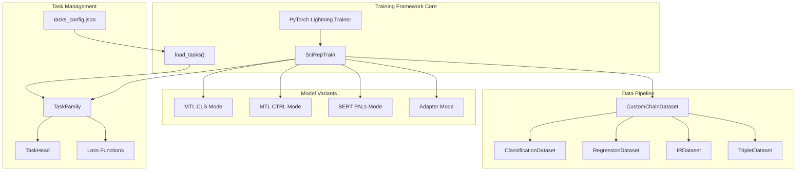
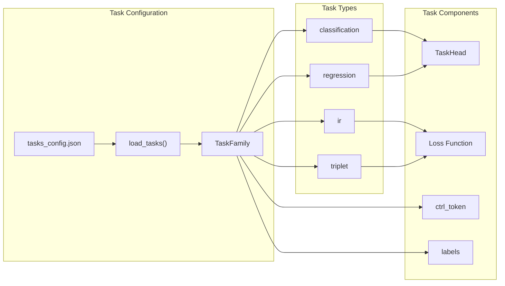
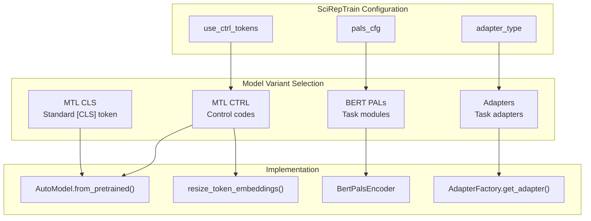
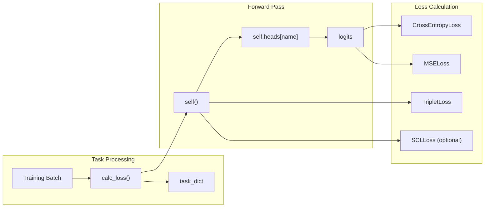
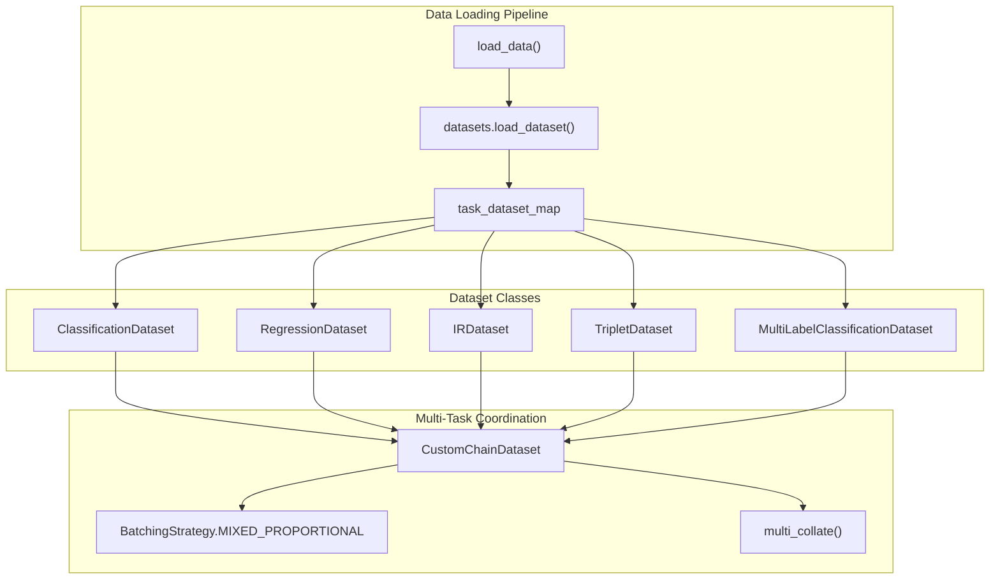
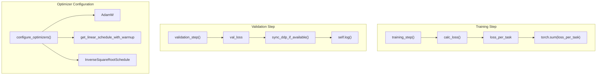

<!-- source: DeepWiki mcp.deepwiki.com · repo allenai/scirepeval · page 4 Training System · fetched 2026-10-26 -->

# Training System

<details>
<summary>Relevant source files</summary>

The following files were used as context for generating this wiki page:

- [evaluation/EVALUATION.md](evaluation/EVALUATION.md)
- [training/TRAINING.md](training/TRAINING.md)
- [training/pl_training.py](training/pl_training.py)
- [training/tasks.py](training/tasks.py)

</details>


The training system provides a PyTorch Lightning-based framework for training multi-task scientific document representation models. This system supports various model architectures including standard multi-task learning, control token-based training, BERT PALs, and adapter-based approaches. The training framework is designed to handle multiple scientific tasks simultaneously with different loss functions and data formats.

For information about evaluating trained models, see [Core Evaluation Framework](#2). For details about model architectures and variants, see [Model Architecture and Variants](#3).

## Training Framework Architecture

The training system is built around the `SciRepTrain` PyTorch Lightning module which orchestrates multi-task training across different scientific document understanding tasks. The framework supports four main model variants and handles task-specific components through a modular design.



Sources: [training/pl_training.py:45-99](), [training/tasks.py:9-36]()

## Task Configuration System

Tasks are defined using JSON configuration files that specify the task type, data sources, labels, and training parameters. The `TaskFamily` class encapsulates each task's configuration and associated components.



### Task Configuration Format

Each task is defined with the following structure:

| Field | Description | Required |
|-------|-------------|----------|
| `name` | Task identifier | Yes |
| `type` | Task type: classification, regression, ir, triplet | Yes |
| `data_files` or `dataset` | Data source specification | Yes |
| `ctrl_token` | Control token or task ID | Yes (for non-CLS variants) |
| `labels` | Label file path (classification only) | Conditional |
| `labels_field` | Label field name | Conditional |
| `multi_label` | Multi-label classification flag | Optional |
| `sample_size` | Sample size limits | Optional |

Sources: [training/TRAINING.md:20-63](), [training/tasks.py:124-151]()

## Model Variants and Training Modes

The training system supports four distinct model variants, each with different architectural approaches to multi-task learning:



### Training Mode Selection

The training mode is determined by command-line arguments:

- **MTL CLS**: Default mode using `[CLS]` token embeddings
- **MTL CTRL**: Enable with `--ctrl-tokens` flag
- **BERT PALs**: Enable with `--pals-config` parameter
- **Adapters**: Enable with `--adapter-type single`
- **Fusion**: Enable with `--adapter-type fusion`

Sources: [training/pl_training.py:65-94](), [training/TRAINING.md:67-89]()

## Loss Functions and Task Heads

The training system implements task-specific loss functions and classification heads based on the task type:

| Task Type | Loss Function | Head Type | Use Case |
|-----------|---------------|-----------|----------|
| Classification | CrossEntropyLoss | TaskHead(num_labels) | Document categorization |
| Multi-label Classification | BCEWithLogitsLoss | TaskHead(num_labels) | Multi-category assignment |
| Regression | MSELoss | TaskHead(1) | Continuous prediction |
| IR/Triplet | TripletLoss | None | Similarity learning |



Sources: [training/pl_training.py:148-179](), [training/tasks.py:38-151]()

## Data Loading and Multi-Task Processing

The training system uses a sophisticated data loading pipeline that handles multiple datasets simultaneously through the `CustomChainDataset` class:



The data loading process supports both HuggingFace datasets and local JSON files, with automatic streaming for large datasets.

Sources: [training/pl_training.py:202-245](), [training/mtl_datasets.py]()

## Training Process Flow

The training process follows the standard PyTorch Lightning workflow with multi-task loss computation:



### Checkpointing and Model Saving

The training system automatically saves model checkpoints and tokenizers:

- Checkpoints saved to `<output>/full_run/<version>/checkpoints/`
- Model and tokenizer saved via `on_save_checkpoint()` callback
- TensorBoard logging enabled by default

Sources: [training/pl_training.py:181-200](), [training/pl_training.py:247-257](), [training/pl_training.py:287-325]()

## Command Line Usage

The training system provides a comprehensive command-line interface through `pl_training.py`:

### Basic Usage Examples

**MTL CLS Training:**
```bash
python pl_training.py --gpu 2 --tasks-config sample_data/tasks_config.json allenai/specter experiment_v1
```

**MTL CTRL Training:**
```bash
python pl_training.py --gpu 2 --ctrl-tokens --tasks-config sample_data/tasks_config.json allenai/specter experiment_ctrl
```

**BERT PALs Training:**
```bash
python pl_training.py --gpu 2 --pals-config pals.config.json --tasks-config sample_data/tasks_config.json allenai/specter experiment_pals
```

**Adapter Training:**
```bash
python pl_training.py --gpu 2 --adapter-type single --tasks-config sample_data/tasks_config.json allenai/specter experiment_adapters
```

### Key Training Parameters

| Parameter | Description | Default |
|-----------|-------------|---------|
| `--batch-size` | Training batch size | 16 |
| `--lr` | Initial learning rate | 1e-4 |
| `--peak-lr` | Peak learning rate | 5e-5 |
| `--warmup` | Warmup steps | 700 |
| `--epochs` | Training epochs | 2 |
| `--grad-accum` | Gradient accumulation steps | 8 |
| `--max-len` | Maximum sequence length | 512 |

Sources: [training/TRAINING.md:67-136](), [training/pl_training.py:259-325]()

---

