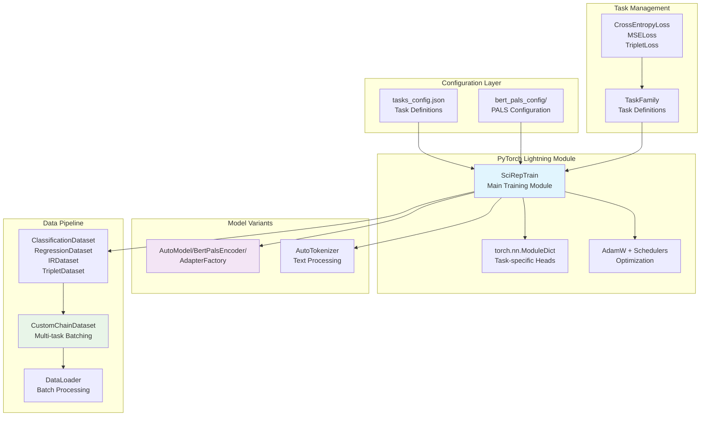
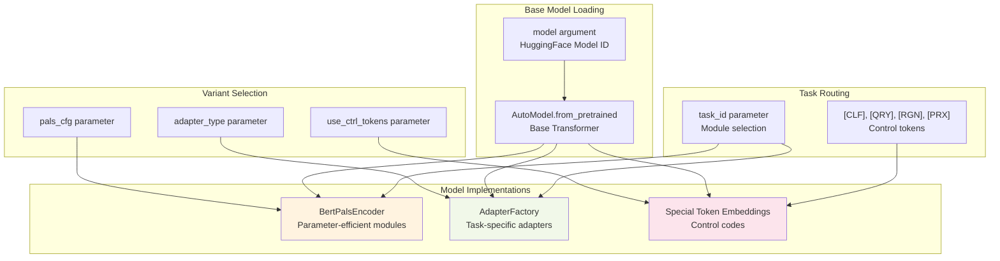
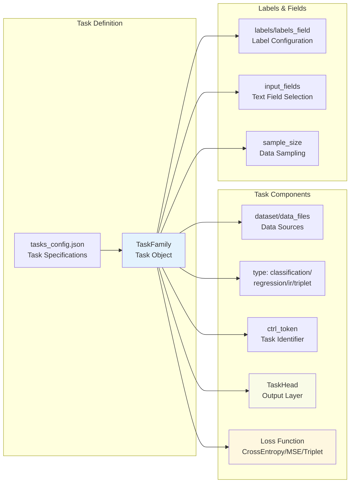
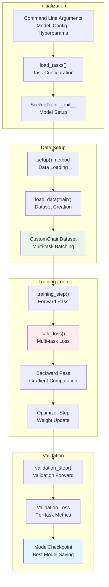

<!-- source: DeepWiki mcp.deepwiki.com · repo allenai/scirepeval · page 4.1 Training Framework · fetched 2026-10-26 -->

# Training Framework

Relevant source files

The following files were used as context for generating this wiki page:

- [evaluation/EVALUATION.md](evaluation/EVALUATION.md)
- [training/TRAINING.md](training/TRAINING.md)
- [training/pl_training.py](training/pl_training.py)
- [training/tasks.py](training/tasks.py)

The training framework provides a comprehensive PyTorch Lightning-based pipeline for training multi-task scientific document representation models. This system supports various model architectures including standard multi-task learning, control token-based variants, parameter-efficient methods like BERT PALs, and adapter-based approaches. For information about evaluating trained models, see [Core Evaluation Framework](#2). For configuration of evaluation tasks, see [Task Configuration and Evaluation](#5).

## Core Training Architecture

The training system is built around the `SciRepTrain` class, which extends PyTorch Lightning's `LightningModule` to provide multi-task learning capabilities with support for different model variants.

**Training Architecture Overview**

Sources: [training/pl_training.py:45-100](), [training/tasks.py:9-36]()

## Multi-Task Learning Framework

The `SciRepTrain` class implements multi-task learning by managing multiple task families simultaneously. Each task has its own head and loss function, while sharing the same encoder backbone.

**Multi-Task Training Components**

| Component | Purpose | Implementation |
|-----------|---------|----------------|
| `task_dict` | Task registry | Maps task names to `TaskFamily` objects |
| `heads` | Task-specific outputs | `torch.nn.ModuleDict` with classification/regression heads |
| `loss_wt` | Task weighting | Tensor for balancing task losses |
| `task_idx` | Task indexing | Maps task names to indices for loss tracking |

The training process supports four task types:
- **Classification**: Categorical prediction with cross-entropy loss
- **Regression**: Continuous prediction with MSE loss  
- **IR (Information Retrieval)**: Triplet-based similarity learning
- **Triplet**: Contrastive learning for embeddings

Sources: [training/pl_training.py:52-60](), [training/tasks.py:124-151]()

## Model Variants Support

The framework supports multiple model architectures through conditional initialization based on configuration flags:

**Model Variant Architecture**

### Supported Variants

1. **MTL CLS**: Standard multi-task learning using `[CLS]` token embeddings
2. **MTL CTRL**: Control token-based routing with special tokens like `[CLF]`, `[QRY]`
3. **BERT PALs**: Parameter-efficient adaptation using task-specific modules
4. **Adapters**: Task-specific adapter modules with single or fusion configurations

Sources: [training/pl_training.py:78-94](), [training/TRAINING.md:4-10]()

## Task Configuration System

Tasks are defined using the `TaskFamily` class and loaded from JSON configuration files. Each task specifies its type, data sources, loss function, and optional parameters.

**Task Configuration Structure**

The `load_tasks` function processes the configuration file and creates `TaskFamily` objects with appropriate heads and loss functions based on task type.

Sources: [training/tasks.py:124-151](), [training/TRAINING.md:16-63]()

## Training Pipeline Flow

The training pipeline follows PyTorch Lightning's structure with custom data loading and loss calculation for multi-task scenarios.

**Training Execution Flow**

The `calc_loss` method handles different task types by routing through appropriate forward passes and loss calculations, supporting both supervised learning (classification/regression) and contrastive learning (IR/triplet) tasks.

Sources: [training/pl_training.py:148-179](), [training/pl_training.py:181-200]()

## Data Loading and Processing

The data pipeline uses streaming datasets from HuggingFace or local files, with task-specific dataset classes handling different input formats.

**Data Processing Components**

| Class | Purpose | Task Types |
|-------|---------|------------|
| `ClassificationDataset` | Label-based learning | Classification |
| `MultiLabelClassificationDataset` | Multi-label classification | Multi-label tasks |
| `RegressionDataset` | Continuous targets | Regression |
| `IRDataset` | Query-candidate pairs | Information retrieval |
| `TripletDataset` | Query-positive-negative | Contrastive learning |

The `CustomChainDataset` combines multiple task datasets with proportional batching strategy, ensuring balanced training across tasks. The `multi_collate` function handles batching of heterogeneous data types.

Sources: [training/pl_training.py:202-235](), [training/mtl_datasets.py:19-20]()

---

