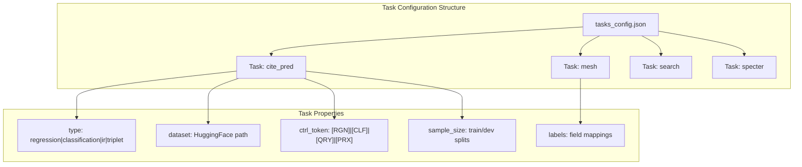
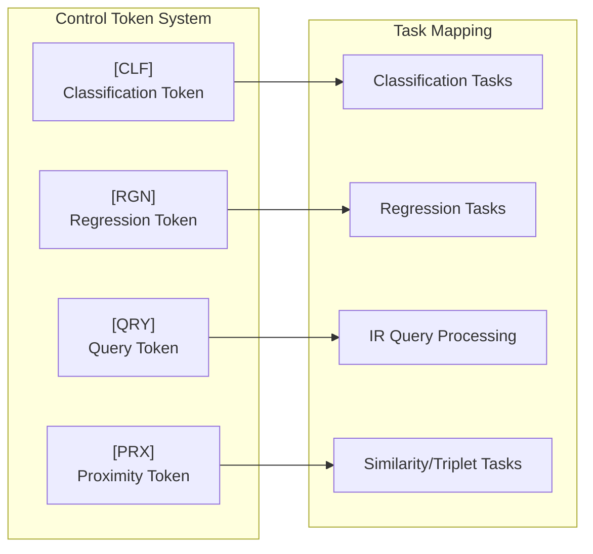
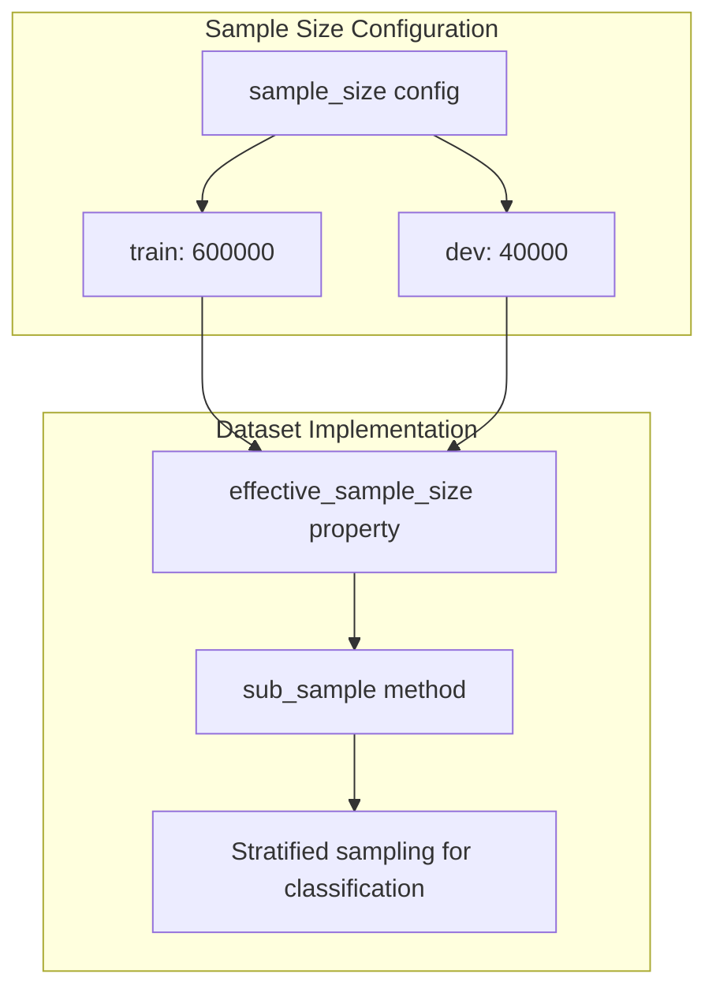
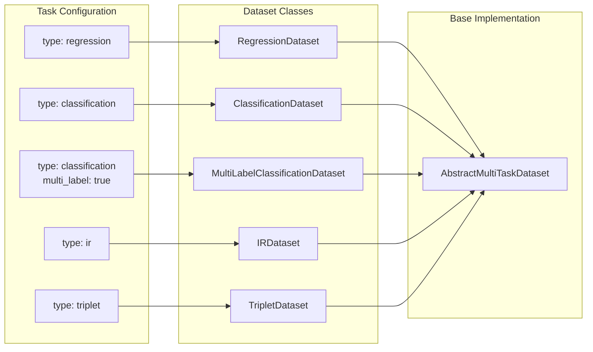
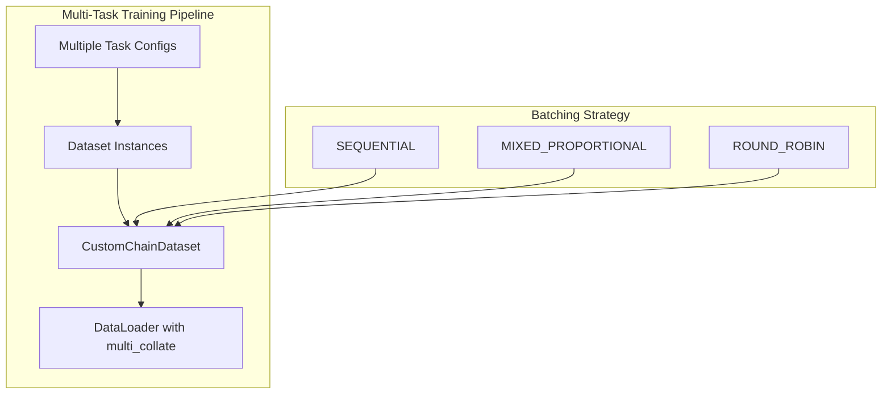

<!-- source: DeepWiki mcp.deepwiki.com · repo allenai/scirepeval · page 4.2 Task Configuration for Training · fetched 2026-10-26 -->

# Task Configuration for Training

<details>
<summary>Relevant source files</summary>

The following files were used as context for generating this wiki page:

- [scirepeval_tasks.jsonl](scirepeval_tasks.jsonl)
- [training/mtl_datasets.py](training/mtl_datasets.py)
- [training/sample_data/tasks_config.json](training/sample_data/tasks_config.json)

</details>


This document covers how to configure training tasks for multi-task learning in the SciRepEval framework. Training task configuration defines the datasets, task types, control tokens, and sampling strategies used during model training.

For information about evaluation task configuration, see [Task Definitions](#5.1). For details about the training framework itself, see [Training Framework](#4.1).

## Configuration File Structure

Training tasks are defined in JSON configuration files, with the primary example being `tasks_config.json`. Each task configuration specifies the dataset, task type, control tokens, and sampling parameters needed for multi-task training.



Sources: [training/sample_data/tasks_config.json:1-116]()

## Task Types and Configurations

The training system supports four primary task types, each with specific configuration requirements and corresponding dataset classes.

### Classification Tasks

Classification tasks use the `ClassificationDataset` or `MultiLabelClassificationDataset` classes depending on whether multi-label classification is enabled.

| Property | Description | Example |
|----------|-------------|---------|
| `type` | Must be "classification" | `"classification"` |
| `labels` | Path to labels file or inline mapping | `"sample_data/mesh_descriptors.txt"` |
| `labels_field` | Field containing the labels | `"descriptor"` |
| `multi_label` | Enable multi-label classification | `true` |
| `ctrl_token` | Control token for classification | `"[CLF]"` |

### Regression Tasks

Regression tasks use the `RegressionDataset` class for continuous value prediction.

| Property | Description | Example |
|----------|-------------|---------|
| `type` | Must be "regression" | `"regression"` |
| `labels_field` | Field containing target values | `"log_citations"` |
| `ctrl_token` | Control token for regression | `"[RGN]"` |

### Information Retrieval Tasks

Information retrieval tasks use the `IRDataset` class for query-document matching with triplet sampling.

| Property | Description | Example |
|----------|-------------|---------|
| `type` | Must be "ir" | `"ir"` |
| `input_fields` | Fields to include in text | `["title", "abstract", "venue", "year"]` |
| `ctrl_token` | Control tokens for query/candidates | `{"query": "[QRY]", "candidates": "[PRX]"}` |

### Triplet Tasks

Triplet tasks use the `TripletDataset` class for learning embeddings with anchor-positive-negative triplets.

| Property | Description | Example |
|----------|-------------|---------|
| `type` | Must be "triplet" | `"triplet"` |
| `ctrl_token` | Control token for triplets | `"[PRX]"` |

Sources: [training/sample_data/tasks_config.json:2-115](), [training/mtl_datasets.py:91-261]()

## Control Tokens and Multi-Task Learning

Control tokens are special tokens prepended to input text to help models distinguish between different task types during multi-task training. The system supports four primary control tokens:



Control tokens can be specified as:
- Single string: `"ctrl_token": "[CLF]"`
- Dictionary for IR tasks: `"ctrl_token": {"query": "[QRY]", "candidates": "[PRX]"}`

The tokens are prepended to text during tokenization in the `tokenized_input` method.

Sources: [training/mtl_datasets.py:80-82](), [training/sample_data/tasks_config.json:10,24,40,56,70]()

## Dataset Configuration

Each task specifies its data source through the `dataset` property, which points to HuggingFace datasets or local files.

### HuggingFace Dataset Configuration

```json
{
  "dataset": {
    "path": "allenai/scirepeval",
    "name": "cite_count"
  }
}
```

### Field Selection

For tasks requiring specific input fields, use the `input_fields` property:

```json
{
  "input_fields": ["title", "abstract", "venue", "year"]
}
```

If not specified, default fields `["title", "abstract"]` are used.

Sources: [training/sample_data/tasks_config.json:5-8,34-37,65-68](), [training/mtl_datasets.py:72-78]()

## Sample Size Management

Sample sizes control the amount of data used for each task during training and development, enabling balanced multi-task learning.



### Sample Size Behavior

- **-1**: Use complete dataset
- **Positive integer**: Sample specified number of examples
- **Stratified sampling**: Applied for classification tasks to maintain label distribution
- **IR adjustment**: IR datasets automatically divide sample size by 5 due to triplet generation

Sources: [training/mtl_datasets.py:33-44,108-121,135-150,158](), [training/sample_data/tasks_config.json:11-14,25-28]()

## Configuration to Dataset Class Mapping

The training system maps task configurations to appropriate dataset classes based on the task type.



### Dataset Class Features

- **`AbstractMultiTaskDataset`**: Base class providing tokenization and sampling
- **`ClassificationDataset`**: Handles label mapping and stratified sampling
- **`MultiLabelClassificationDataset`**: Extends classification with `MultiLabelBinarizer`
- **`RegressionDataset`**: Processes continuous target values
- **`IRDataset`**: Generates query-positive-negative triplets with batching
- **`TripletDataset`**: Handles pre-formed triplet data

Sources: [training/mtl_datasets.py:22-261]()

## Multi-Task Dataset Combination

Training combines multiple task datasets using the `CustomChainDataset` class, which supports different batching strategies and distributed training.



The `multi_collate` function groups batched data by task name, enabling task-specific processing during training.

Sources: [training/mtl_datasets.py:214-246,262-266]()

---

