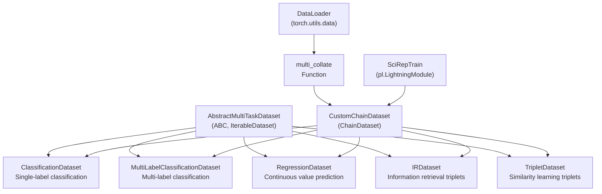
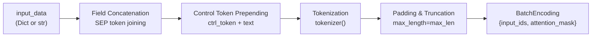
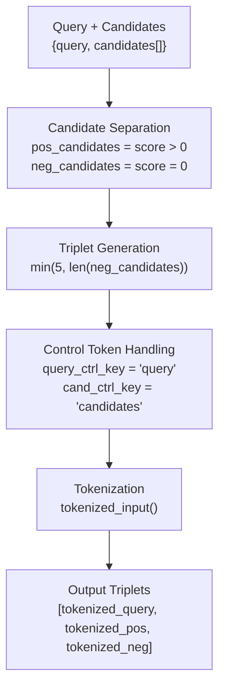
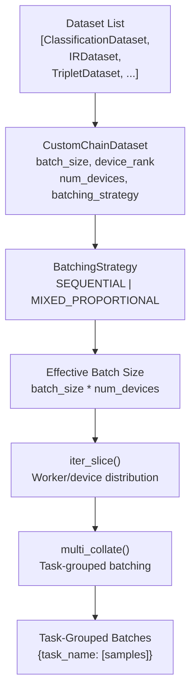
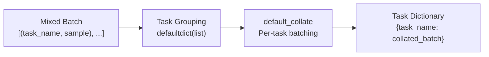
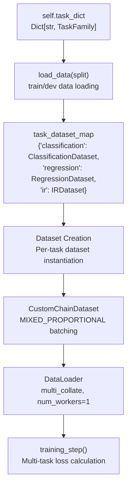

<!-- source: DeepWiki mcp.deepwiki.com · repo allenai/scirepeval · page 4.3 Multi-Task Dataset Handling · fetched 2026-10-26 -->

# Multi-Task Dataset Handling

<details>
<summary>Relevant source files</summary>

The following files were used as context for generating this wiki page:

- [scirepeval_tasks.jsonl](scirepeval_tasks.jsonl)
- [training/mtl_datasets.py](training/mtl_datasets.py)
- [training/pl_training.py](training/pl_training.py)
- [training/tasks.py](training/tasks.py)

</details>


This document covers the data loading and preprocessing infrastructure for multi-task training scenarios in SciRepEval. The system provides unified dataset classes that can handle different task types (classification, regression, information retrieval, triplet learning) simultaneously during training, enabling efficient multi-task learning with PyTorch Lightning.

For information about evaluation dataset handling, see [Dataset Handling](#2.3). For the overall training framework context, see [Training Framework](#4.1). For task configuration details, see [Task Configuration for Training](#4.2).

## Dataset Architecture Overview

The multi-task dataset system is built around an abstract base class that provides common functionality, with specialized implementations for different task types. All datasets integrate seamlessly with PyTorch's data loading infrastructure.

**Multi-Task Dataset Class Hierarchy**



Sources: [training/mtl_datasets.py:22-68](), [training/mtl_datasets.py:214-246](), [training/mtl_datasets.py:262-267](), [training/pl_training.py:202-235]()

## Abstract Base Class

The `AbstractMultiTaskDataset` class provides the foundation for all task-specific datasets. It handles common functionality including tokenization, control token management, and sampling strategies.

**Key Components:**

| Component | Purpose | Location |
|-----------|---------|----------|
| `task_name` | Task identifier for multi-task batching | [training/mtl_datasets.py:26]() |
| `data` | HuggingFace dataset instance | [training/mtl_datasets.py:27]() |
| `tokenizer` | PreTrainedTokenizer for text processing | [training/mtl_datasets.py:28]() |
| `fields` | Input text fields to concatenate | [training/mtl_datasets.py:29]() |
| `ctrl_token` | Control tokens for task identification | [training/mtl_datasets.py:31]() |
| `max_len` | Maximum sequence length | [training/mtl_datasets.py:32]() |

**Text Processing Pipeline:**



The `tokenized_input` method handles the complete text preprocessing pipeline, including field concatenation with SEP tokens and optional control token prepending for task identification.

Sources: [training/mtl_datasets.py:69-89](), [training/mtl_datasets.py:45-67]()

## Task-Specific Dataset Classes

### Classification Datasets

**ClassificationDataset** handles single-label classification tasks with stratified sampling to maintain label distribution during subsampling.

```python
# Example from mtl_datasets.py
def label_transform(self, label_raw: str) -> Union[int, np.ndarray]:
    return self.labels[label_raw]

def preprocess(self, line: Dict[str, str]) -> Tuple[str, BatchEncoding, int]:
    label = line[self.label_field]
    input_ids = self.tokenized_input(line)
    return self.task_name, input_ids, self.label_transform(label)
```

**MultiLabelClassificationDataset** extends classification for multi-label scenarios using `MultiLabelBinarizer` and `IterativeStratification` for balanced sampling.

Sources: [training/mtl_datasets.py:91-121](), [training/mtl_datasets.py:123-151]()

### Information Retrieval Datasets

**IRDataset** processes query-candidate pairs for information retrieval tasks, generating multiple triplets (query, positive, negative) from each input sample.

**IR Dataset Processing Flow:**



The dataset reduces effective sample size by 5x since each input generates multiple triplets, and includes shuffling through `postprocess_iter` for better training dynamics.

Sources: [training/mtl_datasets.py:153-198]()

### Triplet and Regression Datasets

**TripletDataset** handles direct triplet inputs for similarity learning, while **RegressionDataset** processes continuous value prediction tasks with float32 label conversion.

Sources: [training/mtl_datasets.py:200-212](), [training/mtl_datasets.py:248-260]()

## Multi-Task Data Loading

The `CustomChainDataset` enables simultaneous loading from multiple task datasets with configurable batching strategies and distributed training support.

**Multi-Task Batching Architecture:**



**Distributed Training Slicing:**

The `iter_slice` method ensures proper data distribution across devices and workers:

```python
# Key logic from CustomChainDataset.iter_slice
for i, x in curr_batch.items():
    if (i // self.batch_size) % self.num_devices == self.device_rank:
        if (i // self.effective_batch_size) % worker_info.num_workers == worker_info.id:
            yield x
```

Sources: [training/mtl_datasets.py:214-246](), [training/mtl_datasets.py:224-237]()

## Batching and Collation

The `multi_collate` function groups samples by task name and applies PyTorch's default collation within each task group, enabling efficient multi-task batch processing.

**Collation Process:**



This design allows the training loop to process different task types simultaneously while maintaining task-specific batch structures.

Sources: [training/mtl_datasets.py:262-267]()

## Integration with Training Pipeline

The multi-task datasets integrate with the `SciRepTrain` PyTorch Lightning module through the `load_data` method, which dynamically creates appropriate dataset instances based on task configuration.

**Training Integration Flow:**



The system automatically handles:
- HuggingFace dataset loading with streaming support
- Control token management for task identification  
- Sample size limiting per task
- Multi-label vs single-label classification detection
- Distributed training data distribution

Sources: [training/pl_training.py:202-235](), [training/pl_training.py:239-245]()

---

