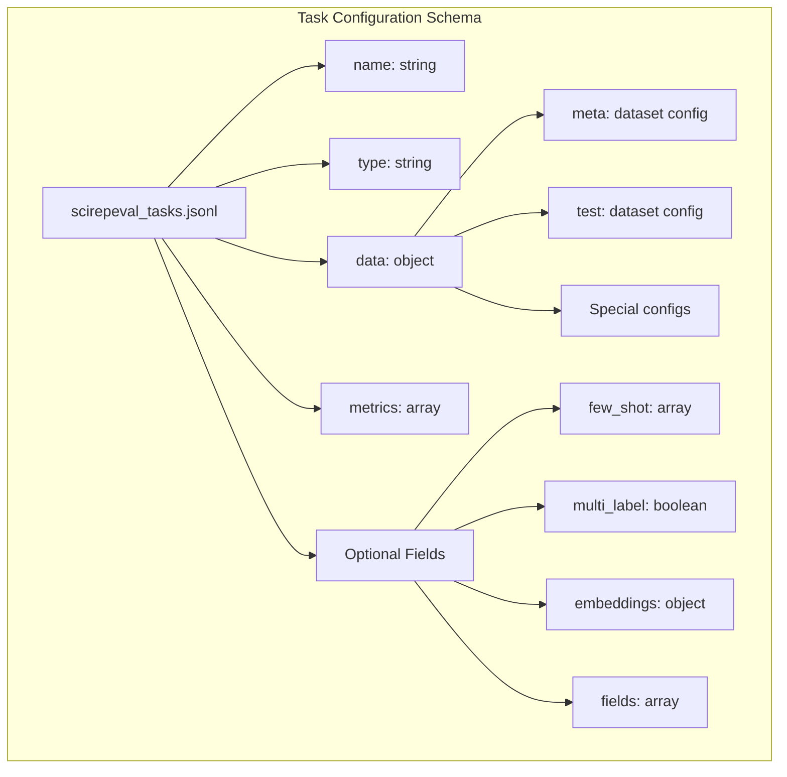
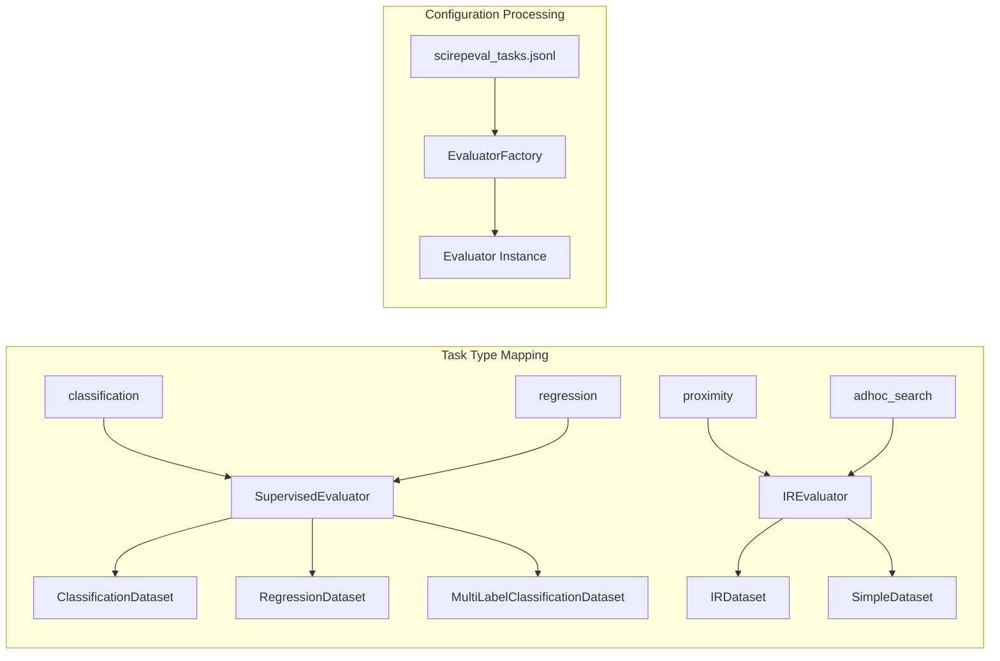
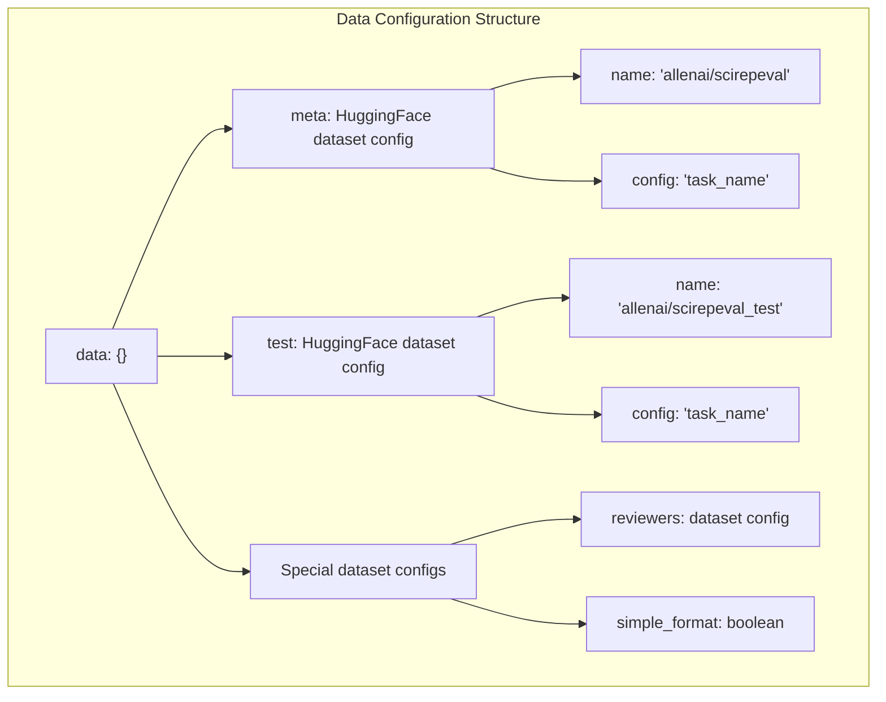
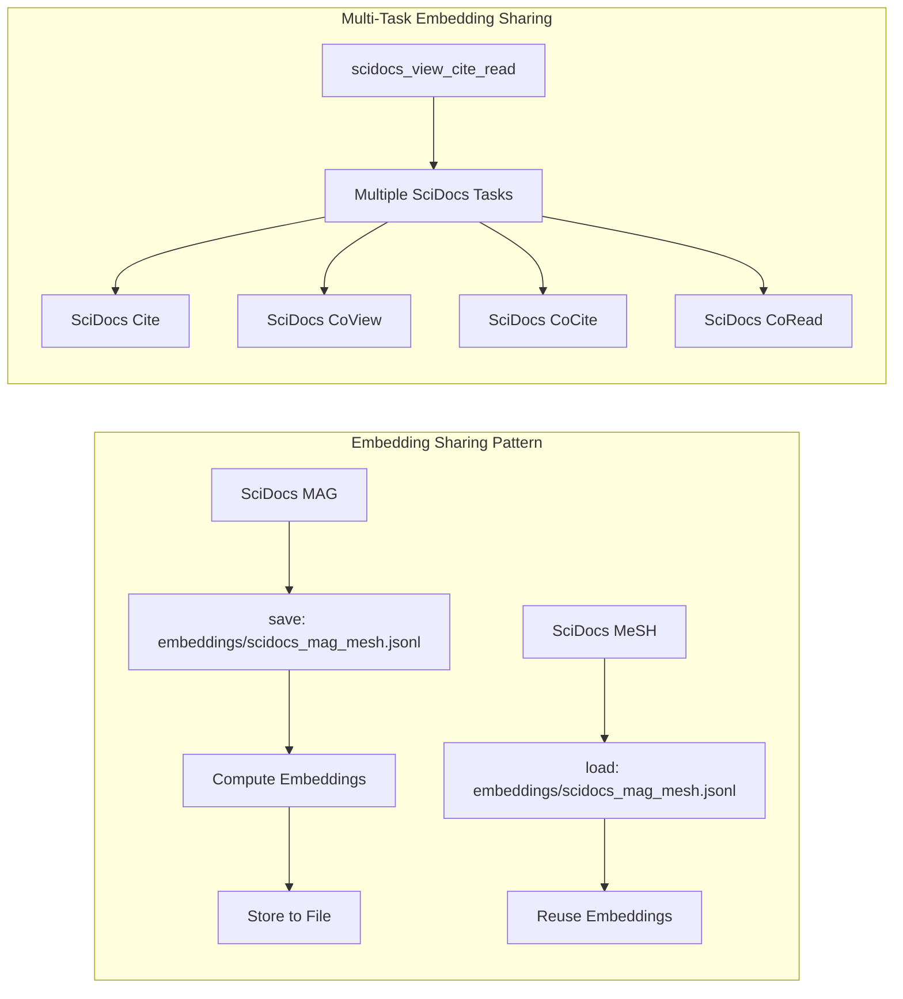
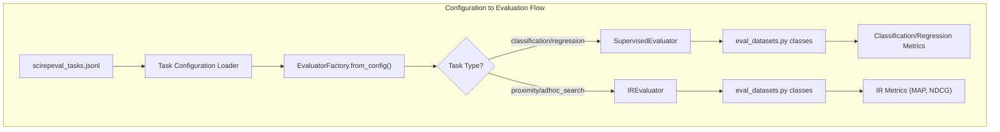

<!-- source: DeepWiki mcp.deepwiki.com · repo allenai/scirepeval · page 5 Task Configuration and Evaluation · fetched 2026-10-26 -->

# Task Configuration and Evaluation

<details>
<summary>Relevant source files</summary>

The following files were used as context for generating this wiki page:

- [scirepeval_tasks.jsonl](scirepeval_tasks.jsonl)
- [training/mtl_datasets.py](training/mtl_datasets.py)

</details>


This document covers how evaluation tasks are defined and configured in SciRepEval using the JSONL configuration format. The task configuration system provides a declarative way to specify evaluation tasks, their data sources, metrics, and specialized parameters. For information about the actual evaluation execution and orchestration, see [Core Evaluation Framework](#2). For details about training task configuration, see [Task Configuration for Training](#4.2).

## Task Configuration Format

The primary task configuration is defined in `scirepeval_tasks.jsonl`, where each line represents a single evaluation task in JSON format. This file serves as the central registry for all available evaluation tasks and their parameters.

### Basic Task Structure

Each task configuration follows a standard schema with required and optional fields:



**Sources:** [scirepeval_tasks.jsonl:1-23]()

### Task Name and Type Mapping

The task configuration system maps task types to specific evaluator classes and dataset handlers:



**Sources:** [scirepeval_tasks.jsonl:1-23](), [training/mtl_datasets.py:91-261]()

## Task Types and Their Configurations

### Classification Tasks

Classification tasks support both single-label and multi-label scenarios with optional few-shot evaluation:

| Task Example | Configuration Fields | Special Features |
|--------------|---------------------|------------------|
| Biomimicry | `"type": "classification"`, `"metrics": ["f1"]` | Few-shot support |
| Fields of Study | `"multi_label": true`, `"metrics": ["f1_macro"]` | Multi-label classification |
| SciDocs MAG | `"embeddings": {"save": "path"}` | Embedding caching |

**Few-shot Configuration:**
```json
"few_shot": [
  {"sample_size": 64, "iterations": 50},
  {"sample_size": 16, "iterations": 100}
]
```

### Regression Tasks

Regression tasks predict continuous values and typically use correlation-based metrics:

| Task Example | Metric | Data Configuration |
|--------------|--------|-------------------|
| Peer Review Score | `kendalltau` | Uses h-index metadata |
| Citation Count | `kendalltau` | Standard text fields |
| Publication Year | `kendalltau` | Temporal prediction |

### Proximity Tasks

Proximity tasks evaluate document similarity and relatedness using information retrieval metrics:

| Task Example | Metrics | Special Configuration |
|--------------|---------|----------------------|
| RELISH | `["ndcg"]` | Document pairs |
| SciDocs Cite | `["map", "ndcg"]` | Simple format flag |
| Paper-Reviewer Matching | `["P_5", "P_10"]` | Reviewer dataset |

### Ad-hoc Search Tasks

Search tasks evaluate query-document retrieval performance:

| Task Example | Fields | Metrics |
|--------------|--------|---------|
| Search | `["title", "abstract", "venue", "year"]` | `["ndcg"]` |
| NFCorpus | Standard fields | `["ndcg"]` |
| TREC-CoVID | Standard fields | `["ndcg"]` |

**Sources:** [scirepeval_tasks.jsonl:1-23]()

## Data Source Configuration

### Dataset Source Structure

The `data` field specifies how to load training metadata and test data:



### HuggingFace Dataset Integration

Most tasks use the standard HuggingFace dataset pattern:

```json
"data": {
  "meta": {"name": "allenai/scirepeval", "config": "biomimicry"},
  "test": {"name": "allenai/scirepeval_test", "config": "biomimicry"}
}
```

The `meta` dataset provides training data for computing embeddings or training classifiers, while `test` contains the actual evaluation data.

### Special Dataset Configurations

Some tasks require additional dataset specifications:

**Paper-Reviewer Matching:**
```json
"data": {
  "meta": {"name": "allenai/scirepeval", "config": "paper_reviewer_matching"},
  "test": {"name": "allenai/scirepeval_test", "config": "paper_reviewer_matching"},
  "reviewers": {"name": "allenai/scirepeval_test", "config": "reviewers"}
}
```

**SciDocs with Simple Format:**
```json
"data": {
  "simple_format": true,
  "meta": {"name": "allenai/scirepeval", "config": "scidocs_view_cite_read"},
  "test": {"name": "allenai/scirepeval_test", "config": "scidocs_cite"}
}
```

**Sources:** [scirepeval_tasks.jsonl:6-15]()

## Embedding Management

### Embedding Save and Load Configuration

The embedding configuration system allows sharing embeddings across related tasks to improve efficiency:



### Embedding Configuration Examples

**Save embeddings:**
```json
"embeddings": {"save": "embeddings/peer_review_score_hIndex.jsonl"}
```

**Load existing embeddings:**
```json
"embeddings": {"load": "embeddings/peer_review_score_hIndex.jsonl"}
```

This system allows expensive embedding computation to be shared across multiple evaluation tasks that use the same metadata.

**Sources:** [scirepeval_tasks.jsonl:7-15]()

## Integration with Evaluation Pipeline

### Configuration Loading and Processing

The task configuration flows through the evaluation system as follows:



### Field Configuration

Tasks can specify which document fields to use for embedding generation:

```json
"fields": ["title", "abstract", "venue", "year"]
```

When not specified, tasks default to using title and abstract fields. This configuration is particularly important for search tasks that may benefit from additional metadata fields.

### Metric Configuration

Each task specifies the evaluation metrics to compute:

| Metric Type | Usage | Example Tasks |
|-------------|-------|---------------|
| `f1` | Binary classification | Biomimicry |
| `f1_macro` | Multi-class/multi-label | DRSM, Fields of Study |
| `kendalltau` | Regression correlation | Citation Count, Publication Year |
| `ndcg` | Ranking quality | Search, RELISH |
| `map` | Information retrieval | SciDocs Cite, Same Author |
| `P_5`, `P_10` | Precision at K | Paper-Reviewer Matching |

**Sources:** [scirepeval_tasks.jsonl:1-23](), [training/mtl_datasets.py:22-68]()

---

