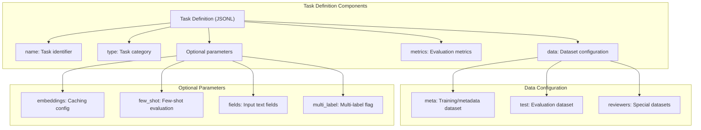
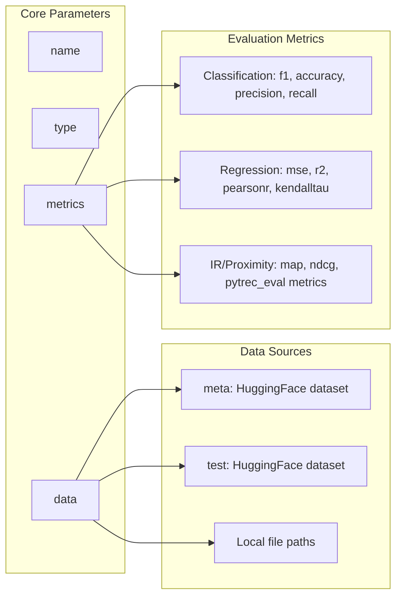
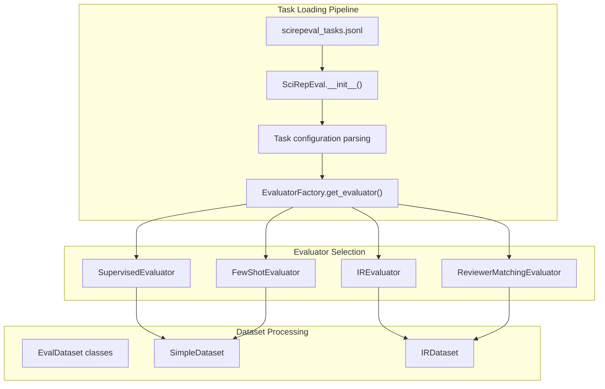

<!-- source: DeepWiki mcp.deepwiki.com · repo allenai/scirepeval · page 5.1 Task Definitions · fetched 2026-10-26 -->

# Task Definitions

<details>
<summary>Relevant source files</summary>

The following files were used as context for generating this wiki page:

- [evaluation/EVALUATION.md](evaluation/EVALUATION.md)
- [scirepeval_tasks.jsonl](scirepeval_tasks.jsonl)
- [training/TRAINING.md](training/TRAINING.md)
- [training/mtl_datasets.py](training/mtl_datasets.py)

</details>


This document covers the structure and format of task definitions used to configure evaluation tasks in SciRepEval. Task definitions specify how scientific document representation models are evaluated across different types of tasks, including the datasets, metrics, and evaluation parameters to use.

For information about training task configuration, see [Task Configuration for Training](#4.2). For details about how task definitions are processed during evaluation, see [Main Orchestration](#2.2).

## Overview

Task definitions in SciRepEval are specified in JSONL (JSON Lines) format, with each line representing a complete task configuration. The primary task definition file is `scirepeval_tasks.jsonl`, which contains all evaluation tasks used in the SciRepEval benchmark. These definitions are loaded and processed by the evaluation system to coordinate model assessment across diverse scientific document understanding tasks.

### Task Definition Structure



Sources: [scirepeval_tasks.jsonl:1-23](), [evaluation/EVALUATION.md:14-48]()

## Task Types and Configuration

SciRepEval supports four primary task types, each with specific configuration requirements and evaluation approaches:

| Task Type | Description | Metrics | Special Parameters |
|-----------|-------------|---------|-------------------|
| `classification` | Document categorization tasks | f1, accuracy, precision, recall, f1_macro, f1_micro | `multi_label`, `few_shot` |
| `regression` | Continuous value prediction | mse, r2, pearsonr, kendalltau | None |
| `proximity` | Document similarity/retrieval | map, ndcg | `simple_format` |
| `adhoc_search` | Text query to document retrieval | ndcg | `fields` |

### Classification Tasks

```json
{
    "name": "Biomimicry",
    "type": "classification",
    "data": {
        "meta": {"name": "allenai/scirepeval", "config": "biomimicry"},
        "test": {"name": "allenai/scirepeval_test", "config": "biomimicry"}
    },
    "metrics": ["f1"],
    "few_shot": [
        {"sample_size": 64, "iterations": 50},
        {"sample_size": 16, "iterations": 100}
    ]
}
```

Multi-label classification tasks include the `multi_label` flag:

```json
{
    "name": "Fields of study",
    "type": "classification",
    "multi_label": true,
    "metrics": ["f1_macro"]
}
```

Sources: [scirepeval_tasks.jsonl:1-2](), [scirepeval_tasks.jsonl:21-22](), [evaluation/EVALUATION.md:15-47]()

### Regression Tasks

```json
{
    "name": "Citation Count",
    "type": "regression",
    "data": {
        "meta": {"name": "allenai/scirepeval", "config": "cite_count"},
        "test": {"name": "allenai/scirepeval_test", "config": "cite_count"}
    },
    "metrics": ["kendalltau"]
}
```

Sources: [scirepeval_tasks.jsonl:19-20]()

### Proximity Tasks

```json
{
    "name": "SciDocs Cite",
    "type": "proximity",
    "data": {
        "simple_format": true,
        "meta": {"name": "allenai/scirepeval", "config": "scidocs_view_cite_read"},
        "test": {"name": "allenai/scirepeval_test", "config": "scidocs_cite"}
    },
    "metrics": ["map", "ndcg"]
}
```

Sources: [scirepeval_tasks.jsonl:12-15]()

### Ad-hoc Search Tasks

```json
{
    "name": "Search",
    "type": "adhoc_search",
    "data": {
        "meta": {"name": "allenai/scirepeval", "config": "search"},
        "test": {"name": "allenai/scirepeval_test", "config": "search"}
    },
    "fields": ["title", "abstract", "venue", "year"],
    "metrics": ["ndcg"]
}
```

Sources: [scirepeval_tasks.jsonl:18]()

## Configuration Parameters

### Core Parameters



Sources: [evaluation/EVALUATION.md:51-63]()

### Optional Parameters

**Embedding Caching**: Tasks can specify embedding save/load paths to avoid recomputation:

```json
{
    "embeddings": {"save": "embeddings/peer_review_score_hIndex.jsonl"}
}
```

```json
{
    "embeddings": {"load": "embeddings/scidocs_mag_mesh.jsonl"}
}
```

**Few-shot Evaluation**: Classification tasks can specify few-shot evaluation parameters:

```json
{
    "few_shot": [
        {"sample_size": 64, "iterations": 50},
        {"sample_size": 16, "iterations": 100}
    ]
}
```

**Input Fields**: Ad-hoc search tasks can specify which document fields to use:

```json
{
    "fields": ["title", "abstract", "venue", "year"]
}
```

Sources: [scirepeval_tasks.jsonl:7-8](), [scirepeval_tasks.jsonl:1-2](), [scirepeval_tasks.jsonl:18]()

## Task Definition Processing

The evaluation system processes task definitions through several components:



Sources: [evaluation/evaluator.py](), [evaluation/eval_datasets.py](), [scirepeval.py]()

### Task Type to Evaluator Mapping

The `EvaluatorFactory` maps task types to specific evaluator classes:

| Task Type | Evaluator Class | Dataset Class |
|-----------|-----------------|---------------|
| `classification` | `SupervisedEvaluator` | `SimpleDataset` |
| `regression` | `SupervisedEvaluator` | `SimpleDataset` |
| `proximity` | `IREvaluator` | `IRDataset` |
| `adhoc_search` | `IREvaluator` | `IRDataset` |

Special cases:
- Paper-Reviewer Matching uses `ReviewerMatchingEvaluator`
- Few-shot evaluation wraps tasks with `FewShotEvaluator`

Sources: [evaluation/evaluator.py]()

## Relationship to Training Configuration

While evaluation tasks use the `scirepeval_tasks.jsonl` format, training tasks use a different but related configuration format in `tasks_config.json`. The training format includes additional parameters for model training:

**Training Task Example**:
```json
{
    "name": "fos",
    "type": "classification",
    "multi_label": true,
    "data_files": {
        "train": "<path>/train.jsonl",
        "dev": "<path>/val.jsonl"
    },
    "labels": "sample_data/fos_labels.txt",
    "labels_field": "labels_text",
    "ctrl_token": "[CLF]"
}
```

**Key Differences**:
- Training configs include `data_files`, `labels`, `labels_field`, `ctrl_token`
- Evaluation configs include `metrics`, `embeddings`, `few_shot` parameters
- Training supports additional task types: `ir` and `triplet`

Sources: [training/TRAINING.md:20-54](), [training/mtl_datasets.py:91-212]()

---

