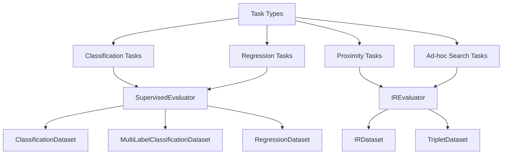
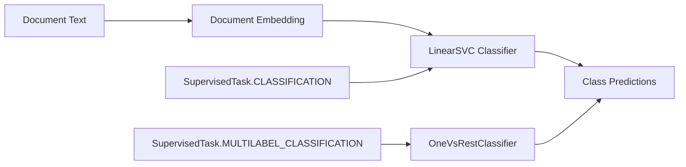
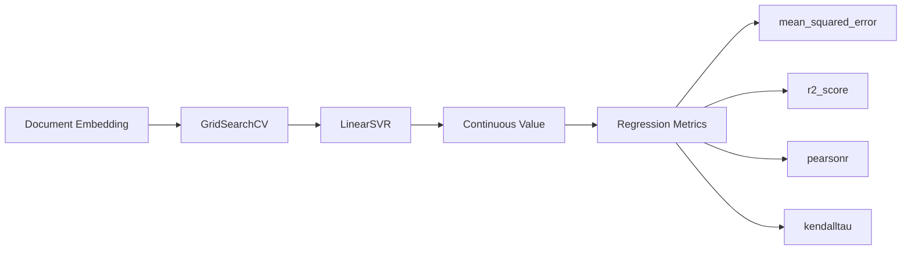
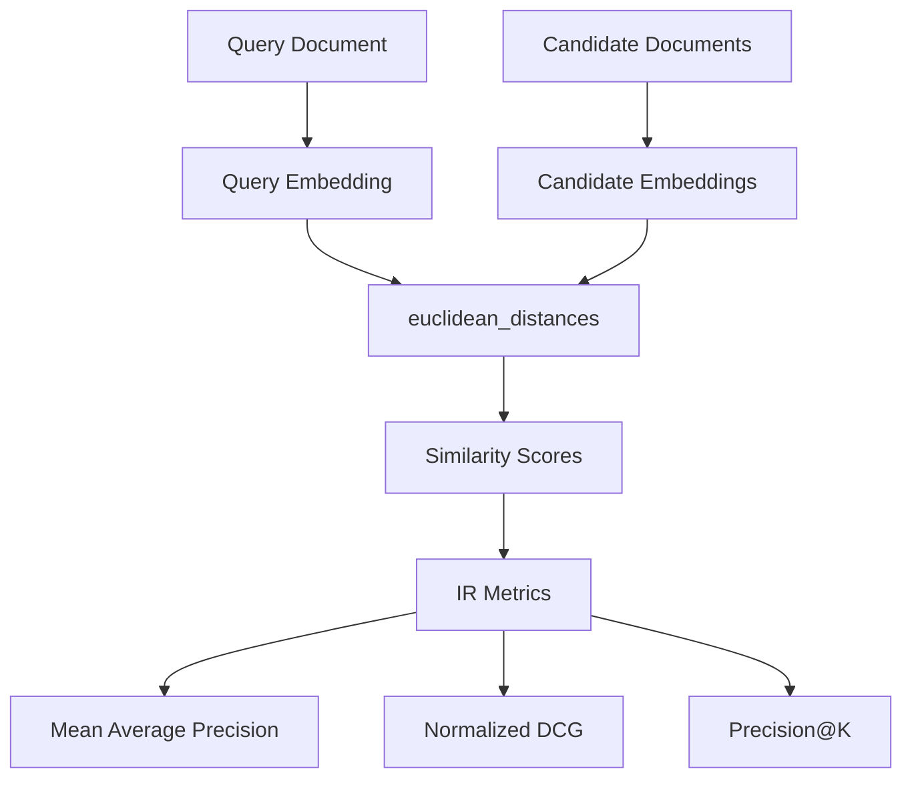
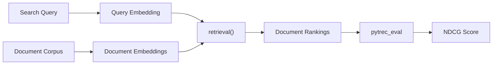
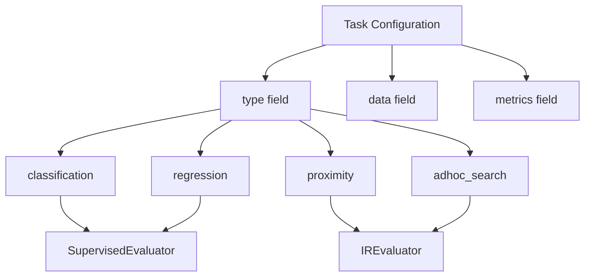
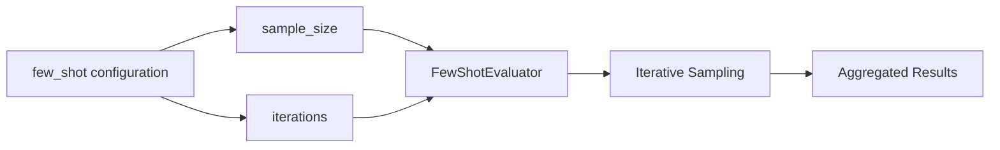

<!-- source: DeepWiki mcp.deepwiki.com · repo allenai/scirepeval · page 5.2 Supported Task Types · fetched 2026-10-26 -->

# Supported Task Types

Relevant source files

The following files were used as context for generating this wiki page:

- [evaluation/evaluator.py](evaluation/evaluator.py)
- [scirepeval_tasks.jsonl](scirepeval_tasks.jsonl)
- [training/mtl_datasets.py](training/mtl_datasets.py)

This document describes the different types of evaluation tasks supported by SciRepEval and how they are implemented in the framework. SciRepEval supports four main categories of tasks: classification, regression, proximity, and ad-hoc search. Each task type uses specific evaluators and dataset classes to assess model performance on scientific document representation tasks.

For information about how tasks are configured and defined, see [Task Definitions](#5.1). For details about the evaluator implementations, see [Evaluator Classes](#2.1).

## Task Type Overview

SciRepEval organizes evaluation tasks into four primary categories, each designed to assess different aspects of scientific document representation quality:

**Sources:** [evaluation/evaluator.py:66-77](), [training/mtl_datasets.py:91-261](), [scirepeval_tasks.jsonl:1-22]()

## Classification Tasks

Classification tasks evaluate how well document embeddings capture categorical properties of scientific papers. These tasks use the `SupervisedEvaluator` with either single-label or multi-label classification modes.

### Single-Label Classification

Single-label classification tasks assign exactly one category to each document. Examples include:

| Task Name | Description | Metric |
|-----------|-------------|---------|
| Biomimicry | Classify papers by biomimetic research area | f1 |
| DRSM | Document classification for research domain | f1_macro |
| SciDocs MAG | Microsoft Academic Graph subject classification | f1_macro |
| SciDocs MeSH | Medical Subject Headings classification | f1_macro |

### Multi-Label Classification  

Multi-label classification allows multiple categories per document:

| Task Name | Description | Metric |
|-----------|-------------|---------|
| Fields of Study | Assign multiple research fields | f1_macro |
| MeSH | Medical Subject Headings (multi-label) | f1_macro |

**Sources:** [evaluation/evaluator.py:66-77](), [evaluation/evaluator.py:118-134](), [training/mtl_datasets.py:91-151](), [scirepeval_tasks.jsonl:1-2,10-11,21-22]()

## Regression Tasks

Regression tasks predict continuous numerical values from document embeddings, such as citation counts or publication years. These use `SupervisedEvaluator` with `SupervisedTask.REGRESSION`.

| Task Name | Description | Metric |
|-----------|-------------|---------|
| Peer Review Score | Predict peer review ratings | kendalltau |
| Max hIndex | Predict maximum h-index of authors | kendalltau |
| Tweet Mentions | Predict social media attention | kendalltau |
| Citation Count | Predict future citation counts | kendalltau |
| Publication Year | Predict publication year | kendalltau |

The regression evaluator uses `LinearSVR` with grid search cross-validation for hyperparameter tuning:

**Sources:** [evaluation/evaluator.py:136-143](), [evaluation/evaluator.py:72-77](), [training/mtl_datasets.py:248-260](), [scirepeval_tasks.jsonl:7-9,19-20]()

## Proximity Tasks

Proximity tasks evaluate how well embeddings capture semantic relationships between documents. These use `IREvaluator` to perform information retrieval-style evaluation using cosine similarity.

| Task Category | Tasks | Metrics |
|---------------|-------|---------|
| Citation Relationships | SciDocs Cite, SciDocs CoCite, High Influence Citations | map, ndcg |
| Co-engagement | SciDocs CoView, SciDocs CoRead | map, ndcg |
| Similarity Detection | RELISH, Same Author Detection | ndcg, map |
| Reviewer Matching | Paper-Reviewer Matching | P_5, P_10 |

The proximity evaluation process uses euclidean distance for similarity scoring:

**Sources:** [evaluation/evaluator.py:218-229](), [evaluation/evaluator.py:189-200](), [scirepeval_tasks.jsonl:3,6,12-17]()

## Ad-hoc Search Tasks

Ad-hoc search tasks evaluate document retrieval capabilities using query-document pairs. These tasks use `IREvaluator` similar to proximity tasks but focus on search relevance.

| Task Name | Description | Metric |
|-----------|-------------|---------|
| NFCorpus | Nutrition document retrieval | ndcg |
| TREC-CoVID | COVID-19 literature search | ndcg |
| Search | General scientific paper search | ndcg |

**Sources:** [evaluation/evaluator.py:202-216](), [evaluation/evaluator.py:189-200](), [scirepeval_tasks.jsonl:4-5,18]()

## Task Configuration Schema

Tasks are defined in `scirepeval_tasks.jsonl` with a standardized schema that maps to specific evaluator classes:

### Task Type Mapping

The task type field determines which evaluator class handles the task:

| Task Type | Evaluator Class | Dataset Class | Supported Metrics |
|-----------|----------------|---------------|------------------|
| `"classification"` | `SupervisedEvaluator` | `SimpleDataset` | f1, accuracy, precision, recall |
| `"regression"` | `SupervisedEvaluator` | `SimpleDataset` | mse, r2, pearsonr, kendalltau |
| `"proximity"` | `IREvaluator` | `IRDataset` | map, ndcg, P_5, P_10 |
| `"adhoc_search"` | `IREvaluator` | `IRDataset` | ndcg, map |

**Sources:** [scirepeval_tasks.jsonl:1-22](), [evaluation/evaluator.py:80-88](), [evaluation/evaluator.py:173-178]()

## Few-Shot Learning Support

Some classification tasks support few-shot evaluation with configurable sample sizes and iterations:

Example few-shot configurations from the task definitions:
- Biomimicry: 64 samples (50 iterations), 16 samples (100 iterations)
- Fields of Study: 10 samples (50 iterations), 5 samples (100 iterations)

**Sources:** [scirepeval_tasks.jsonl:1,21](), [evaluation/evaluator.py:108-121]()

---

