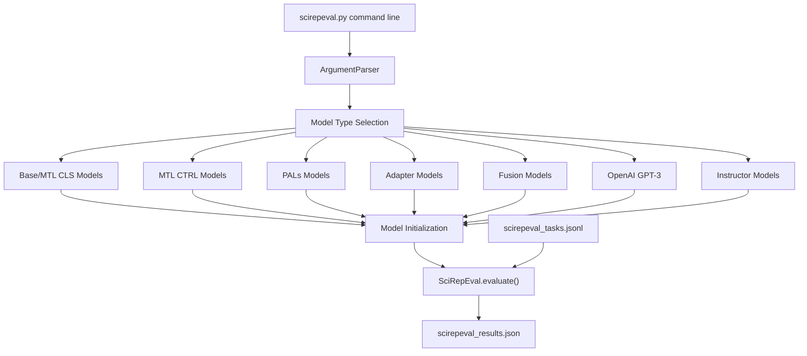
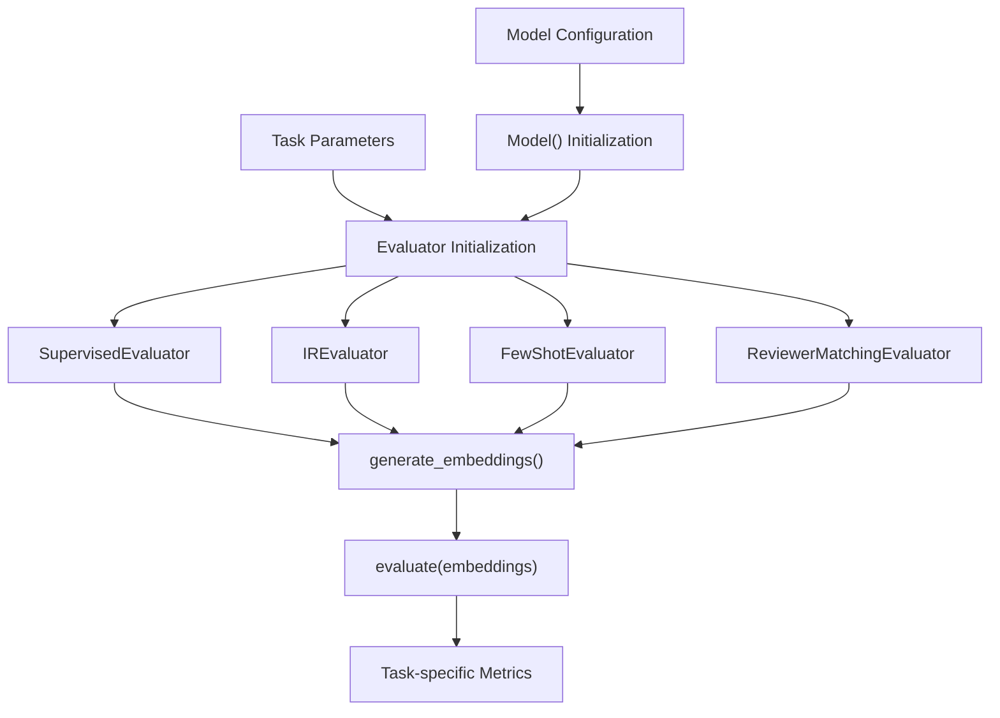
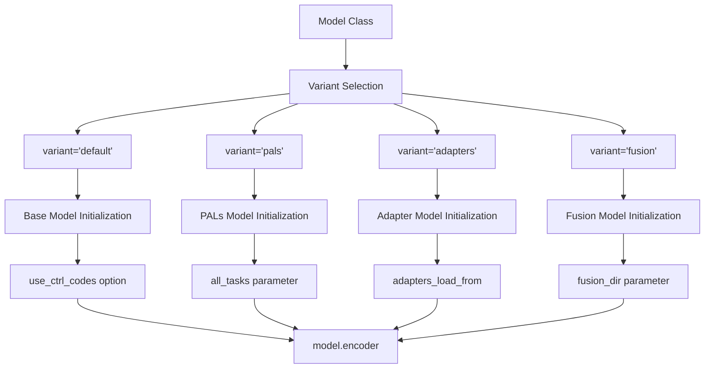

<!-- source: DeepWiki mcp.deepwiki.com · repo allenai/scirepeval · page 6 Benchmarking and Usage · fetched 2026-10-26 -->

# Benchmarking and Usage

<details>
<summary>Relevant source files</summary>

The following files were used as context for generating this wiki page:

- [BENCHMARKING.md](BENCHMARKING.md)
- [examples/classification.py](examples/classification.py)
- [examples/fewshot_classification.py](examples/fewshot_classification.py)
- [examples/regression.py](examples/regression.py)
- [examples/retrieval.py](examples/retrieval.py)

</details>


This page covers how to run benchmarks and use the SciRepEval system for evaluating scientific document representation models. It provides both command-line interfaces for comprehensive benchmarking and programmatic APIs for custom evaluation workflows.

For information about the core evaluation framework components, see [Core Evaluation Framework](#2). For details about task configuration, see [Task Configuration and Evaluation](#5).

## Command-Line Benchmarking System

The SciRepEval framework provides a comprehensive benchmarking system through the main `scirepeval.py` script, which evaluates models across all configured tasks and generates standardized performance reports.

### Benchmark Results Overview

The framework supports evaluation of multiple model variants with established baseline results:

| Model | In-Train | Out-of-Train | SciDocs | Average |
|-------|----------|--------------|---------|---------|
| SciBERT | 51.5 | 52.5 | 69.0 | 58.2 |
| SPECTER | 54.7 | 57.4 | 89.1 | 68.0 |
| SciNCL | 55.6 | 57.8 | 90.8 | 69.0 |
| SciNCL + MTL CTRL | 62.1 | 57.7 | 89.9 | 70.3 |
| SciNCL PALs | 62.3 | 58.4 | 90.0 | 70.7 |
| SciNCL Adapters | 61.9 | 59.0 | 90.3 | 70.9 |

### Command-Line Interface Flow



### Model Variant Commands

**Base Models and MTL CLS**
```bash
python scirepeval.py -m allenai/specter
```

**MTL CTRL with Control Tokens**
```bash
python scirepeval.py -m allenai/scirepeval_ctrl --ctrl-tokens
```

**PALs (Parameter-Efficient Adaptation)**
```bash
python scirepeval.py --mtype pals -m allenai/scirepeval_pals
```

**Adapter-Based Models**
```bash
python scirepeval.py --mtype adapters -m malteos/scincl \
  --adapters-chkpt '{"[CLF]": "allenai/scirepeval_adapters_clf", 
                     "[QRY]": "allenai/scirepeval_adapters_qry", 
                     "[RGN]": "allenai/scirepeval_adapters_rgn", 
                     "[PRX]": "allenai/scirepeval_adapters_prx"}'
```

**OpenAI Embeddings**
```bash
export OPENAI_API_KEY=<api_key>
python scirepeval.py --gpt3-model text-embedding-ada-002
```

**Instructor Models**
```bash
python scirepeval.py --instructor -m hkunlp/instructor-large
```

Sources: [BENCHMARKING.md:26-72]()

### Task Control Codes

The framework uses specific control tokens to identify task types for multi-task models:

```python
TASK_IDS = {
    "classification": "[CLF]", 
    "regression": "[RGN]", 
    "proximity": "[PRX]",
    "adhoc_search": {"query": "[QRY]", "candidates": "[PRX]"}
}
```

Sources: [BENCHMARKING.md:23-24]()

### Output Format

The benchmarking system generates standardized JSON reports with task-specific metrics:

```json
{
    "Biomimicry": {
        "complete": {"f1": 71.18},
        "few_shot": [
            {"sample_size": 64, "results": {"f1": 38.514}},
            {"sample_size": 16, "results": {"f1": 22.3444}}
        ]
    },
    "DRSM": {
        "complete": {"f1_macro": 76.36},
        "few_shot": [
            {"sample_size": 64, "results": {"f1_macro": 61.842}},
            {"sample_size": 24, "results": {"f1_macro": 53.214}}
        ]
    },
    "Feeds-1": {"map": 81.03},
    "Feeds Title": {"map": 78.85}
}
```

Sources: [BENCHMARKING.md:77-125]()

## Programmatic Usage Examples

The framework provides direct access to individual evaluators for custom evaluation workflows and fine-grained control over the evaluation process.

### Direct Evaluator Usage



### Classification Task Example

```python
from evaluation.encoders import Model
from evaluation.evaluator import SupervisedEvaluator, SupervisedTask

# Configure model with adapters
model = Model(
    base_checkpoint="malteos/scincl", 
    variant="adapters",
    adapters_load_from="path/to/adapters",
    task_id="[CLF]"
)

# Initialize evaluator
evaluator = SupervisedEvaluator(
    "biomimicry", 
    SupervisedTask.CLASSIFICATION,
    ("allenai/scirepeval", "biomimicry"),
    ("allenai/scirepeval_test", "biomimicry"), 
    model, 
    metrics=("f1",)
)

# Generate embeddings and evaluate
embeddings = evaluator.generate_embeddings()
evaluator.evaluate(embeddings)
```

Sources: [examples/classification.py:5-24]()

### Information Retrieval Task Example

```python
from evaluation.evaluator import IREvaluator
from evaluation.encoders import Model

# Configure model for proximity tasks
model = Model(
    base_checkpoint="malteos/scincl", 
    variant="adapters",
    adapters_load_from="path/to/adapters",
    task_id="[PRX]", 
    all_tasks=["[PRX]"]
)

# Initialize IR evaluator
evaluator = IREvaluator(
    "feeds_1", 
    ("allenai/scirepeval", "feeds_1"), 
    ("allenai/scirepeval_test", "feeds_1"), 
    model,
    metrics=("map", "ndcg")
)

# Execute evaluation
embeddings = evaluator.generate_embeddings()
evaluator.evaluate(embeddings)
```

Sources: [examples/retrieval.py:16-39]()

### Regression Task Example

```python
from evaluation.encoders import Model
from evaluation.evaluator import SupervisedEvaluator, SupervisedTask

# Basic model configuration
model = Model(base_checkpoint="allenai/specter")

# Configure regression evaluator
evaluator = SupervisedEvaluator(
    "max hIndex", 
    SupervisedTask.REGRESSION,
    ("allenai/scirepeval", "peer_review_score_hIndex"),
    ("allenai/scirepeval_test", "hIndex"), 
    model, 
    metrics=("pearsonr", "kendalltau")
)

embeddings = evaluator.generate_embeddings()
evaluator.evaluate(embeddings)
```

Sources: [examples/regression.py:8-23]()

### Few-Shot Evaluation Example

```python
from evaluation.encoders import Model
from evaluation.few_shot_evaluator import FewShotEvaluator, SupervisedTask

model = Model(base_checkpoint="allenai/specter")

# Configure few-shot evaluator with sampling parameters
evaluator = FewShotEvaluator(
    "drsm", 
    SupervisedTask.CLASSIFICATION,
    ("allenai/scirepeval", "drsm"),
    ("allenai/scirepeval_test", "drsm"), 
    model=model, 
    metrics=("f1_macro",),
    sample_size=16, 
    num_iterations=50
)

embeddings = evaluator.generate_embeddings()
evaluator.evaluate(embeddings)
```

Sources: [examples/fewshot_classification.py:9-23]()

### Task Filtering Options

The `SciRepEval` class provides flexible task filtering for custom evaluation suites:

**Filter by Task Names**
```python
from scirepeval import SciRepEval
from evaluation.encoders import Model

model = Model(variant="default", base_checkpoint="allenai/specter")

# Evaluate specific tasks only
evaluator = SciRepEval(task_list=["Biomimicry", "DRSM", "TREC-CoVID", "Feeds-1"])
evaluator.evaluate(model, "scirepeval_results.json")
```

**Filter by Task Types**
```python
# Evaluate specific task formats only
evaluator = SciRepEval(task_formats=["classification", "regression"])
evaluator.evaluate(model, "scirepeval_results.json")
```

Sources: [BENCHMARKING.md:155-188]()

### Model Configuration Variants



**PALs Configuration Example**
```python
model = Model(
    variant="pals", 
    base_checkpoint="allenai/scirepeval_pals", 
    all_tasks=["[CLF]", "[QRY]", "[RGN]", "[PRX]"]
)
```

**Adapter Configuration Example**
```python
adapters_dict = {
    "[CLF]": "allenai/scirepeval_adapters_clf", 
    "[QRY]": "allenai/scirepeval_adapters_qry", 
    "[RGN]": "allenai/scirepeval_adapters_rgn", 
    "[PRX]": "allenai/scirepeval_adapters_prx"
}

model = Model(
    variant="adapters", 
    base_checkpoint="malteos/scincl", 
    adapters_load_from=adapters_dict, 
    all_tasks=["[CLF]", "[QRY]", "[RGN]", "[PRX]"]
)
```

Sources: [BENCHMARKING.md:159-170]()

---

