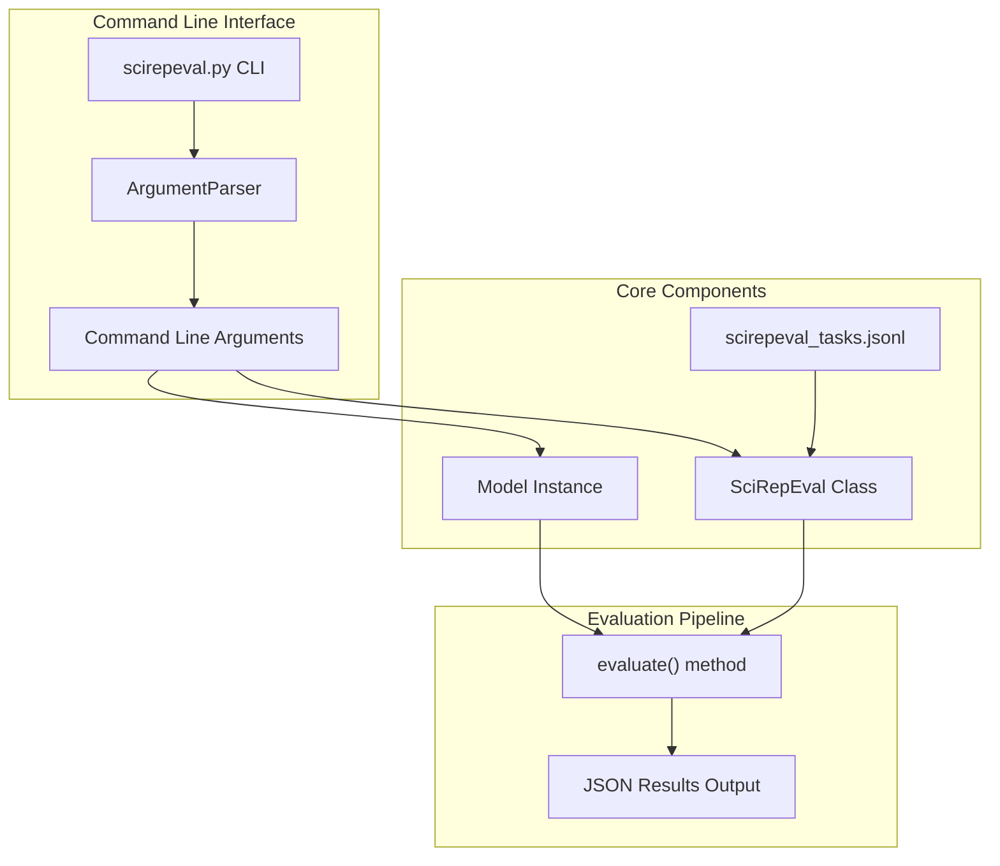
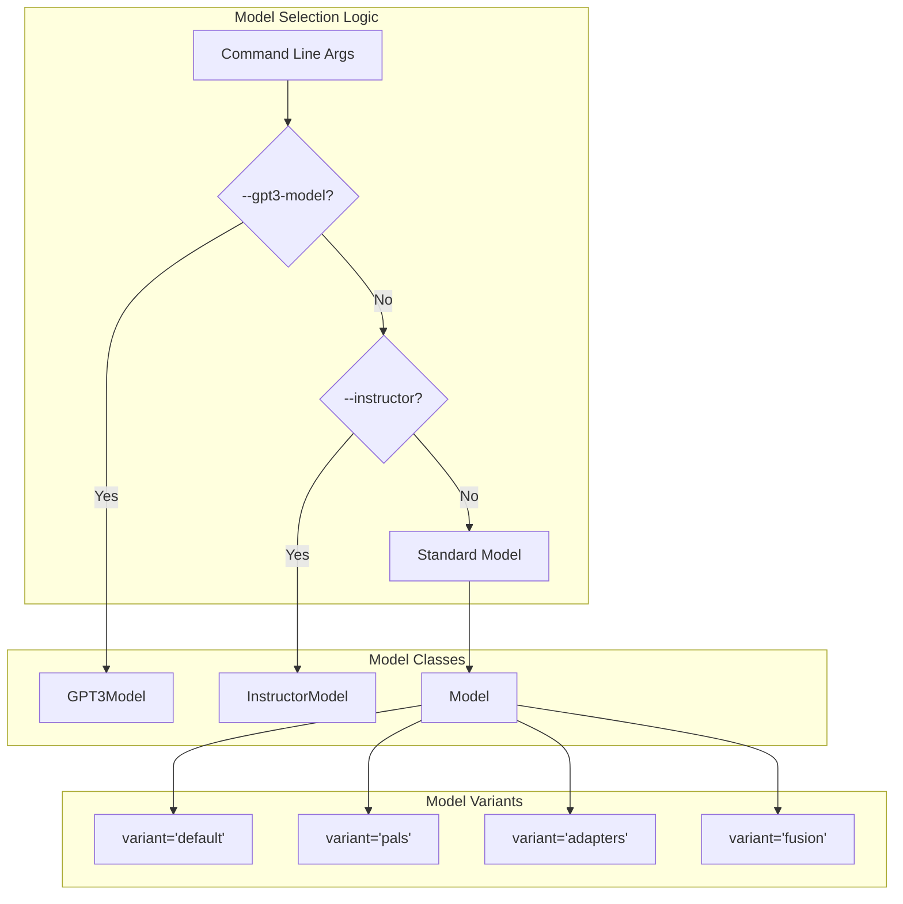
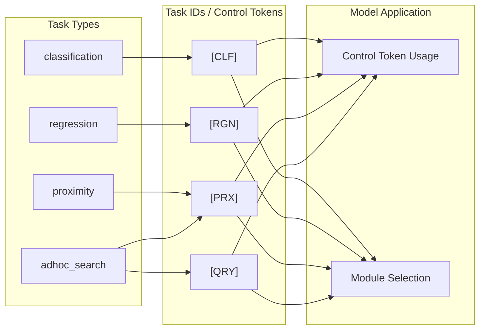
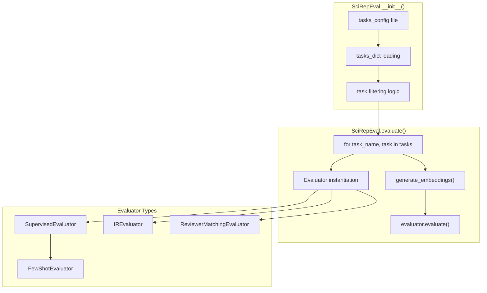

<!-- source: DeepWiki mcp.deepwiki.com · repo allenai/scirepeval · page 6.1 Benchmarking System · fetched 2026-10-26 -->

# Benchmarking System

<details>
<summary>Relevant source files</summary>

The following files were used as context for generating this wiki page:

- [BENCHMARKING.md](BENCHMARKING.md)
- [evaluation/gpt3_encoder.py](evaluation/gpt3_encoder.py)
- [scirepeval.py](scirepeval.py)

</details>


## Purpose and Scope

The benchmarking system provides a command-line interface for evaluating model performance across all SciRepEval tasks. The main entry point is the `scirepeval.py` script, which orchestrates model evaluation using the `SciRepEval` class and generates comprehensive performance reports. This system supports multiple model variants including base models, PALS, adapters, fusion, GPT-3, and Instructor models.

For information about task configuration and definitions, see [Task Definitions](#5.1). For details about the core evaluation framework, see [Core Evaluation Framework](#2).

## Command-Line Interface Overview

The benchmarking system centers around the `scirepeval.py` script, which accepts various command-line arguments to configure model evaluation. The script implements an argument parser that maps user inputs to specific model configurations and evaluation parameters.



**Benchmarking Command-Line Flow**

The system supports the following key command-line arguments:

| Argument | Purpose | Default | Code Reference |
|----------|---------|---------|----------------|
| `--model`, `-m` | HuggingFace model checkpoint | Required | [scirepeval.py:126]() |
| `--mtype` | Model variant selection | `"default"` | [scirepeval.py:124]() |
| `--tasks-config` | Task configuration file | `"scirepeval_tasks.jsonl"` | [scirepeval.py:123]() |
| `--batch-size` | Evaluation batch size | `32` | [scirepeval.py:127]() |
| `--output` | Results output file | `"scirepeval_results.json"` | [scirepeval.py:133]() |
| `--ctrl-tokens` | Enable control token usage | `False` | [scirepeval.py:128]() |
| `--instructor` | Use Instructor model | `False` | [scirepeval.py:135]() |
| `--gpt3-model` | OpenAI embedding model | `None` | [scirepeval.py:125]() |

Sources: [scirepeval.py:122-136](), [BENCHMARKING.md:26-73]()

## Model Variant Support

The benchmarking system supports multiple model architectures through the `--mtype` parameter and specialized model classes. The model selection logic determines which model class to instantiate based on command-line arguments.



**Model Variant Selection Flow**

### Standard Model Variants

The `Model` class supports four variants controlled by the `--mtype` argument:

- **default**: Standard HuggingFace transformer models
- **pals**: Parameter-efficient adaptation using BERT PALS
- **adapters**: Task-specific adapter modules
- **fusion**: Combined adapter fusion approach

### Specialized Model Classes

- **GPT3Model**: Integrates with OpenAI's embedding API using the `--gpt3-model` parameter
- **InstructorModel**: Uses instruction-based embedding models activated by `--instructor` flag

Sources: [scirepeval.py:139-154](), [evaluation/gpt3_encoder.py:7-31]()

## Task Configuration and Control Tokens

The benchmarking system uses task identifiers to route different evaluation types through appropriate evaluators. These identifiers serve dual purposes as control tokens for multi-task models and module selectors for parameter-efficient variants.



**Task ID Mapping and Usage**

The `TASK_IDS` constant defines the mapping between task types and their identifiers:

```python
TASK_IDS = {
    "classification": "[CLF]", 
    "regression": "[RGN]", 
    "proximity": "[PRX]",
    "adhoc_search": {"query": "[QRY]", "candidates": "[PRX]"}
}
```

For adhoc search tasks, queries use `[QRY]` while candidate documents use `[PRX]` identifiers.

Sources: [scirepeval.py:15-16](), [scirepeval.py:49-51](), [BENCHMARKING.md:21-24]()

## Evaluation Orchestration

The `SciRepEval` class orchestrates evaluation across all configured tasks. The evaluation process involves loading task configurations, instantiating appropriate evaluators, generating embeddings, and computing metrics.



**Evaluation Orchestration Flow**

The evaluation process follows these key steps:

1. **Task Loading**: Parse `scirepeval_tasks.jsonl` and filter tasks based on `task_list` or `task_formats` parameters
2. **Evaluator Selection**: Instantiate appropriate evaluator based on task type:
   - Classification/Regression → `SupervisedEvaluator`
   - Proximity/Adhoc Search → `IREvaluator`
   - Paper-Reviewer Matching → `ReviewerMatchingEvaluator`
3. **Embedding Generation**: Call `generate_embeddings()` with optional save/load paths
4. **Evaluation Execution**: Run `evaluate()` method and collect results
5. **Few-Shot Evaluation**: Execute additional `FewShotEvaluator` instances if configured

Sources: [scirepeval.py:22-119](), [scirepeval.py:80-104]()

## Output Format and Results

The benchmarking system generates comprehensive JSON reports containing task-wise performance metrics. The output structure accommodates both complete evaluations and few-shot learning results.

### Standard Results Structure

```json
{
    "Task Name": {
        "metric_name": score_value
    }
}
```

### Few-Shot Results Structure

```json
{
    "Task Name": {
        "complete": {
            "metric_name": score_value
        },
        "few_shot": [
            {
                "sample_size": 64,
                "results": {
                    "metric_name": score_value
                }
            }
        ]
    }
}
```

The results are incrementally written to the output file during evaluation, ensuring partial results are preserved if the process is interrupted.

Sources: [scirepeval.py:106-118](), [BENCHMARKING.md:77-125]()

## Usage Examples

### Basic Model Evaluation

```bash
# Evaluate SPECTER model
python scirepeval.py -m allenai/specter

# Evaluate with control tokens
python scirepeval.py -m allenai/scirepeval_ctrl --ctrl-tokens
```

### Parameter-Efficient Variants

```bash
# PALS evaluation
python scirepeval.py --mtype pals -m allenai/scirepeval_pals

# Adapter evaluation with HuggingFace checkpoints
python scirepeval.py --mtype adapters -m malteos/scincl \
  --adapters-chkpt '{"[CLF]": "allenai/scirepeval_adapters_clf", "[QRY]": "allenai/scirepeval_adapters_qry"}'
```

### External Model APIs

```bash
# OpenAI embeddings (requires OPENAI_API_KEY environment variable)
python scirepeval.py --gpt3-model text-embedding-ada-002

# Instructor models
python scirepeval.py --instructor -m hkunlp/instructor-large
```

### Programmatic Usage

```python
from scirepeval import SciRepEval
from evaluation.encoders import Model

# Create model instance
model = Model(variant="default", base_checkpoint="allenai/specter")

# Filter tasks by name
evaluator = SciRepEval(task_list=["Biomimicry", "DRSM"])
evaluator.evaluate(model, "results.json")

# Filter tasks by type
evaluator = SciRepEval(task_formats=["classification"])
evaluator.evaluate(model, "classification_results.json")
```

Sources: [BENCHMARKING.md:29-188](), [scirepeval.py:155-156]()

---

