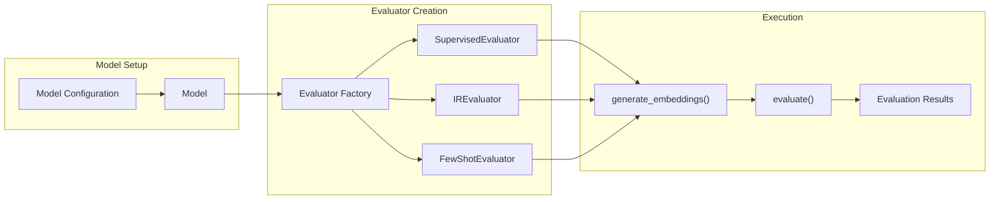
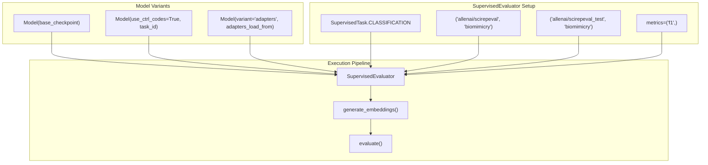
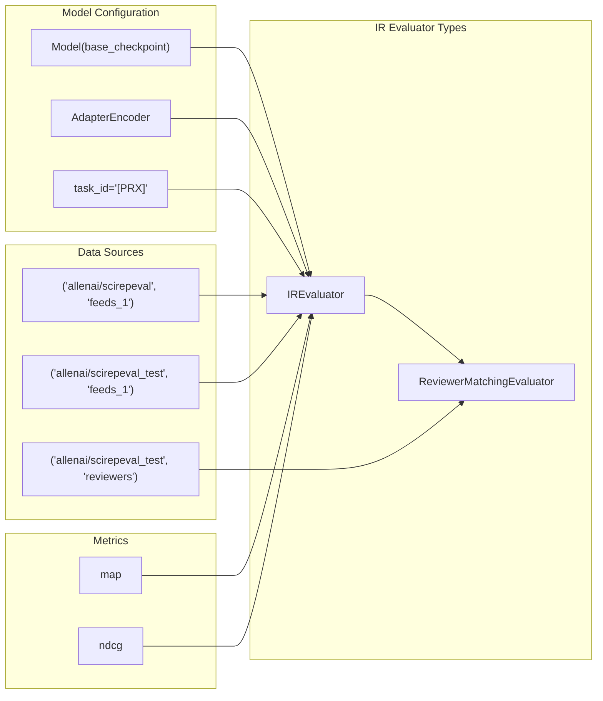
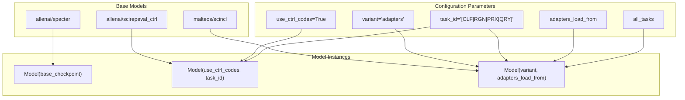

<!-- source: DeepWiki mcp.deepwiki.com · repo allenai/scirepeval · page 6.2 Usage Examples · fetched 2026-10-26 -->

# Usage Examples

<details>
<summary>Relevant source files</summary>

The following files were used as context for generating this wiki page:

- [evaluation/EVALUATION.md](evaluation/EVALUATION.md)
- [examples/classification.py](examples/classification.py)
- [examples/fewshot_classification.py](examples/fewshot_classification.py)
- [examples/regression.py](examples/regression.py)
- [examples/retrieval.py](examples/retrieval.py)
- [training/TRAINING.md](training/TRAINING.md)

</details>


This document provides practical examples demonstrating how to use the SciRepEval framework to evaluate scientific document representations across different task types. It covers basic evaluation workflows, model configuration, and task-specific evaluation patterns using the core evaluator classes.

For information about the benchmarking command-line interface, see [Benchmarking System](#6.1). For details about task configuration formats, see [Task Definitions](#5.1).

## Evaluation Workflow Overview

The standard evaluation process in SciRepEval follows a consistent pattern across all task types: model instantiation, evaluator creation, embedding generation, and evaluation execution.

**Basic Evaluation Flow**


Sources: [examples/classification.py](), [examples/retrieval.py](), [examples/regression.py](), [examples/fewshot_classification.py]()

## Classification Task Examples

Classification tasks use the `SupervisedEvaluator` class with `SupervisedTask.CLASSIFICATION` to evaluate document categorization performance.

### Basic Classification Evaluation

The simplest classification evaluation uses a base model without control codes:

```python
from evaluation.encoders import Model
from evaluation.evaluator import SupervisedEvaluator, SupervisedTask

model = Model(base_checkpoint="allenai/specter")
evaluator = SupervisedEvaluator("biomimicry", SupervisedTask.CLASSIFICATION, 
                               ("allenai/scirepeval", "biomimicry"),
                               ("allenai/scirepeval_test", "biomimicry"), 
                               model, metrics=("f1",))

embeddings = evaluator.generate_embeddings()
evaluator.evaluate(embeddings)
```

### Classification with Control Codes

For models trained with control tokens, specify the appropriate task identifier and enable control code usage:

```python
model = Model(base_checkpoint="../lightning_logs/full_run/scincl_ctrl/checkpoints/", 
              task_id="[CLF]", use_ctrl_codes=True)
```

### Classification with Adapters

Adapter-based models require specifying the adapter loading path and task identifier:

```python
model = Model(base_checkpoint="malteos/scincl", variant="adapters",
              adapters_load_from="../../path/to/adapters/", 
              task_id="[CLF]")
```

**Classification Model Configuration Flow**


Sources: [examples/classification.py:9-24]()

## Regression Task Examples

Regression tasks evaluate continuous prediction performance using the same `SupervisedEvaluator` class with `SupervisedTask.REGRESSION`.

### Basic Regression Evaluation

```python
from evaluation.encoders import Model
from evaluation.evaluator import SupervisedEvaluator, SupervisedTask

model = Model(base_checkpoint="allenai/specter")
evaluator = SupervisedEvaluator("max hIndex", SupervisedTask.REGRESSION, 
                               ("allenai/scirepeval", "peer_review_score_hIndex"),
                               ("allenai/scirepeval_test", "hIndex"), 
                               model, metrics=("pearsonr","kendalltau"))

embeddings = evaluator.generate_embeddings()
evaluator.evaluate(embeddings)
```

### Regression with Control Codes

For regression tasks with control codes, use the `[RGN]` task identifier:

```python
model = Model(base_checkpoint="../lightning_logs/full_run/scincl_ctrl/checkpoints/", 
              task_id="[RGN]", use_ctrl_codes=True)
```

| Task Type | Control Token | Metrics |
|-----------|---------------|---------|
| Classification | `[CLF]` | f1, accuracy, precision, recall |
| Regression | `[RGN]` | pearsonr, kendalltau, mse, r2 |
| Proximity | `[PRX]` | map, ndcg |
| Query | `[QRY]` | map, ndcg |

Sources: [examples/regression.py:8-23]()

## Information Retrieval Examples

Information retrieval tasks use the `IREvaluator` class for document ranking and similarity-based retrieval evaluation.

### Basic IR Evaluation

```python
from evaluation.evaluator import IREvaluator
from evaluation.encoders import Model

model = Model(base_checkpoint="allenai/specter")
evaluator = IREvaluator("feeds_1", ("allenai/scirepeval", "feeds_1"), 
                       ("allenai/scirepeval_test", "feeds_1"), 
                       model, metrics=("map", "ndcg"))

embeddings = evaluator.generate_embeddings()
evaluator.evaluate(embeddings)
```

### IR with Adapters Configuration

The adapter-based IR evaluation requires more complex setup with the `AdapterEncoder`:

```python
from adapter_fusion import AdapterEncoder

model = Model(base_checkpoint="malteos/scincl", variant="adapters",
              adapters_load_from="../path/to/adapters/", 
              task_id="[PRX]", all_tasks=["[PRX]"])

encoder = AdapterEncoder("malteos/scincl", ["[PRX]"], 
                        "../path/to/adapters/model/adapters")
model.encoder = encoder
model.encoder.cuda()
model.encoder.eval()
```

### Reviewer Matching Evaluation

A specialized IR task for matching papers to reviewers:

```python
from reviewer_matching import ReviewerMatchingEvaluator

evaluator = ReviewerMatchingEvaluator("paper reviewer evaluation", 
                                     ("allenai/scirepeval", "paper_reviewer_matching"),
                                     ("allenai/scirepeval_test", "paper_reviewer_matching"),
                                     ("allenai/scirepeval_test", "reviewers"), 
                                     model, metrics=("map", "ndcg"))
```

**IR Evaluation Architecture**


Sources: [examples/retrieval.py:9-39]()

## Few-Shot Evaluation Examples

Few-shot evaluation uses the `FewShotEvaluator` for limited training data scenarios with iterative sampling.

### Basic Few-Shot Classification

```python
from evaluation.encoders import Model
from evaluation.few_shot_evaluator import FewShotEvaluator, SupervisedTask

model = Model(base_checkpoint="allenai/specter")
evaluator = FewShotEvaluator("drsm", SupervisedTask.CLASSIFICATION, 
                            ("allenai/scirepeval", "drsm"),
                            ("allenai/scirepeval_test", "drsm"), 
                            model=model, metrics=("f1_macro",),
                            sample_size=16, num_iterations=50)

embeddings = evaluator.generate_embeddings()
evaluator.evaluate(embeddings)
```

### Few-Shot Configuration Parameters

| Parameter | Purpose | Example Values |
|-----------|---------|----------------|
| `sample_size` | Number of training examples per iteration | 16, 32, 64 |
| `num_iterations` | Number of sampling iterations | 50, 100 |
| `metrics` | Evaluation metrics | f1_macro, accuracy |

Sources: [examples/fewshot_classification.py:8-23]()

## Model Configuration Patterns

Different model variants require specific configuration patterns for proper initialization and evaluation.

### Model Variant Configuration Matrix



### Advanced Model Configurations

**Control Code Models:**
```python
model = Model(variant="default", 
              base_checkpoint="allenai/scirepeval_ctrl", 
              use_ctrl_codes=True)
```

**PALS Models:**
```python
model = Model(variant="pals", 
              base_checkpoint="allenai/scirepeval_pals", 
              all_tasks=["[CLF]", "[QRY]", "[RGN]", "[PRX]"])
```

**Adapter Models:**
```python
adapters_dict = {
    "[CLF]": "allenai/scirepeval_adapters_clf",
    "[QRY]": "allenai/scirepeval_adapters_qry", 
    "[RGN]": "allenai/scirepeval_adapters_rgn",
    "[PRX]": "allenai/scirepeval_prx"
}
model = Model(variant="adapters", 
              base_checkpoint="malteos/scincl", 
              adapters_load_from=adapters_dict, 
              all_tasks=["[CLF]", "[QRY]", "[RGN]", "[PRX]"])
```

**Fusion Models:**
```python
model = Model(variant="fusion", 
              base_checkpoint="malteos/scincl", 
              adapters_load_from=adapters_dict, 
              fusion_load_from="<fusion_checkpoint_directory>", 
              all_tasks=["[CLF]", "[QRY]", "[RGN]", "[PRX]"])
```

Sources: [evaluation/EVALUATION.md:91-105]()

## Programmatic Evaluation Interface

For programmatic access, use the `SciRepEval` class to evaluate multiple tasks:

```python
from scirepeval import SciRepEval
from evaluation.encoders import Model

model = Model(variant="default", base_checkpoint="allenai/specter")
evaluator = SciRepEval(tasks_config="scirepeval_tasks.jsonl")
evaluator.evaluate(model, "scirepeval_results.json")
```

### Ensemble Evaluation

Evaluate multiple models as an ensemble by providing a list of models:

```python
model1 = Model(variant="default", base_checkpoint="allenai/scirepeval_ctrl", 
               use_ctrl_codes=True)
model2 = Model(variant="adapters", base_checkpoint="malteos/scincl", 
               adapters_load_from=adapters_dict, 
               all_tasks=["[CLF]", "[QRY]", "[RGN]", "[PRX]"])

models = [model1, model2]
evaluator = SciRepEval(tasks_config="scirepeval_tasks_adapters.jsonl", 
                      batch_size=16)
evaluator.evaluate(models, "scirepeval_results.json")
```

Sources: [evaluation/EVALUATION.md:87-129]()

---

