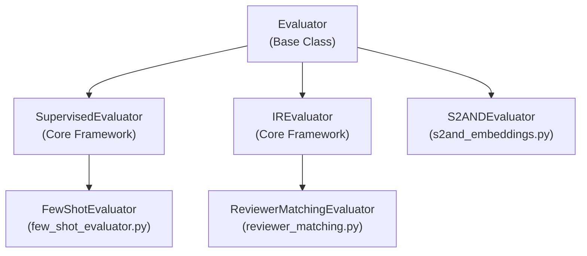
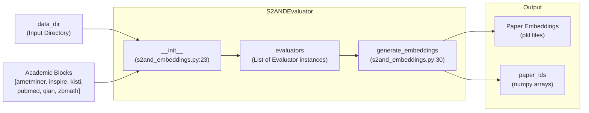
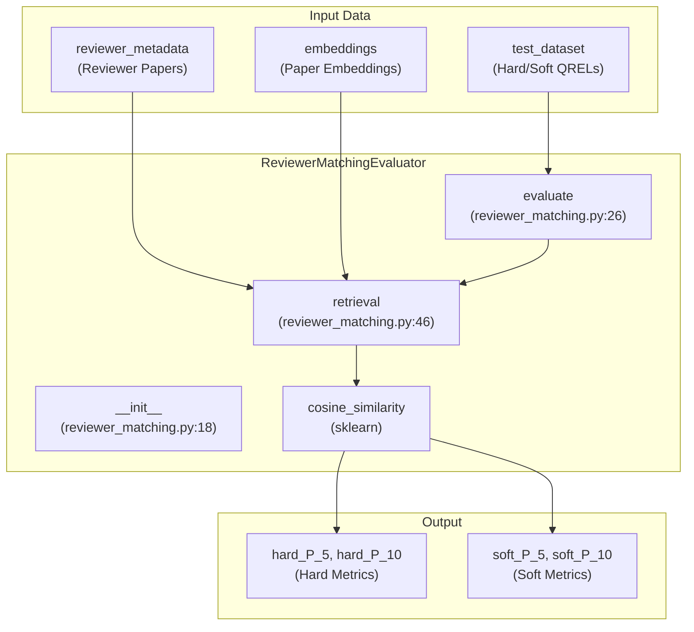
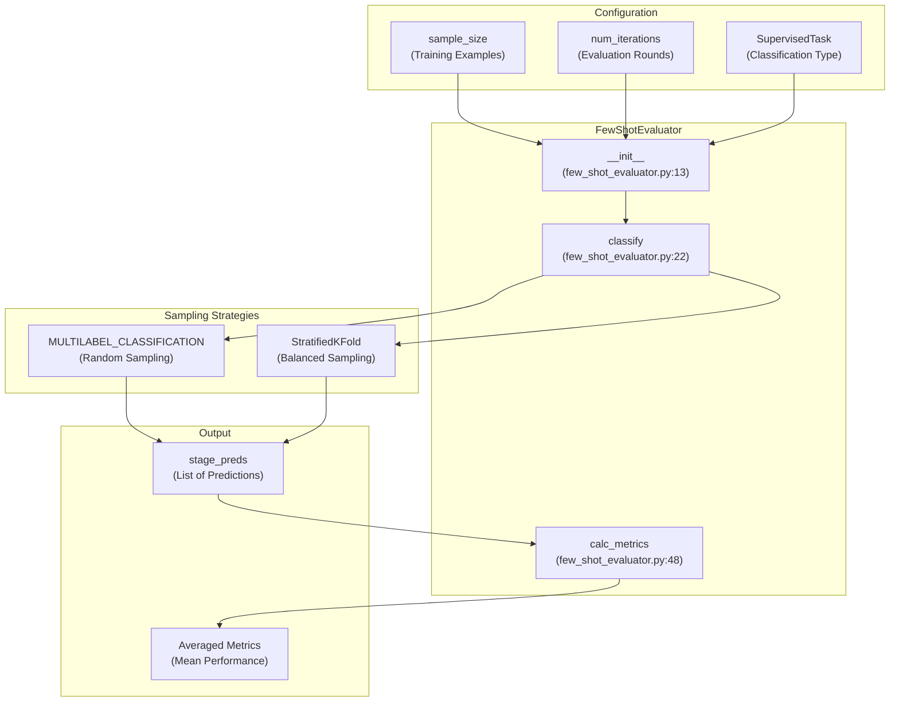

<!-- source: DeepWiki mcp.deepwiki.com · repo allenai/scirepeval · page 7 Specialized Evaluators · fetched 2026-10-26 -->

# Specialized Evaluators

Relevant source files

The following files were used as context for generating this wiki page:

- [evaluation/few_shot_evaluator.py](evaluation/few_shot_evaluator.py)
- [evaluation/instructor.py](evaluation/instructor.py)
- [mdcr.py](mdcr.py)
- [reviewer_matching.py](reviewer_matching.py)
- [s2and_embeddings.py](s2and_embeddings.py)

This document covers domain-specific evaluation components that extend beyond the core evaluation framework to handle specialized scientific tasks. These evaluators implement custom evaluation logic for author name disambiguation, paper-reviewer matching, and few-shot learning scenarios.

For core evaluation framework components, see [Core Evaluation Framework](#2). For multi-domain citation recommendation evaluation, see [MDCR Evaluation](#8.2). For instruction-based embedding models, see [Specialized Models](#3.4).

## Overview

The specialized evaluators inherit from or extend the base evaluator classes to provide task-specific evaluation logic for complex scientific document understanding tasks that require custom similarity calculations, sampling strategies, or evaluation metrics.

**Specialized Evaluator Class Hierarchy**

Sources: [s2and_embeddings.py:21-28](), [reviewer_matching.py:18-24](), [evaluation/few_shot_evaluator.py:13-20]()

## S2AND Evaluation

The `S2ANDEvaluator` class provides specialized evaluation for author name disambiguation using the S2AND (Semantic Scholar Author Name Disambiguation) dataset. This evaluator generates embeddings for scientific papers across multiple academic domains to support author disambiguation tasks.

**S2AND Data Processing Flow**

The evaluator processes six academic domains: `arnetminer`, `inspire`, `kisti`, `pubmed`, `qian`, and `zbmath`. Each domain uses a separate `Evaluator` instance with a `SimpleDataset` to load papers from JSON files located at `{data_dir}/{block}/{block}_papers.json`.

Key implementation details:
- Uses `read_data` function to parse JSON task data [s2and_embeddings.py:15-18]()
- Creates domain-specific evaluators with paper_id as the key field [s2and_embeddings.py:26-28]()
- Saves embeddings and paper IDs as pickle files with configurable suffix [s2and_embeddings.py:34-37]()

The command-line interface supports all model variants including PALS, adapters, fusion, and instructor models, with the proximity task control token `[PRX]` for retrieval-based embeddings [s2and_embeddings.py:54-62]().

Sources: [s2and_embeddings.py:21-62]()

## Reviewer Matching

The `ReviewerMatchingEvaluator` extends `IREvaluator` to implement paper-reviewer matching using cosine similarity calculations between paper embeddings and reviewer expertise profiles. This evaluator supports both hard and soft evaluation criteria for reviewer recommendation systems.

**Reviewer Matching Architecture**

The evaluation process involves:

1. **Data Loading**: Loads test query-candidate pairs from `test_hard_qrel.jsonl` and `test_soft_qrel.jsonl` [reviewer_matching.py:28-34]()
2. **Reviewer Profile Construction**: Maps reviewer IDs to their published papers [reviewer_matching.py:55]()
3. **Similarity Calculation**: Computes cosine similarity between query papers and reviewer paper collections [reviewer_matching.py:62]()
4. **Scoring Strategy**: Uses mean of top-3 similarity scores per reviewer [reviewer_matching.py:64]()

The evaluator inherits IR evaluation metrics (`P_5`, `P_10`) and extends the base `retrieval` method to implement the specialized similarity calculation logic for reviewer matching scenarios.

Sources: [reviewer_matching.py:18-66]()

## Few-Shot Evaluation  

The `FewShotEvaluator` extends `SupervisedEvaluator` to support few-shot learning scenarios through iterative sampling and classification. This evaluator enables evaluation with limited training examples using stratified sampling strategies.

**Few-Shot Evaluation Workflow**

The evaluator implements two sampling strategies:

**Multilabel Classification**: For `MULTILABEL_CLASSIFICATION` tasks, uses random sampling to ensure representation across all label dimensions [evaluation/few_shot_evaluator.py:24-35]():
- Seeds random state for reproducibility with `RANDOM_STATE + k`
- Samples examples for each label dimension independently
- Combines samples into training set

**Standard Classification**: For other task types, uses `StratifiedKFold` to maintain class distribution balance [evaluation/few_shot_evaluator.py:37-46]():
- Creates balanced splits with `math.ceil(x.shape[0] / self.sample_size)`
- Iterates through splits up to `num_iterations`
- Uses `cv=0` to disable cross-validation in base classifier

The `calc_metrics` method aggregates results across iterations by computing mean performance across all sampling rounds [evaluation/few_shot_evaluator.py:48-58]().

Sources: [evaluation/few_shot_evaluator.py:13-59]()

---

