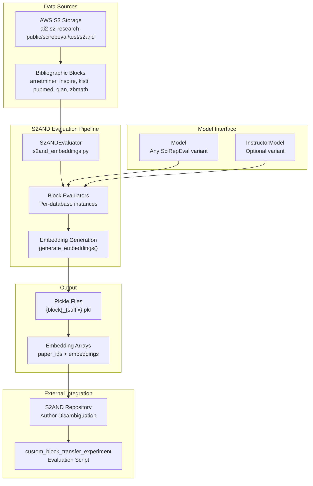
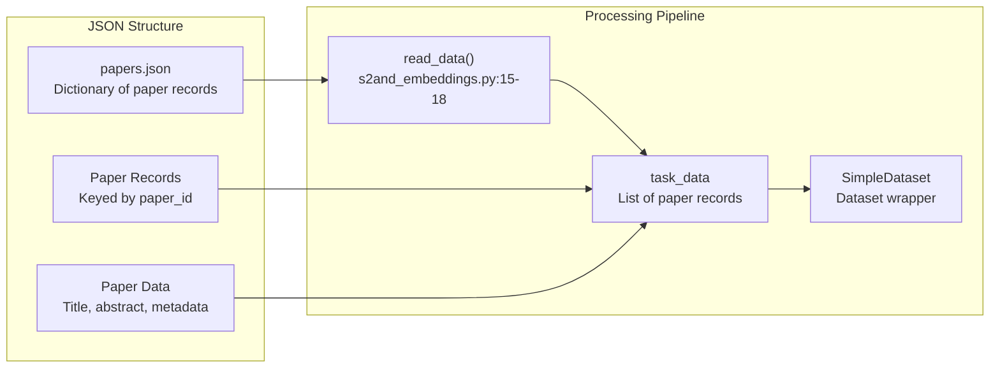
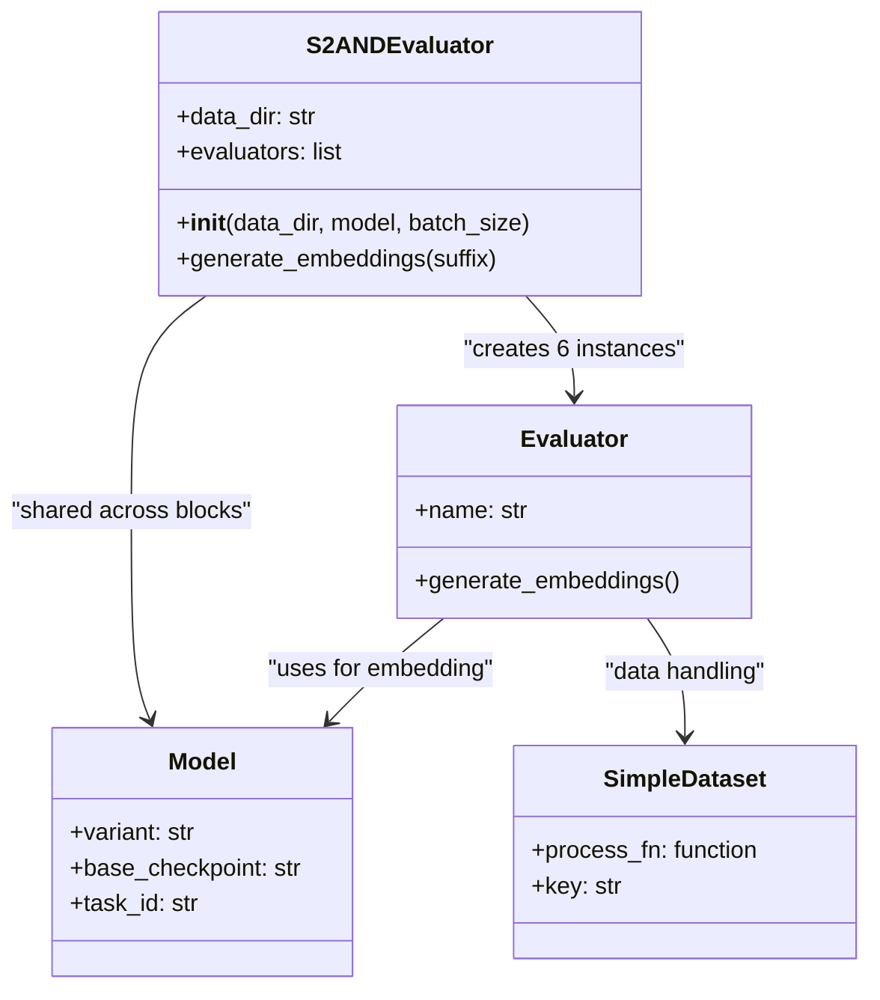
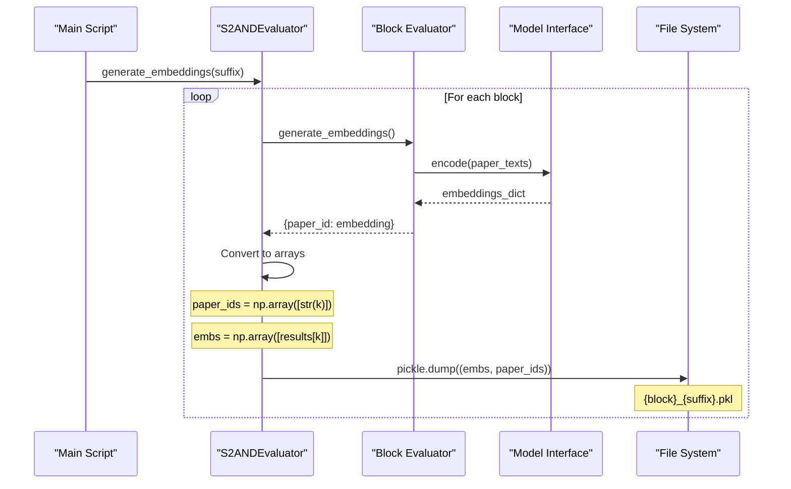
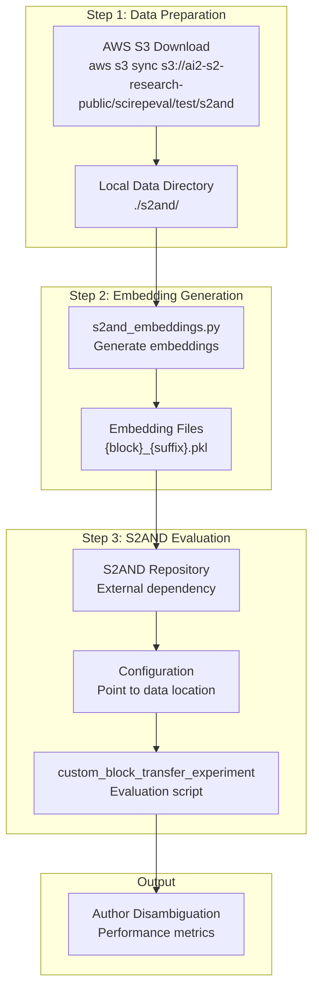

<!-- source: DeepWiki mcp.deepwiki.com · repo allenai/scirepeval · page 7.1 S2AND Evaluation · fetched 2026-10-26 -->

# S2AND Evaluation

<details>
<summary>Relevant source files</summary>

The following files were used as context for generating this wiki page:

- [BENCHMARKING.md](BENCHMARKING.md)
- [evaluation/instructor.py](evaluation/instructor.py)
- [mdcr.py](mdcr.py)
- [s2and_embeddings.py](s2and_embeddings.py)

</details>


This document covers the specialized evaluator for author name disambiguation using the S2AND dataset. The S2AND evaluation system generates document embeddings for scientific papers that are then used by the external S2AND repository for author disambiguation tasks.

For general evaluation framework components, see [Core Evaluation Framework](#2). For other specialized evaluators, see [Reviewer Matching](#7.2) and [Few-Shot Evaluation](#7.3).

## Purpose and Scope

The S2AND evaluation component provides a specialized pipeline for generating document embeddings that can be consumed by the S2AND (Semantic Scholar Author Name Disambiguation) system. Unlike other evaluators in SciRepEval that compute metrics directly, the S2AND evaluator focuses solely on embedding generation and caching for downstream author disambiguation tasks.

The system processes papers from multiple bibliographic databases and generates embeddings using any of the supported model variants in SciRepEval, then saves these embeddings in a format compatible with the S2AND evaluation framework.

Sources: [BENCHMARKING.md:127-152](), [s2and_embeddings.py:1-63]()

## System Architecture

The S2AND evaluation system operates as a specialized embedding generator that processes papers from multiple bibliographic blocks and produces cached embeddings for external evaluation.



Sources: [s2and_embeddings.py:21-38](), [BENCHMARKING.md:133-152]()

## Data Structure and Bibliographic Blocks

The S2AND evaluation operates on six distinct bibliographic databases, each containing scientific papers with metadata organized in a specific JSON format.

### Supported Bibliographic Blocks

| Block Name | Description | Data Location |
|------------|-------------|---------------|
| `arnetminer` | ArnetMiner database papers | `{data_dir}/arnetminer/arnetminer_papers.json` |
| `inspire` | INSPIRE-HEP papers | `{data_dir}/inspire/inspire_papers.json` |
| `kisti` | KISTI database papers | `{data_dir}/kisti/kisti_papers.json` |
| `pubmed` | PubMed papers | `{data_dir}/pubmed/pubmed_papers.json` |
| `qian` | Qian dataset papers | `{data_dir}/qian/qian_papers.json` |
| `zbmath` | zbMATH papers | `{data_dir}/zbmath/zbmath_papers.json` |

### Data Format

Each block's JSON file contains paper records with the following structure processed by the `read_data` function:



Sources: [s2and_embeddings.py:15-18](), [s2and_embeddings.py:24-28]()

## S2ANDEvaluator Class

The `S2ANDEvaluator` class serves as the main orchestrator for generating embeddings across all bibliographic blocks. It creates individual evaluators for each block and manages the embedding generation process.

### Class Structure



### Initialization Process

The constructor creates evaluators for each bibliographic block with standardized parameters:

- **Block Processing**: Iterates through the six predefined blocks
- **Evaluator Creation**: Each block gets its own `Evaluator` instance
- **Shared Model**: All evaluators use the same model instance
- **Data Path Resolution**: Constructs paths to each block's JSON file
- **Key Configuration**: Uses `paper_id` as the primary key for all blocks

Sources: [s2and_embeddings.py:21-28]()

## Embedding Generation Process

The embedding generation process transforms paper text into vector representations and saves them in a format suitable for S2AND evaluation.

### Generation Workflow



### Output Format

The generated embeddings are saved as pickle files with the following structure:

- **File naming**: `{block_name}_{suffix}.pkl`
- **Content**: Tuple of `(embeddings_array, paper_ids_array)`
- **Embeddings**: NumPy array of shape `(n_papers, embedding_dim)`
- **Paper IDs**: NumPy array of string paper identifiers

Sources: [s2and_embeddings.py:30-37]()

## Command Line Interface

The S2AND embedding generation supports all model variants available in SciRepEval through a comprehensive command-line interface.

### Supported Arguments

| Argument | Description | Default | Required |
|----------|-------------|---------|----------|
| `--mtype` | Model variant (default, pals, adapters, fusion) | "default" | No |
| `--model`, `-m` | HuggingFace model checkpoint | None | Yes |
| `--ctrl-tokens` | Enable control token usage | False | No |
| `--adapters-dir` | Path to adapter checkpoints | None | No |
| `--adapters-chkpt` | HuggingFace adapter names (JSON) | None | No |
| `--fusion-dir` | Path to fusion checkpoints | None | No |
| `--data-dir` | Path to S2AND data directory | None | Yes |
| `--suffix` | Suffix for embedding file names | None | Yes |
| `--instructor` | Use Instructor model variant | False | No |

### Model Configuration Examples

```bash
# Standard model
python s2and_embeddings.py --mtype default -m allenai/specter --data-dir ./s2and --suffix specter

# PALS variant
python s2and_embeddings.py --mtype pals -m allenai/scirepeval_pals --data-dir ./s2and --suffix pals

# Adapters variant
python s2and_embeddings.py --mtype adapters -m malteos/scincl --adapters-chkpt '{"[CLF]": "allenai/scirepeval_adapters_clf", "[PRX]": "allenai/scirepeval_adapters_prx"}' --data-dir ./s2and --suffix adapters

# Instructor model
python s2and_embeddings.py --instructor -m hkunlp/instructor-large --data-dir ./s2and --suffix instructor
```

Sources: [s2and_embeddings.py:40-62](), [BENCHMARKING.md:140-143]()

## Integration Workflow

The complete S2AND evaluation workflow involves multiple steps spanning data preparation, embedding generation, and external evaluation.

### Complete Evaluation Pipeline



### Task Configuration

The S2AND evaluator uses proximity task configuration (`[PRX]`) as it focuses on measuring semantic similarity between papers for author disambiguation:

- **Task ID**: `[PRX]` for proximity/similarity tasks
- **Model Tasks**: Supports `["[CLF]", "[PRX]", "[RGN]", "[QRY]"]` for multi-task models
- **Instructor Task**: Uses proximity instruction for Instructor models

Sources: [BENCHMARKING.md:129-152](), [s2and_embeddings.py:56-60]()

## Technical Considerations

### Performance and Scalability

- **Batch Processing**: Configurable batch size (default: 16) for memory management
- **Block Parallelization**: Each bibliographic block processed sequentially
- **Memory Efficiency**: Embeddings converted to NumPy arrays before saving
- **File I/O**: Pickle format for efficient serialization of large arrays

### Model Compatibility

The S2AND evaluator supports all model variants available in SciRepEval:
- Standard transformer models via HuggingFace
- PALS (Parameter-efficient Adaptation) models
- Adapter-based models with task-specific fine-tuning
- AdapterFusion for multi-adapter combinations
- Instructor models with task-specific instructions
- External models like GPT-3 embeddings

### Data Requirements

- **Storage**: Requires local storage for S3 data download
- **Format**: JSON files with paper metadata and content
- **Keys**: Consistent `paper_id` field across all blocks
- **Structure**: Compatible with `SimpleDataset` processing

Sources: [s2and_embeddings.py:23-28](), [s2and_embeddings.py:54-61]()

---

