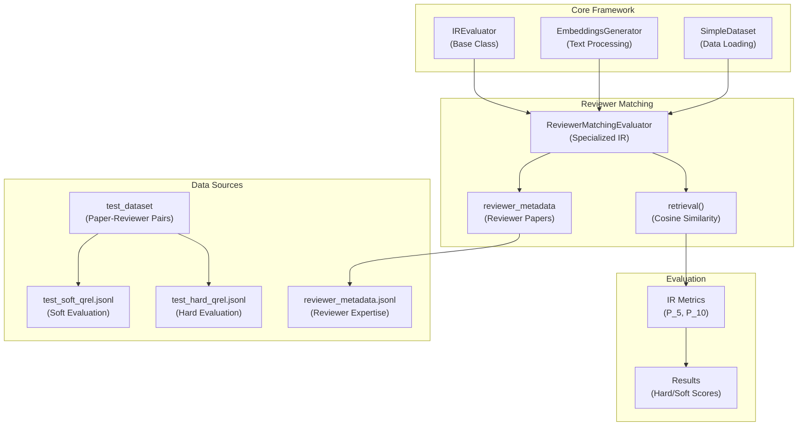
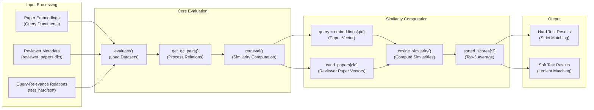
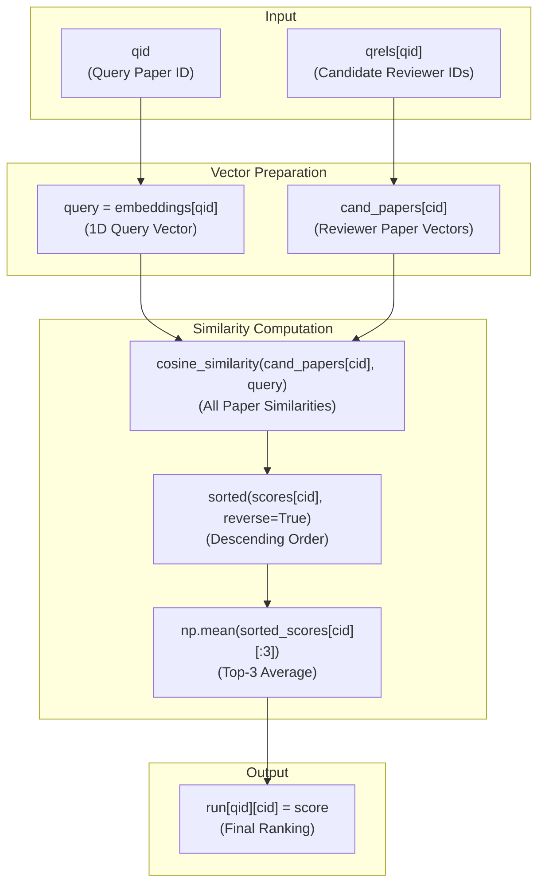
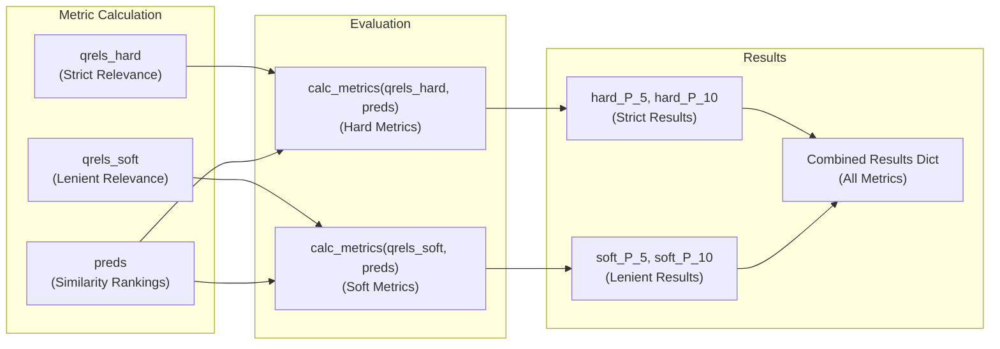

<!-- source: DeepWiki mcp.deepwiki.com · repo allenai/scirepeval · page 7.2 Reviewer Matching · fetched 2026-10-26 -->

# Reviewer Matching

Relevant source files

The following files were used as context for generating this wiki page:

- [evaluation/evaluator.py](evaluation/evaluator.py)
- [evaluation/few_shot_evaluator.py](evaluation/few_shot_evaluator.py)
- [reviewer_matching.py](reviewer_matching.py)

This document covers the paper-reviewer matching evaluation system within SciRepEval. The `ReviewerMatchingEvaluator` implements a specialized information retrieval task that matches academic papers to potential reviewers based on semantic similarity between paper content and reviewer expertise as represented by their publication history.

For general information retrieval evaluation, see [Information Retrieval Evaluator](#2.1). For other specialized evaluators, see [S2AND Evaluation](#7.1) and [Few-Shot Evaluation](#7.3).

## Purpose and Architecture

The reviewer matching system evaluates how well document representation models can identify suitable reviewers for academic papers. This is implemented as a specialized information retrieval task where papers serve as queries and reviewers serve as candidates, with relevance determined by expertise matching.

### System Overview

Sources: [reviewer_matching.py:1-66](), [evaluation/evaluator.py:173-230]()

## Data Flow and Evaluation Process

The reviewer matching evaluation follows a structured pipeline that processes papers, reviewer metadata, and computes similarity-based rankings.

### Evaluation Pipeline

Sources: [reviewer_matching.py:26-44](), [reviewer_matching.py:46-65]()

## Core Components

### ReviewerMatchingEvaluator Class

The `ReviewerMatchingEvaluator` extends the base `IREvaluator` to implement paper-reviewer matching functionality:

| Component | Type | Purpose |
|-----------|------|---------|
| `meta_dataset` | Union[str, tuple] | Source of paper embeddings |
| `test_dataset` | Union[str, tuple] | Test query-candidate pairs |
| `reviewer_metadata` | Union[str, tuple] | Reviewer expertise data |
| `metrics` | tuple | IR evaluation metrics (default: P_5, P_10) |

The class inherits from `IREvaluator` but overrides key methods to implement reviewer-specific logic.

Sources: [reviewer_matching.py:18-25]()

### Data Loading and Processing

The evaluator loads three types of data:

1. **Test Datasets**: Contains hard and soft evaluation splits
   - `test_hard_qrel.jsonl`: Strict reviewer-paper relevance
   - `test_soft_qrel.jsonl`: Lenient reviewer-paper relevance

2. **Reviewer Metadata**: Maps reviewer IDs to their publication lists
   - `reviewer_metadata.jsonl`: Contains `r_id` and `papers` fields

3. **Paper Embeddings**: Vector representations of papers for similarity computation

Sources: [reviewer_matching.py:27-36](), [reviewer_matching.py:47-55]()

## Retrieval Mechanism

### Cosine Similarity Computation

The retrieval process uses cosine similarity between paper embeddings and reviewer expertise representations:

Sources: [reviewer_matching.py:58-65]()

### Expertise Representation Strategy

The system represents reviewer expertise by:

1. **Paper Collection**: Gathering all papers authored by each reviewer
2. **Individual Similarities**: Computing cosine similarity between the query paper and each reviewer paper
3. **Top-K Averaging**: Taking the mean of the top-3 highest similarities as the final reviewer score

This approach captures the strongest areas of overlap between the paper and reviewer expertise.

Sources: [reviewer_matching.py:60-64]()

## Evaluation Metrics and Results

### Metric Types

The reviewer matching evaluation uses precision-based IR metrics:

| Metric | Description | Purpose |
|--------|-------------|---------|
| `P_5` | Precision at 5 | Fraction of relevant reviewers in top-5 results |
| `P_10` | Precision at 10 | Fraction of relevant reviewers in top-10 results |

### Dual Evaluation Framework

The system performs evaluation on two test sets:

1. **Hard Test**: Strict relevance criteria for reviewer-paper matching
2. **Soft Test**: More lenient relevance criteria allowing broader expertise matches

Results are reported with prefixes (`hard_P_5`, `soft_P_5`, etc.) to distinguish between evaluation modes.

Sources: [reviewer_matching.py:38-43]()

### Result Processing

Sources: [reviewer_matching.py:40-43](), [evaluation/evaluator.py:189-200]()

---

