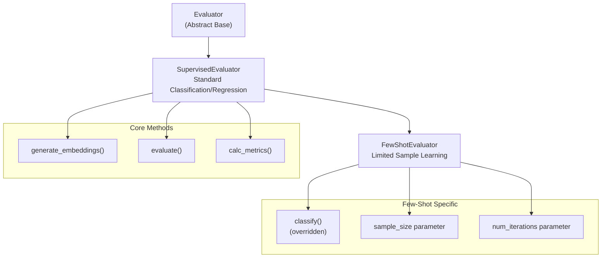
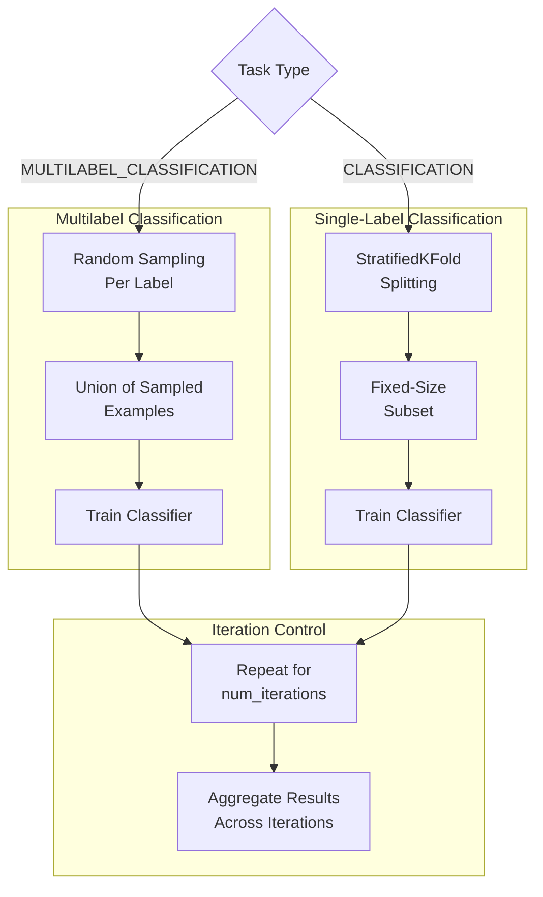
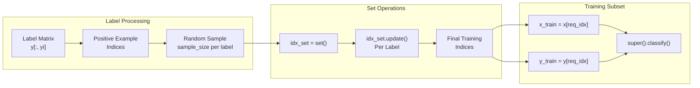
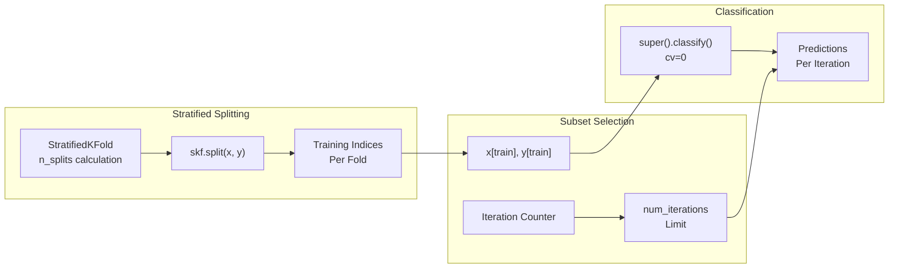
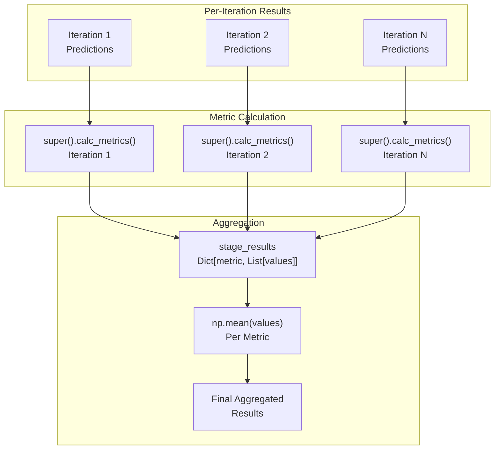
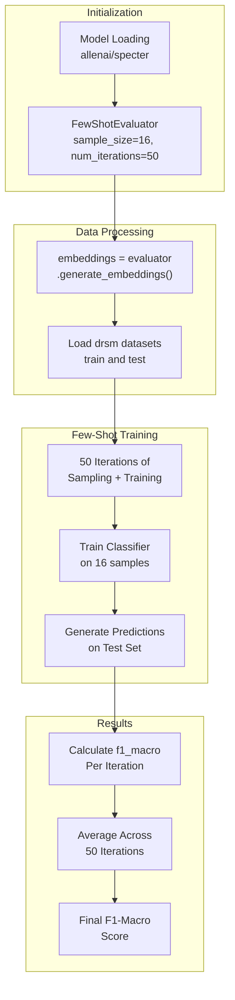

<!-- source: DeepWiki mcp.deepwiki.com · repo allenai/scirepeval · page 7.3 Few-Shot Evaluation · fetched 2026-10-26 -->

# Few-Shot Evaluation

<details>
<summary>Relevant source files</summary>

The following files were used as context for generating this wiki page:

- [evaluation/few_shot_evaluator.py](evaluation/few_shot_evaluator.py)
- [examples/classification.py](examples/classification.py)
- [examples/fewshot_classification.py](examples/fewshot_classification.py)
- [examples/regression.py](examples/regression.py)
- [examples/retrieval.py](examples/retrieval.py)
- [reviewer_matching.py](reviewer_matching.py)

</details>


The Few-Shot Evaluation system enables classification performance assessment using limited training samples through iterative sampling and aggregation. This component extends the standard supervised evaluation framework to handle scenarios where only a small number of labeled examples are available per class.

For standard supervised evaluation with full training data, see [Core Evaluation Framework](#2). For configuration of classification tasks, see [Supported Task Types](#5.2).

## Architecture Overview

The few-shot evaluation system is built as an extension of the core supervised evaluation framework, inheriting from `SupervisedEvaluator` while implementing specialized sampling strategies for limited-data scenarios.

### Class Inheritance and Structure



Sources: [evaluation/few_shot_evaluator.py:13-21](), [evaluation/evaluator.py]()

### Few-Shot Evaluation Configuration

The `FewShotEvaluator` extends the standard supervised evaluator with additional parameters for controlling the few-shot learning process:

| Parameter | Type | Description |
|-----------|------|-------------|
| `sample_size` | int | Number of examples to sample per iteration |
| `num_iterations` | int | Number of sampling iterations to perform |
| `task` | SupervisedTask | Classification or multilabel classification type |
| `model` | Model | Text encoder model for generating embeddings |
| `metrics` | tuple | Evaluation metrics (e.g., "f1_macro", "accuracy") |

Sources: [evaluation/few_shot_evaluator.py:14-20]()

## Few-Shot Methodology

The few-shot evaluation implements two distinct sampling strategies depending on the task type, followed by iterative training and result aggregation.

### Sampling Strategies



Sources: [evaluation/few_shot_evaluator.py:22-46]()

### Multilabel Classification Sampling

For multilabel classification tasks, the system implements per-label random sampling with set union to ensure diverse coverage:



Sources: [evaluation/few_shot_evaluator.py:24-34]()

### Single-Label Classification Sampling

For single-label classification, the system uses `StratifiedKFold` to create balanced subsets:



Sources: [evaluation/few_shot_evaluator.py:36-46]()

## Result Aggregation

The few-shot evaluator aggregates results across multiple iterations to provide stable performance estimates:

### Metric Aggregation Process

| Step | Operation | Description |
|------|-----------|-------------|
| 1 | Collect | Gather predictions from each iteration |
| 2 | Calculate | Compute metrics for each iteration's predictions |
| 3 | Aggregate | Average metric values across iterations |
| 4 | Return | Final aggregated performance scores |



Sources: [evaluation/few_shot_evaluator.py:48-58]()

## Usage Example

The following example demonstrates few-shot classification evaluation on the "drsm" dataset:

### Basic Configuration

```python
from evaluation.encoders import Model
from evaluation.few_shot_evaluator import FewShotEvaluator, SupervisedTask

model = Model(base_checkpoint="allenai/specter")

evaluator = FewShotEvaluator(
    name="drsm",
    task=SupervisedTask.CLASSIFICATION,
    meta_dataset=("allenai/scirepeval", "drsm"),
    test_dataset=("allenai/scirepeval_test", "drsm"),
    model=model,
    metrics=("f1_macro",),
    sample_size=16,
    num_iterations=50
)
```

Sources: [examples/fewshot_classification.py:17-19]()

### Evaluation Flow



Sources: [examples/fewshot_classification.py:21-23]()

## Key Differences from Standard Evaluation

The few-shot evaluator differs from the standard `SupervisedEvaluator` in several critical ways:

| Aspect | SupervisedEvaluator | FewShotEvaluator |
|--------|-------------------|------------------|
| Training Data | Full training dataset | Limited samples per iteration |
| Iterations | Single training run | Multiple iterations with different samples |
| Result Aggregation | Direct metric calculation | Average across iterations |
| Cross-Validation | Standard CV for hyperparameter tuning | Disabled (cv=0) for speed |
| Random Sampling | None | Controlled sampling per class/label |

### Method Override Details

The `FewShotEvaluator` overrides two key methods from its parent class:

1. **`classify()` method**: Implements iterative sampling and training
2. **`calc_metrics()` method**: Aggregates results across iterations

Sources: [evaluation/few_shot_evaluator.py:22-58]()

---

