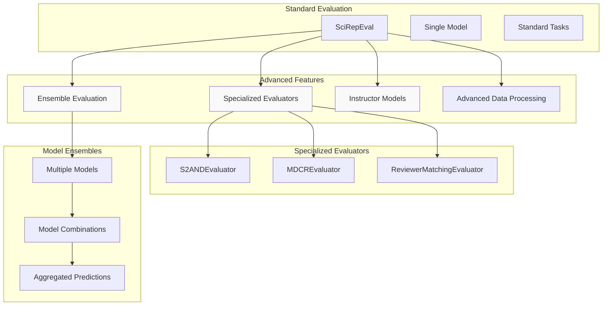
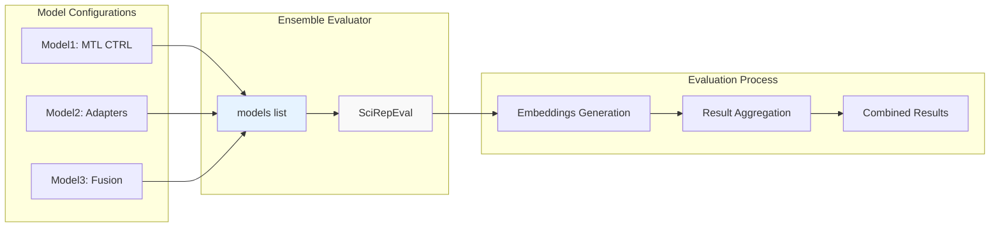
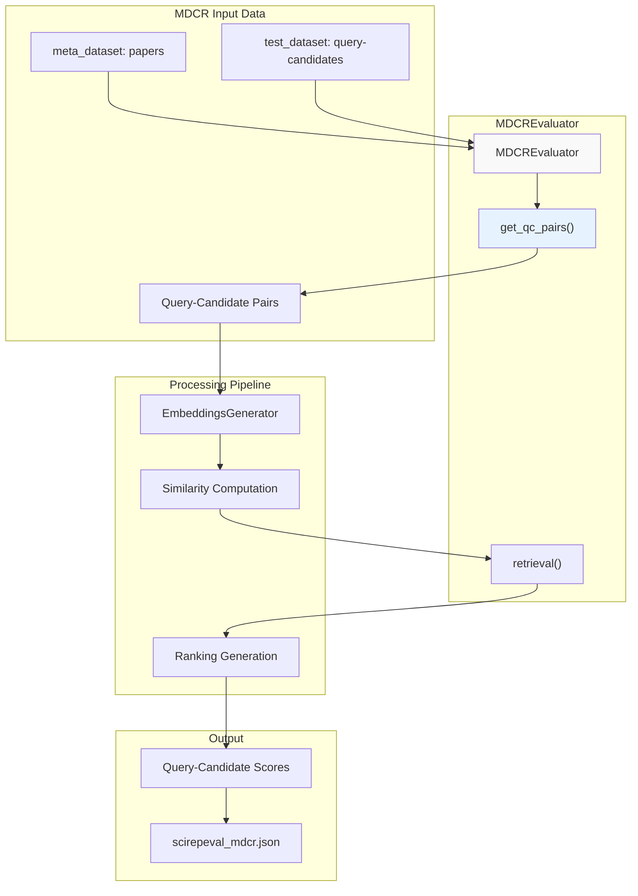
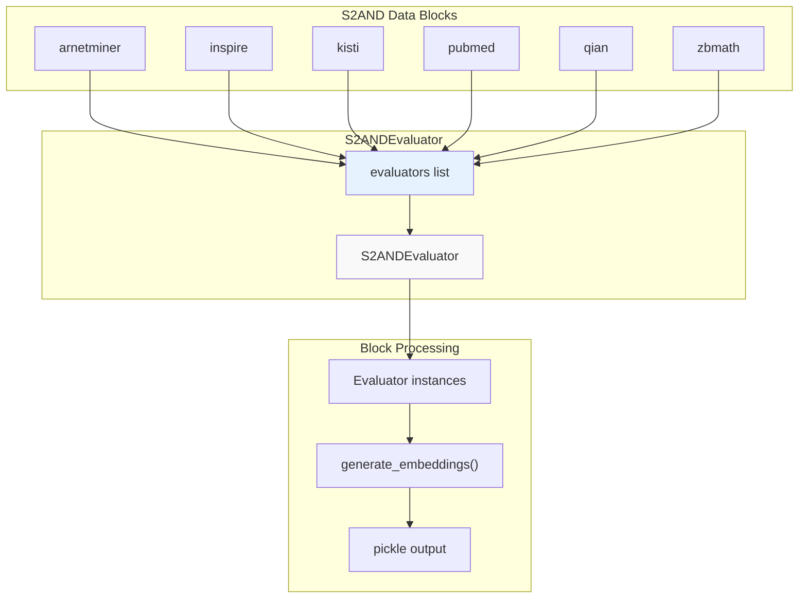
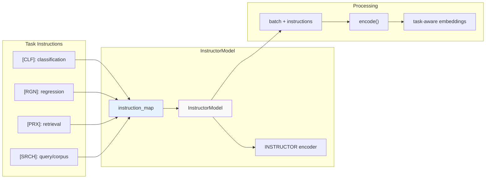
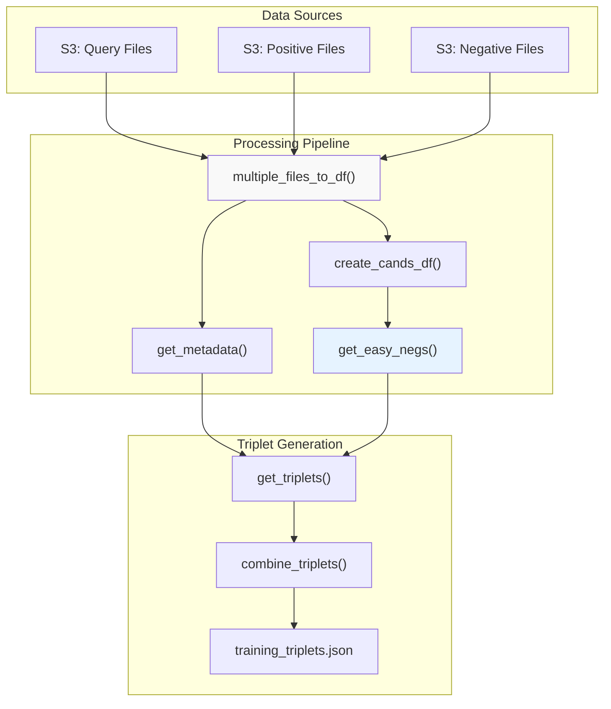

<!-- source: DeepWiki mcp.deepwiki.com · repo allenai/scirepeval · page 8 Advanced Features · fetched 2026-10-26 -->

# Advanced Features

<details>
<summary>Relevant source files</summary>

The following files were used as context for generating this wiki page:

- [evaluation/instructor.py](evaluation/instructor.py)
- [mdcr.py](mdcr.py)
- [s2and_embeddings.py](s2and_embeddings.py)
- [scirepeval_ensemble.py](scirepeval_ensemble.py)
- [update_triplets.py](update_triplets.py)

</details>


This document covers advanced evaluation capabilities in SciRepEval that extend beyond the core framework functionality. These features include ensemble evaluation methods, specialized domain evaluators, and advanced model integrations for complex scientific document representation tasks.

For basic evaluation framework components, see [Core Evaluation Framework](#2). For standard model variants and training, see [Model Architecture and Variants](#3) and [Training System](#4).

## Overview of Advanced Capabilities

SciRepEval provides several advanced features for sophisticated evaluation scenarios:

- **Ensemble Evaluation**: Evaluating multiple model configurations simultaneously and combining their predictions
- **Specialized Domain Evaluators**: Task-specific evaluators for author disambiguation (S2AND) and multi-domain citation recommendation (MDCR)
- **Instruction-Based Models**: Integration with Instructor embeddings for task-aware representation learning
- **Advanced Data Processing**: Specialized dataset handling for complex evaluation scenarios



Sources: [scirepeval_ensemble.py:1-36](), [mdcr.py:21-81](), [s2and_embeddings.py:21-62](), [evaluation/instructor.py:7-26]()

## Ensemble Evaluation

The ensemble evaluation system allows simultaneous assessment of multiple model configurations, enabling comparison and combination of different model variants.

### Ensemble Architecture



The ensemble evaluation is implemented through the standard `SciRepEval` interface but accepts a list of models instead of a single model. Each model configuration can use different variants (PALS, adapters, fusion) and training approaches.

**Key Implementation Details:**

- **Multiple Model Support**: The `SciRepEval.evaluate()` method accepts both single models and model lists [scirepeval_ensemble.py:33]()
- **Model Configuration**: Different model variants can be combined, such as multi-task control tokens with adapter-based models [scirepeval_ensemble.py:9-14]()
- **Task Filtering**: Ensemble evaluation supports task-specific evaluation through the `task_list` parameter [scirepeval_ensemble.py:26-31]()

Sources: [scirepeval_ensemble.py:1-36]()

### Ensemble Configuration Example

The ensemble system supports various model combinations:

```python
# MTL with control tokens
model1 = Model(variant="default", task_id="[PRX]", base_checkpoint=checkpoint, use_ctrl_codes=True)

# Adapter-based model  
model2 = Model(variant="adapters", task_id="[PRX]", base_checkpoint="allenai/specter", 
               adapters_load_from=adapter_path, all_tasks=["[CLF]", "[QRY]", "[RGN]", "[PRX]"])

models = [model2, model1]
evaluator = SciRepEval(tasks_config=config, batch_size=16)
evaluator.evaluate(models, output_path)
```

Sources: [scirepeval_ensemble.py:8-34]()

## MDCR Evaluation

The Multi-Domain Citation Recommendation (MDCR) evaluator provides specialized assessment for citation recommendation across different academic domains.

### MDCR Architecture



The `MDCREvaluator` extends the `IREvaluator` class to handle the specific requirements of multi-domain citation recommendation tasks.

**Core Components:**

- **Query-Candidate Processing**: The `get_qc_pairs()` method processes field-of-study organized test data [mdcr.py:27-36]()
- **Model Integration**: Supports multiple model types including GPT-3, Instructor, and standard transformer models [mdcr.py:69-77]()
- **Result Generation**: Outputs query-candidate similarity scores in JSON format [mdcr.py:48-53]()

Sources: [mdcr.py:21-81]()

### MDCR Data Processing

The MDCR evaluator handles complex nested data structures representing academic domains and model predictions:

```python
def get_qc_pairs(self, dataset):
    qrpairs = dict()
    for fos_dict in dataset:
        for fos in fos_dict:
            for query in fos_dict[fos]:
                qrpairs[query] = dict()
                for model in fos_dict[fos][query]:
                    cands = fos_dict[fos][query][model]
                    qrpairs[query].update({v: 1 if model == "true" else 0 for v in cands})
    return qrpairs
```

This method processes hierarchical data organized by field-of-study (FoS) and converts it into query-candidate relevance pairs.

Sources: [mdcr.py:27-36]()

## S2AND Evaluation

The S2AND (Semantic Scholar Author Name Disambiguation) evaluator provides specialized assessment for author disambiguation tasks across multiple academic domains.

### S2AND Architecture



The S2AND evaluator creates separate `Evaluator` instances for each academic domain block, enabling domain-specific author disambiguation assessment.

**Implementation Details:**

- **Multi-Domain Support**: Handles six academic domains (arnetminer, inspire, kisti, pubmed, qian, zbmath) [s2and_embeddings.py:24]()
- **Unified Processing**: Each domain uses the same `Evaluator` class with `SimpleDataset` for consistent processing [s2and_embeddings.py:26-28]()
- **Embedding Generation**: Generates and saves embeddings for each domain separately [s2and_embeddings.py:30-37]()

Sources: [s2and_embeddings.py:21-62]()

### S2AND Processing Pipeline

```python
class S2ANDEvaluator:
    def __init__(self, data_dir: str, model: Model, batch_size: int = 16):
        blocks = ["arnetminer", "inspire", "kisti", "pubmed", "qian", "zbmath"]
        self.evaluators = [
            Evaluator(block, f"{data_dir}/{block}/{block}_papers.json", SimpleDataset, model, batch_size, [],
                      "paper_id", process_fn=read_data) for block in blocks]

    def generate_embeddings(self, suffix: str):
        for evaluator in self.evaluators:
            results = evaluator.generate_embeddings()
            paper_ids, embs = np.array([str(k) for k in results]), np.array([results[k] for k in results])
            pickle.dump((embs, paper_ids), 
                       open(f"{self.data_dir}/{evaluator.name}/{evaluator.name}_{suffix}.pkl", "wb"))
```

Sources: [s2and_embeddings.py:23-37]()

## Instructor Model Integration

The Instructor model integration provides task-aware embeddings through instruction-based prompting, allowing models to adapt their representations based on task context.

### Instructor Model Architecture



The `InstructorModel` class wraps the INSTRUCTOR embedding model to provide task-specific instructions for different evaluation scenarios.

**Key Features:**

- **Task-Specific Instructions**: Different instruction templates for classification, regression, and retrieval tasks [evaluation/instructor.py:11-14]()
- **Dynamic Instruction Application**: Instructions are applied based on the current `task_id` [evaluation/instructor.py:18-25]()
- **Search Task Handling**: Special handling for search tasks with query/corpus distinction [evaluation/instructor.py:22-23]()

Sources: [evaluation/instructor.py:7-26]()

### Instruction Mapping System

The instructor model uses a comprehensive mapping system to apply appropriate instructions:

```python
self.instruction_map = {
    "[CLF]": f"{instr_format} for classification: ", 
    "[RGN]": f"{instr_format} for regression: ",
    "[PRX]": f"{instr_format} for retrieval: ",
    "[SRCH]": {
        "q": "Represent the Science query for retrieving supporting documents: ",
        "c": f"{instr_format} for retrieval: "
    }
}
```

This mapping ensures that each task type receives contextually appropriate instructions to guide the embedding generation process.

Sources: [evaluation/instructor.py:11-14]()

## Advanced Data Processing

The framework includes sophisticated data processing capabilities for complex evaluation scenarios, particularly for training data generation and specialized dataset handling.

### Triplet Generation Pipeline



The triplet generation system processes large-scale data from S3 to create training triplets with varying difficulty levels for representation learning.

**Processing Components:**

- **Multi-File Processing**: Efficiently combines multiple JSON files from S3 storage [update_triplets.py:14-19]()
- **Metadata Extraction**: Creates comprehensive metadata dictionaries for queries and candidates [update_triplets.py:80-91]()
- **Easy Negative Generation**: Generates negative examples with different field-of-study relationships [update_triplets.py:38-65]()
- **Triplet Assembly**: Combines queries, positives, and negatives into training triplets [update_triplets.py:67-78]()

Sources: [update_triplets.py:14-129]()

### Field-of-Study Based Negative Sampling

The system implements sophisticated negative sampling based on field-of-study relationships:

```python
def get_easy_negs(row):
    q_fos = set(row["query_fos"].split(","))
    
    # Random negatives from different FoS
    rand_fos_cands = {k:v for k,v in grped_fos_dict.items() if not q_fos.intersection(k)}
    rand_negs = np.random.choice(rand_fos_cands_array, 2, replace=False).tolist()
    
    # Overlapping FoS negatives  
    overlap_fos_cands = {k:v for k,v in grped_fos_dict.items() if q_fos.intersection(k)}
    overlap_fos_negs = np.random.choice(overlap_fos_cands_array, 2, replace=False).tolist()
    
    # Same FoS negatives
    same_fos_cands = {k:v for k,v in grped_fos_dict.items() if set(k) == q_fos}
    same_fos_negs = np.random.choice(same_fos_cands_array, 2, replace=False).tolist()
```

This approach creates negative examples with varying levels of difficulty based on field-of-study similarity to the query.

Sources: [update_triplets.py:38-65]()

---

