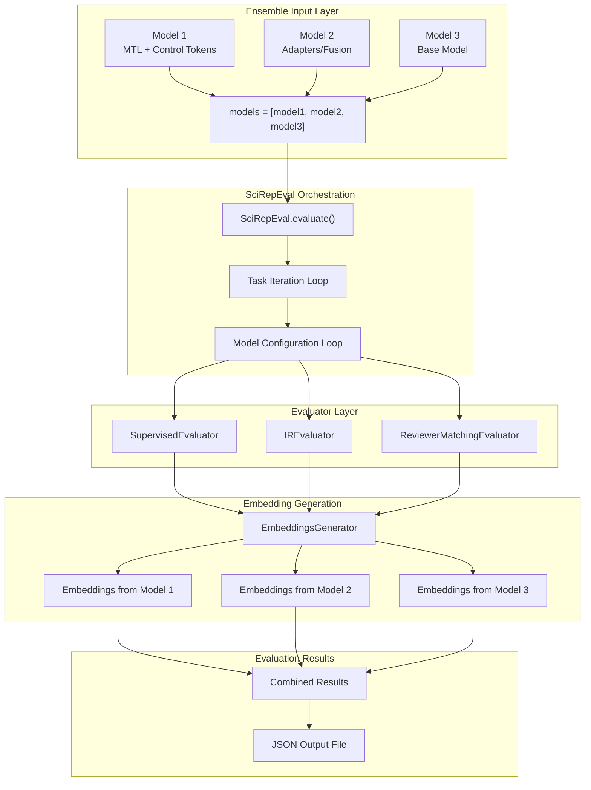
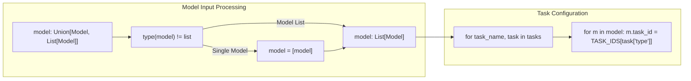
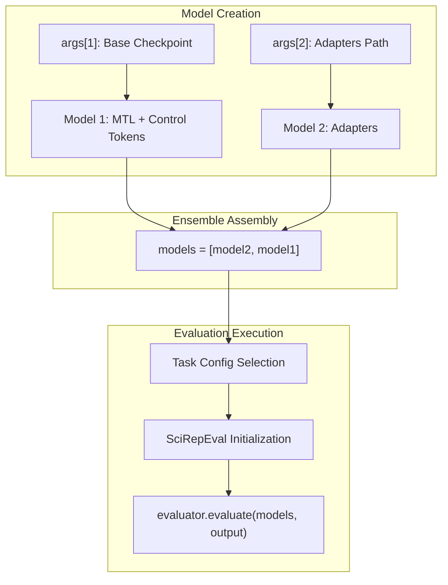
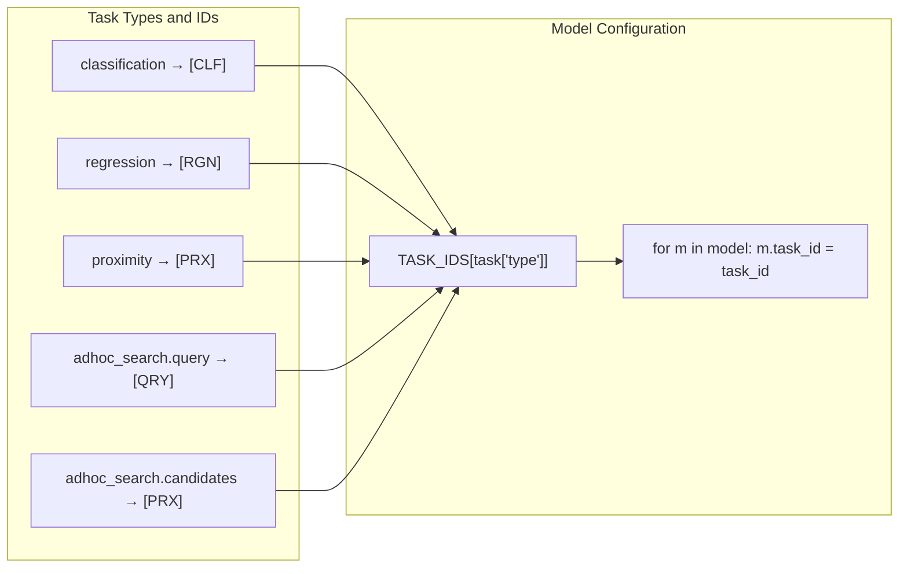
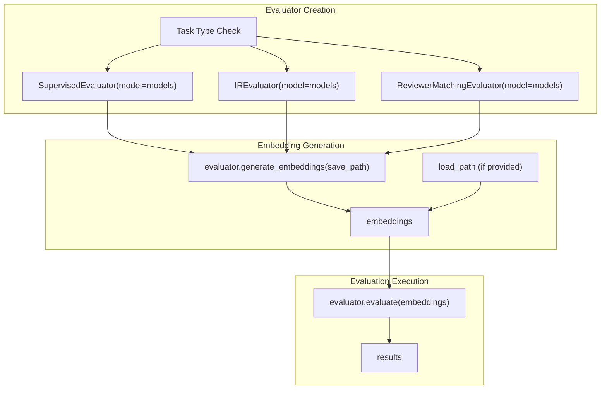
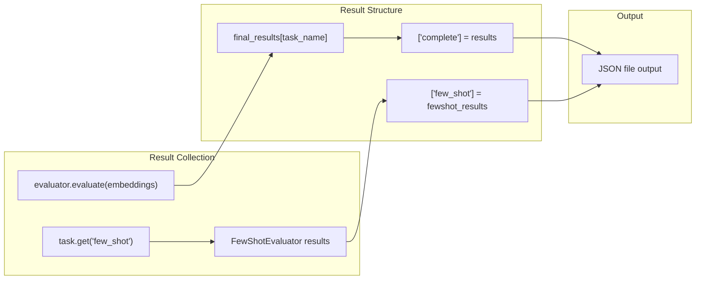

<!-- source: DeepWiki mcp.deepwiki.com · repo allenai/scirepeval · page 8.1 Ensemble Evaluation · fetched 2026-10-26 -->

# Ensemble Evaluation

Relevant source files

The following files were used as context for generating this wiki page:

- [evaluation/gpt3_encoder.py](evaluation/gpt3_encoder.py)
- [scirepeval.py](scirepeval.py)
- [scirepeval_ensemble.py](scirepeval_ensemble.py)
- [update_triplets.py](update_triplets.py)

This document covers the ensemble evaluation capabilities in SciRepEval, which allow evaluating multiple model configurations simultaneously and combining their outputs for improved performance. For information about individual model evaluation, see [Core Evaluation Framework](#2). For specialized single-model evaluators, see [Specialized Evaluators](#7).

## Purpose and Overview

The ensemble evaluation system enables researchers to:
- Evaluate multiple model variants simultaneously on the same tasks
- Combine different model architectures (e.g., adapters, PALS, control tokens)
- Compare ensemble performance against individual model performance
- Leverage complementary strengths of different model configurations

## Ensemble Architecture

The ensemble evaluation system builds upon the core SciRepEval framework by extending the model parameter to accept multiple models and coordinating their evaluation across tasks.

Sources: [scirepeval.py:45-52](), [scirepeval_ensemble.py:9-15]()

## Ensemble Configuration

### Model List Handling

The core evaluation framework accepts either a single model or a list of models through the `Union[Model, List[Model]]` type annotation. When a list is provided, each model in the ensemble is configured with appropriate task identifiers.

Sources: [scirepeval.py:47-52]()

### Supported Model Variants

Ensemble evaluation supports combining different model variants and configurations:

| Model Type | Configuration | Task ID Support |
|------------|---------------|-----------------|
| MTL Control | `variant="default"`, `use_ctrl_codes=True` | `[CLF]`, `[RGN]`, `[PRX]`, `[QRY]` |
| Adapters | `variant="adapters"`, `adapters_load_from` | Task-specific adapters |
| Fusion | `variant="fusion"`, `fusion_load_from` | Multi-adapter fusion |
| PALS | `variant="pals"` | Parameter-efficient adaptation |
| Base Models | `variant="default"` | Standard transformers |

Sources: [scirepeval_ensemble.py:9-14](), [scirepeval.py:144-154]()

## Implementation Details

### Ensemble Evaluation Script

The `scirepeval_ensemble.py` script demonstrates typical ensemble usage:

Sources: [scirepeval_ensemble.py:7-33]()

### Task-Specific Model Configuration

For each task in the evaluation pipeline, all models in the ensemble receive the appropriate task identifier based on the task type:

Sources: [scirepeval.py:15-16](), [scirepeval.py:49-52]()

## Evaluation Pipeline

### Embedding Generation

Each model in the ensemble generates embeddings independently, which are then combined during the evaluation phase. The system handles ensemble embedding generation through the evaluator classes:

Sources: [scirepeval.py:85-106]()

### Result Aggregation

Results from ensemble evaluation are collected and stored in the same format as single-model evaluation, with the ensemble behavior handled internally by the evaluator classes:

Sources: [scirepeval.py:106-118]()

## Usage Examples

### Basic Ensemble Setup

To create and evaluate an ensemble of models:

1. **Model 1**: Multi-task learning with control tokens
   - `variant="default"`
   - `use_ctrl_codes=True`
   - `task_id="[PRX]"`

2. **Model 2**: Adapter-based model
   - `variant="adapters"`
   - `adapters_load_from=adapter_path`
   - Task-specific adapter loading

3. **Ensemble Evaluation**: 
   - Combine models in list: `models = [model1, model2]`
   - Pass to `SciRepEval.evaluate(models, output_path)`

Sources: [scirepeval_ensemble.py:9-33]()

### Command-Line Arguments

The ensemble script accepts the following arguments:
- `args[1]`: Base checkpoint path for Model 1
- `args[2]`: Adapters directory/configuration for Model 2  
- `args[3]`: Output file path for results
- `args[4]`: Optional task configuration file (default: `scirepeval_tasks.jsonl`)
- `args[6:]`: Optional specific task list for evaluation

Sources: [scirepeval_ensemble.py:23-33]()

---

