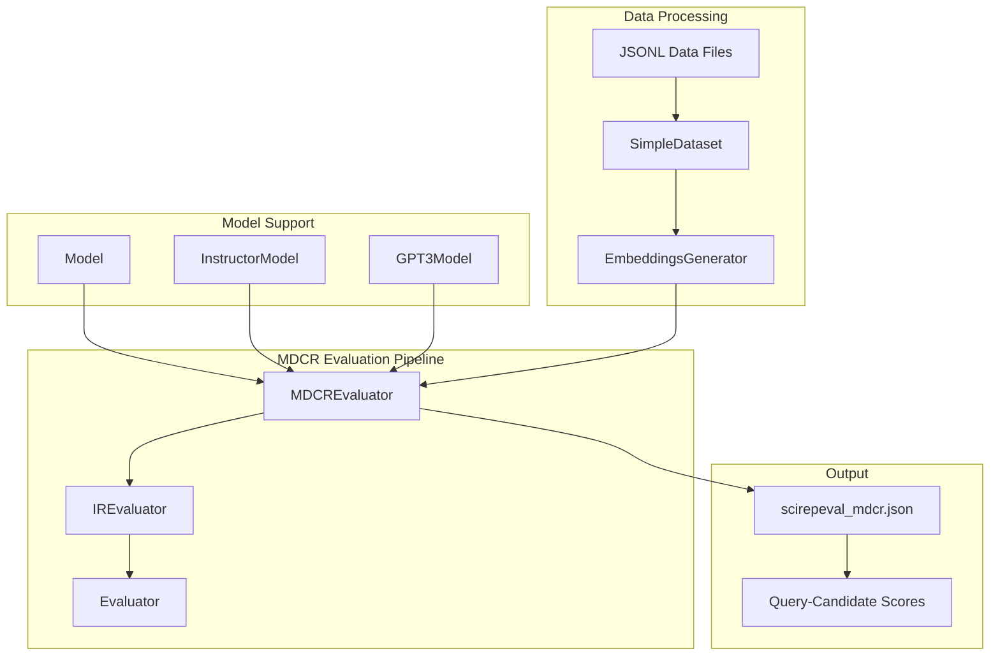
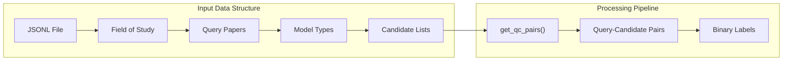
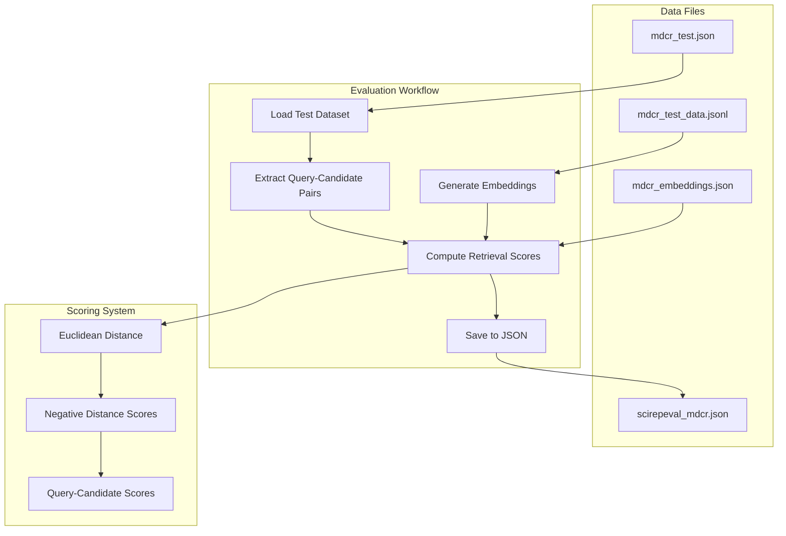
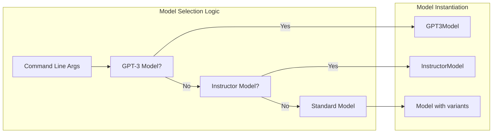
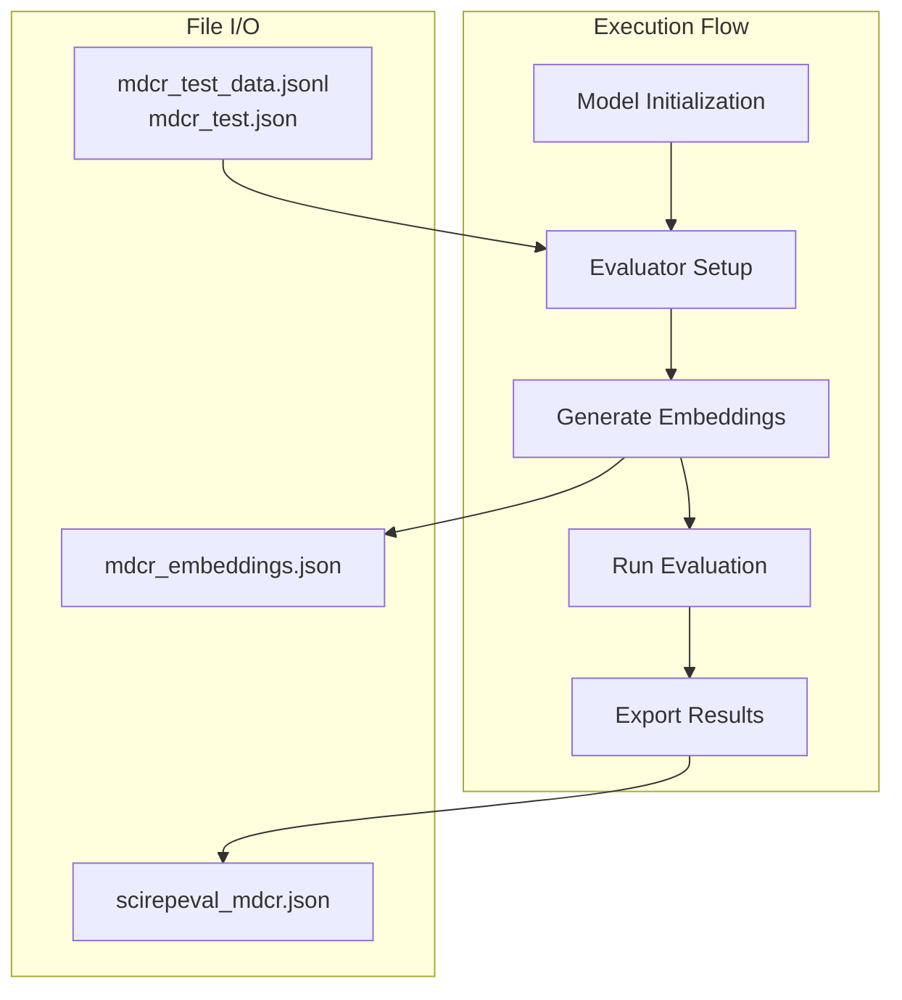

<!-- source: DeepWiki mcp.deepwiki.com · repo allenai/scirepeval · page 8.2 MDCR Evaluation · fetched 2026-10-26 -->

# MDCR Evaluation

<details>
<summary>Relevant source files</summary>

The following files were used as context for generating this wiki page:

- [evaluation/evaluator.py](evaluation/evaluator.py)
- [evaluation/instructor.py](evaluation/instructor.py)
- [mdcr.py](mdcr.py)
- [s2and_embeddings.py](s2and_embeddings.py)

</details>


## Purpose and Scope

The MDCR (Multi-Domain Citation Recommendation) evaluation framework provides specialized functionality for evaluating scientific document representation models on citation recommendation tasks across multiple research domains. This system extends the core information retrieval evaluation capabilities to handle domain-specific citation recommendation datasets with query-candidate pairs organized by field of study.

For general information retrieval evaluation, see [Specialized Evaluators](#7). For the core evaluation framework, see [Core Evaluation Framework](#2).

## Architecture Overview

The MDCR evaluation system is built on top of the core IR evaluation framework, extending `IREvaluator` with domain-specific data processing and evaluation logic.



Sources: [mdcr.py:21-26](), [evaluation/evaluator.py:173-179]()

## Data Format and Processing

The MDCR evaluation system processes citation recommendation data organized by field of study (FOS) with a specific JSON structure containing query-candidate relationships.

### Data Structure



The `get_qc_pairs` method in `MDCREvaluator` processes the hierarchical data structure:

| Level | Description | Processing |
|-------|-------------|------------|
| FOS | Field of Study domains | Iterate through each domain |
| Query | Query papers within each FOS | Extract query identifiers |
| Model | Model types ("true" vs others) | Determine positive/negative labels |
| Candidates | Lists of candidate papers | Assign binary relevance scores |

Sources: [mdcr.py:27-36]()

### Query-Candidate Pair Generation

The system transforms the nested JSON structure into flat query-candidate pairs with binary relevance labels:

- **Positive candidates**: Papers from the "true" model (label = 1)
- **Negative candidates**: Papers from all other models (label = 0)

Sources: [mdcr.py:27-36]()

## Evaluation Process

The MDCR evaluation follows a specialized retrieval-based approach that differs from standard IR evaluation by focusing on citation recommendation scoring.



Sources: [mdcr.py:38-53](), [evaluation/evaluator.py:218-229]()

### Scoring Mechanism

The evaluation uses the inherited retrieval mechanism from `IREvaluator` but outputs results in a specialized format:

1. **Embedding Generation**: Creates vector representations for all documents
2. **Distance Calculation**: Computes Euclidean distances between query and candidate embeddings
3. **Score Assignment**: Assigns negative distance values as similarity scores
4. **Result Formatting**: Outputs query-candidate pairs with computed scores

Sources: [mdcr.py:47-53](), [evaluation/evaluator.py:218-229]()

## Model Support

The MDCR evaluator supports the full range of model variants available in the SciRepEval framework.

### Supported Model Types

| Model Type | Implementation | Task ID |
|------------|----------------|---------|
| Standard HuggingFace | `Model` class | `[PRX]` |
| PALS Architecture | `Model` with variant="pals" | `[PRX]` |
| Adapter-based | `Model` with adapters | `[PRX]` |
| Adapter Fusion | `Model` with fusion | `[PRX]` |
| Instructor Models | `InstructorModel` | `[PRX]` |
| GPT-3 Models | `GPT3Model` | N/A |

All models use the proximity task identifier `[PRX]` for citation recommendation tasks.

Sources: [mdcr.py:58-77]()

### Model Configuration



Sources: [mdcr.py:67-77]()

## Usage and Configuration

### Command Line Interface

The MDCR evaluator can be executed as a standalone script with various configuration options:

```bash
python mdcr.py --model <model_name> --mtype <variant> [options]
```

### Key Parameters

| Parameter | Description | Default |
|-----------|-------------|---------|
| `--model` | HuggingFace model identifier | Required |
| `--mtype` | Model variant (default, pals, adapters, fusion) | "default" |
| `--ctrl-tokens` | Enable control token usage | False |
| `--instructor` | Use Instructor model | False |
| `--gpt3-model` | GPT-3 model for OpenAI API | None |
| `--adapters-dir` | Path to adapter checkpoints | None |
| `--fusion-dir` | Path to fusion checkpoints | None |

Sources: [mdcr.py:57-67]()

### Evaluation Execution

The typical evaluation workflow involves:

1. **Model Initialization**: Create model instance based on specified variant
2. **Evaluator Setup**: Initialize `MDCREvaluator` with data paths and configuration
3. **Embedding Generation**: Compute and cache document embeddings
4. **Evaluation Execution**: Run citation recommendation evaluation
5. **Result Export**: Save query-candidate scores to JSON file



Sources: [mdcr.py:78-80]()

### Integration with Core Framework

The MDCR evaluator integrates with the broader SciRepEval ecosystem through:

- **Shared Model Interface**: Uses the same `Model` abstraction as other evaluators
- **Common Embedding Pipeline**: Leverages `EmbeddingsGenerator` for consistent processing
- **Dataset Compatibility**: Works with `SimpleDataset` for document loading
- **Metric Framework**: Inherits IR evaluation capabilities from `IREvaluator`

Sources: [mdcr.py:21-26](), [evaluation/evaluator.py:173-179]()