# Page: Overview

# Overview

<details>
<summary>Relevant source files</summary>

The following files were used as context for generating this wiki page:

- [README.md](README.md)
- [requirements.txt](requirements.txt)

</details>


## Purpose and Scope

SciRepEval is a comprehensive framework for training and evaluating scientific document representation models across multiple task formats and domains. The repository provides both a standardized benchmark consisting of 24 scientific document tasks and the infrastructure to train multi-task transformer models with parameter-efficient adaptation methods.

This document covers the high-level architecture and core capabilities of the SciRepEval system. For detailed information about specific components, see [Core Evaluation Framework](#2) for the evaluation engine, [Model Architecture and Variants](#3) for supported model types, [Training System](#4) for multi-task training capabilities, and [Task Configuration and Evaluation](#5) for benchmark task definitions.

## System Architecture

SciRepEval operates through a modular architecture that separates evaluation orchestration, model abstraction, and task-specific evaluation logic. The system supports both pre-trained model evaluation and custom model training across scientific document understanding tasks.

### Core Components and File Structure

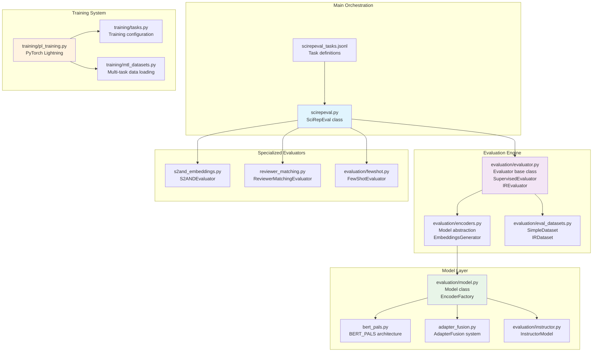

Sources: [README.md:1-98](), [scirepeval.py](), [evaluation/evaluator.py](), [evaluation/encoders.py](), [evaluation/model.py]()

## Core Capabilities

SciRepEval provides four primary capabilities organized around scientific document representation learning:

| Capability | Description | Key Components |
|------------|-------------|----------------|
| **Benchmark Evaluation** | Evaluate models on 24 standardized scientific tasks | `scirepeval.py`, `scirepeval_tasks.jsonl` |
| **Multi-Task Training** | Train transformer models with parameter-efficient methods | `training/pl_training.py`, `bert_pals.py` |
| **Model Abstraction** | Unified interface for HuggingFace, local, and custom models | `evaluation/model.py`, `evaluation/encoders.py` |
| **Specialized Evaluation** | Domain-specific evaluators for scientific tasks | `s2and_embeddings.py`, `reviewer_matching.py` |

### Task Format Support

The framework supports four distinct task formats that cover different aspects of scientific document understanding:

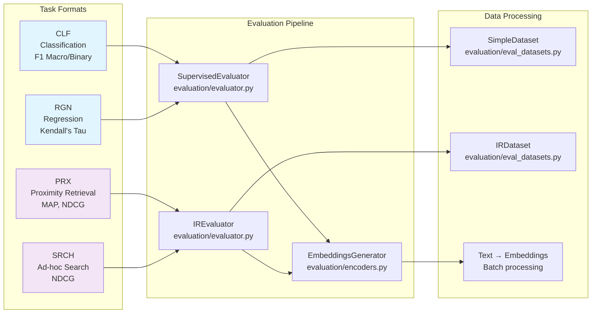

Sources: [README.md:49-74](), [evaluation/evaluator.py](), [evaluation/eval_datasets.py]()

## Model Architecture Support

SciRepEval provides a unified interface for multiple model architectures through the `Model` class and `EncoderFactory`. The system supports both standard transformer models and parameter-efficient adaptation methods:

### Supported Model Types

- **HuggingFace Models**: Standard transformer models loaded via `transformers.AutoModel`
- **BERT PALS**: Parameter-efficient adaptation using the BERT PALS architecture in [bert_pals.py]()
- **Adapter Systems**: Task-specific adapters and AdapterFusion in [adapter_fusion.py]()
- **Instructor Models**: Instruction-based embeddings via [evaluation/instructor.py]()
- **External APIs**: Integration with OpenAI GPT-3 and other external services

The model abstraction layer in [evaluation/encoders.py]() handles embedding generation, caching, and batch processing across all supported model types.

## Data Infrastructure

The benchmark utilizes a comprehensive dataset infrastructure spanning 24 scientific document tasks:

- **Data Sources**: AWS S3 (~24 GB), HuggingFace Datasets (`allenai/scirepeval`, `allenai/scirepeval_test`)
- **Task Coverage**: Citation prediction, author matching, field classification, peer review scoring, and information retrieval
- **Evaluation Metrics**: F1 scores, Kendall's Tau, MAP, NDCG, and specialized metrics like B³ F1 for clustering

The framework separates test metadata (for embedding generation) from labeled examples (for evaluation), enabling proper representation learning evaluation protocols.

Sources: [README.md:26-48](), [requirements.txt:1-102]()

---

# Page: System Architecture

# System Architecture

<details>
<summary>Relevant source files</summary>

The following files were used as context for generating this wiki page:

- [evaluation/encoders.py](evaluation/encoders.py)
- [evaluation/evaluator.py](evaluation/evaluator.py)
- [evaluation/gpt3_encoder.py](evaluation/gpt3_encoder.py)
- [scirepeval.py](scirepeval.py)

</details>


This document provides a comprehensive overview of the SciRepEval system architecture, detailing how the core evaluation framework, model interfaces, and orchestration components interact to enable scientific document representation evaluation. This covers the high-level system design, data flow patterns, and component relationships that enable multi-task evaluation across different model variants.

For specific task configuration details, see [Task Definitions](#5.1). For training system architecture, see [Training Framework](#4.1).

## Overview

SciRepEval implements a modular evaluation framework consisting of three primary architectural layers:

1. **Orchestration Layer**: Main coordination through `SciRepEval` class
2. **Core Evaluation Framework**: Abstract and concrete evaluator implementations  
3. **Model Interface Layer**: Unified model abstraction supporting multiple variants

The system supports evaluation across classification, regression, and information retrieval tasks using various model architectures including standard transformers, parameter-efficient methods (PALS, adapters), and external APIs.

## Core System Components

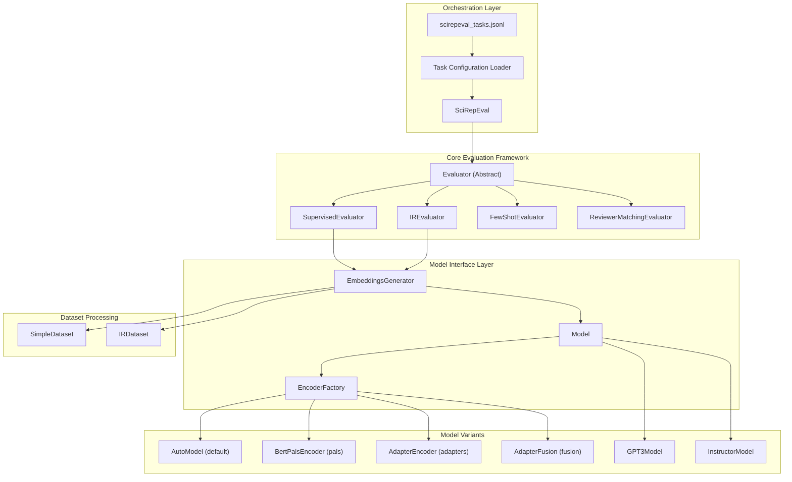

**Sources**: [scirepeval.py:22-43](), [evaluation/evaluator.py:27-50](), [evaluation/encoders.py:48-75]()

## Evaluation Pipeline Flow

The evaluation pipeline follows a standardized flow from task configuration through model evaluation to metric calculation:

```mermaid
graph LR
    subgraph "Configuration Input"
        TasksJSONL["scirepeval_tasks.jsonl"]
        ModelConfig["Model Configuration"]
    end
    
    subgraph "Task Processing"
        SciRepEvalEvaluate["SciRepEval.evaluate()"]
        TaskIteration["Task Loop Processing"]
        EvaluatorFactory["Dynamic Evaluator Creation"]
    end
    
    subgraph "Data Loading"
        DatasetLoader["Dataset Loading"]
        SimpleDatasetClass["SimpleDataset.__init__()"]
        IRDatasetClass["IRDataset.__init__()"]
    end
    
    subgraph "Embedding Generation"
        EmbeddingsGeneratorGenerate["EmbeddingsGenerator.generate_embeddings()"]
        ModelCall["Model.__call__()"]
        BatchProcessing["Batch Processing Loop"]
    end
    
    subgraph "Evaluation Execution"
        EvaluatorEvaluate["Evaluator.evaluate()"]
        MetricCalculation["calc_metrics()"]
        ResultsOutput["JSON Results Output"]
    end
    
    TasksJSONL --> SciRepEvalEvaluate
    ModelConfig --> SciRepEvalEvaluate
    SciRepEvalEvaluate --> TaskIteration
    TaskIteration --> EvaluatorFactory
    EvaluatorFactory --> DatasetLoader
    
    DatasetLoader --> SimpleDatasetClass
    DatasetLoader --> IRDatasetClass
    
    SimpleDatasetClass --> EmbeddingsGeneratorGenerate
    IRDatasetClass --> EmbeddingsGeneratorGenerate
    EmbeddingsGeneratorGenerate --> ModelCall
    ModelCall --> BatchProcessing
    
    BatchProcessing --> EvaluatorEvaluate
    EvaluatorEvaluate --> MetricCalculation
    MetricCalculation --> ResultsOutput
```

**Sources**: [scirepeval.py:45-119](), [evaluation/evaluator.py:44-46](), [evaluation/embeddings_generator.py]()

## Model Architecture and Variant Support

The system implements a unified model interface that abstracts different encoder variants while maintaining consistent evaluation protocols:

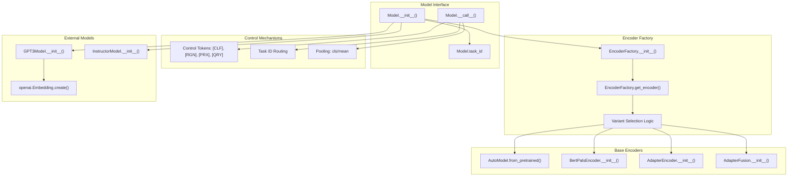

**Sources**: [evaluation/encoders.py:13-46](), [evaluation/encoders.py:48-139](), [evaluation/gpt3_encoder.py:7-30]()

## Task Configuration and Data Flow

The system processes task configurations through a standardized pipeline that maps JSONL definitions to evaluator instances:

| Component | File Path | Key Classes/Functions | Purpose |
|-----------|-----------|---------------------|---------|
| Task Loading | `scirepeval.py` | `SciRepEval.__init__()` | Parse JSONL task configurations |
| Dataset Handling | `evaluation/eval_datasets.py` | `SimpleDataset`, `IRDataset` | Load and preprocess evaluation data |
| Embedding Generation | `evaluation/embeddings_generator.py` | `EmbeddingsGenerator` | Batch process text to embeddings |
| Metric Calculation | `evaluation/evaluator.py` | `calc_metrics()` | Compute task-specific performance metrics |

```mermaid
graph LR
    subgraph "Configuration Processing"
        JSONLParsing["JSONL Line-by-line Parsing"]
        TaskDictConstruction["Task Dictionary Construction"]
        MetadataExtraction["Metadata Extraction"]
    end
    
    subgraph "Evaluator Instantiation"
        TaskTypeDetection["Task Type Detection"]
        SupervisedTaskEnum["SupervisedTask.CLASSIFICATION/REGRESSION"]
        IRTaskDetection["IR Task Detection"]
        SpecializedTaskDetection["Specialized Task Detection"]
    end
    
    subgraph "Data Processing Pipeline"
        DatasetInstantiation["Dataset Class Instantiation"]
        TokenizerSetup["Tokenizer Configuration"]
        BatchConfiguration["Batch Size Configuration"]
        FieldMapping["Field Mapping Setup"]
    end
    
    subgraph "Execution Flow"
        EmbeddingGeneration["generate_embeddings()"]
        EvaluationExecution["evaluate()"]
        MetricsAggregation["Metrics Aggregation"]
        ResultsSerialization["JSON Results Serialization"]
    end
    
    JSONLParsing --> TaskDictConstruction
    TaskDictConstruction --> MetadataExtraction
    MetadataExtraction --> TaskTypeDetection
    
    TaskTypeDetection --> SupervisedTaskEnum
    TaskTypeDetection --> IRTaskDetection
    TaskTypeDetection --> SpecializedTaskDetection
    
    SupervisedTaskEnum --> DatasetInstantiation
    IRTaskDetection --> DatasetInstantiation
    SpecializedTaskDetection --> DatasetInstantiation
    
    DatasetInstantiation --> TokenizerSetup
    TokenizerSetup --> BatchConfiguration
    BatchConfiguration --> FieldMapping
    
    FieldMapping --> EmbeddingGeneration
    EmbeddingGeneration --> EvaluationExecution
    EvaluationExecution --> MetricsAggregation
    MetricsAggregation --> ResultsSerialization
```

**Sources**: [scirepeval.py:24-43](), [scirepeval.py:49-119](), [evaluation/evaluator.py:66-77]()

## Task-Specific Control Flow

The system implements task-specific routing through control tokens and task IDs that enable multi-task model evaluation:

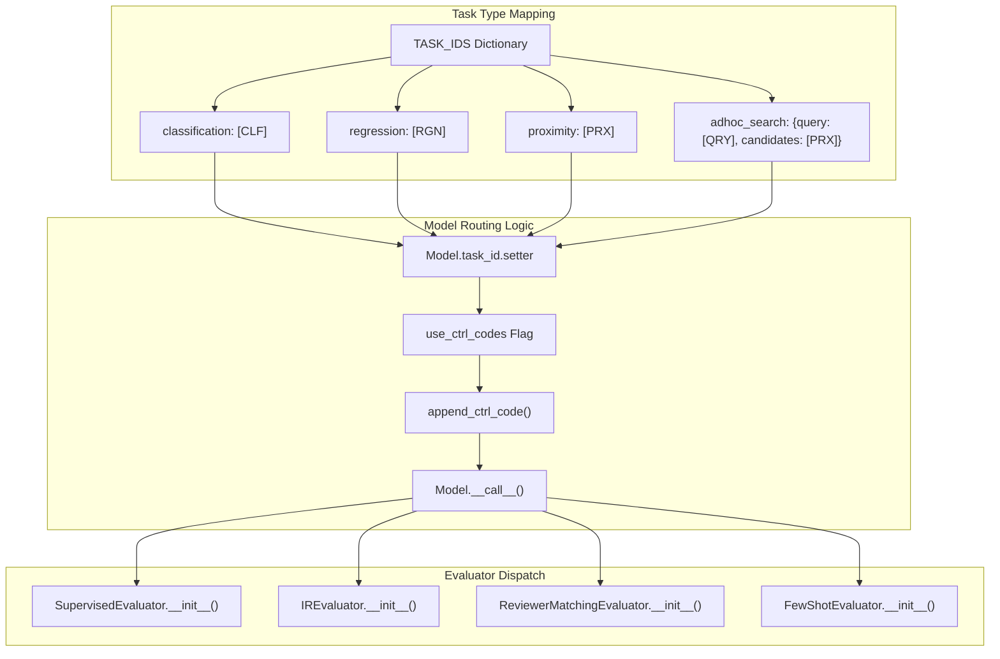

**Sources**: [scirepeval.py:15-16](), [scirepeval.py:50-51](), [evaluation/encoders.py:80-86](), [evaluation/encoders.py:89-100]()

---

# Page: Dependencies and Setup

# Dependencies and Setup

<details>
<summary>Relevant source files</summary>

The following files were used as context for generating this wiki page:

- [README.md](README.md)
- [requirements.txt](requirements.txt)

</details>


This document covers the Python dependencies, environment configuration, and external service integrations required to run SciRepEval. It includes setup instructions for the evaluation framework, training system, and data access requirements.

For information about system architecture, see [System Architecture](#1.1). For benchmarking setup, see [Benchmarking System](#6.1).

## Core Dependencies Overview

SciRepEval requires a comprehensive set of Python packages spanning machine learning frameworks, natural language processing libraries, and cloud storage integrations. The system is built primarily on PyTorch and Transformers, with additional specialized packages for scientific document processing.

### Dependency Categories

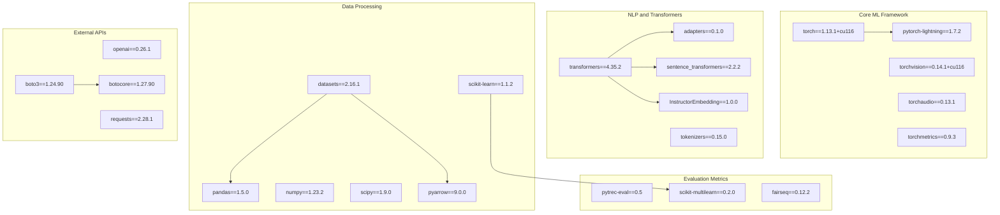

**Sources:** [requirements.txt:1-102]()

### Key Dependencies Analysis

| Category | Package | Version | Purpose |
|----------|---------|---------|---------|
| Deep Learning | `torch` | 1.13.1+cu116 | Core tensor operations and CUDA support |
| Training Framework | `pytorch-lightning` | 1.7.2 | Multi-task training orchestration |
| Transformers | `transformers` | 4.35.2 | Pre-trained model access and fine-tuning |
| Adapters | `adapters` | 0.1.0 | Parameter-efficient fine-tuning |
| Dataset Loading | `datasets` | 2.16.1 | HuggingFace dataset integration |
| Cloud Storage | `boto3` | 1.24.90 | AWS S3 data access |
| External API | `openai` | 0.26.1 | GPT-3 model integration |
| Evaluation | `pytrec-eval` | 0.5 | Information retrieval metrics |

**Sources:** [requirements.txt:2-4](), [requirements.txt:6](), [requirements.txt:23](), [requirements.txt:63](), [requirements.txt:91](), [requirements.txt:99-101]()

## Environment Setup Process

The setup process involves creating a conda environment, installing dependencies, and configuring external service access.

### Installation Workflow

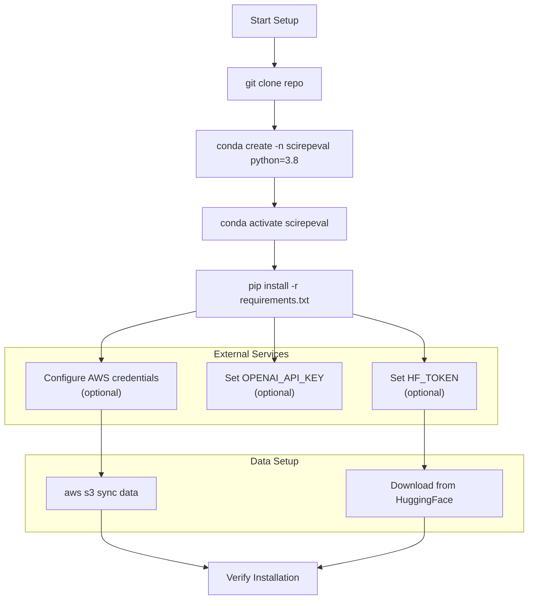

**Sources:** [README.md:5-12](), [README.md:27-33](), [README.md:35-45]()

### Basic Setup Commands

The following commands establish the core environment:

```bash
git clone git@github.com:allenai/scirepeval.git
cd scirepeval
conda create -n scirepeval python=3.8
conda activate scirepeval
pip install -r requirements.txt
```

**Sources:** [README.md:6-12]()

### CUDA and GPU Requirements

The system is configured for CUDA 11.6 support through PyTorch CUDA builds. GPU acceleration is recommended but not required for evaluation tasks.

**Sources:** [requirements.txt:1-4]()

## External Service Integration

SciRepEval integrates with multiple external services for data access and model inference.

### Service Integration Architecture

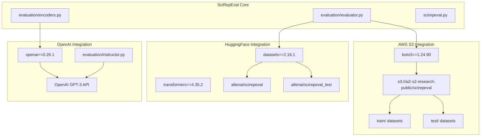

**Sources:** [README.md:27-36](), [README.md:38-45](), [requirements.txt:14-15](), [requirements.txt:23](), [requirements.txt:99]()

### AWS S3 Configuration

For accessing the benchmark datasets via AWS S3:

```bash
mkdir scirepeval_data && mkdir scirepeval_data/train && mkdir scirepeval_data/test && cd scirepeval_data
aws s3 --no-sign-request sync s3://ai2-s2-research-public/scirepeval/train train
aws s3 --no-sign-request sync s3://ai2-s2-research-public/scirepeval/test test
```

The dataset is approximately 24 GB in total size. No AWS credentials are required as the bucket allows anonymous access.

**Sources:** [README.md:28-33]()

### HuggingFace Integration

The system accesses datasets through two HuggingFace repositories:

- `allenai/scirepeval`: Training, validation, and evaluation metadata
- `allenai/scirepeval_test`: Labeled test examples

**Sources:** [README.md:35-36](), [README.md:41-44]()

### OpenAI API Integration

For GPT-3 model evaluation, set the API key environment variable:

```bash
export OPENAI_API_KEY="your-api-key-here"
```

**Sources:** [requirements.txt:99]()

## Data Dependencies

The framework requires access to benchmark datasets in multiple formats and storage locations.

### Data Source Architecture

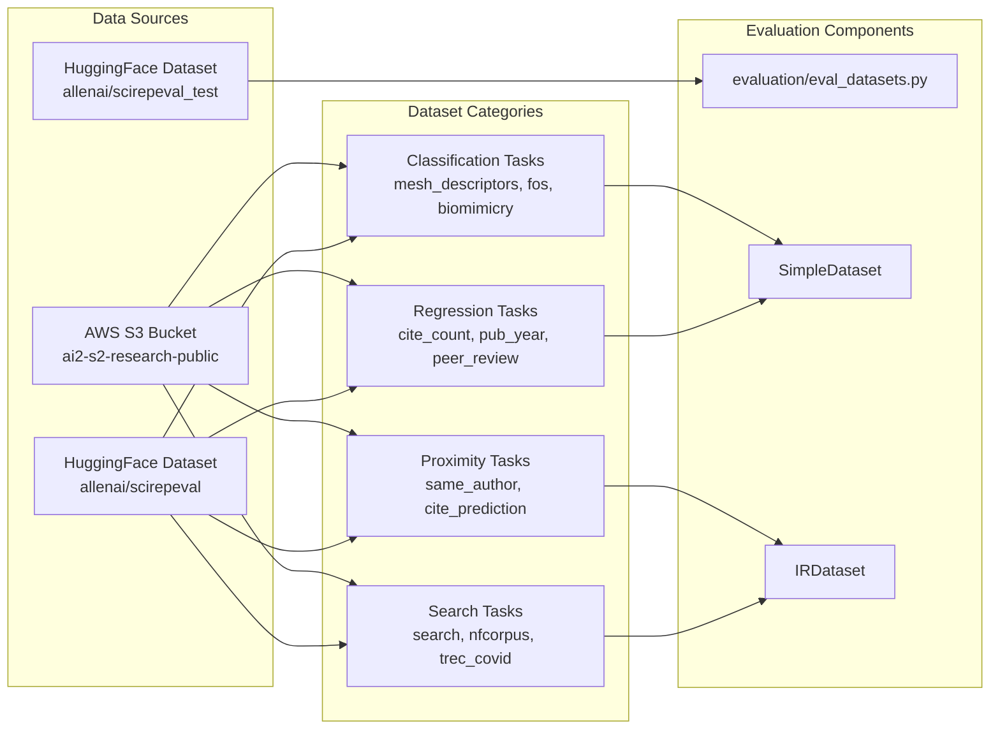

**Sources:** [README.md:25-78]()

### Dataset Format Requirements

The benchmark includes 24 tasks across 4 formats:

- **CLF**: Classification tasks (F1 Macro/Binary metrics)
- **RGN**: Regression tasks (Kendall's Tau metric)
- **PRX**: Proximity/retrieval tasks (MAP, NDCG metrics)
- **SRCH**: Ad-hoc search tasks (NDCG metric)

**Sources:** [README.md:25-26](), [README.md:49-74]()

## Installation Verification

After setup completion, verify the installation by testing core components.

### Verification Process

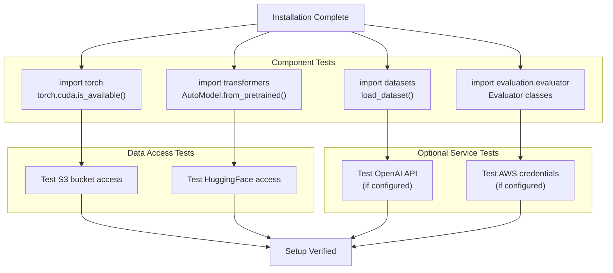

### Basic Import Tests

Verify core functionality by testing key imports:

```python
# Core ML framework
import torch
import pytorch_lightning as pl
import transformers

# Evaluation framework
from evaluation.evaluator import Evaluator
from evaluation.encoders import Model

# Data access
import datasets
import boto3
```

### GPU Verification

Check CUDA availability for accelerated training and inference:

```python
import torch
print(f"CUDA available: {torch.cuda.is_available()}")
print(f"CUDA devices: {torch.cuda.device_count()}")
```

**Sources:** [requirements.txt:2](), [requirements.txt:63](), [requirements.txt:91]()

---

# Page: Core Evaluation Framework

# Core Evaluation Framework

<details>
<summary>Relevant source files</summary>

The following files were used as context for generating this wiki page:

- [evaluation/evaluator.py](evaluation/evaluator.py)

</details>


The Core Evaluation Framework forms the central engine for assessing scientific document representation models across diverse task types. This framework provides a unified interface for evaluating models on classification, regression, and information retrieval tasks through standardized metrics and evaluation protocols.

For information about model variants and architectures, see [Model Architecture and Variants](#3). For details on training systems, see [Training System](#4). For task configuration and definitions, see [Task Configuration and Evaluation](#5).

## Framework Architecture

The evaluation framework is built around an abstract base class that defines the common interface, with concrete implementations for different evaluation paradigms:

**Core Evaluation Framework Architecture**
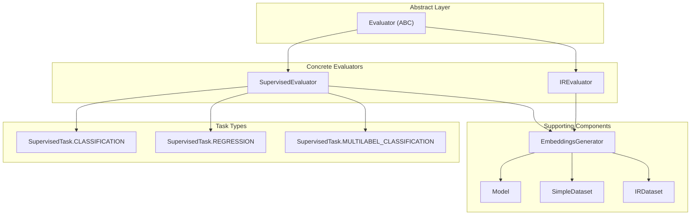

Sources: [evaluation/evaluator.py:27-51](), [evaluation/evaluator.py:80-88](), [evaluation/evaluator.py:173-179]()

## Abstract Evaluator Base Class

The `Evaluator` base class establishes the common interface and core functionality shared across all evaluation types. It handles model initialization, tokenizer configuration, and embedding generation coordination.

**Evaluator Class Structure**
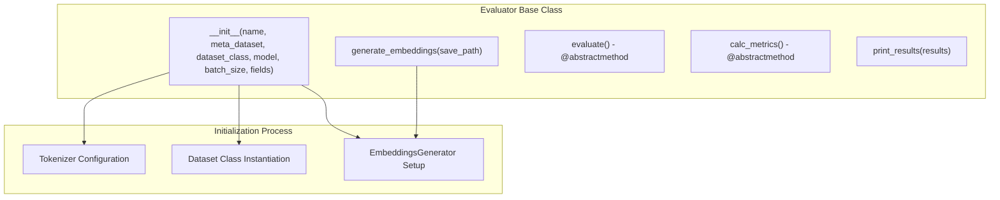

The base class performs critical setup operations including tokenizer padding configuration and special token handling:

| Component | Purpose | Key Operations |
|-----------|---------|----------------|
| Tokenizer Setup | Standardize tokenization across models | Add `[PAD]` token, set padding side, configure separator tokens |
| Dataset Creation | Instantiate appropriate dataset class per model | Create dataset instances with tokenizer-specific separators |
| EmbeddingsGenerator | Coordinate embedding generation | Initialize with datasets and models for batch processing |

Sources: [evaluation/evaluator.py:27-46](), [evaluation/evaluator.py:34-40]()

## Supervised Learning Evaluator

The `SupervisedEvaluator` handles classification and regression tasks using Support Vector Machine models with grid search hyperparameter optimization.

**SupervisedEvaluator Task Flow**
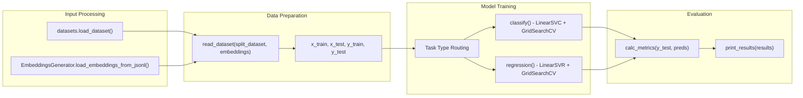

### Task Types and Metrics

The framework supports three supervised learning paradigms through the `SupervisedTask` enum:

| Task Type | Enum Value | Supported Metrics | Model Configuration |
|-----------|------------|-------------------|-------------------|
| Classification | `SupervisedTask.CLASSIFICATION` | f1, accuracy, precision, recall | LinearSVC with squared hinge loss |
| Multi-label Classification | `SupervisedTask.MULTILABEL_CLASSIFICATION` | f1, accuracy, precision, recall | OneVsRestClassifier(LinearSVC) |
| Regression | `SupervisedTask.REGRESSION` | mse, r2, pearsonr, kendalltau | LinearSVR |

The hyperparameter optimization uses cross-validation with predefined parameter grids:
- Classification: `C ∈ [0.01, 0.1, 1, 10, 100]` with 3-fold CV
- Regression: `C ∈ [0.0001, 0.001, 0.01, 0.1, 1, 10, 100]` with 3-fold CV

Sources: [evaluation/evaluator.py:66-77](), [evaluation/evaluator.py:118-134](), [evaluation/evaluator.py:136-143]()

## Information Retrieval Evaluator

The `IREvaluator` implements document retrieval evaluation using cosine similarity and TREC evaluation metrics through the `pytrec_eval` library.

**IREvaluator Processing Pipeline**
```mermaid
graph LR
    subgraph "Query-Candidate Setup"
        load_qrels["Load test_qrel.jsonl"]
        get_qc_pairs["get_qc_pairs(dataset)"]
        qrels_dict["qrels: Dict[query_id, Dict[cand_id, score]]"]
    end
    
    subgraph "Similarity Computation"
        retrieval["retrieval(embeddings, qrels)"]
        euclidean_dist["euclidean_distances(cands, query)"]
        score_negation["float(-scores[i])"]
    end
    
    subgraph "Metric Calculation"
        pytrec_eval["pytrec_eval.RelevanceEvaluator"]
        compute_aggregated["pytrec_eval.compute_aggregated_measure"]
        metric_results["metric_values: Dict[str, float]"]
    end
    
    load_qrels --> get_qc_pairs
    get_qc_pairs --> qrels_dict
    qrels_dict --> retrieval
    retrieval --> euclidean_dist
    euclidean_dist --> score_negation
    score_negation --> pytrec_eval
    pytrec_eval --> compute_aggregated
    compute_aggregated --> metric_results
```

### Retrieval Implementation

The retrieval process uses negative Euclidean distance as similarity scores, converting distance measurements to similarity rankings. For each query, the system:

1. Extracts query embedding: `query = np.array([embeddings[qid]])`
2. Retrieves candidate embeddings: `cands = np.array([embeddings[cid] for cid in qrels[qid]])`
3. Computes distances: `scores = euclidean_distances(cands, query).flatten()`
4. Converts to similarity: `run[qid][cid] = float(-scores[i])`

The evaluation supports standard IR metrics including NDCG, MAP, MRR, and precision at various cutoffs, computed using the `pytrec_eval` library's aggregated measure functions.

Sources: [evaluation/evaluator.py:173-179](), [evaluation/evaluator.py:180-187](), [evaluation/evaluator.py:218-229](), [evaluation/evaluator.py:189-200]()

## Integration with Embedding Generation

Both evaluator types integrate with the `EmbeddingsGenerator` component through a standardized interface:

**Embedding Generation Integration**
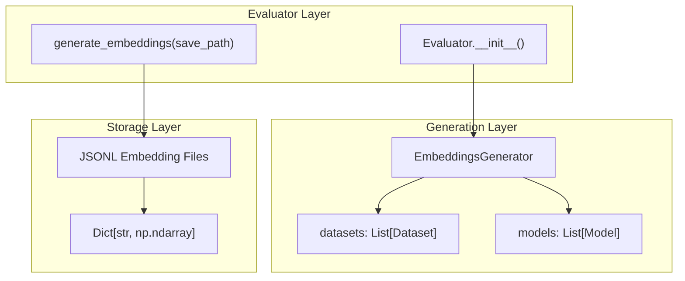

The framework supports both in-memory embedding dictionaries and persistent JSONL storage, enabling efficient reuse of computed embeddings across multiple evaluations. The `load_embeddings_from_jsonl()` static method provides standardized loading functionality for both evaluator types.

Sources: [evaluation/evaluator.py:41-46](), [evaluation/evaluator.py:97-98](), [evaluation/evaluator.py:209-210]()

---

# Page: Evaluator Classes

# Evaluator Classes

<details>
<summary>Relevant source files</summary>

The following files were used as context for generating this wiki page:

- [evaluation/evaluator.py](evaluation/evaluator.py)
- [examples/classification.py](examples/classification.py)
- [examples/fewshot_classification.py](examples/fewshot_classification.py)
- [examples/regression.py](examples/regression.py)
- [examples/retrieval.py](examples/retrieval.py)

</details>


This document covers the core evaluator classes that form the backbone of SciRepEval's evaluation framework. These classes provide standardized interfaces for evaluating scientific document representations across different task types including supervised learning and information retrieval. For information about the main orchestration that coordinates these evaluators, see [Main Orchestration](#2.2). For details about dataset handling used by these evaluators, see [Dataset Handling](#2.3).

## Abstract Evaluator Base Class

The `Evaluator` class serves as the abstract base class for all evaluation components in the framework. It establishes a common contract and provides shared functionality for embedding generation and result presentation.

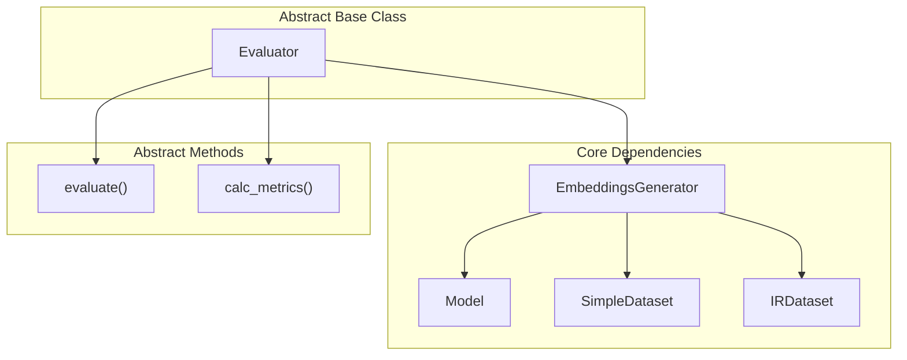

The base class constructor [evaluation/evaluator.py:28-42]() initializes the evaluator with essential components:

- **Name**: Identifier for the evaluation task
- **Meta dataset**: Dataset configuration for embedding generation  
- **Dataset class**: Either `SimpleDataset` or `IRDataset` depending on task type
- **Model**: The model instance to evaluate
- **Batch size**: Processing batch size for efficient computation
- **Fields**: Specific data fields to process
- **Key and process_fn**: Optional dataset processing parameters

The base class handles tokenizer setup automatically, ensuring all models have proper padding tokens [evaluation/evaluator.py:34-38](). It creates dataset instances for each model and initializes the `EmbeddingsGenerator` for text-to-vector conversion.

Sources: evaluation/evaluator.py:27-64

## SupervisedEvaluator for Classification and Regression

The `SupervisedEvaluator` class handles supervised learning tasks including classification, multi-label classification, and regression. It extends the base `Evaluator` class with task-specific functionality for training linear models on document embeddings.

### Task Types and Metrics

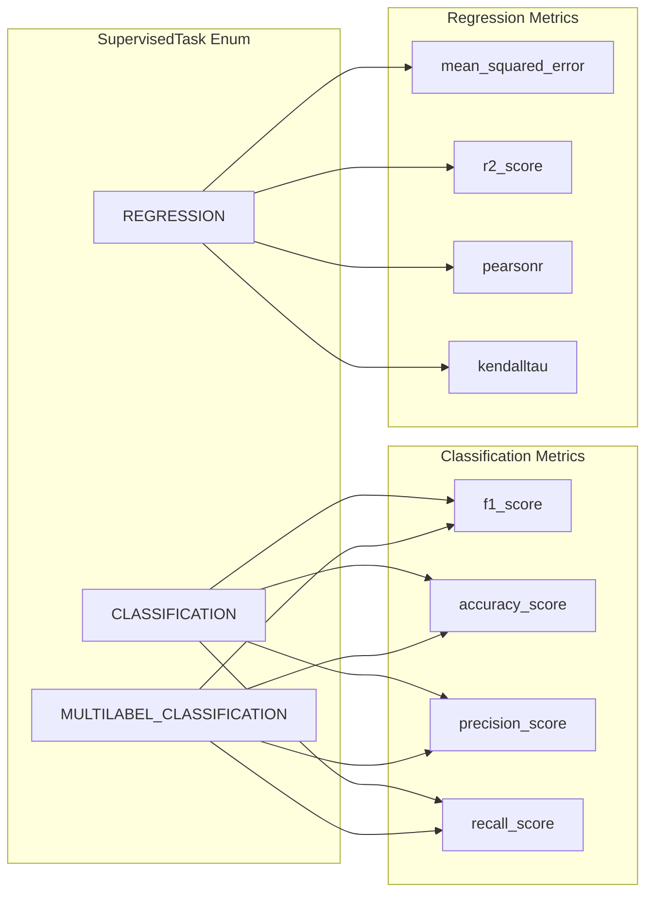

The `SupervisedTask` enum [evaluation/evaluator.py:66-70]() defines three task types, each associated with specific metrics through the `SUPERVISED_TASK_METRICS` mapping [evaluation/evaluator.py:72-77]().

### Evaluation Pipeline

The supervised evaluation process follows this flow:

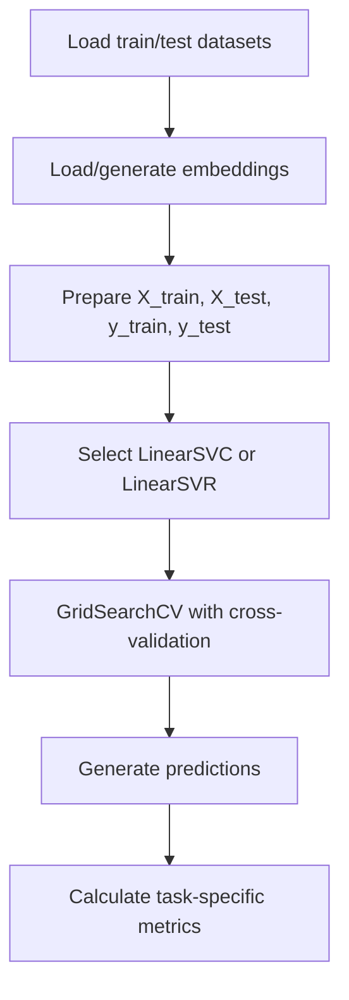

The `evaluate` method [evaluation/evaluator.py:89-104]() orchestrates this pipeline:

1. **Dataset Loading**: Loads train/test splits from HuggingFace datasets or local CSV files
2. **Data Preparation**: Maps paper IDs to embeddings and labels using `read_dataset` [evaluation/evaluator.py:107-116]()
3. **Model Training**: Uses either `classify` [evaluation/evaluator.py:118-134]() or `regression` [evaluation/evaluator.py:136-143]() methods
4. **Metric Calculation**: Computes task-appropriate metrics via `calc_metrics` [evaluation/evaluator.py:145-170]()

For classification tasks, the evaluator uses `LinearSVC` with squared hinge loss and cross-validated hyperparameter search across C values. Multi-label classification employs `OneVsRestClassifier` wrapper. Regression tasks use `LinearSVR` with similar hyperparameter optimization.

Sources: evaluation/evaluator.py:80-171, examples/classification.py:1-25, examples/regression.py:1-24

## IREvaluator for Information Retrieval

The `IREvaluator` class specializes in information retrieval evaluation using query-candidate similarity scoring. It evaluates how well document embeddings capture semantic relationships for retrieval tasks.

### Retrieval Process

```mermaid
graph TD
    test_data["Load test query-candidate pairs"]
    qrels["Extract qrels (query-relevance labels)"]
    embedding_lookup["Lookup query and candidate embeddings"]
    similarity["Calculate euclidean distances"]
    scoring["Convert distances to similarity scores"]
    ranking["Rank candidates per query"]
    evaluation["Evaluate with pytrec_eval"]
    
    test_data --> qrels
    qrels --> embedding_lookup
    embedding_lookup --> similarity
    similarity --> scoring
    scoring --> ranking
    ranking --> evaluation
```

The `IREvaluator` constructor [evaluation/evaluator.py:174-178]() accepts similar parameters to the base class but defaults to using `IRDataset` for handling query-candidate pair data structures.

### Similarity Calculation and Ranking

The core retrieval logic in the `retrieval` method [evaluation/evaluator.py:218-229]() implements the following algorithm:

1. **Query Processing**: For each query ID in the test set, retrieve the query embedding
2. **Candidate Collection**: Gather embeddings for all candidate documents associated with the query
3. **Distance Computation**: Calculate euclidean distances between query and candidate embeddings
4. **Score Conversion**: Convert distances to similarity scores by negating (smaller distances = higher similarity)
5. **Ranking**: Create ranked lists of candidates per query

The `get_qc_pairs` method [evaluation/evaluator.py:180-187]() structures the test data into query-candidate-relevance mappings required by the evaluation framework.

### Metric Evaluation

The `calc_metrics` method [evaluation/evaluator.py:189-200]() leverages the `pytrec_eval` library for standard IR metrics:

- **MAP**: Mean Average Precision
- **NDCG**: Normalized Discounted Cumulative Gain  
- **P@k**: Precision at rank k
- **Recall**: Recall at various cutoffs

Results are aggregated across all queries and scaled to percentages for consistent reporting.

Sources: evaluation/evaluator.py:173-230, examples/retrieval.py:1-40

## Class Hierarchy and Integration

The evaluator classes integrate with the broader SciRepEval ecosystem through well-defined interfaces:

```mermaid
graph TB
    subgraph "Evaluator Hierarchy"
        Evaluator_Base["Evaluator (Abstract)"]
        SupervisedEvaluator["SupervisedEvaluator"]
        IREvaluator["IREvaluator"]
        FewShotEvaluator["FewShotEvaluator"]
        ReviewerMatchingEvaluator["ReviewerMatchingEvaluator"]
    end
    
    subgraph "Core Components"
        EmbeddingsGenerator["EmbeddingsGenerator"]
        Model["Model"]
        SimpleDataset["SimpleDataset"] 
        IRDataset["IRDataset"]
    end
    
    subgraph "External Libraries"
        sklearn["scikit-learn"]
        lightning["lightning"]
        pytrec_eval["pytrec_eval"]
        datasets_lib["datasets"]
    end
    
    Evaluator_Base --> SupervisedEvaluator
    Evaluator_Base --> IREvaluator
    Evaluator_Base --> FewShotEvaluator
    Evaluator_Base --> ReviewerMatchingEvaluator
    
    SupervisedEvaluator --> EmbeddingsGenerator
    IREvaluator --> EmbeddingsGenerator
    EmbeddingsGenerator --> Model
    EmbeddingsGenerator --> SimpleDataset
    EmbeddingsGenerator --> IRDataset
    
    SupervisedEvaluator --> sklearn
    SupervisedEvaluator --> lightning
    IREvaluator --> pytrec_eval
    Evaluator_Base --> datasets_lib
```

### Common Interface Contract

All evaluator classes must implement two abstract methods defined in the base class:

| Method | Purpose | Parameters | Returns |
|--------|---------|------------|---------|
| `evaluate` | Main evaluation entry point | `embeddings`: Dict or file path, `**kwargs` | `Dict[str, float]` of metrics |
| `calc_metrics` | Task-specific metric calculation | `test`: ground truth, `preds`: predictions | `Dict[str, float]` of metrics |

### Shared Functionality

The base `Evaluator` class provides common functionality used by all subclasses:

- **Embedding Generation**: The `generate_embeddings` method [evaluation/evaluator.py:44-46]() delegates to `EmbeddingsGenerator` for text-to-vector conversion
- **Result Display**: The `print_results` method [evaluation/evaluator.py:56-63]() provides consistent formatting for evaluation outputs
- **Model Integration**: Automatic tokenizer configuration and model preparation for batch processing

This design enables consistent evaluation interfaces while allowing task-specific customization in the concrete implementations.

Sources: evaluation/evaluator.py:27-230, examples/classification.py:1-25, examples/retrieval.py:1-40, examples/fewshot_classification.py:1-24

---

# Page: Main Orchestration

# Main Orchestration

<details>
<summary>Relevant source files</summary>

The following files were used as context for generating this wiki page:

- [BENCHMARKING.md](BENCHMARKING.md)
- [evaluation/gpt3_encoder.py](evaluation/gpt3_encoder.py)
- [scirepeval.py](scirepeval.py)

</details>


The main orchestration system coordinates the evaluation of scientific document representation models across multiple tasks and configurations. This document covers the `SciRepEval` class and its role in managing task configurations, model instances, evaluator selection, and result aggregation. For details about individual evaluator implementations, see [Evaluator Classes](#2.1). For task configuration formats, see [Task Definitions](#5.1).

## SciRepEval Class Overview

The `SciRepEval` class serves as the central coordinator for the entire evaluation framework. It manages task configurations, instantiates appropriate evaluators, coordinates model evaluation across tasks, and aggregates results.

```mermaid
graph TD
    SciRepEval["SciRepEval Class"]
    TaskConfig["scirepeval_tasks.jsonl"]
    TaskDict["self.tasks Dictionary"]
    ModelList["Model Instance(s)"]
    EvaluatorFactory["Evaluator Instantiation"]
    ResultAggregation["final_results Dictionary"]
    
    TaskConfig --> SciRepEval
    SciRepEval --> TaskDict
    ModelList --> SciRepEval
    SciRepEval --> EvaluatorFactory
    EvaluatorFactory --> ResultAggregation
    
    SciRepEval --> SupervisedEvaluator["SupervisedEvaluator"]
    SciRepEval --> IREvaluator["IREvaluator"] 
    SciRepEval --> ReviewerMatchingEvaluator["ReviewerMatchingEvaluator"]
    SciRepEval --> FewShotEvaluator["FewShotEvaluator"]
```

The class initializes by loading and filtering tasks from a JSONL configuration file, then provides an `evaluate` method that orchestrates evaluation across all configured tasks.

Sources: [scirepeval.py:22-44]()

## Task Configuration Management

The orchestration system loads task definitions from a JSONL file and supports flexible task filtering by name or type. Each task configuration specifies the evaluation type, data sources, metrics, and optional parameters.

```mermaid
graph LR
    JSONLFile["scirepeval_tasks.jsonl"]
    TasksDict["tasks_dict"]
    TaskByFormats["task_by_formats"]
    FilteredTasks["self.tasks"]
    
    JSONLFile --> TasksDict
    JSONLFile --> TaskByFormats
    TaskList["task_list parameter"] --> FilteredTasks
    TaskFormats["task_formats parameter"] --> FilteredTasks
    TasksDict --> FilteredTasks
    TaskByFormats --> FilteredTasks
```

The initialization process supports three filtering modes:
- **All tasks**: When neither `task_list` nor `task_formats` are specified
- **Specific tasks**: Using the `task_list` parameter to select individual tasks
- **Task type filtering**: Using `task_formats` to select all tasks of specific types

Sources: [scirepeval.py:24-43]()

## Task ID System

The orchestration uses a standardized task ID mapping system that assigns control tokens to different task types. These tokens serve as either control codes for multi-task models or module identifiers for parameter-efficient methods.

| Task Type | Task ID | Usage |
|-----------|---------|-------|
| Classification | `[CLF]` | Classification tasks |
| Regression | `[RGN]` | Regression tasks |
| Proximity | `[PRX]` | Proximity/similarity tasks |
| Ad-hoc Search (queries) | `[QRY]` | Query encoding in search tasks |
| Ad-hoc Search (candidates) | `[PRX]` | Candidate encoding in search tasks |

```mermaid
graph TD
    TaskTypes["Task Types"]
    CLF["classification → [CLF]"]
    RGN["regression → [RGN]"]
    PRX["proximity → [PRX]"]
    QRY["adhoc_search.query → [QRY]"]
    PRXS["adhoc_search.candidates → [PRX]"]
    
    TaskTypes --> CLF
    TaskTypes --> RGN
    TaskTypes --> PRX
    TaskTypes --> QRY
    TaskTypes --> PRXS
    
    CLF --> ModelAssignment["Model Task ID Assignment"]
    RGN --> ModelAssignment
    PRX --> ModelAssignment
    QRY --> ModelAssignment
    PRXS --> ModelAssignment
```

Sources: [scirepeval.py:15-16](), [scirepeval.py:50-51]()

## Evaluation Orchestration Flow

The main `evaluate` method orchestrates the entire evaluation process through a systematic workflow that handles multiple models and tasks with proper error handling and result aggregation.

```mermaid
graph TD
    StartEval["evaluate(model, output)"]
    ModelNormalization["Normalize model to list"]
    TaskIteration["Iterate over self.tasks"]
    TaskIDAssignment["Assign task_id to models"]
    KwargsConstruction["Build kwargs from task config"]
    EvaluatorSelection["Select evaluator type"]
    EmbeddingGeneration["Generate/load embeddings"]
    EvaluationExecution["Execute evaluation"]
    ResultAggregation["Aggregate results"]
    OutputSave["Save to JSON file"]
    
    StartEval --> ModelNormalization
    ModelNormalization --> TaskIteration
    TaskIteration --> TaskIDAssignment
    TaskIDAssignment --> KwargsConstruction
    KwargsConstruction --> EvaluatorSelection
    EvaluatorSelection --> EmbeddingGeneration
    EmbeddingGeneration --> EvaluationExecution
    EvaluationExecution --> ResultAggregation
    ResultAggregation --> OutputSave
    
    EvaluatorSelection --> SupervisedPath["Supervised Tasks<br/>(classification/regression)"]
    EvaluatorSelection --> ReviewerPath["Paper-Reviewer Matching"]
    EvaluatorSelection --> IRPath["Information Retrieval<br/>(proximity/adhoc_search)"]
    
    SupervisedPath --> FewShotCheck["Check few_shot config"]
    FewShotCheck --> FewShotEvaluators["Create FewShotEvaluators"]
```

The orchestration handles several key responsibilities:
- **Model normalization**: Ensures models are always processed as lists for consistent handling
- **Task configuration parsing**: Extracts dataset references, metadata, metrics, and evaluation parameters
- **Evaluator selection**: Routes to appropriate evaluator classes based on task type
- **Few-shot evaluation**: Creates additional evaluators for tasks with few-shot configurations

Sources: [scirepeval.py:45-119]()

## Evaluator Factory Pattern

The orchestration implements a factory pattern for evaluator instantiation, selecting the appropriate evaluator class based on task type and configuration parameters.

```mermaid
graph TD
    TaskType["task['type']"]
    TaskName["task_name"]
    
    Classification["classification"]
    Regression["regression"]
    Proximity["proximity"]
    AdhocSearch["adhoc_search"]
    SpecialCase["Paper-Reviewer Matching"]
    
    TaskType --> Classification
    TaskType --> Regression
    TaskType --> Proximity
    TaskType --> AdhocSearch
    TaskName --> SpecialCase
    
    Classification --> SupervisedEvaluator["SupervisedEvaluator<br/>(CLASSIFICATION)"]
    Regression --> SupervisedEvaluator2["SupervisedEvaluator<br/>(REGRESSION)"]
    SpecialCase --> ReviewerMatchingEvaluator["ReviewerMatchingEvaluator"]
    Proximity --> DatasetClassSelection["Dataset Class Selection"]
    AdhocSearch --> DatasetClassSelection
    
    DatasetClassSelection --> SimpleDataset["simple_format = True<br/>→ SimpleDataset"]
    DatasetClassSelection --> IRDataset["simple_format = False<br/>→ IRDataset"]
    SimpleDataset --> IREvaluator["IREvaluator"]
    IRDataset --> IREvaluator
    
    MultiLabel["multi_label = True"] --> SupervisedEvaluator3["SupervisedEvaluator<br/>(MULTILABEL_CLASSIFICATION)"]
```

The factory logic includes:
- **Supervised tasks**: Routes classification and regression to `SupervisedEvaluator` with appropriate subtypes
- **Multi-label handling**: Detects multi-label classification tasks and sets the appropriate subtype
- **Special cases**: Handles "Paper-Reviewer Matching" as a specialized reviewer matching task
- **IR tasks**: Selects dataset class based on `simple_format` configuration parameter

Sources: [scirepeval.py:80-104]()

## Model Coordination

The orchestration system manages model instances and assigns task-specific identifiers to enable proper routing in multi-task and parameter-efficient models.

```mermaid
graph LR
    Models["Model Instance(s)"]
    TaskIDLookup["TASK_IDS[task['type']]"]
    TaskIDAssignment["model.task_id = task_id"]
    
    Models --> TaskIDAssignment
    TaskIDLookup --> TaskIDAssignment
    
    ControlCodes["Control Codes<br/>(if use_ctrl_codes=True)"]
    AdapterSelection["Adapter Selection<br/>(if variant='adapters')"]
    PALSModules["PALS Modules<br/>(if variant='pals')"]
    
    TaskIDAssignment --> ControlCodes
    TaskIDAssignment --> AdapterSelection
    TaskIDAssignment --> PALSModules
```

The task ID assignment occurs before each task evaluation and enables:
- **Control token injection**: For models trained with control codes
- **Adapter routing**: For adapter-based parameter-efficient fine-tuning
- **Module selection**: For PALS-based parameter sharing

Sources: [scirepeval.py:50-51]()

## Result Aggregation and Output

The orchestration system aggregates evaluation results across all tasks and models, handling both standard evaluation and few-shot evaluation results in a structured format.

```mermaid
graph TD
    TaskResults["Individual Task Results"]
    FewShotResults["Few-shot Evaluation Results"]
    FinalResults["final_results Dictionary"]
    JSONOutput["JSON Output File"]
    
    TaskResults --> StandardFormat["Standard Task Result"]
    FewShotResults --> FewShotFormat["Few-shot Task Result"]
    
    StandardFormat --> FinalResults
    FewShotFormat --> FinalResults
    FinalResults --> JSONOutput
    
    StandardFormat --> CompleteSection["task_name: { metrics... }"]
    FewShotFormat --> CompleteAndFewShot["task_name: {<br/>  'complete': { metrics... },<br/>  'few_shot': [<br/>    { 'sample_size': N, 'results': {...} }<br/>  ]<br/>}"]
```

The result structure accommodates:
- **Standard results**: Direct metric mappings for tasks without few-shot evaluation
- **Combined results**: Structured format with both complete and few-shot results for applicable tasks
- **Incremental saving**: Results are saved after each task to preserve partial progress

Sources: [scirepeval.py:105-118]()

## Command-Line Interface

The orchestration system provides a comprehensive command-line interface that supports all model variants and evaluation configurations available in the framework.

| Parameter | Purpose | Model Variants |
|-----------|---------|----------------|
| `--mtype` | Model variant selection | `default`, `pals`, `adapters`, `fusion` |
| `--model` | Base model checkpoint | HuggingFace model names or local paths |
| `--ctrl-tokens` | Enable control token usage | MTL CTRL models |
| `--adapters-dir` | Local adapter directory | Adapter and Fusion variants |
| `--adapters-chkpt` | HuggingFace adapter mapping | Adapter and Fusion variants |
| `--fusion-dir` | Fusion module directory | Fusion variant |
| `--instructor` | Use Instructor models | Instructor embeddings |
| `--gpt3-model` | OpenAI embedding model | GPT-3 embeddings |

Sources: [scirepeval.py:121-156]()

---

# Page: Dataset Handling

# Dataset Handling

<details>
<summary>Relevant source files</summary>

The following files were used as context for generating this wiki page:

- [evaluation/eval_datasets.py](evaluation/eval_datasets.py)
- [scirepeval_tasks.jsonl](scirepeval_tasks.jsonl)
- [training/mtl_datasets.py](training/mtl_datasets.py)

</details>


This document covers how datasets are loaded, processed, and managed within SciRepEval for both evaluation and training purposes. The framework supports multiple data sources including HuggingFace datasets, local JSON files, and AWS S3 storage, with specialized dataset classes for different task types.

For information about how datasets are used within the evaluation pipeline, see [Core Evaluation Framework](#2). For training configuration and task setup, see [Task Configuration for Training](#4.2).

## Overview

SciRepEval provides two main categories of dataset handling:

1. **Evaluation Datasets** - Used by evaluators to load test data and metadata for model assessment
2. **Training Datasets** - Used during multi-task training to prepare data for different learning objectives

The framework abstracts dataset complexity through consistent interfaces while supporting diverse data formats and sources.

## Evaluation Dataset Classes

### SimpleDataset

The `SimpleDataset` class provides the foundational dataset handling for evaluation tasks. It loads documents, processes them into batches, and handles text field concatenation.

```mermaid
graph TB
    subgraph "SimpleDataset Processing"
        INIT["SimpleDataset.__init__()"]
        LOAD["load_dataset()"]
        BATCH["batches()"]
        PROCESS["process_batches()"]
    end
    
    subgraph "Data Sources"
        JSON["JSON Files"]
        HF["HuggingFace Datasets"]
        CUSTOM["Custom Processing Function"]
    end
    
    subgraph "Output"
        TEXT_BATCH["Text Batches"]
        ID_BATCH["Document IDs"]
    end
    
    JSON --> INIT
    HF --> INIT
    CUSTOM --> INIT
    INIT --> LOAD
    LOAD --> BATCH
    BATCH --> PROCESS
    PROCESS --> TEXT_BATCH
    PROCESS --> ID_BATCH
```

Key features of `SimpleDataset`:

| Feature | Description | Implementation |
|---------|-------------|----------------|
| Data Loading | Supports local JSON and HuggingFace datasets | [evaluation/eval_datasets.py:21-26]() |
| Field Concatenation | Combines multiple text fields with separator tokens | [evaluation/eval_datasets.py:48-52]() |
| Batch Processing | Creates batches with configurable size | [evaluation/eval_datasets.py:37-62]() |
| Deduplication | Prevents processing duplicate documents | [evaluation/eval_datasets.py:45-47]() |

**Sources:** [evaluation/eval_datasets.py:10-63]()

### IRDataset

The `IRDataset` class extends `SimpleDataset` for information retrieval tasks, handling query-candidate pairs with separate processing streams.

```mermaid
graph TB
    subgraph "IRDataset Structure"
        IRDATASET["IRDataset"]
        SIMPLE["SimpleDataset"]
        QUERIES["self.queries"]
        CANDIDATES["self.candidates"]
    end
    
    subgraph "Data Processing"
        EXTRACT["Extract queries and candidates"]
        QUERY_BATCH["Query batches with (id, 'q')"]
        CAND_BATCH["Candidate batches with (id, 'c')"]
    end
    
    IRDATASET --> SIMPLE
    IRDATASET --> EXTRACT
    EXTRACT --> QUERIES
    EXTRACT --> CANDIDATES
    QUERIES --> QUERY_BATCH
    CANDIDATES --> CAND_BATCH
```

The `IRDataset` processes data containing query-candidate relationships, creating separate batch streams for queries and candidates with type annotations.

**Sources:** [evaluation/eval_datasets.py:65-88]()

## Training Dataset Classes

### AbstractMultiTaskDataset

The base class for all training datasets provides common functionality for multi-task learning scenarios.

```mermaid
graph TB
    subgraph "AbstractMultiTaskDataset Interface"
        ABSTRACT["AbstractMultiTaskDataset"]
        PREPROCESS["preprocess() - Abstract"]
        TOKENIZE["tokenized_input()"]
        SUBSAMPLE["sub_sample()"]
    end
    
    subgraph "Concrete Implementations"
        CLF["ClassificationDataset"]
        MULTILABEL["MultiLabelClassificationDataset"]
        IR_TRAIN["IRDataset (Training)"]
        TRIPLET["TripletDataset"]
        REGRESSION["RegressionDataset"]
    end
    
    subgraph "Common Features"
        CTRL["Control Tokens"]
        FIELDS["Text Field Processing"]
        BATCH_SIZE["Batch Management"]
    end
    
    ABSTRACT --> CLF
    ABSTRACT --> MULTILABEL
    ABSTRACT --> IR_TRAIN
    ABSTRACT --> TRIPLET
    ABSTRACT --> REGRESSION
    
    ABSTRACT --> CTRL
    ABSTRACT --> FIELDS
    ABSTRACT --> BATCH_SIZE
```

Key components:

- **Control Tokens**: Prepended to text for task identification [training/mtl_datasets.py:80-82]()
- **Field Processing**: Concatenates multiple text fields with separators [training/mtl_datasets.py:72-77]()
- **Tokenization**: Converts text to model inputs with padding and truncation [training/mtl_datasets.py:83-88]()

**Sources:** [training/mtl_datasets.py:22-89]()

### Specialized Training Dataset Classes

Each task type has a specialized dataset class that handles task-specific data processing:

| Dataset Class | Purpose | Key Features |
|---------------|---------|--------------|
| `ClassificationDataset` | Single-label classification | Stratified sampling, label mapping |
| `MultiLabelClassificationDataset` | Multi-label classification | `MultiLabelBinarizer`, iterative stratification |
| `IRDataset` | Information retrieval training | Triplet generation from query-candidate pairs |
| `TripletDataset` | Similarity learning | Direct triplet processing |
| `RegressionDataset` | Continuous value prediction | Numerical label handling |

**Sources:** [training/mtl_datasets.py:91-260]()

## Data Source Configuration

### Task Definition Format

Tasks are defined in `scirepeval_tasks.jsonl` with standardized data source specifications:

```mermaid
graph LR
    subgraph "Task Configuration"
        TASK_DEF["Task Definition"]
        DATA_CONFIG["data field"]
        META["meta dataset"]
        TEST["test dataset"]
    end
    
    subgraph "Data Sources"
        HF_META["HuggingFace Meta"]
        HF_TEST["HuggingFace Test"]
        LOCAL_FILES["Local JSON Files"]
        S3_STORAGE["S3 Storage"]
    end
    
    TASK_DEF --> DATA_CONFIG
    DATA_CONFIG --> META
    DATA_CONFIG --> TEST
    
    META --> HF_META
    TEST --> HF_TEST
    META --> LOCAL_FILES
    TEST --> LOCAL_FILES
    META --> S3_STORAGE
    TEST --> S3_STORAGE
```

Example task configuration structure:
- `name`: Task identifier
- `type`: Task type (classification, regression, proximity, adhoc_search)
- `data.meta`: Metadata/training dataset source
- `data.test`: Test dataset source
- `fields`: Text fields to use (defaults to ["title", "abstract"])

**Sources:** [scirepeval_tasks.jsonl:1-23]()

### Data Loading Patterns

The framework supports multiple data loading patterns:

1. **HuggingFace Datasets**: `{"name": "allenai/scirepeval", "config": "biomimicry"}`
2. **Local Files**: Direct file paths for JSON/JSONL files
3. **Processing Functions**: Custom data loading through `processing_fn` parameter
4. **Embedding Caching**: Save/load embeddings to avoid recomputation

**Sources:** [evaluation/eval_datasets.py:21-26](), [scirepeval_tasks.jsonl:1-23]()

## Multi-Task Data Pipeline

### CustomChainDataset

The `CustomChainDataset` class orchestrates multiple datasets for multi-task training with sophisticated batching strategies.

```mermaid
graph TB
    subgraph "CustomChainDataset Architecture"
        CHAIN["CustomChainDataset"]
        DATASETS["Multiple Task Datasets"]
        STRATEGY["BatchingStrategy"]
        WORKERS["Multi-Worker Support"]
    end
    
    subgraph "Batching Process"
        EFFECTIVE["Effective Batch Size = batch_size * num_devices"]
        SLICE["iter_slice()"]
        DISTRIBUTE["Distribute to workers/devices"]
    end
    
    subgraph "Output"
        MIXED_BATCH["Mixed Task Batches"]
        COLLATE["multi_collate()"]
        TASK_GROUPED["Task-Grouped Batches"]
    end
    
    CHAIN --> DATASETS
    CHAIN --> STRATEGY
    CHAIN --> WORKERS
    
    DATASETS --> EFFECTIVE
    EFFECTIVE --> SLICE
    SLICE --> DISTRIBUTE
    DISTRIBUTE --> MIXED_BATCH
    MIXED_BATCH --> COLLATE
    COLLATE --> TASK_GROUPED
```

The `CustomChainDataset` handles:
- **Multi-GPU Training**: Distributes batches across devices [training/mtl_datasets.py:232-233]()
- **Worker Coordination**: Manages data loading across multiple workers [training/mtl_datasets.py:233-234]()
- **Batching Strategies**: Supports different mixing strategies via `BatchingStrategy` enum

**Sources:** [training/mtl_datasets.py:214-246]()

## Data Flow Architecture

### End-to-End Processing Pipeline

```mermaid
graph TB
    subgraph "Configuration Layer"
        TASK_CONFIG["scirepeval_tasks.jsonl"]
        TRAINING_CONFIG["tasks_config.json"]
    end
    
    subgraph "Dataset Factory"
        EVAL_FACTORY["Evaluation Dataset Creation"]
        TRAIN_FACTORY["Training Dataset Creation"]
    end
    
    subgraph "Data Processing"
        SIMPLE_DS["SimpleDataset/IRDataset"]
        MTL_DS["Multi-Task Datasets"]
        TOKENIZATION["Text Tokenization"]
        BATCHING["Batch Generation"]
    end
    
    subgraph "Output Streams"
        EVAL_BATCHES["Evaluation Batches"]
        TRAIN_BATCHES["Training Batches"]
        EMBEDDINGS["Generated Embeddings"]
    end
    
    TASK_CONFIG --> EVAL_FACTORY
    TRAINING_CONFIG --> TRAIN_FACTORY
    
    EVAL_FACTORY --> SIMPLE_DS
    TRAIN_FACTORY --> MTL_DS
    
    SIMPLE_DS --> TOKENIZATION
    MTL_DS --> TOKENIZATION
    TOKENIZATION --> BATCHING
    
    BATCHING --> EVAL_BATCHES
    BATCHING --> TRAIN_BATCHES
    BATCHING --> EMBEDDINGS
```

This pipeline demonstrates how configuration files drive dataset creation, which flows through processing stages to produce model-ready batches for both evaluation and training scenarios.

**Sources:** [evaluation/eval_datasets.py:10-88](), [training/mtl_datasets.py:22-266](), [scirepeval_tasks.jsonl:1-23]()

---

# Page: Embedding Generation

# Embedding Generation

<details>
<summary>Relevant source files</summary>

The following files were used as context for generating this wiki page:

- [evaluation/embeddings_generator.py](evaluation/embeddings_generator.py)
- [evaluation/evaluator.py](evaluation/evaluator.py)
- [training/bert_pals_config/low_rank_config.json](training/bert_pals_config/low_rank_config.json)
- [training/bert_pals_config/pals.config.json](training/bert_pals_config/pals.config.json)

</details>


This page documents the embedding generation system in SciRepEval, which is responsible for converting text documents into dense vector representations that can be used for downstream evaluation tasks. The system handles batch processing, caching, and reuse of embeddings across multiple evaluation runs.

For information about the model architectures that generate these embeddings, see [Model Architecture and Variants](#3). For details about how embeddings are used in specific evaluation tasks, see [Evaluator Classes](#2.1).

## Overview

The embedding generation system centers around the `EmbeddingsGenerator` class, which orchestrates the conversion of text documents into numerical embeddings using various model architectures. The system is designed for efficiency, supporting batch processing and persistent caching to avoid redundant computation across evaluation runs.

```mermaid
graph TB
    subgraph "Input"
        DS["Dataset<br/>(SimpleDataset/IRDataset)"]
        MODEL["Model<br/>(encoder + tokenizer)"]
    end
    
    subgraph "EmbeddingsGenerator"
        BATCH["Batch Processing<br/>dataset.batches()"]
        ENCODE["Model Encoding<br/>model(batch, batch_ids)"]
        ACCUM["Accumulation<br/>results[paper_id] = embedding"]
    end
    
    subgraph "Output"
        DICT["In-Memory Dict<br/>{doc_id: np.ndarray}"]
        JSONL["JSONL Cache<br/>embeddings.jsonl"]
    end
    
    DS --> BATCH
    MODEL --> ENCODE
    BATCH --> ENCODE
    ENCODE --> ACCUM
    ACCUM --> DICT
    ACCUM --> JSONL
    
    JSONL -.-> DICT
```

**Embedding Generation Pipeline**

Sources: [evaluation/embeddings_generator.py:18-43]()

## EmbeddingsGenerator Class

The `EmbeddingsGenerator` class serves as the primary interface for converting text documents into embeddings. It handles multiple models and datasets simultaneously, enabling ensemble-style embedding generation.

### Core Architecture

| Component | Type | Purpose |
|-----------|------|---------|
| `datasets` | List | Dataset instances containing text to encode |
| `models` | List[Model] | Model instances for encoding text |
| `generate_embeddings()` | Method | Main processing pipeline |
| `load_embeddings_from_jsonl()` | Static Method | Cache loading utility |

### Batch Processing Flow

The embedding generation process operates on batches of documents to maximize computational efficiency:

```mermaid
graph LR
    subgraph "Dataset Iteration"
        ITER["dataset.batches()"]
        BATCH["batch, batch_ids"]
    end
    
    subgraph "Model Processing"
        FORWARD["model(batch, batch_ids)"]
        EMB["embeddings tensor"]
    end
    
    subgraph "Result Accumulation"
        UNBIND["emb.unbind()"]
        STORE["results[paper_id] = embedding"]
        AVG["Average across models"]
    end
    
    ITER --> BATCH
    BATCH --> FORWARD
    FORWARD --> EMB
    EMB --> UNBIND
    UNBIND --> STORE
    STORE --> AVG
```

**Batch Processing Workflow**

Sources: [evaluation/embeddings_generator.py:21-33]()

### Multi-Model Ensemble Support

When multiple models are provided, the generator processes each model independently and averages the resulting embeddings:

- Each model processes the same batch of text
- Individual embeddings are accumulated per document ID
- Final embeddings are averaged across all models: `results = {k: v/len(self.models) for k, v in results.items()}`

Sources: [evaluation/embeddings_generator.py:27-33]()

## Caching and Persistence

The system implements a JSONL-based caching mechanism to store and reuse embeddings across evaluation runs.

### JSONL Format

Embeddings are serialized to JSONL (JSON Lines) format with the following structure:

```json
{"doc_id": "paper_123", "embedding": [0.1, -0.2, 0.5, ...]}
```

Each line contains a document ID and its corresponding embedding vector as a list of floats.

### Storage and Loading

```mermaid
graph TB
    subgraph "Save Process"
        GEN["generate_embeddings()"]
        PATH["save_path parameter"]
        MKDIR["pathlib.Path.mkdir()"]
        WRITE["JSON serialization"]
    end
    
    subgraph "Load Process"
        CHECK["os.path.isfile()"]
        READ["load_embeddings_from_jsonl()"]
        PARSE["json.loads() per line"]
        CONVERT["np.array(dtype=float16)"]
    end
    
    GEN --> PATH
    PATH --> MKDIR
    MKDIR --> WRITE
    
    CHECK --> READ
    READ --> PARSE
    PARSE --> CONVERT
```

**Caching Mechanism**

The loading process optimizes memory usage by converting embeddings to `float16` precision, reducing memory footprint while maintaining sufficient precision for most evaluation tasks.

Sources: [evaluation/embeddings_generator.py:37-42](), [evaluation/embeddings_generator.py:45-53]()

## Integration with Evaluators

The embedding generation system is tightly integrated with the evaluation framework through the `Evaluator` base class.

### Evaluator Integration Pattern

```mermaid
graph TB
    subgraph "Evaluator.__init__"
        DATASET["dataset_class instantiation"]
        GENERATOR["EmbeddingsGenerator creation"]
    end
    
    subgraph "Evaluation Flow"
        CALL["evaluator.generate_embeddings()"]
        CHECK["Check if embeddings is file path"]
        LOAD["Load from cache if exists"]
        USE["Use embeddings in evaluation"]
    end
    
    DATASET --> GENERATOR
    GENERATOR --> CALL
    CALL --> CHECK
    CHECK --> LOAD
    LOAD --> USE
```

**Evaluator-Generator Integration**

### Automatic Cache Management

Evaluators automatically handle embedding caching:

1. **Cache Check**: During evaluation, if embeddings parameter is a file path, load from cache
2. **Generation**: If embeddings need to be generated, call `generate_embeddings()`
3. **Reuse**: Cached embeddings can be reused across multiple evaluation runs

Sources: [evaluation/evaluator.py:39-46](), [evaluation/evaluator.py:97-98](), [evaluation/evaluator.py:209-210]()

## Memory and Performance Optimization

The system implements several optimizations for efficient embedding generation:

### Memory Management

| Optimization | Implementation | Purpose |
|-------------|----------------|---------|
| Batch Processing | `dataset.batches()` | Limit memory usage per iteration |
| Tensor Cleanup | `del batch; del emb` | Free GPU memory after processing |
| Float16 Loading | `dtype=np.float16` | Reduce memory footprint in cache |
| CPU Transfer | `embedding.detach().cpu().numpy()` | Move tensors off GPU |

### Error Handling

The generation process includes comprehensive error handling to ensure partial results are saved even if processing fails:

```python
try:
    # Main processing loop
except Exception as e:
    print(e)
finally:
    if save_path:
        # Save whatever results were generated
```

This pattern ensures that partial embeddings are preserved for debugging and incremental processing.

Sources: [evaluation/embeddings_generator.py:20-42]()

## File Format Specifications

### Input Requirements

- **Datasets**: Must implement `batches()` method returning `(batch, batch_ids)` tuples
- **Models**: Must be callable with `model(batch, batch_ids)` signature returning embeddings tensor
- **Batch IDs**: Can be strings or tuples; tuples are converted to first element

### Output Specifications

- **In-Memory**: Dictionary mapping document IDs (strings) to NumPy arrays
- **Cached**: JSONL file with one JSON object per line containing `doc_id` and `embedding` fields
- **Precision**: Full precision in memory, `float16` when loaded from cache

Sources: [evaluation/embeddings_generator.py:24-28](), [evaluation/embeddings_generator.py:40-41](), [evaluation/embeddings_generator.py:51]()

---

# Page: Model Architecture and Variants

# Model Architecture and Variants

<details>
<summary>Relevant source files</summary>

The following files were used as context for generating this wiki page:

- [evaluation/encoders.py](evaluation/encoders.py)

</details>


This document covers the unified model interface and architecture variants supported by SciRepEval. The system provides a consistent API for evaluating different types of text encoders, from standard transformers to parameter-efficient adaptations like BERT PALS and adapters. This abstraction layer enables seamless comparison of various model architectures within the same evaluation framework.

For information about how these models are used during evaluation, see [Core Evaluation Framework](#2). For details on training these model variants, see [Training System](#4).

## Model Interface System

SciRepEval uses a factory pattern to instantiate different model variants through a unified interface. The `Model` class provides consistent access to any supported encoder type, while the `EncoderFactory` handles the variant-specific instantiation logic.

### Factory Pattern Architecture

```mermaid
graph TD
    Model["Model Class<br/>[__init__, __call__]"] --> EncoderFactory["EncoderFactory<br/>[get_encoder]"]
    
    EncoderFactory --> |variant='default'| AutoModel["AutoModel.from_pretrained"]
    EncoderFactory --> |variant='pals'| BertPalsEncoder["BertPalsEncoder<br/>[task_ids, checkpoint]"]
    EncoderFactory --> |variant='adapters'| AdapterEncoder["AdapterEncoder<br/>[load_as, all_tasks]"]
    EncoderFactory --> |variant='fusion'| AdapterFusion["AdapterFusion<br/>[fusion_dir, inference]"]
    
    Model --> AutoTokenizer["AutoTokenizer<br/>[tokenizer]"]
    Model --> |"pooling_mode"| PoolingLayer["Pooling Layer<br/>['cls', 'mean']"]
    
    BertPalsEncoder --> BertModel["BertModel"]
    AdapterEncoder --> BaseModel["Base Model + Adapters"]
    AdapterFusion --> FusedAdapters["Fused Adapters"]
    
    PoolingLayer --> Embeddings["Text Embeddings<br/>[hidden_dim]"]
```

The `Model` class serves as the primary interface that evaluation components interact with. It encapsulates encoder selection, tokenization, and embedding generation in a consistent API regardless of the underlying architecture.

**Sources**: [evaluation/encoders.py:48-140]()

### Model Configuration Parameters

The `Model` class accepts several configuration parameters that control its behavior across all variants:

| Parameter | Type | Purpose | Default |
|-----------|------|---------|---------|
| `variant` | str | Specifies encoder type | "default" |
| `base_checkpoint` | str | Model checkpoint path | None |
| `adapters_load_from` | str/Dict | Adapter loading configuration | None |
| `fusion_load_from` | str | AdapterFusion checkpoint path | None |
| `use_ctrl_codes` | bool | Enable control code prefixing | False |
| `task_id` | str/Dict | Task identifier for routing | None |
| `pooling_mode` | str | Token pooling strategy | "cls" |
| `max_len` | int | Maximum sequence length | 512 |

**Sources**: [evaluation/encoders.py:49-74]()

## Supported Model Variants

### Default Variant (HuggingFace Models)

The "default" variant loads standard HuggingFace transformer models using `AutoModel.from_pretrained()`. This provides access to any model available on the HuggingFace Hub or stored locally.

```mermaid
graph LR
    Input["Input Text"] --> Tokenizer["AutoTokenizer<br/>[tokenize, pad, truncate]"]
    Tokenizer --> Encoder["AutoModel<br/>[encoder layers]"]
    Encoder --> LastHidden["last_hidden_state"]
    LastHidden --> CLSPool["CLS Token<br/>[[:,0,:]]"] 
    CLSPool --> Embeddings["Text Embeddings"]
```

**Sources**: [evaluation/encoders.py:24-25](), [evaluation/encoders.py:104-105]()

### PALS Variant (Parameter-Efficient Adaptation)

The "pals" variant implements BERT PALS (Parameter-efficient Adaptation for Language Specificity), which adds task-specific parameters while keeping the base model frozen. This enables multi-task learning with minimal parameter overhead.

```mermaid
graph TB
    TaskID["task_id<br/>[string identifier]"] --> BertPalsEncoder["BertPalsEncoder<br/>[config, task_ids, checkpoint]"]
    
    subgraph "PALS Architecture"
        BaseModel["Frozen BERT Base"] --> TaskParams["Task-Specific Parameters"]
        TaskParams --> TaskRouting["Task Routing Logic"]
    end
    
    InputIDs["input_ids"] --> BertPalsEncoder
    BertPalsEncoder --> TaskRouting
    TaskRouting --> TaskOutput["Task-Specific Output"]
    TaskOutput --> CLSPooling["CLS Pooling"]
```

The PALS encoder requires a task identifier to route inputs to the appropriate task-specific parameters. It supports both local checkpoint loading and HuggingFace Hub models.

**Sources**: [evaluation/encoders.py:26-35](), [evaluation/encoders.py:106-107]()

### Adapters Variant

The "adapters" variant uses the AdapterHub framework to add lightweight task-specific modules to a base transformer model. Adapters can be loaded from local paths or the AdapterHub repository.

```mermaid
graph TD
    BaseCheckpoint["base_checkpoint"] --> AdapterEncoder["AdapterEncoder<br/>[all_tasks, load_as]"]
    
    subgraph "Adapter Architecture"
        BaseTransformer["Base Transformer"] --> AdapterLayers["Adapter Layers"]
        AdapterLayers --> TaskSpecific["Task-Specific Weights"]
    end
    
    TaskID["task_id"] --> AdapterEncoder
    AdapterEncoder --> BaseTransformer
    TaskSpecific --> Output["Adapted Output"]
```

**Sources**: [evaluation/encoders.py:36-39]()

### Fusion Variant (AdapterFusion)

The "fusion" variant combines multiple pre-trained adapters using AdapterFusion, which learns to weight and combine different task-specific adapters for improved multi-task performance.

```mermaid
graph TB
    MultipleAdapters["Multiple Adapters<br/>[load_adapters_as]"] --> AdapterFusion["AdapterFusion<br/>[fusion_dir, inference=True]"]
    
    subgraph "Fusion Architecture"
        Adapter1["Task Adapter 1"] --> FusionLayer["Fusion Layer"]
        Adapter2["Task Adapter 2"] --> FusionLayer
        AdapterN["Task Adapter N"] --> FusionLayer
        FusionLayer --> CombinedOutput["Combined Representation"]
    end
    
    TaskID["task_id"] --> AdapterFusion
    AdapterFusion --> FusionLayer
```

**Sources**: [evaluation/encoders.py:40-43]()

## Control Mechanisms

### Control Codes

When `use_ctrl_codes=True`, the model prefixes input text with task-specific control tokens. This allows a single model to handle multiple tasks by learning task-conditional representations.

```mermaid
graph LR
    OriginalText["'Document about machine learning'"] --> CtrlPrefix["append_ctrl_code"]
    TaskID["'[CLF]'"] --> CtrlPrefix
    CtrlPrefix --> PrefixedText["'[CLF] Document about machine learning'"]
    PrefixedText --> Tokenizer["AutoTokenizer"]
    
    subgraph "Control Code Types"
        CLF["[CLF] - Classification"]
        RGN["[RGN] - Regression"] 
        PRX["[PRX] - Proximity"]
        QRY["[QRY] - Query"]
    end
```

**Sources**: [evaluation/encoders.py:62-63](), [evaluation/encoders.py:89-95](), [evaluation/encoders.py:99-100]()

### Task Routing

For non-default variants, the model uses task identifiers to route inputs to appropriate task-specific parameters. The system supports both string and dictionary-based task IDs for handling query-candidate pairs in retrieval tasks.

```mermaid
graph TD
    TaskIDCheck{{"task_id type"}} --> StringID["String ID<br/>[single task]"]
    TaskIDCheck --> DictID["Dict ID<br/>[query/candidate pair]"]
    
    StringID --> SingleTask["encoder(task_id=task_id)"]
    DictID --> SplitBatch["Split by batch_ids"]
    
    SplitBatch --> QueryIDs["q_idx: query indices"] 
    SplitBatch --> CandIDs["c_idx: candidate indices"]
    
    QueryIDs --> QueryEncoder["encoder(task_id='[QRY]')"]
    CandIDs --> CandEncoder["encoder(task_id='[candidates]')"]
    
    QueryEncoder --> CombineOutput["Combine Outputs"]
    CandEncoder --> CombineOutput
```

**Sources**: [evaluation/encoders.py:106-127]()

### Pooling Strategies

The model supports two pooling strategies for converting token-level representations to sentence-level embeddings:

#### CLS Pooling
Uses the first token (CLS token) representation as the sentence embedding. For control codes, uses the second token to skip the control token.

#### Mean Pooling
Computes attention-weighted average of all token representations, providing a more comprehensive sentence representation.

```mermaid
graph LR
    TokenReps["Token Representations<br/>[batch_size, seq_len, hidden_dim]"] --> PoolingChoice{"pooling_mode"}
    
    PoolingChoice --> |"'cls'"| CLSToken["CLS Token<br/>[:,reqd_token_idx,:]"]
    PoolingChoice --> |"'mean'"| MeanPool["Attention-Weighted Mean<br/>[sum(tokens * attention) / sum(attention)]"]
    
    CLSToken --> FinalEmb["Sentence Embeddings"]
    MeanPool --> FinalEmb
```

**Sources**: [evaluation/encoders.py:128-138]()

## Integration with Evaluation Framework

The unified model interface integrates seamlessly with the evaluation framework. Evaluators instantiate models through this interface and call them with text batches, receiving consistent embedding outputs regardless of the underlying architecture.

```mermaid
graph TD
    EvaluatorConfig["Evaluator Configuration"] --> ModelSpec["Model Specification<br/>[variant, checkpoints]"]
    ModelSpec --> ModelInit["Model.__init__()"]
    
    ModelInit --> EncoderFactory["EncoderFactory.get_encoder()"]
    EncoderFactory --> LoadedModel["Loaded Model Instance"]
    
    TextBatch["Text Batch"] --> ModelCall["model(batch, batch_ids)"]
    LoadedModel --> ModelCall
    ModelCall --> Embeddings["Text Embeddings<br/>[batch_size, hidden_dim]"]
    
    Embeddings --> EvaluationTask["Evaluation Task<br/>[classification, IR, etc.]"]
```

This abstraction enables the evaluation framework to work with any supported model type without modification, facilitating comprehensive model comparison across different architectures and parameter-efficient methods.

**Sources**: [evaluation/encoders.py:88-139]()

---

# Page: Model Interface

# Model Interface

<details>
<summary>Relevant source files</summary>

The following files were used as context for generating this wiki page:

- [evaluation/encoders.py](evaluation/encoders.py)
- [examples/classification.py](examples/classification.py)
- [examples/fewshot_classification.py](examples/fewshot_classification.py)
- [examples/regression.py](examples/regression.py)
- [examples/retrieval.py](examples/retrieval.py)

</details>


This document covers the unified model interface provided by the `Model` class and `EncoderFactory` that abstracts different model variants and configurations in SciRepEval. This interface enables seamless switching between different model architectures while maintaining consistent evaluation workflows.

For information about specific model architectures like PALS, see [PALS Architecture](#3.2). For adapter-based models, see [Adapter System](#3.3). For external model integrations, see [Specialized Models](#3.4).

## Unified Model Interface

The model interface consists of two primary components: the `EncoderFactory` class for instantiating different model variants and the `Model` class that provides a unified interface for text encoding regardless of the underlying architecture.

**Factory Pattern Architecture**
```mermaid
graph TB
    Model["Model class<br/>(lines 48-140)"] --> EncoderFactory["EncoderFactory<br/>(lines 13-46)"]
    
    subgraph "Model Variants"
        Default["default<br/>AutoModel.from_pretrained"]
        Pals["pals<br/>BertPalsEncoder"]
        Adapters["adapters<br/>AdapterEncoder"] 
        Fusion["fusion<br/>AdapterFusion"]
    end
    
    EncoderFactory --> Default
    EncoderFactory --> Pals
    EncoderFactory --> Adapters
    EncoderFactory --> Fusion
    
    subgraph "Configuration"
        BaseCheckpoint["base_checkpoint"]
        AdaptersLoad["adapters_load_from"]
        FusionLoad["fusion_load_from"]
        AllTasks["all_tasks"]
    end
    
    BaseCheckpoint --> EncoderFactory
    AdaptersLoad --> EncoderFactory
    FusionLoad --> EncoderFactory
    AllTasks --> EncoderFactory
```

Sources: [evaluation/encoders.py:13-46](), [evaluation/encoders.py:48-140]()

## EncoderFactory Class

The `EncoderFactory` handles the instantiation of different encoder variants based on configuration parameters. It supports four main variants: default Hugging Face models, PALS encoders, adapter-based encoders, and fusion encoders.

**EncoderFactory Variant Selection**
```mermaid
graph TD
    GetEncoder["get_encoder(variant)"] --> VariantCheck{variant type}
    
    VariantCheck -->|"default"| DefaultPath["AutoModel.from_pretrained<br/>(base_checkpoint)"]
    VariantCheck -->|"pals"| PalsPath["BertPalsEncoder<br/>(config, task_ids, checkpoint)"]
    VariantCheck -->|"adapters"| AdaptersPath["AdapterEncoder<br/>(base_checkpoint, all_tasks, load_as)"]
    VariantCheck -->|"fusion"| FusionPath["AdapterFusion<br/>(base_checkpoint, all_tasks, load_adapters_as, fusion_dir)"]
    
    subgraph "Path Resolution"
        BaseResolution["base_checkpoint path resolution<br/>(lines 16, 28-30)"]
        AdapterResolution["adapters_load_from path resolution<br/>(lines 18-21)"]
        FusionResolution["fusion_load_from path resolution<br/>(line 21)"]
    end
    
    DefaultPath --> BaseResolution
    PalsPath --> BaseResolution
    AdaptersPath --> AdapterResolution
    FusionPath --> FusionResolution
```

The factory automatically handles path resolution for different checkpoint formats, converting directory paths to appropriate model and adapter paths as needed.

Sources: [evaluation/encoders.py:13-46]()

## Model Class Architecture

The `Model` class provides a unified interface that wraps different encoder variants with consistent tokenization, pooling, and inference capabilities. It handles device management, control codes, task IDs, and various configuration options.

| Parameter | Type | Purpose | Default |
|-----------|------|---------|---------|
| `variant` | str | Encoder type selection | "default" |
| `base_checkpoint` | str | Base model checkpoint path | None |
| `adapters_load_from` | Union[str, Dict] | Adapter loading configuration | None |
| `fusion_load_from` | str | Fusion model path | None |
| `use_ctrl_codes` | bool | Enable control code prefixing | False |
| `task_id` | Union[str, Dict] | Task identification for routing | None |
| `pooling_mode` | str | Embedding pooling strategy | "cls" |
| `max_len` | int | Maximum sequence length | 512 |

**Model Initialization Flow**
```mermaid
graph TD
    ModelInit["Model.__init__"] --> FactoryCreate["EncoderFactory creation<br/>(lines 55-56)"]
    FactoryCreate --> EncoderGet["encoder = factory.get_encoder(variant)<br/>(lines 55-56)"]
    EncoderGet --> DeviceMove["encoder.to('cuda')<br/>(lines 57-58)"]
    DeviceMove --> TokenizerLoad["AutoTokenizer.from_pretrained<br/>(lines 60-61)"]
    TokenizerLoad --> ConfigSet["Configuration setup<br/>(lines 62-74)"]
    
    subgraph "Configuration Setup"
        CtrlCodes["use_ctrl_codes → reqd_token_idx<br/>(line 63)"]
        TaskIdSet["task_id property setup<br/>(lines 64-69)"]
        PoolingSet["pooling_mode, hidden_dim, max_length<br/>(lines 71-73)"]
    end
    
    ConfigSet --> CtrlCodes
    ConfigSet --> TaskIdSet
    ConfigSet --> PoolingSet
```

Sources: [evaluation/encoders.py:48-74]()

## Text Encoding Process

The model's `__call__` method handles batch text encoding with support for control codes, task-specific routing, and different pooling strategies.

**Encoding Pipeline**
```mermaid
graph TD
    CallMethod["Model.__call__(batch, batch_ids)"] --> BatchProcess["Batch processing<br/>(lines 97-98)"]
    BatchProcess --> CtrlCheck{use_ctrl_codes?}
    
    CtrlCheck -->|True| AppendCtrl["append_ctrl_code()<br/>(lines 89-95, 99-100)"]
    CtrlCheck -->|False| Tokenize["Tokenization<br/>(lines 101-102)"]
    AppendCtrl --> Tokenize
    
    Tokenize --> DeviceMove["input_ids.to('cuda')<br/>(line 103)"]
    DeviceMove --> VariantRoute{Model variant}
    
    VariantRoute -->|"default"| DefaultEncode["encoder(**input_ids)<br/>(line 105)"]
    VariantRoute -->|"single task"| TaskEncode["encoder(task_id=task_id, **input_ids)<br/>(line 107)"]
    VariantRoute -->|"multi task"| MultiTaskEncode["Separate query/candidate encoding<br/>(lines 109-127)"]
    
    DefaultEncode --> Pooling["Pooling operation<br/>(lines 128-138)"]
    TaskEncode --> Pooling
    MultiTaskEncode --> Pooling
    
    Pooling --> FP16Check{use_fp16?}
    FP16Check -->|True| HalfPrecision["embedding.half()<br/>(line 139)"]
    FP16Check -->|False| FullPrecision["embedding<br/>(line 139)"]
```

Sources: [evaluation/encoders.py:88-139]()

## Task ID and Control Code System

The model interface supports two mechanisms for task-specific behavior: control codes and task IDs. Control codes are prepended to input text, while task IDs are passed directly to parameter-efficient models.

**Control Code Processing**
```mermaid
graph TD
    TaskIdProp["task_id property<br/>(lines 76-86)"] --> TaskIdType{Task ID type}
    
    TaskIdType -->|"string"| SingleTask["Single task ID<br/>e.g., '[CLF]', '[PRX]'"]
    TaskIdType -->|"dict"| MultiTask["Multi-task dictionary<br/>{'query': '[QRY]', 'candidates': '[PRX]'}"]
    
    SingleTask --> CtrlCodeCheck{use_ctrl_codes?}
    MultiTask --> CtrlCodeCheck
    
    CtrlCodeCheck -->|True| PrependCode["Prepend to text<br/>'[CLF] input text'<br/>(lines 89-95)"]
    CtrlCodeCheck -->|False| PassTaskId["Pass as task_id parameter<br/>encoder(task_id=task_id, ...)<br/>(line 107)"]
    
    PrependCode --> TokenIdxAdjust["reqd_token_idx = 1<br/>(line 63)"]
    PassTaskId --> TokenIdxDefault["reqd_token_idx = 0<br/>(line 63)"]
```

For multi-task scenarios with dictionaries, the model handles separate encoding for queries and candidates, routing them to appropriate task-specific parameters.

Sources: [evaluation/encoders.py:76-86](), [evaluation/encoders.py:89-95](), [evaluation/encoders.py:109-127]()

## Usage Patterns

The model interface is designed to be consistent across different evaluation scenarios. Here are the common usage patterns observed in the examples:

**Basic Usage (Default Models)**
```python
# From examples/regression.py:9
model = Model(base_checkpoint="allenai/specter")
```

**Control Code Usage**
```python
# From examples/classification.py:13
model = Model(base_checkpoint="../lightning_logs/full_run/scincl_ctrl/checkpoints/", 
              task_id="[CLF]", use_ctrl_codes=True)
```

**Adapter Usage**
```python
# From examples/retrieval.py:16-18
model = Model(base_checkpoint="malteos/scincl", variant="adapters",
              adapters_load_from="../../../phantasm/phantasm_new/lightning_logs/full_run/scincl_adapters/checkpoints/",
              task_id="[PRX]", all_tasks=["[PRX]"])
```

**Pooling Configuration**
The model supports two pooling modes defined in the `__call__` method:
- `cls`: Uses the CLS token embedding at position `reqd_token_idx`
- `mean`: Computes attention-masked mean pooling across all tokens

Sources: [examples/regression.py:9](), [examples/classification.py:13](), [examples/retrieval.py:16-18](), [evaluation/encoders.py:128-138]()

---

# Page: PALS Architecture

# PALS Architecture

<details>
<summary>Relevant source files</summary>

The following files were used as context for generating this wiki page:

- [bert_pals.py](bert_pals.py)
- [evaluation/embeddings_generator.py](evaluation/embeddings_generator.py)
- [training/bert_pals_config/low_rank_config.json](training/bert_pals_config/low_rank_config.json)
- [training/bert_pals_config/pals.config.json](training/bert_pals_config/pals.config.json)

</details>


This document describes the Parameter-efficient Adaptation Layer System (PALS) architecture implemented in SciRepEval. PALS provides a method for efficient multi-task learning by adding lightweight adaptation modules to pre-trained BERT models without requiring full model fine-tuning.

For information about the broader model interface system, see [Model Interface](#3.1). For details about adapter-based alternatives, see [Adapter System](#3.3).

## Overview

PALS (Parameter-efficient Adaptation Layer System) is a technique that adds task-specific adaptation capabilities to BERT models while maintaining a small parameter footprint. The architecture projects hidden states to a lower-dimensional space, applies attention mechanisms, and projects back to the original dimensionality.

The implementation centers around three key components:
- `BertPalConfig`: Configuration management for PALS-specific parameters
- `BERTPals`: Core adaptation module implementing dimensionality reduction and attention
- `BertPalsEncoder`: Integration wrapper for use within the SciRepEval framework

Sources: [bert_pals.py:1-862]()

## Core Architecture Components

### Configuration System

The PALS configuration extends the standard BERT configuration with additional parameters that control the adaptation behavior:

```mermaid
graph TD
    BertConfig["BertConfig<br/>Standard BERT Parameters"]
    BertPalConfig["BertPalConfig<br/>Extended Configuration"]
    
    BertPalConfig --> BertConfig
    
    subgraph "PALS Parameters"
        hidden_size_aug["hidden_size_aug<br/>Reduced Dimension Size"]
        pals_flag["pals: true<br/>Enable PALS Mode"]
        mult_flag["mult: true<br/>Enable Multiplicative Adaptation"]
        num_tasks["num_tasks<br/>Number of Tasks"]
    end
    
    BertPalConfig --> hidden_size_aug
    BertPalConfig --> pals_flag
    BertPalConfig --> mult_flag
    BertPalConfig --> num_tasks
```

| Parameter | Purpose | Default Value |
|-----------|---------|---------------|
| `hidden_size_aug` | Dimensionality of the reduced space | 204 |
| `pals` | Enable PALS adaptation modules | false |
| `mult` | Enable multiplicative adaptation | false |
| `num_tasks` | Number of tasks for multi-task learning | 1 |

Sources: [bert_pals.py:45-125](), [training/bert_pals_config/pals.config.json:1-16]()

### PALS Adaptation Module

The core `BERTPals` class implements the parameter-efficient adaptation mechanism:

```mermaid
graph TB
    input["Hidden States<br/>(batch_size, seq_len, hidden_size)"]
    
    subgraph "BERTPals Module"
        aug_dense["aug_dense<br/>Linear(hidden_size → hidden_size_aug)"]
        attention["BERTSelfAttention<br/>6 attention heads"]
        aug_dense2["aug_dense2<br/>Linear(hidden_size_aug → hidden_size)"]
        gelu["GELU Activation"]
    end
    
    output["Adapted States<br/>(batch_size, seq_len, hidden_size)"]
    
    input --> aug_dense
    aug_dense --> attention
    attention --> aug_dense2
    aug_dense2 --> gelu
    gelu --> output
```

The adaptation process involves:
1. **Dimension Reduction**: Project from `hidden_size` (768) to `hidden_size_aug` (204)
2. **Attention Processing**: Apply self-attention with reduced head count (6 heads)
3. **Dimension Restoration**: Project back to original `hidden_size`
4. **Activation**: Apply GELU activation function

Sources: [bert_pals.py:283-300]()

### Multi-Task Integration

PALS supports multi-task learning by maintaining separate adaptation modules for each task while sharing the base BERT parameters:

```mermaid
graph TB
    subgraph "Shared Components"
        bert_base["Base BERT Model<br/>Frozen or Shared Parameters"]
        aug_dense_shared["Shared Projection Layers<br/>mult_aug_dense, mult_aug_dense2"]
    end
    
    subgraph "Task-Specific Modules"
        task0["Task 0<br/>PALS Module"]
        task1["Task 1<br/>PALS Module"]
        taskN["Task N<br/>PALS Module"]
    end
    
    subgraph "Task Routing"
        task_idx["task_idx Dictionary<br/>{'task_name': task_id}"]
        forward_routing["Forward with task_id"]
    end
    
    bert_base --> task0
    bert_base --> task1
    bert_base --> taskN
    
    aug_dense_shared --> task0
    aug_dense_shared --> task1
    aug_dense_shared --> taskN
    
    task_idx --> forward_routing
    forward_routing --> task0
    forward_routing --> task1
    forward_routing --> taskN
```

Sources: [bert_pals.py:435-457](), [bert_pals.py:808-854]()

## BERT Layer Integration

PALS modules can be integrated at different levels within the BERT architecture:

### Layer-Level Integration

```mermaid
graph TB
    subgraph "BERTEncoder Configuration"
        config_mult["config.mult = True"]
        config_pals["config.pals = True"]
        multis_config["multis = [True, True, ..., False]<br/>Layer-wise PALS enabling"]
    end
    
    subgraph "Layer Architecture"
        bert_layer["BERTLayer"]
        attention["BERTAttention"]
        intermediate["BERTIntermediate"]
        output["BERTOutput"]
        multi_layers["multi_layers<br/>List of PALS modules"]
    end
    
    subgraph "Forward Pass"
        hidden_states["hidden_states"]
        extra_computation["extra = multi_layers[task_id](hidden_states)"]
        residual_connection["output + extra"]
    end
    
    config_mult --> bert_layer
    config_pals --> bert_layer
    multis_config --> bert_layer
    
    bert_layer --> attention
    bert_layer --> intermediate
    bert_layer --> output
    bert_layer --> multi_layers
    
    hidden_states --> extra_computation
    extra_computation --> residual_connection
```

The integration follows this pattern:
1. **Layer Selection**: Configure which layers receive PALS modules via `multis` array
2. **Module Creation**: Instantiate task-specific PALS modules for each enabled layer
3. **Residual Addition**: Add PALS output to the standard layer output

Sources: [bert_pals.py:405-473](), [bert_pals.py:368-403]()

## Encoder Wrapper Implementation

The `BertPalsEncoder` class provides the integration point with SciRepEval's model system:

```mermaid
graph LR
    subgraph "Input Processing"
        input_ids["input_ids"]
        attention_mask["attention_mask"]
        task_id["task_id"]
    end
    
    subgraph "BertPalsEncoder"
        bert_config["BertPalConfig<br/>Configuration Loading"]
        bert_model["BertModel<br/>PALS-enabled BERT"]
        task_idx_map["task_idx<br/>Task Name → ID Mapping"]
    end
    
    subgraph "Output"
        sequence_output["Sequence Output<br/>Last Layer Hidden States"]
    end
    
    input_ids --> bert_model
    attention_mask --> bert_model
    task_id --> task_idx_map
    task_idx_map --> bert_model
    
    bert_config --> bert_model
    bert_model --> sequence_output
```

Key features of the encoder wrapper:
- **Task Mapping**: Converts task names to integer indices for internal routing
- **Checkpoint Loading**: Supports loading from both file paths and model objects
- **Weight Initialization**: Handles parameter initialization for new PALS components

Sources: [bert_pals.py:808-862]()

## Configuration Examples

### Standard PALS Configuration

The default PALS configuration demonstrates typical parameter settings:

```json
{
  "hidden_size_aug": 204,
  "mult": true,
  "pals": true,
  "hidden_size": 768,
  "num_attention_heads": 12,
  "num_hidden_layers": 12
}
```

### Low-Rank Alternative Configuration

For comparison, a low-rank adaptation configuration without PALS:

```json
{
  "hidden_size_aug": 100,
  "mult": true,
  "hidden_size": 768
}
```

The key difference is the absence of the `"pals": true` flag, which switches to using `BERTLowRank` modules instead of `BERTPals` modules.

Sources: [training/bert_pals_config/pals.config.json:1-16](), [training/bert_pals_config/low_rank_config.json:1-15]()

## Usage in SciRepEval

PALS models integrate with the broader SciRepEval system through the standard model interface. The `BertPalsEncoder` can be instantiated and used like any other encoder in the evaluation pipeline, with the task routing handled automatically based on the provided task identifiers.

The parameter efficiency of PALS makes it particularly suitable for multi-task scenarios where training separate models for each task would be computationally expensive.

Sources: [evaluation/embeddings_generator.py:13-54]()

---

# Page: Adapter System

# Adapter System

<details>
<summary>Relevant source files</summary>

The following files were used as context for generating this wiki page:

- [adapter_fusion.py](adapter_fusion.py)
- [examples/classification.py](examples/classification.py)
- [examples/fewshot_classification.py](examples/fewshot_classification.py)
- [examples/regression.py](examples/regression.py)
- [examples/retrieval.py](examples/retrieval.py)

</details>


## Purpose and Scope

The Adapter System provides parameter-efficient fine-tuning capabilities for transformer models in SciRepEval. It enables task-specific adaptation without modifying the entire model parameters, supporting both single adapter training and adapter fusion for multi-task scenarios. The system is built on top of the `adapters` library and integrates seamlessly with the evaluation framework.

For information about the broader model architecture and variants, see [Model Architecture and Variants](#3). For training configuration details, see [Task Configuration for Training](#4.2).

## System Architecture

The adapter system consists of three main components: a factory for adapter creation, single adapter encoding, and adapter fusion for multi-task learning.

```mermaid
graph TD
    AF["AdapterFactory"] --> AE["AdapterEncoder"]
    AF --> AFU["AdapterFusion"]
    
    subgraph "AbstractAdapter Base"
        AA["AbstractAdapter"]
        AAM["AutoAdapterModel"]
        AA --> AAM
    end
    
    AE --> AA
    AFU --> AA
    
    subgraph "Single Adapter Flow"
        AE --> AEM["add_adapter()"]
        AE --> AET["train_adapter()"]
        AE --> AES["set_active_adapters()"]
    end
    
    subgraph "Fusion Flow"
        AFU --> AFAL["load_adapter()"]
        AFU --> AFAF["add_adapter_fusion()"]
        AFU --> AFAT["train_adapter_fusion()"]
        AFU --> AFAS["set_active_adapters()"]
    end
    
    subgraph "Integration"
        M["Model Class"]
        M --> AF
        ENC["encoder property"]
        M --> ENC
        ENC --> AE
        ENC --> AFU
    end
```

Sources: [adapter_fusion.py:1-106](), [examples/classification.py:1-25](), [examples/retrieval.py:1-40]()

## AdapterFactory

The `AdapterFactory` class provides a static factory method for creating appropriate adapter instances based on configuration parameters.

| Parameter | Type | Purpose |
|-----------|------|---------|
| `checkpoint_name` | str | Base model checkpoint path |
| `task_ids` | List[str] | Task identifiers for adapters |
| `fuse_adapters` | bool | Whether to use adapter fusion |
| `adapters_dir` | Union[str, Dict] | Directory or mapping for adapter loading |

The factory returns either an `AdapterEncoder` for single adapter usage or `AdapterFusion` for multi-task scenarios based on the `fuse_adapters` parameter.

Sources: [adapter_fusion.py:9-18]()

## AbstractAdapter Base Class

The `AbstractAdapter` class serves as the foundation for both adapter implementations, providing common functionality through inheritance from `torch.nn.Module`.

### Core Components

- **Model Initialization**: Wraps `AutoAdapterModel.from_pretrained()` for adapter-compatible transformer models
- **Token Embedding Resizing**: Supports dynamic vocabulary expansion via `resize_token_embeddings()`
- **Adapter Persistence**: Abstract `save_pretrained()` method for adapter serialization

```mermaid
graph LR
    subgraph "AbstractAdapter"
        INIT["__init__()"]
        MODEL["AutoAdapterModel.from_pretrained()"]
        RESIZE["resize_token_embeddings()"]
        SAVE["save_pretrained()"]
    end
    
    INIT --> MODEL
    MODEL --> RESIZE
    MODEL --> SAVE
    
    subgraph "Concrete Implementations"
        AE["AdapterEncoder"]
        AFU["AdapterFusion"]
    end
    
    SAVE --> AE
    SAVE --> AFU
```

Sources: [adapter_fusion.py:20-31]()

## AdapterEncoder

The `AdapterEncoder` class implements single adapter functionality for task-specific fine-tuning without parameter sharing across tasks.

### Initialization Process

The encoder supports both local adapter loading and Hugging Face Hub integration:

- **Local Loading**: Loads adapters from filesystem paths using `load_adapter()`
- **Hub Loading**: Downloads adapters from Hugging Face Hub using `source="hf"`
- **Fresh Adapters**: Creates new adapters with `add_adapter()` using SeqBn configuration

### Forward Pass

The forward method activates the appropriate adapter for each inference call using `set_active_adapters()` before processing input through the model.

### Persistence

Adapter saving supports both complete and selective adapter serialization to filesystem directories.

Sources: [adapter_fusion.py:33-61]()

## AdapterFusion

The `AdapterFusion` class implements multi-adapter fusion for combining knowledge from multiple task-specific adapters during inference.

### Fusion Architecture

```mermaid
graph TD
    subgraph "Adapter Loading"
        AL1["load_adapter(task_1)"]
        AL2["load_adapter(task_2)"]
        ALN["load_adapter(task_n)"]
    end
    
    subgraph "Fusion Creation"
        FC["Fuse(target_task, other_tasks)"]
        AFD["fusion_mods_dict"]
        FC --> AFD
    end
    
    subgraph "Training Setup"
        AAF["add_adapter_fusion()"]
        TAF["train_adapter_fusion()"]
        AAF --> TAF
    end
    
    subgraph "Inference"
        SAA["set_active_adapters(fusion)"]
        FWD["forward()"]
        SAA --> FWD
    end
    
    AL1 --> FC
    AL2 --> FC
    ALN --> FC
    
    AFD --> AAF
    TAF --> SAA
```

### Fusion Strategy

For each task, AdapterFusion creates a `Fuse` composition that combines the target task adapter with all other available adapters. The `fusion_mods_dict` maintains the mapping between task IDs and their corresponding fusion configurations.

### Inference vs Training Modes

- **Training Mode**: Creates new fusion layers with `add_adapter_fusion()`
- **Inference Mode**: Loads pre-trained fusion weights from checkpoint directories

Sources: [adapter_fusion.py:63-106]()

## Integration with Model System

The adapter system integrates with the broader SciRepEval model architecture through the `Model` class configuration parameters.

### Configuration Parameters

```mermaid
graph LR
    subgraph "Model Configuration"
        BC["base_checkpoint"]
        V["variant='adapters'"]
        ALF["adapters_load_from"]
        TID["task_id"]
        AT["all_tasks"]
    end
    
    subgraph "Adapter Creation"
        AF["AdapterFactory.get_adapter()"]
        AE["AdapterEncoder"]
        AFU["AdapterFusion"]
    end
    
    subgraph "Model Integration"
        ENC["model.encoder"]
        CUDA["encoder.cuda()"]
        EVAL["encoder.eval()"]
    end
    
    V --> AF
    ALF --> AF
    TID --> AF
    AT --> AF
    
    AF --> AE
    AF --> AFU
    
    AE --> ENC
    AFU --> ENC
    ENC --> CUDA
    CUDA --> EVAL
```

### Usage Examples

The adapter system supports multiple usage patterns:

**Single Adapter Classification**:
```python
model = Model(base_checkpoint="malteos/scincl", variant="adapters",
              adapters_load_from="../checkpoints/adapters",
              task_id="[CLF]")
```

**Adapter Fusion for Retrieval**:
```python
encoder = AdapterEncoder("malteos/scincl", ["[PRX]"],
                         "../checkpoints/adapters")
model.encoder = encoder
```

Sources: [examples/classification.py:15-17](), [examples/retrieval.py:16-23]()

## Task-Specific Activation

The adapter system uses task identifier tokens (`[CLF]`, `[PRX]`, `[RGN]`) to activate appropriate adapters during inference. This enables multi-task models to route inputs to task-specific parameter subsets without requiring separate model instances.

The activation mechanism ensures that only relevant adapter parameters are used for each evaluation task, maintaining task-specific performance while enabling parameter sharing across the base transformer model.

Sources: [adapter_fusion.py:48-50](), [adapter_fusion.py:96-98](), [examples/classification.py:17](), [examples/retrieval.py:18]()

---

# Page: Specialized Models

# Specialized Models

<details>
<summary>Relevant source files</summary>

The following files were used as context for generating this wiki page:

- [evaluation/gpt3_encoder.py](evaluation/gpt3_encoder.py)
- [evaluation/instructor.py](evaluation/instructor.py)
- [mdcr.py](mdcr.py)
- [s2and_embeddings.py](s2and_embeddings.py)
- [scirepeval.py](scirepeval.py)

</details>


This section covers specialized model integrations that extend beyond the standard transformer-based models. These include external API-based models and instruction-tuned embedding models that provide domain-specific capabilities for scientific document representation.

For information about the standard model interface and parameter-efficient variants like PALS and adapters, see [Model Interface](#3.1), [PALS Architecture](#3.2), and [Adapter System](#3.3).

## Overview

SciRepEval supports several specialized model types that integrate with external APIs or use specialized architectures for embedding generation:

```mermaid
graph TB
    subgraph "Specialized Model Integration"
        MAIN[scirepeval.py] --> GPT3[GPT3Model]
        MAIN --> INSTRUCTOR[InstructorModel]
        MAIN --> MODEL[Model]
    end
    
    subgraph "External APIs"
        OPENAI["OpenAI Embedding API"]
        GPT3 --> OPENAI
    end
    
    subgraph "Instruction Models"
        INSTRUCTOR_LIB["InstructorEmbedding Library"]
        INSTRUCTOR --> INSTRUCTOR_LIB
    end
    
    subgraph "Standard Models"
        HF["HuggingFace Transformers"]
        MODEL --> HF
    end
    
    subgraph "Unified Interface"
        EVAL["Evaluation Pipeline"]
        GPT3 --> EVAL
        INSTRUCTOR --> EVAL
        MODEL --> EVAL
    end
```

**Specialized Model Types Overview**

| Model Type | Class | Purpose | Key Features |
|------------|-------|---------|--------------|
| OpenAI Embeddings | `GPT3Model` | External API-based embeddings | High-quality embeddings via OpenAI API |
| Instruction Models | `InstructorModel` | Task-specific instructions | Domain-aware embedding generation |
| Standard Models | `Model` | Traditional transformers | Parameter-efficient adaptations |

Sources: [scirepeval.py:8-9](), [evaluation/gpt3_encoder.py:7-31](), [evaluation/instructor.py:7-26]()

## GPT3Model Integration

The `GPT3Model` class provides integration with OpenAI's embedding API, allowing evaluation using state-of-the-art commercial embedding models.

### Architecture

```mermaid
graph LR
    subgraph "GPT3Model Components"
        GPT3MODEL["GPT3Model"]
        TOKENIZER["GPT2TokenizerFast"]
        API["OpenAI API"]
    end
    
    subgraph "API Integration"
        INPUT["Text Batch"] --> GPT3MODEL
        GPT3MODEL --> API
        API --> EMBEDDINGS["Embedding Vectors"]
        GPT3MODEL --> TOKENIZER
    end
    
    subgraph "Error Handling"
        TRUNCATE["Text Truncation"]
        RETRY["API Retry Logic"]
        API --> TRUNCATE
        TRUNCATE --> RETRY
    end
```

### Implementation Details

The `GPT3Model` class implements the standard model interface while delegating embedding generation to OpenAI's API:

**Key Components:**
- **API Authentication**: Uses `OPENAI_API_KEY` environment variable [evaluation/gpt3_encoder.py:9]()
- **Text Processing**: Handles input truncation for API limits [evaluation/gpt3_encoder.py:25-29]()
- **Error Recovery**: Automatic retry with truncated text on API failures [evaluation/gpt3_encoder.py:23-29]()

**Usage Pattern:**
```python
# From scirepeval.py command line integration
if args.gpt3_model:
    model = GPT3Model(embed_model=args.gpt3_model)
```

**API Call Flow:**
1. Batch text processing via `__call__` method [evaluation/gpt3_encoder.py:13-30]()
2. Individual text embedding via `openai.Embedding.create()` [evaluation/gpt3_encoder.py:17-21]()
3. Fallback truncation for oversized inputs [evaluation/gpt3_encoder.py:24-29]()
4. Tensor conversion for pipeline compatibility [evaluation/gpt3_encoder.py:30]()

Sources: [evaluation/gpt3_encoder.py:1-31](), [scirepeval.py:139-140]()

## InstructorModel Integration

The `InstructorModel` class leverages instruction-tuned embedding models that can generate task-specific representations based on natural language instructions.

### Instruction Mapping System

```mermaid
graph TB
    subgraph "Task-Specific Instructions"
        CLF_TASK["[CLF] Task"] --> CLF_INSTR["Represent the Science document for classification"]
        RGN_TASK["[RGN] Task"] --> RGN_INSTR["Represent the Science document for regression"]
        PRX_TASK["[PRX] Task"] --> PRX_INSTR["Represent the Science document for retrieval"]
        SRCH_TASK["[SRCH] Task"] --> QUERY_INSTR["Represent the Science query for retrieving supporting documents"]
        SRCH_TASK --> CAND_INSTR["Represent the Science document for retrieval"]
    end
    
    subgraph "Model Processing"
        INSTR_MAP["instruction_map"] --> BATCH_PREP["Batch Preparation"]
        BATCH_PREP --> ENCODER["INSTRUCTOR.encode()"]
        ENCODER --> EMBEDDINGS["Task-Aware Embeddings"]
    end
```

### Implementation Architecture

The instructor model system provides domain-specific embedding generation through structured instructions:

**Instruction Templates:**
- **Classification**: "Represent the Science document for classification" [evaluation/instructor.py:11]()
- **Regression**: "Represent the Science document for regression" [evaluation/instructor.py:11]()
- **Retrieval**: "Represent the Science document for retrieval" [evaluation/instructor.py:12]()
- **Search Queries**: "Represent the Science query for retrieving supporting documents" [evaluation/instructor.py:13-14]()

**Processing Pipeline:**
1. **Task ID Assignment**: Models receive task-specific identifiers [evaluation/instructor.py:19-23]()
2. **Instruction Mapping**: Text paired with appropriate instructions [evaluation/instructor.py:20-23]()
3. **Batch Encoding**: INSTRUCTOR library processes instruction-text pairs [evaluation/instructor.py:24]()
4. **GPU Processing**: Embeddings generated on CUDA devices [evaluation/instructor.py:24]()

**Dual-Mode Operation:**
- **Standard Tasks**: Single instruction per batch [evaluation/instructor.py:19-20]()
- **Search Tasks**: Query/candidate-specific instructions [evaluation/instructor.py:21-23]()

Sources: [evaluation/instructor.py:1-26](), [scirepeval.py:141-142]()

## Integration with Evaluation Pipeline

Both specialized models integrate seamlessly with the SciRepEval evaluation framework through a unified interface.

### Model Selection Logic

```mermaid
graph TD
    subgraph "Command Line Arguments"
        GPT3_ARG["--gpt3-model"] --> GPT3_CHECK{"GPT3 Model?"}
        INSTRUCTOR_ARG["--instructor"] --> INSTR_CHECK{"Instructor Model?"}
        MODEL_ARG["--model"] --> DEFAULT_CHECK{"Standard Model?"}
    end
    
    subgraph "Model Instantiation"
        GPT3_CHECK -->|Yes| GPT3_INIT["GPT3Model(embed_model)"]
        INSTR_CHECK -->|Yes| INSTR_INIT["InstructorModel(model_name)"]
        DEFAULT_CHECK -->|Yes| MODEL_INIT["Model(variant, checkpoint, ...)"]
    end
    
    subgraph "Unified Evaluation"
        GPT3_INIT --> EVAL_PIPELINE["SciRepEval.evaluate()"]
        INSTR_INIT --> EVAL_PIPELINE
        MODEL_INIT --> EVAL_PIPELINE
    end
```

### Common Interface Requirements

All specialized models implement the following interface contract:

**Required Methods:**
- `__call__(batch, batch_ids=None)`: Generate embeddings for text batch [evaluation/gpt3_encoder.py:13](), [evaluation/instructor.py:18]()
- `task_id` attribute: Support for task-specific processing [evaluation/instructor.py:10]()
- `tokenizer` attribute: Text preprocessing capabilities [evaluation/gpt3_encoder.py:11](), [evaluation/instructor.py:15]()

**Task ID Integration:**
Both models support the standard task identification system used throughout SciRepEval:
- `[CLF]`: Classification tasks
- `[RGN]`: Regression tasks  
- `[PRX]`: Proximity/retrieval tasks
- `[QRY]`: Query processing for search tasks

Sources: [scirepeval.py:139-154](), [scirepeval.py:15-16]()

## Usage Examples

### S2AND Evaluation with Specialized Models

The S2AND evaluation demonstrates how specialized models integrate with domain-specific evaluators:

```mermaid
graph LR
    subgraph "S2AND Pipeline"
        S2AND_EVAL["S2ANDEvaluator"] --> MODEL_SELECT{"Model Type?"}
        MODEL_SELECT -->|Instructor| INSTR_MODEL["InstructorModel"]
        MODEL_SELECT -->|Standard| STD_MODEL["Model"]
        
        INSTR_MODEL --> TASK_ID["task_id = [PRX]"]
        STD_MODEL --> TASK_ID
        
        TASK_ID --> EMBED_GEN["generate_embeddings()"]
        EMBED_GEN --> PAPER_BLOCKS["Paper Blocks Processing"]
    end
```

**Implementation Example:**
```python
# From s2and_embeddings.py
if args.instructor:
    model = InstructorModel(args.model)
    model.task_id = "[PRX]"
else:
    model = Model(variant=args.mtype, base_checkpoint=args.model, ...)
```

### MDCR Citation Recommendation

The MDCR evaluator shows specialized model usage for citation recommendation:

**Model Configuration:**
- **GPT3**: External API for high-quality embeddings [mdcr.py:69-70]()
- **Instructor**: Domain-specific retrieval instructions [mdcr.py:71-73]()
- **Standard**: Parameter-efficient adaptations [mdcr.py:74-77]()

**Task Assignment:**
All models receive `[PRX]` task identifier for retrieval-based evaluation [mdcr.py:73](), [mdcr.py:77]()

Sources: [s2and_embeddings.py:54-62](), [mdcr.py:69-77]()

---

# Page: Training System

# Training System

<details>
<summary>Relevant source files</summary>

The following files were used as context for generating this wiki page:

- [evaluation/EVALUATION.md](evaluation/EVALUATION.md)
- [training/TRAINING.md](training/TRAINING.md)
- [training/pl_training.py](training/pl_training.py)
- [training/tasks.py](training/tasks.py)

</details>


The training system provides a PyTorch Lightning-based framework for training multi-task scientific document representation models. This system supports various model architectures including standard multi-task learning, control token-based training, BERT PALs, and adapter-based approaches. The training framework is designed to handle multiple scientific tasks simultaneously with different loss functions and data formats.

For information about evaluating trained models, see [Core Evaluation Framework](#2). For details about model architectures and variants, see [Model Architecture and Variants](#3).

## Training Framework Architecture

The training system is built around the `SciRepTrain` PyTorch Lightning module which orchestrates multi-task training across different scientific document understanding tasks. The framework supports four main model variants and handles task-specific components through a modular design.

```mermaid
graph TB
    subgraph "Training Framework Core"
        SRT["SciRepTrain"] 
        PL["PyTorch Lightning Trainer"]
        TC["load_tasks()"]
    end
    
    subgraph "Task Management"
        TF["TaskFamily"]
        TH["TaskHead"] 
        LOSSES["Loss Functions"]
        CONFIG["tasks_config.json"]
    end
    
    subgraph "Model Variants"
        CLS["MTL CLS Mode"]
        CTRL["MTL CTRL Mode"] 
        PALS["BERT PALs Mode"]
        ADP["Adapter Mode"]
    end
    
    subgraph "Data Pipeline"
        CD["ClassificationDataset"]
        RD["RegressionDataset"] 
        IRD["IRDataset"]
        TD["TripletDataset"]
        CCD["CustomChainDataset"]
    end
    
    CONFIG --> TC
    TC --> TF
    TF --> TH
    TF --> LOSSES
    SRT --> TF
    SRT --> CLS
    SRT --> CTRL
    SRT --> PALS
    SRT --> ADP
    SRT --> CCD
    CCD --> CD
    CCD --> RD
    CCD --> IRD
    CCD --> TD
    PL --> SRT
```

Sources: [training/pl_training.py:45-99](), [training/tasks.py:9-36]()

## Task Configuration System

Tasks are defined using JSON configuration files that specify the task type, data sources, labels, and training parameters. The `TaskFamily` class encapsulates each task's configuration and associated components.

```mermaid
graph LR
    subgraph "Task Configuration"
        JSON["tasks_config.json"]
        TF["TaskFamily"]
        LOAD["load_tasks()"]
    end
    
    subgraph "Task Types"
        CLF["classification"]
        REG["regression"] 
        IR["ir"]
        TRP["triplet"]
    end
    
    subgraph "Task Components"
        HEAD["TaskHead"]
        LOSS["Loss Function"]
        CTRL["ctrl_token"]
        LABELS["labels"]
    end
    
    JSON --> LOAD
    LOAD --> TF
    TF --> CLF
    TF --> REG
    TF --> IR
    TF --> TRP
    CLF --> HEAD
    REG --> HEAD
    IR --> LOSS
    TRP --> LOSS
    TF --> CTRL
    TF --> LABELS
```

### Task Configuration Format

Each task is defined with the following structure:

| Field | Description | Required |
|-------|-------------|----------|
| `name` | Task identifier | Yes |
| `type` | Task type: classification, regression, ir, triplet | Yes |
| `data_files` or `dataset` | Data source specification | Yes |
| `ctrl_token` | Control token or task ID | Yes (for non-CLS variants) |
| `labels` | Label file path (classification only) | Conditional |
| `labels_field` | Label field name | Conditional |
| `multi_label` | Multi-label classification flag | Optional |
| `sample_size` | Sample size limits | Optional |

Sources: [training/TRAINING.md:20-63](), [training/tasks.py:124-151]()

## Model Variants and Training Modes

The training system supports four distinct model variants, each with different architectural approaches to multi-task learning:

```mermaid
graph TB
    subgraph "SciRepTrain Configuration"
        USE_CTRL["use_ctrl_tokens"]
        PALS_CFG["pals_cfg"] 
        ADAPTER_TYPE["adapter_type"]
    end
    
    subgraph "Model Variant Selection"
        MTL_CLS["MTL CLS<br/>Standard [CLS] token"]
        MTL_CTRL["MTL CTRL<br/>Control codes"]
        BERT_PALS["BERT PALs<br/>Task modules"]
        ADAPTERS["Adapters<br/>Task adapters"]
    end
    
    subgraph "Implementation"
        AUTOMODEL["AutoModel.from_pretrained()"]
        BERT_PALS_ENC["BertPalsEncoder"]
        ADAPTER_FACTORY["AdapterFactory.get_adapter()"]
        RESIZE_EMBED["resize_token_embeddings()"]
    end
    
    USE_CTRL --> MTL_CTRL
    PALS_CFG --> BERT_PALS
    ADAPTER_TYPE --> ADAPTERS
    
    MTL_CLS --> AUTOMODEL
    MTL_CTRL --> AUTOMODEL
    MTL_CTRL --> RESIZE_EMBED
    BERT_PALS --> BERT_PALS_ENC
    ADAPTERS --> ADAPTER_FACTORY
```

### Training Mode Selection

The training mode is determined by command-line arguments:

- **MTL CLS**: Default mode using `[CLS]` token embeddings
- **MTL CTRL**: Enable with `--ctrl-tokens` flag
- **BERT PALs**: Enable with `--pals-config` parameter
- **Adapters**: Enable with `--adapter-type single`
- **Fusion**: Enable with `--adapter-type fusion`

Sources: [training/pl_training.py:65-94](), [training/TRAINING.md:67-89]()

## Loss Functions and Task Heads

The training system implements task-specific loss functions and classification heads based on the task type:

| Task Type | Loss Function | Head Type | Use Case |
|-----------|---------------|-----------|----------|
| Classification | CrossEntropyLoss | TaskHead(num_labels) | Document categorization |
| Multi-label Classification | BCEWithLogitsLoss | TaskHead(num_labels) | Multi-category assignment |
| Regression | MSELoss | TaskHead(1) | Continuous prediction |
| IR/Triplet | TripletLoss | None | Similarity learning |

```mermaid
graph LR
    subgraph "Task Processing"
        BATCH["Training Batch"]
        CALC_LOSS["calc_loss()"]
        TASK_DICT["task_dict"]
    end
    
    subgraph "Loss Calculation"
        CLF_LOSS["CrossEntropyLoss"]
        REG_LOSS["MSELoss"] 
        TRP_LOSS["TripletLoss"]
        SCL_LOSS["SCLLoss (optional)"]
    end
    
    subgraph "Forward Pass"
        ENCODING["self()"]
        HEADS["self.heads[name]"]
        LOGITS["logits"]
    end
    
    BATCH --> CALC_LOSS
    CALC_LOSS --> TASK_DICT
    CALC_LOSS --> ENCODING
    ENCODING --> HEADS
    HEADS --> LOGITS
    LOGITS --> CLF_LOSS
    LOGITS --> REG_LOSS
    ENCODING --> TRP_LOSS
    ENCODING --> SCL_LOSS
```

Sources: [training/pl_training.py:148-179](), [training/tasks.py:38-151]()

## Data Loading and Multi-Task Processing

The training system uses a sophisticated data loading pipeline that handles multiple datasets simultaneously through the `CustomChainDataset` class:

```mermaid
graph TB
    subgraph "Data Loading Pipeline"
        LOAD_DATA["load_data()"]
        DATASETS_LIB["datasets.load_dataset()"]
        TASK_DATASET_MAP["task_dataset_map"]
    end
    
    subgraph "Dataset Classes"
        CD["ClassificationDataset"]
        RD["RegressionDataset"]
        IRD["IRDataset"] 
        TD["TripletDataset"]
        MLCD["MultiLabelClassificationDataset"]
    end
    
    subgraph "Multi-Task Coordination" 
        CCD["CustomChainDataset"]
        BATCH_STRAT["BatchingStrategy.MIXED_PROPORTIONAL"]
        MULTI_COLLATE["multi_collate()"]
    end
    
    LOAD_DATA --> DATASETS_LIB
    DATASETS_LIB --> TASK_DATASET_MAP
    TASK_DATASET_MAP --> CD
    TASK_DATASET_MAP --> RD
    TASK_DATASET_MAP --> IRD
    TASK_DATASET_MAP --> TD
    TASK_DATASET_MAP --> MLCD
    CD --> CCD
    RD --> CCD
    IRD --> CCD
    TD --> CCD
    MLCD --> CCD
    CCD --> BATCH_STRAT
    CCD --> MULTI_COLLATE
```

The data loading process supports both HuggingFace datasets and local JSON files, with automatic streaming for large datasets.

Sources: [training/pl_training.py:202-245](), [training/mtl_datasets.py]()

## Training Process Flow

The training process follows the standard PyTorch Lightning workflow with multi-task loss computation:

```mermaid
graph TB
    subgraph "Training Step"
        TRAIN_STEP["training_step()"]
        CALC_LOSS["calc_loss()"]
        LOSS_PER_TASK["loss_per_task"]
        TOTAL_LOSS["torch.sum(loss_per_task)"]
    end
    
    subgraph "Validation Step"
        VAL_STEP["validation_step()"]
        VAL_LOSS["val_loss"]
        SYNC_DDP["sync_ddp_if_available()"]
        LOG_METRICS["self.log()"]
    end
    
    subgraph "Optimizer Configuration"
        CONFIG_OPT["configure_optimizers()"]
        ADAMW["AdamW"]
        SCHEDULER["get_linear_schedule_with_warmup"]
        INV_SQRT["InverseSquareRootSchedule"]
    end
    
    TRAIN_STEP --> CALC_LOSS
    CALC_LOSS --> LOSS_PER_TASK
    LOSS_PER_TASK --> TOTAL_LOSS
    
    VAL_STEP --> VAL_LOSS
    VAL_LOSS --> SYNC_DDP
    SYNC_DDP --> LOG_METRICS
    
    CONFIG_OPT --> ADAMW
    CONFIG_OPT --> SCHEDULER
    CONFIG_OPT --> INV_SQRT
```

### Checkpointing and Model Saving

The training system automatically saves model checkpoints and tokenizers:

- Checkpoints saved to `<output>/full_run/<version>/checkpoints/`
- Model and tokenizer saved via `on_save_checkpoint()` callback
- TensorBoard logging enabled by default

Sources: [training/pl_training.py:181-200](), [training/pl_training.py:247-257](), [training/pl_training.py:287-325]()

## Command Line Usage

The training system provides a comprehensive command-line interface through `pl_training.py`:

### Basic Usage Examples

**MTL CLS Training:**
```bash
python pl_training.py --gpu 2 --tasks-config sample_data/tasks_config.json allenai/specter experiment_v1
```

**MTL CTRL Training:**
```bash
python pl_training.py --gpu 2 --ctrl-tokens --tasks-config sample_data/tasks_config.json allenai/specter experiment_ctrl
```

**BERT PALs Training:**
```bash
python pl_training.py --gpu 2 --pals-config pals.config.json --tasks-config sample_data/tasks_config.json allenai/specter experiment_pals
```

**Adapter Training:**
```bash
python pl_training.py --gpu 2 --adapter-type single --tasks-config sample_data/tasks_config.json allenai/specter experiment_adapters
```

### Key Training Parameters

| Parameter | Description | Default |
|-----------|-------------|---------|
| `--batch-size` | Training batch size | 16 |
| `--lr` | Initial learning rate | 1e-4 |
| `--peak-lr` | Peak learning rate | 5e-5 |
| `--warmup` | Warmup steps | 700 |
| `--epochs` | Training epochs | 2 |
| `--grad-accum` | Gradient accumulation steps | 8 |
| `--max-len` | Maximum sequence length | 512 |

Sources: [training/TRAINING.md:67-136](), [training/pl_training.py:259-325]()

---

# Page: Training Framework

# Training Framework

<details>
<summary>Relevant source files</summary>

The following files were used as context for generating this wiki page:

- [evaluation/EVALUATION.md](evaluation/EVALUATION.md)
- [training/TRAINING.md](training/TRAINING.md)
- [training/pl_training.py](training/pl_training.py)
- [training/tasks.py](training/tasks.py)

</details>


The training framework provides a comprehensive PyTorch Lightning-based pipeline for training multi-task scientific document representation models. This system supports various model architectures including standard multi-task learning, control token-based variants, parameter-efficient methods like BERT PALs, and adapter-based approaches. For information about evaluating trained models, see [Core Evaluation Framework](#2). For configuration of evaluation tasks, see [Task Configuration and Evaluation](#5).

## Core Training Architecture

The training system is built around the `SciRepTrain` class, which extends PyTorch Lightning's `LightningModule` to provide multi-task learning capabilities with support for different model variants.

**Training Architecture Overview**
```mermaid
graph TB
    subgraph "Configuration Layer"
        CONFIG["tasks_config.json<br/>Task Definitions"]
        PALS_CFG["bert_pals_config/<br/>PALS Configuration"]
    end
    
    subgraph "PyTorch Lightning Module"
        SCIREP["SciRepTrain<br/>Main Training Module"]
        HEADS["torch.nn.ModuleDict<br/>Task-specific Heads"]
        OPTIMIZER["AdamW + Schedulers<br/>Optimization"]
    end
    
    subgraph "Model Variants"
        ENCODER["AutoModel/BertPalsEncoder/<br/>AdapterFactory"]
        TOKENIZER["AutoTokenizer<br/>Text Processing"]
    end
    
    subgraph "Data Pipeline"
        DATASETS["ClassificationDataset<br/>RegressionDataset<br/>IRDataset<br/>TripletDataset"]
        CHAIN["CustomChainDataset<br/>Multi-task Batching"]
        LOADER["DataLoader<br/>Batch Processing"]
    end
    
    subgraph "Task Management"
        TASKFAM["TaskFamily<br/>Task Definitions"]
        LOSSES["CrossEntropyLoss<br/>MSELoss<br/>TripletLoss"]
    end
    
    CONFIG --> SCIREP
    PALS_CFG --> SCIREP
    SCIREP --> HEADS
    SCIREP --> OPTIMIZER
    SCIREP --> ENCODER
    SCIREP --> TOKENIZER
    SCIREP --> DATASETS
    DATASETS --> CHAIN
    CHAIN --> LOADER
    TASKFAM --> SCIREP
    LOSSES --> TASKFAM
    
    style SCIREP fill:#e1f5fe
    style ENCODER fill:#f3e5f5
    style CHAIN fill:#e8f5e8
```

Sources: [training/pl_training.py:45-100](), [training/tasks.py:9-36]()

## Multi-Task Learning Framework

The `SciRepTrain` class implements multi-task learning by managing multiple task families simultaneously. Each task has its own head and loss function, while sharing the same encoder backbone.

**Multi-Task Training Components**

| Component | Purpose | Implementation |
|-----------|---------|----------------|
| `task_dict` | Task registry | Maps task names to `TaskFamily` objects |
| `heads` | Task-specific outputs | `torch.nn.ModuleDict` with classification/regression heads |
| `loss_wt` | Task weighting | Tensor for balancing task losses |
| `task_idx` | Task indexing | Maps task names to indices for loss tracking |

The training process supports four task types:
- **Classification**: Categorical prediction with cross-entropy loss
- **Regression**: Continuous prediction with MSE loss  
- **IR (Information Retrieval)**: Triplet-based similarity learning
- **Triplet**: Contrastive learning for embeddings

Sources: [training/pl_training.py:52-60](), [training/tasks.py:124-151]()

## Model Variants Support

The framework supports multiple model architectures through conditional initialization based on configuration flags:

**Model Variant Architecture**
```mermaid
graph TD
    subgraph "Base Model Loading"
        MODEL_NAME["model argument<br/>HuggingFace Model ID"]
        AUTOMODEL["AutoModel.from_pretrained<br/>Base Transformer"]
    end
    
    subgraph "Variant Selection"
        PALS_FLAG["pals_cfg parameter"]
        ADAPTER_FLAG["adapter_type parameter"] 
        CTRL_FLAG["use_ctrl_tokens parameter"]
    end
    
    subgraph "Model Implementations"
        BERT_PALS["BertPalsEncoder<br/>Parameter-efficient modules"]
        ADAPTER_FACT["AdapterFactory<br/>Task-specific adapters"]
        CTRL_TOKENS["Special Token Embeddings<br/>Control codes"]
    end
    
    subgraph "Task Routing"
        TASK_IDS["task_id parameter<br/>Module selection"]
        CTRL_TOKENS_LIST["[CLF], [QRY], [RGN], [PRX]<br/>Control tokens"]
    end
    
    MODEL_NAME --> AUTOMODEL
    PALS_FLAG --> BERT_PALS
    ADAPTER_FLAG --> ADAPTER_FACT
    CTRL_FLAG --> CTRL_TOKENS
    
    AUTOMODEL --> BERT_PALS
    AUTOMODEL --> ADAPTER_FACT
    AUTOMODEL --> CTRL_TOKENS
    
    TASK_IDS --> BERT_PALS
    TASK_IDS --> ADAPTER_FACT
    CTRL_TOKENS_LIST --> CTRL_TOKENS
    
    style BERT_PALS fill:#fff3e0
    style ADAPTER_FACT fill:#f1f8e9
    style CTRL_TOKENS fill:#fce4ec
```

### Supported Variants

1. **MTL CLS**: Standard multi-task learning using `[CLS]` token embeddings
2. **MTL CTRL**: Control token-based routing with special tokens like `[CLF]`, `[QRY]`
3. **BERT PALs**: Parameter-efficient adaptation using task-specific modules
4. **Adapters**: Task-specific adapter modules with single or fusion configurations

Sources: [training/pl_training.py:78-94](), [training/TRAINING.md:4-10]()

## Task Configuration System

Tasks are defined using the `TaskFamily` class and loaded from JSON configuration files. Each task specifies its type, data sources, loss function, and optional parameters.

**Task Configuration Structure**

```mermaid
graph LR
    subgraph "Task Definition"
        JSON_CONFIG["tasks_config.json<br/>Task Specifications"]
        TASK_FAMILY["TaskFamily<br/>Task Object"]
    end
    
    subgraph "Task Components"
        DATA_SRC["dataset/data_files<br/>Data Sources"]
        TASK_TYPE["type: classification/<br/>regression/ir/triplet"]
        CTRL_TOKEN["ctrl_token<br/>Task Identifier"]
        TASK_HEAD["TaskHead<br/>Output Layer"]
        LOSS_FN["Loss Function<br/>CrossEntropy/MSE/Triplet"]
    end
    
    subgraph "Labels & Fields"
        LABELS["labels/labels_field<br/>Label Configuration"]
        INPUT_FIELDS["input_fields<br/>Text Field Selection"]
        SAMPLE_SIZE["sample_size<br/>Data Sampling"]
    end
    
    JSON_CONFIG --> TASK_FAMILY
    TASK_FAMILY --> DATA_SRC
    TASK_FAMILY --> TASK_TYPE
    TASK_FAMILY --> CTRL_TOKEN
    TASK_FAMILY --> TASK_HEAD
    TASK_FAMILY --> LOSS_FN
    TASK_FAMILY --> LABELS
    TASK_FAMILY --> INPUT_FIELDS
    TASK_FAMILY --> SAMPLE_SIZE
    
    style TASK_FAMILY fill:#e3f2fd
    style TASK_HEAD fill:#f9fbe7
    style LOSS_FN fill:#fef7e0
```

The `load_tasks` function processes the configuration file and creates `TaskFamily` objects with appropriate heads and loss functions based on task type.

Sources: [training/tasks.py:124-151](), [training/TRAINING.md:16-63]()

## Training Pipeline Flow

The training pipeline follows PyTorch Lightning's structure with custom data loading and loss calculation for multi-task scenarios.

**Training Execution Flow**
```mermaid
graph TB
    subgraph "Initialization"
        ARGS["Command Line Arguments<br/>Model, Config, Hyperparams"]
        LOAD_TASKS["load_tasks()<br/>Task Configuration"]
        SCIREP_INIT["SciRepTrain.__init__<br/>Model Setup"]
    end
    
    subgraph "Data Setup"
        SETUP["setup() method<br/>Data Loading"]
        LOAD_DATA["load_data('train')<br/>Dataset Creation"]
        MULTI_DATASET["CustomChainDataset<br/>Multi-task Batching"]
    end
    
    subgraph "Training Loop"
        TRAIN_STEP["training_step()<br/>Forward Pass"]
        CALC_LOSS["calc_loss()<br/>Multi-task Loss"]
        BACKWARD["Backward Pass<br/>Gradient Computation"]
        OPTIMIZER_STEP["Optimizer Step<br/>Weight Update"]
    end
    
    subgraph "Validation"
        VAL_STEP["validation_step()<br/>Validation Forward"]
        VAL_LOSS["Validation Loss<br/>Per-task Metrics"]
        CHECKPOINTING["ModelCheckpoint<br/>Best Model Saving"]
    end
    
    ARGS --> LOAD_TASKS
    LOAD_TASKS --> SCIREP_INIT
    SCIREP_INIT --> SETUP
    SETUP --> LOAD_DATA
    LOAD_DATA --> MULTI_DATASET
    MULTI_DATASET --> TRAIN_STEP
    TRAIN_STEP --> CALC_LOSS
    CALC_LOSS --> BACKWARD
    BACKWARD --> OPTIMIZER_STEP
    OPTIMIZER_STEP --> VAL_STEP
    VAL_STEP --> VAL_LOSS
    VAL_LOSS --> CHECKPOINTING
    
    style CALC_LOSS fill:#ffebee
    style MULTI_DATASET fill:#e8f5e8
    style CHECKPOINTING fill:#e1f5fe
```

The `calc_loss` method handles different task types by routing through appropriate forward passes and loss calculations, supporting both supervised learning (classification/regression) and contrastive learning (IR/triplet) tasks.

Sources: [training/pl_training.py:148-179](), [training/pl_training.py:181-200]()

## Data Loading and Processing

The data pipeline uses streaming datasets from HuggingFace or local files, with task-specific dataset classes handling different input formats.

**Data Processing Components**

| Class | Purpose | Task Types |
|-------|---------|------------|
| `ClassificationDataset` | Label-based learning | Classification |
| `MultiLabelClassificationDataset` | Multi-label classification | Multi-label tasks |
| `RegressionDataset` | Continuous targets | Regression |
| `IRDataset` | Query-candidate pairs | Information retrieval |
| `TripletDataset` | Query-positive-negative | Contrastive learning |

The `CustomChainDataset` combines multiple task datasets with proportional batching strategy, ensuring balanced training across tasks. The `multi_collate` function handles batching of heterogeneous data types.

Sources: [training/pl_training.py:202-235](), [training/mtl_datasets.py:19-20]()

---

# Page: Task Configuration for Training

# Task Configuration for Training

<details>
<summary>Relevant source files</summary>

The following files were used as context for generating this wiki page:

- [scirepeval_tasks.jsonl](scirepeval_tasks.jsonl)
- [training/mtl_datasets.py](training/mtl_datasets.py)
- [training/sample_data/tasks_config.json](training/sample_data/tasks_config.json)

</details>


This document covers how to configure training tasks for multi-task learning in the SciRepEval framework. Training task configuration defines the datasets, task types, control tokens, and sampling strategies used during model training.

For information about evaluation task configuration, see [Task Definitions](#5.1). For details about the training framework itself, see [Training Framework](#4.1).

## Configuration File Structure

Training tasks are defined in JSON configuration files, with the primary example being `tasks_config.json`. Each task configuration specifies the dataset, task type, control tokens, and sampling parameters needed for multi-task training.

```mermaid
graph TB
    subgraph "Task Configuration Structure"
        CONFIG["tasks_config.json"]
        TASK1["Task: cite_pred"]
        TASK2["Task: mesh"]
        TASK3["Task: search"]
        TASK4["Task: specter"]
    end
    
    subgraph "Task Properties"
        TYPE["type: regression|classification|ir|triplet"]
        DATASET["dataset: HuggingFace path"]
        CTRL["ctrl_token: [RGN]|[CLF]|[QRY]|[PRX]"]
        SAMPLE["sample_size: train/dev splits"]
        LABELS["labels: field mappings"]
    end
    
    CONFIG --> TASK1
    CONFIG --> TASK2
    CONFIG --> TASK3
    CONFIG --> TASK4
    
    TASK1 --> TYPE
    TASK1 --> DATASET
    TASK1 --> CTRL
    TASK1 --> SAMPLE
    TASK2 --> LABELS
```

Sources: [training/sample_data/tasks_config.json:1-116]()

## Task Types and Configurations

The training system supports four primary task types, each with specific configuration requirements and corresponding dataset classes.

### Classification Tasks

Classification tasks use the `ClassificationDataset` or `MultiLabelClassificationDataset` classes depending on whether multi-label classification is enabled.

| Property | Description | Example |
|----------|-------------|---------|
| `type` | Must be "classification" | `"classification"` |
| `labels` | Path to labels file or inline mapping | `"sample_data/mesh_descriptors.txt"` |
| `labels_field` | Field containing the labels | `"descriptor"` |
| `multi_label` | Enable multi-label classification | `true` |
| `ctrl_token` | Control token for classification | `"[CLF]"` |

### Regression Tasks

Regression tasks use the `RegressionDataset` class for continuous value prediction.

| Property | Description | Example |
|----------|-------------|---------|
| `type` | Must be "regression" | `"regression"` |
| `labels_field` | Field containing target values | `"log_citations"` |
| `ctrl_token` | Control token for regression | `"[RGN]"` |

### Information Retrieval Tasks

Information retrieval tasks use the `IRDataset` class for query-document matching with triplet sampling.

| Property | Description | Example |
|----------|-------------|---------|
| `type` | Must be "ir" | `"ir"` |
| `input_fields` | Fields to include in text | `["title", "abstract", "venue", "year"]` |
| `ctrl_token` | Control tokens for query/candidates | `{"query": "[QRY]", "candidates": "[PRX]"}` |

### Triplet Tasks

Triplet tasks use the `TripletDataset` class for learning embeddings with anchor-positive-negative triplets.

| Property | Description | Example |
|----------|-------------|---------|
| `type` | Must be "triplet" | `"triplet"` |
| `ctrl_token` | Control token for triplets | `"[PRX]"` |

Sources: [training/sample_data/tasks_config.json:2-115](), [training/mtl_datasets.py:91-261]()

## Control Tokens and Multi-Task Learning

Control tokens are special tokens prepended to input text to help models distinguish between different task types during multi-task training. The system supports four primary control tokens:

```mermaid
graph LR
    subgraph "Control Token System"
        CLF["[CLF]<br/>Classification Token"]
        RGN["[RGN]<br/>Regression Token"]
        QRY["[QRY]<br/>Query Token"]
        PRX["[PRX]<br/>Proximity Token"]
    end
    
    subgraph "Task Mapping"
        CLASSIFICATION["Classification Tasks"]
        REGRESSION["Regression Tasks"]
        QUERY["IR Query Processing"]
        PROXIMITY["Similarity/Triplet Tasks"]
    end
    
    CLF --> CLASSIFICATION
    RGN --> REGRESSION
    QRY --> QUERY
    PRX --> PROXIMITY
```

Control tokens can be specified as:
- Single string: `"ctrl_token": "[CLF]"`
- Dictionary for IR tasks: `"ctrl_token": {"query": "[QRY]", "candidates": "[PRX]"}`

The tokens are prepended to text during tokenization in the `tokenized_input` method.

Sources: [training/mtl_datasets.py:80-82](), [training/sample_data/tasks_config.json:10,24,40,56,70]()

## Dataset Configuration

Each task specifies its data source through the `dataset` property, which points to HuggingFace datasets or local files.

### HuggingFace Dataset Configuration

```json
{
  "dataset": {
    "path": "allenai/scirepeval",
    "name": "cite_count"
  }
}
```

### Field Selection

For tasks requiring specific input fields, use the `input_fields` property:

```json
{
  "input_fields": ["title", "abstract", "venue", "year"]
}
```

If not specified, default fields `["title", "abstract"]` are used.

Sources: [training/sample_data/tasks_config.json:5-8,34-37,65-68](), [training/mtl_datasets.py:72-78]()

## Sample Size Management

Sample sizes control the amount of data used for each task during training and development, enabling balanced multi-task learning.

```mermaid
graph TB
    subgraph "Sample Size Configuration"
        SAMPLE_CONFIG["sample_size config"]
        TRAIN_SIZE["train: 600000"]
        DEV_SIZE["dev: 40000"]
    end
    
    subgraph "Dataset Implementation"
        EFFECTIVE_SIZE["effective_sample_size property"]
        SUB_SAMPLE["sub_sample method"]
        STRATIFIED["Stratified sampling for classification"]
    end
    
    SAMPLE_CONFIG --> TRAIN_SIZE
    SAMPLE_CONFIG --> DEV_SIZE
    TRAIN_SIZE --> EFFECTIVE_SIZE
    DEV_SIZE --> EFFECTIVE_SIZE
    EFFECTIVE_SIZE --> SUB_SAMPLE
    SUB_SAMPLE --> STRATIFIED
```

### Sample Size Behavior

- **-1**: Use complete dataset
- **Positive integer**: Sample specified number of examples
- **Stratified sampling**: Applied for classification tasks to maintain label distribution
- **IR adjustment**: IR datasets automatically divide sample size by 5 due to triplet generation

Sources: [training/mtl_datasets.py:33-44,108-121,135-150,158](), [training/sample_data/tasks_config.json:11-14,25-28]()

## Configuration to Dataset Class Mapping

The training system maps task configurations to appropriate dataset classes based on the task type.

```mermaid
graph LR
    subgraph "Task Configuration"
        CONFIG_REGRESSION["type: regression"]
        CONFIG_CLASSIFICATION["type: classification"]
        CONFIG_MULTILABEL["type: classification<br/>multi_label: true"]
        CONFIG_IR["type: ir"]
        CONFIG_TRIPLET["type: triplet"]
    end
    
    subgraph "Dataset Classes"
        REGRESSION_DS["RegressionDataset"]
        CLASSIFICATION_DS["ClassificationDataset"]
        MULTILABEL_DS["MultiLabelClassificationDataset"]
        IR_DS["IRDataset"]
        TRIPLET_DS["TripletDataset"]
    end
    
    subgraph "Base Implementation"
        ABSTRACT_DS["AbstractMultiTaskDataset"]
    end
    
    CONFIG_REGRESSION --> REGRESSION_DS
    CONFIG_CLASSIFICATION --> CLASSIFICATION_DS
    CONFIG_MULTILABEL --> MULTILABEL_DS
    CONFIG_IR --> IR_DS
    CONFIG_TRIPLET --> TRIPLET_DS
    
    REGRESSION_DS --> ABSTRACT_DS
    CLASSIFICATION_DS --> ABSTRACT_DS
    MULTILABEL_DS --> ABSTRACT_DS
    IR_DS --> ABSTRACT_DS
    TRIPLET_DS --> ABSTRACT_DS
```

### Dataset Class Features

- **`AbstractMultiTaskDataset`**: Base class providing tokenization and sampling
- **`ClassificationDataset`**: Handles label mapping and stratified sampling
- **`MultiLabelClassificationDataset`**: Extends classification with `MultiLabelBinarizer`
- **`RegressionDataset`**: Processes continuous target values
- **`IRDataset`**: Generates query-positive-negative triplets with batching
- **`TripletDataset`**: Handles pre-formed triplet data

Sources: [training/mtl_datasets.py:22-261]()

## Multi-Task Dataset Combination

Training combines multiple task datasets using the `CustomChainDataset` class, which supports different batching strategies and distributed training.

```mermaid
graph TB
    subgraph "Multi-Task Training Pipeline"
        TASK_CONFIGS["Multiple Task Configs"]
        DATASET_INSTANCES["Dataset Instances"]
        CHAIN_DATASET["CustomChainDataset"]
        DATALOADER["DataLoader with multi_collate"]
    end
    
    subgraph "Batching Strategy"
        SEQUENTIAL["SEQUENTIAL"]
        MIXED_PROP["MIXED_PROPORTIONAL"]
        ROUND_ROBIN["ROUND_ROBIN"]
    end
    
    TASK_CONFIGS --> DATASET_INSTANCES
    DATASET_INSTANCES --> CHAIN_DATASET
    CHAIN_DATASET --> DATALOADER
    
    SEQUENTIAL --> CHAIN_DATASET
    MIXED_PROP --> CHAIN_DATASET
    ROUND_ROBIN --> CHAIN_DATASET
```

The `multi_collate` function groups batched data by task name, enabling task-specific processing during training.

Sources: [training/mtl_datasets.py:214-246,262-266]()

---

# Page: Multi-Task Dataset Handling

# Multi-Task Dataset Handling

<details>
<summary>Relevant source files</summary>

The following files were used as context for generating this wiki page:

- [scirepeval_tasks.jsonl](scirepeval_tasks.jsonl)
- [training/mtl_datasets.py](training/mtl_datasets.py)
- [training/pl_training.py](training/pl_training.py)
- [training/tasks.py](training/tasks.py)

</details>


This document covers the data loading and preprocessing infrastructure for multi-task training scenarios in SciRepEval. The system provides unified dataset classes that can handle different task types (classification, regression, information retrieval, triplet learning) simultaneously during training, enabling efficient multi-task learning with PyTorch Lightning.

For information about evaluation dataset handling, see [Dataset Handling](#2.3). For the overall training framework context, see [Training Framework](#4.1). For task configuration details, see [Task Configuration for Training](#4.2).

## Dataset Architecture Overview

The multi-task dataset system is built around an abstract base class that provides common functionality, with specialized implementations for different task types. All datasets integrate seamlessly with PyTorch's data loading infrastructure.

**Multi-Task Dataset Class Hierarchy**

```mermaid
graph TD
    ABC["AbstractMultiTaskDataset<br/>(ABC, IterableDataset)"]
    
    ABC --> ClassificationDataset["ClassificationDataset<br/>Single-label classification"]
    ABC --> MultiLabelClassificationDataset["MultiLabelClassificationDataset<br/>Multi-label classification"]
    ABC --> RegressionDataset["RegressionDataset<br/>Continuous value prediction"]
    ABC --> IRDataset["IRDataset<br/>Information retrieval triplets"]
    ABC --> TripletDataset["TripletDataset<br/>Similarity learning triplets"]
    
    CustomChainDataset["CustomChainDataset<br/>(ChainDataset)"] --> ClassificationDataset
    CustomChainDataset --> MultiLabelClassificationDataset
    CustomChainDataset --> RegressionDataset
    CustomChainDataset --> IRDataset
    CustomChainDataset --> TripletDataset
    
    MultiCollate["multi_collate<br/>Function"] --> CustomChainDataset
    
    SciRepTrain["SciRepTrain<br/>(pl.LightningModule)"] --> CustomChainDataset
    DataLoader["DataLoader<br/>(torch.utils.data)"] --> MultiCollate
```

Sources: [training/mtl_datasets.py:22-68](), [training/mtl_datasets.py:214-246](), [training/mtl_datasets.py:262-267](), [training/pl_training.py:202-235]()

## Abstract Base Class

The `AbstractMultiTaskDataset` class provides the foundation for all task-specific datasets. It handles common functionality including tokenization, control token management, and sampling strategies.

**Key Components:**

| Component | Purpose | Location |
|-----------|---------|----------|
| `task_name` | Task identifier for multi-task batching | [training/mtl_datasets.py:26]() |
| `data` | HuggingFace dataset instance | [training/mtl_datasets.py:27]() |
| `tokenizer` | PreTrainedTokenizer for text processing | [training/mtl_datasets.py:28]() |
| `fields` | Input text fields to concatenate | [training/mtl_datasets.py:29]() |
| `ctrl_token` | Control tokens for task identification | [training/mtl_datasets.py:31]() |
| `max_len` | Maximum sequence length | [training/mtl_datasets.py:32]() |

**Text Processing Pipeline:**

```mermaid
graph LR
    InputData["input_data<br/>(Dict or str)"] --> FieldConcatenation["Field Concatenation<br/>SEP token joining"]
    FieldConcatenation --> ControlTokens["Control Token Prepending<br/>ctrl_token + text"]
    ControlTokens --> Tokenization["Tokenization<br/>tokenizer()"]
    Tokenization --> PaddingTruncation["Padding & Truncation<br/>max_length=max_len"]
    PaddingTruncation --> OutputBatch["BatchEncoding<br/>{input_ids, attention_mask}"]
```

The `tokenized_input` method handles the complete text preprocessing pipeline, including field concatenation with SEP tokens and optional control token prepending for task identification.

Sources: [training/mtl_datasets.py:69-89](), [training/mtl_datasets.py:45-67]()

## Task-Specific Dataset Classes

### Classification Datasets

**ClassificationDataset** handles single-label classification tasks with stratified sampling to maintain label distribution during subsampling.

```python
# Example from mtl_datasets.py
def label_transform(self, label_raw: str) -> Union[int, np.ndarray]:
    return self.labels[label_raw]

def preprocess(self, line: Dict[str, str]) -> Tuple[str, BatchEncoding, int]:
    label = line[self.label_field]
    input_ids = self.tokenized_input(line)
    return self.task_name, input_ids, self.label_transform(label)
```

**MultiLabelClassificationDataset** extends classification for multi-label scenarios using `MultiLabelBinarizer` and `IterativeStratification` for balanced sampling.

Sources: [training/mtl_datasets.py:91-121](), [training/mtl_datasets.py:123-151]()

### Information Retrieval Datasets

**IRDataset** processes query-candidate pairs for information retrieval tasks, generating multiple triplets (query, positive, negative) from each input sample.

**IR Dataset Processing Flow:**

```mermaid
graph TD
    Input["Query + Candidates<br/>{query, candidates[]}"]
    
    Input --> Separation["Candidate Separation<br/>pos_candidates = score > 0<br/>neg_candidates = score = 0"]
    
    Separation --> TripletGeneration["Triplet Generation<br/>min(5, len(neg_candidates))"]
    
    TripletGeneration --> ControlTokenHandling["Control Token Handling<br/>query_ctrl_key = 'query'<br/>cand_ctrl_key = 'candidates'"]
    
    ControlTokenHandling --> Tokenization["Tokenization<br/>tokenized_input()"]
    
    Tokenization --> Output["Output Triplets<br/>[tokenized_query, tokenized_pos, tokenized_neg]"]
```

The dataset reduces effective sample size by 5x since each input generates multiple triplets, and includes shuffling through `postprocess_iter` for better training dynamics.

Sources: [training/mtl_datasets.py:153-198]()

### Triplet and Regression Datasets

**TripletDataset** handles direct triplet inputs for similarity learning, while **RegressionDataset** processes continuous value prediction tasks with float32 label conversion.

Sources: [training/mtl_datasets.py:200-212](), [training/mtl_datasets.py:248-260]()

## Multi-Task Data Loading

The `CustomChainDataset` enables simultaneous loading from multiple task datasets with configurable batching strategies and distributed training support.

**Multi-Task Batching Architecture:**

```mermaid
graph TD
    Datasets["Dataset List<br/>[ClassificationDataset,<br/>IRDataset,<br/>TripletDataset, ...]"]
    
    Datasets --> CustomChainDataset["CustomChainDataset<br/>batch_size, device_rank<br/>num_devices, batching_strategy"]
    
    CustomChainDataset --> BatchingStrategy["BatchingStrategy<br/>SEQUENTIAL | MIXED_PROPORTIONAL"]
    
    BatchingStrategy --> EffectiveBatchSize["Effective Batch Size<br/>batch_size * num_devices"]
    
    EffectiveBatchSize --> IterSlice["iter_slice()<br/>Worker/device distribution"]
    
    IterSlice --> MultiCollate["multi_collate()<br/>Task-grouped batching"]
    
    MultiCollate --> TaskBatches["Task-Grouped Batches<br/>{task_name: [samples]}"]
```

**Distributed Training Slicing:**

The `iter_slice` method ensures proper data distribution across devices and workers:

```python
# Key logic from CustomChainDataset.iter_slice
for i, x in curr_batch.items():
    if (i // self.batch_size) % self.num_devices == self.device_rank:
        if (i // self.effective_batch_size) % worker_info.num_workers == worker_info.id:
            yield x
```

Sources: [training/mtl_datasets.py:214-246](), [training/mtl_datasets.py:224-237]()

## Batching and Collation

The `multi_collate` function groups samples by task name and applies PyTorch's default collation within each task group, enabling efficient multi-task batch processing.

**Collation Process:**

```mermaid
graph LR
    InputBatch["Mixed Batch<br/>[(task_name, sample), ...]"] --> TaskGrouping["Task Grouping<br/>defaultdict(list)"]
    TaskGrouping --> DefaultCollate["default_collate<br/>Per-task batching"]
    DefaultCollate --> OutputDict["Task Dictionary<br/>{task_name: collated_batch}"]
```

This design allows the training loop to process different task types simultaneously while maintaining task-specific batch structures.

Sources: [training/mtl_datasets.py:262-267]()

## Integration with Training Pipeline

The multi-task datasets integrate with the `SciRepTrain` PyTorch Lightning module through the `load_data` method, which dynamically creates appropriate dataset instances based on task configuration.

**Training Integration Flow:**

```mermaid
graph TD
    TaskDict["self.task_dict<br/>Dict[str, TaskFamily]"] --> LoadData["load_data(split)<br/>train/dev data loading"]
    
    LoadData --> DatasetMapping["task_dataset_map<br/>{'classification': ClassificationDataset,<br/>'regression': RegressionDataset,<br/>'ir': IRDataset}"]
    
    DatasetMapping --> DatasetCreation["Dataset Creation<br/>Per-task dataset instantiation"]
    
    DatasetCreation --> CustomChainDataset["CustomChainDataset<br/>MIXED_PROPORTIONAL batching"]
    
    CustomChainDataset --> DataLoader["DataLoader<br/>multi_collate, num_workers=1"]
    
    DataLoader --> TrainingStep["training_step()<br/>Multi-task loss calculation"]
```

The system automatically handles:
- HuggingFace dataset loading with streaming support
- Control token management for task identification  
- Sample size limiting per task
- Multi-label vs single-label classification detection
- Distributed training data distribution

Sources: [training/pl_training.py:202-235](), [training/pl_training.py:239-245]()

---

# Page: Task Configuration and Evaluation

# Task Configuration and Evaluation

<details>
<summary>Relevant source files</summary>

The following files were used as context for generating this wiki page:

- [scirepeval_tasks.jsonl](scirepeval_tasks.jsonl)
- [training/mtl_datasets.py](training/mtl_datasets.py)

</details>


This document covers how evaluation tasks are defined and configured in SciRepEval using the JSONL configuration format. The task configuration system provides a declarative way to specify evaluation tasks, their data sources, metrics, and specialized parameters. For information about the actual evaluation execution and orchestration, see [Core Evaluation Framework](#2). For details about training task configuration, see [Task Configuration for Training](#4.2).

## Task Configuration Format

The primary task configuration is defined in `scirepeval_tasks.jsonl`, where each line represents a single evaluation task in JSON format. This file serves as the central registry for all available evaluation tasks and their parameters.

### Basic Task Structure

Each task configuration follows a standard schema with required and optional fields:

```mermaid
graph TB
    subgraph "Task Configuration Schema"
        CONFIG["`scirepeval_tasks.jsonl`"]
        CONFIG --> NAME["`name: string`"]
        CONFIG --> TYPE["`type: string`"]
        CONFIG --> DATA["`data: object`"]
        CONFIG --> METRICS["`metrics: array`"]
        CONFIG --> OPTIONAL["`Optional Fields`"]
        
        DATA --> META["`meta: dataset config`"]
        DATA --> TEST["`test: dataset config`"]
        DATA --> SPECIAL["`Special configs`"]
        
        OPTIONAL --> FEWSHOT["`few_shot: array`"]
        OPTIONAL --> MULTILABEL["`multi_label: boolean`"]
        OPTIONAL --> EMBEDDINGS["`embeddings: object`"]
        OPTIONAL --> FIELDS["`fields: array`"]
    end
```

**Sources:** [scirepeval_tasks.jsonl:1-23]()

### Task Name and Type Mapping

The task configuration system maps task types to specific evaluator classes and dataset handlers:

```mermaid
graph LR
    subgraph "Task Type Mapping"
        CLASSIFICATION["`classification`"] --> SUP_EVAL["`SupervisedEvaluator`"]
        REGRESSION["`regression`"] --> SUP_EVAL
        PROXIMITY["`proximity`"] --> IR_EVAL["`IREvaluator`"]
        ADHOC_SEARCH["`adhoc_search`"] --> IR_EVAL
        
        SUP_EVAL --> CLS_DS["`ClassificationDataset`"]
        SUP_EVAL --> REG_DS["`RegressionDataset`"]
        SUP_EVAL --> MLC_DS["`MultiLabelClassificationDataset`"]
        
        IR_EVAL --> IR_DS["`IRDataset`"]
        IR_EVAL --> SIMPLE_DS["`SimpleDataset`"]
    end
    
    subgraph "Configuration Processing"
        JSONL["`scirepeval_tasks.jsonl`"] --> FACTORY["`EvaluatorFactory`"]
        FACTORY --> EVAL_INSTANCE["`Evaluator Instance`"]
    end
```

**Sources:** [scirepeval_tasks.jsonl:1-23](), [training/mtl_datasets.py:91-261]()

## Task Types and Their Configurations

### Classification Tasks

Classification tasks support both single-label and multi-label scenarios with optional few-shot evaluation:

| Task Example | Configuration Fields | Special Features |
|--------------|---------------------|------------------|
| Biomimicry | `"type": "classification"`, `"metrics": ["f1"]` | Few-shot support |
| Fields of Study | `"multi_label": true`, `"metrics": ["f1_macro"]` | Multi-label classification |
| SciDocs MAG | `"embeddings": {"save": "path"}` | Embedding caching |

**Few-shot Configuration:**
```json
"few_shot": [
  {"sample_size": 64, "iterations": 50},
  {"sample_size": 16, "iterations": 100}
]
```

### Regression Tasks

Regression tasks predict continuous values and typically use correlation-based metrics:

| Task Example | Metric | Data Configuration |
|--------------|--------|-------------------|
| Peer Review Score | `kendalltau` | Uses h-index metadata |
| Citation Count | `kendalltau` | Standard text fields |
| Publication Year | `kendalltau` | Temporal prediction |

### Proximity Tasks

Proximity tasks evaluate document similarity and relatedness using information retrieval metrics:

| Task Example | Metrics | Special Configuration |
|--------------|---------|----------------------|
| RELISH | `["ndcg"]` | Document pairs |
| SciDocs Cite | `["map", "ndcg"]` | Simple format flag |
| Paper-Reviewer Matching | `["P_5", "P_10"]` | Reviewer dataset |

### Ad-hoc Search Tasks

Search tasks evaluate query-document retrieval performance:

| Task Example | Fields | Metrics |
|--------------|--------|---------|
| Search | `["title", "abstract", "venue", "year"]` | `["ndcg"]` |
| NFCorpus | Standard fields | `["ndcg"]` |
| TREC-CoVID | Standard fields | `["ndcg"]` |

**Sources:** [scirepeval_tasks.jsonl:1-23]()

## Data Source Configuration

### Dataset Source Structure

The `data` field specifies how to load training metadata and test data:

```mermaid
graph TB
    subgraph "Data Configuration Structure"
        DATA_CONFIG["`data: {}`"]
        DATA_CONFIG --> META["`meta: HuggingFace dataset config`"]
        DATA_CONFIG --> TEST["`test: HuggingFace dataset config`"]
        DATA_CONFIG --> SPECIAL["`Special dataset configs`"]
        
        META --> META_NAME["`name: 'allenai/scirepeval'`"]
        META --> META_CONFIG["`config: 'task_name'`"]
        
        TEST --> TEST_NAME["`name: 'allenai/scirepeval_test'`"]
        TEST --> TEST_CONFIG["`config: 'task_name'`"]
        
        SPECIAL --> REVIEWERS["`reviewers: dataset config`"]
        SPECIAL --> SIMPLE_FORMAT["`simple_format: boolean`"]
    end
```

### HuggingFace Dataset Integration

Most tasks use the standard HuggingFace dataset pattern:

```json
"data": {
  "meta": {"name": "allenai/scirepeval", "config": "biomimicry"},
  "test": {"name": "allenai/scirepeval_test", "config": "biomimicry"}
}
```

The `meta` dataset provides training data for computing embeddings or training classifiers, while `test` contains the actual evaluation data.

### Special Dataset Configurations

Some tasks require additional dataset specifications:

**Paper-Reviewer Matching:**
```json
"data": {
  "meta": {"name": "allenai/scirepeval", "config": "paper_reviewer_matching"},
  "test": {"name": "allenai/scirepeval_test", "config": "paper_reviewer_matching"},
  "reviewers": {"name": "allenai/scirepeval_test", "config": "reviewers"}
}
```

**SciDocs with Simple Format:**
```json
"data": {
  "simple_format": true,
  "meta": {"name": "allenai/scirepeval", "config": "scidocs_view_cite_read"},
  "test": {"name": "allenai/scirepeval_test", "config": "scidocs_cite"}
}
```

**Sources:** [scirepeval_tasks.jsonl:6-15]()

## Embedding Management

### Embedding Save and Load Configuration

The embedding configuration system allows sharing embeddings across related tasks to improve efficiency:

```mermaid
graph LR
    subgraph "Embedding Sharing Pattern"
        TASK1["`SciDocs MAG`"] --> SAVE["`save: embeddings/scidocs_mag_mesh.jsonl`"]
        SAVE --> COMPUTE["`Compute Embeddings`"]
        COMPUTE --> STORE["`Store to File`"]
        
        TASK2["`SciDocs MeSH`"] --> LOAD["`load: embeddings/scidocs_mag_mesh.jsonl`"]
        LOAD --> REUSE["`Reuse Embeddings`"]
    end
    
    subgraph "Multi-Task Embedding Sharing"
        SHARED_META["`scidocs_view_cite_read`"] --> MULTIPLE_TASKS["`Multiple SciDocs Tasks`"]
        MULTIPLE_TASKS --> CITE["`SciDocs Cite`"]
        MULTIPLE_TASKS --> VIEW["`SciDocs CoView`"] 
        MULTIPLE_TASKS --> COCITE["`SciDocs CoCite`"]
        MULTIPLE_TASKS --> READ["`SciDocs CoRead`"]
    end
```

### Embedding Configuration Examples

**Save embeddings:**
```json
"embeddings": {"save": "embeddings/peer_review_score_hIndex.jsonl"}
```

**Load existing embeddings:**
```json
"embeddings": {"load": "embeddings/peer_review_score_hIndex.jsonl"}
```

This system allows expensive embedding computation to be shared across multiple evaluation tasks that use the same metadata.

**Sources:** [scirepeval_tasks.jsonl:7-15]()

## Integration with Evaluation Pipeline

### Configuration Loading and Processing

The task configuration flows through the evaluation system as follows:

```mermaid
graph TB
    subgraph "Configuration to Evaluation Flow"
        JSONL_FILE["`scirepeval_tasks.jsonl`"]
        JSONL_FILE --> TASK_LOADER["`Task Configuration Loader`"]
        TASK_LOADER --> EVAL_FACTORY["`EvaluatorFactory.from_config()`"]
        
        EVAL_FACTORY --> TYPE_CHECK{"`Task Type?`"}
        TYPE_CHECK -->|"`classification/regression`"| SUP_EVAL["`SupervisedEvaluator`"]
        TYPE_CHECK -->|"`proximity/adhoc_search`"| IR_EVAL["`IREvaluator`"]
        
        SUP_EVAL --> DATA_HANDLER1["`eval_datasets.py classes`"]
        IR_EVAL --> DATA_HANDLER2["`eval_datasets.py classes`"]
        
        DATA_HANDLER1 --> METRICS1["`Classification/Regression Metrics`"]
        DATA_HANDLER2 --> METRICS2["`IR Metrics (MAP, NDCG)`"]
    end
```

### Field Configuration

Tasks can specify which document fields to use for embedding generation:

```json
"fields": ["title", "abstract", "venue", "year"]
```

When not specified, tasks default to using title and abstract fields. This configuration is particularly important for search tasks that may benefit from additional metadata fields.

### Metric Configuration

Each task specifies the evaluation metrics to compute:

| Metric Type | Usage | Example Tasks |
|-------------|-------|---------------|
| `f1` | Binary classification | Biomimicry |
| `f1_macro` | Multi-class/multi-label | DRSM, Fields of Study |
| `kendalltau` | Regression correlation | Citation Count, Publication Year |
| `ndcg` | Ranking quality | Search, RELISH |
| `map` | Information retrieval | SciDocs Cite, Same Author |
| `P_5`, `P_10` | Precision at K | Paper-Reviewer Matching |

**Sources:** [scirepeval_tasks.jsonl:1-23](), [training/mtl_datasets.py:22-68]()

---

# Page: Task Definitions

# Task Definitions

<details>
<summary>Relevant source files</summary>

The following files were used as context for generating this wiki page:

- [evaluation/EVALUATION.md](evaluation/EVALUATION.md)
- [scirepeval_tasks.jsonl](scirepeval_tasks.jsonl)
- [training/TRAINING.md](training/TRAINING.md)
- [training/mtl_datasets.py](training/mtl_datasets.py)

</details>


This document covers the structure and format of task definitions used to configure evaluation tasks in SciRepEval. Task definitions specify how scientific document representation models are evaluated across different types of tasks, including the datasets, metrics, and evaluation parameters to use.

For information about training task configuration, see [Task Configuration for Training](#4.2). For details about how task definitions are processed during evaluation, see [Main Orchestration](#2.2).

## Overview

Task definitions in SciRepEval are specified in JSONL (JSON Lines) format, with each line representing a complete task configuration. The primary task definition file is `scirepeval_tasks.jsonl`, which contains all evaluation tasks used in the SciRepEval benchmark. These definitions are loaded and processed by the evaluation system to coordinate model assessment across diverse scientific document understanding tasks.

### Task Definition Structure

```mermaid
graph TB
    subgraph "Task Definition Components"
        TASKDEF["Task Definition (JSONL)"]
        NAME["name: Task identifier"]
        TYPE["type: Task category"]
        DATA["data: Dataset configuration"]
        METRICS["metrics: Evaluation metrics"]
        OPTS["Optional parameters"]
    end
    
    subgraph "Data Configuration"
        META["meta: Training/metadata dataset"]
        TEST["test: Evaluation dataset"]
        REVIEWERS["reviewers: Special datasets"]
    end
    
    subgraph "Optional Parameters"
        EMBED["embeddings: Caching config"]
        FEWSHOT["few_shot: Few-shot evaluation"]
        FIELDS["fields: Input text fields"]
        MULTILABEL["multi_label: Multi-label flag"]
    end
    
    TASKDEF --> NAME
    TASKDEF --> TYPE
    TASKDEF --> DATA
    TASKDEF --> METRICS
    TASKDEF --> OPTS
    
    DATA --> META
    DATA --> TEST
    DATA --> REVIEWERS
    
    OPTS --> EMBED
    OPTS --> FEWSHOT
    OPTS --> FIELDS
    OPTS --> MULTILABEL
```

Sources: [scirepeval_tasks.jsonl:1-23](), [evaluation/EVALUATION.md:14-48]()

## Task Types and Configuration

SciRepEval supports four primary task types, each with specific configuration requirements and evaluation approaches:

| Task Type | Description | Metrics | Special Parameters |
|-----------|-------------|---------|-------------------|
| `classification` | Document categorization tasks | f1, accuracy, precision, recall, f1_macro, f1_micro | `multi_label`, `few_shot` |
| `regression` | Continuous value prediction | mse, r2, pearsonr, kendalltau | None |
| `proximity` | Document similarity/retrieval | map, ndcg | `simple_format` |
| `adhoc_search` | Text query to document retrieval | ndcg | `fields` |

### Classification Tasks

```json
{
    "name": "Biomimicry",
    "type": "classification",
    "data": {
        "meta": {"name": "allenai/scirepeval", "config": "biomimicry"},
        "test": {"name": "allenai/scirepeval_test", "config": "biomimicry"}
    },
    "metrics": ["f1"],
    "few_shot": [
        {"sample_size": 64, "iterations": 50},
        {"sample_size": 16, "iterations": 100}
    ]
}
```

Multi-label classification tasks include the `multi_label` flag:

```json
{
    "name": "Fields of study",
    "type": "classification",
    "multi_label": true,
    "metrics": ["f1_macro"]
}
```

Sources: [scirepeval_tasks.jsonl:1-2](), [scirepeval_tasks.jsonl:21-22](), [evaluation/EVALUATION.md:15-47]()

### Regression Tasks

```json
{
    "name": "Citation Count",
    "type": "regression",
    "data": {
        "meta": {"name": "allenai/scirepeval", "config": "cite_count"},
        "test": {"name": "allenai/scirepeval_test", "config": "cite_count"}
    },
    "metrics": ["kendalltau"]
}
```

Sources: [scirepeval_tasks.jsonl:19-20]()

### Proximity Tasks

```json
{
    "name": "SciDocs Cite",
    "type": "proximity",
    "data": {
        "simple_format": true,
        "meta": {"name": "allenai/scirepeval", "config": "scidocs_view_cite_read"},
        "test": {"name": "allenai/scirepeval_test", "config": "scidocs_cite"}
    },
    "metrics": ["map", "ndcg"]
}
```

Sources: [scirepeval_tasks.jsonl:12-15]()

### Ad-hoc Search Tasks

```json
{
    "name": "Search",
    "type": "adhoc_search",
    "data": {
        "meta": {"name": "allenai/scirepeval", "config": "search"},
        "test": {"name": "allenai/scirepeval_test", "config": "search"}
    },
    "fields": ["title", "abstract", "venue", "year"],
    "metrics": ["ndcg"]
}
```

Sources: [scirepeval_tasks.jsonl:18]()

## Configuration Parameters

### Core Parameters

```mermaid
graph LR
    subgraph "Core Parameters"
        NAME[name]
        TYPE[type]
        DATA[data]
        METRICS[metrics]
    end
    
    subgraph "Data Sources"
        META["meta: HuggingFace dataset"]
        TEST["test: HuggingFace dataset"]
        LOCAL["Local file paths"]
    end
    
    subgraph "Evaluation Metrics"
        CLF_METRICS["Classification: f1, accuracy, precision, recall"]
        REG_METRICS["Regression: mse, r2, pearsonr, kendalltau"]
        IR_METRICS["IR/Proximity: map, ndcg, pytrec_eval metrics"]
    end
    
    DATA --> META
    DATA --> TEST
    DATA --> LOCAL
    
    METRICS --> CLF_METRICS
    METRICS --> REG_METRICS
    METRICS --> IR_METRICS
```

Sources: [evaluation/EVALUATION.md:51-63]()

### Optional Parameters

**Embedding Caching**: Tasks can specify embedding save/load paths to avoid recomputation:

```json
{
    "embeddings": {"save": "embeddings/peer_review_score_hIndex.jsonl"}
}
```

```json
{
    "embeddings": {"load": "embeddings/scidocs_mag_mesh.jsonl"}
}
```

**Few-shot Evaluation**: Classification tasks can specify few-shot evaluation parameters:

```json
{
    "few_shot": [
        {"sample_size": 64, "iterations": 50},
        {"sample_size": 16, "iterations": 100}
    ]
}
```

**Input Fields**: Ad-hoc search tasks can specify which document fields to use:

```json
{
    "fields": ["title", "abstract", "venue", "year"]
}
```

Sources: [scirepeval_tasks.jsonl:7-8](), [scirepeval_tasks.jsonl:1-2](), [scirepeval_tasks.jsonl:18]()

## Task Definition Processing

The evaluation system processes task definitions through several components:

```mermaid
graph TD
    subgraph "Task Loading Pipeline"
        JSONL["scirepeval_tasks.jsonl"]
        LOADER["SciRepEval.__init__()"]
        PARSER["Task configuration parsing"]
        FACTORY["EvaluatorFactory.get_evaluator()"]
    end
    
    subgraph "Evaluator Selection"
        SUP["SupervisedEvaluator"]
        IR["IREvaluator"]
        REV["ReviewerMatchingEvaluator"]
        FS["FewShotEvaluator"]
    end
    
    subgraph "Dataset Processing"
        DATASET["EvalDataset classes"]
        SIMPLE["SimpleDataset"]
        IRDATASET["IRDataset"]
    end
    
    JSONL --> LOADER
    LOADER --> PARSER
    PARSER --> FACTORY
    
    FACTORY --> SUP
    FACTORY --> IR
    FACTORY --> REV
    FACTORY --> FS
    
    SUP --> SIMPLE
    IR --> IRDATASET
    REV --> IRDATASET
    FS --> SIMPLE
```

Sources: [evaluation/evaluator.py](), [evaluation/eval_datasets.py](), [scirepeval.py]()

### Task Type to Evaluator Mapping

The `EvaluatorFactory` maps task types to specific evaluator classes:

| Task Type | Evaluator Class | Dataset Class |
|-----------|-----------------|---------------|
| `classification` | `SupervisedEvaluator` | `SimpleDataset` |
| `regression` | `SupervisedEvaluator` | `SimpleDataset` |
| `proximity` | `IREvaluator` | `IRDataset` |
| `adhoc_search` | `IREvaluator` | `IRDataset` |

Special cases:
- Paper-Reviewer Matching uses `ReviewerMatchingEvaluator`
- Few-shot evaluation wraps tasks with `FewShotEvaluator`

Sources: [evaluation/evaluator.py]()

## Relationship to Training Configuration

While evaluation tasks use the `scirepeval_tasks.jsonl` format, training tasks use a different but related configuration format in `tasks_config.json`. The training format includes additional parameters for model training:

**Training Task Example**:
```json
{
    "name": "fos",
    "type": "classification",
    "multi_label": true,
    "data_files": {
        "train": "<path>/train.jsonl",
        "dev": "<path>/val.jsonl"
    },
    "labels": "sample_data/fos_labels.txt",
    "labels_field": "labels_text",
    "ctrl_token": "[CLF]"
}
```

**Key Differences**:
- Training configs include `data_files`, `labels`, `labels_field`, `ctrl_token`
- Evaluation configs include `metrics`, `embeddings`, `few_shot` parameters
- Training supports additional task types: `ir` and `triplet`

Sources: [training/TRAINING.md:20-54](), [training/mtl_datasets.py:91-212]()

---

# Page: Supported Task Types

# Supported Task Types

<details>
<summary>Relevant source files</summary>

The following files were used as context for generating this wiki page:

- [evaluation/evaluator.py](evaluation/evaluator.py)
- [scirepeval_tasks.jsonl](scirepeval_tasks.jsonl)
- [training/mtl_datasets.py](training/mtl_datasets.py)

</details>


This document describes the different types of evaluation tasks supported by SciRepEval and how they are implemented in the framework. SciRepEval supports four main categories of tasks: classification, regression, proximity, and ad-hoc search. Each task type uses specific evaluators and dataset classes to assess model performance on scientific document representation tasks.

For information about how tasks are configured and defined, see [Task Definitions](#5.1). For details about the evaluator implementations, see [Evaluator Classes](#2.1).

## Task Type Overview

SciRepEval organizes evaluation tasks into four primary categories, each designed to assess different aspects of scientific document representation quality:

```mermaid
graph TD
    TaskTypes["Task Types"]
    
    Classification["Classification Tasks"]
    Regression["Regression Tasks"] 
    Proximity["Proximity Tasks"]
    AdHocSearch["Ad-hoc Search Tasks"]
    
    TaskTypes --> Classification
    TaskTypes --> Regression
    TaskTypes --> Proximity
    TaskTypes --> AdHocSearch
    
    Classification --> SupervisedEvaluator["SupervisedEvaluator"]
    Regression --> SupervisedEvaluator
    Proximity --> IREvaluator["IREvaluator"]
    AdHocSearch --> IREvaluator
    
    SupervisedEvaluator --> ClassificationDataset["ClassificationDataset"]
    SupervisedEvaluator --> MultiLabelClassificationDataset["MultiLabelClassificationDataset"]
    SupervisedEvaluator --> RegressionDataset["RegressionDataset"]
    
    IREvaluator --> IRDataset["IRDataset"]
    IREvaluator --> TripletDataset["TripletDataset"]
```

**Sources:** [evaluation/evaluator.py:66-77](), [training/mtl_datasets.py:91-261](), [scirepeval_tasks.jsonl:1-22]()

## Classification Tasks

Classification tasks evaluate how well document embeddings capture categorical properties of scientific papers. These tasks use the `SupervisedEvaluator` with either single-label or multi-label classification modes.

### Single-Label Classification

Single-label classification tasks assign exactly one category to each document. Examples include:

| Task Name | Description | Metric |
|-----------|-------------|---------|
| Biomimicry | Classify papers by biomimetic research area | f1 |
| DRSM | Document classification for research domain | f1_macro |
| SciDocs MAG | Microsoft Academic Graph subject classification | f1_macro |
| SciDocs MeSH | Medical Subject Headings classification | f1_macro |

### Multi-Label Classification  

Multi-label classification allows multiple categories per document:

| Task Name | Description | Metric |
|-----------|-------------|---------|
| Fields of Study | Assign multiple research fields | f1_macro |
| MeSH | Medical Subject Headings (multi-label) | f1_macro |

```mermaid
graph LR
    Input["Document Text"]
    Embedding["Document Embedding"]
    Classifier["LinearSVC Classifier"]
    Output["Class Predictions"]
    
    Input --> Embedding
    Embedding --> Classifier
    Classifier --> Output
    
    SupervisedTask_CLASSIFICATION["SupervisedTask.CLASSIFICATION"]
    SupervisedTask_MULTILABEL["SupervisedTask.MULTILABEL_CLASSIFICATION"]
    
    SupervisedTask_CLASSIFICATION --> Classifier
    SupervisedTask_MULTILABEL --> OneVsRestClassifier["OneVsRestClassifier"]
    OneVsRestClassifier --> Output
```

**Sources:** [evaluation/evaluator.py:66-77](), [evaluation/evaluator.py:118-134](), [training/mtl_datasets.py:91-151](), [scirepeval_tasks.jsonl:1-2,10-11,21-22]()

## Regression Tasks

Regression tasks predict continuous numerical values from document embeddings, such as citation counts or publication years. These use `SupervisedEvaluator` with `SupervisedTask.REGRESSION`.

| Task Name | Description | Metric |
|-----------|-------------|---------|
| Peer Review Score | Predict peer review ratings | kendalltau |
| Max hIndex | Predict maximum h-index of authors | kendalltau |
| Tweet Mentions | Predict social media attention | kendalltau |
| Citation Count | Predict future citation counts | kendalltau |
| Publication Year | Predict publication year | kendalltau |

The regression evaluator uses `LinearSVR` with grid search cross-validation for hyperparameter tuning:

```mermaid
graph LR
    DocEmbedding["Document Embedding"]
    LinearSVR["LinearSVR"]
    GridSearchCV["GridSearchCV"]
    Prediction["Continuous Value"]
    
    DocEmbedding --> GridSearchCV
    GridSearchCV --> LinearSVR
    LinearSVR --> Prediction
    
    Metrics["Regression Metrics"]
    MSE["mean_squared_error"]
    R2["r2_score"] 
    Pearson["pearsonr"]
    Kendall["kendalltau"]
    
    Prediction --> Metrics
    Metrics --> MSE
    Metrics --> R2
    Metrics --> Pearson
    Metrics --> Kendall
```

**Sources:** [evaluation/evaluator.py:136-143](), [evaluation/evaluator.py:72-77](), [training/mtl_datasets.py:248-260](), [scirepeval_tasks.jsonl:7-9,19-20]()

## Proximity Tasks

Proximity tasks evaluate how well embeddings capture semantic relationships between documents. These use `IREvaluator` to perform information retrieval-style evaluation using cosine similarity.

| Task Category | Tasks | Metrics |
|---------------|-------|---------|
| Citation Relationships | SciDocs Cite, SciDocs CoCite, High Influence Citations | map, ndcg |
| Co-engagement | SciDocs CoView, SciDocs CoRead | map, ndcg |
| Similarity Detection | RELISH, Same Author Detection | ndcg, map |
| Reviewer Matching | Paper-Reviewer Matching | P_5, P_10 |

The proximity evaluation process uses euclidean distance for similarity scoring:

```mermaid
graph TD
    QueryDoc["Query Document"]
    CandidateDocs["Candidate Documents"]
    
    QueryEmb["Query Embedding"]
    CandEmbs["Candidate Embeddings"]
    
    EuclideanDist["euclidean_distances"]
    Scores["Similarity Scores"]
    
    IRMetrics["IR Metrics"]
    MAP["Mean Average Precision"]
    NDCG["Normalized DCG"]
    Precision["Precision@K"]
    
    QueryDoc --> QueryEmb
    CandidateDocs --> CandEmbs
    
    QueryEmb --> EuclideanDist
    CandEmbs --> EuclideanDist
    EuclideanDist --> Scores
    
    Scores --> IRMetrics
    IRMetrics --> MAP
    IRMetrics --> NDCG
    IRMetrics --> Precision
```

**Sources:** [evaluation/evaluator.py:218-229](), [evaluation/evaluator.py:189-200](), [scirepeval_tasks.jsonl:3,6,12-17]()

## Ad-hoc Search Tasks

Ad-hoc search tasks evaluate document retrieval capabilities using query-document pairs. These tasks use `IREvaluator` similar to proximity tasks but focus on search relevance.

| Task Name | Description | Metric |
|-----------|-------------|---------|
| NFCorpus | Nutrition document retrieval | ndcg |
| TREC-CoVID | COVID-19 literature search | ndcg |
| Search | General scientific paper search | ndcg |

```mermaid
graph LR
    Query["Search Query"]
    Corpus["Document Corpus"]
    
    QueryEmb["Query Embedding"]
    DocEmbs["Document Embeddings"]
    
    Retrieval["retrieval()"]
    Rankings["Document Rankings"]
    
    TrecEval["pytrec_eval"]
    NDCGScore["NDCG Score"]
    
    Query --> QueryEmb
    Corpus --> DocEmbs
    
    QueryEmb --> Retrieval
    DocEmbs --> Retrieval
    Retrieval --> Rankings
    
    Rankings --> TrecEval
    TrecEval --> NDCGScore
```

**Sources:** [evaluation/evaluator.py:202-216](), [evaluation/evaluator.py:189-200](), [scirepeval_tasks.jsonl:4-5,18]()

## Task Configuration Schema

Tasks are defined in `scirepeval_tasks.jsonl` with a standardized schema that maps to specific evaluator classes:

```mermaid
graph TB
    TaskConfig["Task Configuration"]
    
    TaskType["type field"]
    DataConfig["data field"]
    MetricsConfig["metrics field"]
    
    Classification["classification"]
    Regression["regression"]
    Proximity["proximity"]
    AdHocSearch["adhoc_search"]
    
    SupervisedEval["SupervisedEvaluator"]
    IREval["IREvaluator"]
    
    TaskConfig --> TaskType
    TaskConfig --> DataConfig
    TaskConfig --> MetricsConfig
    
    TaskType --> Classification
    TaskType --> Regression
    TaskType --> Proximity
    TaskType --> AdHocSearch
    
    Classification --> SupervisedEval
    Regression --> SupervisedEval
    Proximity --> IREval
    AdHocSearch --> IREval
```

### Task Type Mapping

The task type field determines which evaluator class handles the task:

| Task Type | Evaluator Class | Dataset Class | Supported Metrics |
|-----------|----------------|---------------|------------------|
| `"classification"` | `SupervisedEvaluator` | `SimpleDataset` | f1, accuracy, precision, recall |
| `"regression"` | `SupervisedEvaluator` | `SimpleDataset` | mse, r2, pearsonr, kendalltau |
| `"proximity"` | `IREvaluator` | `IRDataset` | map, ndcg, P_5, P_10 |
| `"adhoc_search"` | `IREvaluator` | `IRDataset` | ndcg, map |

**Sources:** [scirepeval_tasks.jsonl:1-22](), [evaluation/evaluator.py:80-88](), [evaluation/evaluator.py:173-178]()

## Few-Shot Learning Support

Some classification tasks support few-shot evaluation with configurable sample sizes and iterations:

```mermaid
graph LR
    FewShotConfig["few_shot configuration"]
    SampleSize["sample_size"]
    Iterations["iterations"]
    
    FewShotEval["FewShotEvaluator"]
    Sampling["Iterative Sampling"]
    Results["Aggregated Results"]
    
    FewShotConfig --> SampleSize
    FewShotConfig --> Iterations
    
    SampleSize --> FewShotEval
    Iterations --> FewShotEval
    FewShotEval --> Sampling
    Sampling --> Results
```

Example few-shot configurations from the task definitions:
- Biomimicry: 64 samples (50 iterations), 16 samples (100 iterations)
- Fields of Study: 10 samples (50 iterations), 5 samples (100 iterations)

**Sources:** [scirepeval_tasks.jsonl:1,21](), [evaluation/evaluator.py:108-121]()

---

# Page: Benchmarking and Usage

# Benchmarking and Usage

<details>
<summary>Relevant source files</summary>

The following files were used as context for generating this wiki page:

- [BENCHMARKING.md](BENCHMARKING.md)
- [examples/classification.py](examples/classification.py)
- [examples/fewshot_classification.py](examples/fewshot_classification.py)
- [examples/regression.py](examples/regression.py)
- [examples/retrieval.py](examples/retrieval.py)

</details>


This page covers how to run benchmarks and use the SciRepEval system for evaluating scientific document representation models. It provides both command-line interfaces for comprehensive benchmarking and programmatic APIs for custom evaluation workflows.

For information about the core evaluation framework components, see [Core Evaluation Framework](#2). For details about task configuration, see [Task Configuration and Evaluation](#5).

## Command-Line Benchmarking System

The SciRepEval framework provides a comprehensive benchmarking system through the main `scirepeval.py` script, which evaluates models across all configured tasks and generates standardized performance reports.

### Benchmark Results Overview

The framework supports evaluation of multiple model variants with established baseline results:

| Model | In-Train | Out-of-Train | SciDocs | Average |
|-------|----------|--------------|---------|---------|
| SciBERT | 51.5 | 52.5 | 69.0 | 58.2 |
| SPECTER | 54.7 | 57.4 | 89.1 | 68.0 |
| SciNCL | 55.6 | 57.8 | 90.8 | 69.0 |
| SciNCL + MTL CTRL | 62.1 | 57.7 | 89.9 | 70.3 |
| SciNCL PALs | 62.3 | 58.4 | 90.0 | 70.7 |
| SciNCL Adapters | 61.9 | 59.0 | 90.3 | 70.9 |

### Command-Line Interface Flow

```mermaid
graph TD
    CLI["scirepeval.py command line"] --> PARSER["ArgumentParser"]
    PARSER --> MODEL_TYPE["Model Type Selection"]
    
    MODEL_TYPE --> BASE["Base/MTL CLS Models"]
    MODEL_TYPE --> CTRL["MTL CTRL Models"]
    MODEL_TYPE --> PALS["PALs Models"]
    MODEL_TYPE --> ADAPTERS["Adapter Models"]
    MODEL_TYPE --> FUSION["Fusion Models"]
    MODEL_TYPE --> GPT3["OpenAI GPT-3"]
    MODEL_TYPE --> INSTRUCTOR["Instructor Models"]
    
    BASE --> MODEL_INIT["Model Initialization"]
    CTRL --> MODEL_INIT
    PALS --> MODEL_INIT
    ADAPTERS --> MODEL_INIT
    FUSION --> MODEL_INIT
    GPT3 --> MODEL_INIT
    INSTRUCTOR --> MODEL_INIT
    
    MODEL_INIT --> SCIREPEVAL["SciRepEval.evaluate()"]
    TASKS["scirepeval_tasks.jsonl"] --> SCIREPEVAL
    SCIREPEVAL --> RESULTS["scirepeval_results.json"]
```

### Model Variant Commands

**Base Models and MTL CLS**
```bash
python scirepeval.py -m allenai/specter
```

**MTL CTRL with Control Tokens**
```bash
python scirepeval.py -m allenai/scirepeval_ctrl --ctrl-tokens
```

**PALs (Parameter-Efficient Adaptation)**
```bash
python scirepeval.py --mtype pals -m allenai/scirepeval_pals
```

**Adapter-Based Models**
```bash
python scirepeval.py --mtype adapters -m malteos/scincl \
  --adapters-chkpt '{"[CLF]": "allenai/scirepeval_adapters_clf", 
                     "[QRY]": "allenai/scirepeval_adapters_qry", 
                     "[RGN]": "allenai/scirepeval_adapters_rgn", 
                     "[PRX]": "allenai/scirepeval_adapters_prx"}'
```

**OpenAI Embeddings**
```bash
export OPENAI_API_KEY=<api_key>
python scirepeval.py --gpt3-model text-embedding-ada-002
```

**Instructor Models**
```bash
python scirepeval.py --instructor -m hkunlp/instructor-large
```

Sources: [BENCHMARKING.md:26-72]()

### Task Control Codes

The framework uses specific control tokens to identify task types for multi-task models:

```python
TASK_IDS = {
    "classification": "[CLF]", 
    "regression": "[RGN]", 
    "proximity": "[PRX]",
    "adhoc_search": {"query": "[QRY]", "candidates": "[PRX]"}
}
```

Sources: [BENCHMARKING.md:23-24]()

### Output Format

The benchmarking system generates standardized JSON reports with task-specific metrics:

```json
{
    "Biomimicry": {
        "complete": {"f1": 71.18},
        "few_shot": [
            {"sample_size": 64, "results": {"f1": 38.514}},
            {"sample_size": 16, "results": {"f1": 22.3444}}
        ]
    },
    "DRSM": {
        "complete": {"f1_macro": 76.36},
        "few_shot": [
            {"sample_size": 64, "results": {"f1_macro": 61.842}},
            {"sample_size": 24, "results": {"f1_macro": 53.214}}
        ]
    },
    "Feeds-1": {"map": 81.03},
    "Feeds Title": {"map": 78.85}
}
```

Sources: [BENCHMARKING.md:77-125]()

## Programmatic Usage Examples

The framework provides direct access to individual evaluators for custom evaluation workflows and fine-grained control over the evaluation process.

### Direct Evaluator Usage

```mermaid
graph TD
    MODEL_CONFIG["Model Configuration"] --> MODEL_INIT["Model() Initialization"]
    TASK_CONFIG["Task Parameters"] --> EVALUATOR_INIT["Evaluator Initialization"]
    
    MODEL_INIT --> EVALUATOR_INIT
    
    EVALUATOR_INIT --> SUPERVISED["SupervisedEvaluator"]
    EVALUATOR_INIT --> IR["IREvaluator"] 
    EVALUATOR_INIT --> FEWSHOT["FewShotEvaluator"]
    EVALUATOR_INIT --> REVIEWER["ReviewerMatchingEvaluator"]
    
    SUPERVISED --> EMBED_GEN["generate_embeddings()"]
    IR --> EMBED_GEN
    FEWSHOT --> EMBED_GEN
    REVIEWER --> EMBED_GEN
    
    EMBED_GEN --> EVAL_CALL["evaluate(embeddings)"]
    EVAL_CALL --> METRICS["Task-specific Metrics"]
```

### Classification Task Example

```python
from evaluation.encoders import Model
from evaluation.evaluator import SupervisedEvaluator, SupervisedTask

# Configure model with adapters
model = Model(
    base_checkpoint="malteos/scincl", 
    variant="adapters",
    adapters_load_from="path/to/adapters",
    task_id="[CLF]"
)

# Initialize evaluator
evaluator = SupervisedEvaluator(
    "biomimicry", 
    SupervisedTask.CLASSIFICATION,
    ("allenai/scirepeval", "biomimicry"),
    ("allenai/scirepeval_test", "biomimicry"), 
    model, 
    metrics=("f1",)
)

# Generate embeddings and evaluate
embeddings = evaluator.generate_embeddings()
evaluator.evaluate(embeddings)
```

Sources: [examples/classification.py:5-24]()

### Information Retrieval Task Example

```python
from evaluation.evaluator import IREvaluator
from evaluation.encoders import Model

# Configure model for proximity tasks
model = Model(
    base_checkpoint="malteos/scincl", 
    variant="adapters",
    adapters_load_from="path/to/adapters",
    task_id="[PRX]", 
    all_tasks=["[PRX]"]
)

# Initialize IR evaluator
evaluator = IREvaluator(
    "feeds_1", 
    ("allenai/scirepeval", "feeds_1"), 
    ("allenai/scirepeval_test", "feeds_1"), 
    model,
    metrics=("map", "ndcg")
)

# Execute evaluation
embeddings = evaluator.generate_embeddings()
evaluator.evaluate(embeddings)
```

Sources: [examples/retrieval.py:16-39]()

### Regression Task Example

```python
from evaluation.encoders import Model
from evaluation.evaluator import SupervisedEvaluator, SupervisedTask

# Basic model configuration
model = Model(base_checkpoint="allenai/specter")

# Configure regression evaluator
evaluator = SupervisedEvaluator(
    "max hIndex", 
    SupervisedTask.REGRESSION,
    ("allenai/scirepeval", "peer_review_score_hIndex"),
    ("allenai/scirepeval_test", "hIndex"), 
    model, 
    metrics=("pearsonr", "kendalltau")
)

embeddings = evaluator.generate_embeddings()
evaluator.evaluate(embeddings)
```

Sources: [examples/regression.py:8-23]()

### Few-Shot Evaluation Example

```python
from evaluation.encoders import Model
from evaluation.few_shot_evaluator import FewShotEvaluator, SupervisedTask

model = Model(base_checkpoint="allenai/specter")

# Configure few-shot evaluator with sampling parameters
evaluator = FewShotEvaluator(
    "drsm", 
    SupervisedTask.CLASSIFICATION,
    ("allenai/scirepeval", "drsm"),
    ("allenai/scirepeval_test", "drsm"), 
    model=model, 
    metrics=("f1_macro",),
    sample_size=16, 
    num_iterations=50
)

embeddings = evaluator.generate_embeddings()
evaluator.evaluate(embeddings)
```

Sources: [examples/fewshot_classification.py:9-23]()

### Task Filtering Options

The `SciRepEval` class provides flexible task filtering for custom evaluation suites:

**Filter by Task Names**
```python
from scirepeval import SciRepEval
from evaluation.encoders import Model

model = Model(variant="default", base_checkpoint="allenai/specter")

# Evaluate specific tasks only
evaluator = SciRepEval(task_list=["Biomimicry", "DRSM", "TREC-CoVID", "Feeds-1"])
evaluator.evaluate(model, "scirepeval_results.json")
```

**Filter by Task Types**
```python
# Evaluate specific task formats only
evaluator = SciRepEval(task_formats=["classification", "regression"])
evaluator.evaluate(model, "scirepeval_results.json")
```

Sources: [BENCHMARKING.md:155-188]()

### Model Configuration Variants

```mermaid
graph TD
    MODEL_CLASS["Model Class"] --> VARIANT_SELECT["Variant Selection"]
    
    VARIANT_SELECT --> DEFAULT["variant='default'"]
    VARIANT_SELECT --> PALS["variant='pals'"]
    VARIANT_SELECT --> ADAPTERS["variant='adapters'"]
    VARIANT_SELECT --> FUSION["variant='fusion'"]
    
    DEFAULT --> BASE_INIT["Base Model Initialization"]
    PALS --> PALS_INIT["PALs Model Initialization"]
    ADAPTERS --> ADAPTER_INIT["Adapter Model Initialization"]
    FUSION --> FUSION_INIT["Fusion Model Initialization"]
    
    BASE_INIT --> CTRL_TOKENS["use_ctrl_codes option"]
    PALS_INIT --> ALL_TASKS["all_tasks parameter"]
    ADAPTER_INIT --> ADAPTERS_LOAD["adapters_load_from"]
    FUSION_INIT --> FUSION_DIR["fusion_dir parameter"]
    
    CTRL_TOKENS --> ENCODER["model.encoder"]
    ALL_TASKS --> ENCODER
    ADAPTERS_LOAD --> ENCODER
    FUSION_DIR --> ENCODER
```

**PALs Configuration Example**
```python
model = Model(
    variant="pals", 
    base_checkpoint="allenai/scirepeval_pals", 
    all_tasks=["[CLF]", "[QRY]", "[RGN]", "[PRX]"]
)
```

**Adapter Configuration Example**
```python
adapters_dict = {
    "[CLF]": "allenai/scirepeval_adapters_clf", 
    "[QRY]": "allenai/scirepeval_adapters_qry", 
    "[RGN]": "allenai/scirepeval_adapters_rgn", 
    "[PRX]": "allenai/scirepeval_adapters_prx"
}

model = Model(
    variant="adapters", 
    base_checkpoint="malteos/scincl", 
    adapters_load_from=adapters_dict, 
    all_tasks=["[CLF]", "[QRY]", "[RGN]", "[PRX]"]
)
```

Sources: [BENCHMARKING.md:159-170]()

---

# Page: Benchmarking System

# Benchmarking System

<details>
<summary>Relevant source files</summary>

The following files were used as context for generating this wiki page:

- [BENCHMARKING.md](BENCHMARKING.md)
- [evaluation/gpt3_encoder.py](evaluation/gpt3_encoder.py)
- [scirepeval.py](scirepeval.py)

</details>


## Purpose and Scope

The benchmarking system provides a command-line interface for evaluating model performance across all SciRepEval tasks. The main entry point is the `scirepeval.py` script, which orchestrates model evaluation using the `SciRepEval` class and generates comprehensive performance reports. This system supports multiple model variants including base models, PALS, adapters, fusion, GPT-3, and Instructor models.

For information about task configuration and definitions, see [Task Definitions](#5.1). For details about the core evaluation framework, see [Core Evaluation Framework](#2).

## Command-Line Interface Overview

The benchmarking system centers around the `scirepeval.py` script, which accepts various command-line arguments to configure model evaluation. The script implements an argument parser that maps user inputs to specific model configurations and evaluation parameters.

```mermaid
graph TB
    subgraph "Command Line Interface"
        CLI["scirepeval.py CLI"]
        ARGS["ArgumentParser"]
        CONFIG["Command Line Arguments"]
    end
    
    subgraph "Core Components"
        SCIREP["SciRepEval Class"]
        MODEL["Model Instance"]
        TASKS["scirepeval_tasks.jsonl"]
    end
    
    subgraph "Evaluation Pipeline"
        EVAL["evaluate() method"]
        RESULTS["JSON Results Output"]
    end
    
    CLI --> ARGS
    ARGS --> CONFIG
    CONFIG --> MODEL
    CONFIG --> SCIREP
    TASKS --> SCIREP
    MODEL --> EVAL
    SCIREP --> EVAL
    EVAL --> RESULTS
```

**Benchmarking Command-Line Flow**

The system supports the following key command-line arguments:

| Argument | Purpose | Default | Code Reference |
|----------|---------|---------|----------------|
| `--model`, `-m` | HuggingFace model checkpoint | Required | [scirepeval.py:126]() |
| `--mtype` | Model variant selection | `"default"` | [scirepeval.py:124]() |
| `--tasks-config` | Task configuration file | `"scirepeval_tasks.jsonl"` | [scirepeval.py:123]() |
| `--batch-size` | Evaluation batch size | `32` | [scirepeval.py:127]() |
| `--output` | Results output file | `"scirepeval_results.json"` | [scirepeval.py:133]() |
| `--ctrl-tokens` | Enable control token usage | `False` | [scirepeval.py:128]() |
| `--instructor` | Use Instructor model | `False` | [scirepeval.py:135]() |
| `--gpt3-model` | OpenAI embedding model | `None` | [scirepeval.py:125]() |

Sources: [scirepeval.py:122-136](), [BENCHMARKING.md:26-73]()

## Model Variant Support

The benchmarking system supports multiple model architectures through the `--mtype` parameter and specialized model classes. The model selection logic determines which model class to instantiate based on command-line arguments.

```mermaid
graph TD
    subgraph "Model Selection Logic"
        INPUT["Command Line Args"]
        GPT3_CHECK{"--gpt3-model?"}
        INSTRUCTOR_CHECK{"--instructor?"}
        STANDARD["Standard Model"]
    end
    
    subgraph "Model Classes"
        GPT3["GPT3Model"]
        INSTRUCTOR["InstructorModel"] 
        MODEL["Model"]
    end
    
    subgraph "Model Variants"
        DEFAULT["variant='default'"]
        PALS["variant='pals'"]
        ADAPTERS["variant='adapters'"]
        FUSION["variant='fusion'"]
    end
    
    INPUT --> GPT3_CHECK
    GPT3_CHECK -->|Yes| GPT3
    GPT3_CHECK -->|No| INSTRUCTOR_CHECK
    INSTRUCTOR_CHECK -->|Yes| INSTRUCTOR
    INSTRUCTOR_CHECK -->|No| STANDARD
    
    STANDARD --> MODEL
    MODEL --> DEFAULT
    MODEL --> PALS
    MODEL --> ADAPTERS
    MODEL --> FUSION
```

**Model Variant Selection Flow**

### Standard Model Variants

The `Model` class supports four variants controlled by the `--mtype` argument:

- **default**: Standard HuggingFace transformer models
- **pals**: Parameter-efficient adaptation using BERT PALS
- **adapters**: Task-specific adapter modules
- **fusion**: Combined adapter fusion approach

### Specialized Model Classes

- **GPT3Model**: Integrates with OpenAI's embedding API using the `--gpt3-model` parameter
- **InstructorModel**: Uses instruction-based embedding models activated by `--instructor` flag

Sources: [scirepeval.py:139-154](), [evaluation/gpt3_encoder.py:7-31]()

## Task Configuration and Control Tokens

The benchmarking system uses task identifiers to route different evaluation types through appropriate evaluators. These identifiers serve dual purposes as control tokens for multi-task models and module selectors for parameter-efficient variants.

```mermaid
graph LR
    subgraph "Task Types"
        CLF["classification"]
        RGN["regression"] 
        PRX["proximity"]
        ADHOC["adhoc_search"]
    end
    
    subgraph "Task IDs / Control Tokens"
        CLF_ID["[CLF]"]
        RGN_ID["[RGN]"]
        PRX_ID["[PRX]"]
        QRY_ID["[QRY]"]
    end
    
    subgraph "Model Application"
        CTRL_TOKENS["Control Token Usage"]
        MODULE_SELECT["Module Selection"]
    end
    
    CLF --> CLF_ID
    RGN --> RGN_ID
    PRX --> PRX_ID
    ADHOC --> QRY_ID
    ADHOC --> PRX_ID
    
    CLF_ID --> CTRL_TOKENS
    RGN_ID --> CTRL_TOKENS
    PRX_ID --> CTRL_TOKENS
    QRY_ID --> CTRL_TOKENS
    
    CLF_ID --> MODULE_SELECT
    RGN_ID --> MODULE_SELECT
    PRX_ID --> MODULE_SELECT
    QRY_ID --> MODULE_SELECT
```

**Task ID Mapping and Usage**

The `TASK_IDS` constant defines the mapping between task types and their identifiers:

```python
TASK_IDS = {
    "classification": "[CLF]", 
    "regression": "[RGN]", 
    "proximity": "[PRX]",
    "adhoc_search": {"query": "[QRY]", "candidates": "[PRX]"}
}
```

For adhoc search tasks, queries use `[QRY]` while candidate documents use `[PRX]` identifiers.

Sources: [scirepeval.py:15-16](), [scirepeval.py:49-51](), [BENCHMARKING.md:21-24]()

## Evaluation Orchestration

The `SciRepEval` class orchestrates evaluation across all configured tasks. The evaluation process involves loading task configurations, instantiating appropriate evaluators, generating embeddings, and computing metrics.

```mermaid
graph TB
    subgraph "SciRepEval.__init__()"
        TASKS_CONFIG["tasks_config file"]
        TASK_DICT["tasks_dict loading"]
        TASK_FILTER["task filtering logic"]
    end
    
    subgraph "SciRepEval.evaluate()"
        TASK_LOOP["for task_name, task in tasks"]
        EVAL_FACTORY["Evaluator instantiation"]
        EMBED_GEN["generate_embeddings()"]
        EVAL_EXEC["evaluator.evaluate()"]
    end
    
    subgraph "Evaluator Types"
        SUPERVISED["SupervisedEvaluator"]
        IR_EVAL["IREvaluator"] 
        REVIEWER["ReviewerMatchingEvaluator"]
        FEWSHOT["FewShotEvaluator"]
    end
    
    TASKS_CONFIG --> TASK_DICT
    TASK_DICT --> TASK_FILTER
    TASK_FILTER --> TASK_LOOP
    TASK_LOOP --> EVAL_FACTORY
    EVAL_FACTORY --> SUPERVISED
    EVAL_FACTORY --> IR_EVAL
    EVAL_FACTORY --> REVIEWER
    TASK_LOOP --> EMBED_GEN
    EMBED_GEN --> EVAL_EXEC
    SUPERVISED --> FEWSHOT
```

**Evaluation Orchestration Flow**

The evaluation process follows these key steps:

1. **Task Loading**: Parse `scirepeval_tasks.jsonl` and filter tasks based on `task_list` or `task_formats` parameters
2. **Evaluator Selection**: Instantiate appropriate evaluator based on task type:
   - Classification/Regression → `SupervisedEvaluator`
   - Proximity/Adhoc Search → `IREvaluator`
   - Paper-Reviewer Matching → `ReviewerMatchingEvaluator`
3. **Embedding Generation**: Call `generate_embeddings()` with optional save/load paths
4. **Evaluation Execution**: Run `evaluate()` method and collect results
5. **Few-Shot Evaluation**: Execute additional `FewShotEvaluator` instances if configured

Sources: [scirepeval.py:22-119](), [scirepeval.py:80-104]()

## Output Format and Results

The benchmarking system generates comprehensive JSON reports containing task-wise performance metrics. The output structure accommodates both complete evaluations and few-shot learning results.

### Standard Results Structure

```json
{
    "Task Name": {
        "metric_name": score_value
    }
}
```

### Few-Shot Results Structure

```json
{
    "Task Name": {
        "complete": {
            "metric_name": score_value
        },
        "few_shot": [
            {
                "sample_size": 64,
                "results": {
                    "metric_name": score_value
                }
            }
        ]
    }
}
```

The results are incrementally written to the output file during evaluation, ensuring partial results are preserved if the process is interrupted.

Sources: [scirepeval.py:106-118](), [BENCHMARKING.md:77-125]()

## Usage Examples

### Basic Model Evaluation

```bash
# Evaluate SPECTER model
python scirepeval.py -m allenai/specter

# Evaluate with control tokens
python scirepeval.py -m allenai/scirepeval_ctrl --ctrl-tokens
```

### Parameter-Efficient Variants

```bash
# PALS evaluation
python scirepeval.py --mtype pals -m allenai/scirepeval_pals

# Adapter evaluation with HuggingFace checkpoints
python scirepeval.py --mtype adapters -m malteos/scincl \
  --adapters-chkpt '{"[CLF]": "allenai/scirepeval_adapters_clf", "[QRY]": "allenai/scirepeval_adapters_qry"}'
```

### External Model APIs

```bash
# OpenAI embeddings (requires OPENAI_API_KEY environment variable)
python scirepeval.py --gpt3-model text-embedding-ada-002

# Instructor models
python scirepeval.py --instructor -m hkunlp/instructor-large
```

### Programmatic Usage

```python
from scirepeval import SciRepEval
from evaluation.encoders import Model

# Create model instance
model = Model(variant="default", base_checkpoint="allenai/specter")

# Filter tasks by name
evaluator = SciRepEval(task_list=["Biomimicry", "DRSM"])
evaluator.evaluate(model, "results.json")

# Filter tasks by type
evaluator = SciRepEval(task_formats=["classification"])
evaluator.evaluate(model, "classification_results.json")
```

Sources: [BENCHMARKING.md:29-188](), [scirepeval.py:155-156]()

---

# Page: Usage Examples

# Usage Examples

<details>
<summary>Relevant source files</summary>

The following files were used as context for generating this wiki page:

- [evaluation/EVALUATION.md](evaluation/EVALUATION.md)
- [examples/classification.py](examples/classification.py)
- [examples/fewshot_classification.py](examples/fewshot_classification.py)
- [examples/regression.py](examples/regression.py)
- [examples/retrieval.py](examples/retrieval.py)
- [training/TRAINING.md](training/TRAINING.md)

</details>


This document provides practical examples demonstrating how to use the SciRepEval framework to evaluate scientific document representations across different task types. It covers basic evaluation workflows, model configuration, and task-specific evaluation patterns using the core evaluator classes.

For information about the benchmarking command-line interface, see [Benchmarking System](#6.1). For details about task configuration formats, see [Task Definitions](#5.1).

## Evaluation Workflow Overview

The standard evaluation process in SciRepEval follows a consistent pattern across all task types: model instantiation, evaluator creation, embedding generation, and evaluation execution.

**Basic Evaluation Flow**
```mermaid
graph LR
    subgraph "Model Setup"
        MODEL[Model]
        CONFIG["Model Configuration"]
    end
    
    subgraph "Evaluator Creation"
        EVAL_FACTORY["Evaluator Factory"]
        SUPERVISED["SupervisedEvaluator"]
        IR["IREvaluator"]
        FEWSHOT["FewShotEvaluator"]
    end
    
    subgraph "Execution"
        EMBEDDINGS["generate_embeddings()"]
        EVALUATE["evaluate()"]
        RESULTS["Evaluation Results"]
    end
    
    CONFIG --> MODEL
    MODEL --> EVAL_FACTORY
    EVAL_FACTORY --> SUPERVISED
    EVAL_FACTORY --> IR
    EVAL_FACTORY --> FEWSHOT
    
    SUPERVISED --> EMBEDDINGS
    IR --> EMBEDDINGS
    FEWSHOT --> EMBEDDINGS
    
    EMBEDDINGS --> EVALUATE
    EVALUATE --> RESULTS
```

Sources: [examples/classification.py](), [examples/retrieval.py](), [examples/regression.py](), [examples/fewshot_classification.py]()

## Classification Task Examples

Classification tasks use the `SupervisedEvaluator` class with `SupervisedTask.CLASSIFICATION` to evaluate document categorization performance.

### Basic Classification Evaluation

The simplest classification evaluation uses a base model without control codes:

```python
from evaluation.encoders import Model
from evaluation.evaluator import SupervisedEvaluator, SupervisedTask

model = Model(base_checkpoint="allenai/specter")
evaluator = SupervisedEvaluator("biomimicry", SupervisedTask.CLASSIFICATION, 
                               ("allenai/scirepeval", "biomimicry"),
                               ("allenai/scirepeval_test", "biomimicry"), 
                               model, metrics=("f1",))

embeddings = evaluator.generate_embeddings()
evaluator.evaluate(embeddings)
```

### Classification with Control Codes

For models trained with control tokens, specify the appropriate task identifier and enable control code usage:

```python
model = Model(base_checkpoint="../lightning_logs/full_run/scincl_ctrl/checkpoints/", 
              task_id="[CLF]", use_ctrl_codes=True)
```

### Classification with Adapters

Adapter-based models require specifying the adapter loading path and task identifier:

```python
model = Model(base_checkpoint="malteos/scincl", variant="adapters",
              adapters_load_from="../../path/to/adapters/", 
              task_id="[CLF]")
```

**Classification Model Configuration Flow**
```mermaid
graph TD
    subgraph "Model Variants"
        BASE["Model(base_checkpoint)"]
        CTRL["Model(use_ctrl_codes=True, task_id)"]
        ADAPTER["Model(variant='adapters', adapters_load_from)"]
    end
    
    subgraph "SupervisedEvaluator Setup"
        TASK_TYPE["SupervisedTask.CLASSIFICATION"]
        META_DATA["('allenai/scirepeval', 'biomimicry')"]
        TEST_DATA["('allenai/scirepeval_test', 'biomimicry')"]
        METRICS["metrics=('f1',)"]
    end
    
    subgraph "Execution Pipeline"
        EVALUATOR["SupervisedEvaluator"]
        GEN_EMB["generate_embeddings()"]
        EVAL_CALL["evaluate()"]
    end
    
    BASE --> EVALUATOR
    CTRL --> EVALUATOR
    ADAPTER --> EVALUATOR
    
    TASK_TYPE --> EVALUATOR
    META_DATA --> EVALUATOR
    TEST_DATA --> EVALUATOR
    METRICS --> EVALUATOR
    
    EVALUATOR --> GEN_EMB
    GEN_EMB --> EVAL_CALL
```

Sources: [examples/classification.py:9-24]()

## Regression Task Examples

Regression tasks evaluate continuous prediction performance using the same `SupervisedEvaluator` class with `SupervisedTask.REGRESSION`.

### Basic Regression Evaluation

```python
from evaluation.encoders import Model
from evaluation.evaluator import SupervisedEvaluator, SupervisedTask

model = Model(base_checkpoint="allenai/specter")
evaluator = SupervisedEvaluator("max hIndex", SupervisedTask.REGRESSION, 
                               ("allenai/scirepeval", "peer_review_score_hIndex"),
                               ("allenai/scirepeval_test", "hIndex"), 
                               model, metrics=("pearsonr","kendalltau"))

embeddings = evaluator.generate_embeddings()
evaluator.evaluate(embeddings)
```

### Regression with Control Codes

For regression tasks with control codes, use the `[RGN]` task identifier:

```python
model = Model(base_checkpoint="../lightning_logs/full_run/scincl_ctrl/checkpoints/", 
              task_id="[RGN]", use_ctrl_codes=True)
```

| Task Type | Control Token | Metrics |
|-----------|---------------|---------|
| Classification | `[CLF]` | f1, accuracy, precision, recall |
| Regression | `[RGN]` | pearsonr, kendalltau, mse, r2 |
| Proximity | `[PRX]` | map, ndcg |
| Query | `[QRY]` | map, ndcg |

Sources: [examples/regression.py:8-23]()

## Information Retrieval Examples

Information retrieval tasks use the `IREvaluator` class for document ranking and similarity-based retrieval evaluation.

### Basic IR Evaluation

```python
from evaluation.evaluator import IREvaluator
from evaluation.encoders import Model

model = Model(base_checkpoint="allenai/specter")
evaluator = IREvaluator("feeds_1", ("allenai/scirepeval", "feeds_1"), 
                       ("allenai/scirepeval_test", "feeds_1"), 
                       model, metrics=("map", "ndcg"))

embeddings = evaluator.generate_embeddings()
evaluator.evaluate(embeddings)
```

### IR with Adapters Configuration

The adapter-based IR evaluation requires more complex setup with the `AdapterEncoder`:

```python
from adapter_fusion import AdapterEncoder

model = Model(base_checkpoint="malteos/scincl", variant="adapters",
              adapters_load_from="../path/to/adapters/", 
              task_id="[PRX]", all_tasks=["[PRX]"])

encoder = AdapterEncoder("malteos/scincl", ["[PRX]"], 
                        "../path/to/adapters/model/adapters")
model.encoder = encoder
model.encoder.cuda()
model.encoder.eval()
```

### Reviewer Matching Evaluation

A specialized IR task for matching papers to reviewers:

```python
from reviewer_matching import ReviewerMatchingEvaluator

evaluator = ReviewerMatchingEvaluator("paper reviewer evaluation", 
                                     ("allenai/scirepeval", "paper_reviewer_matching"),
                                     ("allenai/scirepeval_test", "paper_reviewer_matching"),
                                     ("allenai/scirepeval_test", "reviewers"), 
                                     model, metrics=("map", "ndcg"))
```

**IR Evaluation Architecture**
```mermaid
graph LR
    subgraph "IR Evaluator Types"
        IR_EVAL["IREvaluator"]
        REVIEWER["ReviewerMatchingEvaluator"]
    end
    
    subgraph "Model Configuration"
        MODEL_BASE["Model(base_checkpoint)"]
        ADAPTER_ENC["AdapterEncoder"]
        TASK_ID["task_id='[PRX]'"]
    end
    
    subgraph "Data Sources"
        META["('allenai/scirepeval', 'feeds_1')"]
        TEST["('allenai/scirepeval_test', 'feeds_1')"]
        REVIEWERS["('allenai/scirepeval_test', 'reviewers')"]
    end
    
    subgraph "Metrics"
        MAP["map"]
        NDCG["ndcg"]
    end
    
    MODEL_BASE --> IR_EVAL
    ADAPTER_ENC --> IR_EVAL
    TASK_ID --> IR_EVAL
    
    META --> IR_EVAL
    TEST --> IR_EVAL
    REVIEWERS --> REVIEWER
    
    MAP --> IR_EVAL
    NDCG --> IR_EVAL
    
    IR_EVAL --> REVIEWER
```

Sources: [examples/retrieval.py:9-39]()

## Few-Shot Evaluation Examples

Few-shot evaluation uses the `FewShotEvaluator` for limited training data scenarios with iterative sampling.

### Basic Few-Shot Classification

```python
from evaluation.encoders import Model
from evaluation.few_shot_evaluator import FewShotEvaluator, SupervisedTask

model = Model(base_checkpoint="allenai/specter")
evaluator = FewShotEvaluator("drsm", SupervisedTask.CLASSIFICATION, 
                            ("allenai/scirepeval", "drsm"),
                            ("allenai/scirepeval_test", "drsm"), 
                            model=model, metrics=("f1_macro",),
                            sample_size=16, num_iterations=50)

embeddings = evaluator.generate_embeddings()
evaluator.evaluate(embeddings)
```

### Few-Shot Configuration Parameters

| Parameter | Purpose | Example Values |
|-----------|---------|----------------|
| `sample_size` | Number of training examples per iteration | 16, 32, 64 |
| `num_iterations` | Number of sampling iterations | 50, 100 |
| `metrics` | Evaluation metrics | f1_macro, accuracy |

Sources: [examples/fewshot_classification.py:8-23]()

## Model Configuration Patterns

Different model variants require specific configuration patterns for proper initialization and evaluation.

### Model Variant Configuration Matrix

```mermaid
graph TD
    subgraph "Base Models"
        SPECTER["allenai/specter"]
        SCINCL["malteos/scincl"]
        CTRL["allenai/scirepeval_ctrl"]
    end
    
    subgraph "Configuration Parameters"
        USE_CTRL["use_ctrl_codes=True"]
        VARIANT["variant='adapters'"]
        TASK_ID["task_id='[CLF|RGN|PRX|QRY]'"]
        ADAPTERS_FROM["adapters_load_from"]
        ALL_TASKS["all_tasks"]
    end
    
    subgraph "Model Instances"
        BASE_MODEL["Model(base_checkpoint)"]
        CTRL_MODEL["Model(use_ctrl_codes, task_id)"]
        ADAPTER_MODEL["Model(variant, adapters_load_from)"]
    end
    
    SPECTER --> BASE_MODEL
    CTRL --> CTRL_MODEL
    SCINCL --> ADAPTER_MODEL
    
    USE_CTRL --> CTRL_MODEL
    VARIANT --> ADAPTER_MODEL
    TASK_ID --> CTRL_MODEL
    TASK_ID --> ADAPTER_MODEL
    ADAPTERS_FROM --> ADAPTER_MODEL
    ALL_TASKS --> ADAPTER_MODEL
```

### Advanced Model Configurations

**Control Code Models:**
```python
model = Model(variant="default", 
              base_checkpoint="allenai/scirepeval_ctrl", 
              use_ctrl_codes=True)
```

**PALS Models:**
```python
model = Model(variant="pals", 
              base_checkpoint="allenai/scirepeval_pals", 
              all_tasks=["[CLF]", "[QRY]", "[RGN]", "[PRX]"])
```

**Adapter Models:**
```python
adapters_dict = {
    "[CLF]": "allenai/scirepeval_adapters_clf",
    "[QRY]": "allenai/scirepeval_adapters_qry", 
    "[RGN]": "allenai/scirepeval_adapters_rgn",
    "[PRX]": "allenai/scirepeval_prx"
}
model = Model(variant="adapters", 
              base_checkpoint="malteos/scincl", 
              adapters_load_from=adapters_dict, 
              all_tasks=["[CLF]", "[QRY]", "[RGN]", "[PRX]"])
```

**Fusion Models:**
```python
model = Model(variant="fusion", 
              base_checkpoint="malteos/scincl", 
              adapters_load_from=adapters_dict, 
              fusion_load_from="<fusion_checkpoint_directory>", 
              all_tasks=["[CLF]", "[QRY]", "[RGN]", "[PRX]"])
```

Sources: [evaluation/EVALUATION.md:91-105]()

## Programmatic Evaluation Interface

For programmatic access, use the `SciRepEval` class to evaluate multiple tasks:

```python
from scirepeval import SciRepEval
from evaluation.encoders import Model

model = Model(variant="default", base_checkpoint="allenai/specter")
evaluator = SciRepEval(tasks_config="scirepeval_tasks.jsonl")
evaluator.evaluate(model, "scirepeval_results.json")
```

### Ensemble Evaluation

Evaluate multiple models as an ensemble by providing a list of models:

```python
model1 = Model(variant="default", base_checkpoint="allenai/scirepeval_ctrl", 
               use_ctrl_codes=True)
model2 = Model(variant="adapters", base_checkpoint="malteos/scincl", 
               adapters_load_from=adapters_dict, 
               all_tasks=["[CLF]", "[QRY]", "[RGN]", "[PRX]"])

models = [model1, model2]
evaluator = SciRepEval(tasks_config="scirepeval_tasks_adapters.jsonl", 
                      batch_size=16)
evaluator.evaluate(models, "scirepeval_results.json")
```

Sources: [evaluation/EVALUATION.md:87-129]()

---

# Page: Specialized Evaluators

# Specialized Evaluators

<details>
<summary>Relevant source files</summary>

The following files were used as context for generating this wiki page:

- [evaluation/few_shot_evaluator.py](evaluation/few_shot_evaluator.py)
- [evaluation/instructor.py](evaluation/instructor.py)
- [mdcr.py](mdcr.py)
- [reviewer_matching.py](reviewer_matching.py)
- [s2and_embeddings.py](s2and_embeddings.py)

</details>


This document covers domain-specific evaluation components that extend beyond the core evaluation framework to handle specialized scientific tasks. These evaluators implement custom evaluation logic for author name disambiguation, paper-reviewer matching, and few-shot learning scenarios.

For core evaluation framework components, see [Core Evaluation Framework](#2). For multi-domain citation recommendation evaluation, see [MDCR Evaluation](#8.2). For instruction-based embedding models, see [Specialized Models](#3.4).

## Overview

The specialized evaluators inherit from or extend the base evaluator classes to provide task-specific evaluation logic for complex scientific document understanding tasks that require custom similarity calculations, sampling strategies, or evaluation metrics.

**Specialized Evaluator Class Hierarchy**
```mermaid
graph TD
    Evaluator["Evaluator<br/>(Base Class)"]
    SupervisedEvaluator["SupervisedEvaluator<br/>(Core Framework)"]
    IREvaluator["IREvaluator<br/>(Core Framework)"]
    
    S2ANDEvaluator["S2ANDEvaluator<br/>(s2and_embeddings.py)"]
    ReviewerMatchingEvaluator["ReviewerMatchingEvaluator<br/>(reviewer_matching.py)"]
    FewShotEvaluator["FewShotEvaluator<br/>(few_shot_evaluator.py)"]
    
    Evaluator --> SupervisedEvaluator
    Evaluator --> IREvaluator
    Evaluator --> S2ANDEvaluator
    IREvaluator --> ReviewerMatchingEvaluator
    SupervisedEvaluator --> FewShotEvaluator
```

Sources: [s2and_embeddings.py:21-28](), [reviewer_matching.py:18-24](), [evaluation/few_shot_evaluator.py:13-20]()

## S2AND Evaluation

The `S2ANDEvaluator` class provides specialized evaluation for author name disambiguation using the S2AND (Semantic Scholar Author Name Disambiguation) dataset. This evaluator generates embeddings for scientific papers across multiple academic domains to support author disambiguation tasks.

**S2AND Data Processing Flow**
```mermaid
graph LR
    DataDir["data_dir<br/>(Input Directory)"]
    Blocks["Academic Blocks<br/>[arnetminer, inspire, kisti,<br/>pubmed, qian, zbmath]"]
    
    subgraph "S2ANDEvaluator"
        Constructor["__init__<br/>(s2and_embeddings.py:23)"]
        Evaluators["evaluators<br/>(List of Evaluator instances)"]
        Generator["generate_embeddings<br/>(s2and_embeddings.py:30)"]
    end
    
    subgraph "Output"
        Embeddings["Paper Embeddings<br/>(pkl files)"]
        PaperIds["paper_ids<br/>(numpy arrays)"]
    end
    
    DataDir --> Constructor
    Blocks --> Constructor
    Constructor --> Evaluators
    Evaluators --> Generator
    Generator --> Embeddings
    Generator --> PaperIds
```

The evaluator processes six academic domains: `arnetminer`, `inspire`, `kisti`, `pubmed`, `qian`, and `zbmath`. Each domain uses a separate `Evaluator` instance with a `SimpleDataset` to load papers from JSON files located at `{data_dir}/{block}/{block}_papers.json`.

Key implementation details:
- Uses `read_data` function to parse JSON task data [s2and_embeddings.py:15-18]()
- Creates domain-specific evaluators with paper_id as the key field [s2and_embeddings.py:26-28]()
- Saves embeddings and paper IDs as pickle files with configurable suffix [s2and_embeddings.py:34-37]()

The command-line interface supports all model variants including PALS, adapters, fusion, and instructor models, with the proximity task control token `[PRX]` for retrieval-based embeddings [s2and_embeddings.py:54-62]().

Sources: [s2and_embeddings.py:21-62]()

## Reviewer Matching

The `ReviewerMatchingEvaluator` extends `IREvaluator` to implement paper-reviewer matching using cosine similarity calculations between paper embeddings and reviewer expertise profiles. This evaluator supports both hard and soft evaluation criteria for reviewer recommendation systems.

**Reviewer Matching Architecture**
```mermaid
graph TD
    subgraph "Input Data"
        TestDataset["test_dataset<br/>(Hard/Soft QRELs)"]
        ReviewerMeta["reviewer_metadata<br/>(Reviewer Papers)"]
        Embeddings["embeddings<br/>(Paper Embeddings)"]
    end
    
    subgraph "ReviewerMatchingEvaluator"
        Constructor["__init__<br/>(reviewer_matching.py:18)"]
        Evaluate["evaluate<br/>(reviewer_matching.py:26)"]
        Retrieval["retrieval<br/>(reviewer_matching.py:46)"]
        Similarity["cosine_similarity<br/>(sklearn)"]
    end
    
    subgraph "Output"
        HardResults["hard_P_5, hard_P_10<br/>(Hard Metrics)"]
        SoftResults["soft_P_5, soft_P_10<br/>(Soft Metrics)"]
    end
    
    TestDataset --> Evaluate
    ReviewerMeta --> Retrieval
    Embeddings --> Retrieval
    Evaluate --> Retrieval
    Retrieval --> Similarity
    Similarity --> HardResults
    Similarity --> SoftResults
```

The evaluation process involves:

1. **Data Loading**: Loads test query-candidate pairs from `test_hard_qrel.jsonl` and `test_soft_qrel.jsonl` [reviewer_matching.py:28-34]()
2. **Reviewer Profile Construction**: Maps reviewer IDs to their published papers [reviewer_matching.py:55]()
3. **Similarity Calculation**: Computes cosine similarity between query papers and reviewer paper collections [reviewer_matching.py:62]()
4. **Scoring Strategy**: Uses mean of top-3 similarity scores per reviewer [reviewer_matching.py:64]()

The evaluator inherits IR evaluation metrics (`P_5`, `P_10`) and extends the base `retrieval` method to implement the specialized similarity calculation logic for reviewer matching scenarios.

Sources: [reviewer_matching.py:18-66]()

## Few-Shot Evaluation  

The `FewShotEvaluator` extends `SupervisedEvaluator` to support few-shot learning scenarios through iterative sampling and classification. This evaluator enables evaluation with limited training examples using stratified sampling strategies.

**Few-Shot Evaluation Workflow**
```mermaid
graph TD
    subgraph "Configuration"
        SampleSize["sample_size<br/>(Training Examples)"]
        NumIterations["num_iterations<br/>(Evaluation Rounds)"]
        Task["SupervisedTask<br/>(Classification Type)"]
    end
    
    subgraph "FewShotEvaluator"
        Constructor["__init__<br/>(few_shot_evaluator.py:13)"]
        Classify["classify<br/>(few_shot_evaluator.py:22)"]
        CalcMetrics["calc_metrics<br/>(few_shot_evaluator.py:48)"]
    end
    
    subgraph "Sampling Strategies"
        Multilabel["MULTILABEL_CLASSIFICATION<br/>(Random Sampling)"]
        Stratified["StratifiedKFold<br/>(Balanced Sampling)"]
    end
    
    subgraph "Output"
        StagePreds["stage_preds<br/>(List of Predictions)"]
        AggregatedResults["Averaged Metrics<br/>(Mean Performance)"]
    end
    
    SampleSize --> Constructor
    NumIterations --> Constructor
    Task --> Constructor
    Constructor --> Classify
    Classify --> Multilabel
    Classify --> Stratified
    Multilabel --> StagePreds
    Stratified --> StagePreds
    StagePreds --> CalcMetrics
    CalcMetrics --> AggregatedResults
```

The evaluator implements two sampling strategies:

**Multilabel Classification**: For `MULTILABEL_CLASSIFICATION` tasks, uses random sampling to ensure representation across all label dimensions [evaluation/few_shot_evaluator.py:24-35]():
- Seeds random state for reproducibility with `RANDOM_STATE + k`
- Samples examples for each label dimension independently
- Combines samples into training set

**Standard Classification**: For other task types, uses `StratifiedKFold` to maintain class distribution balance [evaluation/few_shot_evaluator.py:37-46]():
- Creates balanced splits with `math.ceil(x.shape[0] / self.sample_size)`
- Iterates through splits up to `num_iterations`
- Uses `cv=0` to disable cross-validation in base classifier

The `calc_metrics` method aggregates results across iterations by computing mean performance across all sampling rounds [evaluation/few_shot_evaluator.py:48-58]().

Sources: [evaluation/few_shot_evaluator.py:13-59]()

---

# Page: S2AND Evaluation

# S2AND Evaluation

<details>
<summary>Relevant source files</summary>

The following files were used as context for generating this wiki page:

- [BENCHMARKING.md](BENCHMARKING.md)
- [evaluation/instructor.py](evaluation/instructor.py)
- [mdcr.py](mdcr.py)
- [s2and_embeddings.py](s2and_embeddings.py)

</details>


This document covers the specialized evaluator for author name disambiguation using the S2AND dataset. The S2AND evaluation system generates document embeddings for scientific papers that are then used by the external S2AND repository for author disambiguation tasks.

For general evaluation framework components, see [Core Evaluation Framework](#2). For other specialized evaluators, see [Reviewer Matching](#7.2) and [Few-Shot Evaluation](#7.3).

## Purpose and Scope

The S2AND evaluation component provides a specialized pipeline for generating document embeddings that can be consumed by the S2AND (Semantic Scholar Author Name Disambiguation) system. Unlike other evaluators in SciRepEval that compute metrics directly, the S2AND evaluator focuses solely on embedding generation and caching for downstream author disambiguation tasks.

The system processes papers from multiple bibliographic databases and generates embeddings using any of the supported model variants in SciRepEval, then saves these embeddings in a format compatible with the S2AND evaluation framework.

Sources: [BENCHMARKING.md:127-152](), [s2and_embeddings.py:1-63]()

## System Architecture

The S2AND evaluation system operates as a specialized embedding generator that processes papers from multiple bibliographic blocks and produces cached embeddings for external evaluation.

```mermaid
graph TB
    subgraph "Data Sources"
        S3["AWS S3 Storage<br/>ai2-s2-research-public/scirepeval/test/s2and"]
        BLOCKS["Bibliographic Blocks<br/>arnetminer, inspire, kisti, pubmed, qian, zbmath"]
    end
    
    subgraph "S2AND Evaluation Pipeline"
        S2EVAL["S2ANDEvaluator<br/>s2and_embeddings.py"]
        EVALUATORS["Block Evaluators<br/>Per-database instances"]
        EMBEDGEN["Embedding Generation<br/>generate_embeddings()"]
    end
    
    subgraph "Model Interface"
        MODEL["Model<br/>Any SciRepEval variant"]
        INSTRUCTOR["InstructorModel<br/>Optional variant"]
    end
    
    subgraph "Output"
        PICKLES["Pickle Files<br/>{block}_{suffix}.pkl"]
        ARRAYS["Embedding Arrays<br/>paper_ids + embeddings"]
    end
    
    subgraph "External Integration"
        S2AND_REPO["S2AND Repository<br/>Author Disambiguation"]
        EXPERIMENT["custom_block_transfer_experiment<br/>Evaluation Script"]
    end
    
    S3 --> BLOCKS
    BLOCKS --> S2EVAL
    S2EVAL --> EVALUATORS
    EVALUATORS --> EMBEDGEN
    MODEL --> EVALUATORS
    INSTRUCTOR --> EVALUATORS
    EMBEDGEN --> PICKLES
    PICKLES --> ARRAYS
    ARRAYS --> S2AND_REPO
    S2AND_REPO --> EXPERIMENT
```

Sources: [s2and_embeddings.py:21-38](), [BENCHMARKING.md:133-152]()

## Data Structure and Bibliographic Blocks

The S2AND evaluation operates on six distinct bibliographic databases, each containing scientific papers with metadata organized in a specific JSON format.

### Supported Bibliographic Blocks

| Block Name | Description | Data Location |
|------------|-------------|---------------|
| `arnetminer` | ArnetMiner database papers | `{data_dir}/arnetminer/arnetminer_papers.json` |
| `inspire` | INSPIRE-HEP papers | `{data_dir}/inspire/inspire_papers.json` |
| `kisti` | KISTI database papers | `{data_dir}/kisti/kisti_papers.json` |
| `pubmed` | PubMed papers | `{data_dir}/pubmed/pubmed_papers.json` |
| `qian` | Qian dataset papers | `{data_dir}/qian/qian_papers.json` |
| `zbmath` | zbMATH papers | `{data_dir}/zbmath/zbmath_papers.json` |

### Data Format

Each block's JSON file contains paper records with the following structure processed by the `read_data` function:

```mermaid
graph LR
    subgraph "JSON Structure"
        FILE["papers.json<br/>Dictionary of paper records"]
        RECORDS["Paper Records<br/>Keyed by paper_id"]
        VALUES["Paper Data<br/>Title, abstract, metadata"]
    end
    
    subgraph "Processing Pipeline"
        READ_DATA["read_data()<br/>s2and_embeddings.py:15-18"]
        TASK_DATA["task_data<br/>List of paper records"]
        SIMPLE_DATASET["SimpleDataset<br/>Dataset wrapper"]
    end
    
    FILE --> READ_DATA
    READ_DATA --> TASK_DATA
    RECORDS --> TASK_DATA
    VALUES --> TASK_DATA
    TASK_DATA --> SIMPLE_DATASET
```

Sources: [s2and_embeddings.py:15-18](), [s2and_embeddings.py:24-28]()

## S2ANDEvaluator Class

The `S2ANDEvaluator` class serves as the main orchestrator for generating embeddings across all bibliographic blocks. It creates individual evaluators for each block and manages the embedding generation process.

### Class Structure

```mermaid
classDiagram
    class S2ANDEvaluator {
        +data_dir: str
        +evaluators: list
        +__init__(data_dir, model, batch_size)
        +generate_embeddings(suffix)
    }
    
    class Evaluator {
        +name: str
        +generate_embeddings()
    }
    
    class Model {
        +variant: str
        +base_checkpoint: str
        +task_id: str
    }
    
    class SimpleDataset {
        +process_fn: function
        +key: str
    }
    
    S2ANDEvaluator --> Evaluator : "creates 6 instances"
    Evaluator --> Model : "uses for embedding"
    Evaluator --> SimpleDataset : "data handling"
    S2ANDEvaluator --> Model : "shared across blocks"
```

### Initialization Process

The constructor creates evaluators for each bibliographic block with standardized parameters:

- **Block Processing**: Iterates through the six predefined blocks
- **Evaluator Creation**: Each block gets its own `Evaluator` instance
- **Shared Model**: All evaluators use the same model instance
- **Data Path Resolution**: Constructs paths to each block's JSON file
- **Key Configuration**: Uses `paper_id` as the primary key for all blocks

Sources: [s2and_embeddings.py:21-28]()

## Embedding Generation Process

The embedding generation process transforms paper text into vector representations and saves them in a format suitable for S2AND evaluation.

### Generation Workflow

```mermaid
sequenceDiagram
    participant Main as "Main Script"
    participant S2AND as "S2ANDEvaluator"
    participant Eval as "Block Evaluator"
    participant Model as "Model Interface"
    participant File as "File System"
    
    Main->>S2AND: generate_embeddings(suffix)
    
    loop For each block
        S2AND->>Eval: generate_embeddings()
        Eval->>Model: encode(paper_texts)
        Model-->>Eval: embeddings_dict
        Eval-->>S2AND: {paper_id: embedding}
        
        S2AND->>S2AND: Convert to arrays
        Note over S2AND: paper_ids = np.array([str(k)])
        Note over S2AND: embs = np.array([results[k]])
        
        S2AND->>File: pickle.dump((embs, paper_ids))
        Note over File: {block}_{suffix}.pkl
    end
```

### Output Format

The generated embeddings are saved as pickle files with the following structure:

- **File naming**: `{block_name}_{suffix}.pkl`
- **Content**: Tuple of `(embeddings_array, paper_ids_array)`
- **Embeddings**: NumPy array of shape `(n_papers, embedding_dim)`
- **Paper IDs**: NumPy array of string paper identifiers

Sources: [s2and_embeddings.py:30-37]()

## Command Line Interface

The S2AND embedding generation supports all model variants available in SciRepEval through a comprehensive command-line interface.

### Supported Arguments

| Argument | Description | Default | Required |
|----------|-------------|---------|----------|
| `--mtype` | Model variant (default, pals, adapters, fusion) | "default" | No |
| `--model`, `-m` | HuggingFace model checkpoint | None | Yes |
| `--ctrl-tokens` | Enable control token usage | False | No |
| `--adapters-dir` | Path to adapter checkpoints | None | No |
| `--adapters-chkpt` | HuggingFace adapter names (JSON) | None | No |
| `--fusion-dir` | Path to fusion checkpoints | None | No |
| `--data-dir` | Path to S2AND data directory | None | Yes |
| `--suffix` | Suffix for embedding file names | None | Yes |
| `--instructor` | Use Instructor model variant | False | No |

### Model Configuration Examples

```bash
# Standard model
python s2and_embeddings.py --mtype default -m allenai/specter --data-dir ./s2and --suffix specter

# PALS variant
python s2and_embeddings.py --mtype pals -m allenai/scirepeval_pals --data-dir ./s2and --suffix pals

# Adapters variant
python s2and_embeddings.py --mtype adapters -m malteos/scincl --adapters-chkpt '{"[CLF]": "allenai/scirepeval_adapters_clf", "[PRX]": "allenai/scirepeval_adapters_prx"}' --data-dir ./s2and --suffix adapters

# Instructor model
python s2and_embeddings.py --instructor -m hkunlp/instructor-large --data-dir ./s2and --suffix instructor
```

Sources: [s2and_embeddings.py:40-62](), [BENCHMARKING.md:140-143]()

## Integration Workflow

The complete S2AND evaluation workflow involves multiple steps spanning data preparation, embedding generation, and external evaluation.

### Complete Evaluation Pipeline

```mermaid
graph TD
    subgraph "Step 1: Data Preparation"
        AWS["AWS S3 Download<br/>aws s3 sync s3://ai2-s2-research-public/scirepeval/test/s2and"]
        LOCAL["Local Data Directory<br/>./s2and/"]
    end
    
    subgraph "Step 2: Embedding Generation"
        S2AND_SCRIPT["s2and_embeddings.py<br/>Generate embeddings"]
        EMBEDDINGS["Embedding Files<br/>{block}_{suffix}.pkl"]
    end
    
    subgraph "Step 3: S2AND Evaluation"
        S2AND_REPO["S2AND Repository<br/>External dependency"]
        CONFIG["Configuration<br/>Point to data location"]
        EXPERIMENT["custom_block_transfer_experiment<br/>Evaluation script"]
    end
    
    subgraph "Output"
        RESULTS["Author Disambiguation<br/>Performance metrics"]
    end
    
    AWS --> LOCAL
    LOCAL --> S2AND_SCRIPT
    S2AND_SCRIPT --> EMBEDDINGS
    EMBEDDINGS --> S2AND_REPO
    S2AND_REPO --> CONFIG
    CONFIG --> EXPERIMENT
    EXPERIMENT --> RESULTS
```

### Task Configuration

The S2AND evaluator uses proximity task configuration (`[PRX]`) as it focuses on measuring semantic similarity between papers for author disambiguation:

- **Task ID**: `[PRX]` for proximity/similarity tasks
- **Model Tasks**: Supports `["[CLF]", "[PRX]", "[RGN]", "[QRY]"]` for multi-task models
- **Instructor Task**: Uses proximity instruction for Instructor models

Sources: [BENCHMARKING.md:129-152](), [s2and_embeddings.py:56-60]()

## Technical Considerations

### Performance and Scalability

- **Batch Processing**: Configurable batch size (default: 16) for memory management
- **Block Parallelization**: Each bibliographic block processed sequentially
- **Memory Efficiency**: Embeddings converted to NumPy arrays before saving
- **File I/O**: Pickle format for efficient serialization of large arrays

### Model Compatibility

The S2AND evaluator supports all model variants available in SciRepEval:
- Standard transformer models via HuggingFace
- PALS (Parameter-efficient Adaptation) models
- Adapter-based models with task-specific fine-tuning
- AdapterFusion for multi-adapter combinations
- Instructor models with task-specific instructions
- External models like GPT-3 embeddings

### Data Requirements

- **Storage**: Requires local storage for S3 data download
- **Format**: JSON files with paper metadata and content
- **Keys**: Consistent `paper_id` field across all blocks
- **Structure**: Compatible with `SimpleDataset` processing

Sources: [s2and_embeddings.py:23-28](), [s2and_embeddings.py:54-61]()

---

# Page: Reviewer Matching

# Reviewer Matching

<details>
<summary>Relevant source files</summary>

The following files were used as context for generating this wiki page:

- [evaluation/evaluator.py](evaluation/evaluator.py)
- [evaluation/few_shot_evaluator.py](evaluation/few_shot_evaluator.py)
- [reviewer_matching.py](reviewer_matching.py)

</details>


This document covers the paper-reviewer matching evaluation system within SciRepEval. The `ReviewerMatchingEvaluator` implements a specialized information retrieval task that matches academic papers to potential reviewers based on semantic similarity between paper content and reviewer expertise as represented by their publication history.

For general information retrieval evaluation, see [Information Retrieval Evaluator](#2.1). For other specialized evaluators, see [S2AND Evaluation](#7.1) and [Few-Shot Evaluation](#7.3).

## Purpose and Architecture

The reviewer matching system evaluates how well document representation models can identify suitable reviewers for academic papers. This is implemented as a specialized information retrieval task where papers serve as queries and reviewers serve as candidates, with relevance determined by expertise matching.

### System Overview

```mermaid
graph TB
    subgraph "Core Framework"
        IRE["IREvaluator<br/>(Base Class)"]
        EMB["EmbeddingsGenerator<br/>(Text Processing)"]
        SD["SimpleDataset<br/>(Data Loading)"]
    end
    
    subgraph "Reviewer Matching"
        RME["ReviewerMatchingEvaluator<br/>(Specialized IR)"]
        RM["retrieval()<br/>(Cosine Similarity)"]
        META["reviewer_metadata<br/>(Reviewer Papers)"]
    end
    
    subgraph "Data Sources"
        TEST["test_dataset<br/>(Paper-Reviewer Pairs)"]
        HARD["test_hard_qrel.jsonl<br/>(Hard Evaluation)"]
        SOFT["test_soft_qrel.jsonl<br/>(Soft Evaluation)"]
        RMETA["reviewer_metadata.jsonl<br/>(Reviewer Expertise)"]
    end
    
    subgraph "Evaluation"
        METRICS["IR Metrics<br/>(P_5, P_10)"]
        RESULTS["Results<br/>(Hard/Soft Scores)"]
    end
    
    IRE --> RME
    EMB --> RME
    SD --> RME
    RME --> RM
    RME --> META
    
    TEST --> HARD
    TEST --> SOFT
    META --> RMETA
    
    RM --> METRICS
    METRICS --> RESULTS
```

Sources: [reviewer_matching.py:1-66](), [evaluation/evaluator.py:173-230]()

## Data Flow and Evaluation Process

The reviewer matching evaluation follows a structured pipeline that processes papers, reviewer metadata, and computes similarity-based rankings.

### Evaluation Pipeline

```mermaid
graph LR
    subgraph "Input Processing"
        PAPERS["Paper Embeddings<br/>(Query Documents)"]
        REVIEWERS["Reviewer Metadata<br/>(reviewer_papers dict)"]
        QRELS["Query-Relevance Relations<br/>(test_hard/soft)"]
    end
    
    subgraph "Core Evaluation"
        LOAD["evaluate()<br/>(Load Datasets)"]
        PROC["get_qc_pairs()<br/>(Process Relations)"]
        RETR["retrieval()<br/>(Similarity Computation)"]
    end
    
    subgraph "Similarity Computation"
        QUERY["query = embeddings[qid]<br/>(Paper Vector)"]
        CANDS["cand_papers[cid]<br/>(Reviewer Paper Vectors)"]
        COSINE["cosine_similarity()<br/>(Compute Similarities)"]
        TOP3["sorted_scores[:3]<br/>(Top-3 Average)"]
    end
    
    subgraph "Output"
        HARD_METRICS["Hard Test Results<br/>(Strict Matching)"]
        SOFT_METRICS["Soft Test Results<br/>(Lenient Matching)"]
    end
    
    PAPERS --> LOAD
    REVIEWERS --> LOAD
    QRELS --> LOAD
    
    LOAD --> PROC
    PROC --> RETR
    
    RETR --> QUERY
    RETR --> CANDS
    QUERY --> COSINE
    CANDS --> COSINE
    COSINE --> TOP3
    
    TOP3 --> HARD_METRICS
    TOP3 --> SOFT_METRICS
```

Sources: [reviewer_matching.py:26-44](), [reviewer_matching.py:46-65]()

## Core Components

### ReviewerMatchingEvaluator Class

The `ReviewerMatchingEvaluator` extends the base `IREvaluator` to implement paper-reviewer matching functionality:

| Component | Type | Purpose |
|-----------|------|---------|
| `meta_dataset` | Union[str, tuple] | Source of paper embeddings |
| `test_dataset` | Union[str, tuple] | Test query-candidate pairs |
| `reviewer_metadata` | Union[str, tuple] | Reviewer expertise data |
| `metrics` | tuple | IR evaluation metrics (default: P_5, P_10) |

The class inherits from `IREvaluator` but overrides key methods to implement reviewer-specific logic.

Sources: [reviewer_matching.py:18-25]()

### Data Loading and Processing

The evaluator loads three types of data:

1. **Test Datasets**: Contains hard and soft evaluation splits
   - `test_hard_qrel.jsonl`: Strict reviewer-paper relevance
   - `test_soft_qrel.jsonl`: Lenient reviewer-paper relevance

2. **Reviewer Metadata**: Maps reviewer IDs to their publication lists
   - `reviewer_metadata.jsonl`: Contains `r_id` and `papers` fields

3. **Paper Embeddings**: Vector representations of papers for similarity computation

Sources: [reviewer_matching.py:27-36](), [reviewer_matching.py:47-55]()

## Retrieval Mechanism

### Cosine Similarity Computation

The retrieval process uses cosine similarity between paper embeddings and reviewer expertise representations:

```mermaid
graph TB
    subgraph "Input"
        QID["qid<br/>(Query Paper ID)"]
        CIDS["qrels[qid]<br/>(Candidate Reviewer IDs)"]
    end
    
    subgraph "Vector Preparation"
        QVEC["query = embeddings[qid]<br/>(1D Query Vector)"]
        RVECS["cand_papers[cid]<br/>(Reviewer Paper Vectors)"]
    end
    
    subgraph "Similarity Computation"
        COSIM["cosine_similarity(cand_papers[cid], query)<br/>(All Paper Similarities)"]
        SORT["sorted(scores[cid], reverse=True)<br/>(Descending Order)"]
        TOP3["np.mean(sorted_scores[cid][:3])<br/>(Top-3 Average)"]
    end
    
    subgraph "Output"
        SCORES["run[qid][cid] = score<br/>(Final Ranking)"]
    end
    
    QID --> QVEC
    CIDS --> RVECS
    QVEC --> COSIM
    RVECS --> COSIM
    COSIM --> SORT
    SORT --> TOP3
    TOP3 --> SCORES
```

Sources: [reviewer_matching.py:58-65]()

### Expertise Representation Strategy

The system represents reviewer expertise by:

1. **Paper Collection**: Gathering all papers authored by each reviewer
2. **Individual Similarities**: Computing cosine similarity between the query paper and each reviewer paper
3. **Top-K Averaging**: Taking the mean of the top-3 highest similarities as the final reviewer score

This approach captures the strongest areas of overlap between the paper and reviewer expertise.

Sources: [reviewer_matching.py:60-64]()

## Evaluation Metrics and Results

### Metric Types

The reviewer matching evaluation uses precision-based IR metrics:

| Metric | Description | Purpose |
|--------|-------------|---------|
| `P_5` | Precision at 5 | Fraction of relevant reviewers in top-5 results |
| `P_10` | Precision at 10 | Fraction of relevant reviewers in top-10 results |

### Dual Evaluation Framework

The system performs evaluation on two test sets:

1. **Hard Test**: Strict relevance criteria for reviewer-paper matching
2. **Soft Test**: More lenient relevance criteria allowing broader expertise matches

Results are reported with prefixes (`hard_P_5`, `soft_P_5`, etc.) to distinguish between evaluation modes.

Sources: [reviewer_matching.py:38-43]()

### Result Processing

```mermaid
graph LR
    subgraph "Metric Calculation"
        QRELS_H["qrels_hard<br/>(Strict Relevance)"]
        QRELS_S["qrels_soft<br/>(Lenient Relevance)"]
        PREDS["preds<br/>(Similarity Rankings)"]
    end
    
    subgraph "Evaluation"
        CALC_H["calc_metrics(qrels_hard, preds)<br/>(Hard Metrics)"]
        CALC_S["calc_metrics(qrels_soft, preds)<br/>(Soft Metrics)"]
    end
    
    subgraph "Results"
        HARD_RES["hard_P_5, hard_P_10<br/>(Strict Results)"]
        SOFT_RES["soft_P_5, soft_P_10<br/>(Lenient Results)"]
        COMBINED["Combined Results Dict<br/>(All Metrics)"]
    end
    
    QRELS_H --> CALC_H
    QRELS_S --> CALC_S
    PREDS --> CALC_H
    PREDS --> CALC_S
    
    CALC_H --> HARD_RES
    CALC_S --> SOFT_RES
    HARD_RES --> COMBINED
    SOFT_RES --> COMBINED
```

Sources: [reviewer_matching.py:40-43](), [evaluation/evaluator.py:189-200]()

---

# Page: Few-Shot Evaluation

# Few-Shot Evaluation

<details>
<summary>Relevant source files</summary>

The following files were used as context for generating this wiki page:

- [evaluation/few_shot_evaluator.py](evaluation/few_shot_evaluator.py)
- [examples/classification.py](examples/classification.py)
- [examples/fewshot_classification.py](examples/fewshot_classification.py)
- [examples/regression.py](examples/regression.py)
- [examples/retrieval.py](examples/retrieval.py)
- [reviewer_matching.py](reviewer_matching.py)

</details>


The Few-Shot Evaluation system enables classification performance assessment using limited training samples through iterative sampling and aggregation. This component extends the standard supervised evaluation framework to handle scenarios where only a small number of labeled examples are available per class.

For standard supervised evaluation with full training data, see [Core Evaluation Framework](#2). For configuration of classification tasks, see [Supported Task Types](#5.2).

## Architecture Overview

The few-shot evaluation system is built as an extension of the core supervised evaluation framework, inheriting from `SupervisedEvaluator` while implementing specialized sampling strategies for limited-data scenarios.

### Class Inheritance and Structure

```mermaid
graph TD
    Evaluator["Evaluator<br/>(Abstract Base)"]
    SupervisedEvaluator["SupervisedEvaluator<br/>Standard Classification/Regression"]
    FewShotEvaluator["FewShotEvaluator<br/>Limited Sample Learning"]
    
    Evaluator --> SupervisedEvaluator
    SupervisedEvaluator --> FewShotEvaluator
    
    subgraph "Core Methods"
        generate_embeddings["generate_embeddings()"]
        evaluate["evaluate()"]
        calc_metrics["calc_metrics()"]
    end
    
    subgraph "Few-Shot Specific"
        classify["classify()<br/>(overridden)"]
        sample_size["sample_size parameter"]
        num_iterations["num_iterations parameter"]
    end
    
    SupervisedEvaluator --> generate_embeddings
    SupervisedEvaluator --> evaluate
    SupervisedEvaluator --> calc_metrics
    
    FewShotEvaluator --> classify
    FewShotEvaluator --> sample_size
    FewShotEvaluator --> num_iterations
```

Sources: [evaluation/few_shot_evaluator.py:13-21](), [evaluation/evaluator.py]()

### Few-Shot Evaluation Configuration

The `FewShotEvaluator` extends the standard supervised evaluator with additional parameters for controlling the few-shot learning process:

| Parameter | Type | Description |
|-----------|------|-------------|
| `sample_size` | int | Number of examples to sample per iteration |
| `num_iterations` | int | Number of sampling iterations to perform |
| `task` | SupervisedTask | Classification or multilabel classification type |
| `model` | Model | Text encoder model for generating embeddings |
| `metrics` | tuple | Evaluation metrics (e.g., "f1_macro", "accuracy") |

Sources: [evaluation/few_shot_evaluator.py:14-20]()

## Few-Shot Methodology

The few-shot evaluation implements two distinct sampling strategies depending on the task type, followed by iterative training and result aggregation.

### Sampling Strategies

```mermaid
graph TD
    task_type{"Task Type"}
    
    subgraph "Multilabel Classification"
        ml_sampling["Random Sampling<br/>Per Label"]
        ml_union["Union of Sampled<br/>Examples"]
        ml_train["Train Classifier"]
    end
    
    subgraph "Single-Label Classification"
        sl_stratified["StratifiedKFold<br/>Splitting"]
        sl_subset["Fixed-Size<br/>Subset"]
        sl_train["Train Classifier"]
    end
    
    task_type -->|"MULTILABEL_CLASSIFICATION"| ml_sampling
    task_type -->|"CLASSIFICATION"| sl_stratified
    
    ml_sampling --> ml_union
    ml_union --> ml_train
    
    sl_stratified --> sl_subset
    sl_subset --> sl_train
    
    subgraph "Iteration Control"
        iteration_loop["Repeat for<br/>num_iterations"]
        aggregation["Aggregate Results<br/>Across Iterations"]
    end
    
    ml_train --> iteration_loop
    sl_train --> iteration_loop
    iteration_loop --> aggregation
```

Sources: [evaluation/few_shot_evaluator.py:22-46]()

### Multilabel Classification Sampling

For multilabel classification tasks, the system implements per-label random sampling with set union to ensure diverse coverage:

```mermaid
graph LR
    subgraph "Label Processing"
        y_matrix["Label Matrix<br/>y[:, yi]"]
        positive_idx["Positive Example<br/>Indices"]
        random_sample["Random Sample<br/>sample_size per label"]
    end
    
    subgraph "Set Operations"
        idx_set["idx_set = set()"]
        union_update["idx_set.update()<br/>Per Label"]
        final_indices["Final Training<br/>Indices"]
    end
    
    y_matrix --> positive_idx
    positive_idx --> random_sample
    random_sample --> idx_set
    idx_set --> union_update
    union_update --> final_indices
    
    subgraph "Training Subset"
        x_train["x_train = x[req_idx]"]
        y_train["y_train = y[req_idx]"]
        classify_call["super().classify()"]
    end
    
    final_indices --> x_train
    final_indices --> y_train
    x_train --> classify_call
    y_train --> classify_call
```

Sources: [evaluation/few_shot_evaluator.py:24-34]()

### Single-Label Classification Sampling

For single-label classification, the system uses `StratifiedKFold` to create balanced subsets:

```mermaid
graph LR
    subgraph "Stratified Splitting"
        skf["StratifiedKFold<br/>n_splits calculation"]
        split_generator["skf.split(x, y)"]
        train_indices["Training Indices<br/>Per Fold"]
    end
    
    subgraph "Subset Selection"
        count_control["Iteration Counter"]
        max_iterations["num_iterations<br/>Limit"]
        subset_data["x[train], y[train]"]
    end
    
    subgraph "Classification"
        classify_super["super().classify()<br/>cv=0"]
        stage_preds["Predictions<br/>Per Iteration"]
    end
    
    skf --> split_generator
    split_generator --> train_indices
    train_indices --> subset_data
    subset_data --> classify_super
    classify_super --> stage_preds
    
    count_control --> max_iterations
    max_iterations --> stage_preds
```

Sources: [evaluation/few_shot_evaluator.py:36-46]()

## Result Aggregation

The few-shot evaluator aggregates results across multiple iterations to provide stable performance estimates:

### Metric Aggregation Process

| Step | Operation | Description |
|------|-----------|-------------|
| 1 | Collect | Gather predictions from each iteration |
| 2 | Calculate | Compute metrics for each iteration's predictions |
| 3 | Aggregate | Average metric values across iterations |
| 4 | Return | Final aggregated performance scores |

```mermaid
graph TD
    subgraph "Per-Iteration Results"
        iter1["Iteration 1<br/>Predictions"]
        iter2["Iteration 2<br/>Predictions"]
        iterN["Iteration N<br/>Predictions"]
    end
    
    subgraph "Metric Calculation"
        calc1["super().calc_metrics()<br/>Iteration 1"]
        calc2["super().calc_metrics()<br/>Iteration 2"]
        calcN["super().calc_metrics()<br/>Iteration N"]
    end
    
    subgraph "Aggregation"
        stage_results["stage_results<br/>Dict[metric, List[values]]"]
        mean_calc["np.mean(values)<br/>Per Metric"]
        final_results["Final Aggregated<br/>Results"]
    end
    
    iter1 --> calc1
    iter2 --> calc2
    iterN --> calcN
    
    calc1 --> stage_results
    calc2 --> stage_results
    calcN --> stage_results
    
    stage_results --> mean_calc
    mean_calc --> final_results
```

Sources: [evaluation/few_shot_evaluator.py:48-58]()

## Usage Example

The following example demonstrates few-shot classification evaluation on the "drsm" dataset:

### Basic Configuration

```python
from evaluation.encoders import Model
from evaluation.few_shot_evaluator import FewShotEvaluator, SupervisedTask

model = Model(base_checkpoint="allenai/specter")

evaluator = FewShotEvaluator(
    name="drsm",
    task=SupervisedTask.CLASSIFICATION,
    meta_dataset=("allenai/scirepeval", "drsm"),
    test_dataset=("allenai/scirepeval_test", "drsm"),
    model=model,
    metrics=("f1_macro",),
    sample_size=16,
    num_iterations=50
)
```

Sources: [examples/fewshot_classification.py:17-19]()

### Evaluation Flow

```mermaid
graph TD
    subgraph "Initialization"
        model_load["Model Loading<br/>allenai/specter"]
        evaluator_init["FewShotEvaluator<br/>sample_size=16, num_iterations=50"]
    end
    
    subgraph "Data Processing"
        embed_gen["embeddings = evaluator<br/>.generate_embeddings()"]
        dataset_load["Load drsm datasets<br/>train and test"]
    end
    
    subgraph "Few-Shot Training"
        sampling_loop["50 Iterations of<br/>Sampling + Training"]
        classifier_train["Train Classifier<br/>on 16 samples"]
        predict["Generate Predictions<br/>on Test Set"]
    end
    
    subgraph "Results"
        metric_calc["Calculate f1_macro<br/>Per Iteration"]
        aggregation["Average Across<br/>50 Iterations"]
        final_score["Final F1-Macro<br/>Score"]
    end
    
    model_load --> evaluator_init
    evaluator_init --> embed_gen
    embed_gen --> dataset_load
    dataset_load --> sampling_loop
    sampling_loop --> classifier_train
    classifier_train --> predict
    predict --> metric_calc
    metric_calc --> aggregation
    aggregation --> final_score
```

Sources: [examples/fewshot_classification.py:21-23]()

## Key Differences from Standard Evaluation

The few-shot evaluator differs from the standard `SupervisedEvaluator` in several critical ways:

| Aspect | SupervisedEvaluator | FewShotEvaluator |
|--------|-------------------|------------------|
| Training Data | Full training dataset | Limited samples per iteration |
| Iterations | Single training run | Multiple iterations with different samples |
| Result Aggregation | Direct metric calculation | Average across iterations |
| Cross-Validation | Standard CV for hyperparameter tuning | Disabled (cv=0) for speed |
| Random Sampling | None | Controlled sampling per class/label |

### Method Override Details

The `FewShotEvaluator` overrides two key methods from its parent class:

1. **`classify()` method**: Implements iterative sampling and training
2. **`calc_metrics()` method**: Aggregates results across iterations

Sources: [evaluation/few_shot_evaluator.py:22-58]()

---

# Page: Advanced Features

# Advanced Features

<details>
<summary>Relevant source files</summary>

The following files were used as context for generating this wiki page:

- [evaluation/instructor.py](evaluation/instructor.py)
- [mdcr.py](mdcr.py)
- [s2and_embeddings.py](s2and_embeddings.py)
- [scirepeval_ensemble.py](scirepeval_ensemble.py)
- [update_triplets.py](update_triplets.py)

</details>


This document covers advanced evaluation capabilities in SciRepEval that extend beyond the core framework functionality. These features include ensemble evaluation methods, specialized domain evaluators, and advanced model integrations for complex scientific document representation tasks.

For basic evaluation framework components, see [Core Evaluation Framework](#2). For standard model variants and training, see [Model Architecture and Variants](#3) and [Training System](#4).

## Overview of Advanced Capabilities

SciRepEval provides several advanced features for sophisticated evaluation scenarios:

- **Ensemble Evaluation**: Evaluating multiple model configurations simultaneously and combining their predictions
- **Specialized Domain Evaluators**: Task-specific evaluators for author disambiguation (S2AND) and multi-domain citation recommendation (MDCR)
- **Instruction-Based Models**: Integration with Instructor embeddings for task-aware representation learning
- **Advanced Data Processing**: Specialized dataset handling for complex evaluation scenarios

```mermaid
graph TB
    subgraph "Standard Evaluation"
        SE["SciRepEval"]
        SM["Single Model"]
        ST["Standard Tasks"]
    end
    
    subgraph "Advanced Features"
        EE["Ensemble Evaluation"]
        SE_SPEC["Specialized Evaluators"]
        IM["Instructor Models"]
        ADP["Advanced Data Processing"]
    end
    
    subgraph "Specialized Evaluators"
        S2AND["S2ANDEvaluator"]
        MDCR["MDCREvaluator"]
        RM["ReviewerMatchingEvaluator"]
    end
    
    subgraph "Model Ensembles"
        MM["Multiple Models"]
        MC["Model Combinations"]
        AP["Aggregated Predictions"]
    end
    
    SE --> EE
    EE --> MM
    MM --> MC
    MC --> AP
    
    SE --> SE_SPEC
    SE_SPEC --> S2AND
    SE_SPEC --> MDCR
    SE_SPEC --> RM
    
    SE --> IM
    SE --> ADP
    
    style EE fill:#f9f9f9
    style SE_SPEC fill:#f9f9f9
    style IM fill:#f9f9f9
```

Sources: [scirepeval_ensemble.py:1-36](), [mdcr.py:21-81](), [s2and_embeddings.py:21-62](), [evaluation/instructor.py:7-26]()

## Ensemble Evaluation

The ensemble evaluation system allows simultaneous assessment of multiple model configurations, enabling comparison and combination of different model variants.

### Ensemble Architecture

```mermaid
graph LR
    subgraph "Model Configurations"
        M1["Model1: MTL CTRL"]
        M2["Model2: Adapters"]
        M3["Model3: Fusion"]
    end
    
    subgraph "Ensemble Evaluator"
        EE["SciRepEval"]
        ML["models list"]
    end
    
    subgraph "Evaluation Process"
        EMB["Embeddings Generation"]
        AGG["Result Aggregation"]
        OUT["Combined Results"]
    end
    
    M1 --> ML
    M2 --> ML
    M3 --> ML
    ML --> EE
    EE --> EMB
    EMB --> AGG
    AGG --> OUT
    
    style EE fill:#f9f9f9
    style ML fill:#e6f3ff
```

The ensemble evaluation is implemented through the standard `SciRepEval` interface but accepts a list of models instead of a single model. Each model configuration can use different variants (PALS, adapters, fusion) and training approaches.

**Key Implementation Details:**

- **Multiple Model Support**: The `SciRepEval.evaluate()` method accepts both single models and model lists [scirepeval_ensemble.py:33]()
- **Model Configuration**: Different model variants can be combined, such as multi-task control tokens with adapter-based models [scirepeval_ensemble.py:9-14]()
- **Task Filtering**: Ensemble evaluation supports task-specific evaluation through the `task_list` parameter [scirepeval_ensemble.py:26-31]()

Sources: [scirepeval_ensemble.py:1-36]()

### Ensemble Configuration Example

The ensemble system supports various model combinations:

```python
# MTL with control tokens
model1 = Model(variant="default", task_id="[PRX]", base_checkpoint=checkpoint, use_ctrl_codes=True)

# Adapter-based model  
model2 = Model(variant="adapters", task_id="[PRX]", base_checkpoint="allenai/specter", 
               adapters_load_from=adapter_path, all_tasks=["[CLF]", "[QRY]", "[RGN]", "[PRX]"])

models = [model2, model1]
evaluator = SciRepEval(tasks_config=config, batch_size=16)
evaluator.evaluate(models, output_path)
```

Sources: [scirepeval_ensemble.py:8-34]()

## MDCR Evaluation

The Multi-Domain Citation Recommendation (MDCR) evaluator provides specialized assessment for citation recommendation across different academic domains.

### MDCR Architecture

```mermaid
graph TB
    subgraph "MDCR Input Data"
        META["meta_dataset: papers"]
        TEST["test_dataset: query-candidates"]
        QC["Query-Candidate Pairs"]
    end
    
    subgraph "MDCREvaluator"
        MDCR["MDCREvaluator"]
        QCP["get_qc_pairs()"]
        RET["retrieval()"]
    end
    
    subgraph "Processing Pipeline"
        EMB["EmbeddingsGenerator"]
        SIM["Similarity Computation"]
        RANK["Ranking Generation"]
    end
    
    subgraph "Output"
        JSON["scirepeval_mdcr.json"]
        SCORES["Query-Candidate Scores"]
    end
    
    META --> MDCR
    TEST --> MDCR
    MDCR --> QCP
    QCP --> QC
    QC --> EMB
    EMB --> SIM
    SIM --> RET
    RET --> RANK
    RANK --> SCORES
    SCORES --> JSON
    
    style MDCR fill:#f9f9f9
    style QCP fill:#e6f3ff
```

The `MDCREvaluator` extends the `IREvaluator` class to handle the specific requirements of multi-domain citation recommendation tasks.

**Core Components:**

- **Query-Candidate Processing**: The `get_qc_pairs()` method processes field-of-study organized test data [mdcr.py:27-36]()
- **Model Integration**: Supports multiple model types including GPT-3, Instructor, and standard transformer models [mdcr.py:69-77]()
- **Result Generation**: Outputs query-candidate similarity scores in JSON format [mdcr.py:48-53]()

Sources: [mdcr.py:21-81]()

### MDCR Data Processing

The MDCR evaluator handles complex nested data structures representing academic domains and model predictions:

```python
def get_qc_pairs(self, dataset):
    qrpairs = dict()
    for fos_dict in dataset:
        for fos in fos_dict:
            for query in fos_dict[fos]:
                qrpairs[query] = dict()
                for model in fos_dict[fos][query]:
                    cands = fos_dict[fos][query][model]
                    qrpairs[query].update({v: 1 if model == "true" else 0 for v in cands})
    return qrpairs
```

This method processes hierarchical data organized by field-of-study (FoS) and converts it into query-candidate relevance pairs.

Sources: [mdcr.py:27-36]()

## S2AND Evaluation

The S2AND (Semantic Scholar Author Name Disambiguation) evaluator provides specialized assessment for author disambiguation tasks across multiple academic domains.

### S2AND Architecture

```mermaid
graph TB
    subgraph "S2AND Data Blocks"
        AR["arnetminer"]
        IN["inspire"] 
        KI["kisti"]
        PU["pubmed"]
        QI["qian"]
        ZB["zbmath"]
    end
    
    subgraph "S2ANDEvaluator"
        S2E["S2ANDEvaluator"]
        EVLIST["evaluators list"]
    end
    
    subgraph "Block Processing"
        EVAL["Evaluator instances"]
        EMB["generate_embeddings()"]
        SAVE["pickle output"]
    end
    
    AR --> EVLIST
    IN --> EVLIST
    KI --> EVLIST
    PU --> EVLIST
    QI --> EVLIST
    ZB --> EVLIST
    
    EVLIST --> S2E
    S2E --> EVAL
    EVAL --> EMB
    EMB --> SAVE
    
    style S2E fill:#f9f9f9
    style EVLIST fill:#e6f3ff
```

The S2AND evaluator creates separate `Evaluator` instances for each academic domain block, enabling domain-specific author disambiguation assessment.

**Implementation Details:**

- **Multi-Domain Support**: Handles six academic domains (arnetminer, inspire, kisti, pubmed, qian, zbmath) [s2and_embeddings.py:24]()
- **Unified Processing**: Each domain uses the same `Evaluator` class with `SimpleDataset` for consistent processing [s2and_embeddings.py:26-28]()
- **Embedding Generation**: Generates and saves embeddings for each domain separately [s2and_embeddings.py:30-37]()

Sources: [s2and_embeddings.py:21-62]()

### S2AND Processing Pipeline

```python
class S2ANDEvaluator:
    def __init__(self, data_dir: str, model: Model, batch_size: int = 16):
        blocks = ["arnetminer", "inspire", "kisti", "pubmed", "qian", "zbmath"]
        self.evaluators = [
            Evaluator(block, f"{data_dir}/{block}/{block}_papers.json", SimpleDataset, model, batch_size, [],
                      "paper_id", process_fn=read_data) for block in blocks]

    def generate_embeddings(self, suffix: str):
        for evaluator in self.evaluators:
            results = evaluator.generate_embeddings()
            paper_ids, embs = np.array([str(k) for k in results]), np.array([results[k] for k in results])
            pickle.dump((embs, paper_ids), 
                       open(f"{self.data_dir}/{evaluator.name}/{evaluator.name}_{suffix}.pkl", "wb"))
```

Sources: [s2and_embeddings.py:23-37]()

## Instructor Model Integration

The Instructor model integration provides task-aware embeddings through instruction-based prompting, allowing models to adapt their representations based on task context.

### Instructor Model Architecture

```mermaid
graph LR
    subgraph "Task Instructions"
        CLF["[CLF]: classification"]
        RGN["[RGN]: regression"] 
        PRX["[PRX]: retrieval"]
        SRCH["[SRCH]: query/corpus"]
    end
    
    subgraph "InstructorModel"
        IM["InstructorModel"]
        IMAP["instruction_map"]
        ENC["INSTRUCTOR encoder"]
    end
    
    subgraph "Processing"
        BATCH["batch + instructions"]
        EMBED["encode()"]
        OUT["task-aware embeddings"]
    end
    
    CLF --> IMAP
    RGN --> IMAP
    PRX --> IMAP
    SRCH --> IMAP
    
    IMAP --> IM
    IM --> ENC
    IM --> BATCH
    BATCH --> EMBED
    EMBED --> OUT
    
    style IM fill:#f9f9f9
    style IMAP fill:#e6f3ff
```

The `InstructorModel` class wraps the INSTRUCTOR embedding model to provide task-specific instructions for different evaluation scenarios.

**Key Features:**

- **Task-Specific Instructions**: Different instruction templates for classification, regression, and retrieval tasks [evaluation/instructor.py:11-14]()
- **Dynamic Instruction Application**: Instructions are applied based on the current `task_id` [evaluation/instructor.py:18-25]()
- **Search Task Handling**: Special handling for search tasks with query/corpus distinction [evaluation/instructor.py:22-23]()

Sources: [evaluation/instructor.py:7-26]()

### Instruction Mapping System

The instructor model uses a comprehensive mapping system to apply appropriate instructions:

```python
self.instruction_map = {
    "[CLF]": f"{instr_format} for classification: ", 
    "[RGN]": f"{instr_format} for regression: ",
    "[PRX]": f"{instr_format} for retrieval: ",
    "[SRCH]": {
        "q": "Represent the Science query for retrieving supporting documents: ",
        "c": f"{instr_format} for retrieval: "
    }
}
```

This mapping ensures that each task type receives contextually appropriate instructions to guide the embedding generation process.

Sources: [evaluation/instructor.py:11-14]()

## Advanced Data Processing

The framework includes sophisticated data processing capabilities for complex evaluation scenarios, particularly for training data generation and specialized dataset handling.

### Triplet Generation Pipeline

```mermaid
graph TB
    subgraph "Data Sources"
        S3Q["S3: Query Files"]
        S3P["S3: Positive Files"]
        S3N["S3: Negative Files"]
    end
    
    subgraph "Processing Pipeline"
        MDF["multiple_files_to_df()"]
        META["get_metadata()"]
        GRP["create_cands_df()"]
        ENEG["get_easy_negs()"]
    end
    
    subgraph "Triplet Generation"
        TRIP["get_triplets()"]
        COMB["combine_triplets()"]
        OUT["training_triplets.json"]
    end
    
    S3Q --> MDF
    S3P --> MDF
    S3N --> MDF
    MDF --> META
    MDF --> GRP
    GRP --> ENEG
    META --> TRIP
    ENEG --> TRIP
    TRIP --> COMB
    COMB --> OUT
    
    style MDF fill:#f9f9f9
    style ENEG fill:#e6f3ff
```

The triplet generation system processes large-scale data from S3 to create training triplets with varying difficulty levels for representation learning.

**Processing Components:**

- **Multi-File Processing**: Efficiently combines multiple JSON files from S3 storage [update_triplets.py:14-19]()
- **Metadata Extraction**: Creates comprehensive metadata dictionaries for queries and candidates [update_triplets.py:80-91]()
- **Easy Negative Generation**: Generates negative examples with different field-of-study relationships [update_triplets.py:38-65]()
- **Triplet Assembly**: Combines queries, positives, and negatives into training triplets [update_triplets.py:67-78]()

Sources: [update_triplets.py:14-129]()

### Field-of-Study Based Negative Sampling

The system implements sophisticated negative sampling based on field-of-study relationships:

```python
def get_easy_negs(row):
    q_fos = set(row["query_fos"].split(","))
    
    # Random negatives from different FoS
    rand_fos_cands = {k:v for k,v in grped_fos_dict.items() if not q_fos.intersection(k)}
    rand_negs = np.random.choice(rand_fos_cands_array, 2, replace=False).tolist()
    
    # Overlapping FoS negatives  
    overlap_fos_cands = {k:v for k,v in grped_fos_dict.items() if q_fos.intersection(k)}
    overlap_fos_negs = np.random.choice(overlap_fos_cands_array, 2, replace=False).tolist()
    
    # Same FoS negatives
    same_fos_cands = {k:v for k,v in grped_fos_dict.items() if set(k) == q_fos}
    same_fos_negs = np.random.choice(same_fos_cands_array, 2, replace=False).tolist()
```

This approach creates negative examples with varying levels of difficulty based on field-of-study similarity to the query.

Sources: [update_triplets.py:38-65]()

---

# Page: Ensemble Evaluation

# Ensemble Evaluation

<details>
<summary>Relevant source files</summary>

The following files were used as context for generating this wiki page:

- [evaluation/gpt3_encoder.py](evaluation/gpt3_encoder.py)
- [scirepeval.py](scirepeval.py)
- [scirepeval_ensemble.py](scirepeval_ensemble.py)
- [update_triplets.py](update_triplets.py)

</details>


This document covers the ensemble evaluation capabilities in SciRepEval, which allow evaluating multiple model configurations simultaneously and combining their outputs for improved performance. For information about individual model evaluation, see [Core Evaluation Framework](#2). For specialized single-model evaluators, see [Specialized Evaluators](#7).

## Purpose and Overview

The ensemble evaluation system enables researchers to:
- Evaluate multiple model variants simultaneously on the same tasks
- Combine different model architectures (e.g., adapters, PALS, control tokens)
- Compare ensemble performance against individual model performance
- Leverage complementary strengths of different model configurations

## Ensemble Architecture

The ensemble evaluation system builds upon the core SciRepEval framework by extending the model parameter to accept multiple models and coordinating their evaluation across tasks.

```mermaid
graph TB
    subgraph "Ensemble Input Layer"
        MODEL1["Model 1<br/>MTL + Control Tokens"]
        MODEL2["Model 2<br/>Adapters/Fusion"]
        MODEL3["Model 3<br/>Base Model"]
        MODELS_LIST["models = [model1, model2, model3]"]
    end
    
    subgraph "SciRepEval Orchestration"
        SCIREPEVAL["SciRepEval.evaluate()"]
        TASK_LOOP["Task Iteration Loop"]
        MODEL_LOOP["Model Configuration Loop"]
    end
    
    subgraph "Evaluator Layer"
        SUPERVISED["SupervisedEvaluator"]
        IR["IREvaluator"]
        REVIEWER["ReviewerMatchingEvaluator"]
    end
    
    subgraph "Embedding Generation"
        EMBEDGEN["EmbeddingsGenerator"]
        EMB1["Embeddings from Model 1"]
        EMB2["Embeddings from Model 2"]
        EMB3["Embeddings from Model 3"]
    end
    
    subgraph "Evaluation Results"
        COMBINED["Combined Results"]
        OUTPUT["JSON Output File"]
    end
    
    MODEL1 --> MODELS_LIST
    MODEL2 --> MODELS_LIST
    MODEL3 --> MODELS_LIST
    MODELS_LIST --> SCIREPEVAL
    SCIREPEVAL --> TASK_LOOP
    TASK_LOOP --> MODEL_LOOP
    MODEL_LOOP --> SUPERVISED
    MODEL_LOOP --> IR
    MODEL_LOOP --> REVIEWER
    
    SUPERVISED --> EMBEDGEN
    IR --> EMBEDGEN
    REVIEWER --> EMBEDGEN
    
    EMBEDGEN --> EMB1
    EMBEDGEN --> EMB2
    EMBEDGEN --> EMB3
    
    EMB1 --> COMBINED
    EMB2 --> COMBINED
    EMB3 --> COMBINED
    COMBINED --> OUTPUT
```

Sources: [scirepeval.py:45-52](), [scirepeval_ensemble.py:9-15]()

## Ensemble Configuration

### Model List Handling

The core evaluation framework accepts either a single model or a list of models through the `Union[Model, List[Model]]` type annotation. When a list is provided, each model in the ensemble is configured with appropriate task identifiers.

```mermaid
graph LR
    subgraph "Model Input Processing"
        INPUT["model: Union[Model, List[Model]]"]
        CHECK["type(model) != list"]
        CONVERT["model = [model]"]
        ENSEMBLE["model: List[Model]"]
    end
    
    subgraph "Task Configuration"
        TASK_LOOP["for task_name, task in tasks"]
        MODEL_CONFIG["for m in model: m.task_id = TASK_IDS[task['type']]"]
    end
    
    INPUT --> CHECK
    CHECK -->|"Single Model"| CONVERT
    CHECK -->|"Model List"| ENSEMBLE
    CONVERT --> ENSEMBLE
    ENSEMBLE --> TASK_LOOP
    TASK_LOOP --> MODEL_CONFIG
```

Sources: [scirepeval.py:47-52]()

### Supported Model Variants

Ensemble evaluation supports combining different model variants and configurations:

| Model Type | Configuration | Task ID Support |
|------------|---------------|-----------------|
| MTL Control | `variant="default"`, `use_ctrl_codes=True` | `[CLF]`, `[RGN]`, `[PRX]`, `[QRY]` |
| Adapters | `variant="adapters"`, `adapters_load_from` | Task-specific adapters |
| Fusion | `variant="fusion"`, `fusion_load_from` | Multi-adapter fusion |
| PALS | `variant="pals"` | Parameter-efficient adaptation |
| Base Models | `variant="default"` | Standard transformers |

Sources: [scirepeval_ensemble.py:9-14](), [scirepeval.py:144-154]()

## Implementation Details

### Ensemble Evaluation Script

The `scirepeval_ensemble.py` script demonstrates typical ensemble usage:

```mermaid
graph TD
    subgraph "Model Creation"
        ARG1["args[1]: Base Checkpoint"]
        ARG2["args[2]: Adapters Path"]
        MODEL1_CONFIG["Model 1: MTL + Control Tokens"]
        MODEL2_CONFIG["Model 2: Adapters"]
    end
    
    subgraph "Ensemble Assembly"
        MODELS_LIST["models = [model2, model1]"]
    end
    
    subgraph "Evaluation Execution"
        TASK_CONFIG["Task Config Selection"]
        SCIREPEVAL_INIT["SciRepEval Initialization"]
        EVALUATE["evaluator.evaluate(models, output)"]
    end
    
    ARG1 --> MODEL1_CONFIG
    ARG2 --> MODEL2_CONFIG
    MODEL1_CONFIG --> MODELS_LIST
    MODEL2_CONFIG --> MODELS_LIST
    MODELS_LIST --> TASK_CONFIG
    TASK_CONFIG --> SCIREPEVAL_INIT
    SCIREPEVAL_INIT --> EVALUATE
```

Sources: [scirepeval_ensemble.py:7-33]()

### Task-Specific Model Configuration

For each task in the evaluation pipeline, all models in the ensemble receive the appropriate task identifier based on the task type:

```mermaid
graph LR
    subgraph "Task Types and IDs"
        CLASSIFICATION["classification → [CLF]"]
        REGRESSION["regression → [RGN]"]
        PROXIMITY["proximity → [PRX]"]
        ADHOC_QUERY["adhoc_search.query → [QRY]"]
        ADHOC_CAND["adhoc_search.candidates → [PRX]"]
    end
    
    subgraph "Model Configuration"
        TASK_ID["TASK_IDS[task['type']]"]
        MODEL_LOOP["for m in model: m.task_id = task_id"]
    end
    
    CLASSIFICATION --> TASK_ID
    REGRESSION --> TASK_ID
    PROXIMITY --> TASK_ID
    ADHOC_QUERY --> TASK_ID
    ADHOC_CAND --> TASK_ID
    TASK_ID --> MODEL_LOOP
```

Sources: [scirepeval.py:15-16](), [scirepeval.py:49-52]()

## Evaluation Pipeline

### Embedding Generation

Each model in the ensemble generates embeddings independently, which are then combined during the evaluation phase. The system handles ensemble embedding generation through the evaluator classes:

```mermaid
graph TB
    subgraph "Evaluator Creation"
        TASK_TYPE["Task Type Check"]
        SUPERVISED_EVAL["SupervisedEvaluator(model=models)"]
        IR_EVAL["IREvaluator(model=models)"]
        REVIEWER_EVAL["ReviewerMatchingEvaluator(model=models)"]
    end
    
    subgraph "Embedding Generation"
        GEN_EMBEDDINGS["evaluator.generate_embeddings(save_path)"]
        LOAD_EMBEDDINGS["load_path (if provided)"]
        EMBEDDINGS["embeddings"]
    end
    
    subgraph "Evaluation Execution"
        EVALUATE["evaluator.evaluate(embeddings)"]
        RESULTS["results"]
    end
    
    TASK_TYPE --> SUPERVISED_EVAL
    TASK_TYPE --> IR_EVAL
    TASK_TYPE --> REVIEWER_EVAL
    
    SUPERVISED_EVAL --> GEN_EMBEDDINGS
    IR_EVAL --> GEN_EMBEDDINGS
    REVIEWER_EVAL --> GEN_EMBEDDINGS
    
    GEN_EMBEDDINGS --> EMBEDDINGS
    LOAD_EMBEDDINGS --> EMBEDDINGS
    EMBEDDINGS --> EVALUATE
    EVALUATE --> RESULTS
```

Sources: [scirepeval.py:85-106]()

### Result Aggregation

Results from ensemble evaluation are collected and stored in the same format as single-model evaluation, with the ensemble behavior handled internally by the evaluator classes:

```mermaid
graph LR
    subgraph "Result Collection"
        EVAL_RESULTS["evaluator.evaluate(embeddings)"]
        FEWSHOT_CHECK["task.get('few_shot')"]
        FEWSHOT_EVAL["FewShotEvaluator results"]
    end
    
    subgraph "Result Structure"
        FINAL_RESULTS["final_results[task_name]"]
        COMPLETE["['complete'] = results"]
        FEWSHOT_RESULTS["['few_shot'] = fewshot_results"]
    end
    
    subgraph "Output"
        JSON_OUTPUT["JSON file output"]
    end
    
    EVAL_RESULTS --> FINAL_RESULTS
    FEWSHOT_CHECK --> FEWSHOT_EVAL
    FINAL_RESULTS --> COMPLETE
    FEWSHOT_EVAL --> FEWSHOT_RESULTS
    COMPLETE --> JSON_OUTPUT
    FEWSHOT_RESULTS --> JSON_OUTPUT
```

Sources: [scirepeval.py:106-118]()

## Usage Examples

### Basic Ensemble Setup

To create and evaluate an ensemble of models:

1. **Model 1**: Multi-task learning with control tokens
   - `variant="default"`
   - `use_ctrl_codes=True`
   - `task_id="[PRX]"`

2. **Model 2**: Adapter-based model
   - `variant="adapters"`
   - `adapters_load_from=adapter_path`
   - Task-specific adapter loading

3. **Ensemble Evaluation**: 
   - Combine models in list: `models = [model1, model2]`
   - Pass to `SciRepEval.evaluate(models, output_path)`

Sources: [scirepeval_ensemble.py:9-33]()

### Command-Line Arguments

The ensemble script accepts the following arguments:
- `args[1]`: Base checkpoint path for Model 1
- `args[2]`: Adapters directory/configuration for Model 2  
- `args[3]`: Output file path for results
- `args[4]`: Optional task configuration file (default: `scirepeval_tasks.jsonl`)
- `args[6:]`: Optional specific task list for evaluation

Sources: [scirepeval_ensemble.py:23-33]()

---

# Page: MDCR Evaluation

# MDCR Evaluation

<details>
<summary>Relevant source files</summary>

The following files were used as context for generating this wiki page:

- [evaluation/evaluator.py](evaluation/evaluator.py)
- [evaluation/instructor.py](evaluation/instructor.py)
- [mdcr.py](mdcr.py)
- [s2and_embeddings.py](s2and_embeddings.py)

</details>


## Purpose and Scope

The MDCR (Multi-Domain Citation Recommendation) evaluation framework provides specialized functionality for evaluating scientific document representation models on citation recommendation tasks across multiple research domains. This system extends the core information retrieval evaluation capabilities to handle domain-specific citation recommendation datasets with query-candidate pairs organized by field of study.

For general information retrieval evaluation, see [Specialized Evaluators](#7). For the core evaluation framework, see [Core Evaluation Framework](#2).

## Architecture Overview

The MDCR evaluation system is built on top of the core IR evaluation framework, extending `IREvaluator` with domain-specific data processing and evaluation logic.

```mermaid
graph TB
    subgraph "MDCR Evaluation Pipeline"
        MDCREval["MDCREvaluator"]
        IRBase["IREvaluator"]
        EvalBase["Evaluator"]
    end
    
    subgraph "Model Support"
        Model["Model"]
        InstructorModel["InstructorModel"] 
        GPT3Model["GPT3Model"]
    end
    
    subgraph "Data Processing"
        Dataset["SimpleDataset"]
        EmbGen["EmbeddingsGenerator"]
        JSONLData["JSONL Data Files"]
    end
    
    subgraph "Output"
        Results["scirepeval_mdcr.json"]
        Scores["Query-Candidate Scores"]
    end
    
    MDCREval --> IRBase
    IRBase --> EvalBase
    
    Model --> MDCREval
    InstructorModel --> MDCREval
    GPT3Model --> MDCREval
    
    JSONLData --> Dataset
    Dataset --> EmbGen
    EmbGen --> MDCREval
    
    MDCREval --> Results
    Results --> Scores
```

Sources: [mdcr.py:21-26](), [evaluation/evaluator.py:173-179]()

## Data Format and Processing

The MDCR evaluation system processes citation recommendation data organized by field of study (FOS) with a specific JSON structure containing query-candidate relationships.

### Data Structure

```mermaid
graph LR
    subgraph "Input Data Structure"
        JSONL["JSONL File"]
        FOS["Field of Study"]
        Query["Query Papers"]
        Models["Model Types"]
        Candidates["Candidate Lists"]
    end
    
    subgraph "Processing Pipeline"
        GetQC["get_qc_pairs()"]
        QRPairs["Query-Candidate Pairs"]
        Labels["Binary Labels"]
    end
    
    JSONL --> FOS
    FOS --> Query
    Query --> Models
    Models --> Candidates
    
    Candidates --> GetQC
    GetQC --> QRPairs
    QRPairs --> Labels
```

The `get_qc_pairs` method in `MDCREvaluator` processes the hierarchical data structure:

| Level | Description | Processing |
|-------|-------------|------------|
| FOS | Field of Study domains | Iterate through each domain |
| Query | Query papers within each FOS | Extract query identifiers |
| Model | Model types ("true" vs others) | Determine positive/negative labels |
| Candidates | Lists of candidate papers | Assign binary relevance scores |

Sources: [mdcr.py:27-36]()

### Query-Candidate Pair Generation

The system transforms the nested JSON structure into flat query-candidate pairs with binary relevance labels:

- **Positive candidates**: Papers from the "true" model (label = 1)
- **Negative candidates**: Papers from all other models (label = 0)

Sources: [mdcr.py:27-36]()

## Evaluation Process

The MDCR evaluation follows a specialized retrieval-based approach that differs from standard IR evaluation by focusing on citation recommendation scoring.

```mermaid
graph TB
    subgraph "Evaluation Workflow"
        LoadData["Load Test Dataset"]
        GenEmb["Generate Embeddings"]
        GetPairs["Extract Query-Candidate Pairs"]
        Retrieval["Compute Retrieval Scores"]
        SaveResults["Save to JSON"]
    end
    
    subgraph "Data Files"
        TestData["mdcr_test.json"]
        MetaData["mdcr_test_data.jsonl"]
        EmbFile["mdcr_embeddings.json"]
        OutputFile["scirepeval_mdcr.json"]
    end
    
    subgraph "Scoring System"
        EuclideanDist["Euclidean Distance"]
        NegScores["Negative Distance Scores"]
        PairScores["Query-Candidate Scores"]
    end
    
    TestData --> LoadData
    MetaData --> GenEmb
    LoadData --> GetPairs
    GenEmb --> Retrieval
    GetPairs --> Retrieval
    
    Retrieval --> EuclideanDist
    EuclideanDist --> NegScores
    NegScores --> PairScores
    
    Retrieval --> SaveResults
    SaveResults --> OutputFile
    EmbFile --> Retrieval
```

Sources: [mdcr.py:38-53](), [evaluation/evaluator.py:218-229]()

### Scoring Mechanism

The evaluation uses the inherited retrieval mechanism from `IREvaluator` but outputs results in a specialized format:

1. **Embedding Generation**: Creates vector representations for all documents
2. **Distance Calculation**: Computes Euclidean distances between query and candidate embeddings
3. **Score Assignment**: Assigns negative distance values as similarity scores
4. **Result Formatting**: Outputs query-candidate pairs with computed scores

Sources: [mdcr.py:47-53](), [evaluation/evaluator.py:218-229]()

## Model Support

The MDCR evaluator supports the full range of model variants available in the SciRepEval framework.

### Supported Model Types

| Model Type | Implementation | Task ID |
|------------|----------------|---------|
| Standard HuggingFace | `Model` class | `[PRX]` |
| PALS Architecture | `Model` with variant="pals" | `[PRX]` |
| Adapter-based | `Model` with adapters | `[PRX]` |
| Adapter Fusion | `Model` with fusion | `[PRX]` |
| Instructor Models | `InstructorModel` | `[PRX]` |
| GPT-3 Models | `GPT3Model` | N/A |

All models use the proximity task identifier `[PRX]` for citation recommendation tasks.

Sources: [mdcr.py:58-77]()

### Model Configuration

```mermaid
graph LR
    subgraph "Model Selection Logic"
        Args["Command Line Args"]
        GPT3Check["GPT-3 Model?"]
        InstrCheck["Instructor Model?"]
        StandardModel["Standard Model"]
    end
    
    subgraph "Model Instantiation"
        GPT3Model["GPT3Model"]
        InstructorModel["InstructorModel"] 
        Model["Model with variants"]
    end
    
    Args --> GPT3Check
    GPT3Check -->|Yes| GPT3Model
    GPT3Check -->|No| InstrCheck
    InstrCheck -->|Yes| InstructorModel
    InstrCheck -->|No| StandardModel
    StandardModel --> Model
```

Sources: [mdcr.py:67-77]()

## Usage and Configuration

### Command Line Interface

The MDCR evaluator can be executed as a standalone script with various configuration options:

```bash
python mdcr.py --model <model_name> --mtype <variant> [options]
```

### Key Parameters

| Parameter | Description | Default |
|-----------|-------------|---------|
| `--model` | HuggingFace model identifier | Required |
| `--mtype` | Model variant (default, pals, adapters, fusion) | "default" |
| `--ctrl-tokens` | Enable control token usage | False |
| `--instructor` | Use Instructor model | False |
| `--gpt3-model` | GPT-3 model for OpenAI API | None |
| `--adapters-dir` | Path to adapter checkpoints | None |
| `--fusion-dir` | Path to fusion checkpoints | None |

Sources: [mdcr.py:57-67]()

### Evaluation Execution

The typical evaluation workflow involves:

1. **Model Initialization**: Create model instance based on specified variant
2. **Evaluator Setup**: Initialize `MDCREvaluator` with data paths and configuration
3. **Embedding Generation**: Compute and cache document embeddings
4. **Evaluation Execution**: Run citation recommendation evaluation
5. **Result Export**: Save query-candidate scores to JSON file

```mermaid
graph TB
    subgraph "Execution Flow"
        Init["Model Initialization"]
        Setup["Evaluator Setup"]
        GenEmb["Generate Embeddings"]
        Eval["Run Evaluation"]
        Export["Export Results"]
    end
    
    subgraph "File I/O"
        InputData["mdcr_test_data.jsonl<br/>mdcr_test.json"]
        EmbCache["mdcr_embeddings.json"]
        Output["scirepeval_mdcr.json"]
    end
    
    Init --> Setup
    Setup --> GenEmb
    GenEmb --> Eval
    Eval --> Export
    
    InputData --> Setup
    GenEmb --> EmbCache
    Export --> Output
```

Sources: [mdcr.py:78-80]()

### Integration with Core Framework

The MDCR evaluator integrates with the broader SciRepEval ecosystem through:

- **Shared Model Interface**: Uses the same `Model` abstraction as other evaluators
- **Common Embedding Pipeline**: Leverages `EmbeddingsGenerator` for consistent processing
- **Dataset Compatibility**: Works with `SimpleDataset` for document loading
- **Metric Framework**: Inherits IR evaluation capabilities from `IREvaluator`

Sources: [mdcr.py:21-26](), [evaluation/evaluator.py:173-179]()