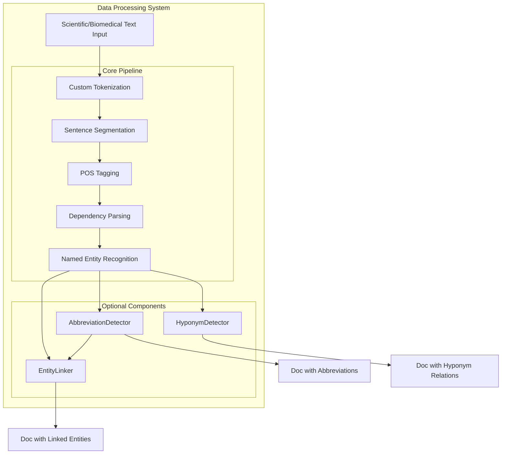

<!-- source: DeepWiki mcp.deepwiki.com · repo allenai/scispacy · page 1 Overview · fetched 2026-10-26 -->

# Overview

<details>
<summary>Relevant source files</summary>

The following files were used as context for generating this wiki page:

- [Dockerfile](Dockerfile)
- [README.md](README.md)
- [RELEASE.md](RELEASE.md)
- [docs/example.svg](docs/example.svg)
- [docs/index.md](docs/index.md)
- [scripts/install_remote_packages.py](scripts/install_remote_packages.py)

</details>


This page provides an introduction to SciSpaCy, a Python package that extends the spaCy natural language processing library for processing scientific, biomedical, and clinical text. It explains the core components, available models, and unique capabilities of SciSpaCy.

For installation instructions, see [Installation Guide](#1.1). For details on specific models, see [Available Models](#1.2).

Sources: [README.md:3-8](), [docs/index.md:4-5]()

## What is SciSpaCy?

SciSpaCy is a specialized extension of spaCy designed specifically for processing scientific and biomedical text. It provides custom components trained on biomedical corpora, including:

- Custom tokenization rules optimized for scientific terminology
- POS tagging and syntactic parsing models trained on biomedical data
- Entity span detection for biomedical terminology
- Named Entity Recognition (NER) models for specific biomedical tasks
- Pipeline components for abbreviation detection, entity linking, and hyponym detection
- Integration with medical knowledge bases (UMLS, MeSH, RxNorm, etc.)

The purpose of SciSpaCy is to improve NLP performance on scientific text, where general-purpose NLP tools often struggle with domain-specific terminology, abbreviations, and linguistic patterns.

Sources: [README.md:3-8](), [docs/index.md:4-5]()

## System Architecture

The following diagram illustrates the core components of SciSpaCy and how they interact:

```mermaid
graph TD
    subgraph "Core SciSpaCy Components"
        models["Pre-trained Models"] -- "used by" --> nlpPipeline["NLP Pipeline"]
        nlpPipeline --> tokenization["Custom Tokenization"]
        nlpPipeline --> sentSeg["Custom Sentence Segmentation"]
        nlpPipeline --> ner["Named Entity Recognition"]
        
        subgraph "Pipeline Components"
            abbreviation["AbbreviationDetector"]
            entityLink["EntityLinker"]
            hyponym["HyponymDetector"]
        end
        
        nlpPipeline --> "Pipeline Components"
        
        subgraph "Knowledge Bases"
            umls["UMLS"]
            mesh["MeSH"]
            rxnorm["RxNorm"]
            go["Gene Ontology"]
            hpo["Human Phenotype Ontology"]
        end
        
        candidateGen["CandidateGenerator"] --> entityLink
        "Knowledge Bases" --> candidateGen
    end
    
    scientificText["Scientific/Biomedical Text"] --> nlpPipeline
    nlpPipeline --> processedDoc["Processed Document"]
```

Sources: [README.md:4-8](), [README.md:120-138](), [README.md:162-196]()

## Data Processing Flow

The following diagram shows how text is processed through the SciSpaCy pipeline:



Sources: [README.md:134-156](), [README.md:162-263](), [README.md:265-291]()

## Available Models

SciSpaCy provides several pre-trained models with different capabilities and sizes:

| Model | Size | Vocabulary | Word Vectors | UAS | LAS | POS | Description |
|-------|------|------------|--------------|-----|-----|-----|-------------|
| en_core_sci_sm | Small | ~100k | None | 89.18 | 87.15 | 98.18 | General-purpose biomedical text processing |
| en_core_sci_md | Medium | ~360k | 50k | 90.08 | 88.16 | 98.46 | Improved performance with word vectors |
| en_core_sci_lg | Large | ~785k | 600k | 89.97 | 88.18 | 98.51 | Best performance for general tasks |
| en_core_sci_scibert | Large | ~785k | BERT-based | 92.12 | 90.58 | 98.18 | Best performance with transformer model |

In addition to these general models, SciSpaCy provides specialized NER models:

| NER Model | F1 Score | Entity Types | Description |
|-----------|----------|--------------|-------------|
| en_ner_craft_md | 78.01 | GGP, SO, TAXON, CHEBI, GO, CL | Gene and protein entity recognition |
| en_ner_jnlpba_md | 72.06 | DNA, CELL_TYPE, CELL_LINE, RNA, PROTEIN | Molecular biology entity recognition |
| en_ner_bc5cdr_md | 84.28 | DISEASE, CHEMICAL | Disease and chemical entity recognition |
| en_ner_bionlp13cg_md | 77.84 | 16 entity types including AMINO_ACID, CANCER, GENE_OR_GENE_PRODUCT, etc. | Comprehensive biomedical entity recognition |

Sources: [README.md:95-117](), [docs/index.md:16-27](), [docs/index.md:32-49]()

## Special Pipeline Components

### AbbreviationDetector

The `AbbreviationDetector` is a pipeline component that implements the abbreviation detection algorithm from "A simple algorithm for identifying abbreviation definitions in biomedical text" (Schwartz & Hearst, 2003). It identifies short forms of terms and their corresponding long forms in text.

You can access the list of abbreviations via the `doc._.abbreviations` attribute, and for a given abbreviation, you can access its long form using `span._.long_form`.

```python
import spacy
from scispacy.abbreviation import AbbreviationDetector

nlp = spacy.load("en_core_sci_sm")
nlp.add_pipe("abbreviation_detector")

doc = nlp("Spinal and bulbar muscular atrophy (SBMA) is an inherited motor neuron disease.")
for abrv in doc._.abbreviations:
    print(f"{abrv} -> {abrv._.long_form}")
# Output: SBMA -> Spinal and bulbar muscular atrophy
```

Sources: [README.md:123-156]()

### EntityLinker

The `EntityLinker` connects entity mentions in text to concepts in medical knowledge bases. It performs a string overlap-based search using character 3-grams, comparing entities with concepts in a knowledge base using approximate nearest neighbors search.

Currently, there are 5 supported knowledge bases:
- `umls`: Unified Medical Language System (~3M concepts)
- `mesh`: Medical Subject Headings (~30k concepts)
- `rxnorm`: RxNorm ontology for clinical drugs (~100k concepts)
- `go`: Gene Ontology (~67k concepts)
- `hpo`: Human Phenotype Ontology (~16k concepts)

This component sets the `._.kb_ents` attribute on spaCy Spans, which contains a list of tuples with the knowledge base concept ID and the associated score.

```python
import spacy

nlp = spacy.load("en_core_sci_sm")
nlp.add_pipe("scispacy_linker", config={"linker_name": "umls"})

doc = nlp("Spinal muscular atrophy is a neurodegenerative disease.")
for entity in doc.ents:
    for umls_ent in entity._.kb_ents:
        print(f"{entity} -> {umls_ent[0]}")
```

Sources: [README.md:161-263]()

### HyponymDetector

The `HyponymDetector` implements the methods from "Automatic Acquisition of Hyponyms from Large Text Corpora" using the spaCy Matcher component. It identifies taxonomic relationships (X is a type of Y) in text using Hearst patterns.

When the `extended=True` parameter is used, it applies an extended set of Hearst patterns for higher recall but potentially lower precision.

This component adds a doc-level attribute `doc._.hearst_patterns`, which is a list of tuples containing:
1. The relation rule used to extract the hyponym (string)
2. The more general concept (spaCy Span)
3. The more specific concept (spaCy Span)

```python
import spacy
from scispacy.hyponym_detector import HyponymDetector

nlp = spacy.load("en_core_sci_sm")
nlp.add_pipe("hyponym_detector", config={"extended": False})

doc = nlp("Keystone plant species such as fig trees are good for the soil.")
print(doc._.hearst_patterns)
# Output: [('such_as', Keystone plant species, fig trees)]
```

Sources: [README.md:265-291]()

## Entity Linking Architecture

The following diagram shows the architecture of the entity linking system in more detail:

```mermaid
graph TD
    text["Scientific Text Input"] --> nlp["spaCy Pipeline Processing"]
    nlp --> entities["Entity Recognition"]
    
    entities --> abbrev["AbbreviationDetector"]
    abbrev --> linker["EntityLinker"]
    entities --> linker
    
    subgraph "Candidate Generation"
        tfidf["TF-IDF Vectorizer"]
        ann["ANN Index (nmslib)"]
        cand["CandidateGenerator"]
        
        tfidf --> cand
        ann --> cand
    end
    
    subgraph "Knowledge Bases"
        umls["UMLS_KB"]
        mesh["MeSH_KB"]
        rxnorm["RxNorm_KB"]
        go["GeneOntology_KB"]
        hpo["HPO_KB"]
    end
    
    linker --> cand
    cand --> candidates["Entity Candidates"]
    "Knowledge Bases" --> cand
    
    candidates --> ranking["Candidate Ranking"]
    ranking --> filtering["Threshold Filtering"]
    filtering --> linkedEntities["Linked Entities"]
```

Sources: [README.md:161-263]()

## Usage Example

Basic usage example of SciSpaCy:

```python
import spacy

# Load a SciSpaCy model
nlp = spacy.load("en_core_sci_sm")

# Process a scientific text
doc = nlp("Alterations in the hypocretin receptor 2 and preprohypocretin genes produce narcolepsy in some animals.")

# Access sentences
for sent in doc.sents:
    print(sent)

# Access entities
for ent in doc.ents:
    print(ent.text)

# Add custom pipeline components
nlp.add_pipe("abbreviation_detector")
nlp.add_pipe("scispacy_linker", config={"linker_name": "umls"})
nlp.add_pipe("hyponym_detector")

# Process text with the enhanced pipeline
doc = nlp("Spinal and bulbar muscular atrophy (SBMA) is an inherited motor neuron disease.")
```

Sources: [README.md:85-90](), [docs/index.md:53-96]()

## Training Data Sources

SciSpaCy models are trained on data from various sources:

- **GENIA 1.0 Treebank**: Converted to Universal Dependencies for syntactic parsing
- **OntoNotes 5.0**: Used to make the parser and tagger more robust to non-biomedical text
- **MedMentions**: Used for training the mention detector
- **CRAFT, JNLPBA, BC5CDR, BIONLP13CG**: Used for training specialized NER models

Sources: [docs/index.md:101-111]()

---

