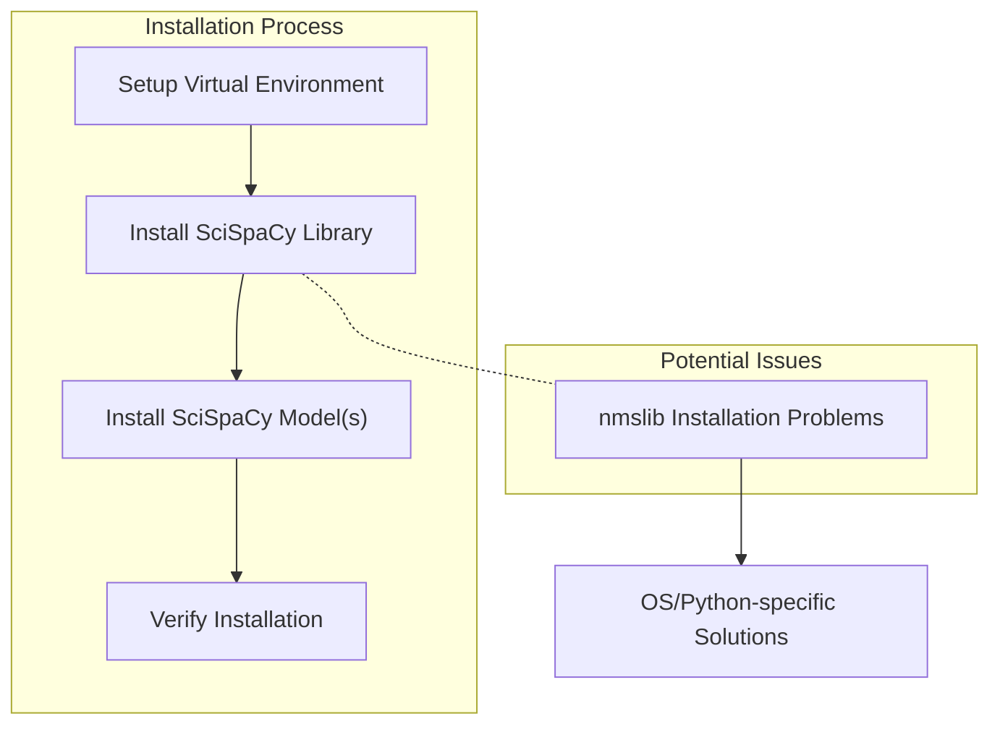
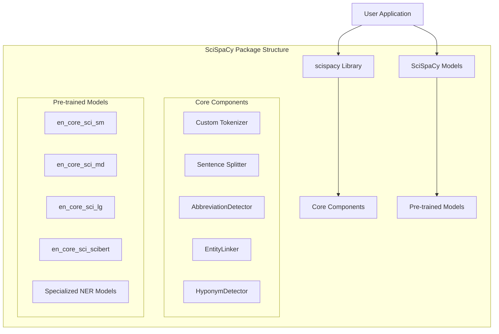
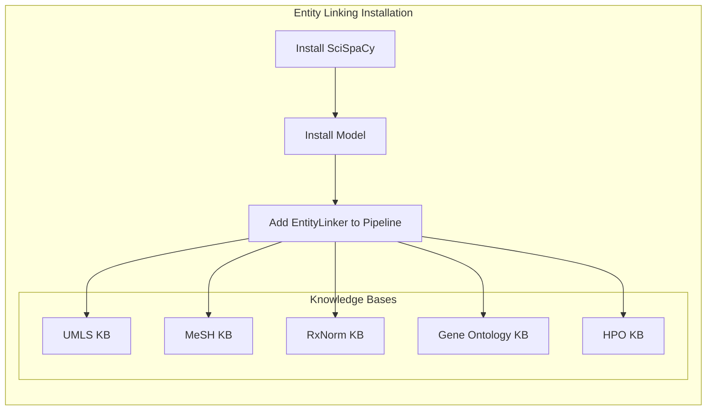

<!-- source: DeepWiki mcp.deepwiki.com · repo allenai/scispacy · page 1.1 Installation Guide · fetched 2026-10-26 -->

# Installation Guide

<details>
<summary>Relevant source files</summary>

The following files were used as context for generating this wiki page:

- [Dockerfile](Dockerfile)
- [README.md](README.md)
- [RELEASE.md](RELEASE.md)
- [docs/example.svg](docs/example.svg)
- [docs/index.md](docs/index.md)
- [evaluation/evaluate_linker.py](evaluation/evaluate_linker.py)
- [requirements.in](requirements.in)
- [scispacy/version.py](scispacy/version.py)
- [scripts/install_remote_packages.py](scripts/install_remote_packages.py)
- [setup.py](setup.py)

</details>


This guide provides detailed instructions for installing SciSpaCy, a Python package that extends spaCy with specialized components for processing scientific and biomedical text. The installation process involves two main steps: installing the SciSpaCy library and installing one or more pre-trained models.

## Prerequisites

Before installing SciSpaCy, ensure your environment meets the following requirements:

- **Python**: SciSpaCy requires Python 3.6 or higher (Python 3.10 is recommended for best compatibility)
- **pip**: Make sure you have an updated version of pip
- **Virtual Environment**: It is strongly recommended to use an isolated Python environment

SciSpaCy has several dependencies that will be automatically installed, including:
- spaCy (version 3.7.0 or compatible)
- NumPy
- SciPy
- scikit-learn
- nmslib (for entity linking functionality)

Sources: [README.md:12-27](), [requirements.in:1-18](), [setup.py:43-54]()

## Installation Workflow



Sources: [README.md:13-23](), [README.md:30-60]()

## Setting Up a Virtual Environment

It is strongly recommended to use a virtual environment to avoid conflicts with other packages. You can use conda, mamba, or virtualenv to create an isolated environment:

### Using Mamba (Recommended)

```bash
# Install Mamba if you don't have it
# Follow the installation instructions at https://mamba.readthedocs.io/en/latest/installation/mamba-installation.html

# Create a new environment with Python 3.10
mamba create -n scispacy python=3.10

# Activate the environment
mamba activate scispacy
```

### Using virtualenv

```bash
# Install virtualenv if you don't have it
pip install virtualenv

# Create a new environment
virtualenv scispacy_env

# Activate the environment (Linux/Mac)
source scispacy_env/bin/activate

# Activate the environment (Windows)
scispacy_env\Scripts\activate
```

Sources: [README.md:62-82]()

## Installing the SciSpaCy Library

Once your virtual environment is activated, install the SciSpaCy library using pip:

```bash
pip install scispacy
```

This command installs the core SciSpaCy package (currently version 0.5.5 as per [scispacy/version.py]()) and its dependencies.

Sources: [README.md:15-17](), [scispacy/version.py:1-7]()

## System Architecture



Sources: [README.md:4-9](), [README.md:94-118]()

## Installing SciSpaCy Models

After installing the SciSpaCy library, you need to install at least one model. Models are not included in the base package and must be installed separately. Choose a model based on your specific requirements for vocabulary size, word vectors, and functionality.

### Available Models

| Model | Description | Command |
|-------|-------------|---------|
| en_core_sci_sm | A full spaCy pipeline for biomedical data with a ~100k vocabulary | `pip install https://s3-us-west-2.amazonaws.com/ai2-s2-scispacy/releases/v0.5.4/en_core_sci_sm-0.5.4.tar.gz` |
| en_core_sci_md | A full spaCy pipeline for biomedical data with a ~360k vocabulary and 50k word vectors | `pip install https://s3-us-west-2.amazonaws.com/ai2-s2-scispacy/releases/v0.5.4/en_core_sci_md-0.5.4.tar.gz` |
| en_core_sci_lg | A full spaCy pipeline for biomedical data with a ~785k vocabulary and 600k word vectors | `pip install https://s3-us-west-2.amazonaws.com/ai2-s2-scispacy/releases/v0.5.4/en_core_sci_lg-0.5.4.tar.gz` |
| en_core_sci_scibert | A full spaCy pipeline with a ~785k vocabulary and `allenai/scibert-base` as the transformer model | `pip install https://s3-us-west-2.amazonaws.com/ai2-s2-scispacy/releases/v0.5.4/en_core_sci_scibert-0.5.4.tar.gz` |

Additionally, specialized NER models are available for specific tasks:

| Model | Description | Command |
|-------|-------------|---------|
| en_ner_craft_md | A spaCy NER model trained on the CRAFT corpus | `pip install https://s3-us-west-2.amazonaws.com/ai2-s2-scispacy/releases/v0.5.4/en_ner_craft_md-0.5.4.tar.gz` |
| en_ner_jnlpba_md | A spaCy NER model trained on the JNLPBA corpus | `pip install https://s3-us-west-2.amazonaws.com/ai2-s2-scispacy/releases/v0.5.4/en_ner_jnlpba_md-0.5.4.tar.gz` |
| en_ner_bc5cdr_md | A spaCy NER model trained on the BC5CDR corpus | `pip install https://s3-us-west-2.amazonaws.com/ai2-s2-scispacy/releases/v0.5.4/en_ner_bc5cdr_md-0.5.4.tar.gz` |
| en_ner_bionlp13cg_md | A spaCy NER model trained on the BIONLP13CG corpus | `pip install https://s3-us-west-2.amazonaws.com/ai2-s2-scispacy/releases/v0.5.4/en_ner_bionlp13cg_md-0.5.4.tar.gz` |

For information about these models' capabilities and performance, see [Available Models](#1.2).

Sources: [README.md:95-117](), [docs/index.md:17-27]()

## Troubleshooting nmslib Installation

The entity linking functionality in SciSpaCy relies on `nmslib`, which can be challenging to install on certain platforms and Python versions. If you encounter issues installing SciSpaCy or when using the entity linking functionality, refer to the compatibility matrix below for potential solutions:

### nmslib Compatibility Matrix

| Python Version | Windows 11 | WSL | Mac M1 | Mac M2 | Intel Mac |
|----------------|------------|-----|--------|--------|-----------|
| Python 3.8     | ✓          | ✓   | Flag*  | ?      | ?         |
| Python 3.9     | Mamba†     | ✓   | Flag*  | Flag** | ?         |
| Python 3.10    | Mamba†     | ✓   | ?      | ?      | ✓         |
| Python 3.11    | Mamba†     | Mamba† | ?   | ?      | Conda**   |
| Python 3.12    | Mamba†     | Fork‡ | ?    | ?      | ?         |

Legend:
- ✓: Works with standard pip install
- Flag*: Use `CFLAGS="-mavx -DWARN(a)=(a)" pip install nmslib`
- Flag**: Use `conda install -c conda-forge nmslib`
- Mamba†: Use `mamba install nmslib`
- Fork‡: Use `pip install nmslib-metabrainz`

If you're still experiencing issues, try these alternative approaches:
- `pip install --no-binary :all: nmslib`
- `pip install "nmslib @ git+https://github.com/nmslib/nmslib.git/#subdirectory=python_bindings"`
- `pip install --upgrade pybind11` followed by `pip install --verbose 'nmslib @ git+https://github.com/nmslib/nmslib.git#egg=nmslib&subdirectory=python_bindings'`

Sources: [README.md:30-60](), [requirements.in:12-17]()

## Verifying Installation

After installing SciSpaCy and at least one model, you can verify the installation with a simple example:

```python
import spacy

# Load one of the installed models
nlp = spacy.load("en_core_sci_sm")

# Process a sample text
text = "Alterations in the hypocretin receptor 2 and preprohypocretin genes produce narcolepsy in some animals."
doc = nlp(text)

# Print tokens to verify the model is working
for token in doc:
    print(token.text, token.pos_)
```

If the model runs without errors and outputs the tokens with their part-of-speech tags, your installation is successful.

Sources: [README.md:85-90]()

## Entity Linking Components Installation

If you plan to use the entity linking functionality, additional components need to be installed. This functionality allows linking of mentions in text to concepts in medical knowledge bases.



The entity linker downloads knowledge base data on first use, which can be large (e.g., UMLS is approximately 1GB). This data is cached for future use. Here's an example of how to add the entity linker to your pipeline:

```python
import spacy
import scispacy
from scispacy.linking import EntityLinker

# Load a model
nlp = spacy.load("en_core_sci_sm")

# Add the entity linker (this will download KB data on first run)
nlp.add_pipe("scispacy_linker", config={"resolve_abbreviations": True, "linker_name": "umls"})

# Process text
doc = nlp("Spinal and bulbar muscular atrophy (SBMA) is an inherited motor neuron disease.")
```

Sources: [README.md:161-263](), [evaluation/evaluate_linker.py:1-14]()

## Upgrading SciSpaCy

When upgrading to a newer version of SciSpaCy, you need to reinstall both the library and the models to ensure compatibility:

1. Upgrade the SciSpaCy library:
   ```bash
   pip install --upgrade scispacy
   ```

2. Reinstall models with the matching version number:
   ```bash
   pip install https://s3-us-west-2.amazonaws.com/ai2-s2-scispacy/releases/v0.5.4/en_core_sci_sm-0.5.4.tar.gz
   ```

Note that you should check the repository for the latest model URLs, as they will change with each version release.

Sources: [README.md:92-93](), [scripts/install_remote_packages.py:1-28](), [RELEASE.md:1-26]()

## Docker Installation

For a reproducible environment, SciSpaCy provides a Dockerfile that sets up a complete environment with the library and models. To use Docker:

1. Clone the repository:
   ```bash
   git clone https://github.com/allenai/scispacy.git
   cd scispacy
   ```

2. Build the Docker image:
   ```bash
   docker build -t scispacy .
   ```

3. Run a container with the image:
   ```bash
   docker run -it scispacy
   ```

This will create a container with SciSpaCy and the small model (`en_core_sci_sm`) pre-installed.

Sources: [Dockerfile:1-34]()

## Next Steps

After successfully installing SciSpaCy, you might want to:

1. Learn about the available models in more detail: [Available Models](#1.2)
2. Explore the core pipeline components: [Core Pipeline Components](#2)
3. Understand how to use specialized components like Abbreviation Detection: [Abbreviation Detection](#2.2)
4. Set up entity linking to medical knowledge bases: [Entity Linking](#2.3)

---

