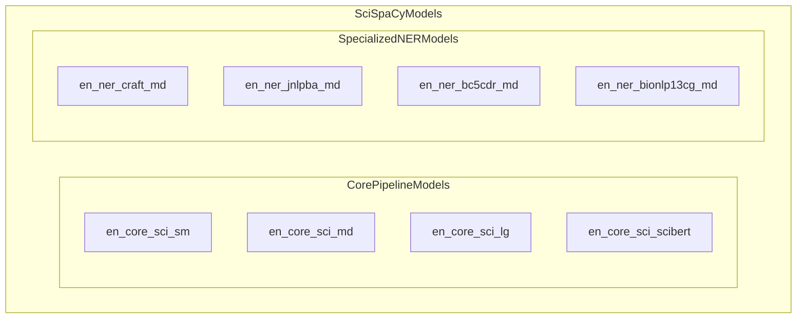
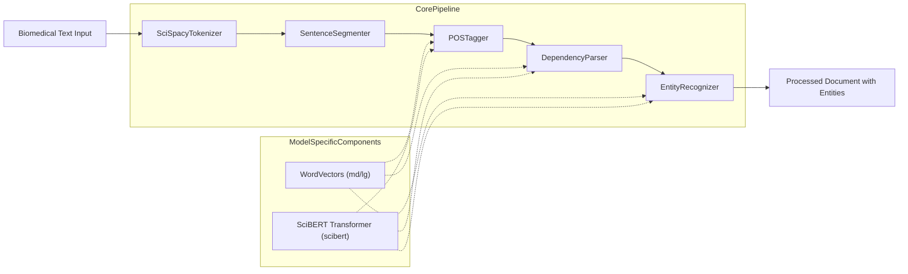
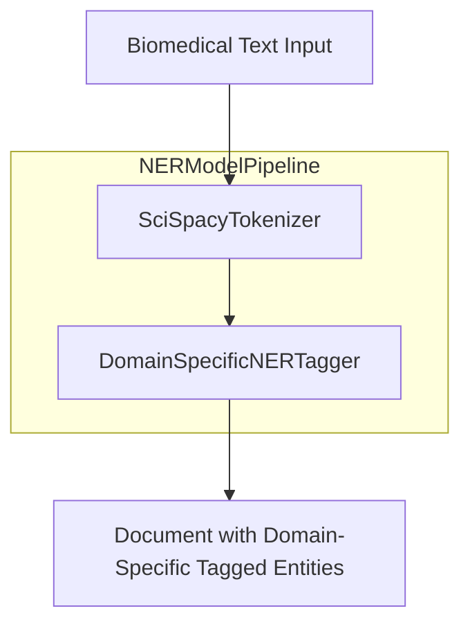
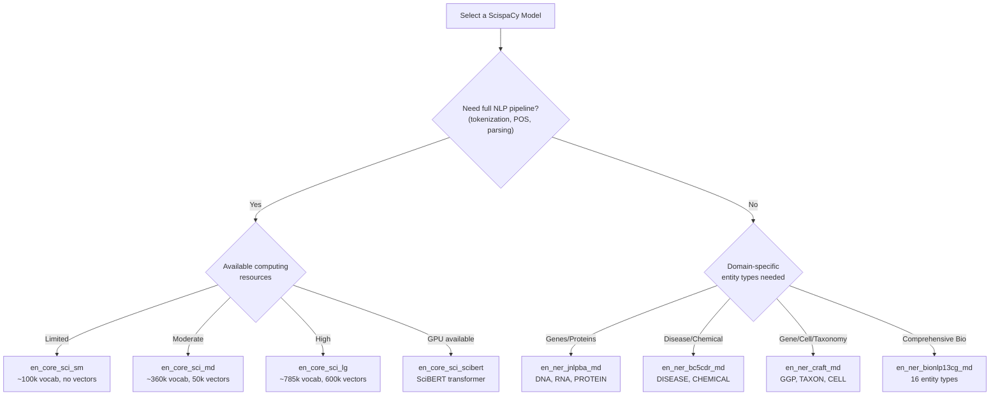

<!-- source: DeepWiki mcp.deepwiki.com · repo allenai/scispacy · page 1.2 Available Models · fetched 2026-10-26 -->

# Available Models

<details>
<summary>Relevant source files</summary>

The following files were used as context for generating this wiki page:

- [Dockerfile](Dockerfile)
- [README.md](README.md)
- [RELEASE.md](RELEASE.md)
- [data/meta_large.json](data/meta_large.json)
- [data/meta_small.json](data/meta_small.json)
- [docs/example.svg](docs/example.svg)
- [docs/index.md](docs/index.md)
- [scripts/install_remote_packages.py](scripts/install_remote_packages.py)

</details>


This document provides a comprehensive overview of the pre-trained models available in scispaCy. It covers the different model types, their capabilities, sizes, and intended use cases. For information about how to install these models, see [Installation Guide](#1.1).

## Overview of Model Types

scispaCy offers two main categories of models:

1. **Core Pipeline Models** - Full spaCy pipelines with customizations for scientific and biomedical text
2. **Specialized NER Models** - Models focused specifically on domain-specific Named Entity Recognition

### Model Architecture Diagram



Sources: [README.md:108-117]()

## Core Pipeline Models

The core pipeline models include all standard spaCy pipeline components (tokenization, part-of-speech tagging, dependency parsing, and entity recognition) with biomedical-specific adaptations. They are designed for general-purpose processing of biomedical and scientific text.

### Core Pipeline Model Comparison

| Model | Vocabulary Size | Word Vectors | Transformer | Description |
|-------|----------------|--------------|-------------|-------------|
| en_core_sci_sm | ~100k | No | No | Lightweight model for basic NLP tasks with lower memory requirements |
| en_core_sci_md | ~360k | 50k | No | Medium-sized model with word vectors for improved semantic understanding |
| en_core_sci_lg | ~785k | 600k | No | Large model with extensive word vectors for better semantic representation |
| en_core_sci_scibert | ~785k | No | Yes (allenai/scibert-base) | Transformer-based model leveraging SciBERT for state-of-the-art performance |

Sources: [README.md:108-113](), [docs/index.md:18-23]()

### Core Model Pipeline Architecture



Sources: [README.md:6-8]()

### Performance Metrics

The core models achieve competitive performance on biomedical text processing tasks:

| Model | UAS | LAS | POS | Mentions (F1) | Web UAS |
|-------|-----|-----|-----|--------------|---------|
| en_core_sci_sm | 89.18 | 87.15 | 98.18 | 67.89 | 87.36 |
| en_core_sci_md | 90.08 | 88.16 | 98.46 | 68.86 | 88.04 |
| en_core_sci_lg | 89.97 | 88.18 | 98.51 | 68.98 | 87.89 |
| en_core_sci_scibert | 92.12 | 90.58 | 98.18 | 67.70 | 92.58 |

Where:
- **UAS**: Unlabeled Attachment Score (dependency parsing accuracy)
- **LAS**: Labeled Attachment Score (dependency parsing with relation labels)
- **POS**: Part-of-speech tagging accuracy
- **Mentions (F1)**: Entity mention detection F1 score
- **Web UAS**: Unlabeled Attachment Score on web domain (out-of-domain performance)

Sources: [docs/index.md:35-40]()

### Training Data Sources

The core models are trained on multiple data sources to ensure robust performance on biomedical text:

- **GENIA 1.0 Treebank**: Provides syntactic annotations for biomedical text
- **OntoNotes 5.0**: Improves robustness on general domain text
- **PubMed Central Open Access Subset**: Used for training word vectors (md and lg models)
- **MedMentions**: Used for entity recognition training

Sources: [docs/index.md:106-110](), [data/meta_small.json:4](), [data/meta_large.json:4]()

## Specialized NER Models

The specialized NER models focus exclusively on Named Entity Recognition for specific biomedical domains. These models are designed to recognize domain-specific entity types with high accuracy.

### NER Model Comparison

| Model | Training Corpus | Entity Types | F1 Score |
|-------|----------------|--------------|----------|
| en_ner_craft_md | CRAFT | GGP, SO, TAXON, CHEBI, GO, CL | 78.01 |
| en_ner_jnlpba_md | JNLPBA | DNA, CELL_TYPE, CELL_LINE, RNA, PROTEIN | 72.06 |
| en_ner_bc5cdr_md | BC5CDR | DISEASE, CHEMICAL | 84.28 |
| en_ner_bionlp13cg_md | BIONLP13CG | AMINO_ACID, ANATOMICAL_SYSTEM, CANCER, CELL, CELLULAR_COMPONENT, DEVELOPING_ANATOMICAL_STRUCTURE, GENE_OR_GENE_PRODUCT, IMMATERIAL_ANATOMICAL_ENTITY, MULTI-TISSUE_STRUCTURE, ORGAN, ORGANISM, ORGANISM_SUBDIVISION, ORGANISM_SUBSTANCE, PATHOLOGICAL_FORMATION, SIMPLE_CHEMICAL, TISSUE | 77.84 |

Sources: [README.md:114-117](), [docs/index.md:44-48]()

### NER Model Pipeline Architecture



Sources: [README.md:8]()

## Model Selection Guide

The following diagram helps select the appropriate model based on your specific requirements:



Sources: [README.md:108-117]()

## Usage Examples

### Using a Core Pipeline Model

```python
import spacy

# Load a core pipeline model
nlp = spacy.load("en_core_sci_sm")

# Process biomedical text
doc = nlp("Alterations in the hypocretin receptor 2 and preprohypocretin genes produce narcolepsy in some animals.")

# Access entities, tokens, and syntactic information
for ent in doc.ents:
    print(f"Entity: {ent.text}")

for token in doc:
    print(f"{token.text} - {token.pos_} - {token.dep_}")
```

Sources: [README.md:86-90]()

### Using a Specialized NER Model

```python
import spacy

# Load a specialized NER model
nlp = spacy.load("en_ner_bc5cdr_md")

# Process biomedical text
doc = nlp("Aspirin may cause stomach bleeding and liver damage.")

# Access tagged entities with their specific types
for ent in doc.ents:
    print(f"Entity: {ent.text}, Type: {ent.label_}")
    # Will output entities like:
    # Entity: Aspirin, Type: CHEMICAL
    # Entity: stomach bleeding, Type: DISEASE
    # Entity: liver damage, Type: DISEASE
```

Sources: [README.md:114]()

## Model Download Links

All models are available as pip-installable packages from the AI2 S3 bucket. To install a specific model, use the appropriate URL with pip:

```bash
pip install <model_url>
```

| Model | Install URL |
|-------|-------------|
| en_core_sci_sm | https://s3-us-west-2.amazonaws.com/ai2-s2-scispacy/releases/v0.5.4/en_core_sci_sm-0.5.4.tar.gz |
| en_core_sci_md | https://s3-us-west-2.amazonaws.com/ai2-s2-scispacy/releases/v0.5.4/en_core_sci_md-0.5.4.tar.gz |
| en_core_sci_lg | https://s3-us-west-2.amazonaws.com/ai2-s2-scispacy/releases/v0.5.4/en_core_sci_lg-0.5.4.tar.gz |
| en_core_sci_scibert | https://s3-us-west-2.amazonaws.com/ai2-s2-scispacy/releases/v0.5.4/en_core_sci_scibert-0.5.4.tar.gz |
| en_ner_craft_md | https://s3-us-west-2.amazonaws.com/ai2-s2-scispacy/releases/v0.5.4/en_ner_craft_md-0.5.4.tar.gz |
| en_ner_jnlpba_md | https://s3-us-west-2.amazonaws.com/ai2-s2-scispacy/releases/v0.5.4/en_ner_jnlpba_md-0.5.4.tar.gz |
| en_ner_bc5cdr_md | https://s3-us-west-2.amazonaws.com/ai2-s2-scispacy/releases/v0.5.4/en_ner_bc5cdr_md-0.5.4.tar.gz |
| en_ner_bionlp13cg_md | https://s3-us-west-2.amazonaws.com/ai2-s2-scispacy/releases/v0.5.4/en_ner_bionlp13cg_md-0.5.4.tar.gz |

Sources: [README.md:108-117](), [scripts/install_remote_packages.py:7-17]()

Note: When upgrading scispaCy, you will need to download the compatible model versions again, as models are versioned to match the scispaCy version they work with.

---

