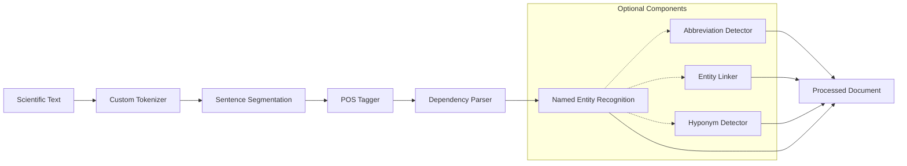
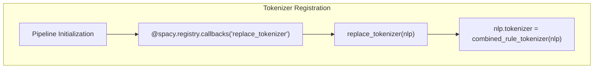
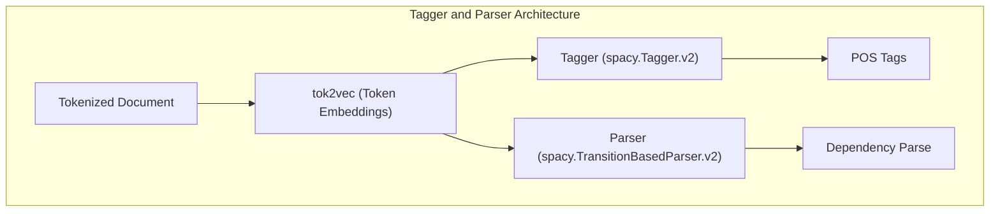
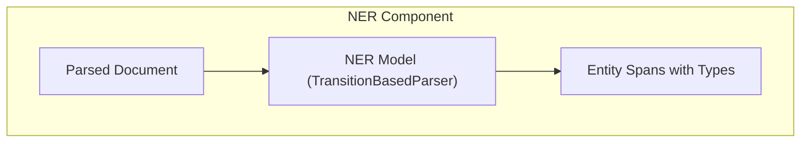
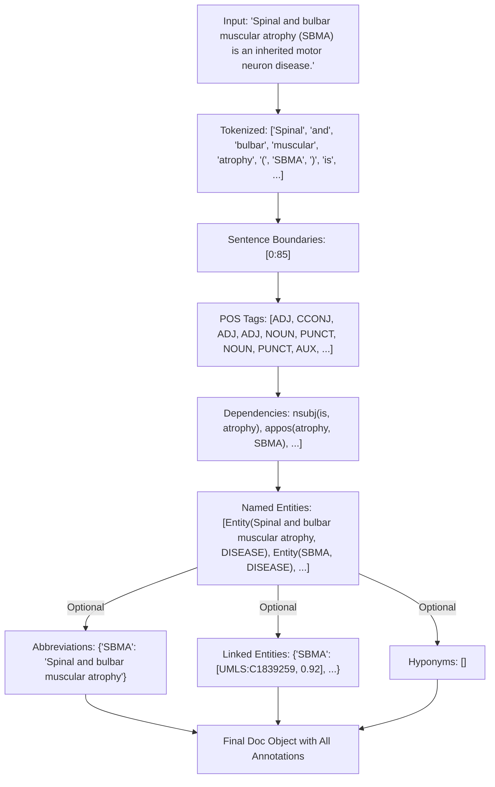
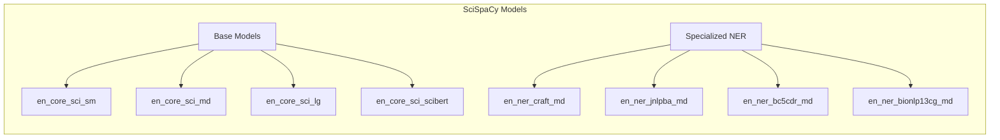
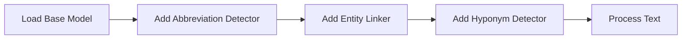
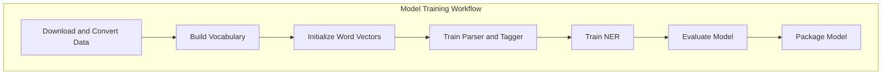

<!-- source: DeepWiki mcp.deepwiki.com · repo allenai/scispacy · page 2 Core Pipeline Components · fetched 2026-10-26 -->

# Core Pipeline Components

<details>
<summary>Relevant source files</summary>

The following files were used as context for generating this wiki page:

- [Dockerfile](Dockerfile)
- [README.md](README.md)
- [RELEASE.md](RELEASE.md)
- [configs/base_ner.cfg](configs/base_ner.cfg)
- [configs/base_ner_scibert.cfg](configs/base_ner_scibert.cfg)
- [configs/base_parser_tagger.cfg](configs/base_parser_tagger.cfg)
- [configs/base_parser_tagger_scibert.cfg](configs/base_parser_tagger_scibert.cfg)
- [configs/base_specialized_ner.cfg](configs/base_specialized_ner.cfg)
- [data/meta_scibert.json](data/meta_scibert.json)
- [docs/example.svg](docs/example.svg)
- [docs/index.md](docs/index.md)
- [project.yml](project.yml)
- [scispacy/base_project_code.py](scispacy/base_project_code.py)
- [scripts/evaluate_ner.py](scripts/evaluate_ner.py)
- [scripts/install_remote_packages.py](scripts/install_remote_packages.py)

</details>


This page provides an overview of the main SciSpaCy pipeline components and explains how they interact to process scientific and biomedical text. This covers the core architecture and components that make up the foundation of SciSpaCy's text processing capabilities. For detailed information about specific components, see the dedicated pages for [Custom Tokenization and Sentence Segmentation](#2.1), [Abbreviation Detection](#2.2), [Entity Linking](#2.3), and [Hyponym Detection](#2.4).

## Pipeline Architecture Overview

SciSpaCy extends spaCy's pipeline architecture with specialized components for processing scientific and biomedical text. The pipeline follows a sequential processing model where each component builds upon the annotations provided by previous components.



The core pipeline components (tokenization through NER) are included in all SciSpaCy models by default. The optional components can be added as needed to provide additional functionality.

Sources: [configs/base_parser_tagger.cfg:16-23](), [configs/base_ner.cfg:14-21](), [README.md:120-156]()

## Core Components

### Custom Tokenization and Sentence Segmentation

SciSpaCy implements a specialized tokenizer that builds on spaCy's rule-based tokenizer, adding rules specific to scientific and biomedical text. This component is critical for properly handling scientific terminology, chemical formulas, gene names, and other domain-specific expressions.

The custom tokenizer is implemented through a callback that replaces spaCy's default tokenizer during model initialization:



The tokenizer replacement is registered in [scispacy/base_project_code.py:24-30]() and is referenced in the initialization section of configuration files [configs/base_parser_tagger.cfg:173]() and [configs/base_ner.cfg:148]().

Sources: [scispacy/base_project_code.py:24-30](), [configs/base_parser_tagger.cfg:173](), [configs/base_ner.cfg:148]()

### Part-of-Speech Tagging and Dependency Parsing

The POS tagger and dependency parser are trained on biomedical corpora (GENIA and OntoNotes) to better handle domain-specific language patterns. Both components share token representations through the tok2vec component.



The tagger and parser configurations are defined in [configs/base_parser_tagger.cfg:54-65]() and [configs/base_parser_tagger.cfg:33-52]() respectively. The shared tok2vec component that provides token embeddings is defined in [configs/base_parser_tagger.cfg:67-85]().

Sources: [configs/base_parser_tagger.cfg:33-85](), [project.yml:266-305]()

### Named Entity Recognition

The NER component identifies spans of text representing entities of interest in biomedical text. SciSpaCy provides general biomedical NER as well as specialized models for specific entity types.



The NER component is defined in [configs/base_ner.cfg:31-60]() and uses a transition-based parser architecture specialized for entity recognition. Different SciSpaCy models are trained to recognize different types of entities:

| Model | Entity Types | Training Corpus |
|-------|-------------|----------------|
| en_core_sci_* | General biomedical entities | MedMentions |
| en_ner_craft_md | GGP, SO, TAXON, CHEBI, GO, CL | CRAFT |
| en_ner_jnlpba_md | DNA, CELL_TYPE, CELL_LINE, RNA, PROTEIN | JNLPBA |
| en_ner_bc5cdr_md | DISEASE, CHEMICAL | BC5CDR |
| en_ner_bionlp13cg_md | 16 entity types including AMINO_ACID, CANCER, GENE_OR_GENE_PRODUCT | BIONLP13CG |

Sources: [configs/base_ner.cfg:31-60](), [README.md:93-117](), [project.yml:320-393]()

## Data Flow Through the Pipeline

When processing text, the SciSpaCy pipeline performs sequential transformations that build increasingly rich linguistic annotations:



Each component adds its annotations to the shared spaCy `Doc` object, which is passed through the entire pipeline. The final `Doc` object contains all the linguistic annotations produced by the pipeline components.

Sources: [README.md:132-156](), [README.md:161-263](), [README.md:267-291]()

## Model Variants and Pipeline Configuration

SciSpaCy provides several model variants with different capabilities and resource requirements:



The model characteristics are summarized below:

| Model | Vocabulary Size | Word Vectors | Description |
|-------|----------------|--------------|-------------|
| en_core_sci_sm | ~100k | None | Fast, small memory footprint |
| en_core_sci_md | ~360k | 50k vectors | Balanced performance |
| en_core_sci_lg | ~785k | 600k vectors | Higher accuracy, larger memory |
| en_core_sci_scibert | ~785k | SciBERT transformer | Highest accuracy, GPU recommended |

The training workflow for these models is defined in [project.yml:76-158](), with specific configurations for each model size and type.

Sources: [README.md:95-117](), [project.yml:76-158]()

## Pipeline Customization

SciSpaCy allows for customization of the pipeline through the addition of optional components:



Example of customizing a pipeline:

```python
import spacy
from scispacy.abbreviation import AbbreviationDetector

nlp = spacy.load("en_core_sci_sm")
nlp.add_pipe("abbreviation_detector")
nlp.add_pipe("scispacy_linker", config={"linker_name": "umls"})
nlp.add_pipe("hyponym_detector", config={"extended": False})

doc = nlp("Spinal and bulbar muscular atrophy (SBMA) is an inherited motor neuron disease.")
```

Each optional component adds specific functionality:

1. **Abbreviation Detector**: Identifies short-form/long-form pairs and adds them as span extensions
2. **Entity Linker**: Links entity mentions to knowledge base concepts (UMLS, MeSH, etc.)
3. **Hyponym Detector**: Identifies term relationships using Hearst patterns

These components can be added in any order after the core pipeline components.

Sources: [README.md:132-156](), [README.md:161-263](), [README.md:267-291]()

## Relationship to Training Infrastructure

The pipeline components are trained using a structured workflow defined in [project.yml]():



The training process uses several data sources:
- GENIA Treebank for training the parser and tagger
- OntoNotes for making the models robust to general text
- MedMentions for training the entity recognition
- Various specialized corpora for domain-specific NER models

The configuration files in [configs/]() define the model architectures, training parameters, and component interactions.

Sources: [project.yml](), [configs/](), [docs/index.md:101-110]()

---

