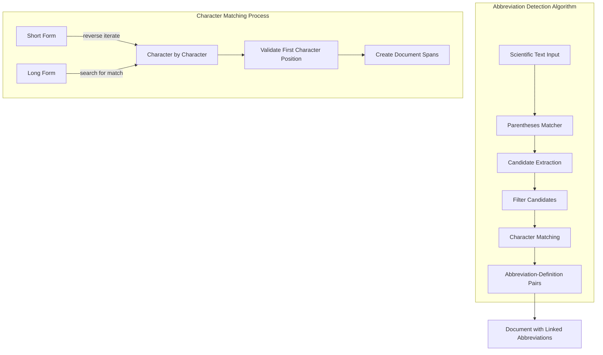
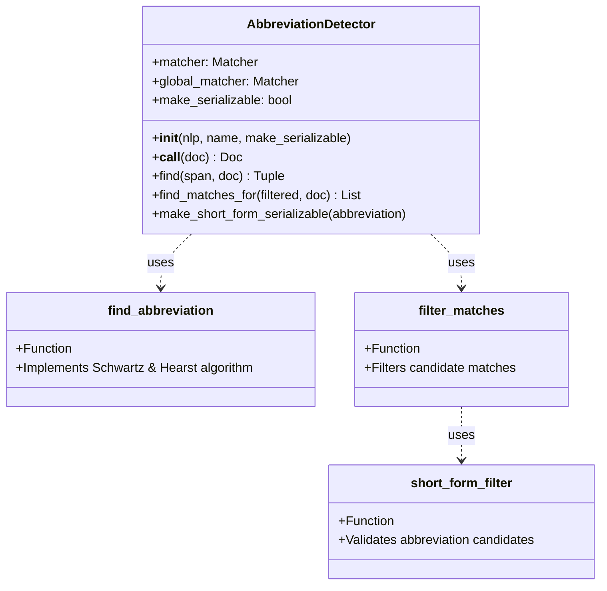
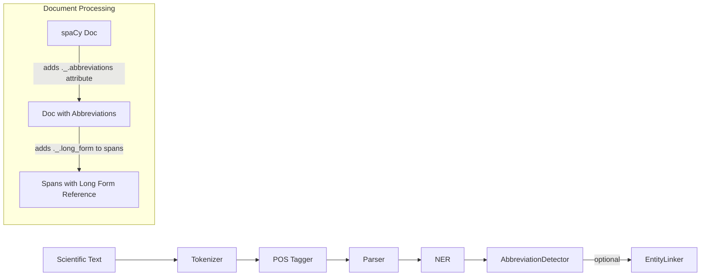

<!-- source: DeepWiki mcp.deepwiki.com · repo allenai/scispacy · page 2.2 Abbreviation Detection · fetched 2026-10-26 -->

# Abbreviation Detection

<details>
<summary>Relevant source files</summary>

The following files were used as context for generating this wiki page:

- [Dockerfile](Dockerfile)
- [README.md](README.md)
- [RELEASE.md](RELEASE.md)
- [docs/example.svg](docs/example.svg)
- [docs/index.md](docs/index.md)
- [scispacy/abbreviation.py](scispacy/abbreviation.py)
- [scispacy/linking.py](scispacy/linking.py)
- [scripts/install_remote_packages.py](scripts/install_remote_packages.py)
- [tests/test_abbreviation_detection.py](tests/test_abbreviation_detection.py)

</details>


This document details the Abbreviation Detection component in SciSpaCy, which identifies abbreviations and their corresponding long-form definitions in scientific and biomedical text. This component implements the algorithm described in "A simple algorithm for identifying abbreviation definitions in biomedical text" (Schwartz & Hearst, 2003).

## Purpose and Function

Scientific and biomedical texts frequently use abbreviations to refer to complex terms. The Abbreviation Detection component automatically identifies these abbreviations and links them to their full definitions, enabling:

1. Better text understanding for downstream NLP tasks
2. Improved entity linking by resolving abbreviations to their expanded forms
3. Enhanced search and information retrieval from scientific documents

The component identifies both patterns:
- Long form (Short form) - e.g., "Spinal and bulbar muscular atrophy (SBMA)"
- Short form (Long form) - e.g., "SBMA (Spinal and bulbar muscular atrophy)"

Sources: [scispacy/abbreviation.py:155-166]()

## Algorithm Overview

The abbreviation detection algorithm works by identifying potential abbreviation-definition pairs and then applying character matching rules to verify if a short form is a valid abbreviation of a long form.



The core algorithm steps are:

1. Identify text within parentheses using a SpaCy matcher
2. Determine if the text inside or outside the parentheses is the abbreviation (based on length)
3. For each candidate pair, apply the character matching algorithm:
   - Start from the end of both short and long forms
   - For each character in the short form, find a matching character in the long form
   - The first character of the abbreviation must match the first character of a word in the long form
4. Create spans linking abbreviations to their definitions

Sources: [scispacy/abbreviation.py:8-82](), [scispacy/abbreviation.py:99-137]()

## Code Structure

The abbreviation detection functionality is implemented in the `scispacy/abbreviation.py` file through several key functions and a main class:



### Key Functions

- **`find_abbreviation()`**: Core implementation of the Schwartz & Hearst algorithm
- **`filter_matches()`**: Creates and filters potential abbreviation pairs
- **`short_form_filter()`**: Validates candidate abbreviations using rules (length, character composition)

### Main Class

- **`AbbreviationDetector`**: SpaCy pipeline component that:
  - Sets custom extensions on SpaCy's Doc and Span objects
  - Processes documents to find and link abbreviations
  - Supports serializable and non-serializable modes

Sources: [scispacy/abbreviation.py:1-279]()

## Integration with SpaCy Pipeline

The AbbreviationDetector is implemented as a SpaCy pipeline component using SpaCy's factory pattern. When added to a pipeline, it processes documents after the core NLP processing (tokenization, sentence segmentation, etc.) is complete.



When the AbbreviationDetector processes a document:

1. It adds the `doc._.abbreviations` attribute (list of abbreviation spans)
2. For each abbreviation span, it adds a `span._.long_form` attribute referencing its definition
3. The EntityLinker component can use these resolved abbreviations for better entity linking

Sources: [scispacy/abbreviation.py:154-188](), [scispacy/linking.py:97-111]()

## Usage Examples

### Basic Usage

```python
import spacy
from scispacy.abbreviation import AbbreviationDetector

# Load a SciSpaCy model
nlp = spacy.load("en_core_sci_sm")

# Add the abbreviation detector to the pipeline
nlp.add_pipe("abbreviation_detector")

# Process text with abbreviations
doc = nlp("Spinal and bulbar muscular atrophy (SBMA) is an inherited motor neuron disease.")

# Access the detected abbreviations
for abrv in doc._.abbreviations:
    print(f"Abbreviation: {abrv.text}")
    print(f"Definition: {abrv._.long_form.text}")
```

### Serializable Mode

When you need to serialize documents (e.g., for multiprocessing):

```python
# Add with serializable mode enabled
nlp.add_pipe("abbreviation_detector", config={"make_serializable": True})
```

Sources: [README.md:123-151](), [scispacy/abbreviation.py:176-187](), [scispacy/abbreviation.py:259-278]()

## Configuration Options

The AbbreviationDetector accepts the following parameters:

| Parameter | Type | Default | Description |
|-----------|------|---------|-------------|
| `nlp` | `Language` | Required | SpaCy Language object |
| `name` | `str` | "abbreviation_detector" | Name for the component |
| `make_serializable` | `bool` | `False` | Whether to use serializable mode |

Sources: [scispacy/abbreviation.py:154-188]()

## Integration with Entity Linking

The AbbreviationDetector works well with the EntityLinker component. When both are used:

1. The AbbreviationDetector identifies abbreviations and links them to definitions
2. The EntityLinker can be configured to resolve abbreviations before linking
3. This improves linking accuracy by using full terms instead of abbreviations

```python
# Add abbreviation detector first
nlp.add_pipe("abbreviation_detector")

# Add entity linker with abbreviation resolution enabled
nlp.add_pipe("scispacy_linker", config={"resolve_abbreviations": True, "linker_name": "umls"})
```

This workflow is particularly useful when abbreviations might be ambiguous, but their expanded forms are less ambiguous for knowledge base linking.

Sources: [README.md:161-224](), [scispacy/linking.py:97-111]()

## Performance Considerations

- The abbreviation detection algorithm is fast and adds minimal overhead to the pipeline
- The implementation includes optimizations for efficiently handling multiple occurrences of the same abbreviation
- Setting `make_serializable=True` adds some conversion overhead but enables multiprocessing

## Testing

SciSpaCy includes comprehensive tests for the abbreviation detector, which verify:
- Correct identification of abbreviation-definition pairs
- Handling of edge cases and special patterns
- Integration with other pipeline components

Sources: [tests/test_abbreviation_detection.py:1-204]()

---

