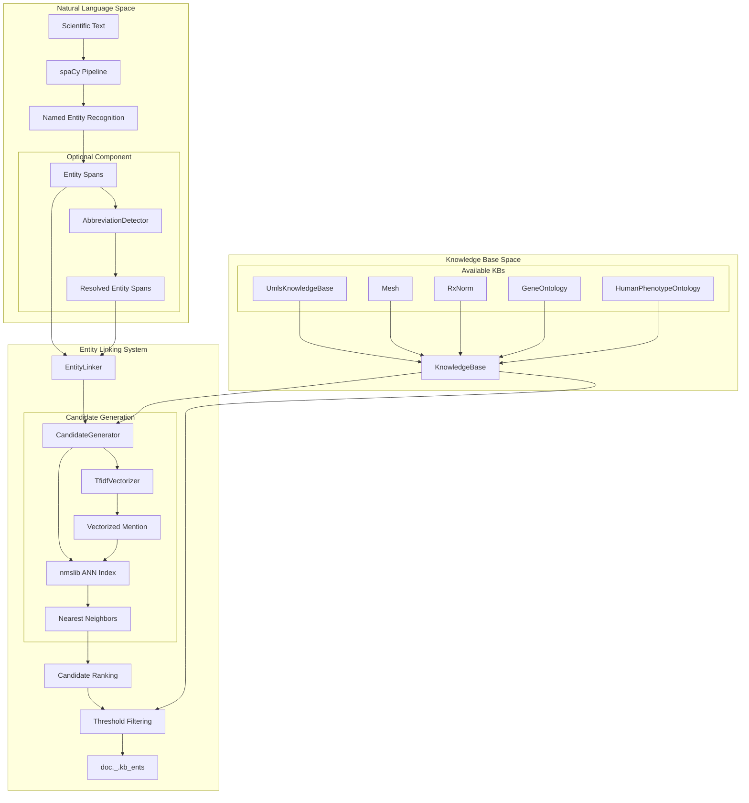
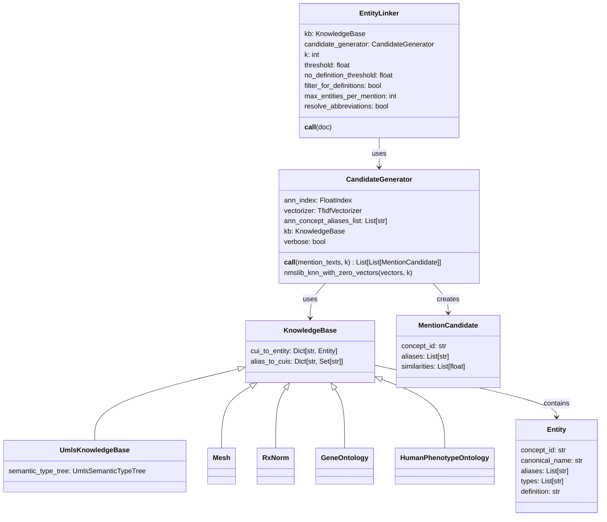

<!-- source: DeepWiki mcp.deepwiki.com · repo allenai/scispacy · page 2.3 Entity Linking · fetched 2026-10-26 -->

# Entity Linking

<details>
<summary>Relevant source files</summary>

The following files were used as context for generating this wiki page:

- [Dockerfile](Dockerfile)
- [README.md](README.md)
- [RELEASE.md](RELEASE.md)
- [docs/example.svg](docs/example.svg)
- [docs/index.md](docs/index.md)
- [scispacy/candidate_generation.py](scispacy/candidate_generation.py)
- [scispacy/linking_utils.py](scispacy/linking_utils.py)
- [scripts/export_umls_json.py](scripts/export_umls_json.py)
- [scripts/install_remote_packages.py](scripts/install_remote_packages.py)

</details>


This document describes the Entity Linking functionality in scispaCy, which connects entities found in biomedical text to concepts in standard knowledge bases. The system allows for linking mentions to databases such as UMLS (Unified Medical Language System), MeSH (Medical Subject Headings), RxNorm, Gene Ontology, and Human Phenotype Ontology. For information about detecting abbreviations before entity linking, see [Abbreviation Detection](#2.2).

## 1. Overview

Entity linking is the process of connecting entity mentions in text to standardized concepts in knowledge bases. In the biomedical domain, this is particularly important as it allows for normalization of different ways of expressing the same concept (e.g., "heart attack" and "myocardial infarction" linking to the same concept).

The scispaCy entity linker performs a string overlap-based search on named entities, comparing them with concepts in knowledge bases using an approximate nearest neighbors search. This approach balances efficiency and accuracy for biomedical entity linking.

Sources: [README.md:161-196]()

## 2. Entity Linking System Architecture

The entity linking system consists of several key components that work together to match text mentions to knowledge base concepts.

### 2.1 System Components Diagram



Sources: [scispacy/candidate_generation.py:149-362](), [scispacy/linking_utils.py:1-123]()

### 2.2 Information Flow

1. The pipeline identifies entity spans in the text through Named Entity Recognition.
2. If the Abbreviation Detector is used, abbreviations are resolved to their long forms.
3. The `EntityLinker` receives entity spans as input.
4. The `CandidateGenerator` creates TF-IDF vectors of the mention text (using character 3-grams).
5. The nearest neighbors search finds similar concept vectors in the knowledge base.
6. Candidates are ranked and filtered based on similarity thresholds.
7. Linked entities are attached to the original spans as `doc._.kb_ents`.

Sources: [README.md:161-196](), [scispacy/candidate_generation.py:293-362]()

## 3. Implementation Details

### 3.1 Code Structure Diagram



Sources: [scispacy/candidate_generation.py:97-115](), [scispacy/candidate_generation.py:149-196](), [scispacy/linking_utils.py:12-34](), [scispacy/linking_utils.py:41-122]()

### 3.2 Candidate Generation

The `CandidateGenerator` class performs the core functionality of finding potential matches for entity mentions:

1. It embeds mention text into a sparse vector of character 3-grams using a pre-trained TF-IDF vectorizer.
2. It searches for similar vectors in a pre-indexed approximate nearest neighbors index.
3. It canonicalizes the results to their KB canonical ids (important because multiple aliases may map to the same canonical entity).
4. It returns a list of `MentionCandidate` objects containing concept IDs, relevant aliases, and similarity scores.

Key implementation note: Because aliases are included in the index, multiple neighbors might map to the same canonical entity. This means that the number of candidates returned may be less than the number of neighbors requested.

Sources: [scispacy/candidate_generation.py:149-196](), [scispacy/candidate_generation.py:238-292](), [scispacy/candidate_generation.py:293-362]()

## 4. Knowledge Bases

scispaCy supports several knowledge bases for entity linking:

| KB Name | Description | Size | Main Focus |
|---------|-------------|------|------------|
| UMLS | Unified Medical Language System | ~3M concepts | General biomedical terminology |
| MeSH | Medical Subject Headings | ~30k entities | Higher quality entities used for Pubmed indexing |
| RxNorm | RxNorm ontology | ~100k concepts | Normalized names for clinical drugs |
| GO | Gene Ontology | ~67k concepts | Functions of genes |
| HPO | Human Phenotype Ontology | ~16k concepts | Phenotypic abnormalities in human disease |

Each knowledge base is represented as a class that inherits from the base `KnowledgeBase` class, which maintains two key views:
1. A mapping from concept_id to an `Entity` object with more information
2. A mapping from aliases to the sets of concept IDs for which they are aliases

Sources: [README.md:167-173](), [scispacy/linking_utils.py:41-122]()

## 5. Usage Guide

### 5.1 Adding the Entity Linker to a Pipeline

To use the entity linker, add it to your spaCy pipeline after loading a model:

```python
import spacy
import scispacy

# Load a scispaCy model
nlp = spacy.load("en_core_sci_sm")

# Add the entity linker to the pipeline
# This may take a while on first use as it downloads data
nlp.add_pipe("scispacy_linker", config={"linker_name": "umls"})

# Process text
doc = nlp("Spinal and bulbar muscular atrophy (SBMA) is an inherited motor neuron disease.")

# Access linked entities
for entity in doc.ents:
    print(f"Entity: {entity.text}")
    for umls_ent in entity._.kb_ents:
        print(f"  {umls_ent[0]}: {umls_ent[1]}")
```

Sources: [README.md:206-263]()

### 5.2 Configuration Parameters

The entity linker accepts several parameters that can be tuned for different use cases:

| Parameter | Type | Default | Description |
|-----------|------|---------|-------------|
| `resolve_abbreviations` | bool | False | Resolves abbreviations before linking if `AbbreviationDetector` is in the pipeline |
| `k` | int | 30 | Number of nearest neighbors to look up per mention |
| `threshold` | float | 0.7 | Similarity threshold for adding entity candidates |
| `no_definition_threshold` | float | 0.95 | Higher threshold for entities without definitions |
| `filter_for_definitions` | bool | True | Whether to only include entities with definitions |
| `max_entities_per_mention` | int | 5 | Maximum number of entities returned per mention |
| `linker_name` | str | "umls" | Knowledge base to use ("umls", "mesh", "rxnorm", "go", "hpo") |

Sources: [README.md:176-196](), [scispacy/candidate_generation.py:80-94]()

### 5.3 Accessing Linked Entity Information

After linking, you can access detailed information about the linked entities:

```python
import spacy
import scispacy
from scispacy.linking import EntityLinker

nlp = spacy.load("en_core_sci_sm")
nlp.add_pipe("scispacy_linker", config={"linker_name": "umls"})

doc = nlp("Spinal and bulbar muscular atrophy (SBMA) is an inherited motor neuron disease.")

# Get the linker component
linker = nlp.get_pipe("scispacy_linker")

# For each entity, print detailed information about linked concepts
for entity in doc.ents:
    print(f"Entity: {entity.text}")
    if entity._.kb_ents:
        for umls_ent in entity._.kb_ents:
            concept_id, score = umls_ent
            concept = linker.kb.cui_to_entity[concept_id]
            print(f"  ID: {concept_id}, Score: {score:.2f}")
            print(f"  Name: {concept.canonical_name}")
            print(f"  Definition: {concept.definition or 'No definition'}")
            print(f"  Types: {', '.join(concept.types)}")
```

Sources: [README.md:232-263]()

## 6. Implementation Notes

### 6.1 TF-IDF Vectorization

The entity linker uses character 3-grams for vectorization rather than words, which works well for biomedical terms and helps handle spelling variations and morphological differences.

```python
# Default TF-IDF vectorizer configuration in scispaCy
tfidf_vectorizer = TfidfVectorizer(
    analyzer="char_wb",  # Character n-grams, including word boundaries
    ngram_range=(3, 3),  # Trigrams only
    min_df=10,           # Minimum document frequency
    dtype=numpy.float32
)
```

Sources: [scispacy/candidate_generation.py:423-425]()

### 6.2 Approximate Nearest Neighbors Search

The entity linker uses the HNSW (Hierarchical Navigable Small World Graph) algorithm implemented in the `nmslib` library for efficient nearest neighbors search. This allows for fast retrieval of similar entities even in large knowledge bases.

The pre-built indices used by scispaCy are created with the following parameters:

```python
# HNSW parameters for index construction
index_params = {
    "M": 100,               # Maximum number of connections per element
    "indexThreadQty": 60,   # Number of threads for indexing
    "efConstruction": 2000, # Size of the dynamic list for the nearest neighbors
    "post": 0,              # No post-processing
}
```

Sources: [scispacy/candidate_generation.py:406-411]()

### 6.3 Index Creation

The indices for each knowledge base are pre-built and stored in the cloud for download. The process of creating these indices involves:

1. Reading concepts from the knowledge base
2. Creating TF-IDF vectors for each concept alias
3. Building an approximate nearest neighbors index
4. Serializing the vectorizer, index, and concept mappings

This process is implemented in the `create_tfidf_ann_index` function, but users typically don't need to run this as the pre-built indices are automatically downloaded.

Sources: [scispacy/candidate_generation.py:365-475]()

---

