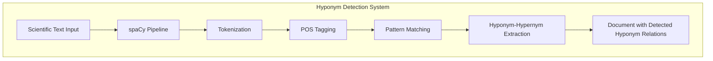
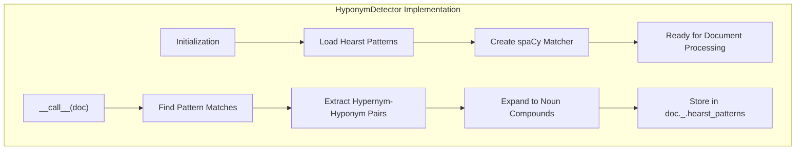
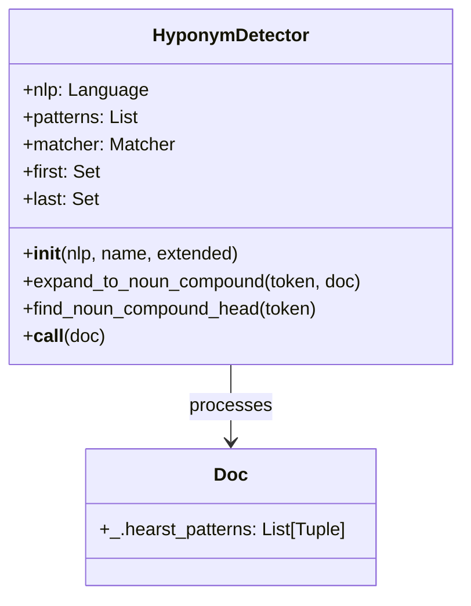
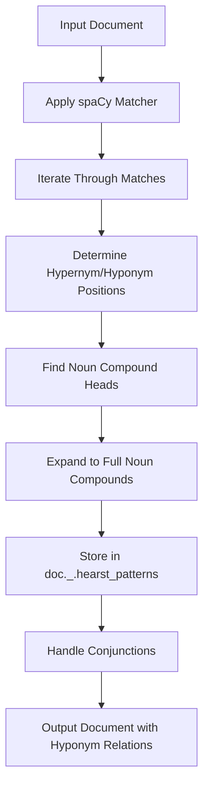
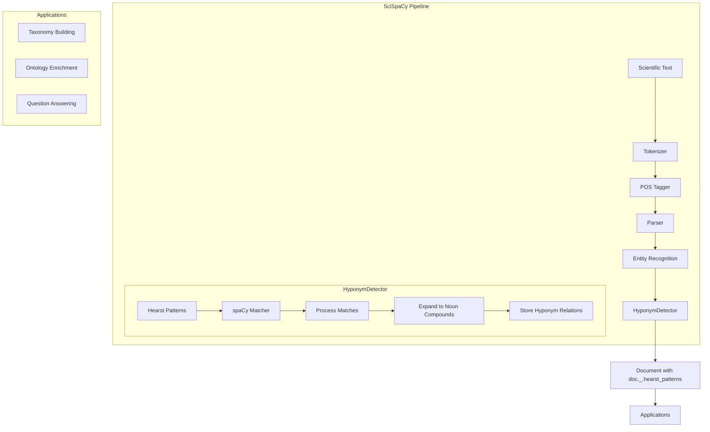

<!-- source: DeepWiki mcp.deepwiki.com · repo allenai/scispacy · page 2.4 Hyponym Detection · fetched 2026-10-26 -->

# Hyponym Detection

<details>
<summary>Relevant source files</summary>

The following files were used as context for generating this wiki page:

- [Dockerfile](Dockerfile)
- [README.md](README.md)
- [RELEASE.md](RELEASE.md)
- [docs/example.svg](docs/example.svg)
- [docs/index.md](docs/index.md)
- [scispacy/hearst_patterns.py](scispacy/hearst_patterns.py)
- [scispacy/hyponym_detector.py](scispacy/hyponym_detector.py)
- [scripts/install_remote_packages.py](scripts/install_remote_packages.py)
- [tests/test_hyponym_detector.py](tests/test_hyponym_detector.py)

</details>


This page documents the Hyponym Detection system in SciSpaCy, which identifies hierarchical relationships between terms in scientific text. The system identifies pairs of terms where one term (hyponym) is a specific instance or subtype of another term (hypernym), such as "coronavirus" being a hyponym of "virus".

For information about other text relationship extraction tasks like entity linking, see [Entity Linking](#2.3).

## Overview

The Hyponym Detector is a spaCy pipeline component that implements the methodology described in ["Automatic Acquisition of Hyponyms from Large Text Corpora"](https://www.aclweb.org/anthology/C92-2082.pdf) by Marti Hearst. It uses pattern matching to identify lexical-syntactic patterns (known as Hearst patterns) that indicate hyponym relationships in text.

For example, in the phrase "coronaviruses such as SARS and MERS", the pattern "X such as Y" indicates that "SARS" and "MERS" are hyponyms (subtypes) of "coronaviruses".



Sources: [scispacy/hyponym_detector.py](), [README.md:265-291]()

## Implementation Details

The Hyponym Detector is implemented as a spaCy pipeline component that can be added to any spaCy NLP pipeline. It uses spaCy's `Matcher` component to identify patterns in tokenized text and extract hyponym-hypernym pairs.



Sources: [scispacy/hyponym_detector.py:8-142](), [tests/test_hyponym_detector.py:8-15]()

### System Components

The Hyponym Detection system consists of two main components:

1. **HyponymDetector Class**: The main pipeline component that processes documents and extracts hyponym relations ([scispacy/hyponym_detector.py:8-142]()).
2. **Hearst Patterns**: Predefined patterns that indicate hyponymy relationships ([scispacy/hearst_patterns.py]()).

### Core Functions

The HyponymDetector has three key methods:

1. `__init__`: Initializes the detector with either basic or extended patterns.
2. `find_noun_compound_head`: Identifies the head word of a noun compound.
3. `expand_to_noun_compound`: Expands a token to include its full noun phrase.
4. `__call__`: Processes documents to find and store hyponym relationships.



Sources: [scispacy/hyponym_detector.py:8-142]()

## Hearst Patterns

The system uses two sets of patterns to identify hyponym relationships:

1. **BASE_PATTERNS**: A core set of high-precision patterns.
2. **EXTENDED_PATTERNS**: Additional patterns that increase recall but may have lower precision.

### Base Patterns

The base patterns capture common hyponymy structures such as:

| Pattern | Example | Relation |
|---------|---------|----------|
| X such as Y | "Viruses such as coronaviruses" | coronaviruses → viruses |
| X including Y | "Respiratory diseases including pneumonia" | pneumonia → respiratory diseases |
| X especially Y | "Mammals especially primates" | primates → mammals |
| Y and other X | "SARS and other coronaviruses" | SARS → coronaviruses |

Sources: [scispacy/hearst_patterns.py:40-71]()

### Extended Patterns

The extended patterns add more complex structures:

| Pattern | Example | Relation |
|---------|---------|----------|
| X which may include Y | "Disorders which may include seizures" | seizures → disorders |
| X which is similar to Y | "Proteins which are similar to enzymes" | enzymes → proteins |
| example of X is Y | "Example of this is pneumonia" | pneumonia → (antecedent) |
| Y is a kind of X | "SARS is a kind of coronavirus" | SARS → coronavirus |

Sources: [scispacy/hearst_patterns.py:73-560]()

## Pattern Matching Process

The HyponymDetector uses spaCy's `Matcher` to find these patterns in text. The pattern matching process involves:

1. Creating a matcher with the selected patterns
2. Running the matcher on each document
3. Processing each match to extract the hypernym and hyponym
4. Expanding each term to its full noun compound
5. Handling conjunctions to extract multiple hyponyms if present



Sources: [scispacy/hyponym_detector.py:97-142]()

## Usage

To use the HyponymDetector, add it to your spaCy pipeline:

```python
import spacy
from scispacy.hyponym_detector import HyponymDetector

# Load a scispaCy model
nlp = spacy.load("en_core_sci_sm")

# Add the hyponym detector to the pipeline
# Set extended=True to use both base and extended patterns
nlp.add_pipe("hyponym_detector", config={"extended": False}, last=True)

# Process a text
doc = nlp("Coronaviruses such as SARS and MERS can cause respiratory diseases.")

# Access the detected hyponym relationships
for relation, hypernym, hyponym in doc._.hearst_patterns:
    print(f"Relation: {relation}")
    print(f"Hypernym (more general): {hypernym}")
    print(f"Hyponym (more specific): {hyponym}")
```

Sources: [README.md:280-291](), [tests/test_hyponym_detector.py:15-33]()

## Examples

Here are some examples of hyponym relationships detected by the system:

### Example 1: "such as" pattern

```
"Keystone plant species such as fig trees are good for the soil."
```

Detected relation: `("such_as", "Keystone plant species", "fig trees")`

### Example 2: "other" pattern

```
"SARS, or other coronaviruses, are bad."
```

Detected relation: `("other", "coronaviruses", "SARS")`

### Example 3: "including" pattern with conjunctions

```
"Coronaviruses, including SARS and MERS, are bad."
```

Detected relations:
- `("include", "Coronaviruses", "SARS")`
- `("include", "Coronaviruses", "MERS")`

Sources: [tests/test_hyponym_detector.py:15-33]()

## Parameter Configuration

When adding the HyponymDetector to your pipeline, you can configure:

| Parameter | Type | Default | Description |
|-----------|------|---------|-------------|
| extended | bool | False | Whether to use the extended set of Hearst patterns in addition to the base patterns. Setting to True yields higher recall but potentially lower precision. |

Sources: [scispacy/hyponym_detector.py:36-38](), [README.md:269]()

## System Architecture Diagram



Sources: [scispacy/hyponym_detector.py](), [scispacy/hearst_patterns.py]()

## Implementation Internals

For developers looking to understand or modify the hyponym detection system, here's a detailed look at the implementation:

### Hypernym/Hyponym Position Logic

The HyponymDetector determines whether the hypernym appears first or last in a pattern:

```python
# gather list of predicates where the hypernym appears first
if pattern["position"] == "first":
    self.first.add(pattern["label"])

# gather list of predicates where the hypernym appears last
if pattern["position"] == "last":
    self.last.add(pattern["label"])
```

During processing, it uses this information to identify which term is the hypernym and which is the hyponym:

```python
# if the predicate is in the list where the hypernym is last, else hypernym is first
if predicate in self.last:
    hypernym = doc[end - 1]
    hyponym = doc[start]
else:
    # An inelegent way to deal with the "such_NOUN_as pattern"
    # since the first token is not the hypernym.
    if doc[start].lemma_ == "such":
        start += 1
    hypernym = doc[start]
    hyponym = doc[end - 1]
```

Sources: [scispacy/hyponym_detector.py:52-62](), [scispacy/hyponym_detector.py:112-122]()

### Noun Compound Expansion

The detector expands simple token matches to their full noun compounds:

```python
hypernym = self.find_noun_compound_head(hypernym)
hyponym = self.find_noun_compound_head(hyponym)

# For the document level, we expand to contain noun phrases.
hypernym_extended = self.expand_to_noun_compound(hypernym, doc)
hyponym_extended = self.expand_to_noun_compound(hyponym, doc)
```

Sources: [scispacy/hyponym_detector.py:124-129]()

## Summary

The Hyponym Detection system in SciSpaCy provides a powerful tool for identifying taxonomic relationships in scientific text. By identifying hyponym-hypernym pairs, it can help with tasks such as:

- Building taxonomies from scientific literature
- Enhancing knowledge graphs with hierarchical relationships
- Supporting query expansion for information retrieval
- Assisting in question answering systems that require hierarchical knowledge

The system is flexible, allowing users to choose between precision (base patterns) and recall (extended patterns) based on their specific needs.

Sources: [README.md:265-291](), [scispacy/hyponym_detector.py](), [scispacy/hearst_patterns.py]()

---

