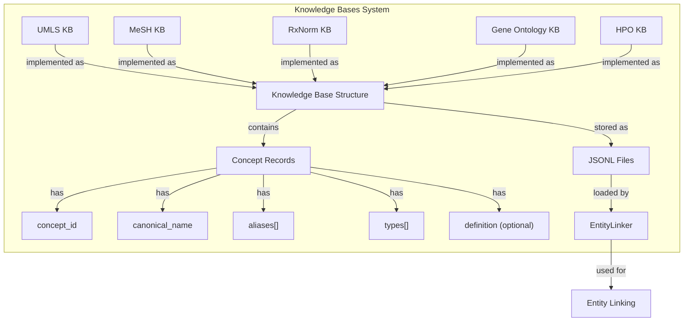
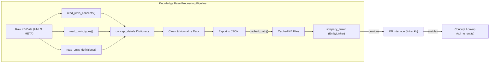
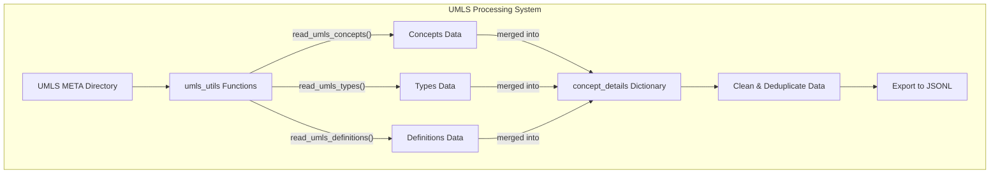

<!-- source: DeepWiki mcp.deepwiki.com · repo allenai/scispacy · page 3 Knowledge Bases · fetched 2026-10-26 -->

# Knowledge Bases

<details>
<summary>Relevant source files</summary>

The following files were used as context for generating this wiki page:

- [Dockerfile](Dockerfile)
- [README.md](README.md)
- [RELEASE.md](RELEASE.md)
- [docs/example.svg](docs/example.svg)
- [docs/index.md](docs/index.md)
- [scripts/export_umls_json.py](scripts/export_umls_json.py)
- [scripts/install_remote_packages.py](scripts/install_remote_packages.py)

</details>


This document describes the knowledge bases integrated into SciSpaCy and how they're used for entity linking. Knowledge bases (KBs) provide structured biomedical terminology that enables the connection between mentions in text and standardized concepts. For information about how these knowledge bases are used in entity linking, see [Entity Linking](#2.3).

## Overview

SciSpaCy integrates several biomedical knowledge bases to support the entity linking functionality. These knowledge bases contain standardized biomedical terminology that enables the mapping of entity mentions in scientific text to canonical concept identifiers.



Sources: [README.md:162-174](), [scripts/export_umls_json.py:17-25]()

## Supported Knowledge Bases

SciSpaCy currently supports five knowledge bases, each with different scopes and sizes:

| Knowledge Base | Description | Approximate Size | Focus Area |
|---------------|------------|-----------------|-----------|
| UMLS | Unified Medical Language System (levels 0,1,2,9) | ~3M concepts | Comprehensive medical terminology |
| MeSH | Medical Subject Headings | ~30K entities | PubMed indexing terms |
| RxNorm | RxNorm ontology | ~100K concepts | Normalized clinical drug names |
| GO | Gene Ontology | ~67K concepts | Gene functions |
| HPO | Human Phenotype Ontology | ~16K concepts | Phenotypic abnormalities in human disease |

MeSH uses different unique identifiers than the other knowledge bases, as it's derived directly from MeSH itself rather than from UMLS.

Sources: [README.md:167-173]()

## Knowledge Base Integration

SciSpaCy provides a unified interface for working with these different knowledge bases through the entity linking system. This integration follows a processing pipeline that converts raw knowledge base data into a format usable by SciSpaCy.



Sources: [scripts/export_umls_json.py:1-90](), [README.md:201-203]()

## Knowledge Base Structure

Each knowledge base in SciSpaCy follows a common structure represented as a concept dictionary. Each concept contains the following fields:

- `concept_id`: Unique identifier (CUI for UMLS-derived KBs)
- `canonical_name`: The primary name for the concept
- `aliases`: List of alternative names/synonyms
- `types`: List of semantic types (categories)
- `definition`: Optional description of the concept

This structure is serialized to JSONL (JSON Lines) format, with each line representing a single concept.

Example concept record structure:
```
{
  "concept_id": "C0031117",
  "canonical_name": "Peripheral Nervous System",
  "aliases": ["PNS", "Peripheral nervous system", "Peripheral neural system"],
  "types": ["T022"],
  "definition": "The peripheral nervous system is one of the two major divisions of the nervous system..."
}
```

Sources: [scripts/export_umls_json.py:17-25](), [scripts/export_umls_json.py:71-85]()

## UMLS Processing

UMLS, as the largest supported knowledge base, requires special processing. The `export_umls_json.py` script handles this process:



During UMLS processing:
1. Concepts, types, and definitions are read from the UMLS META directory
2. This data is merged into a concept_details dictionary
3. Duplicate aliases are removed
4. Concepts without canonical names are assigned one from their aliases
5. The processed data is exported to a JSONL file

Sources: [scripts/export_umls_json.py:10-90]()

## Integration with Entity Linking

The knowledge bases are used primarily by the EntityLinker component to map entity mentions to standardized concepts.

```mermaid
graph TD
    subgraph "Entity Linking System"
        Text["Scientific Text"] --> NLP["NLP Pipeline"]
        NLP --> Entities["Named Entities"]
        
        Entities --> |"optional"| AbbrevDetector["Abbreviation Detector"]
        AbbrevDetector --> |"with resolved abbreviations"| Linker["EntityLinker"]
        Entities --> |"direct"| Linker
        
        subgraph "Candidate Generation"
            KBVectorizer["TF-IDF Vectorizer"]
            ANNIndex["Approximate Nearest Neighbors Index"]
            CandidateGen["Candidate Generator"]
            
            KBVectorizer --> CandidateGen
            ANNIndex --> CandidateGen
        end
        
        subgraph "Knowledge Bases"
            UMLS_KB["UMLS (umls)"]
            MeSH_KB["MeSH (mesh)"]
            RxNorm_KB["RxNorm (rxnorm)"]
            GO_KB["Gene Ontology (go)"]
            HPO_KB["HPO (hpo)"]
        end
        
        Linker --> CandidateGen
        CandidateGen --> Candidates["Entity Candidates"]
        Knowledge Bases --> CandidateGen
        
        Candidates --> Ranking["Similarity Ranking"]
        Ranking --> Threshold["Threshold Filtering"]
        Threshold --> LinkedEntities["Linked Entities (._.kb_ents)"]
    end
```

The entity linking process:
1. Named entities are detected in scientific text
2. If the Abbreviation Detector is in the pipeline, abbreviations are resolved to their long forms
3. The EntityLinker component uses the specified knowledge base to find candidate matches
4. Candidates are ranked by similarity score
5. Matches above a configurable threshold are kept
6. The resulting linked entities are attached to each mention as the `._.kb_ents` attribute

Sources: [README.md:161-204]()

## Usage and Configuration

To use a knowledge base for entity linking, you need to add the `scispacy_linker` component to the spaCy pipeline with the desired KB name:

```python
import spacy

nlp = spacy.load("en_core_sci_sm")
nlp.add_pipe("scispacy_linker", config={"linker_name": "umls"})

# Process text
doc = nlp("Patients with diabetes mellitus often develop hypertension.")

# Access linked entities
for ent in doc.ents:
    if ent._.kb_ents:
        print(f"Entity: {ent.text}")
        linker = nlp.get_pipe("scispacy_linker")
        for umls_ent in ent._.kb_ents:
            cui, score = umls_ent
            print(f"  CUI: {cui}, Score: {score}")
            print(f"  Details: {linker.kb.cui_to_entity[cui]}")
```

Key configuration parameters for the EntityLinker:

| Parameter | Default | Description |
|-----------|---------|-------------|
| linker_name | "umls" | Knowledge base to use (umls, mesh, rxnorm, go, hpo) |
| resolve_abbreviations | False | Whether to resolve abbreviations before linking |
| k | 30 | Number of nearest neighbors to look up from candidate generator |
| threshold | 0.7 | Minimum similarity score threshold for candidates |
| no_definition_threshold | 0.95 | Threshold for entities without definitions |
| filter_for_definitions | True | Whether to only include entities with definitions |
| max_entities_per_mention | 5 | Maximum number of entities to return per mention |

Sources: [README.md:176-199](), [README.md:213-226]()

## Performance Considerations

The knowledge bases, especially UMLS, are large datasets that require significant resources:

- Initial loading time: The first time a knowledge base is used, it must be downloaded and processed, which can take several minutes.
- Memory usage: The larger knowledge bases (especially UMLS) require substantial memory.
- Disk space: The cached knowledge base files can occupy several gigabytes of disk space.

After the first use, the knowledge bases are cached, making subsequent loading much faster.

Sources: [README.md:214-218]()

---

