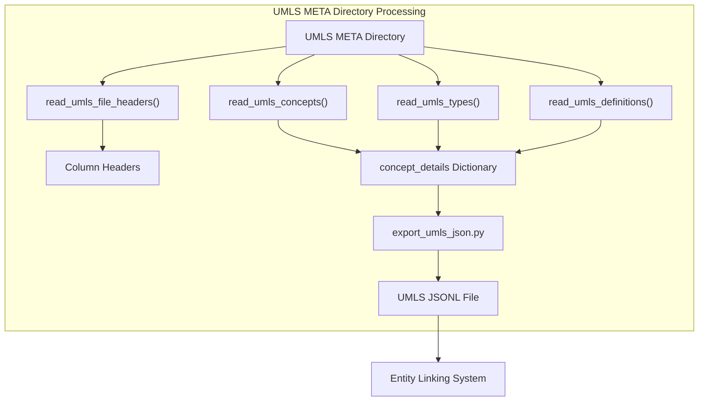
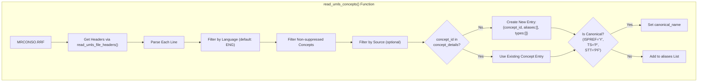
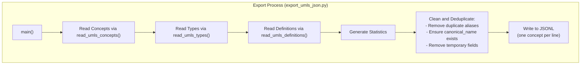
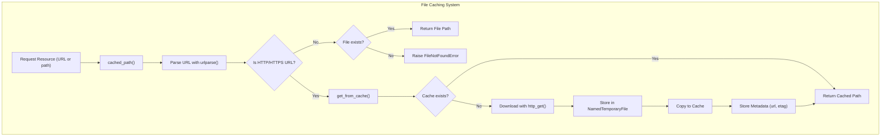
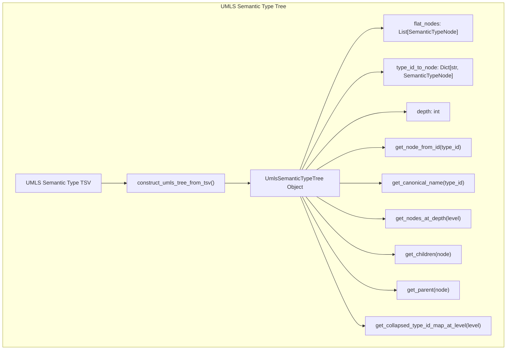
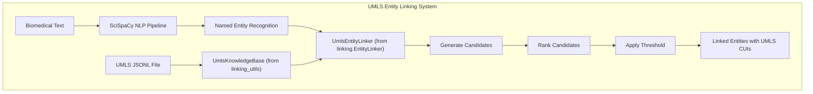

<!-- source: DeepWiki mcp.deepwiki.com · repo allenai/scispacy · page 3.1 UMLS Integration · fetched 2026-10-26 -->

# UMLS Integration

<details>
<summary>Relevant source files</summary>

The following files were used as context for generating this wiki page:

- [scispacy/file_cache.py](scispacy/file_cache.py)
- [scispacy/per_class_scorer.py](scispacy/per_class_scorer.py)
- [scispacy/train_utils.py](scispacy/train_utils.py)
- [scispacy/umls_linking.py](scispacy/umls_linking.py)
- [scispacy/umls_semantic_type_tree.py](scispacy/umls_semantic_type_tree.py)
- [scispacy/umls_utils.py](scispacy/umls_utils.py)
- [scripts/export_umls_json.py](scripts/export_umls_json.py)
- [tests/fixtures/umls_test_fixture.json](tests/fixtures/umls_test_fixture.json)

</details>


## Purpose and Scope

This page documents how the Unified Medical Language System (UMLS) is integrated into SciSpaCy. UMLS is a comprehensive metathesaurus of biomedical and health concepts, providing standardized terminology for entity linking in scientific text processing. This integration enables SciSpaCy to link entities recognized in biomedical text to their corresponding concept identifiers in UMLS.

For information about other knowledge bases supported in SciSpaCy (such as MeSH, Gene Ontology, Human Phenotype Ontology, and RxNorm), see [Other Knowledge Bases](#3.2).

Sources: [scispacy/umls_utils.py:1-180](), [scispacy/umls_linking.py:1-3]()

## UMLS Data Structure and Processing

UMLS data is organized in several key files within the META directory of a UMLS release:

| UMLS File | Content | SciSpaCy Function |
|-----------|---------|-------------------|
| MRCONSO.RRF | Concept names, sources, and aliases | `read_umls_concepts()` |
| MRSTY.RRF | Semantic types for concepts | `read_umls_types()` |
| MRDEF.RRF | Concept definitions | `read_umls_definitions()` |
| MRFILES.RRF | File descriptors for UMLS files | `read_umls_file_headers()` |

SciSpaCy processes these files to create a structured representation of UMLS concepts, which can then be used for entity linking.

### UMLS Data Processing Flow



Sources: [scispacy/umls_utils.py:40-179](), [scripts/export_umls_json.py:10-90]()

### Concept Data Structure

Each UMLS concept in SciSpaCy is represented with the following structure:

```json
{
    "concept_id": "CUI",
    "canonical_name": "Preferred name",
    "aliases": ["Synonym1", "Synonym2", ...],
    "types": ["Semantic Type ID1", "Semantic Type ID2", ...],
    "definition": "Concept definition"
}
```

Sources: [tests/fixtures/umls_test_fixture.json:1-262](), [scispacy/umls_utils.py:84-91]()

## Core UMLS Processing Functions

### Reading Concept Information

The `read_umls_concepts()` function processes the MRCONSO.RRF file to extract concept identifiers, canonical names, and aliases.



Sources: [scispacy/umls_utils.py:40-109]()

### Reading Semantic Types

The `read_umls_types()` function processes the MRSTY.RRF file to associate semantic types with concepts.

```mermaid
graph TD
    subgraph "read_umls_types() Function"
        mrsty["MRSTY.RRF"] --> headers["Get Headers via read_umls_file_headers()"]
        headers --> parseLine["Parse Each Line"]
        parseLine --> conceptExists{"concept_details.get(concept_type[\"CUI\"])"}
        
        conceptExists -->|"Not None"| addType["Append TUI to concept[\"types\"]"]
        conceptExists -->|"None"| skip["Skip (Concept doesn't exist)"]
    end
```

Sources: [scispacy/umls_utils.py:112-138]()

### Reading Definitions

The `read_umls_definitions()` function processes the MRDEF.RRF file to add definitions to concepts.

```mermaid
graph TD
    subgraph "read_umls_definitions() Function"
        mrdef["MRDEF.RRF"] --> headers["Get Headers via read_umls_file_headers()"]
        headers --> parseLine["Parse Each Line"]
        parseLine --> filterSuppress["Filter Non-suppressed (SUPPRESS='N')"]
        
        filterSuppress --> checkSource["Check if Source is Preferred\n(SAB in DEF_SOURCES_PREFERRED)"]
        checkSource --> conceptExists{"concept_details.get(definition[\"CUI\"])"}
        
        conceptExists -->|"None"| skip["Skip (Concept doesn't exist)"]
        conceptExists -->|"Not None"| definitionCheck{"'definition' not in concept\nOR preferred source\nAND existing not preferred"}
        
        definitionCheck -->|"True"| addDef["Add Definition"]
        definitionCheck -->|"False"| keep["Keep Existing Definition"]
    end
```

Sources: [scispacy/umls_utils.py:140-179]()

## Exporting UMLS Data

The `export_umls_json.py` script processes UMLS data and exports it to a JSONL file for use in SciSpaCy:



Key cleaning steps performed during export:

1. Deduplication of concept aliases using `list(set(concept["aliases"]))`
2. Setting a canonical name from aliases if none exists
3. Removing temporary fields like `is_from_preferred_source`

Sources: [scripts/export_umls_json.py:10-90]()

## File Caching System

SciSpaCy implements a file caching system that efficiently handles downloading and storing UMLS data:



The cache location is determined by the environment variable `SCISPACY_CACHE` or defaults to `~/.scispacy/datasets`.

Sources: [scispacy/file_cache.py:21-158]()

## UMLS Semantic Type Hierarchy

The `UmlsSemanticTypeTree` class provides functionality for working with the hierarchical structure of UMLS semantic types:



Each `SemanticTypeNode` contains:
- `type_id`: The semantic type identifier (e.g., "T116")
- `full_name`: The canonical name of the semantic type
- `children`: List of child nodes
- `level`: The depth in the hierarchy

Sources: [scispacy/umls_semantic_type_tree.py:1-115]()

## Integration with Entity Linking

The processed UMLS data serves as the knowledge base for entity linking in SciSpaCy:



In current versions of SciSpaCy, UMLS linking is implemented through the generalized `EntityLinker` class, with backward compatibility maintained through import aliases.

Sources: [scispacy/umls_linking.py:1-3](), [scispacy/umls_utils.py:1-4]()

## Backward Compatibility

SciSpaCy maintains backward compatibility for UMLS-specific classes through import aliases:

```python
# In scispacy/umls_linking.py
from scispacy.linking import EntityLinker as UmlsEntityLinker

# In scispacy/umls_utils.py
from scispacy.linking_utils import Entity as UmlsEntity, UmlsKnowledgeBase
```

These aliases allow code written for earlier versions of SciSpaCy to continue working with the more generalized entity linking framework introduced in later versions.

Sources: [scispacy/umls_linking.py:1-3](), [scispacy/umls_utils.py:1-4]()

---

