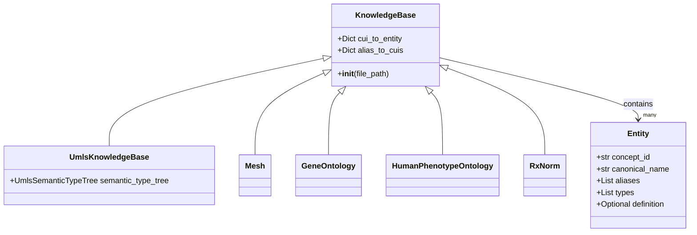
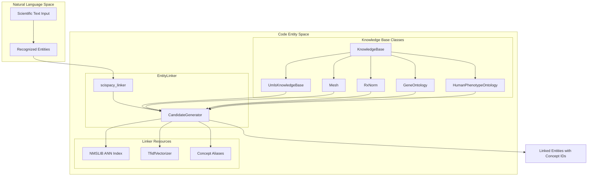
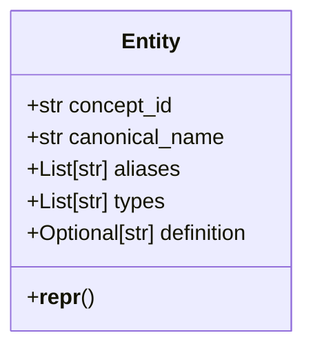
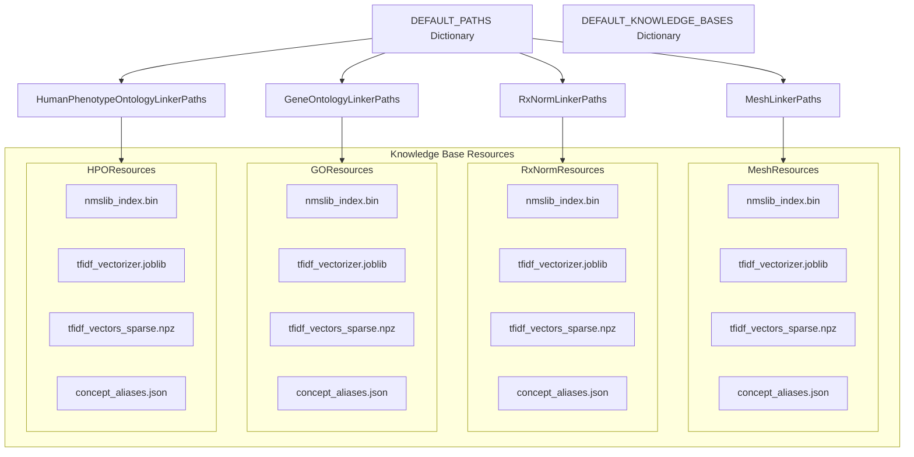
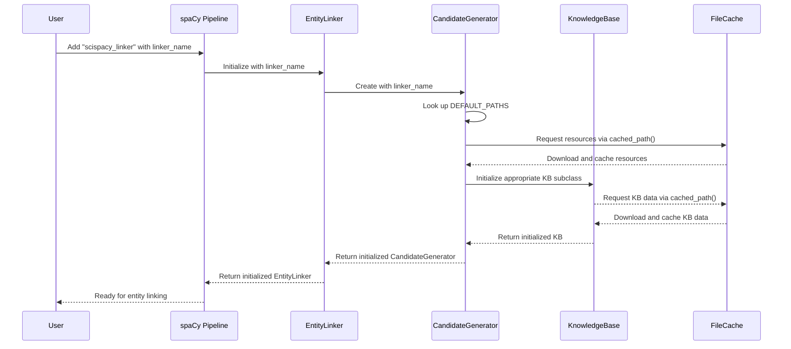

<!-- source: DeepWiki mcp.deepwiki.com · repo allenai/scispacy · page 3.2 Other Knowledge Bases · fetched 2026-10-26 -->

# Other Knowledge Bases

<details>
<summary>Relevant source files</summary>

The following files were used as context for generating this wiki page:

- [Dockerfile](Dockerfile)
- [README.md](README.md)
- [RELEASE.md](RELEASE.md)
- [docs/example.svg](docs/example.svg)
- [docs/index.md](docs/index.md)
- [scispacy/candidate_generation.py](scispacy/candidate_generation.py)
- [scispacy/linking_utils.py](scispacy/linking_utils.py)
- [scripts/install_remote_packages.py](scripts/install_remote_packages.py)

</details>


This page documents the additional knowledge bases available in SciSpaCy beyond the main UMLS knowledge base. These knowledge bases extend SciSpaCy's entity linking capabilities to specialized biomedical domains including medical subject headings, drug information, gene functions, and human phenotypes. For information about the primary UMLS knowledge base, see [UMLS Integration](#3.1).

## Overview

SciSpaCy's entity linking system can connect named entities in text to concepts in various biomedical knowledge bases. While UMLS is the largest and most comprehensive knowledge base supported, SciSpaCy offers several additional specialized knowledge bases that may be more appropriate for specific domain tasks.

These knowledge bases are:

- **MeSH**: Medical Subject Headings - a controlled vocabulary for indexing biomedical literature
- **RxNorm**: A normalized naming system for clinical drugs
- **Gene Ontology (GO)**: A structured vocabulary of gene and gene product attributes
- **Human Phenotype Ontology (HPO)**: A standardized vocabulary of phenotypic abnormalities in human disease

Each knowledge base is implemented as a subclass of the base `KnowledgeBase` class and provides domain-specific entity linking capabilities.

Sources: [scispacy/linking_utils.py:41-122](), [README.md:167-173]()

## Knowledge Base Architecture

The following diagram shows how the different knowledge bases are implemented in SciSpaCy:



Sources: [scispacy/linking_utils.py:12-122]()

## Knowledge Base Integration with Entity Linking

The following diagram illustrates how these knowledge bases are integrated with the entity linking system:



Sources: [scispacy/candidate_generation.py:24-94](), [scispacy/linking_utils.py:41-122]()

## Knowledge Base Comparison

Each knowledge base has different characteristics, focus areas, and sizes:

| Knowledge Base | Size | Focus Area | Notes |
|----------------|------|------------|-------|
| UMLS | ~3M concepts | Comprehensive medical terminology | Includes content from many vocabularies |
| MeSH | ~30k entities | Medical subject headings | Used for indexing in PubMed; uses different identifiers than other KBs |
| RxNorm | ~100k concepts | Clinical drugs | Normalized names for medications from multiple sources |
| Gene Ontology | ~67k concepts | Gene functions | Structured vocabulary of gene attributes |
| Human Phenotype Ontology | ~16k concepts | Phenotypic abnormalities | Focus on human disease phenotypes |

Sources: [README.md:167-173]()

## Entity Structure

All knowledge bases use the same `Entity` structure to represent concepts:



Each entity has a unique concept ID, a canonical name, a list of aliases (alternative names), semantic types, and an optional definition.

Sources: [scispacy/linking_utils.py:12-34]()

## Configuration Details

Each knowledge base has associated resources that are used for entity linking:



Each knowledge base has four key resources:
1. An approximate nearest neighbors index (`nmslib_index.bin`)
2. A TF-IDF vectorizer for encoding mentions (`tfidf_vectorizer.joblib`)
3. Pre-computed TF-IDF vectors for concepts (`tfidf_vectors_sparse.npz`)
4. A list of concept aliases (`concept_aliases.json`)

These resources are stored in Amazon S3 and are downloaded automatically when needed.

Sources: [scispacy/candidate_generation.py:44-94]()

## Usage

To use any of these knowledge bases for entity linking, provide the `linker_name` parameter when adding the `scispacy_linker` to your spaCy pipeline:

```python
import spacy

# Load a model
nlp = spacy.load("en_core_sci_sm")

# Add the entity linker with the desired knowledge base
# Options: "umls", "mesh", "rxnorm", "go", "hpo"
nlp.add_pipe("scispacy_linker", config={"linker_name": "mesh"})

# Process text
doc = nlp("Aspirin may interact with warfarin.")

# Examine linked entities
for ent in doc.ents:
    print(f"Entity: {ent.text}")
    print(f"Linked concepts from MeSH:")
    for umls_ent in ent._.kb_ents:
        # Get the linker object
        linker = nlp.get_pipe("scispacy_linker")
        # Print information about the entity
        print(linker.kb.cui_to_entity[umls_ent[0]])
```

Sources: [README.md:167-263]()

## Initialization Process

When initializing a knowledge base for entity linking, SciSpaCy follows this process:



Sources: [scispacy/candidate_generation.py:197-237]()

## Knowledge Base Data Sources

Each knowledge base downloads its data from Amazon S3. The specific paths for each knowledge base are defined in `LinkerPaths` objects:

| Knowledge Base | Data Source |
|----------------|-------------|
| MeSH | https://ai2-s2-scispacy.s3-us-west-2.amazonaws.com/data/kbs/2023-04-23/umls_mesh_2022.jsonl |
| RxNorm | https://ai2-s2-scispacy.s3-us-west-2.amazonaws.com/data/kbs/2023-04-23/umls_rxnorm_2022.jsonl |
| Gene Ontology | https://ai2-s2-scispacy.s3-us-west-2.amazonaws.com/data/kbs/2023-04-23/umls_go_2022.jsonl |
| Human Phenotype Ontology | https://ai2-s2-scispacy.s3-us-west-2.amazonaws.com/data/kbs/2023-04-23/umls_hpo_2022.jsonl |

Resources for entity linking (such as the nearest neighbors index and TF-IDF vectorizer) are also stored in Amazon S3, with paths defined in the respective `LinkerPaths` objects.

Sources: [scispacy/linking_utils.py:94-122](), [scispacy/candidate_generation.py:51-77]()

## Conclusion

SciSpaCy offers multiple knowledge bases for entity linking, each with a different focus area. These knowledge bases extend beyond the primary UMLS knowledge base to provide more specialized entity linking capabilities. By selecting the appropriate knowledge base for your task, you can improve the accuracy and relevance of entity linking in your specific domain.

---

