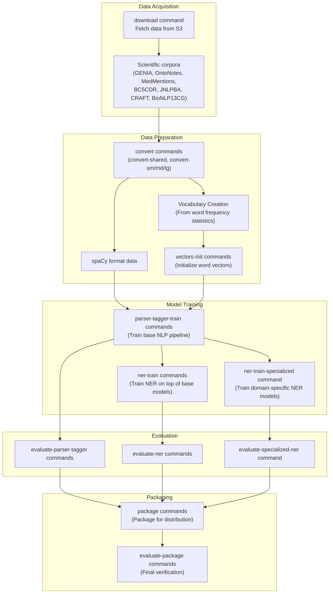
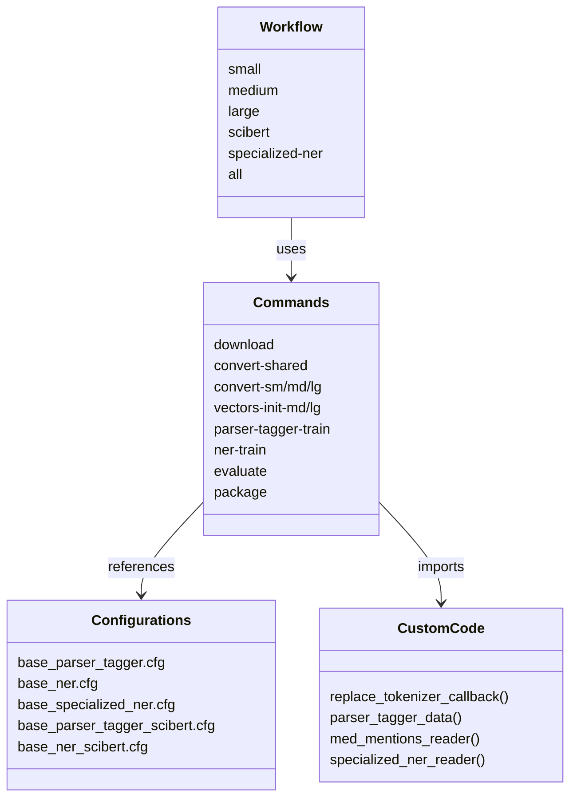

<!-- source: DeepWiki mcp.deepwiki.com · repo allenai/scispacy · page 4 Model Training · fetched 2026-10-26 -->

# Model Training

<details>
<summary>Relevant source files</summary>

The following files were used as context for generating this wiki page:

- [configs/base_ner.cfg](configs/base_ner.cfg)
- [configs/base_ner_scibert.cfg](configs/base_ner_scibert.cfg)
- [configs/base_parser_tagger.cfg](configs/base_parser_tagger.cfg)
- [configs/base_parser_tagger_scibert.cfg](configs/base_parser_tagger_scibert.cfg)
- [configs/base_specialized_ner.cfg](configs/base_specialized_ner.cfg)
- [data/meta_scibert.json](data/meta_scibert.json)
- [project.yml](project.yml)
- [scispacy/base_project_code.py](scispacy/base_project_code.py)
- [scripts/evaluate_ner.py](scripts/evaluate_ner.py)
- [tests/test_util.py](tests/test_util.py)

</details>


## Purpose and Scope

This document details the model training infrastructure and processes used in SciSpaCy to create specialized biomedical NLP models. It covers the complete training workflow from data acquisition to model evaluation and packaging. For information about using the pre-trained models, see [Available Models](#1.2). For details on customizing existing models, see [Development Guide](#5).

## Training Workflow Overview

SciSpaCy's training infrastructure is built on spaCy's project system, which provides a structured pipeline for downloading data, converting it to the appropriate format, training models, evaluating performance, and packaging models for distribution.



Sources: [project.yml:71-158](), [project.yml:160-632]()

## Model Variants

SciSpaCy trains several model variants to accommodate different use cases, balancing performance with computational requirements:

| Model | Description | Vocab Size | Vectors | Pipeline Components |
|-------|-------------|------------|---------|---------------------|
| `en_core_sci_sm` | Small model with basic capabilities | 5,000 words (min freq 1000) | None | Tokenizer, Tagger, Parser, NER |
| `en_core_sci_md` | Medium model with word vectors | 19,000 words (min freq 150) | 50,000 dimensions | Tokenizer, Tagger, Parser, NER |
| `en_core_sci_lg` | Large model with more vectors | 785,000 words (min freq 50) | 600,000 dimensions | Tokenizer, Tagger, Parser, NER |
| `en_core_sci_scibert` | BERT-based transformer model | Uses `lg` vocabulary | SciBERT transformer | Transformer, Tagger, Parser, NER |
| Specialized NER models | Domain-specific NER (BC5CDR, JNLPBA, etc.) | Uses `md` vocabulary | 50,000 dimensions | Tokenizer, Tagger, Parser, specialized NER |

Sources: [project.yml:4-68](), [project.yml:219-244]()

## Training Infrastructure

The training infrastructure is managed through spaCy's project system, which defines workflows, commands, and dependencies in the `project.yml` file.



Sources: [project.yml:75-158](), [scispacy/base_project_code.py:1-112]()

### Training Data

SciSpaCy models are trained on multiple biomedical and scientific corpora:

1. **GENIA 1.0 Treebank** - Used for training the parser and tagger components
2. **OntoNotes 5.0** - General domain data mixed in to improve robustness
3. **MedMentions** - Used for training the NER components
4. **Specialized NER corpora**:
   - BC5CDR - Chemical and disease entities
   - JNLPBA - Gene/protein entities
   - CRAFT - Various biomedical entities
   - BioNLP13CG - Cancer genetics entities

The training process downloads these datasets from an S3 bucket during the `download` command.

Sources: [project.yml:11-28](), [project.yml:160-197]()

## Training Process

### Data Preparation

Before training, data must be prepared through several steps:

1. **Download data**: Fetch training corpora from S3 storage
   ```
   aws s3 cp ${vars.genia_loc_s3}/train.json ${vars.genia_train_loc_local} --no-sign-request
   ```

2. **Convert to spaCy format**: Transform raw data into spaCy's binary format
   ```
   spacy convert ${vars.genia_train_loc_local} project_data --converter json --file-type spacy
   ```

3. **Create vocabulary**: Generate vocabulary from word frequency statistics
   ```
   python scripts/convert_freqs.py --input_path ${vars.freqs_loc_local} --output_path ${vars.vocab_sm_loc} --min_word_frequency 1000
   ```

4. **Initialize vectors** (for md/lg models): Prepare word vector representations
   ```
   spacy init vectors en ${vars.vectors_loc_local} ${vars.vectors_md_loc} --prune 50000 --name en_core_sci_md.vectors --lexemes-jsonl ${vars.vocab_md_loc}
   ```

Sources: [project.yml:160-264]()

### Training Models

The training process follows a layered approach where base models (parser and tagger) are trained first, then specialized components (NER) are trained on top of them:

#### 1. Parser & Tagger Training

The base models provide tokenization, sentence segmentation, POS tagging, and dependency parsing. The command structure is:

```
spacy train ${vars.parser_tagger_config_loc} --output ${vars.parser_tagger_sm_loc} --code ${vars.code_loc} --paths.vocab_path ${vars.vocab_sm_loc} --vars.include_static_vectors False --gpu-id ${vars.gpu_id}
```

The configuration for these components is defined in [configs/base_parser_tagger.cfg:1-174]() and [configs/base_parser_tagger_scibert.cfg:1-164]() for the transformer-based model.

Training uses a mixture of biomedical text (GENIA) and general domain text (OntoNotes) to ensure robust performance, with custom data readers defined in [scispacy/base_project_code.py:33-69]().

Sources: [project.yml:266-318](), [configs/base_parser_tagger.cfg:1-174]()

#### 2. NER Training

Named Entity Recognition is trained as a separate step, using the previously trained parser and tagger models:

```
spacy train ${vars.ner_config_loc} --output ${vars.ner_sm_loc} --code ${vars.code_loc} --paths.parser_tagger_path ${vars.parser_tagger_sm_loc}/model-best --paths.vocab_path ${vars.vocab_sm_loc} --vars.include_static_vectors False --gpu-id ${vars.gpu_id}
```

The MedMentions corpus is used for training the main NER models, with a custom reader defined in [scispacy/base_project_code.py:72-97]().

NER models are configured via [configs/base_ner.cfg:1-149]() and [configs/base_ner_scibert.cfg:1-148]() for the transformer-based model.

Sources: [project.yml:320-364](), [configs/base_ner.cfg:1-149]()

#### 3. Specialized NER Training

Domain-specific NER models are trained for particular entity types using specialized corpora:

```
spacy train ${vars.specialized_ner_config_loc} --output ${vars.bc5cdr_md_loc} --code ${vars.code_loc} --paths.vectors ${vars.vectors_md_loc} --paths.parser_tagger_path ${vars.parser_tagger_md_loc}/model-best --paths.train_path ${vars.bc5cdr_loc_local}/train.tsv --paths.dev_path ${vars.bc5cdr_loc_local}/devel.tsv --paths.vocab_path ${vars.vocab_md_loc} --vars.include_static_vectors True --gpu-id ${vars.gpu_id}
```

These specialized models use the medium-sized vocabulary and vectors, with the base parser and tagger from the medium model. Configuration is defined in [configs/base_specialized_ner.cfg:1-149]().

Sources: [project.yml:366-393](), [configs/base_specialized_ner.cfg:1-149]()

### Custom Components and Training Code

SciSpaCy uses several custom components during training:

1. **Custom Tokenizer**: Scientific text requires specialized tokenization rules, applied via the `replace_tokenizer_callback` [scispacy/base_project_code.py:24-30]()

2. **Custom Data Readers**:
   - `parser_tagger_data`: Mixes GENIA and OntoNotes data [scispacy/base_project_code.py:33-69]()
   - `med_mentions_reader`: Reads the MedMentions corpus [scispacy/base_project_code.py:72-97]()
   - `specialized_ner_reader`: Reads specialized NER corpora [scispacy/base_project_code.py:100-112]()

Sources: [scispacy/base_project_code.py:1-112]()

## Evaluation

Models are evaluated at multiple stages:

### 1. Base Model Evaluation

Parser and tagger models are evaluated on both GENIA (biomedical) and OntoNotes (general):

```
spacy evaluate ${vars.parser_tagger_sm_loc}/model-best ${vars.genia_test_spacy_loc} --output ${vars.parser_tagger_sm_loc}/model_best_results.json --gpu-id ${vars.gpu_id}
```

Sources: [project.yml:395-445]()

### 2. NER Evaluation

NER models are evaluated using a custom script:

```
python scripts/evaluate_ner.py --model_path ${vars.ner_sm_loc}/model-best --dataset medmentions-test --output ${vars.ner_sm_loc}/model_best_results.json --med_mentions_folder_path assets/ --gpu_id ${vars.gpu_id}
```

The evaluation script [scripts/evaluate_ner.py:1-51]() measures precision, recall, and F1 score for entity recognition.

Sources: [project.yml:447-507](), [scripts/evaluate_ner.py:1-51]()

### 3. Packaged Model Evaluation

Final evaluations are run on the packaged models to ensure that packaging hasn't affected performance:

```
spacy evaluate ${vars.package_sm_loc} ${vars.genia_test_spacy_loc} --output packages/sm_genia_results.json --gpu-id ${vars.gpu_id}
```

Sources: [project.yml:518-632]()

## Model Packaging

The final step is packaging models for distribution:

```
spacy package ${vars.ner_sm_loc}/model-best packages/ --meta-path ${vars.meta_sm_loc} --version ${vars.version_string}
```

Metadata files like [data/meta_scibert.json:1-17]() define additional properties such as model name, description, license, and dependencies.

Packages are prepared for distribution through PyPI, allowing easy installation via pip.

Sources: [project.yml:509-517](), [data/meta_scibert.json:1-17]()

## Training Workflows

SciSpaCy defines several pre-configured workflows to train different model variants:

1. **small**: Train the small model without word vectors
2. **medium**: Train the medium model with 50K vectors
3. **large**: Train the large model with 600K vectors
4. **scibert**: Train the transformer-based model
5. **specialized-ner**: Train the domain-specific NER models
6. **all**: Train all model variants

These workflows are defined in [project.yml:75-158]() and can be run using the spaCy project CLI:

```
python -m spacy project run [workflow]
```

Sources: [project.yml:75-158]()

---

