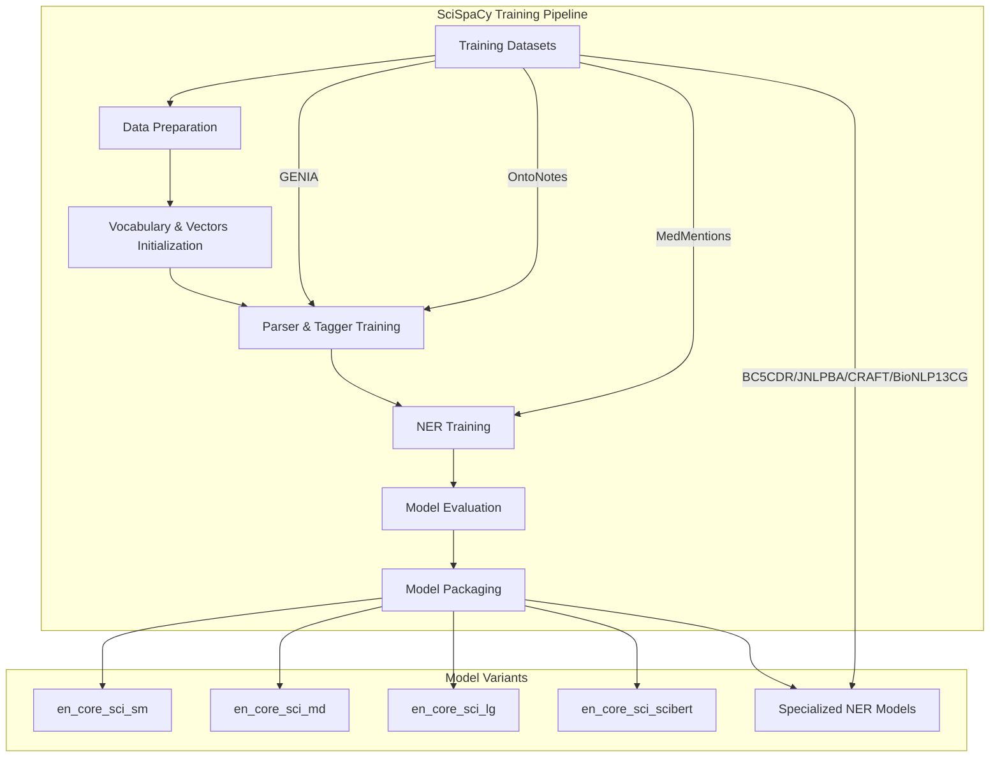
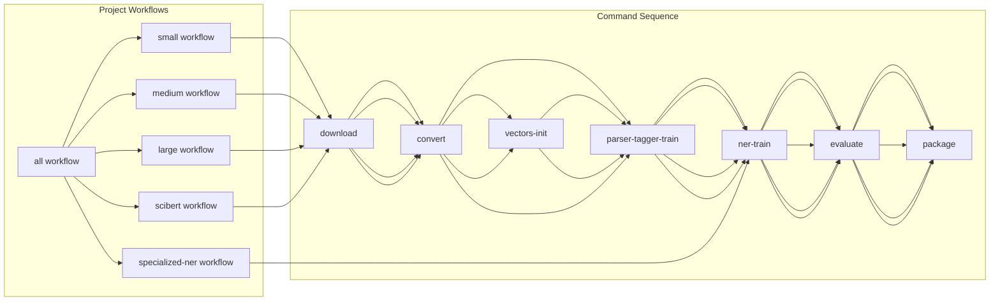
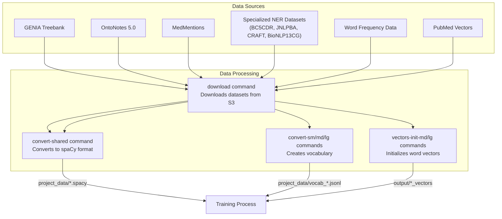
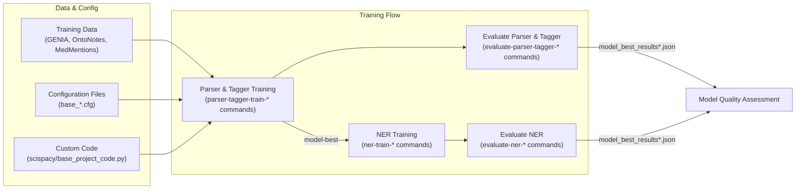

<!-- source: DeepWiki mcp.deepwiki.com · repo allenai/scispacy · page 4.1 Training Pipeline Configuration · fetched 2026-10-26 -->

# Training Pipeline Configuration

<details>
<summary>Relevant source files</summary>

The following files were used as context for generating this wiki page:

- [configs/base_ner.cfg](configs/base_ner.cfg)
- [configs/base_ner_scibert.cfg](configs/base_ner_scibert.cfg)
- [configs/base_parser_tagger.cfg](configs/base_parser_tagger.cfg)
- [configs/base_parser_tagger_scibert.cfg](configs/base_parser_tagger_scibert.cfg)
- [configs/base_specialized_ner.cfg](configs/base_specialized_ner.cfg)
- [data/meta_scibert.json](data/meta_scibert.json)
- [project.yml](project.yml)
- [scispacy/base_project_code.py](scispacy/base_project_code.py)
- [scripts/convert_freqs.py](scripts/convert_freqs.py)
- [scripts/evaluate_ner.py](scripts/evaluate_ner.py)

</details>


## Purpose and Scope

This document details the configuration and workflow of the SciSpaCy training pipeline. It explains how the various SciSpaCy models are trained, evaluated, and packaged for distribution. This includes the setup of configuration files, data preparation processes, model training sequences, and model evaluation methods specifically tailored for biomedical and scientific text processing.

For information about using the pre-trained models, see [Available Models](#1.2). For details about the data preparation process, see [Data Preparation](#4.2).

## Overview of the Training Pipeline

SciSpaCy's training pipeline is orchestrated through spaCy's project system, which allows for the definition of complex workflows with dependencies and reproducible execution. The pipeline supports training multiple model sizes (small, medium, large) as well as specialized models for specific NER tasks and transformer-based SciBERT models.



Sources: [project.yml:1-633]()

## Project Configuration Structure

The training pipeline is defined in `project.yml`, which contains variables, workflows, and commands that orchestrate the entire training process.

### Variables

The project variables define important paths, version information, and file locations used throughout the training process. These include:

- Model version
- Data locations (local and S3)
- Training, development, and test dataset paths
- Configuration file paths
- Output paths for model artifacts

Sources: [project.yml:4-68]()

### Workflows

The project defines several workflows for different model types:

| Workflow | Description | Key Commands |
|----------|-------------|-------------|
| small | Trains the small model without word vectors | download, convert, parser-tagger-train-sm, ner-train-sm, package-sm |
| medium | Trains the medium model with word vectors | download, convert, vectors-init-md, parser-tagger-train-md, ner-train-md, package-md |
| large | Trains the large model with extensive word vectors | download, convert, vectors-init-lg, parser-tagger-train-lg, ner-train-lg, package-lg |
| scibert | Trains the SciBERT transformer-based model | download, convert, parser-tagger-train-scibert, ner-train-scibert, package-scibert |
| specialized-ner | Trains specialized NER models for specific domains | ner-train-specialized, package-ner |
| all | Runs all workflows | All commands for all model types |

Sources: [project.yml:75-158]()



Sources: [project.yml:75-158]()

## Configuration Files

The training pipeline uses several configuration files that define the model architectures, training parameters, and components:

### Base Parser and Tagger Configuration

The base parser and tagger configuration (`base_parser_tagger.cfg`) defines:

- Pipeline components: tok2vec, tagger, attribute_ruler, lemmatizer, parser
- Model architecture for each component
- Training corpus settings (mixing GENIA and OntoNotes data)
- Training hyperparameters (learning rate, batch size, epochs)

Sources: [configs/base_parser_tagger.cfg:1-174]()

### NER Configuration

The NER configuration (`base_ner.cfg`) defines:

- NER model architecture
- Integration with the pre-trained parser and tagger
- Training on MedMentions data
- Evaluation metrics focused on entity recognition

Sources: [configs/base_ner.cfg:1-149]()

### Specialized NER Configuration

The specialized NER configuration (`base_specialized_ner.cfg`) is similar to the base NER configuration but is adapted for specific biomedical entity types from datasets like BC5CDR, JNLPBA, CRAFT, and BioNLP13CG.

Sources: [configs/base_specialized_ner.cfg:1-149]()

### SciBERT Configurations

For transformer-based models, SciBERT-specific configurations are used (`base_parser_tagger_scibert.cfg` and `base_ner_scibert.cfg`). These configurations:

- Utilize the allenai/scibert_scivocab_uncased transformer
- Define transformer-specific parameters for tokenization and encoding
- Adapt the training parameters for transformer-based models

Sources: [configs/base_parser_tagger_scibert.cfg:1-164](), [configs/base_ner_scibert.cfg:1-148]()

## Data Processing Flow



Sources: [project.yml:160-245](), [scripts/convert_freqs.py:1-79]()

## Training Process

The training process follows a sequential approach where the parser and tagger are trained first, followed by the NER component:



Sources: [project.yml:266-319](), [project.yml:320-363](), [scispacy/base_project_code.py:1-113]()

### Parser and Tagger Training

The parser and tagger training commands:
- Use spaCy's `train` command with the appropriate configuration file
- Specify the output location for the model
- Include custom code for data loading and tokenization
- Set paths for vocabulary and vectors (when applicable)
- Control GPU usage with `--gpu-id` parameter

For example, the medium model parser/tagger training command:

```
spacy train ${vars.parser_tagger_config_loc} --output ${vars.parser_tagger_md_loc} --code ${vars.code_loc} --paths.vectors ${vars.vectors_md_loc} --paths.vocab_path ${vars.vocab_md_loc} --vars.include_static_vectors True --gpu-id ${vars.gpu_id}
```

Sources: [project.yml:266-305]()

### NER Training

The NER training commands:
- Initialize from the trained parser and tagger model
- Use a separate NER configuration file
- Train only the NER component while freezing other components
- Train on biomedical entity data (MedMentions or specialized datasets)

For example, the medium model NER training command:

```
spacy train ${vars.ner_config_loc} --output ${vars.ner_md_loc} --code ${vars.code_loc} --paths.vectors ${vars.vectors_md_loc} --paths.parser_tagger_path ${vars.parser_tagger_md_loc}/model-best --paths.vocab_path ${vars.vocab_md_loc} --vars.include_static_vectors True --gpu-id ${vars.gpu_id}
```

Sources: [project.yml:320-363]()

### Specialized NER Training

For specialized NER models, the training process is similar but uses different datasets:

```
spacy train ${vars.specialized_ner_config_loc} --output ${vars.bc5cdr_md_loc} --code ${vars.code_loc} --paths.vectors ${vars.vectors_md_loc} --paths.parser_tagger_path ${vars.parser_tagger_md_loc}/model-best --paths.train_path ${vars.bc5cdr_loc_local}/train.tsv --paths.dev_path ${vars.bc5cdr_loc_local}/devel.tsv --paths.vocab_path ${vars.vocab_md_loc} --vars.include_static_vectors True --gpu-id ${vars.gpu_id}
```

Sources: [project.yml:366-393]()

## Model Evaluation

After training, models are evaluated on appropriate test sets:

### Parser and Tagger Evaluation

Parser and tagger models are evaluated on both GENIA and OntoNotes test sets to assess performance on both biomedical and general domain text.

```
spacy evaluate ${vars.parser_tagger_md_loc}/model-best ${vars.genia_test_spacy_loc} --output ${vars.parser_tagger_md_loc}/model_best_results.json --gpu-id ${vars.gpu_id}
spacy evaluate ${vars.parser_tagger_md_loc}/model-best ${vars.ontonotes_test_spacy_loc} --output ${vars.parser_tagger_md_loc}/model_best_results_onto.json --gpu-id ${vars.gpu_id}
```

Sources: [project.yml:395-432]()

### NER Evaluation

NER models are evaluated using a custom script that calculates precision, recall, and F1 scores for entity recognition:

```
python scripts/evaluate_ner.py --model_path ${vars.ner_md_loc}/model-best --dataset medmentions-test --output ${vars.ner_md_loc}/model_best_results.json --med_mentions_folder_path assets/ --gpu_id ${vars.gpu_id}
```

For specialized NER models, evaluation uses the corresponding test sets:

```
python scripts/evaluate_ner.py --model_path ${vars.bc5cdr_md_loc}/model-best --dataset ${vars.bc5cdr_loc_local}/test.tsv --output ${vars.bc5cdr_md_loc}/model_best_results.json --gpu_id ${vars.gpu_id}
```

Sources: [project.yml:447-507](), [scripts/evaluate_ner.py:1-51]()

## Model Packaging

Finally, trained models are packaged for distribution:

```
spacy package ${vars.ner_md_loc}/model-best packages/ --meta-path ${vars.meta_md_loc} --version ${vars.version_string}
```

The packaging process:
1. Takes the final trained model
2. Applies metadata from a JSON file (such as author, license, description)
3. Creates a package with the correct version number
4. Produces a distributable Python package that can be installed via pip

After packaging, the models are evaluated again to ensure that the packaged versions perform as expected.

Sources: [project.yml:509-632](), [data/meta_scibert.json:1-17]()

## Custom Code Integration

The training pipeline uses custom code defined in `scispacy/base_project_code.py` that provides:

1. Custom tokenizer replacement via `replace_tokenizer_callback` function
2. Custom data readers:
   - `parser_tagger_data`: Mixes GENIA and OntoNotes data
   - `med_mentions_reader`: Loads MedMentions data
   - `specialized_ner_reader`: Loads specialized NER datasets

These custom components are registered with spaCy and referenced in the configuration files.

Sources: [scispacy/base_project_code.py:15-112]()

## Summary

The SciSpaCy training pipeline provides a comprehensive framework for training various models for biomedical text processing. By using spaCy's project system, the pipeline ensures reproducibility and maintainability. The workflow supports different model sizes and specialized models, allowing users to choose the appropriate model for their specific needs.

Training progresses from basic linguistic components (parser and tagger) to specialized named entity recognition, with thorough evaluation at each stage. The final packaged models are ready for distribution and use in biomedical NLP applications.

---

