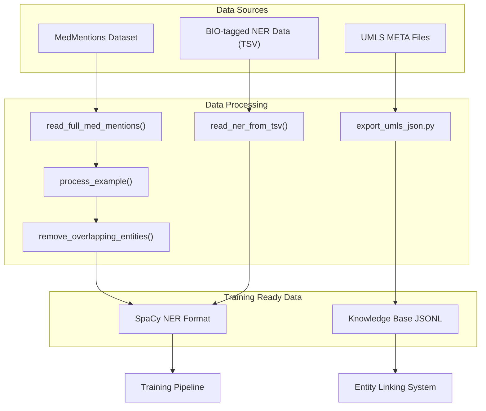
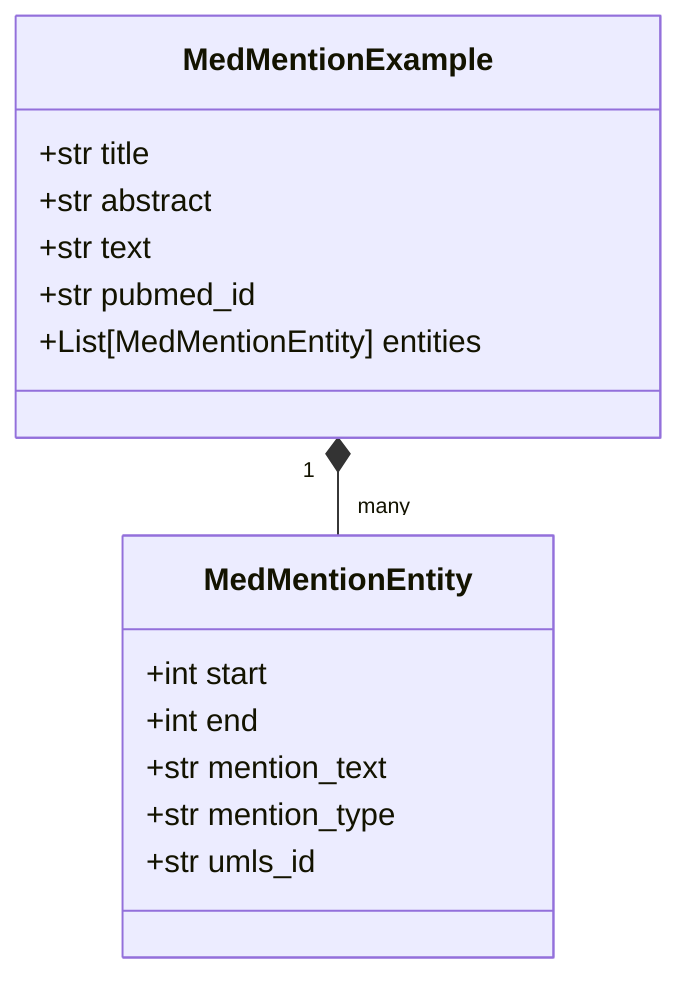
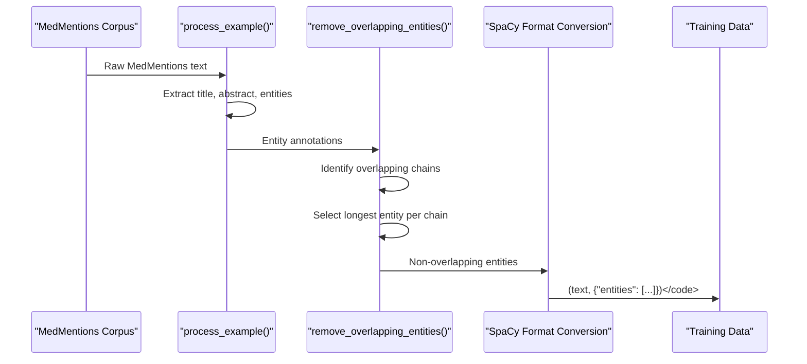
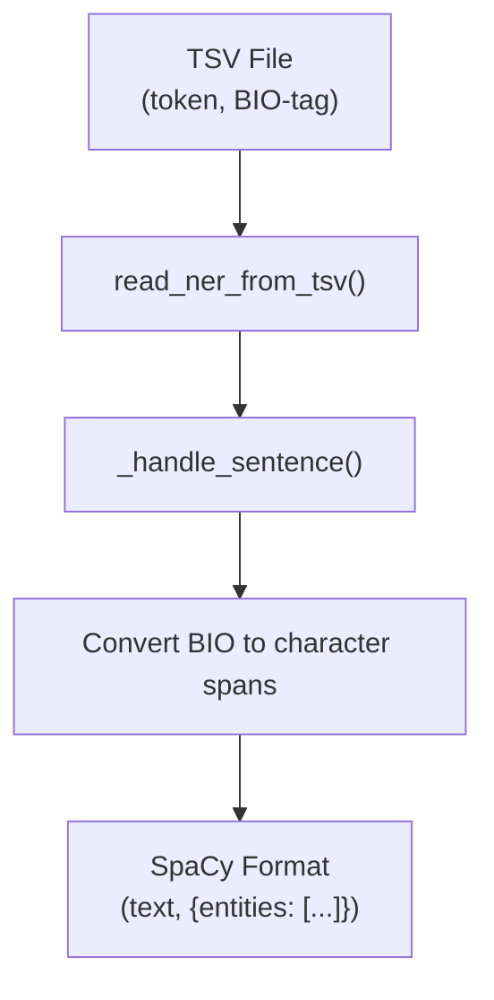
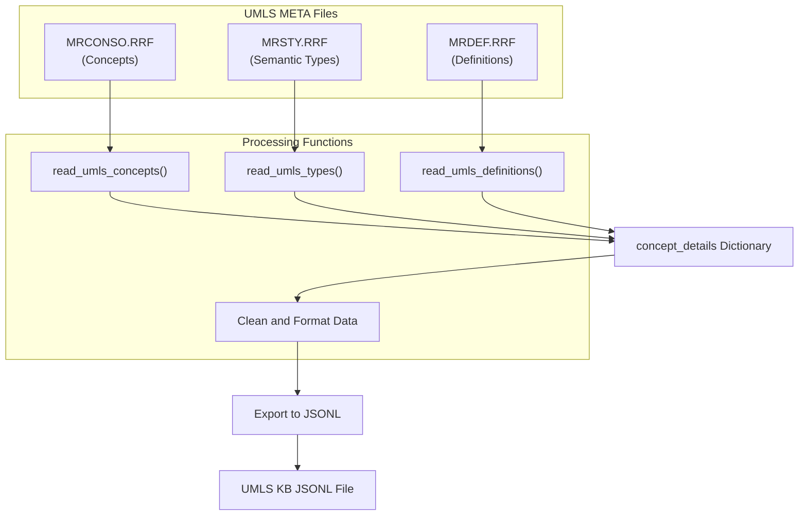
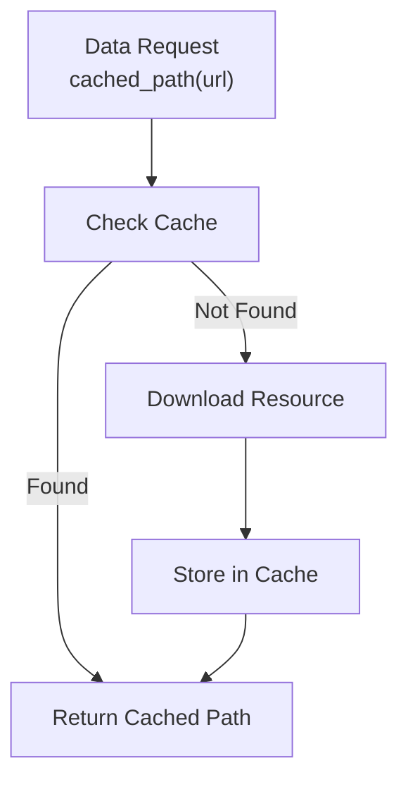

<!-- source: DeepWiki mcp.deepwiki.com · repo allenai/scispacy · page 4.2 Data Preparation · fetched 2026-10-26 -->

# Data Preparation

<details>
<summary>Relevant source files</summary>

The following files were used as context for generating this wiki page:

- [scispacy/data_util.py](scispacy/data_util.py)
- [scripts/export_umls_json.py](scripts/export_umls_json.py)

</details>


## Purpose and Scope

This document describes the data preparation processes used in SciSpaCy for training models. It covers how various biomedical datasets are processed, transformed, and prepared for training pipelines, including MedMentions data processing for named entity recognition (NER) and UMLS knowledge base preparation for entity linking. For information about the training pipeline configuration, see [Training Pipeline Configuration](#4.1), and for model evaluation methods, see [Model Evaluation](#4.3).

## Data Processing Workflow Overview

SciSpaCy uses several specialized datasets for training its models. The data preparation process involves transforming raw biomedical text and annotation files into formats suitable for training spaCy models.



**Diagram: Data Preparation Workflow in SciSpaCy**

Sources: [scispacy/data_util.py:1-318](), [scripts/export_umls_json.py:1-120]()

## MedMentions Data Processing

MedMentions is a biomedical dataset containing PubMed abstracts with entity annotations linked to UMLS concepts. SciSpaCy includes utilities to process this dataset into a format suitable for training NER models.

### MedMentions Data Structure



**Diagram: MedMentions Data Classes in SciSpaCy**

Sources: [scispacy/data_util.py:11-24]()

### MedMentions Processing Pipeline

The MedMentions dataset is processed through several stages:

1. **Reading raw data**: The `read_full_med_mentions()` function reads the MedMentions corpus file and splits it into training, development, and test sets.

2. **Processing examples**: Each example (PubMed abstract) is processed to extract its title, abstract, and entity annotations.

3. **Handling overlapping entities**: MedMentions can contain overlapping entity annotations. SciSpaCy resolves these overlaps by greedily selecting the longest entity from each overlapping chain.

4. **Converting to spaCy format**: The processed data is converted to spaCy's training format, which consists of text and entity annotations.



**Diagram: MedMentions Processing Sequence**

Sources: [scispacy/data_util.py:27-234]()

### Entity Overlap Resolution

A key challenge in processing biomedical text is handling overlapping entity mentions. SciSpaCy uses a greedy approach:

1. Entities are first sorted by length (longest first)
2. For each chain of overlapping entities, the longest non-overlapping entities are selected
3. This ensures that each token in the text belongs to at most one entity

The implementation can be found in the `remove_overlapping_entities()` and `select_subset_of_overlapping_chain()` functions.

Sources: [scispacy/data_util.py:70-146]()

## Processing BIO-Tagged NER Data

SciSpaCy provides utility functions to convert BIO-tagged (Beginning, Inside, Outside) NER data from TSV files into the format required by spaCy.

### TSV to spaCy Format Conversion

The `read_ner_from_tsv()` function processes TSV files containing token-level BIO tags:

```
Token1  B-DISEASE
Token2  I-DISEASE
Token3  O
Token4  B-DRUG
...
```

This data is converted into spaCy's expected format:

```
(text, {"entities": [(start, end, label), ...]})
```



**Diagram: BIO-tagged TSV to SpaCy Format Conversion**

Sources: [scispacy/data_util.py:239-318]()

## UMLS Knowledge Base Preparation

The UMLS (Unified Medical Language System) is a comprehensive biomedical terminology resource used for entity linking in SciSpaCy. The raw UMLS data must be processed into a format suitable for SciSpaCy's entity linking component.

### UMLS to JSONL Conversion

SciSpaCy includes a script (`export_umls_json.py`) that converts UMLS META files into a JSONL format:



**Diagram: UMLS to JSONL Conversion Process**

Sources: [scripts/export_umls_json.py:10-89]()

### UMLS Concept Processing

Each UMLS concept is processed to include:

1. **Concept ID**: Unique identifier
2. **Canonical Name**: Preferred name for the concept
3. **Aliases**: Alternative names/synonyms
4. **Types**: Semantic types associated with the concept
5. **Definition**: Text definition of the concept

During processing, duplicate aliases are removed, and concepts without canonical names have one selected from their aliases.

Sources: [scripts/export_umls_json.py:18-89]()

## Data Caching System

SciSpaCy implements a file caching system to efficiently manage downloaded datasets. The `cached_path()` function is used throughout the data preparation code to handle downloading and caching of external resources.



**Diagram: Data Caching System in SciSpaCy**

Sources: [scispacy/data_util.py:8-158]()

## Integration with Training Pipeline

The prepared data feeds directly into SciSpaCy's training pipeline:

1. **MedMentions** and **BIO-tagged NER data** are processed into spaCy's training format for NER models
2. **UMLS JSONL** data is used for entity linking components
3. The data preparation utilities ensure consistent handling of biomedical text and entities across different data sources

For details on how the prepared data is used in the training process, see [Training Pipeline Configuration](#4.1).

Sources: [scispacy/data_util.py:149-234](), [scripts/export_umls_json.py:86-89]()

---

