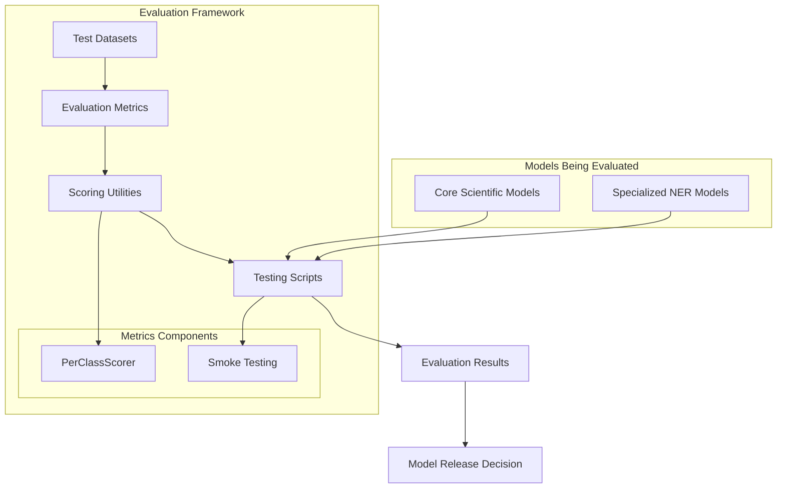
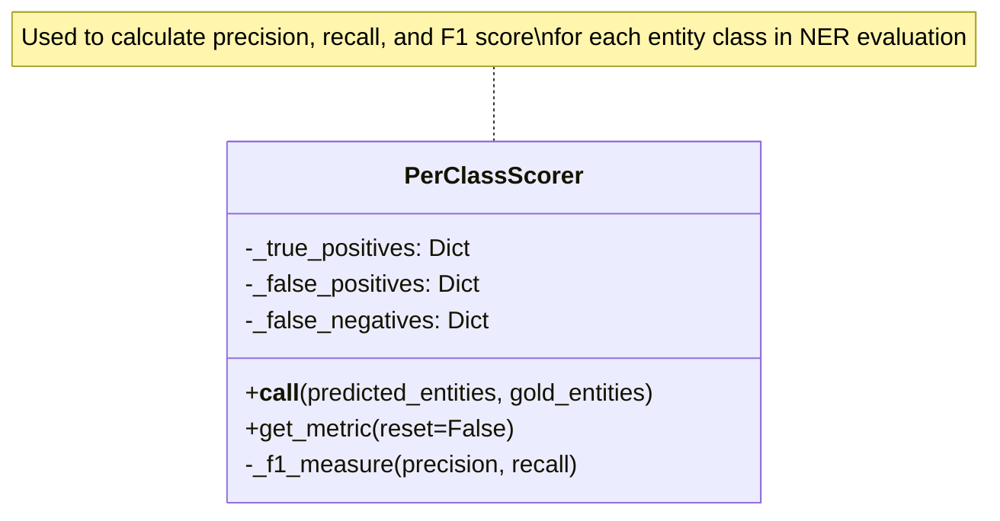
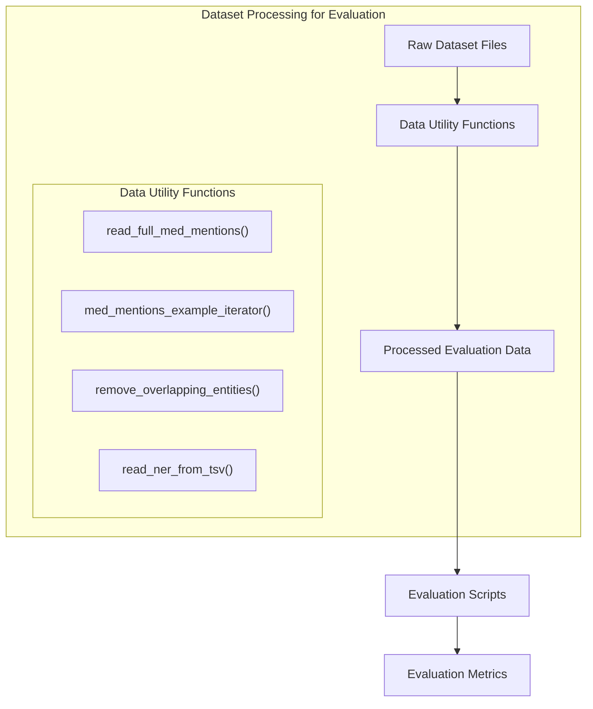
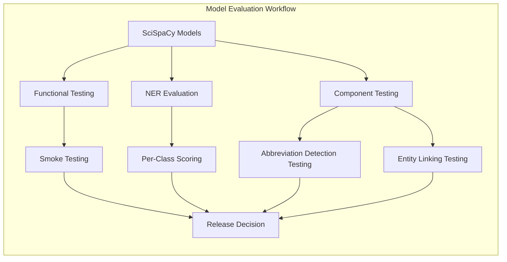
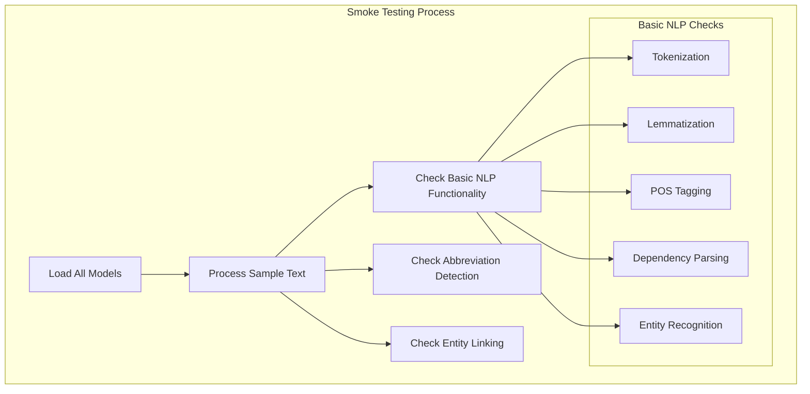
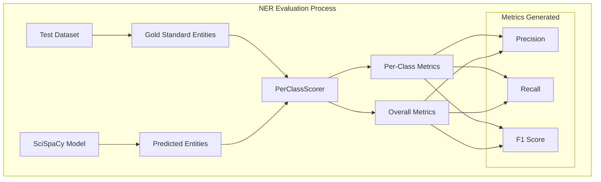

<!-- source: DeepWiki mcp.deepwiki.com · repo allenai/scispacy · page 4.3 Model Evaluation · fetched 2026-10-26 -->

# Model Evaluation

<details>
<summary>Relevant source files</summary>

The following files were used as context for generating this wiki page:

- [scripts/install_local_packages.py](scripts/install_local_packages.py)
- [scripts/smoke_test.py](scripts/smoke_test.py)
- [scripts/uninstall_local_packages.py](scripts/uninstall_local_packages.py)
- [tests/fixtures/med_mentions.txt](tests/fixtures/med_mentions.txt)
- [tests/test_data_util.py](tests/test_data_util.py)
- [tests/test_per_class_scorer.py](tests/test_per_class_scorer.py)

</details>


This page documents the evaluation framework and methodologies used to assess the performance of SciSpaCy models. It describes how models are evaluated for accuracy and functionality before release, focusing on metrics, testing procedures, and evaluation utilities. For information about model training configuration, see [Training Pipeline Configuration](#4.1), and for details on data preparation for evaluation, see [Data Preparation](#4.2).

## Evaluation Framework Overview

SciSpaCy includes a comprehensive evaluation framework to ensure that all models meet quality standards before release. The framework evaluates both core NLP functionalities (like tokenization and POS tagging) and specialized components (like entity recognition and linking).



Sources: [tests/test_per_class_scorer.py](), [scripts/smoke_test.py]()

## Evaluation Metrics

SciSpaCy primarily uses precision, recall, and F1-score to evaluate model performance, particularly for named entity recognition (NER) tasks. The `PerClassScorer` class implements these metrics calculations.

### PerClassScorer

The `PerClassScorer` calculates evaluation metrics for each entity class separately, as well as overall metrics for the model. This allows for fine-grained analysis of model performance on different entity types.



The scorer works by:
1. Counting true positives, false positives, and false negatives for each entity class
2. Computing precision, recall, and F1-score per class and overall
3. Returning metrics in a dictionary with keys like 'precision-CLASS', 'recall-CLASS', and 'f1-measure-CLASS'

Example metrics output from the `PerClassScorer`:
```
{
    'precision-PER': 1.0,
    'recall-PER': 1.0,
    'f1-measure-PER': 1.0,
    'precision-LOC': 0.0,
    'recall-LOC': 0.0,
    'f1-measure-LOC': 0.0,
    'precision-untyped': 1.0,
    'recall-untyped': 1.0,
    'f1-measure-untyped': 1.0,
    'precision-ORG': 0.0,
    'recall-ORG': 0.0,
    'f1-measure-ORG': 0.0,
    'precision-overall': 0.5,
    'recall-overall': 0.5,
    'f1-measure-overall': 0.5
}
```

Sources: [tests/test_per_class_scorer.py:5-48]()

## Evaluation Datasets

SciSpaCy models are evaluated on various biomedical corpora, including:

| Dataset | Description | Used For |
|---------|-------------|----------|
| MedMentions | Biomedical entity annotations linked to UMLS concepts | NER and Entity Linking evaluation |
| GENIA | Biomedical corpus with syntactic and entity annotations | General NLP pipeline evaluation |
| BC5CDR | Chemical and disease entity annotations | NER evaluation |
| CRAFT | Comprehensive biomedical corpus with various entity types | NER evaluation |
| JNLPBA | Molecular biology entity annotations | NER evaluation |
| BioNLP13CG | Cancer genetics entity annotations | NER evaluation |

The evaluation datasets are processed using utility functions in the `data_util` module, which handle parsing and formatting the data for evaluation.



Sources: [tests/test_data_util.py:6-93](), [tests/fixtures/med_mentions.txt]()

## Evaluation Workflow

The evaluation workflow for SciSpaCy models involves multiple steps to thoroughly test model performance and functionality:



Sources: [scripts/smoke_test.py:8-86]()

## Smoke Testing

Smoke testing is an important part of the evaluation process, providing a quick verification that models work as expected. The `smoke_test.py` script loads each model and runs it on sample text to ensure basic functionality.

### Core Model Testing

The smoke test verifies that each model can:
- Load successfully
- Process sample text
- Produce expected outputs for tokenization, lemmatization, POS tagging, dependency parsing, and entity recognition

### Component Testing

The smoke test also verifies specialized components:
- Abbreviation detection: Tests ability to identify abbreviations and their long forms
- Entity linking: Tests ability to link entities to various knowledge bases (UMLS, MeSH, RxNorm, GO, HPO)

The models that undergo smoke testing include:
- Core scientific models: `en_core_sci_sm`, `en_core_sci_md`, `en_core_sci_lg`, `en_core_sci_scibert`
- Specialized NER models: `en_ner_bc5cdr_md`, `en_ner_craft_md`, `en_ner_bionlp13cg_md`, `en_ner_jnlpba_md`



Sources: [scripts/smoke_test.py:8-86](), [scripts/install_local_packages.py:7-16](), [scripts/uninstall_local_packages.py:7-16]()

## NER Evaluation Process

Named Entity Recognition (NER) is a critical component of SciSpaCy, and its evaluation receives special attention:



For each entity class (e.g., disease, chemical, gene), the evaluation calculates:
- Precision: Percentage of predicted entities that are correct
- Recall: Percentage of gold standard entities that were found
- F1-score: Harmonic mean of precision and recall

Sources: [tests/test_per_class_scorer.py:9-38]()

## Release Decision Process

After comprehensive evaluation, the decision to release a model depends on meeting specific performance thresholds:

| Evaluation Aspect | Minimum Threshold | Target Threshold |
|-------------------|-------------------|------------------|
| Overall NER F1 score | Depends on model type | Typically >85% |
| Smoke test passing | All tests must pass | All tests must pass |
| Specialized component tests | All tests must pass | All tests must pass |

Models that fail to meet minimum thresholds undergo further training and improvement before release. Those that meet thresholds are packaged and released to PyPI.

Sources: [scripts/smoke_test.py](), [scripts/install_local_packages.py](), [scripts/uninstall_local_packages.py]()

## Conclusion

The evaluation framework in SciSpaCy ensures that released models meet high performance standards for biomedical text processing. Through a combination of metric-based evaluation, smoke testing, and component testing, the framework provides confidence in model quality across different use cases.

For information about how to run the evaluation processes yourself or contribute to their improvement, see [Development Guide](#5) and [Testing Framework](#5.2).

---

