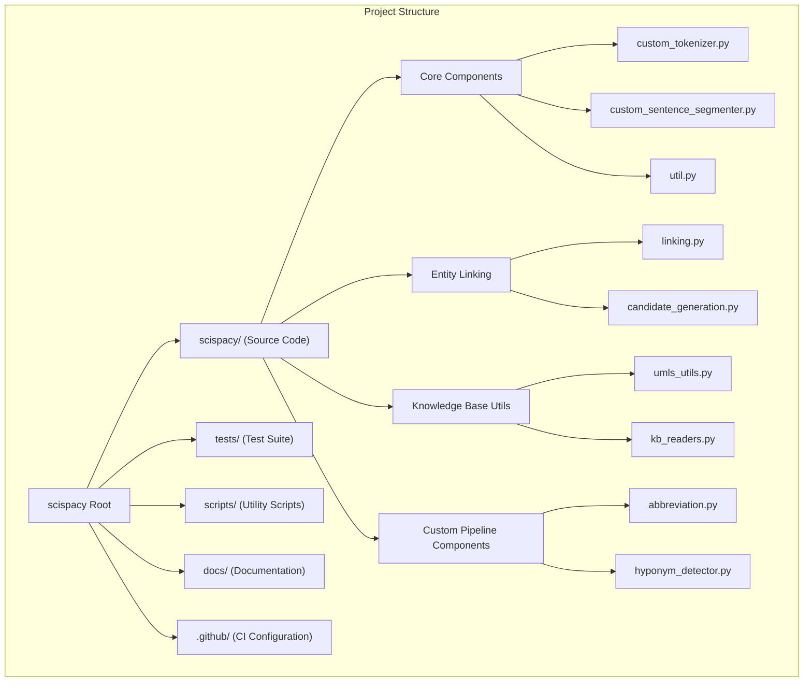
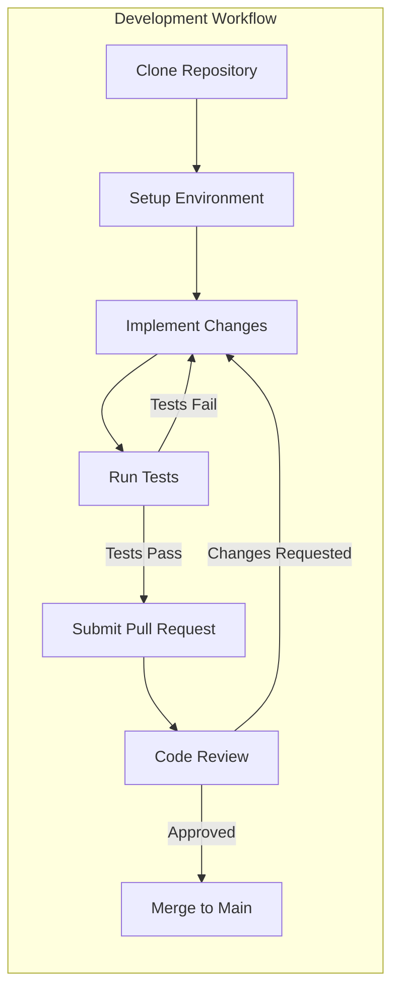
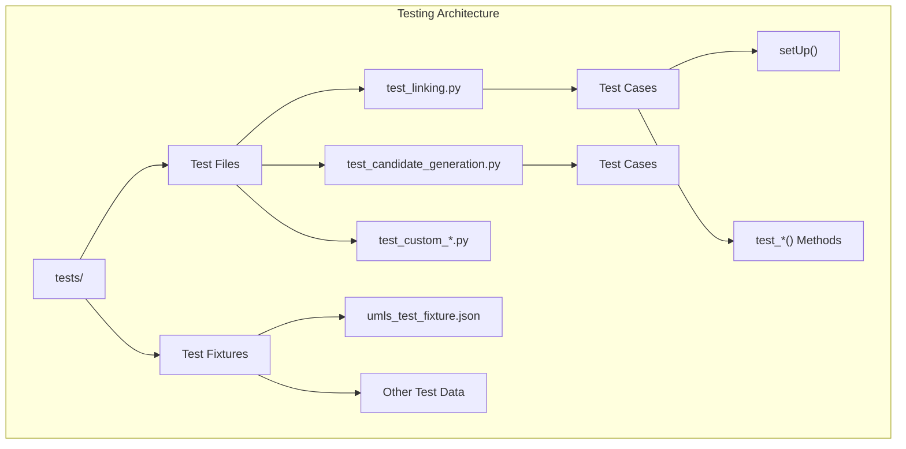
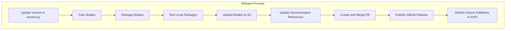

<!-- source: DeepWiki mcp.deepwiki.com · repo allenai/scispacy · page 5 Development Guide · fetched 2026-10-26 -->

# Development Guide

<details>
<summary>Relevant source files</summary>

The following files were used as context for generating this wiki page:

- [.github/workflows/main.yml](.github/workflows/main.yml)
- [.github/workflows/old_scipy.yml](.github/workflows/old_scipy.yml)
- [Dockerfile](Dockerfile)
- [README.md](README.md)
- [RELEASE.md](RELEASE.md)
- [docs/example.svg](docs/example.svg)
- [docs/index.md](docs/index.md)
- [scispacy/util.py](scispacy/util.py)
- [scripts/install_remote_packages.py](scripts/install_remote_packages.py)
- [tests/test_candidate_generation.py](tests/test_candidate_generation.py)
- [tests/test_linking.py](tests/test_linking.py)

</details>


This guide is intended for developers who want to contribute to or modify SciSpaCy. It covers the project structure, development environment setup, testing framework, and release process. For general usage information, see [Overview](#1), and for detailed model information, see [Available Models](#1.2).

## Project Structure

SciSpaCy is organized as a Python package with several components that extend spaCy's functionality for scientific and biomedical text processing.



The project has the following key directories:

- **scispacy/**: Main source code package containing all core functionality
- **tests/**: Test suite for verifying functionality
- **scripts/**: Utility scripts for development, installation, and testing
- **docs/**: Documentation files including the website
- **.github/**: CI/CD configuration for GitHub Actions

Sources: [Dockerfile:28-30]()

### Key Files

| File | Purpose |
|------|---------|
| scispacy/custom_tokenizer.py | Custom tokenization rules for scientific text |
| scispacy/custom_sentence_segmenter.py | Scientific sentence segmentation |
| scispacy/candidate_generation.py | Entity candidate generation for linking |
| scispacy/linking.py | Entity linking functionality |
| scispacy/abbreviation.py | Abbreviation detection |
| scispacy/umls_utils.py | UMLS knowledge base utilities |
| scispacy/version.py | Version information |
| tests/*.py | Test files for each component |

Sources: [Dockerfile:28-30](), [README.md:124-156]()

## Development Environment Setup

### Using Docker (Recommended)

The simplest way to get started with SciSpaCy development is to use Docker, which provides a consistent environment with all dependencies pre-installed.

1. Clone the repository:
   ```bash
   git clone https://github.com/allenai/scispacy.git
   cd scispacy
   ```

2. Build the Docker image:
   ```bash
   docker build --tag scispacy .
   ```

3. Run the Docker container with mounted source code:
   ```bash
   docker run -it --rm -v $(pwd):/work scispacy
   ```

Sources: [Dockerfile:1-33](), [.github/workflows/main.yml:14-22]()

### Setting Up a Virtual Environment

If you prefer to develop without Docker:

1. Create a Python environment with Mamba (recommended) or Conda:
   ```bash
   mamba create -n scispacy python=3.10
   mamba activate scispacy
   ```

2. Install dependencies:
   ```bash
   pip install -r requirements.in
   ```

3. Install a development version of scispacy and a model:
   ```bash
   pip install -e .
   pip install https://s3-us-west-2.amazonaws.com/ai2-s2-scispacy/releases/v0.5.4/en_core_sci_sm-0.5.4.tar.gz
   ```

Sources: [README.md:62-82](), [Dockerfile:18-20]()

### Note on nmslib Installation

The `nmslib` library, which is used for candidate generation in entity linking, can be challenging to install in some environments. Here are workarounds for various platforms:

- For Python 3.8 on WSL or Linux: Standard pip install works
- For Mac M1: Use `CFLAGS="-mavx -DWARN(a)=(a)" pip install nmslib`
- For some environments: Use `mamba install nmslib` or `conda install -c conda-forge nmslib`

Sources: [README.md:30-60]()

## Development Workflow



The development workflow follows these steps:

1. **Fork and clone** the repository
2. **Set up** the development environment
3. **Create a branch** for your changes
4. **Implement** your changes or fixes
5. **Run tests** to ensure everything works
6. **Submit a pull request** with your changes
7. **Respond to review comments** if needed
8. **Your PR gets merged** once approved

Sources: [.github/workflows/main.yml:1-23]()

## Testing Framework

SciSpaCy uses pytest for testing. The test suite verifies the functionality of various components.

### Running Tests

To run all tests:

```bash
# From Docker
docker run --rm scispacy pytest tests/

# Without Docker
pytest tests/
```

To run code quality checks:

```bash
# Run linting with flake8
docker run --rm scispacy flake8 scispacy

# Run formatting check with black
docker run --rm scispacy black scispacy --check --line-length 88

# Run type checking with mypy
docker run --rm scispacy bash scripts/mypy.sh

# Run code coverage check
docker run --rm scispacy pytest tests/ --cov scispacy --cov-fail-under=20
```

Sources: [.github/workflows/main.yml:17-22]()

### Test Structure



Key test files:

- `tests/test_candidate_generation.py`: Tests for candidate generation
- `tests/test_linking.py`: Tests for entity linking
- `tests/fixtures/`: Contains test data and fixtures

When writing tests, use the standard unittest pattern:

```python
import unittest

class TestYourFeature(unittest.TestCase):
    def setUp(self):
        # Setup code...
        pass
        
    def test_your_feature(self):
        # Test code...
        self.assertEqual(expected, actual)
```

Common test utilities:

- `tempfile.TemporaryDirectory()`: For creating temporary test files
- `UmlsKnowledgeBase("tests/fixtures/umls_test_fixture.json")`: Test knowledge base

Sources: [tests/test_linking.py:1-76](), [tests/test_candidate_generation.py:1-62]()

## Adding New Features

When adding new features to SciSpaCy, follow these guidelines:

1. **Create a custom pipeline component** if adding functionality to the spaCy pipeline
2. **Use the spaCy extension mechanism** for adding custom attributes to Doc, Span, or Token objects
3. **Add comprehensive tests** for your new functionality
4. **Document the API** clearly with docstrings and examples

### Pipeline Component Structure

```mermaid
graph TD
    subgraph "Pipeline Component Architecture"
        component["Custom Component Class"] --> init["__init__()"]
        component --> call["__call__(doc)"]
        component --> pipe["pipe(docs, batch_size)"]
        component --> factory["from_disk()/to_disk()"]
        
        call --> processing["Process Text"]
        call --> set_extensions["Set Custom Extensions"]
        call --> return["Return Modified Doc"]
    end
```

Example skeleton for a pipeline component:

```python
from spacy.language import Language

@Language.factory("your_component_name")
class YourComponent:
    def __init__(self, nlp, name, param1=default1):
        self.param1 = param1
        # Register custom extensions
        if not Span.has_extension("your_attr"):
            Span.set_extension("your_attr", default=None)
            
    def __call__(self, doc):
        # Process the doc
        for entity in doc.ents:
            # Set custom attributes
            entity._.your_attr = some_value
        return doc
```

Sources: [README.md:134-141](), [README.md:214-223]()

## Release Process

The release process for SciSpaCy involves updating version information, building new models, and publishing to PyPI and S3.



### Steps for Releasing a New Version

1. **Update version number** in `scispacy/version.py` 
2. **Train new models** using `spacy project run all`
3. **Package models** for distribution
4. **Test locally** with `install_local_packages.py` and `smoke_test.py`
5. **Upload packages** to S3 bucket at:
   ```
   https://s3-us-west-2.amazonaws.com/ai2-s2-scispacy/releases/v{VERSION}/
   ```
6. **Update documentation references** to point to the new version
7. **Create a PR and merge** with these changes
8. **Create a GitHub release** with a tag matching the version number
9. **GitHub Actions** will automatically publish the package to PyPI

Sources: [RELEASE.md:1-26](), [scripts/install_remote_packages.py:1-29]()

### Testing the Release

These scripts help verify the release:

- `scripts/install_local_packages.py`: Install locally built packages
- `scripts/install_remote_packages.py`: Install packages from S3
- `scripts/smoke_test.py`: Verify basic functionality
- `scripts/print_out_metrics.py`: Generate metrics for README
- `scripts/uninstall_local_packages.py`: Clean up test installations

Sources: [RELEASE.md:20-22](), [scripts/install_remote_packages.py:1-29]()

## Known Issues and Limitations

### scipy Compatibility

There are known issues with `nmslib` and newer versions of scipy:

```python
def scipy_supports_sparse_float16() -> bool:
    # https://github.com/scipy/scipy/issues/7408
    return Version(scipy.__version__) < Version("1.11")
```

Entity linking functionality that depends on `nmslib` may not work with scipy version 1.11 or newer. There are two workflows to handle this:

1. Test with an older version of scipy: `pip install 'scipy<1.11'`
2. Skip entity linking tests when using newer versions of scipy

Sources: [scispacy/util.py:22-24](), [.github/workflows/old_scipy.yml:1-18](), [tests/test_linking.py:15-18]()

## Contributors

SciSpaCy is an open-source project developed by the Allen Institute for Artificial Intelligence (AI2). Contributions are welcome through GitHub pull requests.

For questions or issues, open an issue on the [GitHub repository](https://github.com/allenai/scispacy).

Sources: [README.md:315-318]()

---

