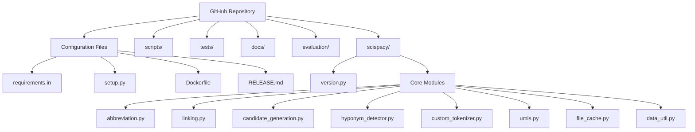
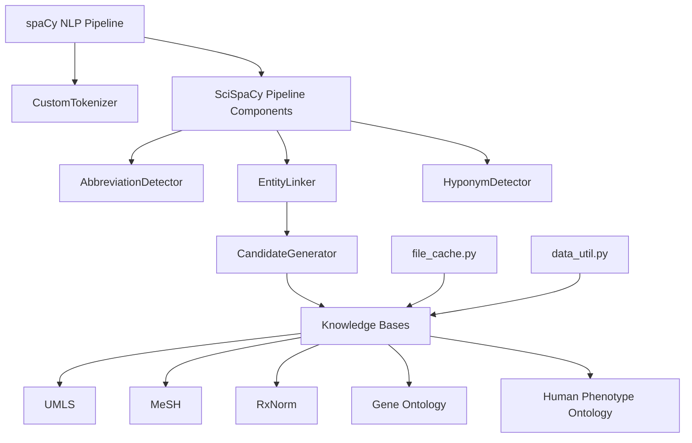
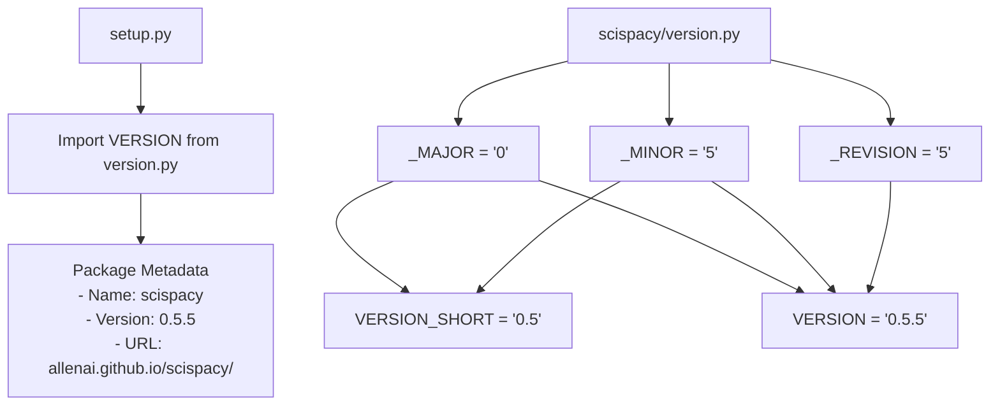
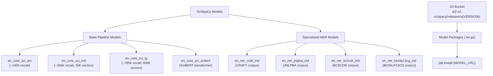
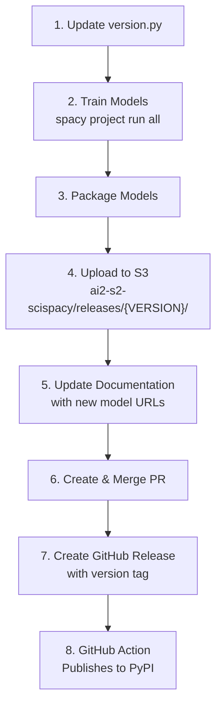
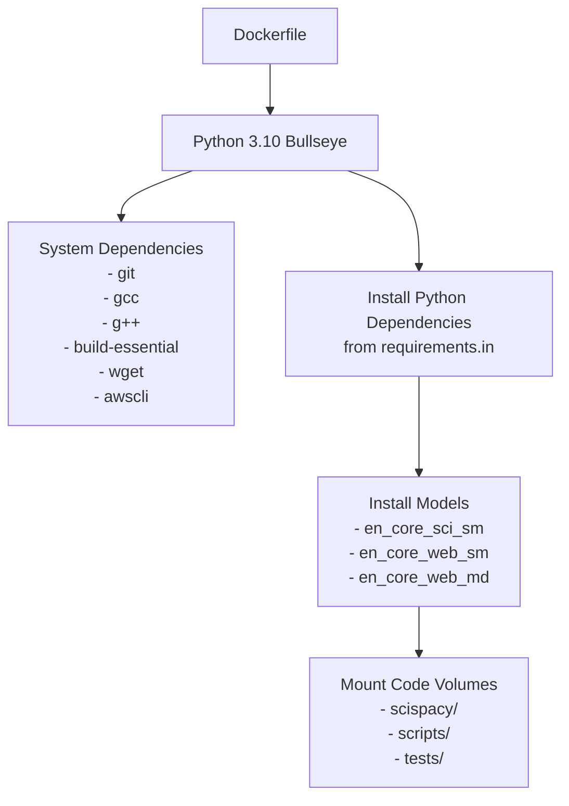

<!-- source: DeepWiki mcp.deepwiki.com · repo allenai/scispacy · page 5.1 Project Structure · fetched 2026-10-26 -->

# Project Structure

Relevant source files

The following files were used as context for generating this wiki page:

- [Dockerfile](Dockerfile)
- [README.md](README.md)
- [RELEASE.md](RELEASE.md)
- [docs/example.svg](docs/example.svg)
- [docs/index.md](docs/index.md)
- [evaluation/evaluate_linker.py](evaluation/evaluate_linker.py)
- [requirements.in](requirements.in)
- [scispacy/version.py](scispacy/version.py)
- [scripts/install_remote_packages.py](scripts/install_remote_packages.py)
- [setup.py](setup.py)

This document provides a comprehensive overview of the SciSpaCy codebase organization, detailing the repository structure, key modules, model organization, and development tools. This guide is intended for developers who want to understand, modify, or extend the SciSpaCy library.

For information about using specific components, refer to the Core Pipeline Components documentation [Core Pipeline Components](#2).

## Repository Structure

The SciSpaCy repository is organized into several key directories and files:

Sources: [README.md](), [setup.py](), [Dockerfile](), [RELEASE.md]()

## Core Module Organization

The SciSpaCy package contains several key modules that implement specialized NLP components for scientific text processing. These components extend spaCy's functionality to handle the unique challenges of biomedical and scientific documents.

Here's how the core modules are organized and their dependencies:

Sources: [README.md:123-201](), [README.md:267-291]()

### Key Modules and Their Roles

| Module | Description | Primary Classes/Functions |
|--------|-------------|---------------------------|
| `version.py` | Contains version constants | `VERSION`, `VERSION_SHORT` |
| `abbreviation.py` | Abbreviation detection (Schwartz & Hearst algorithm) | `AbbreviationDetector` |
| `linking.py` | Entity linking to knowledge bases | `EntityLinker` |
| `candidate_generation.py` | Candidate generation for entity linking | `CandidateGenerator` |
| `hyponym_detector.py` | Hearst pattern-based hyponym detection | `HyponymDetector` |
| `custom_tokenizer.py` | Specialized tokenization for scientific text | Custom tokenization rules |
| `umls.py` | UMLS knowledge base processing | UMLS utilities |
| `file_cache.py` | Caching mechanisms for downloaded files | File caching utilities |
| `data_util.py` | Data processing utilities | Data manipulation functions |

Sources: [scispacy/version.py:1-7](), [README.md:123-156](), [README.md:161-201](), [README.md:267-291]()

## Package Configuration and Version Management

The package configuration is defined in `setup.py`, which specifies dependencies, package metadata, and installation requirements. Version management is handled in `scispacy/version.py`:

Sources: [setup.py:16-33](), [scispacy/version.py:1-7]()

## Model Organization and Distribution

SciSpaCy provides several pre-trained models that are distributed separately from the main package. Models are stored in S3 and installed via pip:

Sources: [README.md:95-117](), [docs/index.md:16-27](), [scripts/install_remote_packages.py:7-16]()

## Dependencies

SciSpaCy has several key dependencies, specified in both `requirements.in` and `setup.py`:

| Dependency | Purpose | Version Constraint |
|------------|---------|-------------------|
| spacy | Base NLP framework | >=3.7.0,<3.8.0 |
| scipy | Scientific computing | <1.11 for Python<3.11 |
| numpy | Numerical computing | No specific constraint |
| nmslib | Approximate nearest neighbors | >=1.7.3.6 for Python<3.11 |
| nmslib-metabrainz | Alternative nmslib fork | ==2.1.3 for Python>=3.11 |
| scikit-learn | Machine learning utilities | >=0.20.3 |
| pysbd | Sentence boundary detection | Required for custom sentence splitter |

Sources: [requirements.in:1-36](), [setup.py:43-54]()

## Build and Release Process

The release process involves updating the package version and releasing both the SciSpaCy library and associated models:

Sources: [RELEASE.md:1-27](), [setup.py:4-14]()

### Testing Model Packages

Several scripts facilitate testing the models during the release process:

| Script | Purpose |
|--------|---------|
| `scripts/install_local_packages.py` | Install locally built models |
| `scripts/smoke_test.py` | Basic functionality testing |
| `scripts/print_out_metrics.py` | Generate model metrics for README |
| `scripts/uninstall_local_packages.py` | Remove locally installed models |
| `scripts/install_remote_packages.py` | Install models from S3 to verify upload |

Sources: [RELEASE.md:22](), [scripts/install_remote_packages.py:1-28]()

## Development Environment

The development environment is configured using Docker to ensure consistency across different systems:

Sources: [Dockerfile:1-34]()

## Evaluation Tools

The repository includes evaluation scripts for assessing model performance:

| Script | Purpose |
|--------|---------|
| `evaluation/evaluate_linker.py` | Evaluates entity linking performance using MedMentions dataset |

Sources: [evaluation/evaluate_linker.py:1-97]()

## Continuous Integration and Deployment

The project uses GitHub Actions for continuous integration and automated deployment:

1. Testing builds against different Python versions
2. Automatic publishing to PyPI when a release is created
3. The publish action is triggered by creating a new release with a tag in the GitHub releases UI

Sources: [RELEASE.md:9-25]()

---

