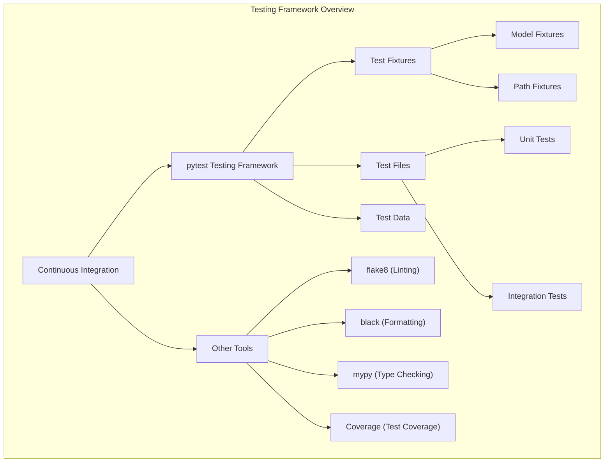
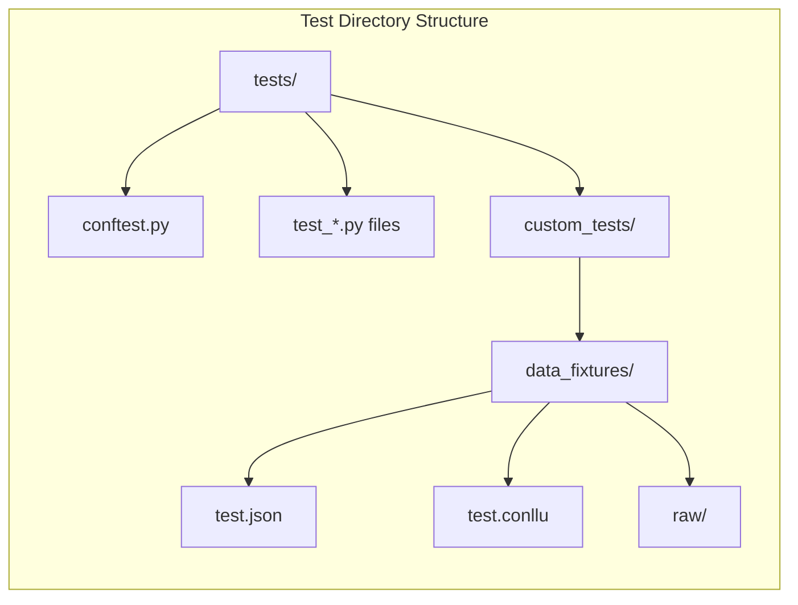
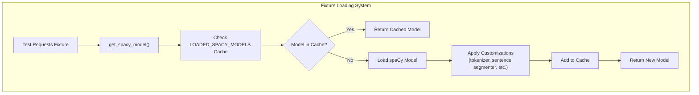
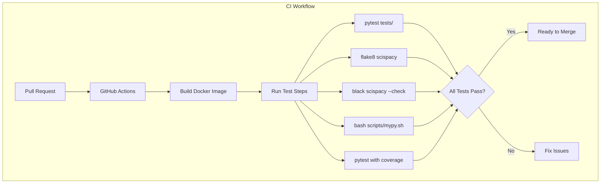
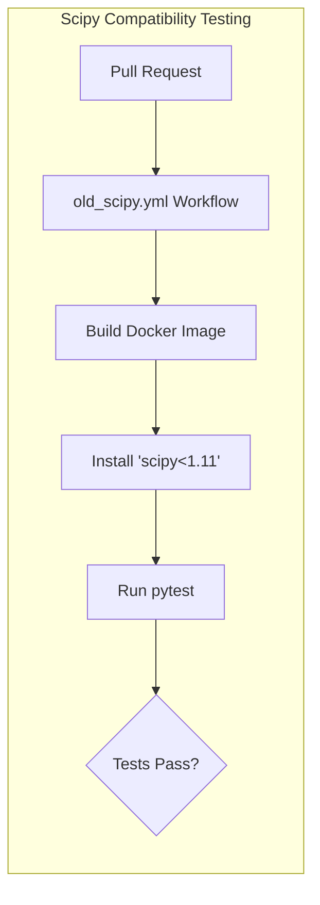
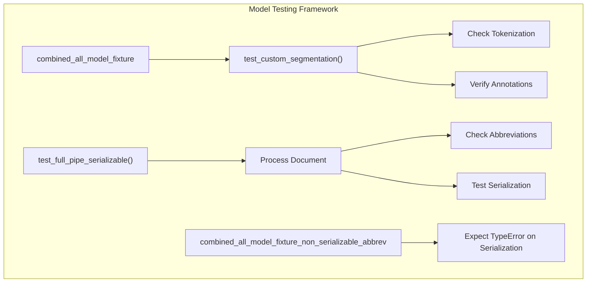

<!-- source: DeepWiki mcp.deepwiki.com · repo allenai/scispacy · page 5.2 Testing Framework · fetched 2026-10-26 -->

# Testing Framework

<details>
<summary>Relevant source files</summary>

The following files were used as context for generating this wiki page:

- [.github/workflows/main.yml](.github/workflows/main.yml)
- [.github/workflows/old_scipy.yml](.github/workflows/old_scipy.yml)
- [.gitignore](.gitignore)
- [LICENSE](LICENSE)
- [scispacy/util.py](scispacy/util.py)
- [tests/conftest.py](tests/conftest.py)
- [tests/custom_tests/data_fixtures/test.json](tests/custom_tests/data_fixtures/test.json)
- [tests/custom_tests/test_all_model.py](tests/custom_tests/test_all_model.py)
- [tests/test_candidate_generation.py](tests/test_candidate_generation.py)
- [tests/test_linking.py](tests/test_linking.py)

</details>


This page documents the testing infrastructure in SciSpaCy, explaining how tests are organized, how to run them, and how to add new tests. For information about the release process, see [Release Process](#5.3).

## Overview

SciSpaCy uses pytest as its primary testing framework, with additional tools for code quality and coverage. The testing infrastructure is designed to verify the functionality of all core components, including custom tokenization, entity linking, and model serialization.



Sources: [tests/conftest.py](), [.github/workflows/main.yml]()

## Test Directory Structure

The tests in SciSpaCy are organized into multiple directories:

- `tests/` - Main directory containing test files and configuration
  - `conftest.py` - Pytest configuration and fixture definitions
  - `test_*.py` - Individual test files for specific components
  - `custom_tests/` - Additional specialized tests
    - `data_fixtures/` - Test data used by tests



Sources: [tests/conftest.py](), [tests/custom_tests/data_fixtures/test.json]()

## Test Fixtures

SciSpaCy uses pytest fixtures extensively to set up the testing environment. These fixtures provide reusable components and configurations that tests can depend on, reducing code duplication and ensuring consistent test environments.

The main test fixtures are defined in `tests/conftest.py` and include:

| Fixture | Purpose |
|---------|---------|
| `get_spacy_model` | Function to load spaCy models with configurable options |
| `combined_rule_tokenizer_fixture` | Provides the custom tokenizer |
| `en_with_combined_rule_tokenizer_fixture` | English spaCy model with custom tokenizer |
| `en_with_combined_rule_tokenizer_and_segmenter_fixture` | Model with custom tokenizer and sentence segmenter |
| `test_data_fixtures_path` | Path to test data directory |
| `combined_all_model_fixture` | SciSpaCy model with all components enabled |
| `default_en_model_fixture` | Default English spaCy model |

### Fixture Loading System

The fixture system is designed to efficiently load and cache spaCy models, preventing unnecessary reloading of the same model multiple times:



Sources: [tests/conftest.py:16-55]()

## Running Tests

### Local Testing

To run the entire test suite locally:

```
pytest tests/
```

To run specific tests:

```
pytest tests/test_linking.py
```

To run tests with coverage:

```
pytest tests/ --cov scispacy --cov-fail-under=20
```

### Continuous Integration

SciSpaCy uses GitHub Actions for continuous integration testing. The CI pipeline runs automatically on pull requests to the main branch.



Sources: [.github/workflows/main.yml:11-22]()

## Compatibility Testing

SciSpaCy has special considerations for compatibility with different versions of dependencies, particularly scipy. A separate workflow tests compatibility with older scipy versions:



Sources: [.github/workflows/old_scipy.yml:10-17](), [tests/test_candidate_generation.py:11-15](), [tests/test_linking.py:14-18]()

The test files include checks for scipy version compatibility and will skip certain tests that are not supported in newer scipy versions:

```python
def setUp(self):
    super().setUp()
    if not scipy_supports_sparse_float16():
        # https://github.com/allenai/scispacy/issues/519#issuecomment-2229915999
        self.skipTest("Candidate generation isn't supported for scipy>=1.11")
```

## Writing New Tests

### Basic Test Structure

New tests should follow the existing patterns in the codebase. Most tests are organized as test classes that inherit from `unittest.TestCase`.

Example test structure:

```python
import unittest
from scispacy.some_module import SomeClass

class TestSomeClass(unittest.TestCase):
    def setUp(self):
        # Setup code to run before each test
        pass
        
    def test_some_functionality(self):
        # Test code
        result = SomeClass().some_method()
        self.assertEqual(result, expected_value)
```

### Using Fixtures

To use pytest fixtures in your tests:

```python
def test_custom_functionality(combined_all_model_fixture):
    # The fixture is automatically passed to your test
    doc = combined_all_model_fixture("Some text to process")
    # Test assertions
    assert len(doc.ents) > 0
```

### Test Data

For tests that require test data:

1. Add your test data to `tests/custom_tests/data_fixtures/`
2. Access it using the provided path fixtures or with direct paths

```python
def test_with_data(test_data_fixtures_path):
    data_path = os.path.join(test_data_fixtures_path, "my_test_file.txt")
    # Test code that uses the data
```

## Best Practices

1. **Isolate Tests**: Each test should be independent and not rely on state from other tests.

2. **Use Fixtures**: When possible, use the provided fixtures rather than creating new model instances.

3. **Skip Tests When Appropriate**: Use `pytest.skip()` or the unittest `skipTest()` method to skip tests that shouldn't run in certain environments.

4. **Write Descriptive Test Names**: Test names should clearly describe what they're testing.

5. **Test Edge Cases**: Include tests for edge cases and error handling.

6. **Keep Tests Fast**: Avoid unnecessary computation in tests to keep the test suite fast.

Sources: [tests/test_candidate_generation.py](), [tests/custom_tests/test_all_model.py]()

## Model Testing Framework

The testing framework includes specialized utilities for testing SciSpaCy's models:



Sources: [tests/custom_tests/test_all_model.py:9-60]()

The model testing framework verifies:
- Custom tokenization and sentence segmentation
- Proper annotation of linguistic features
- Abbreviation detection
- Model serialization and deserialization

## Test Debugging

When tests fail, you can increase verbosity to see more details:

```
pytest tests/failing_test.py -v
```

For more detailed output, use the `-s` flag to show print statements:

```
pytest tests/failing_test.py -s
```

To debug specific test failures, you can use pytest's built-in debugger by adding the `--pdb` flag:

```
pytest tests/failing_test.py --pdb
```

This will drop you into a debugger when a test fails, allowing you to inspect variables and understand what went wrong.

---

