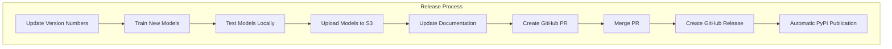
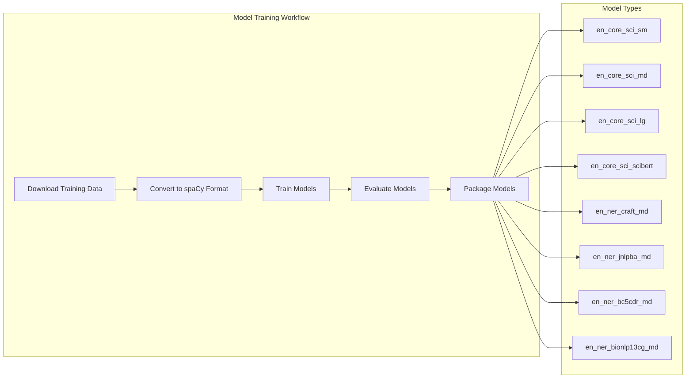
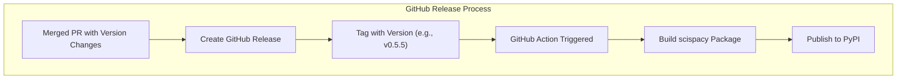

<!-- source: DeepWiki mcp.deepwiki.com · repo allenai/scispacy · page 5.3 Release Process · fetched 2026-10-26 -->

# Release Process

<details>
<summary>Relevant source files</summary>

The following files were used as context for generating this wiki page:

- [Dockerfile](Dockerfile)
- [README.md](README.md)
- [RELEASE.md](RELEASE.md)
- [docs/example.svg](docs/example.svg)
- [docs/index.md](docs/index.md)
- [evaluation/evaluate_linker.py](evaluation/evaluate_linker.py)
- [requirements.in](requirements.in)
- [scispacy/version.py](scispacy/version.py)
- [scripts/install_local_packages.py](scripts/install_local_packages.py)
- [scripts/install_remote_packages.py](scripts/install_remote_packages.py)
- [scripts/smoke_test.py](scripts/smoke_test.py)
- [scripts/uninstall_local_packages.py](scripts/uninstall_local_packages.py)
- [setup.py](setup.py)

</details>


This document outlines the process for creating and publishing new releases of SciSpaCy, which includes both the Python package and the pre-trained models. For information about installing and using existing releases, see [Installation Guide](#1.1).

## Overview

SciSpaCy has two main components that need to be released:

1. The `scispacy` Python package (published to PyPI)
2. The pre-trained models (hosted on AWS S3)

The release process involves updating version numbers, training new models, publishing the models to S3, and creating a GitHub release that triggers the automatic publication of the Python package.



Sources: [RELEASE.md](), [setup.py:4-14]()

## Version Management

Before initiating a release, update the version numbers in the `scispacy/version.py` file. This version will be used for both the Python package and the model packages.

```python
# Current version format in scispacy/version.py
_MAJOR = "0"
_MINOR = "5"
_REVISION = "5"

VERSION_SHORT = "{0}.{1}".format(_MAJOR, _MINOR)
VERSION = "{0}.{1}.{2}".format(_MAJOR, _MINOR, _REVISION)
```

The version number follows a standard semantic versioning format. When creating a new release, increment the appropriate version number based on the changes:

- **Major version**: Incompatible API changes
- **Minor version**: Backward-compatible functionality additions
- **Revision**: Backward-compatible bug fixes

Sources: [scispacy/version.py](), [RELEASE.md:13-14]()

## Model Training and Packaging

### Training Process

Models are trained using the spaCy project system. The entire pipeline can be run using the following command:

```
spacy project run all
```

This command executes the training pipeline defined in the project configuration, which includes downloading data, converting it to spaCy format, training models, evaluating them, and packaging them for distribution.



Sources: [RELEASE.md:16-18](), [scripts/install_local_packages.py:7-17]()

### Testing Models Locally

After training, you should test the models locally to ensure they work correctly before publishing them. SciSpaCy provides several utility scripts to help with this process:

1. Install local packages using:
   ```
   python scripts/install_local_packages.py
   ```

2. Run smoke tests to quickly validate model functionality:
   ```
   python scripts/smoke_test.py
   ```

3. Optionally, generate metrics for documentation updates:
   ```
   python scripts/print_out_metrics.py
   ```

Sources: [RELEASE.md:22](), [scripts/install_local_packages.py](), [scripts/smoke_test.py]()

## Publishing Models

### Uploading to S3

After successful local testing, upload the packaged models to the AWS S3 bucket. The models should be uploaded to:

```
https://s3-us-west-2.amazonaws.com/ai2-s2-scispacy/releases/v{VERSION}/
```

Replace `{VERSION}` with the current version number (e.g., `v0.5.5`).

For example, for version 0.5.5, the path would be:
```
https://s3-us-west-2.amazonaws.com/ai2-s2-scispacy/releases/v0.5.5/
```

The following model packages should be uploaded:

- en_core_sci_sm-{VERSION}.tar.gz
- en_core_sci_md-{VERSION}.tar.gz
- en_core_sci_lg-{VERSION}.tar.gz
- en_core_sci_scibert-{VERSION}.tar.gz
- en_ner_bc5cdr_md-{VERSION}.tar.gz
- en_ner_craft_md-{VERSION}.tar.gz
- en_ner_bionlp13cg_md-{VERSION}.tar.gz
- en_ner_jnlpba_md-{VERSION}.tar.gz

Sources: [RELEASE.md:20](), [scripts/install_remote_packages.py:6-17]()

### Updating Documentation

After uploading the models, update all references to previous model versions in the repository. This includes:

1. Update version references in README.md
2. Update the download URLs in docs/index.md
3. Update any other documents that reference specific versions

You can find all references to the previous version using:
```
git grep "<previous version>"
```

Sources: [RELEASE.md:20](), [README.md:107-117](), [docs/index.md:18-27]()

### Testing Remote Packages

After uploading the models to S3, verify they can be installed and used correctly:

1. Uninstall local packages:
   ```
   python scripts/uninstall_local_packages.py
   ```

2. Install remote packages:
   ```
   python scripts/install_remote_packages.py
   ```

3. Run smoke tests again:
   ```
   python scripts/smoke_test.py
   ```

Sources: [RELEASE.md:22](), [scripts/install_remote_packages.py](), [scripts/uninstall_local_packages.py]()

## Creating a GitHub Release

Once all models are uploaded and documentation is updated, follow these steps to complete the release:

1. Create a Pull Request with all the changes:
   - Updated version in `scispacy/version.py`
   - Updated documentation references
   - Any other changes needed for the release

2. After the PR is merged, create a new GitHub Release:
   - Go to the GitHub Releases page
   - Create a new release with a tag corresponding to the version (e.g., `v0.5.5`)
   - Use the commit from the merged PR as the target
   - Add release notes describing the changes

3. Publishing the release will trigger the GitHub Action that automatically builds and publishes the `scispacy` package to PyPI.



Sources: [RELEASE.md:24-26]()

## Package Publishing Process

The `scispacy` Python package is published automatically when a GitHub release is created. This is handled by a GitHub Action defined in `.github/actions/publish.yml`.

The publishing process includes:

1. Building the Python package distribution
2. Uploading the package to PyPI

After the package is published, you can verify it's available on PyPI at https://pypi.org/project/scispacy/.

### Manual Package Publishing (if needed)

If you need to publish the package manually, follow these steps:

1. Ensure your working directory is clean
2. Make sure that you have changed the versions in `scispacy/version.py`
3. Create the distribution:
   ```
   python setup.py sdist
   ```
4. Check you can install the new distribution in a clean environment
5. Upload the distribution to PyPI:
   ```
   twine upload <path to the distribution> -u <username> -p <password>
   ```

Note: The username is "scispacy" and the password can be found in LastPass.

Sources: [setup.py:4-14]()

## Release Checklist

Here's a summary checklist for the entire release process:

| Step | Description | Complete |
|------|-------------|----------|
| 1 | Update version in `scispacy/version.py` | □ |
| 2 | Train models with `spacy project run all` | □ |
| 3 | Test models locally | □ |
| 4 | Upload models to S3 | □ |
| 5 | Update documentation references | □ |
| 6 | Test remote packages | □ |
| 7 | Create and merge PR with changes | □ |
| 8 | Create GitHub release | □ |
| 9 | Verify package on PyPI | □ |

Sources: [RELEASE.md](), [setup.py:4-14]()