# Page: Overview

# Overview

<details>
<summary>Relevant source files</summary>

The following files were used as context for generating this wiki page:

- [Dockerfile](Dockerfile)
- [README.md](README.md)
- [RELEASE.md](RELEASE.md)
- [docs/example.svg](docs/example.svg)
- [docs/index.md](docs/index.md)
- [scripts/install_remote_packages.py](scripts/install_remote_packages.py)

</details>


This page provides an introduction to SciSpaCy, a Python package that extends the spaCy natural language processing library for processing scientific, biomedical, and clinical text. It explains the core components, available models, and unique capabilities of SciSpaCy.

For installation instructions, see [Installation Guide](#1.1). For details on specific models, see [Available Models](#1.2).

Sources: [README.md:3-8](), [docs/index.md:4-5]()

## What is SciSpaCy?

SciSpaCy is a specialized extension of spaCy designed specifically for processing scientific and biomedical text. It provides custom components trained on biomedical corpora, including:

- Custom tokenization rules optimized for scientific terminology
- POS tagging and syntactic parsing models trained on biomedical data
- Entity span detection for biomedical terminology
- Named Entity Recognition (NER) models for specific biomedical tasks
- Pipeline components for abbreviation detection, entity linking, and hyponym detection
- Integration with medical knowledge bases (UMLS, MeSH, RxNorm, etc.)

The purpose of SciSpaCy is to improve NLP performance on scientific text, where general-purpose NLP tools often struggle with domain-specific terminology, abbreviations, and linguistic patterns.

Sources: [README.md:3-8](), [docs/index.md:4-5]()

## System Architecture

The following diagram illustrates the core components of SciSpaCy and how they interact:

```mermaid
graph TD
    subgraph "Core SciSpaCy Components"
        models["Pre-trained Models"] -- "used by" --> nlpPipeline["NLP Pipeline"]
        nlpPipeline --> tokenization["Custom Tokenization"]
        nlpPipeline --> sentSeg["Custom Sentence Segmentation"]
        nlpPipeline --> ner["Named Entity Recognition"]
        
        subgraph "Pipeline Components"
            abbreviation["AbbreviationDetector"]
            entityLink["EntityLinker"]
            hyponym["HyponymDetector"]
        end
        
        nlpPipeline --> "Pipeline Components"
        
        subgraph "Knowledge Bases"
            umls["UMLS"]
            mesh["MeSH"]
            rxnorm["RxNorm"]
            go["Gene Ontology"]
            hpo["Human Phenotype Ontology"]
        end
        
        candidateGen["CandidateGenerator"] --> entityLink
        "Knowledge Bases" --> candidateGen
    end
    
    scientificText["Scientific/Biomedical Text"] --> nlpPipeline
    nlpPipeline --> processedDoc["Processed Document"]
```

Sources: [README.md:4-8](), [README.md:120-138](), [README.md:162-196]()

## Data Processing Flow

The following diagram shows how text is processed through the SciSpaCy pipeline:

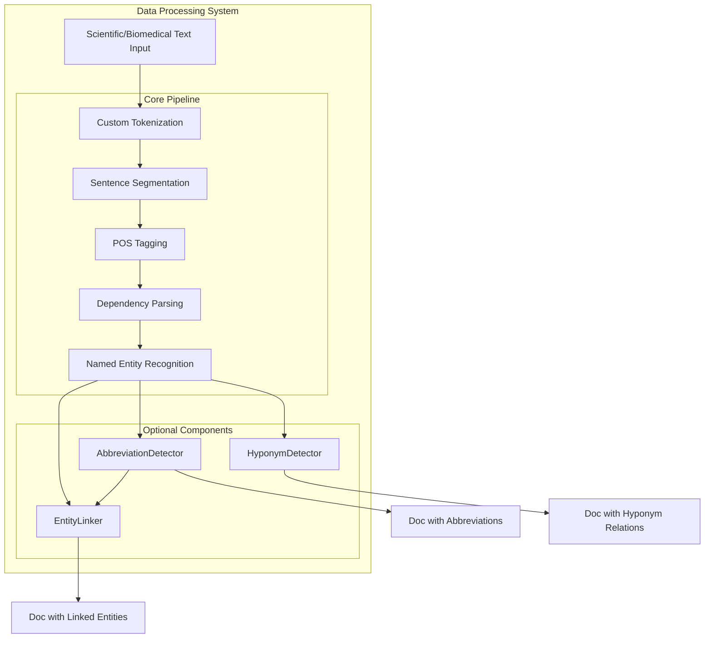

Sources: [README.md:134-156](), [README.md:162-263](), [README.md:265-291]()

## Available Models

SciSpaCy provides several pre-trained models with different capabilities and sizes:

| Model | Size | Vocabulary | Word Vectors | UAS | LAS | POS | Description |
|-------|------|------------|--------------|-----|-----|-----|-------------|
| en_core_sci_sm | Small | ~100k | None | 89.18 | 87.15 | 98.18 | General-purpose biomedical text processing |
| en_core_sci_md | Medium | ~360k | 50k | 90.08 | 88.16 | 98.46 | Improved performance with word vectors |
| en_core_sci_lg | Large | ~785k | 600k | 89.97 | 88.18 | 98.51 | Best performance for general tasks |
| en_core_sci_scibert | Large | ~785k | BERT-based | 92.12 | 90.58 | 98.18 | Best performance with transformer model |

In addition to these general models, SciSpaCy provides specialized NER models:

| NER Model | F1 Score | Entity Types | Description |
|-----------|----------|--------------|-------------|
| en_ner_craft_md | 78.01 | GGP, SO, TAXON, CHEBI, GO, CL | Gene and protein entity recognition |
| en_ner_jnlpba_md | 72.06 | DNA, CELL_TYPE, CELL_LINE, RNA, PROTEIN | Molecular biology entity recognition |
| en_ner_bc5cdr_md | 84.28 | DISEASE, CHEMICAL | Disease and chemical entity recognition |
| en_ner_bionlp13cg_md | 77.84 | 16 entity types including AMINO_ACID, CANCER, GENE_OR_GENE_PRODUCT, etc. | Comprehensive biomedical entity recognition |

Sources: [README.md:95-117](), [docs/index.md:16-27](), [docs/index.md:32-49]()

## Special Pipeline Components

### AbbreviationDetector

The `AbbreviationDetector` is a pipeline component that implements the abbreviation detection algorithm from "A simple algorithm for identifying abbreviation definitions in biomedical text" (Schwartz & Hearst, 2003). It identifies short forms of terms and their corresponding long forms in text.

You can access the list of abbreviations via the `doc._.abbreviations` attribute, and for a given abbreviation, you can access its long form using `span._.long_form`.

```python
import spacy
from scispacy.abbreviation import AbbreviationDetector

nlp = spacy.load("en_core_sci_sm")
nlp.add_pipe("abbreviation_detector")

doc = nlp("Spinal and bulbar muscular atrophy (SBMA) is an inherited motor neuron disease.")
for abrv in doc._.abbreviations:
    print(f"{abrv} -> {abrv._.long_form}")
# Output: SBMA -> Spinal and bulbar muscular atrophy
```

Sources: [README.md:123-156]()

### EntityLinker

The `EntityLinker` connects entity mentions in text to concepts in medical knowledge bases. It performs a string overlap-based search using character 3-grams, comparing entities with concepts in a knowledge base using approximate nearest neighbors search.

Currently, there are 5 supported knowledge bases:
- `umls`: Unified Medical Language System (~3M concepts)
- `mesh`: Medical Subject Headings (~30k concepts)
- `rxnorm`: RxNorm ontology for clinical drugs (~100k concepts)
- `go`: Gene Ontology (~67k concepts)
- `hpo`: Human Phenotype Ontology (~16k concepts)

This component sets the `._.kb_ents` attribute on spaCy Spans, which contains a list of tuples with the knowledge base concept ID and the associated score.

```python
import spacy

nlp = spacy.load("en_core_sci_sm")
nlp.add_pipe("scispacy_linker", config={"linker_name": "umls"})

doc = nlp("Spinal muscular atrophy is a neurodegenerative disease.")
for entity in doc.ents:
    for umls_ent in entity._.kb_ents:
        print(f"{entity} -> {umls_ent[0]}")
```

Sources: [README.md:161-263]()

### HyponymDetector

The `HyponymDetector` implements the methods from "Automatic Acquisition of Hyponyms from Large Text Corpora" using the spaCy Matcher component. It identifies taxonomic relationships (X is a type of Y) in text using Hearst patterns.

When the `extended=True` parameter is used, it applies an extended set of Hearst patterns for higher recall but potentially lower precision.

This component adds a doc-level attribute `doc._.hearst_patterns`, which is a list of tuples containing:
1. The relation rule used to extract the hyponym (string)
2. The more general concept (spaCy Span)
3. The more specific concept (spaCy Span)

```python
import spacy
from scispacy.hyponym_detector import HyponymDetector

nlp = spacy.load("en_core_sci_sm")
nlp.add_pipe("hyponym_detector", config={"extended": False})

doc = nlp("Keystone plant species such as fig trees are good for the soil.")
print(doc._.hearst_patterns)
# Output: [('such_as', Keystone plant species, fig trees)]
```

Sources: [README.md:265-291]()

## Entity Linking Architecture

The following diagram shows the architecture of the entity linking system in more detail:

```mermaid
graph TD
    text["Scientific Text Input"] --> nlp["spaCy Pipeline Processing"]
    nlp --> entities["Entity Recognition"]
    
    entities --> abbrev["AbbreviationDetector"]
    abbrev --> linker["EntityLinker"]
    entities --> linker
    
    subgraph "Candidate Generation"
        tfidf["TF-IDF Vectorizer"]
        ann["ANN Index (nmslib)"]
        cand["CandidateGenerator"]
        
        tfidf --> cand
        ann --> cand
    end
    
    subgraph "Knowledge Bases"
        umls["UMLS_KB"]
        mesh["MeSH_KB"]
        rxnorm["RxNorm_KB"]
        go["GeneOntology_KB"]
        hpo["HPO_KB"]
    end
    
    linker --> cand
    cand --> candidates["Entity Candidates"]
    "Knowledge Bases" --> cand
    
    candidates --> ranking["Candidate Ranking"]
    ranking --> filtering["Threshold Filtering"]
    filtering --> linkedEntities["Linked Entities"]
```

Sources: [README.md:161-263]()

## Usage Example

Basic usage example of SciSpaCy:

```python
import spacy

# Load a SciSpaCy model
nlp = spacy.load("en_core_sci_sm")

# Process a scientific text
doc = nlp("Alterations in the hypocretin receptor 2 and preprohypocretin genes produce narcolepsy in some animals.")

# Access sentences
for sent in doc.sents:
    print(sent)

# Access entities
for ent in doc.ents:
    print(ent.text)

# Add custom pipeline components
nlp.add_pipe("abbreviation_detector")
nlp.add_pipe("scispacy_linker", config={"linker_name": "umls"})
nlp.add_pipe("hyponym_detector")

# Process text with the enhanced pipeline
doc = nlp("Spinal and bulbar muscular atrophy (SBMA) is an inherited motor neuron disease.")
```

Sources: [README.md:85-90](), [docs/index.md:53-96]()

## Training Data Sources

SciSpaCy models are trained on data from various sources:

- **GENIA 1.0 Treebank**: Converted to Universal Dependencies for syntactic parsing
- **OntoNotes 5.0**: Used to make the parser and tagger more robust to non-biomedical text
- **MedMentions**: Used for training the mention detector
- **CRAFT, JNLPBA, BC5CDR, BIONLP13CG**: Used for training specialized NER models

Sources: [docs/index.md:101-111]()

---

# Page: Installation Guide

# Installation Guide

<details>
<summary>Relevant source files</summary>

The following files were used as context for generating this wiki page:

- [Dockerfile](Dockerfile)
- [README.md](README.md)
- [RELEASE.md](RELEASE.md)
- [docs/example.svg](docs/example.svg)
- [docs/index.md](docs/index.md)
- [evaluation/evaluate_linker.py](evaluation/evaluate_linker.py)
- [requirements.in](requirements.in)
- [scispacy/version.py](scispacy/version.py)
- [scripts/install_remote_packages.py](scripts/install_remote_packages.py)
- [setup.py](setup.py)

</details>


This guide provides detailed instructions for installing SciSpaCy, a Python package that extends spaCy with specialized components for processing scientific and biomedical text. The installation process involves two main steps: installing the SciSpaCy library and installing one or more pre-trained models.

## Prerequisites

Before installing SciSpaCy, ensure your environment meets the following requirements:

- **Python**: SciSpaCy requires Python 3.6 or higher (Python 3.10 is recommended for best compatibility)
- **pip**: Make sure you have an updated version of pip
- **Virtual Environment**: It is strongly recommended to use an isolated Python environment

SciSpaCy has several dependencies that will be automatically installed, including:
- spaCy (version 3.7.0 or compatible)
- NumPy
- SciPy
- scikit-learn
- nmslib (for entity linking functionality)

Sources: [README.md:12-27](), [requirements.in:1-18](), [setup.py:43-54]()

## Installation Workflow

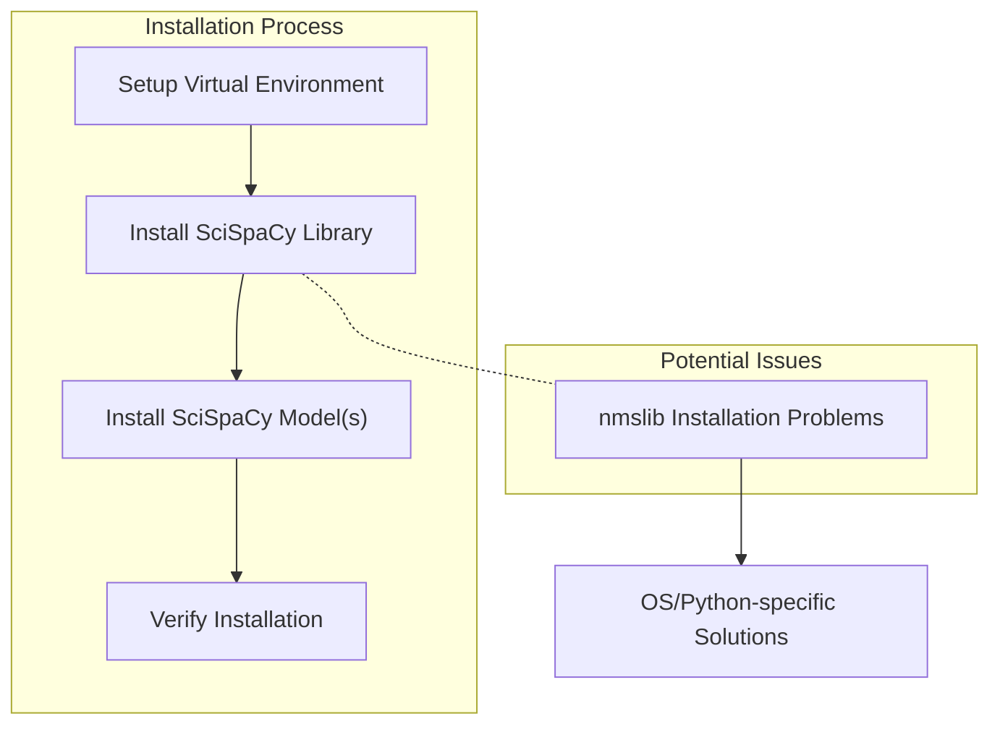

Sources: [README.md:13-23](), [README.md:30-60]()

## Setting Up a Virtual Environment

It is strongly recommended to use a virtual environment to avoid conflicts with other packages. You can use conda, mamba, or virtualenv to create an isolated environment:

### Using Mamba (Recommended)

```bash
# Install Mamba if you don't have it
# Follow the installation instructions at https://mamba.readthedocs.io/en/latest/installation/mamba-installation.html

# Create a new environment with Python 3.10
mamba create -n scispacy python=3.10

# Activate the environment
mamba activate scispacy
```

### Using virtualenv

```bash
# Install virtualenv if you don't have it
pip install virtualenv

# Create a new environment
virtualenv scispacy_env

# Activate the environment (Linux/Mac)
source scispacy_env/bin/activate

# Activate the environment (Windows)
scispacy_env\Scripts\activate
```

Sources: [README.md:62-82]()

## Installing the SciSpaCy Library

Once your virtual environment is activated, install the SciSpaCy library using pip:

```bash
pip install scispacy
```

This command installs the core SciSpaCy package (currently version 0.5.5 as per [scispacy/version.py]()) and its dependencies.

Sources: [README.md:15-17](), [scispacy/version.py:1-7]()

## System Architecture

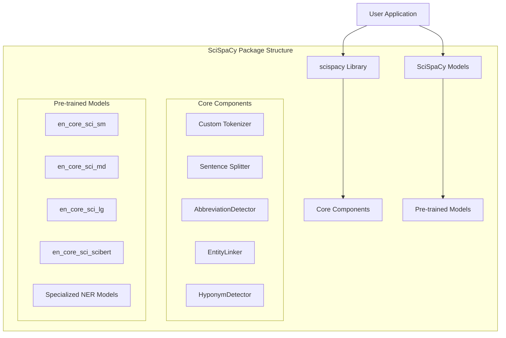

Sources: [README.md:4-9](), [README.md:94-118]()

## Installing SciSpaCy Models

After installing the SciSpaCy library, you need to install at least one model. Models are not included in the base package and must be installed separately. Choose a model based on your specific requirements for vocabulary size, word vectors, and functionality.

### Available Models

| Model | Description | Command |
|-------|-------------|---------|
| en_core_sci_sm | A full spaCy pipeline for biomedical data with a ~100k vocabulary | `pip install https://s3-us-west-2.amazonaws.com/ai2-s2-scispacy/releases/v0.5.4/en_core_sci_sm-0.5.4.tar.gz` |
| en_core_sci_md | A full spaCy pipeline for biomedical data with a ~360k vocabulary and 50k word vectors | `pip install https://s3-us-west-2.amazonaws.com/ai2-s2-scispacy/releases/v0.5.4/en_core_sci_md-0.5.4.tar.gz` |
| en_core_sci_lg | A full spaCy pipeline for biomedical data with a ~785k vocabulary and 600k word vectors | `pip install https://s3-us-west-2.amazonaws.com/ai2-s2-scispacy/releases/v0.5.4/en_core_sci_lg-0.5.4.tar.gz` |
| en_core_sci_scibert | A full spaCy pipeline with a ~785k vocabulary and `allenai/scibert-base` as the transformer model | `pip install https://s3-us-west-2.amazonaws.com/ai2-s2-scispacy/releases/v0.5.4/en_core_sci_scibert-0.5.4.tar.gz` |

Additionally, specialized NER models are available for specific tasks:

| Model | Description | Command |
|-------|-------------|---------|
| en_ner_craft_md | A spaCy NER model trained on the CRAFT corpus | `pip install https://s3-us-west-2.amazonaws.com/ai2-s2-scispacy/releases/v0.5.4/en_ner_craft_md-0.5.4.tar.gz` |
| en_ner_jnlpba_md | A spaCy NER model trained on the JNLPBA corpus | `pip install https://s3-us-west-2.amazonaws.com/ai2-s2-scispacy/releases/v0.5.4/en_ner_jnlpba_md-0.5.4.tar.gz` |
| en_ner_bc5cdr_md | A spaCy NER model trained on the BC5CDR corpus | `pip install https://s3-us-west-2.amazonaws.com/ai2-s2-scispacy/releases/v0.5.4/en_ner_bc5cdr_md-0.5.4.tar.gz` |
| en_ner_bionlp13cg_md | A spaCy NER model trained on the BIONLP13CG corpus | `pip install https://s3-us-west-2.amazonaws.com/ai2-s2-scispacy/releases/v0.5.4/en_ner_bionlp13cg_md-0.5.4.tar.gz` |

For information about these models' capabilities and performance, see [Available Models](#1.2).

Sources: [README.md:95-117](), [docs/index.md:17-27]()

## Troubleshooting nmslib Installation

The entity linking functionality in SciSpaCy relies on `nmslib`, which can be challenging to install on certain platforms and Python versions. If you encounter issues installing SciSpaCy or when using the entity linking functionality, refer to the compatibility matrix below for potential solutions:

### nmslib Compatibility Matrix

| Python Version | Windows 11 | WSL | Mac M1 | Mac M2 | Intel Mac |
|----------------|------------|-----|--------|--------|-----------|
| Python 3.8     | ✓          | ✓   | Flag*  | ?      | ?         |
| Python 3.9     | Mamba†     | ✓   | Flag*  | Flag** | ?         |
| Python 3.10    | Mamba†     | ✓   | ?      | ?      | ✓         |
| Python 3.11    | Mamba†     | Mamba† | ?   | ?      | Conda**   |
| Python 3.12    | Mamba†     | Fork‡ | ?    | ?      | ?         |

Legend:
- ✓: Works with standard pip install
- Flag*: Use `CFLAGS="-mavx -DWARN(a)=(a)" pip install nmslib`
- Flag**: Use `conda install -c conda-forge nmslib`
- Mamba†: Use `mamba install nmslib`
- Fork‡: Use `pip install nmslib-metabrainz`

If you're still experiencing issues, try these alternative approaches:
- `pip install --no-binary :all: nmslib`
- `pip install "nmslib @ git+https://github.com/nmslib/nmslib.git/#subdirectory=python_bindings"`
- `pip install --upgrade pybind11` followed by `pip install --verbose 'nmslib @ git+https://github.com/nmslib/nmslib.git#egg=nmslib&subdirectory=python_bindings'`

Sources: [README.md:30-60](), [requirements.in:12-17]()

## Verifying Installation

After installing SciSpaCy and at least one model, you can verify the installation with a simple example:

```python
import spacy

# Load one of the installed models
nlp = spacy.load("en_core_sci_sm")

# Process a sample text
text = "Alterations in the hypocretin receptor 2 and preprohypocretin genes produce narcolepsy in some animals."
doc = nlp(text)

# Print tokens to verify the model is working
for token in doc:
    print(token.text, token.pos_)
```

If the model runs without errors and outputs the tokens with their part-of-speech tags, your installation is successful.

Sources: [README.md:85-90]()

## Entity Linking Components Installation

If you plan to use the entity linking functionality, additional components need to be installed. This functionality allows linking of mentions in text to concepts in medical knowledge bases.

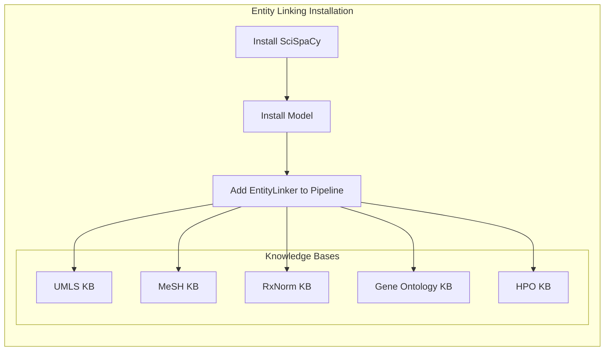

The entity linker downloads knowledge base data on first use, which can be large (e.g., UMLS is approximately 1GB). This data is cached for future use. Here's an example of how to add the entity linker to your pipeline:

```python
import spacy
import scispacy
from scispacy.linking import EntityLinker

# Load a model
nlp = spacy.load("en_core_sci_sm")

# Add the entity linker (this will download KB data on first run)
nlp.add_pipe("scispacy_linker", config={"resolve_abbreviations": True, "linker_name": "umls"})

# Process text
doc = nlp("Spinal and bulbar muscular atrophy (SBMA) is an inherited motor neuron disease.")
```

Sources: [README.md:161-263](), [evaluation/evaluate_linker.py:1-14]()

## Upgrading SciSpaCy

When upgrading to a newer version of SciSpaCy, you need to reinstall both the library and the models to ensure compatibility:

1. Upgrade the SciSpaCy library:
   ```bash
   pip install --upgrade scispacy
   ```

2. Reinstall models with the matching version number:
   ```bash
   pip install https://s3-us-west-2.amazonaws.com/ai2-s2-scispacy/releases/v0.5.4/en_core_sci_sm-0.5.4.tar.gz
   ```

Note that you should check the repository for the latest model URLs, as they will change with each version release.

Sources: [README.md:92-93](), [scripts/install_remote_packages.py:1-28](), [RELEASE.md:1-26]()

## Docker Installation

For a reproducible environment, SciSpaCy provides a Dockerfile that sets up a complete environment with the library and models. To use Docker:

1. Clone the repository:
   ```bash
   git clone https://github.com/allenai/scispacy.git
   cd scispacy
   ```

2. Build the Docker image:
   ```bash
   docker build -t scispacy .
   ```

3. Run a container with the image:
   ```bash
   docker run -it scispacy
   ```

This will create a container with SciSpaCy and the small model (`en_core_sci_sm`) pre-installed.

Sources: [Dockerfile:1-34]()

## Next Steps

After successfully installing SciSpaCy, you might want to:

1. Learn about the available models in more detail: [Available Models](#1.2)
2. Explore the core pipeline components: [Core Pipeline Components](#2)
3. Understand how to use specialized components like Abbreviation Detection: [Abbreviation Detection](#2.2)
4. Set up entity linking to medical knowledge bases: [Entity Linking](#2.3)

---

# Page: Available Models

# Available Models

<details>
<summary>Relevant source files</summary>

The following files were used as context for generating this wiki page:

- [Dockerfile](Dockerfile)
- [README.md](README.md)
- [RELEASE.md](RELEASE.md)
- [data/meta_large.json](data/meta_large.json)
- [data/meta_small.json](data/meta_small.json)
- [docs/example.svg](docs/example.svg)
- [docs/index.md](docs/index.md)
- [scripts/install_remote_packages.py](scripts/install_remote_packages.py)

</details>


This document provides a comprehensive overview of the pre-trained models available in scispaCy. It covers the different model types, their capabilities, sizes, and intended use cases. For information about how to install these models, see [Installation Guide](#1.1).

## Overview of Model Types

scispaCy offers two main categories of models:

1. **Core Pipeline Models** - Full spaCy pipelines with customizations for scientific and biomedical text
2. **Specialized NER Models** - Models focused specifically on domain-specific Named Entity Recognition

### Model Architecture Diagram

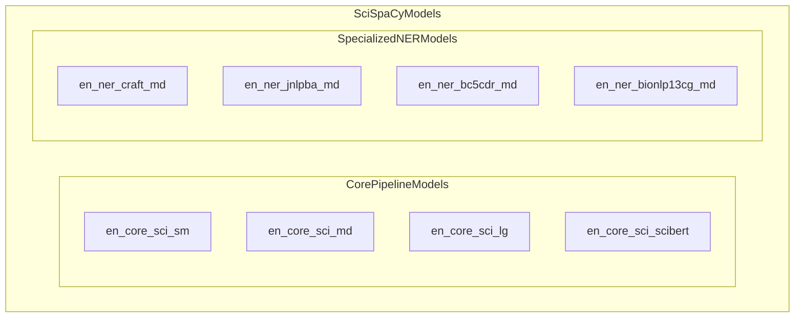

Sources: [README.md:108-117]()

## Core Pipeline Models

The core pipeline models include all standard spaCy pipeline components (tokenization, part-of-speech tagging, dependency parsing, and entity recognition) with biomedical-specific adaptations. They are designed for general-purpose processing of biomedical and scientific text.

### Core Pipeline Model Comparison

| Model | Vocabulary Size | Word Vectors | Transformer | Description |
|-------|----------------|--------------|-------------|-------------|
| en_core_sci_sm | ~100k | No | No | Lightweight model for basic NLP tasks with lower memory requirements |
| en_core_sci_md | ~360k | 50k | No | Medium-sized model with word vectors for improved semantic understanding |
| en_core_sci_lg | ~785k | 600k | No | Large model with extensive word vectors for better semantic representation |
| en_core_sci_scibert | ~785k | No | Yes (allenai/scibert-base) | Transformer-based model leveraging SciBERT for state-of-the-art performance |

Sources: [README.md:108-113](), [docs/index.md:18-23]()

### Core Model Pipeline Architecture

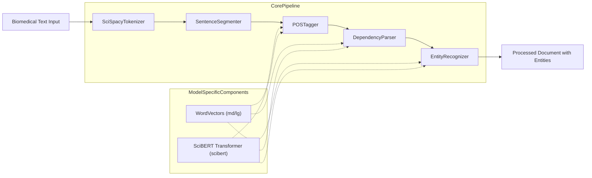

Sources: [README.md:6-8]()

### Performance Metrics

The core models achieve competitive performance on biomedical text processing tasks:

| Model | UAS | LAS | POS | Mentions (F1) | Web UAS |
|-------|-----|-----|-----|--------------|---------|
| en_core_sci_sm | 89.18 | 87.15 | 98.18 | 67.89 | 87.36 |
| en_core_sci_md | 90.08 | 88.16 | 98.46 | 68.86 | 88.04 |
| en_core_sci_lg | 89.97 | 88.18 | 98.51 | 68.98 | 87.89 |
| en_core_sci_scibert | 92.12 | 90.58 | 98.18 | 67.70 | 92.58 |

Where:
- **UAS**: Unlabeled Attachment Score (dependency parsing accuracy)
- **LAS**: Labeled Attachment Score (dependency parsing with relation labels)
- **POS**: Part-of-speech tagging accuracy
- **Mentions (F1)**: Entity mention detection F1 score
- **Web UAS**: Unlabeled Attachment Score on web domain (out-of-domain performance)

Sources: [docs/index.md:35-40]()

### Training Data Sources

The core models are trained on multiple data sources to ensure robust performance on biomedical text:

- **GENIA 1.0 Treebank**: Provides syntactic annotations for biomedical text
- **OntoNotes 5.0**: Improves robustness on general domain text
- **PubMed Central Open Access Subset**: Used for training word vectors (md and lg models)
- **MedMentions**: Used for entity recognition training

Sources: [docs/index.md:106-110](), [data/meta_small.json:4](), [data/meta_large.json:4]()

## Specialized NER Models

The specialized NER models focus exclusively on Named Entity Recognition for specific biomedical domains. These models are designed to recognize domain-specific entity types with high accuracy.

### NER Model Comparison

| Model | Training Corpus | Entity Types | F1 Score |
|-------|----------------|--------------|----------|
| en_ner_craft_md | CRAFT | GGP, SO, TAXON, CHEBI, GO, CL | 78.01 |
| en_ner_jnlpba_md | JNLPBA | DNA, CELL_TYPE, CELL_LINE, RNA, PROTEIN | 72.06 |
| en_ner_bc5cdr_md | BC5CDR | DISEASE, CHEMICAL | 84.28 |
| en_ner_bionlp13cg_md | BIONLP13CG | AMINO_ACID, ANATOMICAL_SYSTEM, CANCER, CELL, CELLULAR_COMPONENT, DEVELOPING_ANATOMICAL_STRUCTURE, GENE_OR_GENE_PRODUCT, IMMATERIAL_ANATOMICAL_ENTITY, MULTI-TISSUE_STRUCTURE, ORGAN, ORGANISM, ORGANISM_SUBDIVISION, ORGANISM_SUBSTANCE, PATHOLOGICAL_FORMATION, SIMPLE_CHEMICAL, TISSUE | 77.84 |

Sources: [README.md:114-117](), [docs/index.md:44-48]()

### NER Model Pipeline Architecture

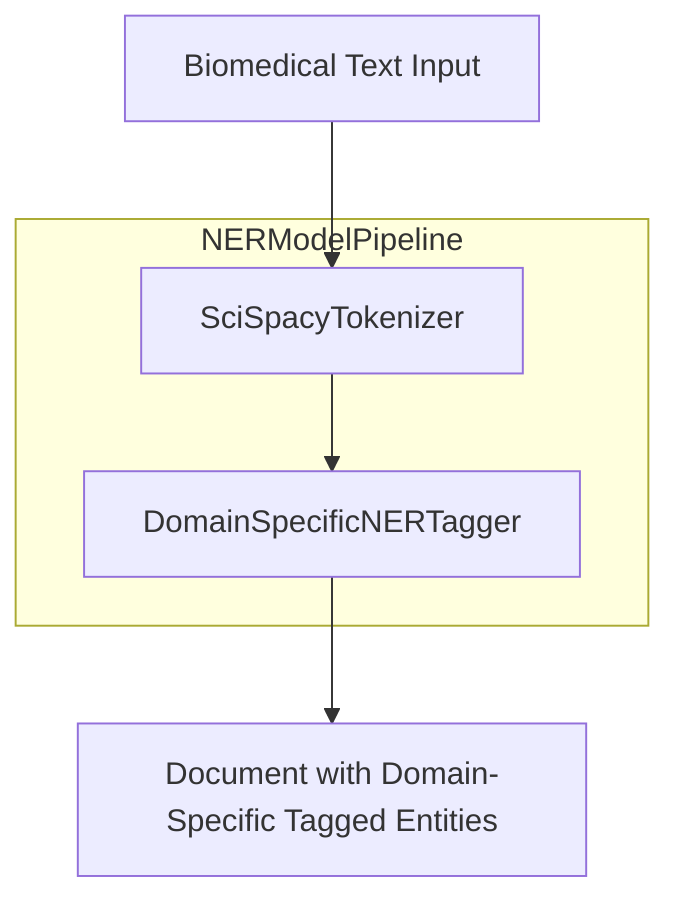

Sources: [README.md:8]()

## Model Selection Guide

The following diagram helps select the appropriate model based on your specific requirements:

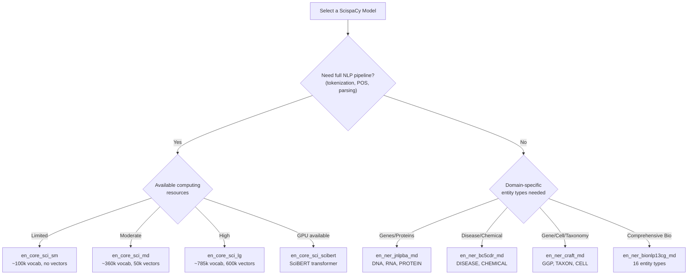

Sources: [README.md:108-117]()

## Usage Examples

### Using a Core Pipeline Model

```python
import spacy

# Load a core pipeline model
nlp = spacy.load("en_core_sci_sm")

# Process biomedical text
doc = nlp("Alterations in the hypocretin receptor 2 and preprohypocretin genes produce narcolepsy in some animals.")

# Access entities, tokens, and syntactic information
for ent in doc.ents:
    print(f"Entity: {ent.text}")

for token in doc:
    print(f"{token.text} - {token.pos_} - {token.dep_}")
```

Sources: [README.md:86-90]()

### Using a Specialized NER Model

```python
import spacy

# Load a specialized NER model
nlp = spacy.load("en_ner_bc5cdr_md")

# Process biomedical text
doc = nlp("Aspirin may cause stomach bleeding and liver damage.")

# Access tagged entities with their specific types
for ent in doc.ents:
    print(f"Entity: {ent.text}, Type: {ent.label_}")
    # Will output entities like:
    # Entity: Aspirin, Type: CHEMICAL
    # Entity: stomach bleeding, Type: DISEASE
    # Entity: liver damage, Type: DISEASE
```

Sources: [README.md:114]()

## Model Download Links

All models are available as pip-installable packages from the AI2 S3 bucket. To install a specific model, use the appropriate URL with pip:

```bash
pip install <model_url>
```

| Model | Install URL |
|-------|-------------|
| en_core_sci_sm | https://s3-us-west-2.amazonaws.com/ai2-s2-scispacy/releases/v0.5.4/en_core_sci_sm-0.5.4.tar.gz |
| en_core_sci_md | https://s3-us-west-2.amazonaws.com/ai2-s2-scispacy/releases/v0.5.4/en_core_sci_md-0.5.4.tar.gz |
| en_core_sci_lg | https://s3-us-west-2.amazonaws.com/ai2-s2-scispacy/releases/v0.5.4/en_core_sci_lg-0.5.4.tar.gz |
| en_core_sci_scibert | https://s3-us-west-2.amazonaws.com/ai2-s2-scispacy/releases/v0.5.4/en_core_sci_scibert-0.5.4.tar.gz |
| en_ner_craft_md | https://s3-us-west-2.amazonaws.com/ai2-s2-scispacy/releases/v0.5.4/en_ner_craft_md-0.5.4.tar.gz |
| en_ner_jnlpba_md | https://s3-us-west-2.amazonaws.com/ai2-s2-scispacy/releases/v0.5.4/en_ner_jnlpba_md-0.5.4.tar.gz |
| en_ner_bc5cdr_md | https://s3-us-west-2.amazonaws.com/ai2-s2-scispacy/releases/v0.5.4/en_ner_bc5cdr_md-0.5.4.tar.gz |
| en_ner_bionlp13cg_md | https://s3-us-west-2.amazonaws.com/ai2-s2-scispacy/releases/v0.5.4/en_ner_bionlp13cg_md-0.5.4.tar.gz |

Sources: [README.md:108-117](), [scripts/install_remote_packages.py:7-17]()

Note: When upgrading scispaCy, you will need to download the compatible model versions again, as models are versioned to match the scispaCy version they work with.

---

# Page: Core Pipeline Components

# Core Pipeline Components

<details>
<summary>Relevant source files</summary>

The following files were used as context for generating this wiki page:

- [Dockerfile](Dockerfile)
- [README.md](README.md)
- [RELEASE.md](RELEASE.md)
- [configs/base_ner.cfg](configs/base_ner.cfg)
- [configs/base_ner_scibert.cfg](configs/base_ner_scibert.cfg)
- [configs/base_parser_tagger.cfg](configs/base_parser_tagger.cfg)
- [configs/base_parser_tagger_scibert.cfg](configs/base_parser_tagger_scibert.cfg)
- [configs/base_specialized_ner.cfg](configs/base_specialized_ner.cfg)
- [data/meta_scibert.json](data/meta_scibert.json)
- [docs/example.svg](docs/example.svg)
- [docs/index.md](docs/index.md)
- [project.yml](project.yml)
- [scispacy/base_project_code.py](scispacy/base_project_code.py)
- [scripts/evaluate_ner.py](scripts/evaluate_ner.py)
- [scripts/install_remote_packages.py](scripts/install_remote_packages.py)

</details>


This page provides an overview of the main SciSpaCy pipeline components and explains how they interact to process scientific and biomedical text. This covers the core architecture and components that make up the foundation of SciSpaCy's text processing capabilities. For detailed information about specific components, see the dedicated pages for [Custom Tokenization and Sentence Segmentation](#2.1), [Abbreviation Detection](#2.2), [Entity Linking](#2.3), and [Hyponym Detection](#2.4).

## Pipeline Architecture Overview

SciSpaCy extends spaCy's pipeline architecture with specialized components for processing scientific and biomedical text. The pipeline follows a sequential processing model where each component builds upon the annotations provided by previous components.

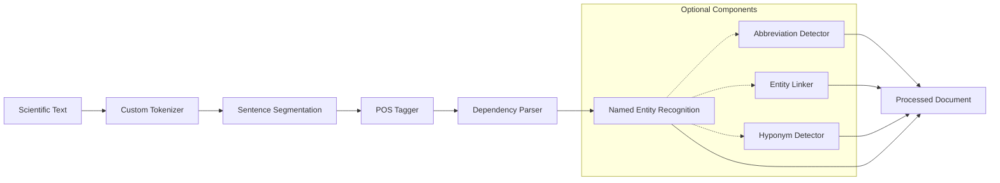

The core pipeline components (tokenization through NER) are included in all SciSpaCy models by default. The optional components can be added as needed to provide additional functionality.

Sources: [configs/base_parser_tagger.cfg:16-23](), [configs/base_ner.cfg:14-21](), [README.md:120-156]()

## Core Components

### Custom Tokenization and Sentence Segmentation

SciSpaCy implements a specialized tokenizer that builds on spaCy's rule-based tokenizer, adding rules specific to scientific and biomedical text. This component is critical for properly handling scientific terminology, chemical formulas, gene names, and other domain-specific expressions.

The custom tokenizer is implemented through a callback that replaces spaCy's default tokenizer during model initialization:

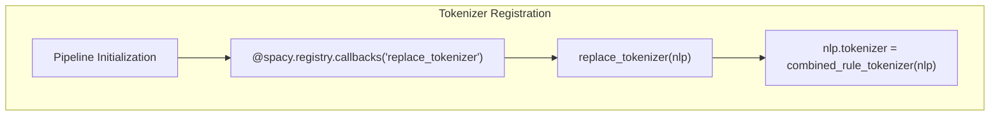

The tokenizer replacement is registered in [scispacy/base_project_code.py:24-30]() and is referenced in the initialization section of configuration files [configs/base_parser_tagger.cfg:173]() and [configs/base_ner.cfg:148]().

Sources: [scispacy/base_project_code.py:24-30](), [configs/base_parser_tagger.cfg:173](), [configs/base_ner.cfg:148]()

### Part-of-Speech Tagging and Dependency Parsing

The POS tagger and dependency parser are trained on biomedical corpora (GENIA and OntoNotes) to better handle domain-specific language patterns. Both components share token representations through the tok2vec component.

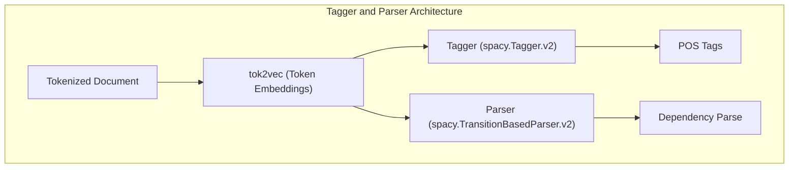

The tagger and parser configurations are defined in [configs/base_parser_tagger.cfg:54-65]() and [configs/base_parser_tagger.cfg:33-52]() respectively. The shared tok2vec component that provides token embeddings is defined in [configs/base_parser_tagger.cfg:67-85]().

Sources: [configs/base_parser_tagger.cfg:33-85](), [project.yml:266-305]()

### Named Entity Recognition

The NER component identifies spans of text representing entities of interest in biomedical text. SciSpaCy provides general biomedical NER as well as specialized models for specific entity types.

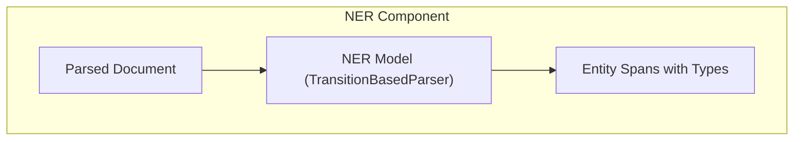

The NER component is defined in [configs/base_ner.cfg:31-60]() and uses a transition-based parser architecture specialized for entity recognition. Different SciSpaCy models are trained to recognize different types of entities:

| Model | Entity Types | Training Corpus |
|-------|-------------|----------------|
| en_core_sci_* | General biomedical entities | MedMentions |
| en_ner_craft_md | GGP, SO, TAXON, CHEBI, GO, CL | CRAFT |
| en_ner_jnlpba_md | DNA, CELL_TYPE, CELL_LINE, RNA, PROTEIN | JNLPBA |
| en_ner_bc5cdr_md | DISEASE, CHEMICAL | BC5CDR |
| en_ner_bionlp13cg_md | 16 entity types including AMINO_ACID, CANCER, GENE_OR_GENE_PRODUCT | BIONLP13CG |

Sources: [configs/base_ner.cfg:31-60](), [README.md:93-117](), [project.yml:320-393]()

## Data Flow Through the Pipeline

When processing text, the SciSpaCy pipeline performs sequential transformations that build increasingly rich linguistic annotations:

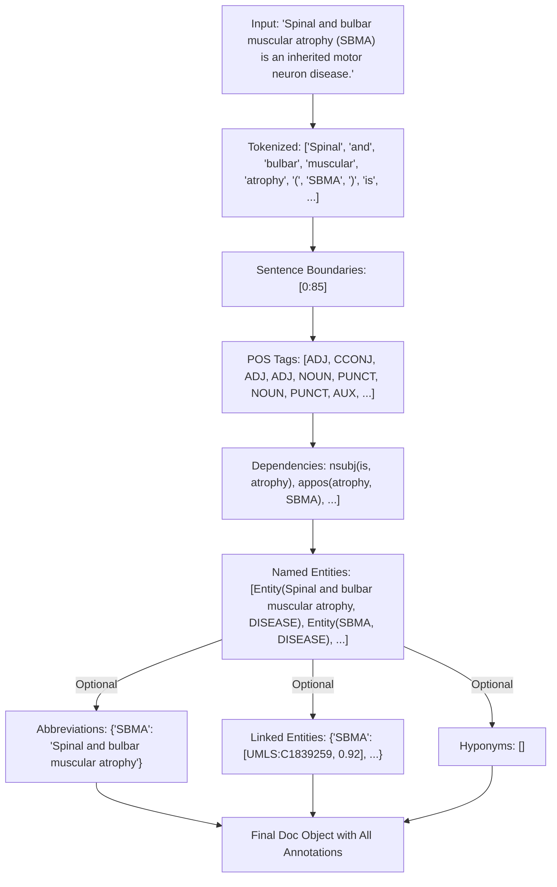

Each component adds its annotations to the shared spaCy `Doc` object, which is passed through the entire pipeline. The final `Doc` object contains all the linguistic annotations produced by the pipeline components.

Sources: [README.md:132-156](), [README.md:161-263](), [README.md:267-291]()

## Model Variants and Pipeline Configuration

SciSpaCy provides several model variants with different capabilities and resource requirements:

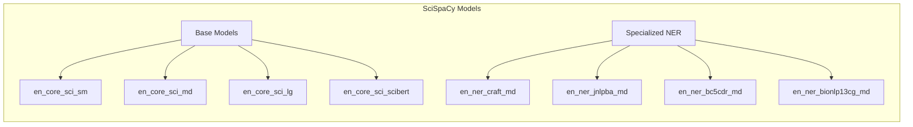

The model characteristics are summarized below:

| Model | Vocabulary Size | Word Vectors | Description |
|-------|----------------|--------------|-------------|
| en_core_sci_sm | ~100k | None | Fast, small memory footprint |
| en_core_sci_md | ~360k | 50k vectors | Balanced performance |
| en_core_sci_lg | ~785k | 600k vectors | Higher accuracy, larger memory |
| en_core_sci_scibert | ~785k | SciBERT transformer | Highest accuracy, GPU recommended |

The training workflow for these models is defined in [project.yml:76-158](), with specific configurations for each model size and type.

Sources: [README.md:95-117](), [project.yml:76-158]()

## Pipeline Customization

SciSpaCy allows for customization of the pipeline through the addition of optional components:


Example of customizing a pipeline:

```python
import spacy
from scispacy.abbreviation import AbbreviationDetector

nlp = spacy.load("en_core_sci_sm")
nlp.add_pipe("abbreviation_detector")
nlp.add_pipe("scispacy_linker", config={"linker_name": "umls"})
nlp.add_pipe("hyponym_detector", config={"extended": False})

doc = nlp("Spinal and bulbar muscular atrophy (SBMA) is an inherited motor neuron disease.")
```

Each optional component adds specific functionality:

1. **Abbreviation Detector**: Identifies short-form/long-form pairs and adds them as span extensions
2. **Entity Linker**: Links entity mentions to knowledge base concepts (UMLS, MeSH, etc.)
3. **Hyponym Detector**: Identifies term relationships using Hearst patterns

These components can be added in any order after the core pipeline components.

Sources: [README.md:132-156](), [README.md:161-263](), [README.md:267-291]()

## Relationship to Training Infrastructure

The pipeline components are trained using a structured workflow defined in [project.yml]():


The training process uses several data sources:
- GENIA Treebank for training the parser and tagger
- OntoNotes for making the models robust to general text
- MedMentions for training the entity recognition
- Various specialized corpora for domain-specific NER models

The configuration files in [configs/]() define the model architectures, training parameters, and component interactions.

Sources: [project.yml](), [configs/](), [docs/index.md:101-110]()

---

# Page: Custom Tokenization and Sentence Segmentation

# Custom Tokenization and Sentence Segmentation

<details>
<summary>Relevant source files</summary>

The following files were used as context for generating this wiki page:

- [Dockerfile](Dockerfile)
- [README.md](README.md)
- [RELEASE.md](RELEASE.md)
- [docs/example.svg](docs/example.svg)
- [docs/index.md](docs/index.md)
- [scispacy/custom_sentence_segmenter.py](scispacy/custom_sentence_segmenter.py)
- [scispacy/custom_tokenizer.py](scispacy/custom_tokenizer.py)
- [scripts/install_remote_packages.py](scripts/install_remote_packages.py)
- [tests/custom_tests/test_custom_segmentation.py](tests/custom_tests/test_custom_segmentation.py)
- [tests/custom_tests/test_custom_tokenizer.py](tests/custom_tests/test_custom_tokenizer.py)
- [tests/custom_tests/test_whitespace.py](tests/custom_tests/test_whitespace.py)

</details>


## Overview

This document describes the custom tokenization and sentence segmentation capabilities in SciSpaCy, which are specifically designed to handle the unique challenges presented by scientific and biomedical text. Scientific literature often contains specialized notation, abbreviations, and complex sentence structures that standard NLP tools struggle with. SciSpaCy implements custom tokenization rules and sentence segmentation to provide more accurate text processing for scientific content.

Sources: [README.md:5-8](), [scispacy/custom_tokenizer.py:48-57](), [scispacy/custom_sentence_segmenter.py:12-25]()

## Tokenization System Architecture

The tokenization process in SciSpaCy builds upon spaCy's rule-based tokenizer with additional rules specific to scientific text.

```mermaid
flowchart TB
    subgraph "Tokenization System"
        input["Scientific Text Input"]
        pretokenize["Pre-tokenization: remove_new_lines()"]
        tokenizer["combined_rule_tokenizer()"]
        
        subgraph "Custom Rules"
            prefixes["Custom Prefixes"]
            infixes["Custom Infixes"]
            suffixes["Custom Suffixes"]
            exceptions["Tokenizer Exceptions (ABBREVIATIONS)"]
        end
        
        output["Tokenized Document"]
        
        input --> pretokenize
        pretokenize --> tokenizer
        Custom Rules --> tokenizer
        tokenizer --> output
    end
```

Sources: [scispacy/custom_tokenizer.py:48-136](), [scispacy/custom_tokenizer.py:12-23]()

### Custom Tokenizer

The core of SciSpaCy's tokenization is the `combined_rule_tokenizer` function, which extends spaCy's default tokenizer with scientific text-specific rules. This tokenizer is designed to handle specialized patterns like chemical formulas, mathematical expressions, and biomedical terminology.

Key features of the custom tokenizer include:

1. **Hyphen handling**: Properly tokenizes hyphenated compounds common in scientific terminology (e.g., "bag-of-words" as a single token)
2. **Special character handling**: Treats special characters like multiplication symbols (×) as separate tokens
3. **Bracket handling**: Improved handling of bracketed expressions
4. **Abbreviation preservation**: Prevents splitting of common scientific abbreviations (e.g., "Fig.", "Eq.")
5. **New line handling**: The `remove_new_lines` function preprocesses text to handle hyphenated words split across lines

Sources: [scispacy/custom_tokenizer.py:12-23](), [scispacy/custom_tokenizer.py:48-136]()

#### Using the Custom Tokenizer

To use SciSpaCy's custom tokenizer, you can load a SciSpaCy model which already includes it, or add it to an existing spaCy pipeline:

```python
import spacy
from scispacy.custom_tokenizer import combined_rule_tokenizer

# Method 1: Use a SciSpaCy model (recommended)
nlp = spacy.load("en_core_sci_sm")

# Method 2: Add to existing pipeline
nlp = spacy.load("en_core_web_sm")
nlp.tokenizer = combined_rule_tokenizer(nlp)
```

Sources: [README.md:86-90]()

## Sentence Segmentation System Architecture

SciSpaCy uses the pySBD library for sentence boundary detection, with additional customizations for scientific text.

```mermaid
flowchart TB
    subgraph "Sentence Segmentation System"
        input["Tokenized Document"]
        pysbd["pysbd_sentencizer Component"]
        
        subgraph "pySBD Process"
            segmenter["pysbd.Segmenter (English)"]
            charSpans["Extract Character Spans"]
        end
        
        special["Special Cases Processing"]
        output["Document with Sentence Boundaries"]
        
        input --> pysbd
        pysbd --> pySBD Process
        pySBD Process --> special
        special --> output
    end
    
    subgraph "Special Cases"
        abbrev["Abbreviation Handling\n(ABBREVIATIONS list)"]
        nl["Newline Handling"]
    end
    
    special --> Special Cases
```

Sources: [scispacy/custom_sentence_segmenter.py:12-54]()

### Custom Sentence Segmenter

The `pysbd_sentencizer` function is a spaCy pipeline component that uses the pySBD library to perform sentence segmentation specifically tailored for scientific text. It handles special cases such as:

1. Preserving sentences that contain references to figures, tables, and equations (e.g., "Fig. 1", "Table 2", "Eq. 3")
2. Managing numbered lists and section headers properly
3. Handling scientific abbreviations to prevent incorrect sentence splits
4. Special handling of newlines to properly segment text with formatting artifacts

Sources: [scispacy/custom_sentence_segmenter.py:12-54]()

#### Using the Custom Sentence Segmenter

The sentence segmenter is included in all SciSpaCy models by default. If you need to add it to a custom pipeline:

```python
import spacy
from scispacy.custom_sentence_segmenter import pysbd_sentencizer

nlp = spacy.load("en_core_web_sm")
nlp.add_pipe("pysbd_sentencizer")
```

Sources: [scispacy/custom_sentence_segmenter.py:12-13]()

## Scientific Text Challenges and Solutions

The table below illustrates common challenges in scientific text tokenization and segmentation, and how SciSpaCy handles them:

| Challenge | Example | SciSpaCy Solution |
|-----------|---------|------------------|
| Abbreviations with periods | "Fig. 1 shows results." | Treats "Fig." as a single token, not the end of a sentence |
| References in parentheses | "Previous work (Smith et al., 2019) shows..." | Correctly handles the period in "al." |
| Hyphenated terms | "bag-of-words model" | Treats "bag-of-words" as a single token |
| Equations & formulas | "Eqs. 1-4 demonstrate..." | Preserves references to equations as single sentences |
| Chemical compounds | "[Ca2+]i protein" | Correctly tokenizes complex chemical notation |
| Measurements | "The 28× 28 image" | Properly handles multiplication symbols and numbers |
| Section numbering | "1. Introduction" | Correctly identifies as a section header |

Sources: [tests/custom_tests/test_custom_segmentation.py:3-238](), [tests/custom_tests/test_custom_tokenizer.py:3-48]()

## Integration with SciSpaCy Pipeline

The custom tokenizer and sentence segmenter form the foundation of the SciSpaCy pipeline, enabling more accurate downstream processing specific to scientific text.

```mermaid
flowchart LR
    input["Scientific Text"] --> tokenizer["Custom Tokenizer\ncombined_rule_tokenizer()"]
    tokenizer --> segmenter["Custom Sentence Segmenter\npysbd_sentencizer()"]
    
    subgraph "SciSpaCy Pipeline"
        segmenter --> pos["POS Tagging"]
        pos --> dep["Dependency Parsing"]
        dep --> ner["Named Entity Recognition"]
        
        ner --> abbrev["Abbreviation Detection\n(Optional)"]
        abbrev --> linking["Entity Linking\n(Optional)"]
        ner --> hyponym["Hyponym Detection\n(Optional)"]
    end
    
    SciSpaCy Pipeline --> output["Processed Scientific Document"]
```

Sources: [README.md:4-8](), [README.md:122-156]()

### Performance Considerations

The custom tokenization and sentence segmentation components are designed to be efficient while handling the complex patterns in scientific text. The preprocessing step to handle hyphenated words across newlines adds minimal overhead, and the overall pipeline maintains good performance even on large scientific documents.

## Common Issues and Solutions

When working with SciSpaCy's tokenization and sentence segmentation:

1. **Hyphenated words**: SciSpaCy's preprocessing handles most hyphenated words across newlines, but extremely complex cases may require additional preprocessing.

2. **Very long sentences**: Scientific literature sometimes contains extremely long sentences. While SciSpaCy handles most cases well, extremely complex sentences may occasionally be incorrectly segmented.

3. **Mixed text and equations**: Text with inline LaTeX or other mathematical notation may require additional preprocessing depending on how the equations are formatted.

## Related Pages

For information about other SciSpaCy components that build upon tokenization and sentence segmentation:

- For abbreviation detection, see [Abbreviation Detection](#2.2)
- For entity linking, see [Entity Linking](#2.3)
- For hyponym detection, see [Hyponym Detection](#2.4)

---

# Page: Abbreviation Detection

# Abbreviation Detection

<details>
<summary>Relevant source files</summary>

The following files were used as context for generating this wiki page:

- [Dockerfile](Dockerfile)
- [README.md](README.md)
- [RELEASE.md](RELEASE.md)
- [docs/example.svg](docs/example.svg)
- [docs/index.md](docs/index.md)
- [scispacy/abbreviation.py](scispacy/abbreviation.py)
- [scispacy/linking.py](scispacy/linking.py)
- [scripts/install_remote_packages.py](scripts/install_remote_packages.py)
- [tests/test_abbreviation_detection.py](tests/test_abbreviation_detection.py)

</details>


This document details the Abbreviation Detection component in SciSpaCy, which identifies abbreviations and their corresponding long-form definitions in scientific and biomedical text. This component implements the algorithm described in "A simple algorithm for identifying abbreviation definitions in biomedical text" (Schwartz & Hearst, 2003).

## Purpose and Function

Scientific and biomedical texts frequently use abbreviations to refer to complex terms. The Abbreviation Detection component automatically identifies these abbreviations and links them to their full definitions, enabling:

1. Better text understanding for downstream NLP tasks
2. Improved entity linking by resolving abbreviations to their expanded forms
3. Enhanced search and information retrieval from scientific documents

The component identifies both patterns:
- Long form (Short form) - e.g., "Spinal and bulbar muscular atrophy (SBMA)"
- Short form (Long form) - e.g., "SBMA (Spinal and bulbar muscular atrophy)"

Sources: [scispacy/abbreviation.py:155-166]()

## Algorithm Overview

The abbreviation detection algorithm works by identifying potential abbreviation-definition pairs and then applying character matching rules to verify if a short form is a valid abbreviation of a long form.

```mermaid
flowchart TD
    subgraph "Abbreviation Detection Algorithm"
        direction LR
        input["Scientific Text Input"] --> matcher["Parentheses Matcher"]
        matcher --> candidates["Candidate Extraction"]
        candidates --> filtering["Filter Candidates"]
        filtering --> matching["Character Matching"]
        matching --> result["Abbreviation-Definition Pairs"]
    end

    subgraph "Character Matching Process"
        direction LR
        sf["Short Form"] --> |"reverse iterate"| chars["Character by Character"]
        lf["Long Form"] --> |"search for match"| chars
        chars --> validation["Validate First Character Position"]
        validation --> span["Create Document Spans"]
    end

    result --> doc["Document with Linked Abbreviations"]
```

The core algorithm steps are:

1. Identify text within parentheses using a SpaCy matcher
2. Determine if the text inside or outside the parentheses is the abbreviation (based on length)
3. For each candidate pair, apply the character matching algorithm:
   - Start from the end of both short and long forms
   - For each character in the short form, find a matching character in the long form
   - The first character of the abbreviation must match the first character of a word in the long form
4. Create spans linking abbreviations to their definitions

Sources: [scispacy/abbreviation.py:8-82](), [scispacy/abbreviation.py:99-137]()

## Code Structure

The abbreviation detection functionality is implemented in the `scispacy/abbreviation.py` file through several key functions and a main class:

```mermaid
classDiagram
    class AbbreviationDetector{
        +matcher: Matcher
        +global_matcher: Matcher
        +make_serializable: bool
        +__init__(nlp, name, make_serializable)
        +__call__(doc) Doc
        +find(span, doc) Tuple
        +find_matches_for(filtered, doc) List
        +make_short_form_serializable(abbreviation)
    }
    
    class find_abbreviation{
        +Function
        +Implements Schwartz & Hearst algorithm
    }
    
    class filter_matches{
        +Function
        +Filters candidate matches
    }
    
    class short_form_filter{
        +Function
        +Validates abbreviation candidates
    }
    
    AbbreviationDetector ..> find_abbreviation : uses
    AbbreviationDetector ..> filter_matches : uses
    filter_matches ..> short_form_filter : uses
```

### Key Functions

- **`find_abbreviation()`**: Core implementation of the Schwartz & Hearst algorithm
- **`filter_matches()`**: Creates and filters potential abbreviation pairs
- **`short_form_filter()`**: Validates candidate abbreviations using rules (length, character composition)

### Main Class

- **`AbbreviationDetector`**: SpaCy pipeline component that:
  - Sets custom extensions on SpaCy's Doc and Span objects
  - Processes documents to find and link abbreviations
  - Supports serializable and non-serializable modes

Sources: [scispacy/abbreviation.py:1-279]()

## Integration with SpaCy Pipeline

The AbbreviationDetector is implemented as a SpaCy pipeline component using SpaCy's factory pattern. When added to a pipeline, it processes documents after the core NLP processing (tokenization, sentence segmentation, etc.) is complete.

```mermaid
flowchart LR
    text["Scientific Text"] --> tokenizer["Tokenizer"]
    tokenizer --> tagger["POS Tagger"]
    tagger --> parser["Parser"]
    parser --> ner["NER"]
    ner --> abbreviation["AbbreviationDetector"]
    abbreviation --> |optional| entityLinker["EntityLinker"]
    
    subgraph "Document Processing"
        direction TB
        doc["spaCy Doc"] --> |"adds ._.abbreviations attribute"| docWithAbbr["Doc with Abbreviations"]
        docWithAbbr --> |"adds ._.long_form to spans"| spanWithLong["Spans with Long Form Reference"]
    end
```

When the AbbreviationDetector processes a document:

1. It adds the `doc._.abbreviations` attribute (list of abbreviation spans)
2. For each abbreviation span, it adds a `span._.long_form` attribute referencing its definition
3. The EntityLinker component can use these resolved abbreviations for better entity linking

Sources: [scispacy/abbreviation.py:154-188](), [scispacy/linking.py:97-111]()

## Usage Examples

### Basic Usage

```python
import spacy
from scispacy.abbreviation import AbbreviationDetector

# Load a SciSpaCy model
nlp = spacy.load("en_core_sci_sm")

# Add the abbreviation detector to the pipeline
nlp.add_pipe("abbreviation_detector")

# Process text with abbreviations
doc = nlp("Spinal and bulbar muscular atrophy (SBMA) is an inherited motor neuron disease.")

# Access the detected abbreviations
for abrv in doc._.abbreviations:
    print(f"Abbreviation: {abrv.text}")
    print(f"Definition: {abrv._.long_form.text}")
```

### Serializable Mode

When you need to serialize documents (e.g., for multiprocessing):

```python
# Add with serializable mode enabled
nlp.add_pipe("abbreviation_detector", config={"make_serializable": True})
```

Sources: [README.md:123-151](), [scispacy/abbreviation.py:176-187](), [scispacy/abbreviation.py:259-278]()

## Configuration Options

The AbbreviationDetector accepts the following parameters:

| Parameter | Type | Default | Description |
|-----------|------|---------|-------------|
| `nlp` | `Language` | Required | SpaCy Language object |
| `name` | `str` | "abbreviation_detector" | Name for the component |
| `make_serializable` | `bool` | `False` | Whether to use serializable mode |

Sources: [scispacy/abbreviation.py:154-188]()

## Integration with Entity Linking

The AbbreviationDetector works well with the EntityLinker component. When both are used:

1. The AbbreviationDetector identifies abbreviations and links them to definitions
2. The EntityLinker can be configured to resolve abbreviations before linking
3. This improves linking accuracy by using full terms instead of abbreviations

```python
# Add abbreviation detector first
nlp.add_pipe("abbreviation_detector")

# Add entity linker with abbreviation resolution enabled
nlp.add_pipe("scispacy_linker", config={"resolve_abbreviations": True, "linker_name": "umls"})
```

This workflow is particularly useful when abbreviations might be ambiguous, but their expanded forms are less ambiguous for knowledge base linking.

Sources: [README.md:161-224](), [scispacy/linking.py:97-111]()

## Performance Considerations

- The abbreviation detection algorithm is fast and adds minimal overhead to the pipeline
- The implementation includes optimizations for efficiently handling multiple occurrences of the same abbreviation
- Setting `make_serializable=True` adds some conversion overhead but enables multiprocessing

## Testing

SciSpaCy includes comprehensive tests for the abbreviation detector, which verify:
- Correct identification of abbreviation-definition pairs
- Handling of edge cases and special patterns
- Integration with other pipeline components

Sources: [tests/test_abbreviation_detection.py:1-204]()

---

# Page: Entity Linking

# Entity Linking

<details>
<summary>Relevant source files</summary>

The following files were used as context for generating this wiki page:

- [Dockerfile](Dockerfile)
- [README.md](README.md)
- [RELEASE.md](RELEASE.md)
- [docs/example.svg](docs/example.svg)
- [docs/index.md](docs/index.md)
- [scispacy/candidate_generation.py](scispacy/candidate_generation.py)
- [scispacy/linking_utils.py](scispacy/linking_utils.py)
- [scripts/export_umls_json.py](scripts/export_umls_json.py)
- [scripts/install_remote_packages.py](scripts/install_remote_packages.py)

</details>


This document describes the Entity Linking functionality in scispaCy, which connects entities found in biomedical text to concepts in standard knowledge bases. The system allows for linking mentions to databases such as UMLS (Unified Medical Language System), MeSH (Medical Subject Headings), RxNorm, Gene Ontology, and Human Phenotype Ontology. For information about detecting abbreviations before entity linking, see [Abbreviation Detection](#2.2).

## 1. Overview

Entity linking is the process of connecting entity mentions in text to standardized concepts in knowledge bases. In the biomedical domain, this is particularly important as it allows for normalization of different ways of expressing the same concept (e.g., "heart attack" and "myocardial infarction" linking to the same concept).

The scispaCy entity linker performs a string overlap-based search on named entities, comparing them with concepts in knowledge bases using an approximate nearest neighbors search. This approach balances efficiency and accuracy for biomedical entity linking.

Sources: [README.md:161-196]()

## 2. Entity Linking System Architecture

The entity linking system consists of several key components that work together to match text mentions to knowledge base concepts.

### 2.1 System Components Diagram

```mermaid
graph TD
    subgraph "Natural Language Space"
        text["Scientific Text"] --> pipeline["spaCy Pipeline"]
        pipeline --> ner["Named Entity Recognition"]
        ner --> entity["Entity Spans"]
        
        subgraph "Optional Component"
            entity --> abbrevDetector["AbbreviationDetector"]
            abbrevDetector --> resolvedEntities["Resolved Entity Spans"]
        end
    end
    
    subgraph "Entity Linking System"
        entity --> entityLinker["EntityLinker"]
        resolvedEntities --> entityLinker
        
        entityLinker --> candidateGen["CandidateGenerator"]
        
        subgraph "Candidate Generation"
            candidateGen --> tfidf["TfidfVectorizer"]
            candidateGen --> annIndex["nmslib ANN Index"]
            tfidf --> vectorizedMention["Vectorized Mention"]
            vectorizedMention --> annIndex
            annIndex --> candidates["Nearest Neighbors"]
        end
        
        candidates --> ranking["Candidate Ranking"]
        ranking --> filtering["Threshold Filtering"]
        filtering --> linkedEntities["doc._.kb_ents"]
    end
    
    subgraph "Knowledge Base Space"
        kb["KnowledgeBase"] --> candidateGen
        kb --> filtering
        
        subgraph "Available KBs"
            umls["UmlsKnowledgeBase"]
            mesh["Mesh"]
            rxnorm["RxNorm"]
            go["GeneOntology"]
            hpo["HumanPhenotypeOntology"]
        end
        
        umls --> kb
        mesh --> kb
        rxnorm --> kb
        go --> kb
        hpo --> kb
    end
```

Sources: [scispacy/candidate_generation.py:149-362](), [scispacy/linking_utils.py:1-123]()

### 2.2 Information Flow

1. The pipeline identifies entity spans in the text through Named Entity Recognition.
2. If the Abbreviation Detector is used, abbreviations are resolved to their long forms.
3. The `EntityLinker` receives entity spans as input.
4. The `CandidateGenerator` creates TF-IDF vectors of the mention text (using character 3-grams).
5. The nearest neighbors search finds similar concept vectors in the knowledge base.
6. Candidates are ranked and filtered based on similarity thresholds.
7. Linked entities are attached to the original spans as `doc._.kb_ents`.

Sources: [README.md:161-196](), [scispacy/candidate_generation.py:293-362]()

## 3. Implementation Details

### 3.1 Code Structure Diagram

```mermaid
classDiagram
    class EntityLinker {
        kb: KnowledgeBase
        candidate_generator: CandidateGenerator
        k: int
        threshold: float
        no_definition_threshold: float
        filter_for_definitions: bool
        max_entities_per_mention: int
        resolve_abbreviations: bool
        __call__(doc)
    }
    
    class CandidateGenerator {
        ann_index: FloatIndex
        vectorizer: TfidfVectorizer
        ann_concept_aliases_list: List[str]
        kb: KnowledgeBase
        verbose: bool
        __call__(mention_texts, k) List[List[MentionCandidate]]
        nmslib_knn_with_zero_vectors(vectors, k)
    }
    
    class KnowledgeBase {
        cui_to_entity: Dict[str, Entity]
        alias_to_cuis: Dict[str, Set[str]]
    }
    
    class UmlsKnowledgeBase {
        semantic_type_tree: UmlsSemanticTypeTree
    }
    
    class MentionCandidate {
        concept_id: str
        aliases: List[str]
        similarities: List[float]
    }
    
    class Entity {
        concept_id: str
        canonical_name: str
        aliases: List[str]
        types: List[str]
        definition: str
    }
    
    KnowledgeBase <|-- UmlsKnowledgeBase
    KnowledgeBase <|-- Mesh
    KnowledgeBase <|-- RxNorm
    KnowledgeBase <|-- GeneOntology
    KnowledgeBase <|-- HumanPhenotypeOntology
    
    EntityLinker --> CandidateGenerator: uses
    CandidateGenerator --> KnowledgeBase: uses
    CandidateGenerator --> MentionCandidate: creates
    KnowledgeBase --> Entity: contains
```

Sources: [scispacy/candidate_generation.py:97-115](), [scispacy/candidate_generation.py:149-196](), [scispacy/linking_utils.py:12-34](), [scispacy/linking_utils.py:41-122]()

### 3.2 Candidate Generation

The `CandidateGenerator` class performs the core functionality of finding potential matches for entity mentions:

1. It embeds mention text into a sparse vector of character 3-grams using a pre-trained TF-IDF vectorizer.
2. It searches for similar vectors in a pre-indexed approximate nearest neighbors index.
3. It canonicalizes the results to their KB canonical ids (important because multiple aliases may map to the same canonical entity).
4. It returns a list of `MentionCandidate` objects containing concept IDs, relevant aliases, and similarity scores.

Key implementation note: Because aliases are included in the index, multiple neighbors might map to the same canonical entity. This means that the number of candidates returned may be less than the number of neighbors requested.

Sources: [scispacy/candidate_generation.py:149-196](), [scispacy/candidate_generation.py:238-292](), [scispacy/candidate_generation.py:293-362]()

## 4. Knowledge Bases

scispaCy supports several knowledge bases for entity linking:

| KB Name | Description | Size | Main Focus |
|---------|-------------|------|------------|
| UMLS | Unified Medical Language System | ~3M concepts | General biomedical terminology |
| MeSH | Medical Subject Headings | ~30k entities | Higher quality entities used for Pubmed indexing |
| RxNorm | RxNorm ontology | ~100k concepts | Normalized names for clinical drugs |
| GO | Gene Ontology | ~67k concepts | Functions of genes |
| HPO | Human Phenotype Ontology | ~16k concepts | Phenotypic abnormalities in human disease |

Each knowledge base is represented as a class that inherits from the base `KnowledgeBase` class, which maintains two key views:
1. A mapping from concept_id to an `Entity` object with more information
2. A mapping from aliases to the sets of concept IDs for which they are aliases

Sources: [README.md:167-173](), [scispacy/linking_utils.py:41-122]()

## 5. Usage Guide

### 5.1 Adding the Entity Linker to a Pipeline

To use the entity linker, add it to your spaCy pipeline after loading a model:

```python
import spacy
import scispacy

# Load a scispaCy model
nlp = spacy.load("en_core_sci_sm")

# Add the entity linker to the pipeline
# This may take a while on first use as it downloads data
nlp.add_pipe("scispacy_linker", config={"linker_name": "umls"})

# Process text
doc = nlp("Spinal and bulbar muscular atrophy (SBMA) is an inherited motor neuron disease.")

# Access linked entities
for entity in doc.ents:
    print(f"Entity: {entity.text}")
    for umls_ent in entity._.kb_ents:
        print(f"  {umls_ent[0]}: {umls_ent[1]}")
```

Sources: [README.md:206-263]()

### 5.2 Configuration Parameters

The entity linker accepts several parameters that can be tuned for different use cases:

| Parameter | Type | Default | Description |
|-----------|------|---------|-------------|
| `resolve_abbreviations` | bool | False | Resolves abbreviations before linking if `AbbreviationDetector` is in the pipeline |
| `k` | int | 30 | Number of nearest neighbors to look up per mention |
| `threshold` | float | 0.7 | Similarity threshold for adding entity candidates |
| `no_definition_threshold` | float | 0.95 | Higher threshold for entities without definitions |
| `filter_for_definitions` | bool | True | Whether to only include entities with definitions |
| `max_entities_per_mention` | int | 5 | Maximum number of entities returned per mention |
| `linker_name` | str | "umls" | Knowledge base to use ("umls", "mesh", "rxnorm", "go", "hpo") |

Sources: [README.md:176-196](), [scispacy/candidate_generation.py:80-94]()

### 5.3 Accessing Linked Entity Information

After linking, you can access detailed information about the linked entities:

```python
import spacy
import scispacy
from scispacy.linking import EntityLinker

nlp = spacy.load("en_core_sci_sm")
nlp.add_pipe("scispacy_linker", config={"linker_name": "umls"})

doc = nlp("Spinal and bulbar muscular atrophy (SBMA) is an inherited motor neuron disease.")

# Get the linker component
linker = nlp.get_pipe("scispacy_linker")

# For each entity, print detailed information about linked concepts
for entity in doc.ents:
    print(f"Entity: {entity.text}")
    if entity._.kb_ents:
        for umls_ent in entity._.kb_ents:
            concept_id, score = umls_ent
            concept = linker.kb.cui_to_entity[concept_id]
            print(f"  ID: {concept_id}, Score: {score:.2f}")
            print(f"  Name: {concept.canonical_name}")
            print(f"  Definition: {concept.definition or 'No definition'}")
            print(f"  Types: {', '.join(concept.types)}")
```

Sources: [README.md:232-263]()

## 6. Implementation Notes

### 6.1 TF-IDF Vectorization

The entity linker uses character 3-grams for vectorization rather than words, which works well for biomedical terms and helps handle spelling variations and morphological differences.

```python
# Default TF-IDF vectorizer configuration in scispaCy
tfidf_vectorizer = TfidfVectorizer(
    analyzer="char_wb",  # Character n-grams, including word boundaries
    ngram_range=(3, 3),  # Trigrams only
    min_df=10,           # Minimum document frequency
    dtype=numpy.float32
)
```

Sources: [scispacy/candidate_generation.py:423-425]()

### 6.2 Approximate Nearest Neighbors Search

The entity linker uses the HNSW (Hierarchical Navigable Small World Graph) algorithm implemented in the `nmslib` library for efficient nearest neighbors search. This allows for fast retrieval of similar entities even in large knowledge bases.

The pre-built indices used by scispaCy are created with the following parameters:

```python
# HNSW parameters for index construction
index_params = {
    "M": 100,               # Maximum number of connections per element
    "indexThreadQty": 60,   # Number of threads for indexing
    "efConstruction": 2000, # Size of the dynamic list for the nearest neighbors
    "post": 0,              # No post-processing
}
```

Sources: [scispacy/candidate_generation.py:406-411]()

### 6.3 Index Creation

The indices for each knowledge base are pre-built and stored in the cloud for download. The process of creating these indices involves:

1. Reading concepts from the knowledge base
2. Creating TF-IDF vectors for each concept alias
3. Building an approximate nearest neighbors index
4. Serializing the vectorizer, index, and concept mappings

This process is implemented in the `create_tfidf_ann_index` function, but users typically don't need to run this as the pre-built indices are automatically downloaded.

Sources: [scispacy/candidate_generation.py:365-475]()

---

# Page: Hyponym Detection

# Hyponym Detection

<details>
<summary>Relevant source files</summary>

The following files were used as context for generating this wiki page:

- [Dockerfile](Dockerfile)
- [README.md](README.md)
- [RELEASE.md](RELEASE.md)
- [docs/example.svg](docs/example.svg)
- [docs/index.md](docs/index.md)
- [scispacy/hearst_patterns.py](scispacy/hearst_patterns.py)
- [scispacy/hyponym_detector.py](scispacy/hyponym_detector.py)
- [scripts/install_remote_packages.py](scripts/install_remote_packages.py)
- [tests/test_hyponym_detector.py](tests/test_hyponym_detector.py)

</details>


This page documents the Hyponym Detection system in SciSpaCy, which identifies hierarchical relationships between terms in scientific text. The system identifies pairs of terms where one term (hyponym) is a specific instance or subtype of another term (hypernym), such as "coronavirus" being a hyponym of "virus".

For information about other text relationship extraction tasks like entity linking, see [Entity Linking](#2.3).

## Overview

The Hyponym Detector is a spaCy pipeline component that implements the methodology described in ["Automatic Acquisition of Hyponyms from Large Text Corpora"](https://www.aclweb.org/anthology/C92-2082.pdf) by Marti Hearst. It uses pattern matching to identify lexical-syntactic patterns (known as Hearst patterns) that indicate hyponym relationships in text.

For example, in the phrase "coronaviruses such as SARS and MERS", the pattern "X such as Y" indicates that "SARS" and "MERS" are hyponyms (subtypes) of "coronaviruses".

```mermaid
graph TD
    subgraph "Hyponym Detection System"
        text["Scientific Text Input"] --> nlp["spaCy Pipeline"]
        nlp --> tokenization["Tokenization"]
        tokenization --> pos["POS Tagging"]
        pos --> patterns["Pattern Matching"]
        patterns --> extraction["Hyponym-Hypernym Extraction"]
        extraction --> results["Document with Detected Hyponym Relations"]
    end
```

Sources: [scispacy/hyponym_detector.py](), [README.md:265-291]()

## Implementation Details

The Hyponym Detector is implemented as a spaCy pipeline component that can be added to any spaCy NLP pipeline. It uses spaCy's `Matcher` component to identify patterns in tokenized text and extract hyponym-hypernym pairs.

```mermaid
graph TD
    subgraph "HyponymDetector Implementation"
        direction LR
        init["Initialization"] --> loadPatterns["Load Hearst Patterns"]
        loadPatterns --> create["Create spaCy Matcher"]
        create --> ready["Ready for Document Processing"]
        
        process["__call__(doc)"] --> match["Find Pattern Matches"]
        match --> extract["Extract Hypernym-Hyponym Pairs"]
        extract --> expand["Expand to Noun Compounds"]
        expand --> store["Store in doc._.hearst_patterns"]
    end
```

Sources: [scispacy/hyponym_detector.py:8-142](), [tests/test_hyponym_detector.py:8-15]()

### System Components

The Hyponym Detection system consists of two main components:

1. **HyponymDetector Class**: The main pipeline component that processes documents and extracts hyponym relations ([scispacy/hyponym_detector.py:8-142]()).
2. **Hearst Patterns**: Predefined patterns that indicate hyponymy relationships ([scispacy/hearst_patterns.py]()).

### Core Functions

The HyponymDetector has three key methods:

1. `__init__`: Initializes the detector with either basic or extended patterns.
2. `find_noun_compound_head`: Identifies the head word of a noun compound.
3. `expand_to_noun_compound`: Expands a token to include its full noun phrase.
4. `__call__`: Processes documents to find and store hyponym relationships.

```mermaid
classDiagram
    class HyponymDetector {
        +nlp: Language
        +patterns: List
        +matcher: Matcher
        +first: Set
        +last: Set
        +__init__(nlp, name, extended)
        +expand_to_noun_compound(token, doc)
        +find_noun_compound_head(token)
        +__call__(doc)
    }
    
    class Doc {
        +_.hearst_patterns: List[Tuple]
    }
    
    HyponymDetector --> Doc: processes
```

Sources: [scispacy/hyponym_detector.py:8-142]()

## Hearst Patterns

The system uses two sets of patterns to identify hyponym relationships:

1. **BASE_PATTERNS**: A core set of high-precision patterns.
2. **EXTENDED_PATTERNS**: Additional patterns that increase recall but may have lower precision.

### Base Patterns

The base patterns capture common hyponymy structures such as:

| Pattern | Example | Relation |
|---------|---------|----------|
| X such as Y | "Viruses such as coronaviruses" | coronaviruses → viruses |
| X including Y | "Respiratory diseases including pneumonia" | pneumonia → respiratory diseases |
| X especially Y | "Mammals especially primates" | primates → mammals |
| Y and other X | "SARS and other coronaviruses" | SARS → coronaviruses |

Sources: [scispacy/hearst_patterns.py:40-71]()

### Extended Patterns

The extended patterns add more complex structures:

| Pattern | Example | Relation |
|---------|---------|----------|
| X which may include Y | "Disorders which may include seizures" | seizures → disorders |
| X which is similar to Y | "Proteins which are similar to enzymes" | enzymes → proteins |
| example of X is Y | "Example of this is pneumonia" | pneumonia → (antecedent) |
| Y is a kind of X | "SARS is a kind of coronavirus" | SARS → coronavirus |

Sources: [scispacy/hearst_patterns.py:73-560]()

## Pattern Matching Process

The HyponymDetector uses spaCy's `Matcher` to find these patterns in text. The pattern matching process involves:

1. Creating a matcher with the selected patterns
2. Running the matcher on each document
3. Processing each match to extract the hypernym and hyponym
4. Expanding each term to its full noun compound
5. Handling conjunctions to extract multiple hyponyms if present

```mermaid
flowchart TD
    A["Input Document"] --> B["Apply spaCy Matcher"]
    B --> C["Iterate Through Matches"]
    C --> D["Determine Hypernym/Hyponym Positions"]
    D --> E["Find Noun Compound Heads"]
    E --> F["Expand to Full Noun Compounds"]
    F --> G["Store in doc._.hearst_patterns"]
    G --> H["Handle Conjunctions"]
    H --> I["Output Document with Hyponym Relations"]
```

Sources: [scispacy/hyponym_detector.py:97-142]()

## Usage

To use the HyponymDetector, add it to your spaCy pipeline:

```python
import spacy
from scispacy.hyponym_detector import HyponymDetector

# Load a scispaCy model
nlp = spacy.load("en_core_sci_sm")

# Add the hyponym detector to the pipeline
# Set extended=True to use both base and extended patterns
nlp.add_pipe("hyponym_detector", config={"extended": False}, last=True)

# Process a text
doc = nlp("Coronaviruses such as SARS and MERS can cause respiratory diseases.")

# Access the detected hyponym relationships
for relation, hypernym, hyponym in doc._.hearst_patterns:
    print(f"Relation: {relation}")
    print(f"Hypernym (more general): {hypernym}")
    print(f"Hyponym (more specific): {hyponym}")
```

Sources: [README.md:280-291](), [tests/test_hyponym_detector.py:15-33]()

## Examples

Here are some examples of hyponym relationships detected by the system:

### Example 1: "such as" pattern

```
"Keystone plant species such as fig trees are good for the soil."
```

Detected relation: `("such_as", "Keystone plant species", "fig trees")`

### Example 2: "other" pattern

```
"SARS, or other coronaviruses, are bad."
```

Detected relation: `("other", "coronaviruses", "SARS")`

### Example 3: "including" pattern with conjunctions

```
"Coronaviruses, including SARS and MERS, are bad."
```

Detected relations:
- `("include", "Coronaviruses", "SARS")`
- `("include", "Coronaviruses", "MERS")`

Sources: [tests/test_hyponym_detector.py:15-33]()

## Parameter Configuration

When adding the HyponymDetector to your pipeline, you can configure:

| Parameter | Type | Default | Description |
|-----------|------|---------|-------------|
| extended | bool | False | Whether to use the extended set of Hearst patterns in addition to the base patterns. Setting to True yields higher recall but potentially lower precision. |

Sources: [scispacy/hyponym_detector.py:36-38](), [README.md:269]()

## System Architecture Diagram

```mermaid
graph TD
    subgraph "SciSpaCy Pipeline"
        direction LR
        input["Scientific Text"] --> tokenizer["Tokenizer"]
        tokenizer --> tagger["POS Tagger"]
        tagger --> parser["Parser"]
        parser --> ner["Entity Recognition"]
        ner --> hyponym["HyponymDetector"]
        
        subgraph "HyponymDetector"
            patterns["Hearst Patterns"] --> matcher["spaCy Matcher"]
            matcher --> process["Process Matches"]
            process --> expand["Expand to Noun Compounds"]
            expand --> store["Store Hyponym Relations"]
        end
    end
    
    output["Document with doc._.hearst_patterns"] --> applications["Applications"]
    hyponym --> output
    
    subgraph "Applications"
        taxonomy["Taxonomy Building"]
        ontology["Ontology Enrichment"]
        qa["Question Answering"]
    end
```

Sources: [scispacy/hyponym_detector.py](), [scispacy/hearst_patterns.py]()

## Implementation Internals

For developers looking to understand or modify the hyponym detection system, here's a detailed look at the implementation:

### Hypernym/Hyponym Position Logic

The HyponymDetector determines whether the hypernym appears first or last in a pattern:

```python
# gather list of predicates where the hypernym appears first
if pattern["position"] == "first":
    self.first.add(pattern["label"])

# gather list of predicates where the hypernym appears last
if pattern["position"] == "last":
    self.last.add(pattern["label"])
```

During processing, it uses this information to identify which term is the hypernym and which is the hyponym:

```python
# if the predicate is in the list where the hypernym is last, else hypernym is first
if predicate in self.last:
    hypernym = doc[end - 1]
    hyponym = doc[start]
else:
    # An inelegent way to deal with the "such_NOUN_as pattern"
    # since the first token is not the hypernym.
    if doc[start].lemma_ == "such":
        start += 1
    hypernym = doc[start]
    hyponym = doc[end - 1]
```

Sources: [scispacy/hyponym_detector.py:52-62](), [scispacy/hyponym_detector.py:112-122]()

### Noun Compound Expansion

The detector expands simple token matches to their full noun compounds:

```python
hypernym = self.find_noun_compound_head(hypernym)
hyponym = self.find_noun_compound_head(hyponym)

# For the document level, we expand to contain noun phrases.
hypernym_extended = self.expand_to_noun_compound(hypernym, doc)
hyponym_extended = self.expand_to_noun_compound(hyponym, doc)
```

Sources: [scispacy/hyponym_detector.py:124-129]()

## Summary

The Hyponym Detection system in SciSpaCy provides a powerful tool for identifying taxonomic relationships in scientific text. By identifying hyponym-hypernym pairs, it can help with tasks such as:

- Building taxonomies from scientific literature
- Enhancing knowledge graphs with hierarchical relationships
- Supporting query expansion for information retrieval
- Assisting in question answering systems that require hierarchical knowledge

The system is flexible, allowing users to choose between precision (base patterns) and recall (extended patterns) based on their specific needs.

Sources: [README.md:265-291](), [scispacy/hyponym_detector.py](), [scispacy/hearst_patterns.py]()

---

# Page: Knowledge Bases

# Knowledge Bases

<details>
<summary>Relevant source files</summary>

The following files were used as context for generating this wiki page:

- [Dockerfile](Dockerfile)
- [README.md](README.md)
- [RELEASE.md](RELEASE.md)
- [docs/example.svg](docs/example.svg)
- [docs/index.md](docs/index.md)
- [scripts/export_umls_json.py](scripts/export_umls_json.py)
- [scripts/install_remote_packages.py](scripts/install_remote_packages.py)

</details>


This document describes the knowledge bases integrated into SciSpaCy and how they're used for entity linking. Knowledge bases (KBs) provide structured biomedical terminology that enables the connection between mentions in text and standardized concepts. For information about how these knowledge bases are used in entity linking, see [Entity Linking](#2.3).

## Overview

SciSpaCy integrates several biomedical knowledge bases to support the entity linking functionality. These knowledge bases contain standardized biomedical terminology that enables the mapping of entity mentions in scientific text to canonical concept identifiers.

```mermaid
graph TD
    subgraph "Knowledge Bases System"
        KB["Knowledge Base Structure"] --> |"stored as"| JSONL["JSONL Files"]
        KB --> |"contains"| Concepts["Concept Records"]
        
        Concepts --> |"has"| CUI["concept_id"]
        Concepts --> |"has"| CanName["canonical_name"]
        Concepts --> |"has"| Aliases["aliases[]"]
        Concepts --> |"has"| Types["types[]"]
        Concepts --> |"has"| Def["definition (optional)"]
        
        JSONL --> |"loaded by"| EntityLinker["EntityLinker"]
        
        UMLS["UMLS KB"] --> |"implemented as"| KB
        MeSH["MeSH KB"] --> |"implemented as"| KB
        RxNorm["RxNorm KB"] --> |"implemented as"| KB
        GO["Gene Ontology KB"] --> |"implemented as"| KB
        HPO["HPO KB"] --> |"implemented as"| KB
    end
    
    EntityLinker --> |"used for"| Linking["Entity Linking"]
```

Sources: [README.md:162-174](), [scripts/export_umls_json.py:17-25]()

## Supported Knowledge Bases

SciSpaCy currently supports five knowledge bases, each with different scopes and sizes:

| Knowledge Base | Description | Approximate Size | Focus Area |
|---------------|------------|-----------------|-----------|
| UMLS | Unified Medical Language System (levels 0,1,2,9) | ~3M concepts | Comprehensive medical terminology |
| MeSH | Medical Subject Headings | ~30K entities | PubMed indexing terms |
| RxNorm | RxNorm ontology | ~100K concepts | Normalized clinical drug names |
| GO | Gene Ontology | ~67K concepts | Gene functions |
| HPO | Human Phenotype Ontology | ~16K concepts | Phenotypic abnormalities in human disease |

MeSH uses different unique identifiers than the other knowledge bases, as it's derived directly from MeSH itself rather than from UMLS.

Sources: [README.md:167-173]()

## Knowledge Base Integration

SciSpaCy provides a unified interface for working with these different knowledge bases through the entity linking system. This integration follows a processing pipeline that converts raw knowledge base data into a format usable by SciSpaCy.

```mermaid
graph LR
    subgraph "Knowledge Base Processing Pipeline"
        RawData["Raw KB Data (UMLS META)"] --> ReadConcepts["read_umls_concepts()"]
        RawData --> ReadTypes["read_umls_types()"]
        RawData --> ReadDefs["read_umls_definitions()"]
        
        ReadConcepts --> ConceptDetails["concept_details Dictionary"]
        ReadTypes --> ConceptDetails
        ReadDefs --> ConceptDetails
        
        ConceptDetails --> CleanUp["Clean & Normalize Data"]
        CleanUp --> ExportJSON["Export to JSONL"]
        
        ExportJSON --> |"cached_path()"| CachedKB["Cached KB Files"]
        
        CachedKB --> EntityLinker["scispacy_linker (EntityLinker)"]
    end
    
    EntityLinker --> |"provides"| KBInterface["KB Interface (linker.kb)"]
    KBInterface --> |"enables"| ConceptLookup["Concept Lookup (cui_to_entity)"]
```

Sources: [scripts/export_umls_json.py:1-90](), [README.md:201-203]()

## Knowledge Base Structure

Each knowledge base in SciSpaCy follows a common structure represented as a concept dictionary. Each concept contains the following fields:

- `concept_id`: Unique identifier (CUI for UMLS-derived KBs)
- `canonical_name`: The primary name for the concept
- `aliases`: List of alternative names/synonyms
- `types`: List of semantic types (categories)
- `definition`: Optional description of the concept

This structure is serialized to JSONL (JSON Lines) format, with each line representing a single concept.

Example concept record structure:
```
{
  "concept_id": "C0031117",
  "canonical_name": "Peripheral Nervous System",
  "aliases": ["PNS", "Peripheral nervous system", "Peripheral neural system"],
  "types": ["T022"],
  "definition": "The peripheral nervous system is one of the two major divisions of the nervous system..."
}
```

Sources: [scripts/export_umls_json.py:17-25](), [scripts/export_umls_json.py:71-85]()

## UMLS Processing

UMLS, as the largest supported knowledge base, requires special processing. The `export_umls_json.py` script handles this process:

```mermaid
graph TD
    subgraph "UMLS Processing System"
        META["UMLS META Directory"] --> ReadUMLS["umls_utils Functions"]
        
        ReadUMLS --> |"read_umls_concepts()"| Concepts["Concepts Data"]
        ReadUMLS --> |"read_umls_types()"| Types["Types Data"]
        ReadUMLS --> |"read_umls_definitions()"| Defs["Definitions Data"]
        
        Concepts --> |"merged into"| ConceptDict["concept_details Dictionary"]
        Types --> |"merged into"| ConceptDict
        Defs --> |"merged into"| ConceptDict
        
        ConceptDict --> Cleanup["Clean & Deduplicate Data"]
        Cleanup --> Export["Export to JSONL"]
    end
```

During UMLS processing:
1. Concepts, types, and definitions are read from the UMLS META directory
2. This data is merged into a concept_details dictionary
3. Duplicate aliases are removed
4. Concepts without canonical names are assigned one from their aliases
5. The processed data is exported to a JSONL file

Sources: [scripts/export_umls_json.py:10-90]()

## Integration with Entity Linking

The knowledge bases are used primarily by the EntityLinker component to map entity mentions to standardized concepts.

```mermaid
graph TD
    subgraph "Entity Linking System"
        Text["Scientific Text"] --> NLP["NLP Pipeline"]
        NLP --> Entities["Named Entities"]
        
        Entities --> |"optional"| AbbrevDetector["Abbreviation Detector"]
        AbbrevDetector --> |"with resolved abbreviations"| Linker["EntityLinker"]
        Entities --> |"direct"| Linker
        
        subgraph "Candidate Generation"
            KBVectorizer["TF-IDF Vectorizer"]
            ANNIndex["Approximate Nearest Neighbors Index"]
            CandidateGen["Candidate Generator"]
            
            KBVectorizer --> CandidateGen
            ANNIndex --> CandidateGen
        end
        
        subgraph "Knowledge Bases"
            UMLS_KB["UMLS (umls)"]
            MeSH_KB["MeSH (mesh)"]
            RxNorm_KB["RxNorm (rxnorm)"]
            GO_KB["Gene Ontology (go)"]
            HPO_KB["HPO (hpo)"]
        end
        
        Linker --> CandidateGen
        CandidateGen --> Candidates["Entity Candidates"]
        Knowledge Bases --> CandidateGen
        
        Candidates --> Ranking["Similarity Ranking"]
        Ranking --> Threshold["Threshold Filtering"]
        Threshold --> LinkedEntities["Linked Entities (._.kb_ents)"]
    end
```

The entity linking process:
1. Named entities are detected in scientific text
2. If the Abbreviation Detector is in the pipeline, abbreviations are resolved to their long forms
3. The EntityLinker component uses the specified knowledge base to find candidate matches
4. Candidates are ranked by similarity score
5. Matches above a configurable threshold are kept
6. The resulting linked entities are attached to each mention as the `._.kb_ents` attribute

Sources: [README.md:161-204]()

## Usage and Configuration

To use a knowledge base for entity linking, you need to add the `scispacy_linker` component to the spaCy pipeline with the desired KB name:

```python
import spacy

nlp = spacy.load("en_core_sci_sm")
nlp.add_pipe("scispacy_linker", config={"linker_name": "umls"})

# Process text
doc = nlp("Patients with diabetes mellitus often develop hypertension.")

# Access linked entities
for ent in doc.ents:
    if ent._.kb_ents:
        print(f"Entity: {ent.text}")
        linker = nlp.get_pipe("scispacy_linker")
        for umls_ent in ent._.kb_ents:
            cui, score = umls_ent
            print(f"  CUI: {cui}, Score: {score}")
            print(f"  Details: {linker.kb.cui_to_entity[cui]}")
```

Key configuration parameters for the EntityLinker:

| Parameter | Default | Description |
|-----------|---------|-------------|
| linker_name | "umls" | Knowledge base to use (umls, mesh, rxnorm, go, hpo) |
| resolve_abbreviations | False | Whether to resolve abbreviations before linking |
| k | 30 | Number of nearest neighbors to look up from candidate generator |
| threshold | 0.7 | Minimum similarity score threshold for candidates |
| no_definition_threshold | 0.95 | Threshold for entities without definitions |
| filter_for_definitions | True | Whether to only include entities with definitions |
| max_entities_per_mention | 5 | Maximum number of entities to return per mention |

Sources: [README.md:176-199](), [README.md:213-226]()

## Performance Considerations

The knowledge bases, especially UMLS, are large datasets that require significant resources:

- Initial loading time: The first time a knowledge base is used, it must be downloaded and processed, which can take several minutes.
- Memory usage: The larger knowledge bases (especially UMLS) require substantial memory.
- Disk space: The cached knowledge base files can occupy several gigabytes of disk space.

After the first use, the knowledge bases are cached, making subsequent loading much faster.

Sources: [README.md:214-218]()

---

# Page: UMLS Integration

# UMLS Integration

<details>
<summary>Relevant source files</summary>

The following files were used as context for generating this wiki page:

- [scispacy/file_cache.py](scispacy/file_cache.py)
- [scispacy/per_class_scorer.py](scispacy/per_class_scorer.py)
- [scispacy/train_utils.py](scispacy/train_utils.py)
- [scispacy/umls_linking.py](scispacy/umls_linking.py)
- [scispacy/umls_semantic_type_tree.py](scispacy/umls_semantic_type_tree.py)
- [scispacy/umls_utils.py](scispacy/umls_utils.py)
- [scripts/export_umls_json.py](scripts/export_umls_json.py)
- [tests/fixtures/umls_test_fixture.json](tests/fixtures/umls_test_fixture.json)

</details>


## Purpose and Scope

This page documents how the Unified Medical Language System (UMLS) is integrated into SciSpaCy. UMLS is a comprehensive metathesaurus of biomedical and health concepts, providing standardized terminology for entity linking in scientific text processing. This integration enables SciSpaCy to link entities recognized in biomedical text to their corresponding concept identifiers in UMLS.

For information about other knowledge bases supported in SciSpaCy (such as MeSH, Gene Ontology, Human Phenotype Ontology, and RxNorm), see [Other Knowledge Bases](#3.2).

Sources: [scispacy/umls_utils.py:1-180](), [scispacy/umls_linking.py:1-3]()

## UMLS Data Structure and Processing

UMLS data is organized in several key files within the META directory of a UMLS release:

| UMLS File | Content | SciSpaCy Function |
|-----------|---------|-------------------|
| MRCONSO.RRF | Concept names, sources, and aliases | `read_umls_concepts()` |
| MRSTY.RRF | Semantic types for concepts | `read_umls_types()` |
| MRDEF.RRF | Concept definitions | `read_umls_definitions()` |
| MRFILES.RRF | File descriptors for UMLS files | `read_umls_file_headers()` |

SciSpaCy processes these files to create a structured representation of UMLS concepts, which can then be used for entity linking.

### UMLS Data Processing Flow

```mermaid
graph TD
    subgraph "UMLS META Directory Processing"
        meta["UMLS META Directory"] --> readHeaders["read_umls_file_headers()"]
        meta --> readConcepts["read_umls_concepts()"]
        meta --> readTypes["read_umls_types()"]
        meta --> readDefs["read_umls_definitions()"]
        
        readHeaders --> fileHeaders["Column Headers"]
        readConcepts --> conceptDetails["concept_details Dictionary"]
        readTypes --> conceptDetails
        readDefs --> conceptDetails
        
        conceptDetails --> export["export_umls_json.py"]
        export --> jsonl["UMLS JSONL File"]
    end
    
    jsonl --> entityLinking["Entity Linking System"]
```

Sources: [scispacy/umls_utils.py:40-179](), [scripts/export_umls_json.py:10-90]()

### Concept Data Structure

Each UMLS concept in SciSpaCy is represented with the following structure:

```json
{
    "concept_id": "CUI",
    "canonical_name": "Preferred name",
    "aliases": ["Synonym1", "Synonym2", ...],
    "types": ["Semantic Type ID1", "Semantic Type ID2", ...],
    "definition": "Concept definition"
}
```

Sources: [tests/fixtures/umls_test_fixture.json:1-262](), [scispacy/umls_utils.py:84-91]()

## Core UMLS Processing Functions

### Reading Concept Information

The `read_umls_concepts()` function processes the MRCONSO.RRF file to extract concept identifiers, canonical names, and aliases.

```mermaid
graph TD
    subgraph "read_umls_concepts() Function"
        mrconso["MRCONSO.RRF"] --> headers["Get Headers via read_umls_file_headers()"]
        headers --> parseLine["Parse Each Line"]
        parseLine --> filterLang["Filter by Language (default: ENG)"]
        filterLang --> filterSuppress["Filter Non-suppressed Concepts"]
        filterSuppress --> sourceFilter["Filter by Source (optional)"]
        
        sourceFilter --> conceptExists{"concept_id in\nconcept_details?"}
        
        conceptExists -->|"No"| createNew["Create New Entry:\n{concept_id, aliases:[], types:[]}"]
        conceptExists -->|"Yes"| existingConcept["Use Existing Concept Entry"]
        
        createNew --> canonicalCheck{"Is Canonical?\n(ISPREF='Y',\nTS='P',\nSTT='PF')"}
        existingConcept --> canonicalCheck
        
        canonicalCheck -->|"Yes"| setCanonical["Set canonical_name"]
        canonicalCheck -->|"No"| addAlias["Add to aliases List"]
    end
```

Sources: [scispacy/umls_utils.py:40-109]()

### Reading Semantic Types

The `read_umls_types()` function processes the MRSTY.RRF file to associate semantic types with concepts.

```mermaid
graph TD
    subgraph "read_umls_types() Function"
        mrsty["MRSTY.RRF"] --> headers["Get Headers via read_umls_file_headers()"]
        headers --> parseLine["Parse Each Line"]
        parseLine --> conceptExists{"concept_details.get(concept_type[\"CUI\"])"}
        
        conceptExists -->|"Not None"| addType["Append TUI to concept[\"types\"]"]
        conceptExists -->|"None"| skip["Skip (Concept doesn't exist)"]
    end
```

Sources: [scispacy/umls_utils.py:112-138]()

### Reading Definitions

The `read_umls_definitions()` function processes the MRDEF.RRF file to add definitions to concepts.

```mermaid
graph TD
    subgraph "read_umls_definitions() Function"
        mrdef["MRDEF.RRF"] --> headers["Get Headers via read_umls_file_headers()"]
        headers --> parseLine["Parse Each Line"]
        parseLine --> filterSuppress["Filter Non-suppressed (SUPPRESS='N')"]
        
        filterSuppress --> checkSource["Check if Source is Preferred\n(SAB in DEF_SOURCES_PREFERRED)"]
        checkSource --> conceptExists{"concept_details.get(definition[\"CUI\"])"}
        
        conceptExists -->|"None"| skip["Skip (Concept doesn't exist)"]
        conceptExists -->|"Not None"| definitionCheck{"'definition' not in concept\nOR preferred source\nAND existing not preferred"}
        
        definitionCheck -->|"True"| addDef["Add Definition"]
        definitionCheck -->|"False"| keep["Keep Existing Definition"]
    end
```

Sources: [scispacy/umls_utils.py:140-179]()

## Exporting UMLS Data

The `export_umls_json.py` script processes UMLS data and exports it to a JSONL file for use in SciSpaCy:

```mermaid
graph TD
    subgraph "Export Process (export_umls_json.py)"
        main["main()"] --> readConcepts["Read Concepts via read_umls_concepts()"]
        readConcepts --> readTypes["Read Types via read_umls_types()"]
        readTypes --> readDefs["Read Definitions via read_umls_definitions()"]
        
        readDefs --> stats["Generate Statistics"]
        stats --> cleanup["Clean and Deduplicate:\n- Remove duplicate aliases\n- Ensure canonical_name exists\n- Remove temporary fields"]
        
        cleanup --> writeJsonl["Write to JSONL\n(one concept per line)"]
    end
```

Key cleaning steps performed during export:

1. Deduplication of concept aliases using `list(set(concept["aliases"]))`
2. Setting a canonical name from aliases if none exists
3. Removing temporary fields like `is_from_preferred_source`

Sources: [scripts/export_umls_json.py:10-90]()

## File Caching System

SciSpaCy implements a file caching system that efficiently handles downloading and storing UMLS data:

```mermaid
graph TD
    subgraph "File Caching System"
        request["Request Resource (URL or path)"] --> cachedPath["cached_path()"]
        cachedPath --> parseUrl["Parse URL with urlparse()"]
        
        parseUrl --> isUrl{"Is HTTP/HTTPS URL?"}
        isUrl -->|"Yes"| getFromCache["get_from_cache()"]
        isUrl -->|"No"| isFile{"File exists?"}
        
        isFile -->|"Yes"| returnPath["Return File Path"]
        isFile -->|"No"| notFound["Raise FileNotFoundError"]
        
        getFromCache --> exists{"Cache exists?"}
        exists -->|"Yes"| returnCached["Return Cached Path"]
        exists -->|"No"| download["Download with http_get()"]
        
        download --> tempFile["Store in NamedTemporaryFile"]
        tempFile --> copyCache["Copy to Cache"]
        copyCache --> storeMeta["Store Metadata (url, etag)"]
        storeMeta --> returnCached
    end
```

The cache location is determined by the environment variable `SCISPACY_CACHE` or defaults to `~/.scispacy/datasets`.

Sources: [scispacy/file_cache.py:21-158]()

## UMLS Semantic Type Hierarchy

The `UmlsSemanticTypeTree` class provides functionality for working with the hierarchical structure of UMLS semantic types:

```mermaid
graph TD
    subgraph "UMLS Semantic Type Tree"
        tsvFile["UMLS Semantic Type TSV"] --> constructTree["construct_umls_tree_from_tsv()"]
        constructTree --> treeObj["UmlsSemanticTypeTree Object"]
        
        treeObj --> flatNodes["flat_nodes: List[SemanticTypeNode]"]
        treeObj --> typeIdMap["type_id_to_node: Dict[str, SemanticTypeNode]"]
        treeObj --> depth["depth: int"]
        
        treeObj --> getNode["get_node_from_id(type_id)"]
        treeObj --> getName["get_canonical_name(type_id)"]
        treeObj --> getDepth["get_nodes_at_depth(level)"]
        treeObj --> getChildren["get_children(node)"]
        treeObj --> getParent["get_parent(node)"]
        treeObj --> collapseMap["get_collapsed_type_id_map_at_level(level)"]
    end
```

Each `SemanticTypeNode` contains:
- `type_id`: The semantic type identifier (e.g., "T116")
- `full_name`: The canonical name of the semantic type
- `children`: List of child nodes
- `level`: The depth in the hierarchy

Sources: [scispacy/umls_semantic_type_tree.py:1-115]()

## Integration with Entity Linking

The processed UMLS data serves as the knowledge base for entity linking in SciSpaCy:

```mermaid
graph TD
    subgraph "UMLS Entity Linking System"
        text["Biomedical Text"] --> nlpPipeline["SciSpaCy NLP Pipeline"]
        nlpPipeline --> ner["Named Entity Recognition"]
        ner --> linker["UmlsEntityLinker (from linking.EntityLinker)"]
        
        umlsJsonl["UMLS JSONL File"] --> kbClass["UmlsKnowledgeBase (from linking_utils)"]
        kbClass --> linker
        
        linker --> candidates["Generate Candidates"]
        candidates --> rank["Rank Candidates"]
        rank --> threshold["Apply Threshold"]
        threshold --> linkedEntities["Linked Entities with UMLS CUIs"]
    end
```

In current versions of SciSpaCy, UMLS linking is implemented through the generalized `EntityLinker` class, with backward compatibility maintained through import aliases.

Sources: [scispacy/umls_linking.py:1-3](), [scispacy/umls_utils.py:1-4]()

## Backward Compatibility

SciSpaCy maintains backward compatibility for UMLS-specific classes through import aliases:

```python
# In scispacy/umls_linking.py
from scispacy.linking import EntityLinker as UmlsEntityLinker

# In scispacy/umls_utils.py
from scispacy.linking_utils import Entity as UmlsEntity, UmlsKnowledgeBase
```

These aliases allow code written for earlier versions of SciSpaCy to continue working with the more generalized entity linking framework introduced in later versions.

Sources: [scispacy/umls_linking.py:1-3](), [scispacy/umls_utils.py:1-4]()

---

# Page: Other Knowledge Bases

# Other Knowledge Bases

<details>
<summary>Relevant source files</summary>

The following files were used as context for generating this wiki page:

- [Dockerfile](Dockerfile)
- [README.md](README.md)
- [RELEASE.md](RELEASE.md)
- [docs/example.svg](docs/example.svg)
- [docs/index.md](docs/index.md)
- [scispacy/candidate_generation.py](scispacy/candidate_generation.py)
- [scispacy/linking_utils.py](scispacy/linking_utils.py)
- [scripts/install_remote_packages.py](scripts/install_remote_packages.py)

</details>


This page documents the additional knowledge bases available in SciSpaCy beyond the main UMLS knowledge base. These knowledge bases extend SciSpaCy's entity linking capabilities to specialized biomedical domains including medical subject headings, drug information, gene functions, and human phenotypes. For information about the primary UMLS knowledge base, see [UMLS Integration](#3.1).

## Overview

SciSpaCy's entity linking system can connect named entities in text to concepts in various biomedical knowledge bases. While UMLS is the largest and most comprehensive knowledge base supported, SciSpaCy offers several additional specialized knowledge bases that may be more appropriate for specific domain tasks.

These knowledge bases are:

- **MeSH**: Medical Subject Headings - a controlled vocabulary for indexing biomedical literature
- **RxNorm**: A normalized naming system for clinical drugs
- **Gene Ontology (GO)**: A structured vocabulary of gene and gene product attributes
- **Human Phenotype Ontology (HPO)**: A standardized vocabulary of phenotypic abnormalities in human disease

Each knowledge base is implemented as a subclass of the base `KnowledgeBase` class and provides domain-specific entity linking capabilities.

Sources: [scispacy/linking_utils.py:41-122](), [README.md:167-173]()

## Knowledge Base Architecture

The following diagram shows how the different knowledge bases are implemented in SciSpaCy:

```mermaid
classDiagram
    class KnowledgeBase {
      +Dict cui_to_entity
      +Dict alias_to_cuis
      +__init__(file_path)
    }
    KnowledgeBase <|-- UmlsKnowledgeBase
    KnowledgeBase <|-- Mesh
    KnowledgeBase <|-- GeneOntology
    KnowledgeBase <|-- HumanPhenotypeOntology
    KnowledgeBase <|-- RxNorm
    
    class Entity {
      +str concept_id
      +str canonical_name
      +List aliases
      +List types
      +Optional definition
    }
    
    KnowledgeBase --> "many" Entity : contains
    
    class UmlsKnowledgeBase {
      +UmlsSemanticTypeTree semantic_type_tree
    }
    
    class Mesh {
    }
    
    class GeneOntology {
    }
    
    class HumanPhenotypeOntology {
    }
    
    class RxNorm {
    }
```

Sources: [scispacy/linking_utils.py:12-122]()

## Knowledge Base Integration with Entity Linking

The following diagram illustrates how these knowledge bases are integrated with the entity linking system:

```mermaid
flowchart TD
    subgraph "Natural Language Space"
        text["Scientific Text Input"]
        entities["Recognized Entities"]
    end
    
    subgraph "Code Entity Space"
        subgraph "EntityLinker"
            linker["scispacy_linker"]
            cg["CandidateGenerator"]
        end
        
        subgraph "Knowledge Base Classes"
            kb["KnowledgeBase"]
            umls["UmlsKnowledgeBase"]
            mesh["Mesh"]
            rxnorm["RxNorm"]
            go["GeneOntology"]
            hpo["HumanPhenotypeOntology"]
        end
        
        subgraph "Linker Resources"
            ann["NMSLIB ANN Index"]
            tfidf["TfidfVectorizer"]
            aliases["Concept Aliases"]
        end
    end
    
    text --> entities
    entities --> linker
    linker --> cg
    
    kb --> umls
    kb --> mesh
    kb --> rxnorm
    kb --> go
    kb --> hpo
    
    cg --> ann
    cg --> tfidf
    cg --> aliases
    
    umls --> cg
    mesh --> cg
    rxnorm --> cg
    go --> cg
    hpo --> cg
    
    cg --> linkedEntities["Linked Entities with Concept IDs"]
```

Sources: [scispacy/candidate_generation.py:24-94](), [scispacy/linking_utils.py:41-122]()

## Knowledge Base Comparison

Each knowledge base has different characteristics, focus areas, and sizes:

| Knowledge Base | Size | Focus Area | Notes |
|----------------|------|------------|-------|
| UMLS | ~3M concepts | Comprehensive medical terminology | Includes content from many vocabularies |
| MeSH | ~30k entities | Medical subject headings | Used for indexing in PubMed; uses different identifiers than other KBs |
| RxNorm | ~100k concepts | Clinical drugs | Normalized names for medications from multiple sources |
| Gene Ontology | ~67k concepts | Gene functions | Structured vocabulary of gene attributes |
| Human Phenotype Ontology | ~16k concepts | Phenotypic abnormalities | Focus on human disease phenotypes |

Sources: [README.md:167-173]()

## Entity Structure

All knowledge bases use the same `Entity` structure to represent concepts:

```mermaid
classDiagram
    class Entity {
        +str concept_id
        +str canonical_name
        +List[str] aliases
        +List[str] types
        +Optional[str] definition
        +__repr__()
    }
```

Each entity has a unique concept ID, a canonical name, a list of aliases (alternative names), semantic types, and an optional definition.

Sources: [scispacy/linking_utils.py:12-34]()

## Configuration Details

Each knowledge base has associated resources that are used for entity linking:

```mermaid
flowchart TD
    subgraph "Knowledge Base Resources"
        direction LR
        
        subgraph "MeshResources"
            meshIndex["nmslib_index.bin"]
            meshVectorizer["tfidf_vectorizer.joblib"]
            meshVectors["tfidf_vectors_sparse.npz"]
            meshAliases["concept_aliases.json"]
        end
        
        subgraph "RxNormResources"
            rxnormIndex["nmslib_index.bin"]
            rxnormVectorizer["tfidf_vectorizer.joblib"]
            rxnormVectors["tfidf_vectors_sparse.npz"]
            rxnormAliases["concept_aliases.json"]
        end
        
        subgraph "GOResources"
            goIndex["nmslib_index.bin"]
            goVectorizer["tfidf_vectorizer.joblib"]
            goVectors["tfidf_vectors_sparse.npz"]
            goAliases["concept_aliases.json"]
        end
        
        subgraph "HPOResources"
            hpoIndex["nmslib_index.bin"]
            hpoVectorizer["tfidf_vectorizer.joblib"]
            hpoVectors["tfidf_vectors_sparse.npz"]
            hpoAliases["concept_aliases.json"]
        end
    end
    
    MeshLinkerPaths["MeshLinkerPaths"] --> MeshResources
    RxNormLinkerPaths["RxNormLinkerPaths"] --> RxNormResources
    GeneOntologyLinkerPaths["GeneOntologyLinkerPaths"] --> GOResources
    HumanPhenotypeOntologyLinkerPaths["HumanPhenotypeOntologyLinkerPaths"] --> HPOResources
    
    DEFAULT_PATHS["DEFAULT_PATHS Dictionary"]
    DEFAULT_PATHS --> MeshLinkerPaths
    DEFAULT_PATHS --> RxNormLinkerPaths
    DEFAULT_PATHS --> GeneOntologyLinkerPaths
    DEFAULT_PATHS --> HumanPhenotypeOntologyLinkerPaths
    
    DEFAULT_KNOWLEDGE_BASES["DEFAULT_KNOWLEDGE_BASES Dictionary"]
```

Each knowledge base has four key resources:
1. An approximate nearest neighbors index (`nmslib_index.bin`)
2. A TF-IDF vectorizer for encoding mentions (`tfidf_vectorizer.joblib`)
3. Pre-computed TF-IDF vectors for concepts (`tfidf_vectors_sparse.npz`)
4. A list of concept aliases (`concept_aliases.json`)

These resources are stored in Amazon S3 and are downloaded automatically when needed.

Sources: [scispacy/candidate_generation.py:44-94]()

## Usage

To use any of these knowledge bases for entity linking, provide the `linker_name` parameter when adding the `scispacy_linker` to your spaCy pipeline:

```python
import spacy

# Load a model
nlp = spacy.load("en_core_sci_sm")

# Add the entity linker with the desired knowledge base
# Options: "umls", "mesh", "rxnorm", "go", "hpo"
nlp.add_pipe("scispacy_linker", config={"linker_name": "mesh"})

# Process text
doc = nlp("Aspirin may interact with warfarin.")

# Examine linked entities
for ent in doc.ents:
    print(f"Entity: {ent.text}")
    print(f"Linked concepts from MeSH:")
    for umls_ent in ent._.kb_ents:
        # Get the linker object
        linker = nlp.get_pipe("scispacy_linker")
        # Print information about the entity
        print(linker.kb.cui_to_entity[umls_ent[0]])
```

Sources: [README.md:167-263]()

## Initialization Process

When initializing a knowledge base for entity linking, SciSpaCy follows this process:

```mermaid
sequenceDiagram
    participant User
    participant Pipeline as spaCy Pipeline
    participant EntityLinker
    participant CandidateGenerator
    participant KnowledgeBase
    participant FileCache

    User->>Pipeline: Add "scispacy_linker" with linker_name
    Pipeline->>EntityLinker: Initialize with linker_name
    EntityLinker->>CandidateGenerator: Create with linker_name
    CandidateGenerator->>CandidateGenerator: Look up DEFAULT_PATHS
    CandidateGenerator->>FileCache: Request resources via cached_path()
    FileCache-->>CandidateGenerator: Download and cache resources
    CandidateGenerator->>KnowledgeBase: Initialize appropriate KB subclass
    KnowledgeBase-->>FileCache: Request KB data via cached_path()
    FileCache-->>KnowledgeBase: Download and cache KB data
    KnowledgeBase-->>CandidateGenerator: Return initialized KB
    CandidateGenerator-->>EntityLinker: Return initialized CandidateGenerator
    EntityLinker-->>Pipeline: Return initialized EntityLinker
    Pipeline-->>User: Ready for entity linking
```

Sources: [scispacy/candidate_generation.py:197-237]()

## Knowledge Base Data Sources

Each knowledge base downloads its data from Amazon S3. The specific paths for each knowledge base are defined in `LinkerPaths` objects:

| Knowledge Base | Data Source |
|----------------|-------------|
| MeSH | https://ai2-s2-scispacy.s3-us-west-2.amazonaws.com/data/kbs/2023-04-23/umls_mesh_2022.jsonl |
| RxNorm | https://ai2-s2-scispacy.s3-us-west-2.amazonaws.com/data/kbs/2023-04-23/umls_rxnorm_2022.jsonl |
| Gene Ontology | https://ai2-s2-scispacy.s3-us-west-2.amazonaws.com/data/kbs/2023-04-23/umls_go_2022.jsonl |
| Human Phenotype Ontology | https://ai2-s2-scispacy.s3-us-west-2.amazonaws.com/data/kbs/2023-04-23/umls_hpo_2022.jsonl |

Resources for entity linking (such as the nearest neighbors index and TF-IDF vectorizer) are also stored in Amazon S3, with paths defined in the respective `LinkerPaths` objects.

Sources: [scispacy/linking_utils.py:94-122](), [scispacy/candidate_generation.py:51-77]()

## Conclusion

SciSpaCy offers multiple knowledge bases for entity linking, each with a different focus area. These knowledge bases extend beyond the primary UMLS knowledge base to provide more specialized entity linking capabilities. By selecting the appropriate knowledge base for your task, you can improve the accuracy and relevance of entity linking in your specific domain.

---

# Page: Model Training

# Model Training

<details>
<summary>Relevant source files</summary>

The following files were used as context for generating this wiki page:

- [configs/base_ner.cfg](configs/base_ner.cfg)
- [configs/base_ner_scibert.cfg](configs/base_ner_scibert.cfg)
- [configs/base_parser_tagger.cfg](configs/base_parser_tagger.cfg)
- [configs/base_parser_tagger_scibert.cfg](configs/base_parser_tagger_scibert.cfg)
- [configs/base_specialized_ner.cfg](configs/base_specialized_ner.cfg)
- [data/meta_scibert.json](data/meta_scibert.json)
- [project.yml](project.yml)
- [scispacy/base_project_code.py](scispacy/base_project_code.py)
- [scripts/evaluate_ner.py](scripts/evaluate_ner.py)
- [tests/test_util.py](tests/test_util.py)

</details>


## Purpose and Scope

This document details the model training infrastructure and processes used in SciSpaCy to create specialized biomedical NLP models. It covers the complete training workflow from data acquisition to model evaluation and packaging. For information about using the pre-trained models, see [Available Models](#1.2). For details on customizing existing models, see [Development Guide](#5).

## Training Workflow Overview

SciSpaCy's training infrastructure is built on spaCy's project system, which provides a structured pipeline for downloading data, converting it to the appropriate format, training models, evaluating performance, and packaging models for distribution.

```mermaid
flowchart TD
    subgraph "Data Acquisition"
        download["download command\nFetch data from S3"]
        download --> data["Scientific corpora\n(GENIA, OntoNotes, MedMentions,\nBC5CDR, JNLPBA, CRAFT, BioNLP13CG)"]
    end

    subgraph "Data Preparation"
        data --> convert["convert commands\n(convert-shared, convert-sm/md/lg)"]
        convert --> vocab["Vocabulary Creation\n(From word frequency statistics)"]
        convert --> spacy_data["spaCy format data"]
        vocab --> vectors["vectors-init commands\n(Initialize word vectors)"]
    end

    subgraph "Model Training"
        spacy_data --> parser_tagger["parser-tagger-train commands\n(Train base NLP pipeline)"]
        vectors --> parser_tagger
        parser_tagger --> ner["ner-train commands\n(Train NER on top of base models)"]
        parser_tagger --> specialized["ner-train-specialized command\n(Train domain-specific NER models)"]
    end

    subgraph "Evaluation"
        parser_tagger --> eval_parser["evaluate-parser-tagger commands"]
        ner --> eval_ner["evaluate-ner commands"]
        specialized --> eval_specialized["evaluate-specialized-ner command"]
    end

    subgraph "Packaging"
        eval_parser --> package["package commands\n(Package for distribution)"]
        eval_ner --> package
        eval_specialized --> package
        package --> eval_package["evaluate-package commands\n(Final verification)"]
    end
```

Sources: [project.yml:71-158](), [project.yml:160-632]()

## Model Variants

SciSpaCy trains several model variants to accommodate different use cases, balancing performance with computational requirements:

| Model | Description | Vocab Size | Vectors | Pipeline Components |
|-------|-------------|------------|---------|---------------------|
| `en_core_sci_sm` | Small model with basic capabilities | 5,000 words (min freq 1000) | None | Tokenizer, Tagger, Parser, NER |
| `en_core_sci_md` | Medium model with word vectors | 19,000 words (min freq 150) | 50,000 dimensions | Tokenizer, Tagger, Parser, NER |
| `en_core_sci_lg` | Large model with more vectors | 785,000 words (min freq 50) | 600,000 dimensions | Tokenizer, Tagger, Parser, NER |
| `en_core_sci_scibert` | BERT-based transformer model | Uses `lg` vocabulary | SciBERT transformer | Transformer, Tagger, Parser, NER |
| Specialized NER models | Domain-specific NER (BC5CDR, JNLPBA, etc.) | Uses `md` vocabulary | 50,000 dimensions | Tokenizer, Tagger, Parser, specialized NER |

Sources: [project.yml:4-68](), [project.yml:219-244]()

## Training Infrastructure

The training infrastructure is managed through spaCy's project system, which defines workflows, commands, and dependencies in the `project.yml` file.

```mermaid
classDiagram
    class Workflow {
        small
        medium
        large
        scibert
        specialized-ner
        all
    }
    
    class Commands {
        download
        convert-shared
        convert-sm/md/lg
        vectors-init-md/lg
        parser-tagger-train
        ner-train
        evaluate
        package
    }
    
    class Configurations {
        base_parser_tagger.cfg
        base_ner.cfg
        base_specialized_ner.cfg
        base_parser_tagger_scibert.cfg
        base_ner_scibert.cfg
    }
    
    class CustomCode {
        replace_tokenizer_callback()
        parser_tagger_data()
        med_mentions_reader()
        specialized_ner_reader()
    }
    
    Workflow --> Commands : uses
    Commands --> Configurations : references
    Commands --> CustomCode : imports
```

Sources: [project.yml:75-158](), [scispacy/base_project_code.py:1-112]()

### Training Data

SciSpaCy models are trained on multiple biomedical and scientific corpora:

1. **GENIA 1.0 Treebank** - Used for training the parser and tagger components
2. **OntoNotes 5.0** - General domain data mixed in to improve robustness
3. **MedMentions** - Used for training the NER components
4. **Specialized NER corpora**:
   - BC5CDR - Chemical and disease entities
   - JNLPBA - Gene/protein entities
   - CRAFT - Various biomedical entities
   - BioNLP13CG - Cancer genetics entities

The training process downloads these datasets from an S3 bucket during the `download` command.

Sources: [project.yml:11-28](), [project.yml:160-197]()

## Training Process

### Data Preparation

Before training, data must be prepared through several steps:

1. **Download data**: Fetch training corpora from S3 storage
   ```
   aws s3 cp ${vars.genia_loc_s3}/train.json ${vars.genia_train_loc_local} --no-sign-request
   ```

2. **Convert to spaCy format**: Transform raw data into spaCy's binary format
   ```
   spacy convert ${vars.genia_train_loc_local} project_data --converter json --file-type spacy
   ```

3. **Create vocabulary**: Generate vocabulary from word frequency statistics
   ```
   python scripts/convert_freqs.py --input_path ${vars.freqs_loc_local} --output_path ${vars.vocab_sm_loc} --min_word_frequency 1000
   ```

4. **Initialize vectors** (for md/lg models): Prepare word vector representations
   ```
   spacy init vectors en ${vars.vectors_loc_local} ${vars.vectors_md_loc} --prune 50000 --name en_core_sci_md.vectors --lexemes-jsonl ${vars.vocab_md_loc}
   ```

Sources: [project.yml:160-264]()

### Training Models

The training process follows a layered approach where base models (parser and tagger) are trained first, then specialized components (NER) are trained on top of them:

#### 1. Parser & Tagger Training

The base models provide tokenization, sentence segmentation, POS tagging, and dependency parsing. The command structure is:

```
spacy train ${vars.parser_tagger_config_loc} --output ${vars.parser_tagger_sm_loc} --code ${vars.code_loc} --paths.vocab_path ${vars.vocab_sm_loc} --vars.include_static_vectors False --gpu-id ${vars.gpu_id}
```

The configuration for these components is defined in [configs/base_parser_tagger.cfg:1-174]() and [configs/base_parser_tagger_scibert.cfg:1-164]() for the transformer-based model.

Training uses a mixture of biomedical text (GENIA) and general domain text (OntoNotes) to ensure robust performance, with custom data readers defined in [scispacy/base_project_code.py:33-69]().

Sources: [project.yml:266-318](), [configs/base_parser_tagger.cfg:1-174]()

#### 2. NER Training

Named Entity Recognition is trained as a separate step, using the previously trained parser and tagger models:

```
spacy train ${vars.ner_config_loc} --output ${vars.ner_sm_loc} --code ${vars.code_loc} --paths.parser_tagger_path ${vars.parser_tagger_sm_loc}/model-best --paths.vocab_path ${vars.vocab_sm_loc} --vars.include_static_vectors False --gpu-id ${vars.gpu_id}
```

The MedMentions corpus is used for training the main NER models, with a custom reader defined in [scispacy/base_project_code.py:72-97]().

NER models are configured via [configs/base_ner.cfg:1-149]() and [configs/base_ner_scibert.cfg:1-148]() for the transformer-based model.

Sources: [project.yml:320-364](), [configs/base_ner.cfg:1-149]()

#### 3. Specialized NER Training

Domain-specific NER models are trained for particular entity types using specialized corpora:

```
spacy train ${vars.specialized_ner_config_loc} --output ${vars.bc5cdr_md_loc} --code ${vars.code_loc} --paths.vectors ${vars.vectors_md_loc} --paths.parser_tagger_path ${vars.parser_tagger_md_loc}/model-best --paths.train_path ${vars.bc5cdr_loc_local}/train.tsv --paths.dev_path ${vars.bc5cdr_loc_local}/devel.tsv --paths.vocab_path ${vars.vocab_md_loc} --vars.include_static_vectors True --gpu-id ${vars.gpu_id}
```

These specialized models use the medium-sized vocabulary and vectors, with the base parser and tagger from the medium model. Configuration is defined in [configs/base_specialized_ner.cfg:1-149]().

Sources: [project.yml:366-393](), [configs/base_specialized_ner.cfg:1-149]()

### Custom Components and Training Code

SciSpaCy uses several custom components during training:

1. **Custom Tokenizer**: Scientific text requires specialized tokenization rules, applied via the `replace_tokenizer_callback` [scispacy/base_project_code.py:24-30]()

2. **Custom Data Readers**:
   - `parser_tagger_data`: Mixes GENIA and OntoNotes data [scispacy/base_project_code.py:33-69]()
   - `med_mentions_reader`: Reads the MedMentions corpus [scispacy/base_project_code.py:72-97]()
   - `specialized_ner_reader`: Reads specialized NER corpora [scispacy/base_project_code.py:100-112]()

Sources: [scispacy/base_project_code.py:1-112]()

## Evaluation

Models are evaluated at multiple stages:

### 1. Base Model Evaluation

Parser and tagger models are evaluated on both GENIA (biomedical) and OntoNotes (general):

```
spacy evaluate ${vars.parser_tagger_sm_loc}/model-best ${vars.genia_test_spacy_loc} --output ${vars.parser_tagger_sm_loc}/model_best_results.json --gpu-id ${vars.gpu_id}
```

Sources: [project.yml:395-445]()

### 2. NER Evaluation

NER models are evaluated using a custom script:

```
python scripts/evaluate_ner.py --model_path ${vars.ner_sm_loc}/model-best --dataset medmentions-test --output ${vars.ner_sm_loc}/model_best_results.json --med_mentions_folder_path assets/ --gpu_id ${vars.gpu_id}
```

The evaluation script [scripts/evaluate_ner.py:1-51]() measures precision, recall, and F1 score for entity recognition.

Sources: [project.yml:447-507](), [scripts/evaluate_ner.py:1-51]()

### 3. Packaged Model Evaluation

Final evaluations are run on the packaged models to ensure that packaging hasn't affected performance:

```
spacy evaluate ${vars.package_sm_loc} ${vars.genia_test_spacy_loc} --output packages/sm_genia_results.json --gpu-id ${vars.gpu_id}
```

Sources: [project.yml:518-632]()

## Model Packaging

The final step is packaging models for distribution:

```
spacy package ${vars.ner_sm_loc}/model-best packages/ --meta-path ${vars.meta_sm_loc} --version ${vars.version_string}
```

Metadata files like [data/meta_scibert.json:1-17]() define additional properties such as model name, description, license, and dependencies.

Packages are prepared for distribution through PyPI, allowing easy installation via pip.

Sources: [project.yml:509-517](), [data/meta_scibert.json:1-17]()

## Training Workflows

SciSpaCy defines several pre-configured workflows to train different model variants:

1. **small**: Train the small model without word vectors
2. **medium**: Train the medium model with 50K vectors
3. **large**: Train the large model with 600K vectors
4. **scibert**: Train the transformer-based model
5. **specialized-ner**: Train the domain-specific NER models
6. **all**: Train all model variants

These workflows are defined in [project.yml:75-158]() and can be run using the spaCy project CLI:

```
python -m spacy project run [workflow]
```

Sources: [project.yml:75-158]()

---

# Page: Training Pipeline Configuration

# Training Pipeline Configuration

<details>
<summary>Relevant source files</summary>

The following files were used as context for generating this wiki page:

- [configs/base_ner.cfg](configs/base_ner.cfg)
- [configs/base_ner_scibert.cfg](configs/base_ner_scibert.cfg)
- [configs/base_parser_tagger.cfg](configs/base_parser_tagger.cfg)
- [configs/base_parser_tagger_scibert.cfg](configs/base_parser_tagger_scibert.cfg)
- [configs/base_specialized_ner.cfg](configs/base_specialized_ner.cfg)
- [data/meta_scibert.json](data/meta_scibert.json)
- [project.yml](project.yml)
- [scispacy/base_project_code.py](scispacy/base_project_code.py)
- [scripts/convert_freqs.py](scripts/convert_freqs.py)
- [scripts/evaluate_ner.py](scripts/evaluate_ner.py)

</details>


## Purpose and Scope

This document details the configuration and workflow of the SciSpaCy training pipeline. It explains how the various SciSpaCy models are trained, evaluated, and packaged for distribution. This includes the setup of configuration files, data preparation processes, model training sequences, and model evaluation methods specifically tailored for biomedical and scientific text processing.

For information about using the pre-trained models, see [Available Models](#1.2). For details about the data preparation process, see [Data Preparation](#4.2).

## Overview of the Training Pipeline

SciSpaCy's training pipeline is orchestrated through spaCy's project system, which allows for the definition of complex workflows with dependencies and reproducible execution. The pipeline supports training multiple model sizes (small, medium, large) as well as specialized models for specific NER tasks and transformer-based SciBERT models.

```mermaid
graph TD
    subgraph "SciSpaCy Training Pipeline"
        dataset["Training Datasets"] --> dataPrep["Data Preparation"]
        dataPrep --> vocabVectors["Vocabulary & Vectors Initialization"]
        vocabVectors --> parserTagger["Parser & Tagger Training"]
        parserTagger --> nerTraining["NER Training"]
        nerTraining --> evaluation["Model Evaluation"]
        evaluation --> packaging["Model Packaging"]
    end

    subgraph "Model Variants"
        sm["en_core_sci_sm"]
        md["en_core_sci_md"]
        lg["en_core_sci_lg"]
        scibert["en_core_sci_scibert"]
        specializedNER["Specialized NER Models"]
    end

    dataset --> |"GENIA"| parserTagger
    dataset --> |"OntoNotes"| parserTagger
    dataset --> |"MedMentions"| nerTraining
    dataset --> |"BC5CDR/JNLPBA/CRAFT/BioNLP13CG"| specializedNER

    packaging --> sm
    packaging --> md
    packaging --> lg
    packaging --> scibert
    packaging --> specializedNER
```

Sources: [project.yml:1-633]()

## Project Configuration Structure

The training pipeline is defined in `project.yml`, which contains variables, workflows, and commands that orchestrate the entire training process.

### Variables

The project variables define important paths, version information, and file locations used throughout the training process. These include:

- Model version
- Data locations (local and S3)
- Training, development, and test dataset paths
- Configuration file paths
- Output paths for model artifacts

Sources: [project.yml:4-68]()

### Workflows

The project defines several workflows for different model types:

| Workflow | Description | Key Commands |
|----------|-------------|-------------|
| small | Trains the small model without word vectors | download, convert, parser-tagger-train-sm, ner-train-sm, package-sm |
| medium | Trains the medium model with word vectors | download, convert, vectors-init-md, parser-tagger-train-md, ner-train-md, package-md |
| large | Trains the large model with extensive word vectors | download, convert, vectors-init-lg, parser-tagger-train-lg, ner-train-lg, package-lg |
| scibert | Trains the SciBERT transformer-based model | download, convert, parser-tagger-train-scibert, ner-train-scibert, package-scibert |
| specialized-ner | Trains specialized NER models for specific domains | ner-train-specialized, package-ner |
| all | Runs all workflows | All commands for all model types |

Sources: [project.yml:75-158]()

```mermaid
flowchart LR
    subgraph "Project Workflows"
        direction TB
        small["small workflow"]
        medium["medium workflow"]
        large["large workflow"]
        scibert["scibert workflow"]
        specialized["specialized-ner workflow"]
        all["all workflow"]
    end

    subgraph "Command Sequence"
        direction TB
        download["download"]
        convert["convert"]
        vectors["vectors-init"]
        parser["parser-tagger-train"]
        ner["ner-train"]
        evaluate["evaluate"]
        package["package"]
    end

    small --> download --> convert --> parser --> ner --> evaluate --> package
    medium --> download --> convert --> vectors --> parser --> ner --> evaluate --> package
    large --> download --> convert --> vectors --> parser --> ner --> evaluate --> package
    scibert --> download --> convert --> parser --> ner --> evaluate --> package
    specialized --> ner --> evaluate --> package
    all --> small & medium & large & scibert & specialized
```

Sources: [project.yml:75-158]()

## Configuration Files

The training pipeline uses several configuration files that define the model architectures, training parameters, and components:

### Base Parser and Tagger Configuration

The base parser and tagger configuration (`base_parser_tagger.cfg`) defines:

- Pipeline components: tok2vec, tagger, attribute_ruler, lemmatizer, parser
- Model architecture for each component
- Training corpus settings (mixing GENIA and OntoNotes data)
- Training hyperparameters (learning rate, batch size, epochs)

Sources: [configs/base_parser_tagger.cfg:1-174]()

### NER Configuration

The NER configuration (`base_ner.cfg`) defines:

- NER model architecture
- Integration with the pre-trained parser and tagger
- Training on MedMentions data
- Evaluation metrics focused on entity recognition

Sources: [configs/base_ner.cfg:1-149]()

### Specialized NER Configuration

The specialized NER configuration (`base_specialized_ner.cfg`) is similar to the base NER configuration but is adapted for specific biomedical entity types from datasets like BC5CDR, JNLPBA, CRAFT, and BioNLP13CG.

Sources: [configs/base_specialized_ner.cfg:1-149]()

### SciBERT Configurations

For transformer-based models, SciBERT-specific configurations are used (`base_parser_tagger_scibert.cfg` and `base_ner_scibert.cfg`). These configurations:

- Utilize the allenai/scibert_scivocab_uncased transformer
- Define transformer-specific parameters for tokenization and encoding
- Adapt the training parameters for transformer-based models

Sources: [configs/base_parser_tagger_scibert.cfg:1-164](), [configs/base_ner_scibert.cfg:1-148]()

## Data Processing Flow

```mermaid
flowchart TD
    subgraph "Data Sources"
        genia["GENIA Treebank"]
        ontonotes["OntoNotes 5.0"]
        medmentions["MedMentions"]
        specialized["Specialized NER Datasets<br/>(BC5CDR, JNLPBA, CRAFT, BioNLP13CG)"]
        freqs["Word Frequency Data"]
        vectors["PubMed Vectors"]
    end

    subgraph "Data Processing"
        download["download command<br/>Downloads datasets from S3"]
        convertShared["convert-shared command<br/>Converts to spaCy format"]
        convertVocab["convert-sm/md/lg commands<br/>Creates vocabulary"]
        vectorsInit["vectors-init-md/lg commands<br/>Initializes word vectors"]
    end

    genia --> download --> convertShared
    ontonotes --> download --> convertShared
    medmentions --> download
    specialized --> download
    freqs --> download --> convertVocab
    vectors --> download --> vectorsInit

    convertShared --> |"project_data/*.spacy"| train["Training Process"]
    convertVocab --> |"project_data/vocab_*.jsonl"| train
    vectorsInit --> |"output/*_vectors"| train
```

Sources: [project.yml:160-245](), [scripts/convert_freqs.py:1-79]()

## Training Process

The training process follows a sequential approach where the parser and tagger are trained first, followed by the NER component:

```mermaid
flowchart LR
    subgraph "Training Flow"
        direction TB
        parserTagger["Parser & Tagger Training<br/>(parser-tagger-train-* commands)"]
        ner["NER Training<br/>(ner-train-* commands)"]
        evalParserTagger["Evaluate Parser & Tagger<br/>(evaluate-parser-tagger-* commands)"]
        evalNer["Evaluate NER<br/>(evaluate-ner-* commands)"]
    end

    subgraph "Data & Config"
        trainingData["Training Data<br/>(GENIA, OntoNotes, MedMentions)"]
        configs["Configuration Files<br/>(base_*.cfg)"]
        code["Custom Code<br/>(scispacy/base_project_code.py)"]
    end

    trainingData --> parserTagger
    configs --> parserTagger
    code --> parserTagger
    
    parserTagger --> |"model-best"| ner
    parserTagger --> evalParserTagger
    ner --> evalNer
    
    evalParserTagger --> |"model_best_results*.json"| modelQuality["Model Quality Assessment"]
    evalNer --> |"model_best_results*.json"| modelQuality
```

Sources: [project.yml:266-319](), [project.yml:320-363](), [scispacy/base_project_code.py:1-113]()

### Parser and Tagger Training

The parser and tagger training commands:
- Use spaCy's `train` command with the appropriate configuration file
- Specify the output location for the model
- Include custom code for data loading and tokenization
- Set paths for vocabulary and vectors (when applicable)
- Control GPU usage with `--gpu-id` parameter

For example, the medium model parser/tagger training command:

```
spacy train ${vars.parser_tagger_config_loc} --output ${vars.parser_tagger_md_loc} --code ${vars.code_loc} --paths.vectors ${vars.vectors_md_loc} --paths.vocab_path ${vars.vocab_md_loc} --vars.include_static_vectors True --gpu-id ${vars.gpu_id}
```

Sources: [project.yml:266-305]()

### NER Training

The NER training commands:
- Initialize from the trained parser and tagger model
- Use a separate NER configuration file
- Train only the NER component while freezing other components
- Train on biomedical entity data (MedMentions or specialized datasets)

For example, the medium model NER training command:

```
spacy train ${vars.ner_config_loc} --output ${vars.ner_md_loc} --code ${vars.code_loc} --paths.vectors ${vars.vectors_md_loc} --paths.parser_tagger_path ${vars.parser_tagger_md_loc}/model-best --paths.vocab_path ${vars.vocab_md_loc} --vars.include_static_vectors True --gpu-id ${vars.gpu_id}
```

Sources: [project.yml:320-363]()

### Specialized NER Training

For specialized NER models, the training process is similar but uses different datasets:

```
spacy train ${vars.specialized_ner_config_loc} --output ${vars.bc5cdr_md_loc} --code ${vars.code_loc} --paths.vectors ${vars.vectors_md_loc} --paths.parser_tagger_path ${vars.parser_tagger_md_loc}/model-best --paths.train_path ${vars.bc5cdr_loc_local}/train.tsv --paths.dev_path ${vars.bc5cdr_loc_local}/devel.tsv --paths.vocab_path ${vars.vocab_md_loc} --vars.include_static_vectors True --gpu-id ${vars.gpu_id}
```

Sources: [project.yml:366-393]()

## Model Evaluation

After training, models are evaluated on appropriate test sets:

### Parser and Tagger Evaluation

Parser and tagger models are evaluated on both GENIA and OntoNotes test sets to assess performance on both biomedical and general domain text.

```
spacy evaluate ${vars.parser_tagger_md_loc}/model-best ${vars.genia_test_spacy_loc} --output ${vars.parser_tagger_md_loc}/model_best_results.json --gpu-id ${vars.gpu_id}
spacy evaluate ${vars.parser_tagger_md_loc}/model-best ${vars.ontonotes_test_spacy_loc} --output ${vars.parser_tagger_md_loc}/model_best_results_onto.json --gpu-id ${vars.gpu_id}
```

Sources: [project.yml:395-432]()

### NER Evaluation

NER models are evaluated using a custom script that calculates precision, recall, and F1 scores for entity recognition:

```
python scripts/evaluate_ner.py --model_path ${vars.ner_md_loc}/model-best --dataset medmentions-test --output ${vars.ner_md_loc}/model_best_results.json --med_mentions_folder_path assets/ --gpu_id ${vars.gpu_id}
```

For specialized NER models, evaluation uses the corresponding test sets:

```
python scripts/evaluate_ner.py --model_path ${vars.bc5cdr_md_loc}/model-best --dataset ${vars.bc5cdr_loc_local}/test.tsv --output ${vars.bc5cdr_md_loc}/model_best_results.json --gpu_id ${vars.gpu_id}
```

Sources: [project.yml:447-507](), [scripts/evaluate_ner.py:1-51]()

## Model Packaging

Finally, trained models are packaged for distribution:

```
spacy package ${vars.ner_md_loc}/model-best packages/ --meta-path ${vars.meta_md_loc} --version ${vars.version_string}
```

The packaging process:
1. Takes the final trained model
2. Applies metadata from a JSON file (such as author, license, description)
3. Creates a package with the correct version number
4. Produces a distributable Python package that can be installed via pip

After packaging, the models are evaluated again to ensure that the packaged versions perform as expected.

Sources: [project.yml:509-632](), [data/meta_scibert.json:1-17]()

## Custom Code Integration

The training pipeline uses custom code defined in `scispacy/base_project_code.py` that provides:

1. Custom tokenizer replacement via `replace_tokenizer_callback` function
2. Custom data readers:
   - `parser_tagger_data`: Mixes GENIA and OntoNotes data
   - `med_mentions_reader`: Loads MedMentions data
   - `specialized_ner_reader`: Loads specialized NER datasets

These custom components are registered with spaCy and referenced in the configuration files.

Sources: [scispacy/base_project_code.py:15-112]()

## Summary

The SciSpaCy training pipeline provides a comprehensive framework for training various models for biomedical text processing. By using spaCy's project system, the pipeline ensures reproducibility and maintainability. The workflow supports different model sizes and specialized models, allowing users to choose the appropriate model for their specific needs.

Training progresses from basic linguistic components (parser and tagger) to specialized named entity recognition, with thorough evaluation at each stage. The final packaged models are ready for distribution and use in biomedical NLP applications.

---

# Page: Data Preparation

# Data Preparation

<details>
<summary>Relevant source files</summary>

The following files were used as context for generating this wiki page:

- [scispacy/data_util.py](scispacy/data_util.py)
- [scripts/export_umls_json.py](scripts/export_umls_json.py)

</details>


## Purpose and Scope

This document describes the data preparation processes used in SciSpaCy for training models. It covers how various biomedical datasets are processed, transformed, and prepared for training pipelines, including MedMentions data processing for named entity recognition (NER) and UMLS knowledge base preparation for entity linking. For information about the training pipeline configuration, see [Training Pipeline Configuration](#4.1), and for model evaluation methods, see [Model Evaluation](#4.3).

## Data Processing Workflow Overview

SciSpaCy uses several specialized datasets for training its models. The data preparation process involves transforming raw biomedical text and annotation files into formats suitable for training spaCy models.

```mermaid
flowchart TD
    subgraph "Data Sources"
        medmentions["MedMentions Dataset"]
        ner_tsv["BIO-tagged NER Data (TSV)"]
        umls_meta["UMLS META Files"]
    end
    
    subgraph "Data Processing"
        read_medmentions["read_full_med_mentions()"]
        process_example["process_example()"]
        remove_overlap["remove_overlapping_entities()"]
        read_ner["read_ner_from_tsv()"]
        process_umls["export_umls_json.py"]
    end
    
    subgraph "Training Ready Data"
        spacy_format["SpaCy NER Format"]
        kb_jsonl["Knowledge Base JSONL"]
    end
    
    medmentions --> read_medmentions
    read_medmentions --> process_example
    process_example --> remove_overlap
    remove_overlap --> spacy_format
    
    ner_tsv --> read_ner
    read_ner --> spacy_format
    
    umls_meta --> process_umls
    process_umls --> kb_jsonl
    
    spacy_format --> training["Training Pipeline"]
    kb_jsonl --> entity_linking["Entity Linking System"]
```

**Diagram: Data Preparation Workflow in SciSpaCy**

Sources: [scispacy/data_util.py:1-318](), [scripts/export_umls_json.py:1-120]()

## MedMentions Data Processing

MedMentions is a biomedical dataset containing PubMed abstracts with entity annotations linked to UMLS concepts. SciSpaCy includes utilities to process this dataset into a format suitable for training NER models.

### MedMentions Data Structure

```mermaid
classDiagram
    class MedMentionEntity {
        +int start
        +int end
        +str mention_text
        +str mention_type
        +str umls_id
    }
    
    class MedMentionExample {
        +str title
        +str abstract
        +str text
        +str pubmed_id
        +List[MedMentionEntity] entities
    }
    
    MedMentionExample "1" *-- "many" MedMentionEntity
```

**Diagram: MedMentions Data Classes in SciSpaCy**

Sources: [scispacy/data_util.py:11-24]()

### MedMentions Processing Pipeline

The MedMentions dataset is processed through several stages:

1. **Reading raw data**: The `read_full_med_mentions()` function reads the MedMentions corpus file and splits it into training, development, and test sets.

2. **Processing examples**: Each example (PubMed abstract) is processed to extract its title, abstract, and entity annotations.

3. **Handling overlapping entities**: MedMentions can contain overlapping entity annotations. SciSpaCy resolves these overlaps by greedily selecting the longest entity from each overlapping chain.

4. **Converting to spaCy format**: The processed data is converted to spaCy's training format, which consists of text and entity annotations.

```mermaid
sequenceDiagram
    participant Input as "MedMentions Corpus"
    participant Process as "process_example()"
    participant Overlap as "remove_overlapping_entities()"
    participant Format as "SpaCy Format Conversion"
    participant Output as "Training Data"
    
    Input->>Process: Raw MedMentions text
    Process->>Process: Extract title, abstract, entities
    Process->>Overlap: Entity annotations
    Overlap->>Overlap: Identify overlapping chains
    Overlap->>Overlap: Select longest entity per chain
    Overlap->>Format: Non-overlapping entities
    Format->>Output: (text, {"entities": [...]})</code>
```

**Diagram: MedMentions Processing Sequence**

Sources: [scispacy/data_util.py:27-234]()

### Entity Overlap Resolution

A key challenge in processing biomedical text is handling overlapping entity mentions. SciSpaCy uses a greedy approach:

1. Entities are first sorted by length (longest first)
2. For each chain of overlapping entities, the longest non-overlapping entities are selected
3. This ensures that each token in the text belongs to at most one entity

The implementation can be found in the `remove_overlapping_entities()` and `select_subset_of_overlapping_chain()` functions.

Sources: [scispacy/data_util.py:70-146]()

## Processing BIO-Tagged NER Data

SciSpaCy provides utility functions to convert BIO-tagged (Beginning, Inside, Outside) NER data from TSV files into the format required by spaCy.

### TSV to spaCy Format Conversion

The `read_ner_from_tsv()` function processes TSV files containing token-level BIO tags:

```
Token1  B-DISEASE
Token2  I-DISEASE
Token3  O
Token4  B-DRUG
...
```

This data is converted into spaCy's expected format:

```
(text, {"entities": [(start, end, label), ...]})
```

```mermaid
flowchart TD
    input["TSV File\n(token, BIO-tag)"] --> read["read_ner_from_tsv()"]
    read --> process_sentence["_handle_sentence()"]
    process_sentence --> convert["Convert BIO to character spans"]
    convert --> output["SpaCy Format\n(text, {entities: [...]})"]
```

**Diagram: BIO-tagged TSV to SpaCy Format Conversion**

Sources: [scispacy/data_util.py:239-318]()

## UMLS Knowledge Base Preparation

The UMLS (Unified Medical Language System) is a comprehensive biomedical terminology resource used for entity linking in SciSpaCy. The raw UMLS data must be processed into a format suitable for SciSpaCy's entity linking component.

### UMLS to JSONL Conversion

SciSpaCy includes a script (`export_umls_json.py`) that converts UMLS META files into a JSONL format:

```mermaid
flowchart TD
    subgraph "UMLS META Files"
        mrconso["MRCONSO.RRF\n(Concepts)"]
        mrsty["MRSTY.RRF\n(Semantic Types)"]
        mrdef["MRDEF.RRF\n(Definitions)"]
    end
    
    subgraph "Processing Functions"
        read_concepts["read_umls_concepts()"]
        read_types["read_umls_types()"]
        read_defs["read_umls_definitions()"]
        clean["Clean and Format Data"]
    end
    
    mrconso --> read_concepts
    mrsty --> read_types
    mrdef --> read_defs
    
    read_concepts --> concept_details["concept_details Dictionary"]
    read_types --> concept_details
    read_defs --> concept_details
    
    concept_details --> clean
    clean --> export["Export to JSONL"]
    export --> jsonl["UMLS KB JSONL File"]
```

**Diagram: UMLS to JSONL Conversion Process**

Sources: [scripts/export_umls_json.py:10-89]()

### UMLS Concept Processing

Each UMLS concept is processed to include:

1. **Concept ID**: Unique identifier
2. **Canonical Name**: Preferred name for the concept
3. **Aliases**: Alternative names/synonyms
4. **Types**: Semantic types associated with the concept
5. **Definition**: Text definition of the concept

During processing, duplicate aliases are removed, and concepts without canonical names have one selected from their aliases.

Sources: [scripts/export_umls_json.py:18-89]()

## Data Caching System

SciSpaCy implements a file caching system to efficiently manage downloaded datasets. The `cached_path()` function is used throughout the data preparation code to handle downloading and caching of external resources.

```mermaid
flowchart TD
    request["Data Request\ncached_path(url)"] --> check["Check Cache"]
    check -->|"Found"| return["Return Cached Path"]
    check -->|"Not Found"| download["Download Resource"]
    download --> cache["Store in Cache"]
    cache --> return
```

**Diagram: Data Caching System in SciSpaCy**

Sources: [scispacy/data_util.py:8-158]()

## Integration with Training Pipeline

The prepared data feeds directly into SciSpaCy's training pipeline:

1. **MedMentions** and **BIO-tagged NER data** are processed into spaCy's training format for NER models
2. **UMLS JSONL** data is used for entity linking components
3. The data preparation utilities ensure consistent handling of biomedical text and entities across different data sources

For details on how the prepared data is used in the training process, see [Training Pipeline Configuration](#4.1).

Sources: [scispacy/data_util.py:149-234](), [scripts/export_umls_json.py:86-89]()

---

# Page: Model Evaluation

# Model Evaluation

<details>
<summary>Relevant source files</summary>

The following files were used as context for generating this wiki page:

- [scripts/install_local_packages.py](scripts/install_local_packages.py)
- [scripts/smoke_test.py](scripts/smoke_test.py)
- [scripts/uninstall_local_packages.py](scripts/uninstall_local_packages.py)
- [tests/fixtures/med_mentions.txt](tests/fixtures/med_mentions.txt)
- [tests/test_data_util.py](tests/test_data_util.py)
- [tests/test_per_class_scorer.py](tests/test_per_class_scorer.py)

</details>


This page documents the evaluation framework and methodologies used to assess the performance of SciSpaCy models. It describes how models are evaluated for accuracy and functionality before release, focusing on metrics, testing procedures, and evaluation utilities. For information about model training configuration, see [Training Pipeline Configuration](#4.1), and for details on data preparation for evaluation, see [Data Preparation](#4.2).

## Evaluation Framework Overview

SciSpaCy includes a comprehensive evaluation framework to ensure that all models meet quality standards before release. The framework evaluates both core NLP functionalities (like tokenization and POS tagging) and specialized components (like entity recognition and linking).

```mermaid
graph TD
    subgraph "Evaluation Framework"
        data["Test Datasets"] --> metrics["Evaluation Metrics"]
        metrics --> scorers["Scoring Utilities"]
        scorers --> testing["Testing Scripts"]
        
        subgraph "Metrics Components"
            perClassScorer["PerClassScorer"]
            smokeTest["Smoke Testing"]
        end
        
        scorers --> perClassScorer
        testing --> smokeTest
    end
    
    subgraph "Models Being Evaluated"
        coreModels["Core Scientific Models"]
        nerModels["Specialized NER Models"]
    end
    
    testing --> results["Evaluation Results"]
    results --> modelRelease["Model Release Decision"]
    
    coreModels --> testing
    nerModels --> testing
```

Sources: [tests/test_per_class_scorer.py](), [scripts/smoke_test.py]()

## Evaluation Metrics

SciSpaCy primarily uses precision, recall, and F1-score to evaluate model performance, particularly for named entity recognition (NER) tasks. The `PerClassScorer` class implements these metrics calculations.

### PerClassScorer

The `PerClassScorer` calculates evaluation metrics for each entity class separately, as well as overall metrics for the model. This allows for fine-grained analysis of model performance on different entity types.

```mermaid
classDiagram
    class PerClassScorer {
        -_true_positives: Dict
        -_false_positives: Dict
        -_false_negatives: Dict
        +__call__(predicted_entities, gold_entities)
        +get_metric(reset=False)
        -_f1_measure(precision, recall)
    }
    
    note for PerClassScorer "Used to calculate precision, recall, and F1 score\nfor each entity class in NER evaluation"
```

The scorer works by:
1. Counting true positives, false positives, and false negatives for each entity class
2. Computing precision, recall, and F1-score per class and overall
3. Returning metrics in a dictionary with keys like 'precision-CLASS', 'recall-CLASS', and 'f1-measure-CLASS'

Example metrics output from the `PerClassScorer`:
```
{
    'precision-PER': 1.0,
    'recall-PER': 1.0,
    'f1-measure-PER': 1.0,
    'precision-LOC': 0.0,
    'recall-LOC': 0.0,
    'f1-measure-LOC': 0.0,
    'precision-untyped': 1.0,
    'recall-untyped': 1.0,
    'f1-measure-untyped': 1.0,
    'precision-ORG': 0.0,
    'recall-ORG': 0.0,
    'f1-measure-ORG': 0.0,
    'precision-overall': 0.5,
    'recall-overall': 0.5,
    'f1-measure-overall': 0.5
}
```

Sources: [tests/test_per_class_scorer.py:5-48]()

## Evaluation Datasets

SciSpaCy models are evaluated on various biomedical corpora, including:

| Dataset | Description | Used For |
|---------|-------------|----------|
| MedMentions | Biomedical entity annotations linked to UMLS concepts | NER and Entity Linking evaluation |
| GENIA | Biomedical corpus with syntactic and entity annotations | General NLP pipeline evaluation |
| BC5CDR | Chemical and disease entity annotations | NER evaluation |
| CRAFT | Comprehensive biomedical corpus with various entity types | NER evaluation |
| JNLPBA | Molecular biology entity annotations | NER evaluation |
| BioNLP13CG | Cancer genetics entity annotations | NER evaluation |

The evaluation datasets are processed using utility functions in the `data_util` module, which handle parsing and formatting the data for evaluation.

```mermaid
flowchart TD
    subgraph "Dataset Processing for Evaluation"
        rawData["Raw Dataset Files"] --> dataUtil["Data Utility Functions"]
        dataUtil --> processedData["Processed Evaluation Data"]
        
        subgraph "Data Utility Functions"
            readMedMentions["read_full_med_mentions()"]
            medMentionsIterator["med_mentions_example_iterator()"]
            removeOverlaps["remove_overlapping_entities()"]
            readNerTsv["read_ner_from_tsv()"]
        end
    end
    
    processedData --> evaluationScripts["Evaluation Scripts"]
    evaluationScripts --> metrics["Evaluation Metrics"]
```

Sources: [tests/test_data_util.py:6-93](), [tests/fixtures/med_mentions.txt]()

## Evaluation Workflow

The evaluation workflow for SciSpaCy models involves multiple steps to thoroughly test model performance and functionality:

```mermaid
flowchart LR
    subgraph "Model Evaluation Workflow"
        models["SciSpaCy Models"] --> functionalTests["Functional Testing"]
        models --> nerEval["NER Evaluation"]
        models --> componentTests["Component Testing"]
        
        functionalTests --> smokeTesting["Smoke Testing"]
        nerEval --> perClassScoring["Per-Class Scoring"]
        componentTests --> abbrevTesting["Abbreviation Detection Testing"]
        componentTests --> linkingTesting["Entity Linking Testing"]
        
        smokeTesting --> releaseDecision["Release Decision"]
        perClassScoring --> releaseDecision
        abbrevTesting --> releaseDecision
        linkingTesting --> releaseDecision
    end
```

Sources: [scripts/smoke_test.py:8-86]()

## Smoke Testing

Smoke testing is an important part of the evaluation process, providing a quick verification that models work as expected. The `smoke_test.py` script loads each model and runs it on sample text to ensure basic functionality.

### Core Model Testing

The smoke test verifies that each model can:
- Load successfully
- Process sample text
- Produce expected outputs for tokenization, lemmatization, POS tagging, dependency parsing, and entity recognition

### Component Testing

The smoke test also verifies specialized components:
- Abbreviation detection: Tests ability to identify abbreviations and their long forms
- Entity linking: Tests ability to link entities to various knowledge bases (UMLS, MeSH, RxNorm, GO, HPO)

The models that undergo smoke testing include:
- Core scientific models: `en_core_sci_sm`, `en_core_sci_md`, `en_core_sci_lg`, `en_core_sci_scibert`
- Specialized NER models: `en_ner_bc5cdr_md`, `en_ner_craft_md`, `en_ner_bionlp13cg_md`, `en_ner_jnlpba_md`

```mermaid
flowchart TD
    subgraph "Smoke Testing Process"
        loadModels["Load All Models"] --> processText["Process Sample Text"]
        processText --> checkBasicNLP["Check Basic NLP Functionality"]
        processText --> checkAbbrev["Check Abbreviation Detection"]
        processText --> checkLinking["Check Entity Linking"]
        
        subgraph "Basic NLP Checks"
            tokenCheck["Tokenization"]
            lemmaCheck["Lemmatization"]
            posCheck["POS Tagging"]
            depCheck["Dependency Parsing"]
            nerCheck["Entity Recognition"]
        end
        
        checkBasicNLP --> tokenCheck
        checkBasicNLP --> lemmaCheck
        checkBasicNLP --> posCheck
        checkBasicNLP --> depCheck
        checkBasicNLP --> nerCheck
    end
```

Sources: [scripts/smoke_test.py:8-86](), [scripts/install_local_packages.py:7-16](), [scripts/uninstall_local_packages.py:7-16]()

## NER Evaluation Process

Named Entity Recognition (NER) is a critical component of SciSpaCy, and its evaluation receives special attention:

```mermaid
flowchart TD
    subgraph "NER Evaluation Process"
        testData["Test Dataset"] --> goldEntities["Gold Standard Entities"]
        model["SciSpaCy Model"] --> predictedEntities["Predicted Entities"]
        
        goldEntities --> perClassScorer["PerClassScorer"]
        predictedEntities --> perClassScorer
        
        perClassScorer --> classMetrics["Per-Class Metrics"]
        perClassScorer --> overallMetrics["Overall Metrics"]
        
        subgraph "Metrics Generated"
            precision["Precision"]
            recall["Recall"]
            f1["F1 Score"]
        end
        
        classMetrics --> precision
        classMetrics --> recall
        classMetrics --> f1
        overallMetrics --> precision
        overallMetrics --> recall
        overallMetrics --> f1
    end
```

For each entity class (e.g., disease, chemical, gene), the evaluation calculates:
- Precision: Percentage of predicted entities that are correct
- Recall: Percentage of gold standard entities that were found
- F1-score: Harmonic mean of precision and recall

Sources: [tests/test_per_class_scorer.py:9-38]()

## Release Decision Process

After comprehensive evaluation, the decision to release a model depends on meeting specific performance thresholds:

| Evaluation Aspect | Minimum Threshold | Target Threshold |
|-------------------|-------------------|------------------|
| Overall NER F1 score | Depends on model type | Typically >85% |
| Smoke test passing | All tests must pass | All tests must pass |
| Specialized component tests | All tests must pass | All tests must pass |

Models that fail to meet minimum thresholds undergo further training and improvement before release. Those that meet thresholds are packaged and released to PyPI.

Sources: [scripts/smoke_test.py](), [scripts/install_local_packages.py](), [scripts/uninstall_local_packages.py]()

## Conclusion

The evaluation framework in SciSpaCy ensures that released models meet high performance standards for biomedical text processing. Through a combination of metric-based evaluation, smoke testing, and component testing, the framework provides confidence in model quality across different use cases.

For information about how to run the evaluation processes yourself or contribute to their improvement, see [Development Guide](#5) and [Testing Framework](#5.2).

---

# Page: Development Guide

# Development Guide

<details>
<summary>Relevant source files</summary>

The following files were used as context for generating this wiki page:

- [.github/workflows/main.yml](.github/workflows/main.yml)
- [.github/workflows/old_scipy.yml](.github/workflows/old_scipy.yml)
- [Dockerfile](Dockerfile)
- [README.md](README.md)
- [RELEASE.md](RELEASE.md)
- [docs/example.svg](docs/example.svg)
- [docs/index.md](docs/index.md)
- [scispacy/util.py](scispacy/util.py)
- [scripts/install_remote_packages.py](scripts/install_remote_packages.py)
- [tests/test_candidate_generation.py](tests/test_candidate_generation.py)
- [tests/test_linking.py](tests/test_linking.py)

</details>


This guide is intended for developers who want to contribute to or modify SciSpaCy. It covers the project structure, development environment setup, testing framework, and release process. For general usage information, see [Overview](#1), and for detailed model information, see [Available Models](#1.2).

## Project Structure

SciSpaCy is organized as a Python package with several components that extend spaCy's functionality for scientific and biomedical text processing.

```mermaid
graph TD
    subgraph "Project Structure"
        root["scispacy Root"] --> src["scispacy/ (Source Code)"]
        root --> tests["tests/ (Test Suite)"]
        root --> scripts["scripts/ (Utility Scripts)"]
        root --> docs["docs/ (Documentation)"]
        root --> config[".github/ (CI Configuration)"]
        
        src --> core["Core Components"]
        src --> linking["Entity Linking"]
        src --> kb["Knowledge Base Utils"]
        src --> custom["Custom Pipeline Components"]
        
        core --> tokenizer["custom_tokenizer.py"]
        core --> sentencizer["custom_sentence_segmenter.py"]
        core --> util["util.py"]
        
        linking --> linker["linking.py"]
        linking --> candidate["candidate_generation.py"]
        
        kb --> umls["umls_utils.py"]
        kb --> kb_readers["kb_readers.py"]
        
        custom --> abbrev["abbreviation.py"]
        custom --> hyponym["hyponym_detector.py"]
    end
```

The project has the following key directories:

- **scispacy/**: Main source code package containing all core functionality
- **tests/**: Test suite for verifying functionality
- **scripts/**: Utility scripts for development, installation, and testing
- **docs/**: Documentation files including the website
- **.github/**: CI/CD configuration for GitHub Actions

Sources: [Dockerfile:28-30]()

### Key Files

| File | Purpose |
|------|---------|
| scispacy/custom_tokenizer.py | Custom tokenization rules for scientific text |
| scispacy/custom_sentence_segmenter.py | Scientific sentence segmentation |
| scispacy/candidate_generation.py | Entity candidate generation for linking |
| scispacy/linking.py | Entity linking functionality |
| scispacy/abbreviation.py | Abbreviation detection |
| scispacy/umls_utils.py | UMLS knowledge base utilities |
| scispacy/version.py | Version information |
| tests/*.py | Test files for each component |

Sources: [Dockerfile:28-30](), [README.md:124-156]()

## Development Environment Setup

### Using Docker (Recommended)

The simplest way to get started with SciSpaCy development is to use Docker, which provides a consistent environment with all dependencies pre-installed.

1. Clone the repository:
   ```bash
   git clone https://github.com/allenai/scispacy.git
   cd scispacy
   ```

2. Build the Docker image:
   ```bash
   docker build --tag scispacy .
   ```

3. Run the Docker container with mounted source code:
   ```bash
   docker run -it --rm -v $(pwd):/work scispacy
   ```

Sources: [Dockerfile:1-33](), [.github/workflows/main.yml:14-22]()

### Setting Up a Virtual Environment

If you prefer to develop without Docker:

1. Create a Python environment with Mamba (recommended) or Conda:
   ```bash
   mamba create -n scispacy python=3.10
   mamba activate scispacy
   ```

2. Install dependencies:
   ```bash
   pip install -r requirements.in
   ```

3. Install a development version of scispacy and a model:
   ```bash
   pip install -e .
   pip install https://s3-us-west-2.amazonaws.com/ai2-s2-scispacy/releases/v0.5.4/en_core_sci_sm-0.5.4.tar.gz
   ```

Sources: [README.md:62-82](), [Dockerfile:18-20]()

### Note on nmslib Installation

The `nmslib` library, which is used for candidate generation in entity linking, can be challenging to install in some environments. Here are workarounds for various platforms:

- For Python 3.8 on WSL or Linux: Standard pip install works
- For Mac M1: Use `CFLAGS="-mavx -DWARN(a)=(a)" pip install nmslib`
- For some environments: Use `mamba install nmslib` or `conda install -c conda-forge nmslib`

Sources: [README.md:30-60]()

## Development Workflow

```mermaid
graph LR
    subgraph "Development Workflow"
        clone["Clone Repository"] --> setup["Setup Environment"]
        setup --> implement["Implement Changes"]
        implement --> test["Run Tests"]
        test -->|"Tests Pass"| pr["Submit Pull Request"]
        test -->|"Tests Fail"| implement
        pr --> review["Code Review"]
        review -->|"Approved"| merge["Merge to Main"]
        review -->|"Changes Requested"| implement
    end
```

The development workflow follows these steps:

1. **Fork and clone** the repository
2. **Set up** the development environment
3. **Create a branch** for your changes
4. **Implement** your changes or fixes
5. **Run tests** to ensure everything works
6. **Submit a pull request** with your changes
7. **Respond to review comments** if needed
8. **Your PR gets merged** once approved

Sources: [.github/workflows/main.yml:1-23]()

## Testing Framework

SciSpaCy uses pytest for testing. The test suite verifies the functionality of various components.

### Running Tests

To run all tests:

```bash
# From Docker
docker run --rm scispacy pytest tests/

# Without Docker
pytest tests/
```

To run code quality checks:

```bash
# Run linting with flake8
docker run --rm scispacy flake8 scispacy

# Run formatting check with black
docker run --rm scispacy black scispacy --check --line-length 88

# Run type checking with mypy
docker run --rm scispacy bash scripts/mypy.sh

# Run code coverage check
docker run --rm scispacy pytest tests/ --cov scispacy --cov-fail-under=20
```

Sources: [.github/workflows/main.yml:17-22]()

### Test Structure

```mermaid
graph TD
    subgraph "Testing Architecture"
        test_root["tests/"] --> test_files["Test Files"]
        test_root --> fixtures["Test Fixtures"]
        
        test_files --> test_linking["test_linking.py"]
        test_files --> test_candidate["test_candidate_generation.py"]
        test_files --> test_custom["test_custom_*.py"]
        
        fixtures --> umls_fixture["umls_test_fixture.json"]
        fixtures --> other_fixtures["Other Test Data"]
        
        test_linking --> test_cases["Test Cases"]
        test_candidate --> candidate_cases["Test Cases"]
        
        test_cases --> setup["setUp()"]
        test_cases --> test_methods["test_*() Methods"]
    end
```

Key test files:

- `tests/test_candidate_generation.py`: Tests for candidate generation
- `tests/test_linking.py`: Tests for entity linking
- `tests/fixtures/`: Contains test data and fixtures

When writing tests, use the standard unittest pattern:

```python
import unittest

class TestYourFeature(unittest.TestCase):
    def setUp(self):
        # Setup code...
        pass
        
    def test_your_feature(self):
        # Test code...
        self.assertEqual(expected, actual)
```

Common test utilities:

- `tempfile.TemporaryDirectory()`: For creating temporary test files
- `UmlsKnowledgeBase("tests/fixtures/umls_test_fixture.json")`: Test knowledge base

Sources: [tests/test_linking.py:1-76](), [tests/test_candidate_generation.py:1-62]()

## Adding New Features

When adding new features to SciSpaCy, follow these guidelines:

1. **Create a custom pipeline component** if adding functionality to the spaCy pipeline
2. **Use the spaCy extension mechanism** for adding custom attributes to Doc, Span, or Token objects
3. **Add comprehensive tests** for your new functionality
4. **Document the API** clearly with docstrings and examples

### Pipeline Component Structure

```mermaid
graph TD
    subgraph "Pipeline Component Architecture"
        component["Custom Component Class"] --> init["__init__()"]
        component --> call["__call__(doc)"]
        component --> pipe["pipe(docs, batch_size)"]
        component --> factory["from_disk()/to_disk()"]
        
        call --> processing["Process Text"]
        call --> set_extensions["Set Custom Extensions"]
        call --> return["Return Modified Doc"]
    end
```

Example skeleton for a pipeline component:

```python
from spacy.language import Language

@Language.factory("your_component_name")
class YourComponent:
    def __init__(self, nlp, name, param1=default1):
        self.param1 = param1
        # Register custom extensions
        if not Span.has_extension("your_attr"):
            Span.set_extension("your_attr", default=None)
            
    def __call__(self, doc):
        # Process the doc
        for entity in doc.ents:
            # Set custom attributes
            entity._.your_attr = some_value
        return doc
```

Sources: [README.md:134-141](), [README.md:214-223]()

## Release Process

The release process for SciSpaCy involves updating version information, building new models, and publishing to PyPI and S3.

```mermaid
graph TD
    subgraph "Release Process"
        update_version["Update Version in version.py"] --> train["Train Models"]
        train --> package["Package Models"]
        package --> test_local["Test Local Packages"]
        test_local --> upload["Upload Models to S3"]
        upload --> update_docs["Update Documentation References"]
        update_docs --> create_pr["Create and Merge PR"]
        create_pr --> publish_release["Publish GitHub Release"]
        publish_release --> ci["GitHub Actions Publishes to PyPI"]
    end
```

### Steps for Releasing a New Version

1. **Update version number** in `scispacy/version.py` 
2. **Train new models** using `spacy project run all`
3. **Package models** for distribution
4. **Test locally** with `install_local_packages.py` and `smoke_test.py`
5. **Upload packages** to S3 bucket at:
   ```
   https://s3-us-west-2.amazonaws.com/ai2-s2-scispacy/releases/v{VERSION}/
   ```
6. **Update documentation references** to point to the new version
7. **Create a PR and merge** with these changes
8. **Create a GitHub release** with a tag matching the version number
9. **GitHub Actions** will automatically publish the package to PyPI

Sources: [RELEASE.md:1-26](), [scripts/install_remote_packages.py:1-29]()

### Testing the Release

These scripts help verify the release:

- `scripts/install_local_packages.py`: Install locally built packages
- `scripts/install_remote_packages.py`: Install packages from S3
- `scripts/smoke_test.py`: Verify basic functionality
- `scripts/print_out_metrics.py`: Generate metrics for README
- `scripts/uninstall_local_packages.py`: Clean up test installations

Sources: [RELEASE.md:20-22](), [scripts/install_remote_packages.py:1-29]()

## Known Issues and Limitations

### scipy Compatibility

There are known issues with `nmslib` and newer versions of scipy:

```python
def scipy_supports_sparse_float16() -> bool:
    # https://github.com/scipy/scipy/issues/7408
    return Version(scipy.__version__) < Version("1.11")
```

Entity linking functionality that depends on `nmslib` may not work with scipy version 1.11 or newer. There are two workflows to handle this:

1. Test with an older version of scipy: `pip install 'scipy<1.11'`
2. Skip entity linking tests when using newer versions of scipy

Sources: [scispacy/util.py:22-24](), [.github/workflows/old_scipy.yml:1-18](), [tests/test_linking.py:15-18]()

## Contributors

SciSpaCy is an open-source project developed by the Allen Institute for Artificial Intelligence (AI2). Contributions are welcome through GitHub pull requests.

For questions or issues, open an issue on the [GitHub repository](https://github.com/allenai/scispacy).

Sources: [README.md:315-318]()

---

# Page: Project Structure

# Project Structure

<details>
<summary>Relevant source files</summary>

The following files were used as context for generating this wiki page:

- [Dockerfile](Dockerfile)
- [README.md](README.md)
- [RELEASE.md](RELEASE.md)
- [docs/example.svg](docs/example.svg)
- [docs/index.md](docs/index.md)
- [evaluation/evaluate_linker.py](evaluation/evaluate_linker.py)
- [requirements.in](requirements.in)
- [scispacy/version.py](scispacy/version.py)
- [scripts/install_remote_packages.py](scripts/install_remote_packages.py)
- [setup.py](setup.py)

</details>


This document provides a comprehensive overview of the SciSpaCy codebase organization, detailing the repository structure, key modules, model organization, and development tools. This guide is intended for developers who want to understand, modify, or extend the SciSpaCy library.

For information about using specific components, refer to the Core Pipeline Components documentation [Core Pipeline Components](#2).

## Repository Structure

The SciSpaCy repository is organized into several key directories and files:

```mermaid
graph TD
    repo["GitHub Repository"] --> scispacy["scispacy/"]
    repo --> scripts["scripts/"]
    repo --> tests["tests/"]
    repo --> docs["docs/"]
    repo --> evaluation["evaluation/"]
    repo --> config["Configuration Files"]
    
    config --> requirements["requirements.in"]
    config --> setup["setup.py"]
    config --> dockerfile["Dockerfile"]
    config --> release["RELEASE.md"]
    
    scispacy --> version["version.py"]
    scispacy --> core_modules["Core Modules"]
    
    core_modules --> abbreviation["abbreviation.py"]
    core_modules --> linking["linking.py"]
    core_modules --> candidate_generation["candidate_generation.py"]
    core_modules --> hyponym_detector["hyponym_detector.py"]
    core_modules --> custom_tokenizer["custom_tokenizer.py"]
    core_modules --> umls["umls.py"]
    core_modules --> file_cache["file_cache.py"]
    core_modules --> data_util["data_util.py"]
```

Sources: [README.md](), [setup.py](), [Dockerfile](), [RELEASE.md]()

## Core Module Organization

The SciSpaCy package contains several key modules that implement specialized NLP components for scientific text processing. These components extend spaCy's functionality to handle the unique challenges of biomedical and scientific documents.

Here's how the core modules are organized and their dependencies:

```mermaid
graph TD
    nlp["spaCy NLP Pipeline"] --> custom_tokenizer["CustomTokenizer"]
    nlp --> pipeline["SciSpaCy Pipeline Components"]
    
    pipeline --> abbreviation["AbbreviationDetector"]
    pipeline --> entity_linker["EntityLinker"]
    pipeline --> hyponym["HyponymDetector"]
    
    entity_linker --> candidate_generator["CandidateGenerator"]
    candidate_generator --> kb["Knowledge Bases"]
    
    kb --> umls_kb["UMLS"]
    kb --> mesh_kb["MeSH"]
    kb --> rxnorm_kb["RxNorm"]
    kb --> go_kb["Gene Ontology"]
    kb --> hpo_kb["Human Phenotype Ontology"]
    
    file_cache["file_cache.py"] --> kb
    data_util["data_util.py"] --> kb
```

Sources: [README.md:123-201](), [README.md:267-291]()

### Key Modules and Their Roles

| Module | Description | Primary Classes/Functions |
|--------|-------------|---------------------------|
| `version.py` | Contains version constants | `VERSION`, `VERSION_SHORT` |
| `abbreviation.py` | Abbreviation detection (Schwartz & Hearst algorithm) | `AbbreviationDetector` |
| `linking.py` | Entity linking to knowledge bases | `EntityLinker` |
| `candidate_generation.py` | Candidate generation for entity linking | `CandidateGenerator` |
| `hyponym_detector.py` | Hearst pattern-based hyponym detection | `HyponymDetector` |
| `custom_tokenizer.py` | Specialized tokenization for scientific text | Custom tokenization rules |
| `umls.py` | UMLS knowledge base processing | UMLS utilities |
| `file_cache.py` | Caching mechanisms for downloaded files | File caching utilities |
| `data_util.py` | Data processing utilities | Data manipulation functions |

Sources: [scispacy/version.py:1-7](), [README.md:123-156](), [README.md:161-201](), [README.md:267-291]()

## Package Configuration and Version Management

The package configuration is defined in `setup.py`, which specifies dependencies, package metadata, and installation requirements. Version management is handled in `scispacy/version.py`:

```mermaid
graph TD
    setup["setup.py"] --> version_import["Import VERSION from version.py"]
    version_file["scispacy/version.py"] --> major["_MAJOR = '0'"]
    version_file --> minor["_MINOR = '5'"]
    version_file --> revision["_REVISION = '5'"]
    major --> version_short["VERSION_SHORT = '0.5'"]
    minor --> version_short
    major --> version["VERSION = '0.5.5'"]
    minor --> version
    revision --> version
    version_import --> package_metadata["Package Metadata\n- Name: scispacy\n- Version: 0.5.5\n- URL: allenai.github.io/scispacy/"]
```

Sources: [setup.py:16-33](), [scispacy/version.py:1-7]()

## Model Organization and Distribution

SciSpaCy provides several pre-trained models that are distributed separately from the main package. Models are stored in S3 and installed via pip:

```mermaid
graph TD
    models["SciSpaCy Models"] --> base_models["Base Pipeline Models"]
    models --> ner_models["Specialized NER Models"]
    
    base_models --> core_sci_sm["en_core_sci_sm\n(~100k vocab)"]
    base_models --> core_sci_md["en_core_sci_md\n(~360k vocab, 50k vectors)"]
    base_models --> core_sci_lg["en_core_sci_lg\n(~785k vocab, 600k vectors)"]
    base_models --> core_sci_scibert["en_core_sci_scibert\n(SciBERT transformer)"]
    
    ner_models --> ner_craft["en_ner_craft_md\n(CRAFT corpus)"]
    ner_models --> ner_jnlpba["en_ner_jnlpba_md\n(JNLPBA corpus)"]
    ner_models --> ner_bc5cdr["en_ner_bc5cdr_md\n(BC5CDR corpus)"]
    ner_models --> ner_bionlp["en_ner_bionlp13cg_md\n(BIONLP13CG corpus)"]
    
    s3["S3 Bucket\nai2-s2-scispacy/releases/v{VERSION}/"] --> model_packages["Model Packages (.tar.gz)"]
    model_packages --> pip_install["pip install {MODEL_URL}"]
```

Sources: [README.md:95-117](), [docs/index.md:16-27](), [scripts/install_remote_packages.py:7-16]()

## Dependencies

SciSpaCy has several key dependencies, specified in both `requirements.in` and `setup.py`:

| Dependency | Purpose | Version Constraint |
|------------|---------|-------------------|
| spacy | Base NLP framework | >=3.7.0,<3.8.0 |
| scipy | Scientific computing | <1.11 for Python<3.11 |
| numpy | Numerical computing | No specific constraint |
| nmslib | Approximate nearest neighbors | >=1.7.3.6 for Python<3.11 |
| nmslib-metabrainz | Alternative nmslib fork | ==2.1.3 for Python>=3.11 |
| scikit-learn | Machine learning utilities | >=0.20.3 |
| pysbd | Sentence boundary detection | Required for custom sentence splitter |

Sources: [requirements.in:1-36](), [setup.py:43-54]()

## Build and Release Process

The release process involves updating the package version and releasing both the SciSpaCy library and associated models:

```mermaid
graph TD
    update_version["1. Update version.py"] --> train_models["2. Train Models\nspacy project run all"]
    train_models --> package_models["3. Package Models"]
    package_models --> upload_s3["4. Upload to S3\nai2-s2-scispacy/releases/{VERSION}/"]
    upload_s3 --> update_docs["5. Update Documentation\nwith new model URLs"]
    update_docs --> create_pr["6. Create & Merge PR"]
    create_pr --> create_release["7. Create GitHub Release\nwith version tag"]
    create_release --> publish_pypi["8. GitHub Action\nPublishes to PyPI"]
```

Sources: [RELEASE.md:1-27](), [setup.py:4-14]()

### Testing Model Packages

Several scripts facilitate testing the models during the release process:

| Script | Purpose |
|--------|---------|
| `scripts/install_local_packages.py` | Install locally built models |
| `scripts/smoke_test.py` | Basic functionality testing |
| `scripts/print_out_metrics.py` | Generate model metrics for README |
| `scripts/uninstall_local_packages.py` | Remove locally installed models |
| `scripts/install_remote_packages.py` | Install models from S3 to verify upload |

Sources: [RELEASE.md:22](), [scripts/install_remote_packages.py:1-28]()

## Development Environment

The development environment is configured using Docker to ensure consistency across different systems:

```mermaid
graph TD
    docker["Dockerfile"] --> base["Python 3.10 Bullseye"]
    base --> system_deps["System Dependencies\n- git\n- gcc\n- g++\n- build-essential\n- wget\n- awscli"]
    base --> python_deps["Install Python Dependencies\nfrom requirements.in"]
    python_deps --> install_models["Install Models\n- en_core_sci_sm\n- en_core_web_sm\n- en_core_web_md"]
    install_models --> mount_code["Mount Code Volumes\n- scispacy/\n- scripts/\n- tests/"]
```

Sources: [Dockerfile:1-34]()

## Evaluation Tools

The repository includes evaluation scripts for assessing model performance:

| Script | Purpose |
|--------|---------|
| `evaluation/evaluate_linker.py` | Evaluates entity linking performance using MedMentions dataset |

Sources: [evaluation/evaluate_linker.py:1-97]()

## Continuous Integration and Deployment

The project uses GitHub Actions for continuous integration and automated deployment:

1. Testing builds against different Python versions
2. Automatic publishing to PyPI when a release is created
3. The publish action is triggered by creating a new release with a tag in the GitHub releases UI

Sources: [RELEASE.md:9-25]()

---

# Page: Testing Framework

# Testing Framework

<details>
<summary>Relevant source files</summary>

The following files were used as context for generating this wiki page:

- [.github/workflows/main.yml](.github/workflows/main.yml)
- [.github/workflows/old_scipy.yml](.github/workflows/old_scipy.yml)
- [.gitignore](.gitignore)
- [LICENSE](LICENSE)
- [scispacy/util.py](scispacy/util.py)
- [tests/conftest.py](tests/conftest.py)
- [tests/custom_tests/data_fixtures/test.json](tests/custom_tests/data_fixtures/test.json)
- [tests/custom_tests/test_all_model.py](tests/custom_tests/test_all_model.py)
- [tests/test_candidate_generation.py](tests/test_candidate_generation.py)
- [tests/test_linking.py](tests/test_linking.py)

</details>


This page documents the testing infrastructure in SciSpaCy, explaining how tests are organized, how to run them, and how to add new tests. For information about the release process, see [Release Process](#5.3).

## Overview

SciSpaCy uses pytest as its primary testing framework, with additional tools for code quality and coverage. The testing infrastructure is designed to verify the functionality of all core components, including custom tokenization, entity linking, and model serialization.

```mermaid
graph TD
    subgraph "Testing Framework Overview"
        pytest["pytest Testing Framework"] --> fixtures["Test Fixtures"]
        pytest --> test_files["Test Files"]
        pytest --> test_data["Test Data"]
        
        fixtures --> model_fixtures["Model Fixtures"]
        fixtures --> path_fixtures["Path Fixtures"]
        
        test_files --> unit["Unit Tests"]
        test_files --> integration["Integration Tests"]
        
        CI["Continuous Integration"] --> pytest
        CI --> other_tools["Other Tools"]
        
        other_tools --> flake8["flake8 (Linting)"]
        other_tools --> black["black (Formatting)"]
        other_tools --> mypy["mypy (Type Checking)"]
        other_tools --> coverage["Coverage (Test Coverage)"]
    end
```

Sources: [tests/conftest.py](), [.github/workflows/main.yml]()

## Test Directory Structure

The tests in SciSpaCy are organized into multiple directories:

- `tests/` - Main directory containing test files and configuration
  - `conftest.py` - Pytest configuration and fixture definitions
  - `test_*.py` - Individual test files for specific components
  - `custom_tests/` - Additional specialized tests
    - `data_fixtures/` - Test data used by tests

```mermaid
graph LR
    subgraph "Test Directory Structure"
        tests["tests/"] --> conftest["conftest.py"]
        tests --> component_tests["test_*.py files"]
        tests --> custom["custom_tests/"]
        
        custom --> data["data_fixtures/"]
        data --> json["test.json"]
        data --> conll["test.conllu"]
        data --> raw["raw/"]
    end
```

Sources: [tests/conftest.py](), [tests/custom_tests/data_fixtures/test.json]()

## Test Fixtures

SciSpaCy uses pytest fixtures extensively to set up the testing environment. These fixtures provide reusable components and configurations that tests can depend on, reducing code duplication and ensuring consistent test environments.

The main test fixtures are defined in `tests/conftest.py` and include:

| Fixture | Purpose |
|---------|---------|
| `get_spacy_model` | Function to load spaCy models with configurable options |
| `combined_rule_tokenizer_fixture` | Provides the custom tokenizer |
| `en_with_combined_rule_tokenizer_fixture` | English spaCy model with custom tokenizer |
| `en_with_combined_rule_tokenizer_and_segmenter_fixture` | Model with custom tokenizer and sentence segmenter |
| `test_data_fixtures_path` | Path to test data directory |
| `combined_all_model_fixture` | SciSpaCy model with all components enabled |
| `default_en_model_fixture` | Default English spaCy model |

### Fixture Loading System

The fixture system is designed to efficiently load and cache spaCy models, preventing unnecessary reloading of the same model multiple times:

```mermaid
flowchart TD
    subgraph "Fixture Loading System"
        request["Test Requests Fixture"] --> get_model["get_spacy_model()"]
        get_model --> check_cache["Check LOADED_SPACY_MODELS Cache"]
        check_cache --> decision{"Model in Cache?"}
        
        decision -->|"Yes"| return_cached["Return Cached Model"]
        decision -->|"No"| load_model["Load spaCy Model"]
        
        load_model --> customize["Apply Customizations\n(tokenizer, sentence segmenter, etc.)"]
        customize --> cache["Add to Cache"]
        cache --> return_new["Return New Model"]
    end
```

Sources: [tests/conftest.py:16-55]()

## Running Tests

### Local Testing

To run the entire test suite locally:

```
pytest tests/
```

To run specific tests:

```
pytest tests/test_linking.py
```

To run tests with coverage:

```
pytest tests/ --cov scispacy --cov-fail-under=20
```

### Continuous Integration

SciSpaCy uses GitHub Actions for continuous integration testing. The CI pipeline runs automatically on pull requests to the main branch.

```mermaid
flowchart TD
    subgraph "CI Workflow"
        PR["Pull Request"] --> Actions["GitHub Actions"]
        Actions --> Docker["Build Docker Image"]
        Docker --> TestSteps["Run Test Steps"]
        
        TestSteps --> PyTest["pytest tests/"]
        TestSteps --> Flake8["flake8 scispacy"]
        TestSteps --> Black["black scispacy --check"]
        TestSteps --> MyPy["bash scripts/mypy.sh"]
        TestSteps --> Coverage["pytest with coverage"]
        
        PyTest & Flake8 & Black & MyPy & Coverage --> Result{"All Tests Pass?"}
        Result -->|"Yes"| Merge["Ready to Merge"]
        Result -->|"No"| Fix["Fix Issues"]
    end
```

Sources: [.github/workflows/main.yml:11-22]()

## Compatibility Testing

SciSpaCy has special considerations for compatibility with different versions of dependencies, particularly scipy. A separate workflow tests compatibility with older scipy versions:

```mermaid
flowchart LR
    subgraph "Scipy Compatibility Testing"
        PR["Pull Request"] --> OldWorkflow["old_scipy.yml Workflow"]
        OldWorkflow --> Docker["Build Docker Image"]
        Docker --> Install["Install 'scipy<1.11'"]
        Install --> RunTests["Run pytest"]
        RunTests --> Result{"Tests Pass?"}
    end
```

Sources: [.github/workflows/old_scipy.yml:10-17](), [tests/test_candidate_generation.py:11-15](), [tests/test_linking.py:14-18]()

The test files include checks for scipy version compatibility and will skip certain tests that are not supported in newer scipy versions:

```python
def setUp(self):
    super().setUp()
    if not scipy_supports_sparse_float16():
        # https://github.com/allenai/scispacy/issues/519#issuecomment-2229915999
        self.skipTest("Candidate generation isn't supported for scipy>=1.11")
```

## Writing New Tests

### Basic Test Structure

New tests should follow the existing patterns in the codebase. Most tests are organized as test classes that inherit from `unittest.TestCase`.

Example test structure:

```python
import unittest
from scispacy.some_module import SomeClass

class TestSomeClass(unittest.TestCase):
    def setUp(self):
        # Setup code to run before each test
        pass
        
    def test_some_functionality(self):
        # Test code
        result = SomeClass().some_method()
        self.assertEqual(result, expected_value)
```

### Using Fixtures

To use pytest fixtures in your tests:

```python
def test_custom_functionality(combined_all_model_fixture):
    # The fixture is automatically passed to your test
    doc = combined_all_model_fixture("Some text to process")
    # Test assertions
    assert len(doc.ents) > 0
```

### Test Data

For tests that require test data:

1. Add your test data to `tests/custom_tests/data_fixtures/`
2. Access it using the provided path fixtures or with direct paths

```python
def test_with_data(test_data_fixtures_path):
    data_path = os.path.join(test_data_fixtures_path, "my_test_file.txt")
    # Test code that uses the data
```

## Best Practices

1. **Isolate Tests**: Each test should be independent and not rely on state from other tests.

2. **Use Fixtures**: When possible, use the provided fixtures rather than creating new model instances.

3. **Skip Tests When Appropriate**: Use `pytest.skip()` or the unittest `skipTest()` method to skip tests that shouldn't run in certain environments.

4. **Write Descriptive Test Names**: Test names should clearly describe what they're testing.

5. **Test Edge Cases**: Include tests for edge cases and error handling.

6. **Keep Tests Fast**: Avoid unnecessary computation in tests to keep the test suite fast.

Sources: [tests/test_candidate_generation.py](), [tests/custom_tests/test_all_model.py]()

## Model Testing Framework

The testing framework includes specialized utilities for testing SciSpaCy's models:

```mermaid
flowchart TD
    subgraph "Model Testing Framework"
        Custom["combined_all_model_fixture"] --> Test["test_custom_segmentation()"]
        Test --> Check["Check Tokenization"]
        Test --> Verify["Verify Annotations"]
        
        SerTest["test_full_pipe_serializable()"] --> Process["Process Document"]
        Process --> CheckAbbrev["Check Abbreviations"]
        Process --> TestSerialization["Test Serialization"]
        
        NonSer["combined_all_model_fixture_non_serializable_abbrev"] --> ExpectFail["Expect TypeError on Serialization"]
    end
```

Sources: [tests/custom_tests/test_all_model.py:9-60]()

The model testing framework verifies:
- Custom tokenization and sentence segmentation
- Proper annotation of linguistic features
- Abbreviation detection
- Model serialization and deserialization

## Test Debugging

When tests fail, you can increase verbosity to see more details:

```
pytest tests/failing_test.py -v
```

For more detailed output, use the `-s` flag to show print statements:

```
pytest tests/failing_test.py -s
```

To debug specific test failures, you can use pytest's built-in debugger by adding the `--pdb` flag:

```
pytest tests/failing_test.py --pdb
```

This will drop you into a debugger when a test fails, allowing you to inspect variables and understand what went wrong.

---

# Page: Release Process

# Release Process

<details>
<summary>Relevant source files</summary>

The following files were used as context for generating this wiki page:

- [Dockerfile](Dockerfile)
- [README.md](README.md)
- [RELEASE.md](RELEASE.md)
- [docs/example.svg](docs/example.svg)
- [docs/index.md](docs/index.md)
- [evaluation/evaluate_linker.py](evaluation/evaluate_linker.py)
- [requirements.in](requirements.in)
- [scispacy/version.py](scispacy/version.py)
- [scripts/install_local_packages.py](scripts/install_local_packages.py)
- [scripts/install_remote_packages.py](scripts/install_remote_packages.py)
- [scripts/smoke_test.py](scripts/smoke_test.py)
- [scripts/uninstall_local_packages.py](scripts/uninstall_local_packages.py)
- [setup.py](setup.py)

</details>


This document outlines the process for creating and publishing new releases of SciSpaCy, which includes both the Python package and the pre-trained models. For information about installing and using existing releases, see [Installation Guide](#1.1).

## Overview

SciSpaCy has two main components that need to be released:

1. The `scispacy` Python package (published to PyPI)
2. The pre-trained models (hosted on AWS S3)

The release process involves updating version numbers, training new models, publishing the models to S3, and creating a GitHub release that triggers the automatic publication of the Python package.

```mermaid
flowchart TD
    subgraph "Release Process"
        A["Update Version Numbers"] --> B["Train New Models"]
        B --> C["Test Models Locally"]
        C --> D["Upload Models to S3"]
        D --> E["Update Documentation"]
        E --> F["Create GitHub PR"]
        F --> G["Merge PR"]
        G --> H["Create GitHub Release"]
        H --> I["Automatic PyPI Publication"]
    end
```

Sources: [RELEASE.md](), [setup.py:4-14]()

## Version Management

Before initiating a release, update the version numbers in the `scispacy/version.py` file. This version will be used for both the Python package and the model packages.

```python
# Current version format in scispacy/version.py
_MAJOR = "0"
_MINOR = "5"
_REVISION = "5"

VERSION_SHORT = "{0}.{1}".format(_MAJOR, _MINOR)
VERSION = "{0}.{1}.{2}".format(_MAJOR, _MINOR, _REVISION)
```

The version number follows a standard semantic versioning format. When creating a new release, increment the appropriate version number based on the changes:

- **Major version**: Incompatible API changes
- **Minor version**: Backward-compatible functionality additions
- **Revision**: Backward-compatible bug fixes

Sources: [scispacy/version.py](), [RELEASE.md:13-14]()

## Model Training and Packaging

### Training Process

Models are trained using the spaCy project system. The entire pipeline can be run using the following command:

```
spacy project run all
```

This command executes the training pipeline defined in the project configuration, which includes downloading data, converting it to spaCy format, training models, evaluating them, and packaging them for distribution.

```mermaid
flowchart LR
    subgraph "Model Training Workflow"
        A["Download Training Data"] --> B["Convert to spaCy Format"]
        B --> C["Train Models"]
        C --> D["Evaluate Models"]
        D --> E["Package Models"]
    end

    subgraph "Model Types"
        M1["en_core_sci_sm"]
        M2["en_core_sci_md"]
        M3["en_core_sci_lg"]
        M4["en_core_sci_scibert"]
        M5["en_ner_craft_md"]
        M6["en_ner_jnlpba_md"]
        M7["en_ner_bc5cdr_md"]
        M8["en_ner_bionlp13cg_md"]
    end

    E --> M1
    E --> M2
    E --> M3
    E --> M4
    E --> M5
    E --> M6
    E --> M7
    E --> M8
```

Sources: [RELEASE.md:16-18](), [scripts/install_local_packages.py:7-17]()

### Testing Models Locally

After training, you should test the models locally to ensure they work correctly before publishing them. SciSpaCy provides several utility scripts to help with this process:

1. Install local packages using:
   ```
   python scripts/install_local_packages.py
   ```

2. Run smoke tests to quickly validate model functionality:
   ```
   python scripts/smoke_test.py
   ```

3. Optionally, generate metrics for documentation updates:
   ```
   python scripts/print_out_metrics.py
   ```

Sources: [RELEASE.md:22](), [scripts/install_local_packages.py](), [scripts/smoke_test.py]()

## Publishing Models

### Uploading to S3

After successful local testing, upload the packaged models to the AWS S3 bucket. The models should be uploaded to:

```
https://s3-us-west-2.amazonaws.com/ai2-s2-scispacy/releases/v{VERSION}/
```

Replace `{VERSION}` with the current version number (e.g., `v0.5.5`).

For example, for version 0.5.5, the path would be:
```
https://s3-us-west-2.amazonaws.com/ai2-s2-scispacy/releases/v0.5.5/
```

The following model packages should be uploaded:

- en_core_sci_sm-{VERSION}.tar.gz
- en_core_sci_md-{VERSION}.tar.gz
- en_core_sci_lg-{VERSION}.tar.gz
- en_core_sci_scibert-{VERSION}.tar.gz
- en_ner_bc5cdr_md-{VERSION}.tar.gz
- en_ner_craft_md-{VERSION}.tar.gz
- en_ner_bionlp13cg_md-{VERSION}.tar.gz
- en_ner_jnlpba_md-{VERSION}.tar.gz

Sources: [RELEASE.md:20](), [scripts/install_remote_packages.py:6-17]()

### Updating Documentation

After uploading the models, update all references to previous model versions in the repository. This includes:

1. Update version references in README.md
2. Update the download URLs in docs/index.md
3. Update any other documents that reference specific versions

You can find all references to the previous version using:
```
git grep "<previous version>"
```

Sources: [RELEASE.md:20](), [README.md:107-117](), [docs/index.md:18-27]()

### Testing Remote Packages

After uploading the models to S3, verify they can be installed and used correctly:

1. Uninstall local packages:
   ```
   python scripts/uninstall_local_packages.py
   ```

2. Install remote packages:
   ```
   python scripts/install_remote_packages.py
   ```

3. Run smoke tests again:
   ```
   python scripts/smoke_test.py
   ```

Sources: [RELEASE.md:22](), [scripts/install_remote_packages.py](), [scripts/uninstall_local_packages.py]()

## Creating a GitHub Release

Once all models are uploaded and documentation is updated, follow these steps to complete the release:

1. Create a Pull Request with all the changes:
   - Updated version in `scispacy/version.py`
   - Updated documentation references
   - Any other changes needed for the release

2. After the PR is merged, create a new GitHub Release:
   - Go to the GitHub Releases page
   - Create a new release with a tag corresponding to the version (e.g., `v0.5.5`)
   - Use the commit from the merged PR as the target
   - Add release notes describing the changes

3. Publishing the release will trigger the GitHub Action that automatically builds and publishes the `scispacy` package to PyPI.

```mermaid
flowchart TD
    subgraph "GitHub Release Process"
        A["Merged PR with Version Changes"] --> B["Create GitHub Release"]
        B --> C["Tag with Version (e.g., v0.5.5)"]
        C --> D["GitHub Action Triggered"]
        D --> E["Build scispacy Package"]
        E --> F["Publish to PyPI"]
    end
```

Sources: [RELEASE.md:24-26]()

## Package Publishing Process

The `scispacy` Python package is published automatically when a GitHub release is created. This is handled by a GitHub Action defined in `.github/actions/publish.yml`.

The publishing process includes:

1. Building the Python package distribution
2. Uploading the package to PyPI

After the package is published, you can verify it's available on PyPI at https://pypi.org/project/scispacy/.

### Manual Package Publishing (if needed)

If you need to publish the package manually, follow these steps:

1. Ensure your working directory is clean
2. Make sure that you have changed the versions in `scispacy/version.py`
3. Create the distribution:
   ```
   python setup.py sdist
   ```
4. Check you can install the new distribution in a clean environment
5. Upload the distribution to PyPI:
   ```
   twine upload <path to the distribution> -u <username> -p <password>
   ```

Note: The username is "scispacy" and the password can be found in LastPass.

Sources: [setup.py:4-14]()

## Release Checklist

Here's a summary checklist for the entire release process:

| Step | Description | Complete |
|------|-------------|----------|
| 1 | Update version in `scispacy/version.py` | □ |
| 2 | Train models with `spacy project run all` | □ |
| 3 | Test models locally | □ |
| 4 | Upload models to S3 | □ |
| 5 | Update documentation references | □ |
| 6 | Test remote packages | □ |
| 7 | Create and merge PR with changes | □ |
| 8 | Create GitHub release | □ |
| 9 | Verify package on PyPI | □ |

Sources: [RELEASE.md](), [setup.py:4-14]()