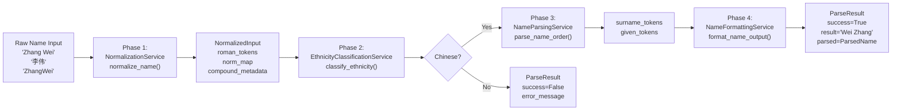
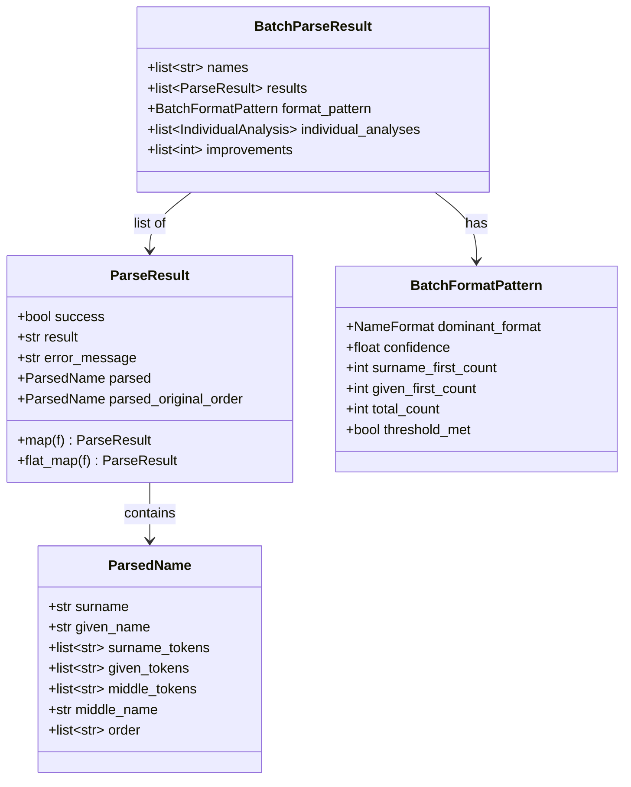

<!-- source: DeepWiki mcp.deepwiki.com · repo allenai/sinonym · page 1 Overview · fetched 2026-10-26 -->

# Overview

<details>
<summary>Relevant source files</summary>

The following files were used as context for generating this wiki page:

- [README.md](README.md)
- [pyproject.toml](pyproject.toml)
- [scripts/profile_run.py](scripts/profile_run.py)
- [sinonym/detector.py](sinonym/detector.py)
- [uv.lock](uv.lock)

</details>


**Sinonym** is a Chinese name detection and normalization library that processes romanized Chinese names through a multi-phase pipeline of normalization, ethnicity classification, parsing, and formatting. The system converts diverse input formats (Pinyin, Wade-Giles, Cantonese, mixed scripts, all-Chinese characters) into standardized "Given-Name Surname" format while filtering out non-Chinese names (Western, Korean, Vietnamese, Japanese).

For detailed information on specific subsystems, see:
- Architecture and pipeline details: [Core Architecture](#2)
- Individual service components: [Service Components](#3)
- Testing methodology: [Testing](#5)
- Deployment and CI/CD: [Development and Deployment](#6)

## System Architecture

The codebase follows a layered service-oriented architecture with clean separation of concerns:

```mermaid
graph TB
    subgraph "Public API Layer"
        ChineseNameDetector["ChineseNameDetector<br/>sinonym/detector.py"]
    end
    
    subgraph "Service Layer"
        NormalizationService["NormalizationService<br/>services/normalization/"]
        EthnicityClassificationService["EthnicityClassificationService<br/>services/ethnicity/"]
        NameParsingService["NameParsingService<br/>services/parsing/"]
        NameFormattingService["NameFormattingService<br/>services/formatting/"]
        BatchAnalysisService["BatchAnalysisService<br/>services/batch/"]
    end
    
    subgraph "Utility Layer"
        StringManipulationUtils["StringManipulationUtils<br/>services/utils/"]
        PinyinCacheService["PinyinCacheService<br/>services/cache/"]
    end
    
    subgraph "Data Layer"
        NameDataStructures["NameDataStructures<br/>services/data_structures.py"]
        ChineseNameConfig["ChineseNameConfig<br/>services/config.py"]
        DataFiles["sinonym/data/<br/>surnames, given names,<br/>ML models"]
    end
    
    ChineseNameDetector --> NormalizationService
    ChineseNameDetector --> EthnicityClassificationService
    ChineseNameDetector --> NameParsingService
    ChineseNameDetector --> NameFormattingService
    ChineseNameDetector --> BatchAnalysisService
    
    NormalizationService --> StringManipulationUtils
    NormalizationService --> PinyinCacheService
    NormalizationService --> NameDataStructures
    
    EthnicityClassificationService --> NameDataStructures
    EthnicityClassificationService --> ChineseNameConfig
    
    NameParsingService --> NameDataStructures
    NameParsingService --> ChineseNameConfig
    NameParsingService --> StringManipulationUtils
    
    NameFormattingService --> StringManipulationUtils
    NameFormattingService --> NameDataStructures
    
    BatchAnalysisService --> NameParsingService
    BatchAnalysisService --> EthnicityClassificationService
    BatchAnalysisService --> NameFormattingService
    
    NameDataStructures --> DataFiles
```



**Sources:** [sinonym/detector.py:1-670](), [pyproject.toml:1-104](), Diagram 1 and Diagram 3 from high-level system architecture

## Main Entry Point

The primary interface is the `ChineseNameDetector` class, which initializes all services and provides three main methods:

| Method | Purpose | Returns |
|--------|---------|---------|
| `normalize_name(raw_name)` | Process a single name | `ParseResult` with success/failure and parsed components |
| `analyze_name_batch(names, ...)` | Process multiple names with format detection | `BatchParseResult` with pattern analysis and improvements |
| `detect_batch_format(names, ...)` | Detect format pattern without full processing | `BatchFormatPattern` with confidence metrics |

The detector uses **lazy initialization** ([sinonym/detector.py:235-242]()) and **dependency injection** ([sinonym/detector.py:221-233]()) to manage service instantiation.

**Sources:** [sinonym/detector.py:190-243](), [sinonym/detector.py:249-496](), [sinonym/detector.py:502-633]()

## Processing Pipeline

Names flow through a four-phase pipeline with early-exit optimization:



**Phase Details:**

1. **Normalization** ([sinonym/services/normalization/]()): Handles text preprocessing, tokenization, romanization normalization, and compound surname detection. Produces `NormalizedInput` with token-level metadata.

2. **Ethnicity Classification** ([sinonym/services/ethnicity/]()): Three-tier system using linguistic patterns and ML classification (99.5% accuracy for Japanese detection). Early rejection of non-Chinese names.

3. **Parsing** ([sinonym/services/parsing/]()): Probabilistic boundary detection using frequency databases (~1400 surnames, ~3000 given names). Generates and scores parse candidates.

4. **Formatting** ([sinonym/services/formatting/]()): Output standardization with compound surname preservation, given name splitting, and capitalization normalization.

**Sources:** [sinonym/detector.py:249-495](), [README.md:11-27](), Diagram 2 from high-level system architecture

## Key Features and Capabilities

| Feature Category | Capabilities | Implementation |
|-----------------|--------------|----------------|
| **Input Formats** | Pinyin, Wade-Giles, Cantonese, all-Chinese characters, mixed scripts | `TextPreprocessor`, `NormalizationService` |
| **False Positive Prevention** | Korean, Vietnamese, Western, Japanese name filtering | `EthnicityClassificationService`, ML classifier (`.skops` models) |
| **Compound Handling** | Compound surnames (Duanmu, Au Yeung), compound given names (Wei-Ming) | `CompoundDetector`, format preservation in `compound_metadata` |
| **Script Support** | Han characters, diacritics, full-width characters, OCR errors | `han_pinyin_cache.pkl`, `pypinyin` library integration |
| **Batch Processing** | Format pattern detection, context-aware parsing, improvement tracking | `BatchAnalysisService` with configurable thresholds |
| **Performance** | ~0.16ms per name, >7500 names/sec, persistent caching | `PinyinCacheService`, lazy evaluation, thread-safe design |

**Sources:** [sinonym/detector.py:1-163](), [README.md:29-115](), [pyproject.toml:26-35]()

## Result Types

The system uses immutable dataclasses with functional composition patterns:



**Key Characteristics:**

- **ParseResult**: Either-monad pattern with `map`/`flat_map` for Scala interoperability ([sinonym/coretypes/results.py]())
- **ParsedName**: Two views - `parsed` (semantic, normalized to given-surname order) and `parsed_original_order` (positional, preserves input order) ([sinonym/coretypes/results.py]())
- **Immutability**: All dataclasses use `frozen=True` for thread safety
- **CompoundMetadata**: Authority for compound surname formatting, threading through entire pipeline ([sinonym/services/normalization/]())

**Sources:** [sinonym/coretypes/results.py](), [sinonym/coretypes/batch.py](), [README.md:236-271](), Diagram 5 from high-level system architecture

## Performance Characteristics

The system is optimized for production use with sub-millisecond latency:

| Metric | Value | Implementation Strategy |
|--------|-------|------------------------|
| Average latency | ~0.16ms per name | Lazy normalization, early exit patterns |
| Throughput | >7500 names/second | Persistent caching, single-pass processing |
| Cold start | ~100ms | Pre-computed `han_pinyin_cache.pkl` |
| Memory efficiency | 60% reduction | Lazy token processing, immutable structures |
| Thread safety | Full | Immutable data, thread-local caching |

**Performance validation** is enforced through CI with baseline tests ([scripts/profile_run.py:1-113](), [tests/test_performance.py]()).

**Sources:** [sinonym/detector.py:141-149](), [scripts/profile_run.py:1-113](), [README.md:112-115]()

## Batch vs Single Processing

Choose processing mode based on use case:

**Single Name Processing** (`normalize_name`):
- Individual names with unknown context
- Interactive/API use cases
- Mixed format lists where consistency isn't expected
- Example: `detector.normalize_name("Zhang Wei")` → `ParseResult`

**Batch Processing** (`analyze_name_batch`):
- Academic author lists (typically surname-first)
- Company directories (uniform formatting)
- Large datasets (100+ names) with expected consistency
- Achieves 90%+ accuracy on ambiguous cases through format detection
- Minimum 2 names, optimal with 5+ names
- Example: `detector.analyze_name_batch(["Zhang Wei", "Li Ming", ...])` → `BatchParseResult`

**Format Detection Only** (`detect_batch_format`):
- Data validation without full processing
- Pre-flight checks before batch operations
- Format consistency analysis
- Example: `detector.detect_batch_format(names)` → `BatchFormatPattern`

**Sources:** [sinonym/detector.py:502-633](), [README.md:273-388]()

## Data Sources and Dependencies

The library requires several external resources and dependencies:

| Category | Components | Location/Source |
|----------|-----------|----------------|
| **Python Dependencies** | `pypinyin`, `scikit-learn`, `numpy`, `scipy`, `joblib`, `skops` | [pyproject.toml:27-35]() |
| **Linguistic Data** | Chinese surnames (~1400), given names (~3000), compound variants | [sinonym/data/familyname_orcid.csv](), [sinonym/data/givenname_orcid.csv]() |
| **ML Models** | Japanese classifier (99.5% accuracy) | [sinonym/data/*.skops](), [sinonym/data/*.joblib]() |
| **Cache Data** | Han-to-Pinyin mappings | [sinonym/data/han_pinyin_cache.pkl]() |
| **Configuration** | Patterns, thresholds, validation rules | `ChineseNameConfig` in [sinonym/services/config.py]() |

All data is bundled in the package for offline operation ([pyproject.toml:53-57]()).

**Sources:** [pyproject.toml:1-104](), [sinonym/detector.py:117-123]()

## Installation and Quick Start

Installation via `uv`:

```bash
uv venv --python 3.11
source .venv/bin/activate  # or .venv\Scripts\activate on Windows
uv sync --active --all-extras --dev
```

Basic usage:

```python
from sinonym.detector import ChineseNameDetector

detector = ChineseNameDetector()

# Single name
result = detector.normalize_name("Zhang Wei")
# ParseResult(success=True, result="Wei Zhang")

# Batch processing
batch_result = detector.analyze_name_batch([
    "Zhang Wei", "Li Ming", "Wang Xiaoli"
])
# BatchParseResult with format_pattern.dominant_format = NameFormat.SURNAME_FIRST
```

**Sources:** [README.md:127-234](), [pyproject.toml:5-26]()

---

