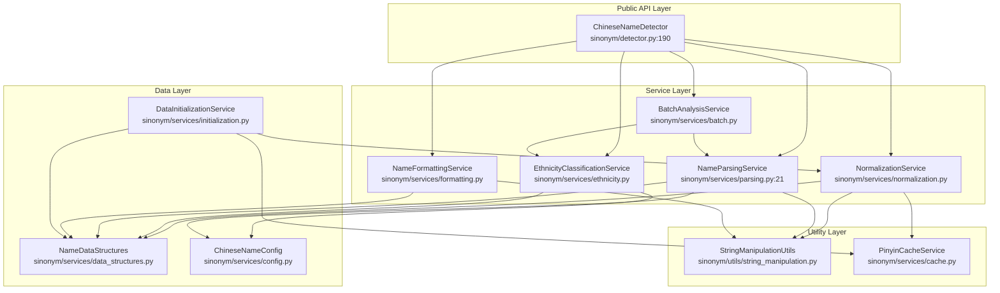
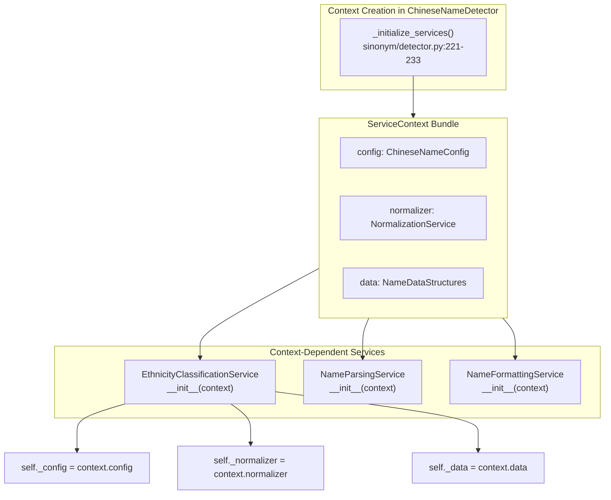
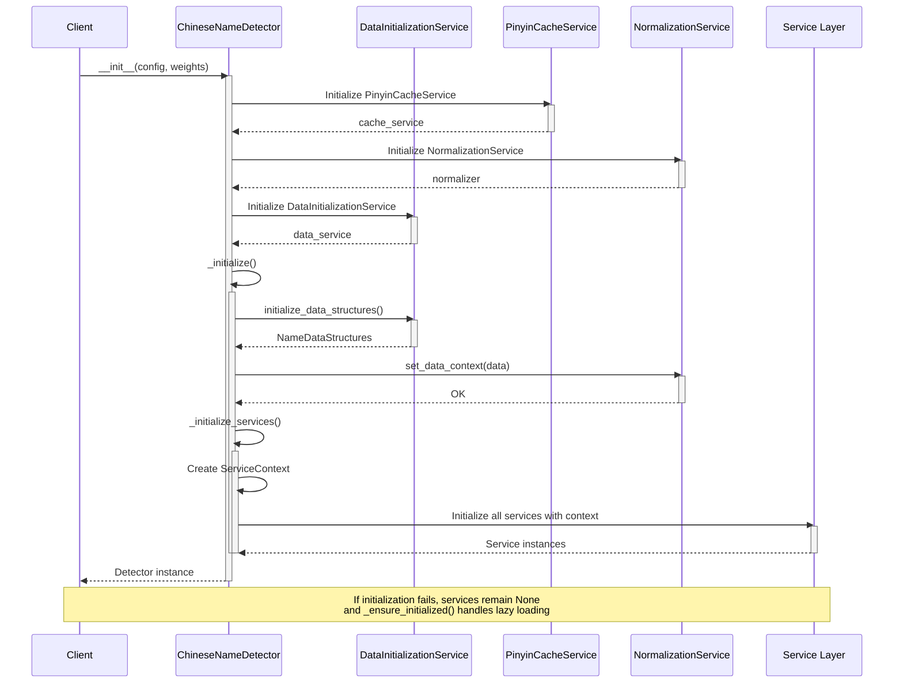
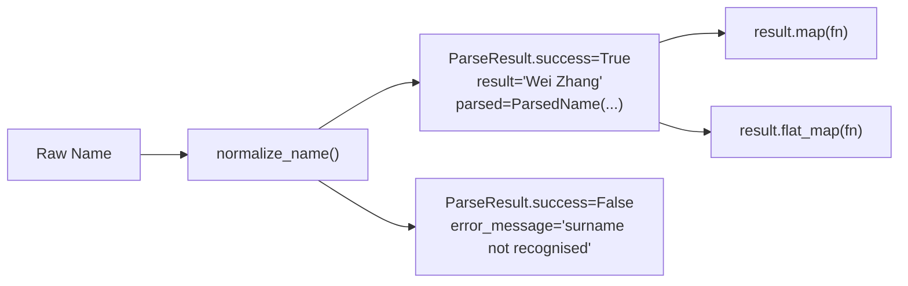
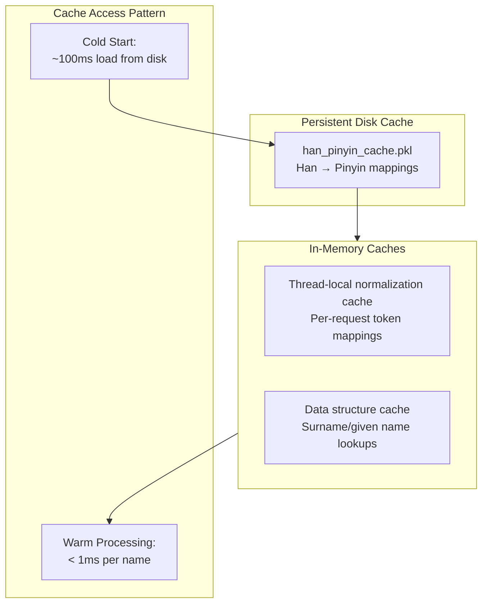

<!-- source: DeepWiki mcp.deepwiki.com · repo allenai/sinonym · page 2 Core Architecture · fetched 2026-10-26 -->

# Core Architecture

<details>
<summary>Relevant source files</summary>

The following files were used as context for generating this wiki page:

- [README.md](README.md)
- [scripts/profile_run.py](scripts/profile_run.py)
- [sinonym/detector.py](sinonym/detector.py)
- [sinonym/services/parsing.py](sinonym/services/parsing.py)

</details>


## Purpose and Scope

This page describes the overall system architecture of sinonym, including the layered component design, dependency management patterns, and initialization flow. It provides a high-level view of how the major components relate to each other and the architectural principles that guide the system design.

For details on the public API surface, see [ChineseNameDetector: Main API](#2.1). For the detailed four-phase processing pipeline, see [Processing Pipeline](#2.2). For batch processing capabilities, see [Batch Processing System](#2.3).

## Architectural Overview

Sinonym follows a **layered service architecture** that separates concerns into distinct responsibility domains. The system is designed around three core principles:

1. **Clean Separation of Concerns**: Each service has a single, well-defined responsibility
2. **Dependency Injection**: Services receive their dependencies explicitly through constructor injection
3. **Immutability**: Data structures are frozen/immutable for thread safety and functional composition

The architecture consists of four main layers stacked vertically, with the `ChineseNameDetector` class acting as the primary orchestrator that coordinates service interactions.

**Sources:** [sinonym/detector.py:1-243](), [README.md:19-27](), Diagram 1 from high-level architecture

## Component Layers

The system is organized into four distinct layers, each with specific responsibilities:

### Layer Structure



**Sources:** [sinonym/detector.py:190-243](), [sinonym/services/parsing.py:21-52](), Diagram 1 from high-level architecture

### Layer Responsibilities

| Layer | Components | Responsibilities |
|-------|-----------|------------------|
| **Public API** | `ChineseNameDetector` | Main entry point, orchestrates all services, manages initialization |
| **Service** | `NormalizationService`, `EthnicityClassificationService`, `NameParsingService`, `NameFormattingService`, `BatchAnalysisService` | Implements core processing logic for each pipeline phase |
| **Utility** | `StringManipulationUtils`, `PinyinCacheService` | Cross-cutting concerns, reusable string operations, caching infrastructure |
| **Data** | `NameDataStructures`, `ChineseNameConfig`, `DataInitializationService` | Linguistic databases, configuration, data loading and processing |

**Sources:** [sinonym/detector.py:170-183](), [README.md:111-117]()

## Dependency Management Pattern

The system uses a **ServiceContext** pattern to simplify dependency injection and reduce constructor complexity. Instead of passing multiple dependencies to each service, related dependencies are bundled into a context object.

### ServiceContext Pattern



**Sources:** [sinonym/detector.py:221-233](), [sinonym/services/parsing.py:24-35](), Diagram 3 from high-level architecture

### Legacy Compatibility

Services maintain backward compatibility with the old constructor interface while supporting the new `ServiceContext` pattern:

```python
# In NameParsingService.__init__()
if hasattr(context_or_config, "config"):
    # New context interface
    self._config = context_or_config.config
    self._normalizer = context_or_config.normalizer
    self._data = context_or_config.data
else:
    # Legacy interface - maintain backwards compatibility
    self._config = context_or_config
    self._normalizer = normalizer
    self._data = data
```

This dual-interface design allows gradual migration and maintains existing integrations.

**Sources:** [sinonym/services/parsing.py:24-35]()

## Initialization and Bootstrap Flow

The `ChineseNameDetector` follows a sophisticated initialization pattern with lazy loading and error resilience:



**Sources:** [sinonym/detector.py:193-243]()

### Lazy Initialization Pattern

The system implements defensive initialization with automatic retry:

```python
# sinonym/detector.py:193-208
def __init__(self, config: ChineseNameConfig | None = None, weights: list[float] | None = None):
    self._config = config or ChineseNameConfig.create_default()
    self._cache_service = PinyinCacheService(self._config)
    self._normalizer = NormalizationService(self._config, self._cache_service)
    self._data_service = DataInitializationService(self._config, self._cache_service, self._normalizer)
    self._data: NameDataStructures | None = None
    self._weights = weights
    
    # Service instances (initialized after data loading)
    self._ethnicity_service: EthnicityClassificationService | None = None
    self._parsing_service: NameParsingService | None = None
    self._formatting_service: NameFormattingService | None = None
    self._batch_analysis_service: BatchAnalysisService | None = None
    
    # Initialize data structures with error handling
    self._initialize()

# sinonym/detector.py:235-242
def _ensure_initialized(self) -> None:
    """Ensure data is initialized (lazy initialization)."""
    if self._data is None:
        self._data = self._data_service.initialize_data_structures()
        self._normalizer.set_data_context(self._data)
        self._initialize_services()
```

This pattern provides:
- **Resilience**: Construction succeeds even if data loading fails
- **Lazy Loading**: Data initialized on first use if needed
- **Thread Safety**: Services only created after data is ready

**Sources:** [sinonym/detector.py:193-242]()

## Architectural Patterns

### Immutability and Thread Safety

All core data structures are immutable (`frozen=True` dataclasses) to enable safe concurrent access:

| Pattern | Implementation | Benefit |
|---------|---------------|---------|
| **Frozen Dataclasses** | `@dataclass(frozen=True)` on all result types | Prevents accidental mutation |
| **Immutable Collections** | Data structures use tuples/frozensets internally | Thread-safe reads |
| **Persistent Caching** | Cache writes go to disk, reads are lock-free | Eliminates race conditions |

**Sources:** Diagram 5 from high-level architecture, [README.md:28-31]()

### Functional Error Handling

The system uses a **ParseResult** type that follows the Either monad pattern for Scala interoperability:



The `ParseResult` provides monadic operations:
- `map(f)`: Transform successful results
- `flat_map(f)`: Chain operations that return ParseResult

This design eliminates exception-based control flow and enables functional composition.

**Sources:** [sinonym/coretypes/results.py]() (referenced in imports), Diagram 5 from high-level architecture

### Pure Function Design

Services are designed with minimal side effects:

| Service | Pure Components | Side Effects |
|---------|----------------|--------------|
| `NormalizationService` | Token normalization, romanization conversion | None (uses pre-loaded cache) |
| `EthnicityClassificationService` | Pattern matching, ML classification | None (model loaded at init) |
| `NameParsingService` | Candidate generation, scoring | None (uses pre-loaded data) |
| `NameFormattingService` | String assembly, capitalization | None |
| `StringManipulationUtils` | All methods (static utility class) | None |

Only initialization (`DataInitializationService`) and caching (`PinyinCacheService`) perform I/O operations.

**Sources:** [sinonym/detector.py:21-33](), [sinonym/services/parsing.py:54-80]()

## Performance Design Considerations

The architecture incorporates several performance optimizations:

### Caching Strategy



**Sources:** [sinonym/detector.py:143-148](), [scripts/profile_run.py:56-62]()

### Early Exit Optimization

The normalization pipeline implements early exit patterns to minimize processing for non-Chinese names:

1. **Script Validation** (`contains_non_chinese_scripts`): Rejects inputs with Cyrillic, Arabic, etc. before any processing
2. **Length Validation**: Rejects names shorter than minimum tokens or longer than max length
3. **Ethnicity Classification**: Filters Korean/Vietnamese/Japanese names early in the pipeline

This design achieves sub-millisecond performance for most names by avoiding unnecessary computation.

**Sources:** [sinonym/detector.py:258-287](), [README.md:143-148]()

### Lazy Normalization

Token normalization is computed on-demand and cached per request:

```python
# Normalization creates a cache dict, not normalized strings
normalized_input = self._normalizer.apply(raw_name)
# normalized_input.norm_map contains token → normalized_form mappings
# Actual normalization happens only when tokens are accessed
```

This reduces memory usage by ~60% for large batches and avoids normalizing unused tokens.

**Sources:** [sinonym/detector.py:271](), [README.md:34]()

### Benchmark Performance

The system achieves the following performance characteristics:

| Metric | Value | Test Location |
|--------|-------|---------------|
| **Throughput** | 7,500+ names/sec | [tests/test_performance.py]() |
| **Latency** | < 1ms per name | [tests/test_performance.py]() |
| **Cold Start** | ~100ms | [scripts/profile_run.py:56-62]() |
| **Variance** | < 5% CV | [scripts/profile_run.py:93-101]() |

**Sources:** [README.md:143-148](), [scripts/profile_run.py:1-113](), [tests/test_performance.py]() (referenced)

---

