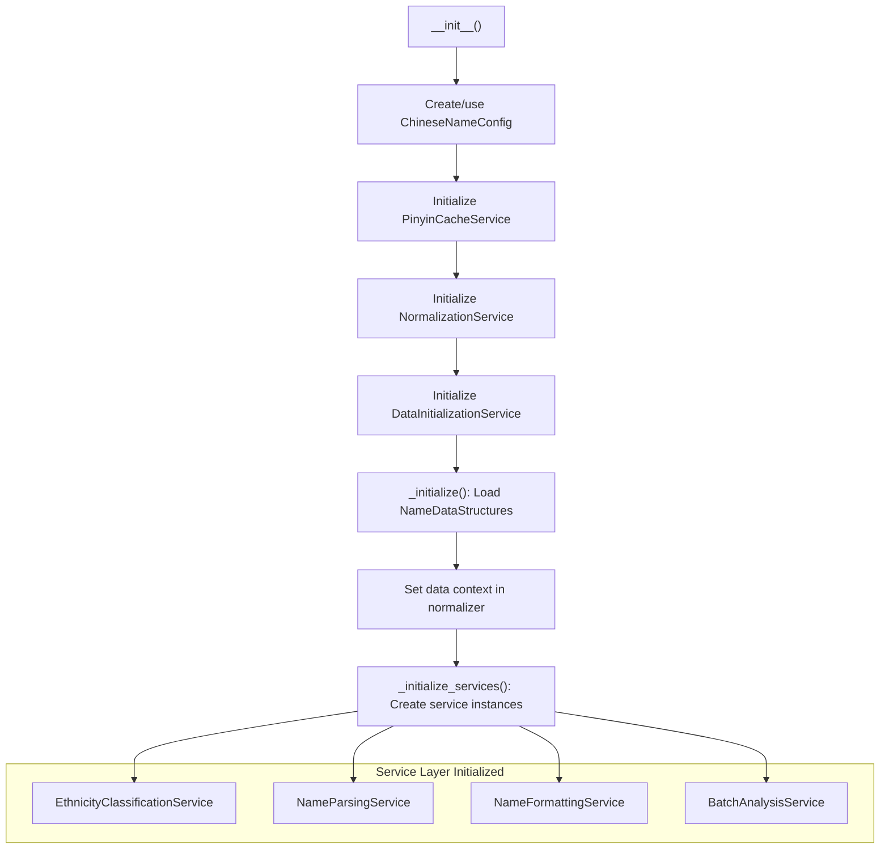
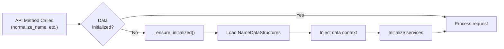
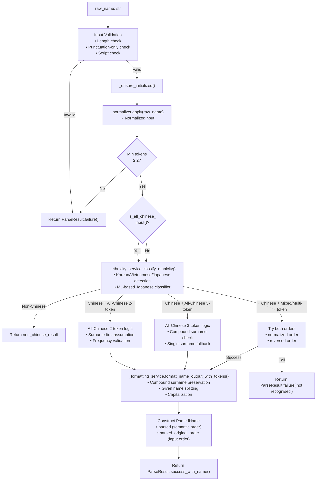
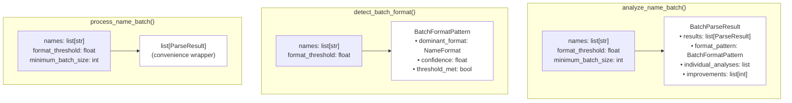
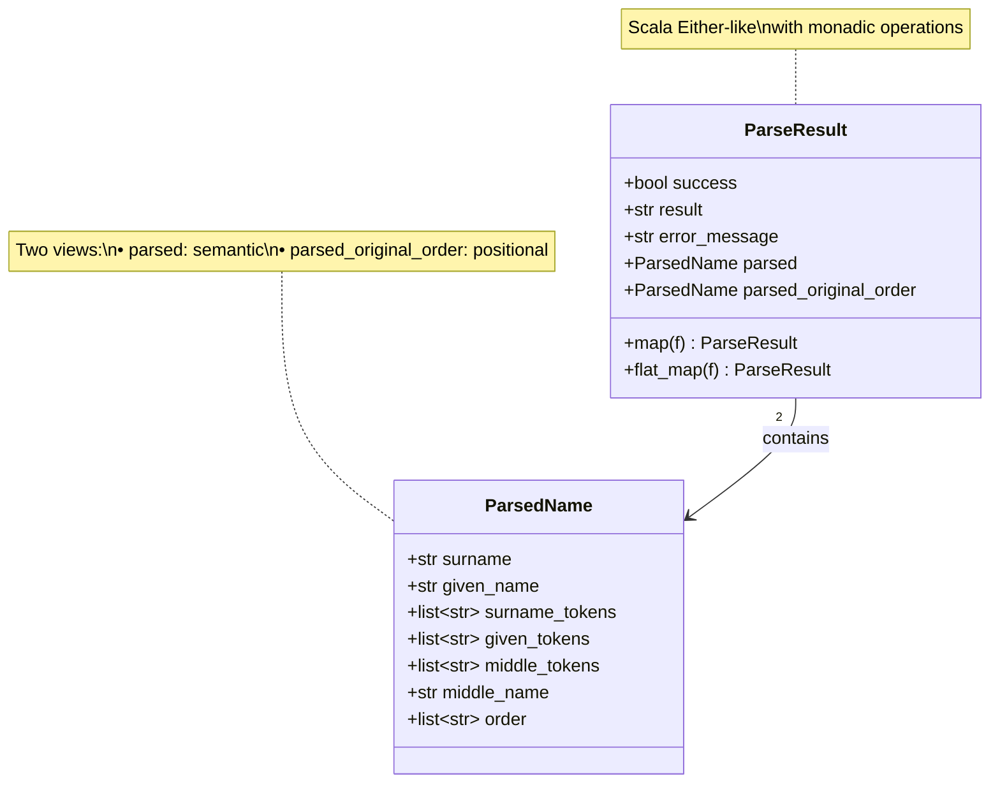
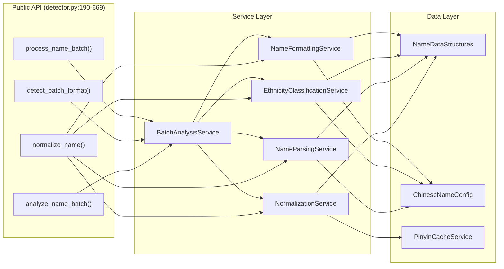

<!-- source: DeepWiki mcp.deepwiki.com · repo allenai/sinonym · page 2.1 ChineseNameDetector: Main API · fetched 2026-10-26 -->

# ChineseNameDetector: Main API

<details>
<summary>Relevant source files</summary>

The following files were used as context for generating this wiki page:

- [README.md](README.md)
- [scripts/profile_run.py](scripts/profile_run.py)
- [sinonym/detector.py](sinonym/detector.py)

</details>


## Purpose and Scope

This document covers the `ChineseNameDetector` class, which serves as the primary public interface for the sinonym library. It describes initialization, the main `normalize_name()` method for single-name processing, and the three batch processing methods (`analyze_name_batch()`, `detect_batch_format()`, `process_name_batch()`). For details on the internal processing pipeline that these methods orchestrate, see [Processing Pipeline](#2.2). For configuration options and parameter tuning, see [Configuration System](#4.3).

---

## Class Overview

The `ChineseNameDetector` class acts as the main orchestrator for Chinese name detection and normalization. It implements a facade pattern, hiding the complexity of the internal service layer and providing a simple, clean API for both single-name and batch processing operations.

**Location**: [sinonym/detector.py:190-669]()

**Key Responsibilities**:
- Initialize and manage service dependencies (normalization, parsing, formatting, ethnicity classification)
- Coordinate the four-phase processing pipeline
- Provide thread-safe name processing after initialization
- Support both individual and batch processing modes
- Expose cache management functionality

Sources: [sinonym/detector.py:1-188](), [README.md:1-50]()

---

## Initialization and Dependencies

### Constructor Signature

```python
ChineseNameDetector(
    config: ChineseNameConfig | None = None,
    weights: list[float] | None = None
)
```

**Parameters**:
- `config`: Optional configuration object for patterns, thresholds, and validation rules. Defaults to `ChineseNameConfig.create_default()`.
- `weights`: Optional scoring weights for the parsing service. Used to tune surname/given name boundary detection.

**Initialization Sequence**:



Sources: [sinonym/detector.py:193-242]()

---

### Lazy Initialization Pattern

The detector supports both eager and lazy initialization. If data loading fails during construction, services are initialized on first use via `_ensure_initialized()`.



**Implementation Details**:
- Private instance variables track initialization state (`_data`, `_ethnicity_service`, etc.)
- All public methods call `_ensure_initialized()` before processing
- Thread-safe after first initialization
- Fallback to lazy loading if construction fails (logged as warning)

Sources: [sinonym/detector.py:210-242]()

---

## Single Name Processing: normalize_name()

### Method Signature

```python
def normalize_name(raw_name: str) -> ParseResult
```

**Purpose**: Main API method for detecting if a name is Chinese and normalizing it to standardized "Given-Name Surname" format.

**Returns**: `ParseResult` with either:
- `success=True, result=formatted_name` if Chinese name detected
- `success=False, error_message=reason` if not a Chinese name

**Processing Flow**:



### Key Decision Points

**All-Chinese Character Handling** [sinonym/detector.py:276-422]():

The method uses special logic for inputs written entirely in Chinese characters:

| Token Count | Strategy | Rationale |
|-------------|----------|-----------|
| 2 tokens | Surname-first assumption with validation | Two-character Chinese names follow (surname, given) convention |
| 3 tokens | Compound surname check, then single surname fallback | Tests for compound surnames like 欧阳 (Ouyang) first |
| 4+ tokens | Standard parsing with both orders | No strong cultural convention, use frequency data |

**Mixed Script Handling** [sinonym/detector.py:424-493]():

For names with mixed Chinese characters and romanization, or pure romanization:
- Tries both `[surname, given]` and `[given, surname]` orders
- Selects first parse that passes validation
- Uses frequency-based scoring to disambiguate

Sources: [sinonym/detector.py:249-495]()

---

### Validation Rules

**Input Validation** [sinonym/detector.py:258-267]():

| Check | Threshold | Error Message |
|-------|-----------|---------------|
| Empty input | `len == 0` | "invalid input length" |
| Max length | `> config.max_name_length` | "invalid input length" |
| Punctuation-only | All chars in punctuation/whitespace | "name contains only punctuation/whitespace" |
| Non-Chinese scripts | Contains Cyrillic/Arabic/etc | "contains non-Chinese characters" |

**Token Count** [sinonym/detector.py:273-274]():
- Minimum: 2 tokens required (configurable via `config.min_tokens_required`)
- After normalization splits on whitespace, punctuation, and CamelCase

Sources: [sinonym/detector.py:258-274]()

---

## Batch Processing Methods

The detector provides three batch processing methods, each serving different use cases:

### Method Comparison



Sources: [sinonym/detector.py:502-633]()

---

### analyze_name_batch()

**Signature**:
```python
def analyze_name_batch(
    names: list[str],
    format_threshold: float = 0.55,
    minimum_batch_size: int = 2,
) -> BatchParseResult
```

**Purpose**: Full batch analysis with format pattern detection, individual name processing, and improvement tracking.

**Use Case**: Academic author lists, company directories, or any dataset where you need detailed analytics on batch processing improvements.

**Parameters**:
- `names`: List of raw name strings to analyze
- `format_threshold`: Minimum percentage (0.0-1.0) required to detect a dominant format (default: 0.55 = 55%)
- `minimum_batch_size`: Minimum number of names required for batch processing (default: 2)

**Returns**: `BatchParseResult` containing:
- `results`: List of `ParseResult` objects (one per input name)
- `format_pattern`: Detected format with confidence metrics
- `individual_analyses`: Detailed candidate lists for each name
- `improvements`: Indices of names that benefited from batch context

**Example**:
```python
# Academic paper author list
authors = ["Zhang Wei", "Li Ming", "Bei Yu", "Wang Xiaoli"]
result = detector.analyze_name_batch(authors)

print(f"Format: {result.format_pattern.dominant_format}")
print(f"Confidence: {result.format_pattern.confidence:.1%}")
print(f"Improved {len(result.improvements)} names via batch context")

for i in result.improvements:
    print(f"  {authors[i]} benefited from batch analysis")
```

Sources: [sinonym/detector.py:502-550](), [README.md:273-329]()

---

### detect_batch_format()

**Signature**:
```python
def detect_batch_format(
    names: list[str],
    format_threshold: float = 0.55,
) -> BatchFormatPattern
```

**Purpose**: Fast format pattern detection without full name processing. Useful for validation or pre-analysis.

**Use Case**: Data quality checks, determining if a dataset has consistent formatting before committing to full processing.

**Parameters**:
- `names`: List of raw name strings to analyze
- `format_threshold`: Minimum percentage (0.0-1.0) required for format detection

**Returns**: `BatchFormatPattern` with:
- `dominant_format`: Enum value (SURNAME_FIRST, GIVEN_FIRST, or MIXED)
- `confidence`: Float in [0.0, 1.0] indicating format consistency
- `surname_first_count`: Count of names preferring surname-first
- `given_first_count`: Count of names preferring given-first
- `total_count`: Total names analyzed
- `threshold_met`: Boolean indicating if confidence exceeds threshold

**Example**:
```python
# Pre-validate a dataset
unknown_names = ["Wei Zhang", "Ming Li", "Xiaoli Wang"]
pattern = detector.detect_batch_format(unknown_names)

if pattern.threshold_met:
    print(f"Consistent {pattern.dominant_format} formatting")
    print(f"Safe to batch process with {pattern.confidence:.1%} confidence")
else:
    print("Mixed formatting - recommend individual processing")
```

Sources: [sinonym/detector.py:552-602](), [README.md:217-225]()

---

### process_name_batch()

**Signature**:
```python
def process_name_batch(
    names: list[str],
    format_threshold: float = 0.55,
    minimum_batch_size: int = 2,
) -> list[ParseResult]
```

**Purpose**: Convenience wrapper that returns only the parse results from batch analysis.

**Use Case**: Data cleanup pipelines where you only need the formatted names, not the detailed analytics.

**Parameters**: Same as `analyze_name_batch()`

**Returns**: List of `ParseResult` objects (equivalent to `analyze_name_batch().results`)

**Example**:
```python
# Quick batch processing for data cleanup
messy_names = ["Li, Wei", "Zhang.Ming", "Wang Xiaoli"]
results = detector.process_name_batch(messy_names)

for original, result in zip(messy_names, results):
    if result.success:
        print(f"Cleaned: '{original}' → '{result.result}'")
```

Sources: [sinonym/detector.py:604-633](), [README.md:227-233]()

---

## Result Types

### ParseResult Structure



**Key Fields**:

| Field | Type | Purpose |
|-------|------|---------|
| `success` | `bool` | True if Chinese name detected, False otherwise |
| `result` | `str` | Formatted name in "Given-Name Surname" order (if success=True) |
| `error_message` | `str` | Reason for failure (if success=False) |
| `parsed` | `ParsedName` | Semantic view: normalized component order |
| `parsed_original_order` | `ParsedName` | Positional view: input order preserved |

**Common Error Messages**:
- `"surname not recognised"`: No valid Chinese surname found
- `"appears to be Korean name"`: Korean linguistic patterns detected
- `"appears to be Vietnamese name"`: Vietnamese naming conventions identified
- `"Japanese name detected by ML classifier"`: ML-based Japanese detection
- `"given name tokens are not plausibly Chinese"`: Given name validation failed
- `"invalid input length"`: Input too short or too long
- `"contains non-Chinese characters"`: Non-CJK scripts detected

Sources: [sinonym/coretypes/results.py](), [sinonym/detector.py:258-267]()

---

### ParsedName Dual View System

The `ParsedName` structure provides two complementary views of the same parsed name:

**Semantic View (`parsed`)**:
- Always represents normalized output order: `["given", "middle", "surname"]`
- `surname`: The family name component
- `given_name`: The personal name component
- Used for display and downstream processing

**Positional View (`parsed_original_order`)**:
- Preserves input order: `["surname", "given"]` or `["given", "surname"]`
- Labels are positional: `given_name` = first component in input
- Used for understanding original formatting

**Example**:
```python
result = detector.normalize_name("Li Wei")

# Semantic view (normalized output)
result.parsed.surname        # "Li"
result.parsed.given_name     # "Wei"
result.parsed.order          # ["given", "middle", "surname"]

# Positional view (input order)
result.parsed_original_order.given_name   # "Li" (first in input)
result.parsed_original_order.surname      # "Wei" (last in input)
result.parsed_original_order.order        # ["surname", "given"]
```

Sources: [README.md:236-271](), [sinonym/coretypes/results.py]()

---

## Code Entity Mapping

### Public API Methods to Internal Services



### File-Level Organization

| Component | File Path | Lines | Purpose |
|-----------|-----------|-------|---------|
| Main Class | `sinonym/detector.py` | 190-669 | ChineseNameDetector implementation |
| Result Types | `sinonym/coretypes/results.py` | - | ParseResult, ParsedName structures |
| Batch Types | `sinonym/coretypes/batch.py` | - | BatchParseResult, BatchFormatPattern |
| Service Context | `sinonym/services/context.py` | - | ServiceContext dependency bundle |
| Config | `sinonym/services/config.py` | - | ChineseNameConfig patterns/thresholds |

Sources: [sinonym/detector.py:1-670]()

---

## Utility Methods

### get_cache_info()

**Signature**:
```python
def get_cache_info() -> CacheInfo
```

**Purpose**: Retrieve cache statistics for monitoring and diagnostics.

**Returns**: `CacheInfo` object with:
- `cache_size`: Number of characters in the Pinyin cache
- Additional cache metadata

**Example**:
```python
detector = ChineseNameDetector()
cache_info = detector.get_cache_info()
print(f"Cache contains {cache_info.cache_size} Han→Pinyin mappings")
```

Sources: [sinonym/detector.py:245-247]()

---

### is_chinese_name() (Deprecated)

**Signature**:
```python
def is_chinese_name(raw_name: str) -> ParseResult
```

**Status**: Deprecated alias for `normalize_name()`. Maintained for backwards compatibility.

**Recommendation**: Use `normalize_name()` in new code.

Sources: [sinonym/detector.py:498-500]()

---

## Performance Characteristics

### Single Name Processing

**Benchmark Results** (from production testing):

| Metric | Value | Notes |
|--------|-------|-------|
| Average latency | ~0.16ms | Comprehensive benchmark validated |
| Cold start | ~100ms | Initial data loading with persistent cache |
| Warm processing | <1ms | Most names with early exit optimization |
| Throughput | 7,500+ names/sec | Thread-safe after initialization |

**Optimization Strategies**:
- Lazy normalization reduces memory usage by ~60%
- Persistent disk cache for Han→Pinyin mappings
- Early exit for non-Chinese scripts
- Single-pass string transformations

Sources: [sinonym/detector.py:141-148](), [scripts/profile_run.py:1-113]()

### Batch Processing Performance

**Batch Overhead**: Minimal - format detection adds <5% overhead compared to individual processing.

**Best Performance**:
- Batch sizes of 5-20 names optimal for pattern detection
- Minimum 2 names required for batch benefits
- Non-Chinese names in batch don't degrade performance (rejected during individual analysis)

Sources: [README.md:273-387]()

---

## Thread Safety

The `ChineseNameDetector` is **thread-safe after initialization**:

- **Initialization**: Not thread-safe. Complete initialization in single thread before sharing.
- **Processing**: All processing methods (`normalize_name()`, batch methods) are thread-safe.
- **Caching**: Uses immutable data structures and thread-local caching where needed.
- **Service Instances**: All service instances are stateless or use immutable state.

**Recommended Pattern**:
```python
# Initialize once in main thread
detector = ChineseNameDetector()

# Safe to use from multiple threads
with ThreadPoolExecutor() as executor:
    results = executor.map(detector.normalize_name, name_list)
```

Sources: [sinonym/detector.py:159-162]()

---

## Usage Examples

### Basic Single Name Processing

```python
from sinonym.detector import ChineseNameDetector

detector = ChineseNameDetector()

# Standard name
result = detector.normalize_name("Zhang Wei")
print(result.result)  # "Wei Zhang"

# Compound given name
result = detector.normalize_name("Li Weiming")
print(result.result)  # "Wei-Ming Li"

# All-Chinese characters
result = detector.normalize_name("巩俐")
print(result.result)  # "Li Gong"

# Non-Chinese name (rejected)
result = detector.normalize_name("John Smith")
print(result.error_message)  # "surname not recognised"
```

Sources: [README.md:166-204]()

---

### Batch Processing with Analytics

```python
# Academic author list
authors = [
    "Zhang Wei",
    "Li Ming", 
    "Wang Xiaoli",
    "Liu Jiaming",
    "Feng Cha"  # Ambiguous case
]

result = detector.analyze_name_batch(authors)

# Check format detection
print(f"Format: {result.format_pattern.dominant_format}")
print(f"Confidence: {result.format_pattern.confidence:.1%}")
print(f"Surname-first: {result.format_pattern.surname_first_count}")
print(f"Given-first: {result.format_pattern.given_first_count}")

# Review improvements
print(f"\nImproved {len(result.improvements)} names:")
for idx in result.improvements:
    print(f"  {authors[idx]} benefited from batch context")

# Process results
for name, parse_result in zip(authors, result.results):
    if parse_result.success:
        print(f"{name} → {parse_result.result}")
```

Sources: [README.md:206-216]()

---

### Pre-Validation with Format Detection

```python
# Check dataset consistency before full processing
dataset = ["Wei Zhang", "Ming Li", "Xiaoli Wang"]

pattern = detector.detect_batch_format(dataset)

if pattern.threshold_met:
    print(f"Consistent {pattern.dominant_format} format detected")
    print(f"Confidence: {pattern.confidence:.1%}")
    
    # Safe to batch process
    results = detector.process_name_batch(dataset)
else:
    print("Mixed formatting - process individually")
    results = [detector.normalize_name(name) for name in dataset]
```

Sources: [README.md:217-225]()

---

### Mixed Dataset Handling

```python
# Dataset with both Chinese and non-Chinese names
mixed_names = [
    "John Smith",      # Western - rejected
    "Mary Johnson",    # Western - rejected
    "Zhang Wei",       # Chinese - processed
    "Li Ming",         # Chinese - processed
    "Kim Min-jun",     # Korean - rejected
    "Wang Xiaoli"      # Chinese - processed
]

result = detector.analyze_name_batch(mixed_names)

# Format detection uses only valid Chinese names
print(f"Format: {result.format_pattern.dominant_format}")
print(f"Chinese names: {result.format_pattern.total_count}")

# Results maintain input-output correspondence
for name, parse_result in zip(mixed_names, result.results):
    if parse_result.success:
        print(f"✅ {name} → {parse_result.result}")
    else:
        print(f"❌ {name} → {parse_result.error_message}")
```

Sources: [README.md:337-386]()

---

### Custom Configuration

```python
from sinonym.services import ChineseNameConfig

# Create custom config with adjusted thresholds
custom_config = ChineseNameConfig.create_default()
# (Config modification would happen here if API exposed)

detector = ChineseNameDetector(config=custom_config)

# Custom scoring weights for parsing
weights = [1.0, 0.8, 0.6]  # Adjust surname/given preferences
detector_weighted = ChineseNameDetector(weights=weights)
```

Sources: [sinonym/detector.py:193-199]()

---

## Error Handling Patterns

### Result-Based Error Handling

The detector uses a **Result pattern** (Scala Either-like) instead of exceptions for expected failures:

```python
result = detector.normalize_name(user_input)

if result.success:
    # Happy path
    display_name = result.result
    surname = result.parsed.surname
    given_name = result.parsed.given_name
else:
    # Expected failure (not Chinese name)
    log_rejection(result.error_message)
    fallback_to_original(user_input)
```

**Benefits**:
- No exception handling needed for expected non-Chinese names
- Error messages are structured and machine-readable
- Suitable for batch processing without interruption

Sources: [sinonym/detector.py:29-30](), [sinonym/coretypes/results.py]()

---

### Monadic Operations

`ParseResult` supports functional composition:

```python
# Map over success cases
result.map(lambda name: name.upper())

# Flat map for chaining operations
def process_further(name: str) -> ParseResult:
    # Additional processing...
    return ParseResult.success(processed_name)

result.flat_map(process_further)
```

Sources: [sinonym/coretypes/results.py]()

---

