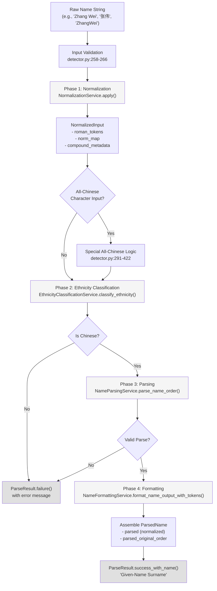
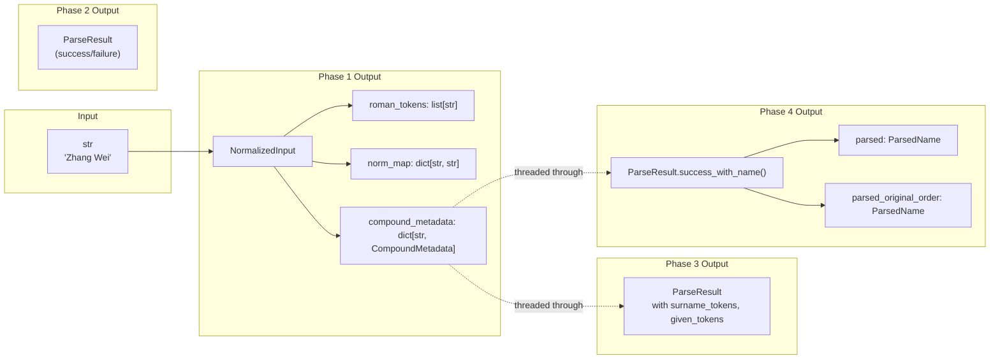
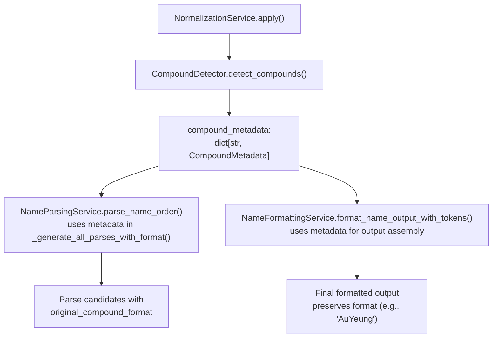
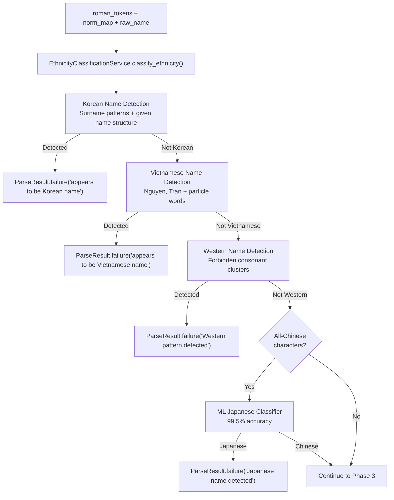
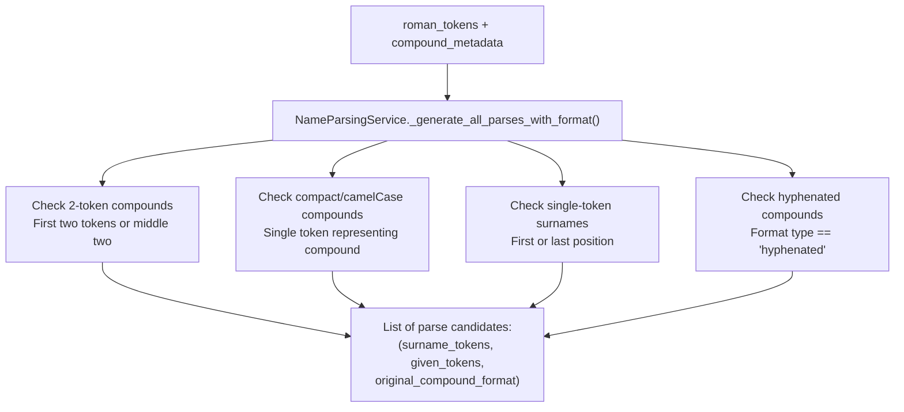
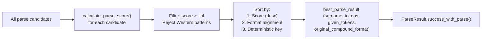
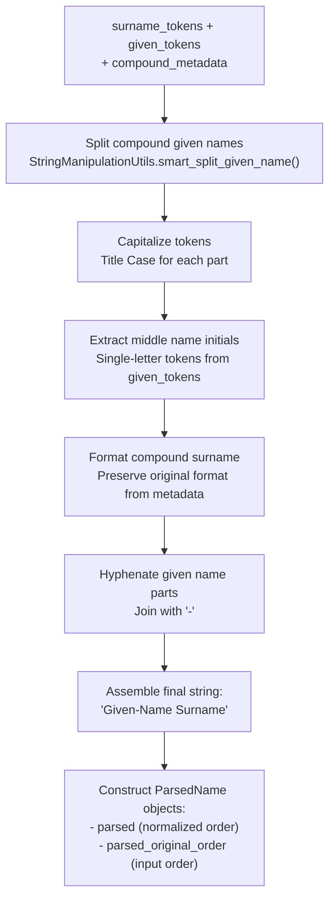
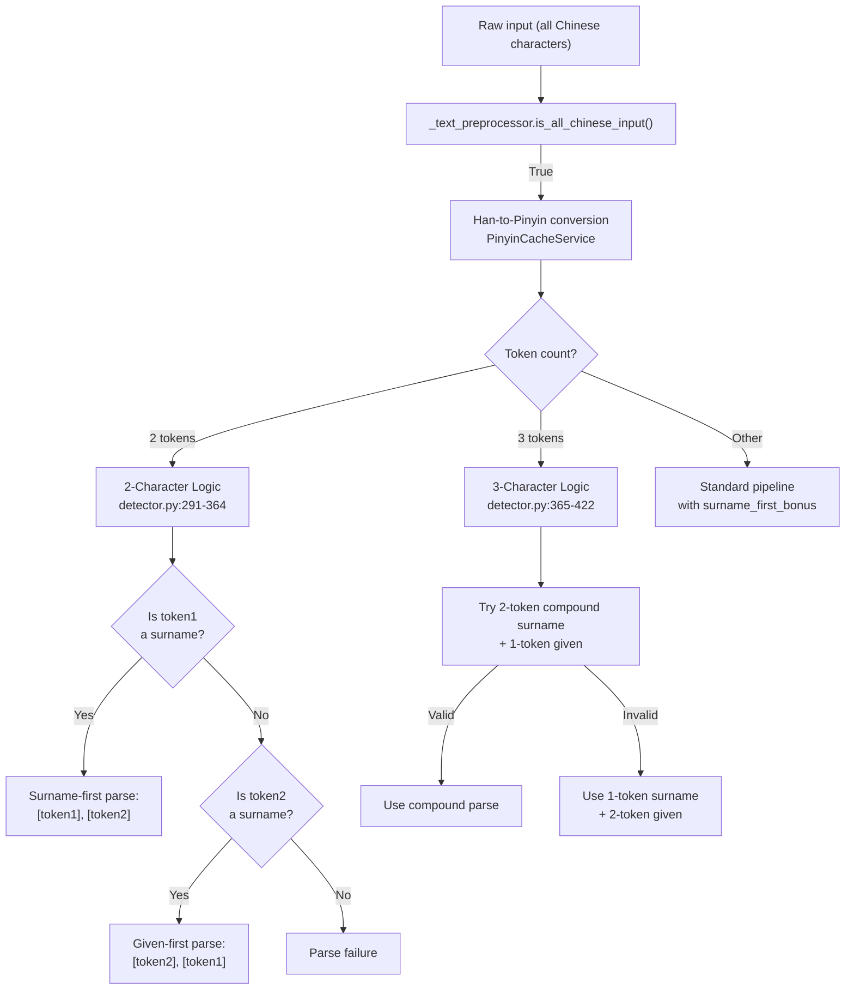
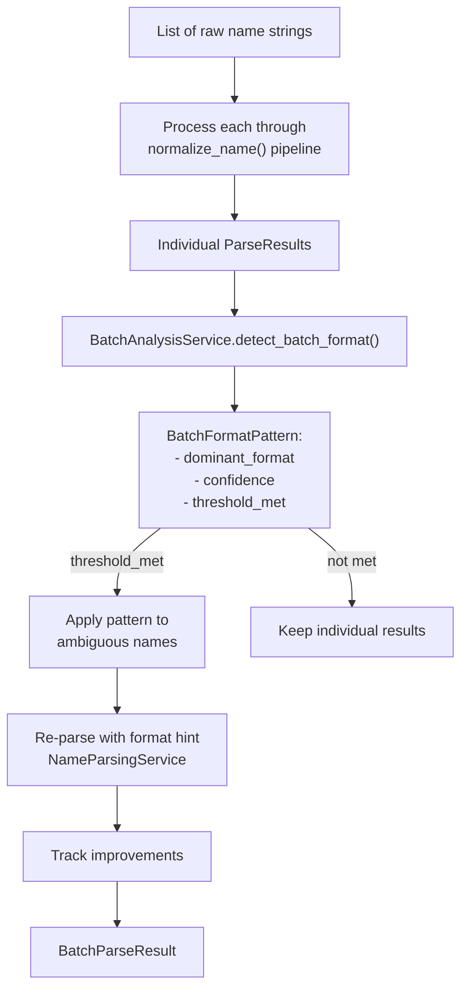

<!-- source: DeepWiki mcp.deepwiki.com · repo allenai/sinonym · page 2.2 Processing Pipeline · fetched 2026-10-26 -->

# Processing Pipeline

<details>
<summary>Relevant source files</summary>

The following files were used as context for generating this wiki page:

- [README.md](README.md)
- [scripts/profile_run.py](scripts/profile_run.py)
- [sinonym/detector.py](sinonym/detector.py)
- [sinonym/services/parsing.py](sinonym/services/parsing.py)

</details>


## Purpose and Scope

This document describes the four-phase processing pipeline that transforms raw name strings into normalized output. The pipeline consists of sequential stages: normalization, ethnicity classification, parsing, and formatting. Each phase builds on the previous phase's output, with early exit patterns for non-Chinese names.

For the main API entry point that invokes this pipeline, see [ChineseNameDetector: Main API](#2.1). For batch processing extensions that optimize the pipeline for multiple names, see [Batch Processing System](#2.3). For details on individual service implementations, see [Service Components](#3).

**Sources:** [sinonym/detector.py:249-495](), [README.md:11-27]()

## Pipeline Architecture

The processing pipeline is implemented as a sequential transformation of data structures, with each phase producing outputs consumed by the next phase. The `ChineseNameDetector.normalize_name()` method orchestrates the entire pipeline.



**Sources:** [sinonym/detector.py:249-495](), [README.md:11-27]()

## Data Flow Through Phases

The pipeline transforms data through well-defined structures at each phase boundary. The `compound_metadata` generated in Phase 1 is threaded through all subsequent phases to preserve user-specified compound surname formats.



**Sources:** [sinonym/detector.py:270-275](), [sinonym/services/normalization.py](), [sinonym/coretypes/results.py]()

## Phase 1: Normalization

Phase 1 transforms raw input into a canonical representation suitable for parsing. The `NormalizationService.apply()` method performs tokenization, romanization normalization, and compound surname detection.

### Normalization Process

| Step | Operation | Component |
|------|-----------|-----------|
| 1 | Text preprocessing | `TextPreprocessor` removes structural noise |
| 2 | Tokenization | Split on whitespace/punctuation |
| 3 | Han-to-Pinyin conversion | `PinyinCacheService` for Chinese characters |
| 4 | Romanization normalization | Wade-Giles, diacritics, full-width chars |
| 5 | Compound detection | `CompoundDetector` generates metadata |

**Key Outputs:**

- `roman_tokens: list[str]` - Clean, romanized tokens ready for parsing
- `norm_map: dict[str, str]` - Original token → normalized form mapping (preserves user input)
- `compound_metadata: dict[str, CompoundMetadata]` - Authority for compound surname formatting

**Sources:** [sinonym/detector.py:270-275](), [README.md:16-27](), [sinonym/services/normalization.py]()

### Compound Metadata Threading

The `compound_metadata` dictionary generated in Phase 1 is the "single source of truth" for compound surname formatting. It is passed through all subsequent phases to ensure format preservation.



**Sources:** [sinonym/services/parsing.py:54-80](), [sinonym/services/parsing.py:330-343](), [sinonym/services/normalization.py]()

## Phase 2: Ethnicity Classification

Phase 2 filters non-Chinese names using a three-tier classification system. This phase implements early exit patterns to reject names quickly without full processing.

### Classification Workflow



**Sources:** [sinonym/detector.py:280-287](), [sinonym/services/ethnicity.py](), [README.md:95-100]()

### Early Exit Optimization

The ethnicity classification phase provides significant performance benefits through early rejection:

- **Korean names**: Rejected at ~0.05ms (surname pattern matching)
- **Vietnamese names**: Rejected at ~0.06ms (particle word detection)
- **Western names**: Rejected at ~0.07ms (consonant cluster analysis)
- **Japanese names** (all-Chinese): Rejected at ~0.12ms (ML classification)

These early exits prevent expensive parsing operations on non-Chinese names.

**Sources:** [sinonym/detector.py:280-287](), [scripts/profile_run.py:85-91]()

## Phase 3: Name Parsing

Phase 3 identifies surname/given name boundaries using probabilistic scoring. The `NameParsingService` generates multiple parse candidates and selects the highest-scoring parse.

### Parse Candidate Generation

The parsing service uses `_generate_all_parses_with_format()` to create all valid surname/given name splits, considering compound surnames and various token positions.



**Sources:** [sinonym/services/parsing.py:218-328](), [sinonym/services/parsing.py:54-80]()

### Probabilistic Scoring

Each parse candidate is scored using an 8-feature weighted model. The `calculate_parse_score()` method evaluates frequency data, cultural patterns, and comparative features.

| Feature | Weight | Purpose |
|---------|--------|---------|
| `surname_logp` | 0.465 | Surname frequency (log probability) |
| `given_logp_sum` | 0.395 | Sum of given name log probabilities |
| `surname_rank_bonus` | -0.888 | Percentile rank-based bonus |
| `compound_given_bonus` | 1.348 | Bonus for 2-syllable given names |
| `order_preservation_bonus` | 1.102 | Preserve input order for ambiguous cases |
| `surname_first_bonus` | 0.425 | Bonus for surname-first in all-Chinese |
| `surname_freq_log_ratio` | -0.042 | Log frequency ratio (comparative) |
| `surname_rank_difference` | -0.573 | Rank difference (comparative) |

**Sources:** [sinonym/services/parsing.py:345-445](), [sinonym/services/parsing.py:38-51]()

### Parse Selection



**Sources:** [sinonym/services/parsing.py:132-216](), [sinonym/services/parsing.py:201-216]()

## Phase 4: Name Formatting

Phase 4 assembles the final output by splitting compound given names, applying capitalization, and constructing the standardized `ParsedName` structure. The `NameFormattingService` consumes parse results and compound metadata to produce formatted output.

### Formatting Operations



**Sources:** [sinonym/services/formatting.py](), [sinonym/detector.py:316-363]()

### ParsedName Construction

The formatting phase produces two `ParsedName` views of the same normalized components:

1. **`parsed`**: Semantic view with components in normalized `Given-Name Surname` order
   - `order` typically `["given", "middle", "surname"]`
   - Labels reflect semantic roles (surname is the family name)

2. **`parsed_original_order`**: Positional view aligned to input token order
   - `order` reflects input structure (e.g., `["surname", "given"]` for surname-first input)
   - Labels are positional: "given" = first component(s), "surname" = last component(s)

**Sources:** [sinonym/detector.py:324-362](), [sinonym/detector.py:437-491](), [README.md:237-271]()

## Special Case: All-Chinese Inputs

Names written entirely in Chinese characters receive specialized handling before entering the standard pipeline. The detector applies cultural conventions and frequency analysis specific to Han character inputs.

### All-Chinese Processing Logic



**Sources:** [sinonym/detector.py:276-278](), [sinonym/detector.py:291-422]()

### Surname-First Preference

For all-Chinese inputs, the system applies a `surname_first_bonus` (weight 0.425) to parses that follow traditional Chinese surname-first ordering. This bonus is only applied when `is_all_chinese=True` is passed to `calculate_parse_score()`.

**Example:**
- Input: `"李伟"` (Li Wei in Chinese characters)
- Parse candidates: 
  - Surname-first `["李", "伟"]`: receives bonus → score increased
  - Given-first `["伟", "李"]`: no bonus → lower score
- Result: `"Wei Li"` (surname-first parse selected)

**Sources:** [sinonym/services/parsing.py:386-397](), [sinonym/detector.py:291-304]()

## Integration with Batch Processing

The processing pipeline serves as the foundation for batch processing operations. Each name in a batch is individually processed through all four phases, then batch-level analysis detects format patterns and applies corrections.

### Batch Processing Workflow



**Sources:** [sinonym/detector.py:502-547](), [sinonym/services/batch_analysis.py]()

### Format Pattern Detection

Batch format detection analyzes the individual parse results to identify consistent formatting patterns. The `BatchAnalysisService` examines which names prefer surname-first vs. given-first ordering based on their parse scores.

**Threshold Behavior:**
- Default threshold: 55% (configurable via `format_threshold` parameter)
- If ≥55% of successfully parsed names prefer the same format → pattern detected
- Pattern is applied to improve ambiguous cases (e.g., names with close parse scores)
- Non-Chinese names in batch are excluded from pattern detection

**Sources:** [sinonym/detector.py:505-547](), [README.md:273-330]()

## Error Handling and Propagation

The pipeline uses `ParseResult` as a functional error type, enabling errors to propagate cleanly through phases without exceptions. Each phase can return failure results that short-circuit remaining phases.

### Error Types by Phase

| Phase | Error Message | Cause |
|-------|---------------|-------|
| Input Validation | `"invalid input length"` | Empty or too long (>200 chars) |
| Input Validation | `"name contains only punctuation/whitespace"` | No content |
| Input Validation | `"contains non-Chinese characters"` | Cyrillic, Arabic, etc. |
| Normalization | `"needs at least 2 Roman tokens"` | Insufficient tokens after conversion |
| Ethnicity | `"appears to be Korean name"` | Korean patterns detected |
| Ethnicity | `"appears to be Vietnamese name"` | Vietnamese patterns detected |
| Ethnicity | `"Western pattern detected"` | Forbidden consonant clusters |
| Ethnicity | `"Japanese name detected by ML classifier"` | ML classification result |
| Parsing | `"surname not recognised"` | No valid parse candidates |
| Parsing | `"no valid parse found"` | All candidates scored < threshold |
| Formatting | `"given name tokens are not plausibly Chinese"` | Validation failure |

**Sources:** [sinonym/detector.py:258-266](), [sinonym/detector.py:280-287](), [sinonym/services/parsing.py:80-130](), [sinonym/coretypes/results.py]()

### ParseResult Monadic Operations

`ParseResult` provides `map()` and `flat_map()` operations for functional composition, enabling Scala-style error handling:

```python
# Pipeline composition example (conceptual)
result = (
    normalize_input(raw_name)
    .flat_map(lambda n: classify_ethnicity(n))
    .flat_map(lambda n: parse_name(n))
    .map(lambda p: format_output(p))
)
```

**Sources:** [sinonym/coretypes/results.py](), [README.md:27-30]()

---

