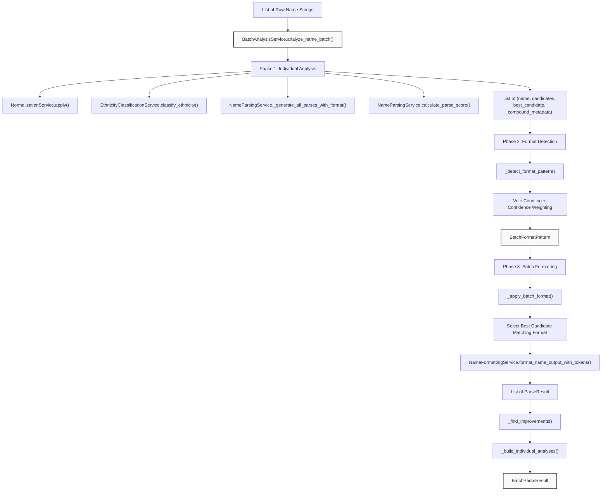
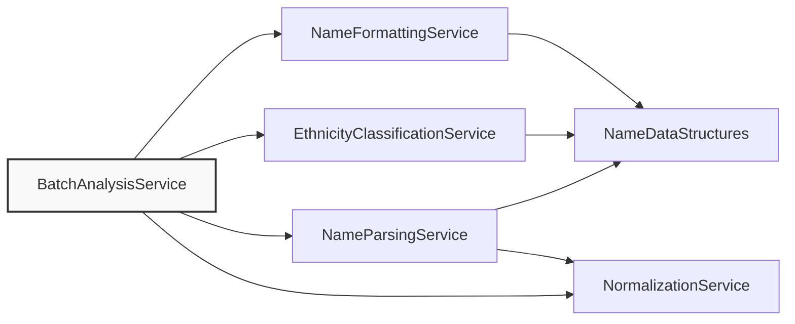

<!-- source: DeepWiki mcp.deepwiki.com · repo allenai/sinonym · page 2.3 Batch Processing System · fetched 2026-10-26 -->

# Batch Processing System

<details>
<summary>Relevant source files</summary>

The following files were used as context for generating this wiki page:

- [README.md](README.md)
- [scripts/profile_run.py](scripts/profile_run.py)
- [sinonym/services/batch_analysis.py](sinonym/services/batch_analysis.py)
- [tests/test_batch.py](tests/test_batch.py)
- [tests/test_middle_names.py](tests/test_middle_names.py)

</details>


## Purpose and Scope

This document describes the batch analysis capabilities of Sinonym, which improve name parsing accuracy by detecting consistent formatting patterns across multiple names. When processing lists of Chinese names (e.g., academic author lists, company directories), the batch system analyzes all names together to determine whether they follow surname-first or given-first formatting, then applies this pattern to resolve ambiguous individual cases.

For information about the overall processing pipeline, see [Processing Pipeline](#2.2). For details about individual name parsing, see [Name Parsing Service](#3.3). For batch processing test coverage, see [Batch Processing Tests](#5.5).

**Sources:** [sinonym/services/batch_analysis.py:1-7](), [README.md:273-330]()

---

## System Overview

The batch processing system addresses a fundamental challenge in Chinese name parsing: many romanized names are ambiguous in isolation. For example, "Li Wei" could be interpreted as "Wei Li" (given-first) or "Li Wei" (surname-first). By analyzing multiple names together, the system can detect formatting consistency and apply that pattern to improve individual parsing decisions.

### Key Capabilities

| Capability | Description |
|------------|-------------|
| **Format Detection** | Identifies whether a batch follows surname-first or given-first ordering |
| **Confidence Calculation** | Computes pattern confidence using vote counting and weighted tie-breaking |
| **Consistent Application** | Applies detected format to all Chinese names in the batch |
| **Improvement Tracking** | Identifies names that benefit from batch context vs. individual parsing |
| **Mixed-Type Handling** | Processes batches containing both Chinese and non-Chinese names |
| **Graceful Fallback** | Falls back to individual processing when patterns are unclear |

**Sources:** [sinonym/services/batch_analysis.py:28-40](), [README.md:279-291]()

---

## Core Components

### BatchAnalysisService

The `BatchAnalysisService` class orchestrates batch processing by coordinating with the parsing, ethnicity, and formatting services:

```python
class BatchAnalysisService:
    def __init__(
        self,
        parsing_service: NameParsingService,
        ethnicity_service: EthnicityClassificationService | None = None,
        format_threshold: float = 0.55,
    )
```

**Constructor Parameters:**
- `parsing_service`: NameParsingService instance for generating parse candidates
- `ethnicity_service`: Optional EthnicityClassificationService for non-Chinese filtering
- `format_threshold`: Minimum confidence threshold for format detection (default 0.55, advisory only)

**Sources:** [sinonym/services/batch_analysis.py:28-39]()

### Data Structures

The batch system uses four key data structures to represent analysis results:

| Type | Purpose | Key Fields |
|------|---------|------------|
| `BatchParseResult` | Complete batch analysis output | `names`, `results`, `format_pattern`, `individual_analyses`, `improvements` |
| `BatchFormatPattern` | Detected format pattern with confidence | `dominant_format`, `confidence`, `surname_first_count`, `given_first_count`, `total_count`, `threshold_met` |
| `IndividualAnalysis` | Per-name analysis details | `raw_name`, `candidates`, `best_candidate`, `confidence` |
| `ParseCandidate` | Single parse interpretation | `surname_tokens`, `given_tokens`, `score`, `format`, `original_compound_format` |

**Sources:** [sinonym/coretypes/__init__.py](), [sinonym/services/batch_analysis.py:13-21]()

---

## Batch Processing Data Flow

### Component Interaction Diagram



**Sources:** [sinonym/services/batch_analysis.py:41-102]()

### Service Dependency Chain



**Sources:** [sinonym/services/batch_analysis.py:31-35]()

---

## Three-Phase Batch Processing Algorithm

### Phase 1: Individual Analysis with Normalization Reuse

Each name is analyzed individually to generate all possible parse candidates. Normalization is performed once per name and reused throughout the pipeline:

```python
def analyze_name_batch(self, names, normalizer, data, formatting_service, minimum_batch_size=2):
    # Phase 1: Analyze each name individually and collect all parse candidates
    name_candidates = []
    
    for name in names:
        # Normalize once and reuse
        normalized_input = normalizer.apply(name)
        candidates, best_candidate = self._analyze_individual_name_with_normalized(
            name, normalized_input, data
        )
        name_candidates.append((name, candidates, best_candidate, normalized_input.compound_metadata))
```

The `_analyze_individual_name_with_normalized` method:
1. Validates minimum token count
2. Applies ethnicity pre-filtering to exclude non-Chinese names
3. Generates all possible parses with format metadata
4. Scores each candidate using frequency data
5. Determines format (surname-first vs. given-first) for each parse
6. Sorts candidates by score

**Sources:** [sinonym/services/batch_analysis.py:65-74](), [sinonym/services/batch_analysis.py:177-235]()

### Phase 2: Format Pattern Detection with Confidence-Weighted Voting

The system detects the dominant format using a two-tier voting system:

#### Primary Decision: Simple Vote Counting

```python
def _detect_format_pattern(self, name_candidates):
    surname_first_preferences = 0
    given_first_preferences = 0
    
    for _name, candidates, best_candidate, _ in name_candidates:
        if not candidates or not best_candidate:
            continue
            
        if best_candidate.format == NameFormat.SURNAME_FIRST:
            surname_first_preferences += 1
        elif best_candidate.format == NameFormat.GIVEN_FIRST:
            given_first_preferences += 1
```

Each name contributes one vote based on its highest-scoring parse candidate.

**Sources:** [sinonym/services/batch_analysis.py:253-290]()

#### Tie-Breaking: Confidence-Weighted Voting

When vote counts are exactly tied, the system uses confidence-weighted voting:

```python
# Calculate confidence gap between top two candidates
if len(candidates) >= 2:
    sorted_candidates = sorted(candidates, key=lambda x: x.score, reverse=True)
    confidence_gap = sorted_candidates[0].score - sorted_candidates[1].score
    
    # Weight by confidence gap - higher gap = more influence
    weight = max(0.1, confidence_gap * 2)
else:
    # Single candidate gets maximum weight
    weight = 1.0
```

The confidence gap (difference in scores between top two candidates) determines voting weight. Names with clear parsing preferences have more influence in tie-breaking.

**Sources:** [sinonym/services/batch_analysis.py:269-290]()

#### Final Tie-Breaking: Heuristic Analysis

If confidence-weighted voting still produces a tie, surname frequency heuristics and cultural defaults are applied:

| Heuristic | Weight Calculation |
|-----------|-------------------|
| Strong surname (freq > 1000) | +2 points |
| Medium surname (freq > 100) | +1 point |
| Cultural default (surname-first) | +0.5 points |

**Sources:** [sinonym/services/batch_analysis.py:397-439]()

### Phase 3: Batch Format Application

The detected format is applied by selecting the best candidate that matches the target format:

```python
def _apply_batch_format(self, name_candidates, target_format, formatting_service):
    for name, candidates, best_candidate, compound_metadata in name_candidates:
        # Find candidates that match the target format
        matching_candidates = [c for c in candidates if c.format == target_format]
        
        if candidates and not matching_candidates:
            # Unambiguous name - use best available candidate
            selected_candidate = best_candidate
        elif matching_candidates:
            # Use the best candidate that matches the batch format
            selected_candidate = max(matching_candidates, key=lambda x: x.score)
        else:
            # No candidates at all
            selected_candidate = None
```

**Key Behavior:** Names with no candidates matching the target format are considered "unambiguous" and retain their individual best parse. This prevents forcing valid parses into incorrect formats.

**Sources:** [sinonym/services/batch_analysis.py:344-395]()

---

## Public API Methods

### analyze_name_batch()

Performs complete batch analysis with format detection and improvement tracking:

```python
def analyze_name_batch(
    names: list[str],
    normalizer,
    data,
    formatting_service,
    minimum_batch_size: int = 2
) -> BatchParseResult
```

**Returns:** `BatchParseResult` containing:
- `names`: Original input names
- `results`: List of `ParseResult` (same length and order as input)
- `format_pattern`: Detected `BatchFormatPattern` with confidence metrics
- `individual_analyses`: List of `IndividualAnalysis` with per-name candidates
- `improvements`: List of indices where batch context improved results

**Behavior for Small Batches:** If `len(names) < minimum_batch_size`, falls back to individual processing with a dummy format pattern.

**Sources:** [sinonym/services/batch_analysis.py:41-102]()

### detect_batch_format()

Detects format pattern without full processing:

```python
def detect_batch_format(
    names: list[str],
    normalizer,
    data
) -> BatchFormatPattern
```

**Use Case:** Quick validation of dataset consistency before processing. Useful for data quality checks in ETL pipelines.

**Sources:** [sinonym/services/batch_analysis.py:104-120](), [README.md:307-314]()

### _process_individually()

Fallback method when batch size is too small or pattern detection fails:

```python
def _process_individually(
    names: list[str],
    normalizer,
    data,
    formatting_service
) -> BatchParseResult
```

**Returns:** `BatchParseResult` with:
- Individual processing results for each name
- Dummy `BatchFormatPattern` with `total_count=0` and `threshold_met=False`
- Empty `improvements` list

**Sources:** [sinonym/services/batch_analysis.py:122-175]()

---

## Format Determination Logic

### Parse Format Classification

Each parse candidate is classified as surname-first or given-first based on token positions:

```python
def _determine_parse_format(
    surname_tokens: list[str],
    _given_tokens: list[str],
    original_tokens: list[str]
) -> NameFormat:
    # Check if surname is at the beginning (surname-first) or end (given-first)
    if surname_tokens[0] == original_tokens[0]:
        return NameFormat.SURNAME_FIRST
    if surname_tokens[-1] == original_tokens[-1]:
        return NameFormat.GIVEN_FIRST
    
    # Default to surname-first for unclear cases
    return NameFormat.SURNAME_FIRST
```

**Logic:**
- If surname starts at position 0: `SURNAME_FIRST`
- If surname ends at final position: `GIVEN_FIRST`
- Otherwise: Default to `SURNAME_FIRST`

**Sources:** [sinonym/services/batch_analysis.py:237-251]()

---

## Improvement Detection

The system tracks which names benefit from batch context by comparing individual best candidates to batch-applied results:

```python
def _find_improvements(
    name_candidates: list[tuple[...]], 
    batch_results: list[ParseResult]
) -> list[int]:
    improvements = []
    
    for i, ((name, candidates, best_candidate, _), batch_result) in enumerate(zip(...)):
        if not best_candidate or not batch_result.success:
            continue
            
        # Check if the batch result differs from individual best result
        if len(candidates) >= 2:
            tokens = name.split()
            if len(tokens) == 2:
                expected_individual = f"{best_candidate.given_tokens[0].capitalize()} {best_candidate.surname_tokens[0].capitalize()}"
                if expected_individual != batch_result.result:
                    improvements.append(i)
```

**Improvement Criteria:** A name is marked as "improved" if the batch result differs from what would have been produced by individual processing alone.

**Sources:** [sinonym/services/batch_analysis.py:507-532]()

---

## Confidence Calculation

### Softmax-Based Individual Confidence

For each name in the batch, individual confidence is computed using softmax over candidate scores:

```python
def _build_individual_analyses(self, name_candidates):
    for name, candidates, best_candidate, _ in name_candidates:
        if not candidates or best_candidate is None:
            confidence = 0.0
        elif len(candidates) == 1:
            confidence = 1.0
        else:
            max_score = max(c.score for c in candidates)
            exps = [math.exp(c.score - max_score) for c in candidates]
            denom = sum(exps)
            idx = candidates.index(best_candidate)
            confidence = exps[idx] / denom
```

**Interpretation:**
- `confidence=1.0`: Only one parse candidate exists (unambiguous)
- `confidence=0.0`: No valid candidates (likely non-Chinese)
- `0 < confidence < 1`: Probability mass of best candidate relative to alternatives

**Sources:** [sinonym/services/batch_analysis.py:534-581]()

---

## Integration with ChineseNameDetector

The batch system is exposed through three public methods in `ChineseNameDetector`:

### Method Comparison Table

| Method | Returns | Use Case |
|--------|---------|----------|
| `analyze_name_batch()` | `BatchParseResult` | Full analysis with improvements and pattern details |
| `detect_batch_format()` | `BatchFormatPattern` | Quick format validation for data quality checks |
| `process_name_batch()` | `list[ParseResult]` | Simple batch processing (convenience wrapper) |

**Sources:** [README.md:295-321]()

---

## Handling Mixed Chinese and Non-Chinese Names

The batch system processes mixed datasets by:

1. **Ethnicity Pre-Filtering:** Non-Chinese names are rejected during Phase 1 individual analysis
2. **Participant Counting:** Only Chinese names with valid candidates contribute to format detection (`total_count`)
3. **Result Preservation:** Non-Chinese names appear in results as failed `ParseResult` with error messages
4. **Input-Output Correspondence:** Results array matches input array length and order

### Mixed Batch Processing Flow

```mermaid
flowchart TD
    Input["Mixed Input: ['John Smith', 'Xin Liu', 'Yang Li', 'Mary Johnson']"]
    
    Input --> Analyze["Phase 1: Individual Analysis"]
    
    Analyze --> Smith["'John Smith'<br/>→ Ethnicity filter rejects<br/>→ 0 candidates"]
    Analyze --> Liu["'Xin Liu'<br/>→ Chinese detected<br/>→ 2 candidates (formats: GIVEN_FIRST, SURNAME_FIRST)"]
    Analyze --> Li["'Yang Li'<br/>→ Chinese detected<br/>→ 2 candidates"]
    Analyze --> Johnson["'Mary Johnson'<br/>→ Ethnicity filter rejects<br/>→ 0 candidates"]
    
    Liu --> Detect["Phase 2: Format Detection<br/>total_count = 2 (only Chinese names)<br/>GIVEN_FIRST: 2 votes<br/>confidence = 100%"]
    Li --> Detect
    
    Detect --> Apply["Phase 3: Apply GIVEN_FIRST Format"]
    
    Smith --> ResultSmith["ParseResult.failure('not recognised as Chinese')"]
    Apply --> ResultLiu["ParseResult.success('Xin Liu')"]
    Apply --> ResultLi["ParseResult.success('Yang Li')"]
    Johnson --> ResultJohnson["ParseResult.failure('not recognised as Chinese')"]
    
    ResultSmith --> Output["BatchParseResult:<br/>results = [fail, success, success, fail]<br/>format_pattern.total_count = 2<br/>format_pattern.confidence = 1.0"]
    ResultLiu --> Output
    ResultLi --> Output
    ResultJohnson --> Output
    
    style Detect fill:#f9f9f9,stroke:#333,stroke-width:2px
    style Output fill:#f9f9f9,stroke:#333,stroke-width:2px
```



**Sources:** [README.md:338-387](), [tests/test_batch.py:127-144]()

---

## Edge Cases and Fallback Behavior

### Small Batch Fallback

When `len(names) < minimum_batch_size` (default 2), the system falls back to individual processing:

```python
if len(names) < minimum_batch_size:
    return self._process_individually(names, normalizer, data, formatting_service)
```

**Returned Pattern:**
```python
BatchFormatPattern(
    dominant_format=NameFormat.MIXED,
    confidence=0.0,
    surname_first_count=0,
    given_first_count=0,
    total_count=0,
    threshold_met=False
)
```

**Sources:** [sinonym/services/batch_analysis.py:61-63](), [sinonym/services/batch_analysis.py:156-165]()

### Zero Chinese Names Fallback

When no names in the batch produce candidates (all rejected as non-Chinese):

```python
if format_pattern.total_count > 0:
    results = self._apply_batch_format(...)
else:
    return self._process_individually(...)
```

**Sources:** [sinonym/services/batch_analysis.py:83-91]()

### Unambiguous Name Handling

Names with only one possible format (e.g., compound given names like "Wei-Qi Wang") are never forced into the detected batch format:

```python
if candidates and not matching_candidates:
    # This name has no candidates for the target format - it's unambiguous
    unambiguous_names.append(name)
    # Use the best available candidate
    selected_candidate = best_candidate
```

**Sources:** [sinonym/services/batch_analysis.py:359-363]()

---

## Batch Processing Test Coverage

The batch system is tested across multiple dimensions:

### Test Categories

| Test Category | File | Test Count | Coverage |
|---------------|------|------------|----------|
| Format Detection | `test_batch.py` | 6 tests | Homogeneous batches, mixed batches, threshold boundaries |
| Batch Processing | `test_batch.py` | 6 tests | Basic analysis, convenience methods, rejections, thresholds |
| Edge Cases | `test_batch.py` | 7 tests | Empty batches, single name, all rejected, compounds, Chinese characters |
| Improvements | `test_batch.py` | 2 tests | Improvement detection, optimal cases |
| Performance | `test_batch.py` | 2 tests | Large batches (50 names), consistency validation |
| Real-World Cases | `test_batch.py` | 6 tests | ACL authors, mixed confidence, format consistency |

**Sources:** [tests/test_batch.py:1-501]()

### Example Test: Homogeneous Given-First Batch

```python
def test_homogeneous_given_first_batch(detector):
    names = ["Xin Liu", "Yang Li", "Chen Huang", "Wei Zhang", "Ming Wang"]
    
    pattern = detector.detect_batch_format(names)
    
    assert pattern.total_count == 5
    
    batch_result = detector.analyze_name_batch(names)
    expected_results = ["Xin Liu", "Yang Li", "Chen Huang", "Wei Zhang", "Ming Wang"]
    
    for i, (expected, actual) in enumerate(zip(expected_results, batch_result.results)):
        assert actual.success
        assert actual.result == expected
```

**Sources:** [tests/test_batch.py:20-39]()

---

## Performance Characteristics

### Throughput Benchmarks

The batch processing system is designed for high-throughput scenarios:

| Metric | Value | Measurement Method |
|--------|-------|-------------------|
| Cache-warm throughput | 7,500+ names/sec | Pure measurement (no profiling overhead) |
| Per-name latency | ~130 microseconds | Mean time across 3000-name batches |
| Measurement variance | <5% CV | Coefficient of variation across 5 runs |

**Sources:** [scripts/profile_run.py:1-113](), [README.md:112-114]()

### Optimization Strategies

1. **Normalization Reuse:** Each name is normalized once in Phase 1, then reused throughout the pipeline
2. **Lazy Ethnicity Checking:** Ethnicity filtering occurs only in individual analysis, not repeated in batch formatting
3. **Candidate Caching:** Parse candidates are generated once and sorted by score for reuse
4. **Compound Metadata Threading:** Compound surname formatting metadata flows through the entire pipeline

**Sources:** [sinonym/services/batch_analysis.py:69-74]()

---

## Usage Examples

### Full Batch Analysis

```python
from sinonym import ChineseNameDetector

detector = ChineseNameDetector()

author_list = ["Zhang Wei", "Li Ming", "Wang Xiaoli", "Liu Jiaming"]
batch_result = detector.analyze_name_batch(author_list)

print(f"Format detected: {batch_result.format_pattern.dominant_format}")
print(f"Confidence: {batch_result.format_pattern.confidence:.1%}")
print(f"Improved names: {len(batch_result.improvements)}")

for i, result in enumerate(batch_result.results):
    if result.success:
        print(f"{author_list[i]} → {result.result}")
```

**Sources:** [README.md:206-217]()

### Quick Format Validation

```python
unknown_format_list = ["Wei Zhang", "Ming Li", "Xiaoli Wang"]
pattern = detector.detect_batch_format(unknown_format_list)

if pattern.threshold_met:
    print(f"Consistent {pattern.dominant_format} formatting detected")
    print(f"Safe to process as batch with {pattern.confidence:.1%} confidence")
else:
    print("Mixed formatting detected - process individually")
```

**Sources:** [README.md:219-226]()

### Simple Batch Processing

```python
messy_names = ["Li, Wei", "Zhang.Ming", "Wang Xiaoli"]
clean_results = detector.process_name_batch(messy_names)

for original, clean in zip(messy_names, clean_results):
    if clean.success:
        print(f"Cleaned: '{original}' → '{clean.result}'")
```

**Sources:** [README.md:228-234]()

---

## Related Systems

- **[Processing Pipeline](#2.2):** Overall four-phase name processing architecture
- **[Name Parsing Service](#3.3):** Individual parse candidate generation and scoring
- **[Ethnicity Classification Service](#3.2):** Non-Chinese name filtering
- **[Name Formatting Service](#3.4):** Output formatting and compound surname handling
- **[Batch Processing Tests](#5.5):** Comprehensive test coverage for batch functionality

---

