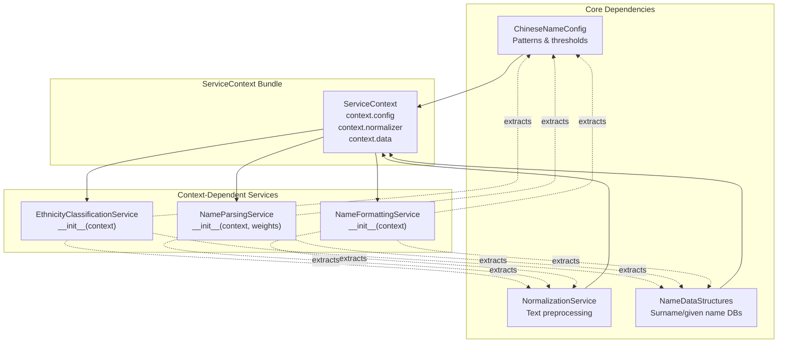
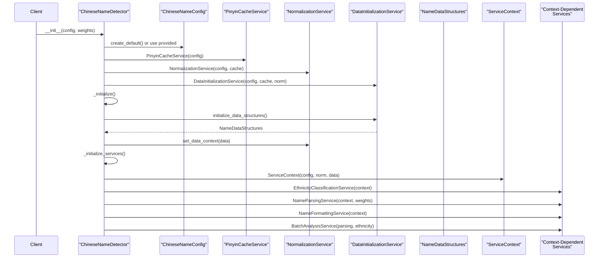
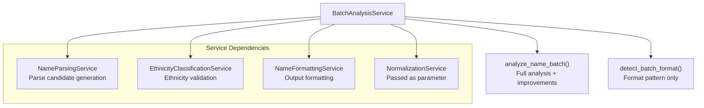

<!-- source: DeepWiki mcp.deepwiki.com · repo allenai/sinonym · page 3 Service Components · fetched 2026-10-26 -->

# Service Components

<details>
<summary>Relevant source files</summary>

The following files were used as context for generating this wiki page:

- [sinonym/detector.py](sinonym/detector.py)
- [sinonym/services/ethnicity.py](sinonym/services/ethnicity.py)
- [sinonym/services/parsing.py](sinonym/services/parsing.py)

</details>


## Purpose and Scope

This document describes the service layer architecture of sinonym, focusing on how the five specialized services coordinate to process Chinese names. It covers the dependency injection pattern via `ServiceContext`, service initialization patterns, and collaboration mechanisms. For detailed documentation of individual services, see:
- Normalization: [Normalization Service](#3.1)
- Ethnicity filtering: [Ethnicity Classification Service](#3.2)
- Surname/given name boundary detection: [Name Parsing Service](#3.3)
- Output formatting: [Name Formatting Service](#3.4)
- Utility functions: [String Manipulation Utilities](#3.5)

For the overall processing pipeline that orchestrates these services, see [Processing Pipeline](#2.2).

---

## Service Layer Architecture

The service layer consists of five specialized services that implement distinct phases of name processing. Services are categorized by their dependency patterns:

| Service Type | Services | Dependencies | Initialization Pattern |
|-------------|----------|--------------|----------------------|
| **Context-Dependent** | `EthnicityClassificationService`<br/>`NameParsingService`<br/>`NameFormattingService` | Require `ServiceContext` (config + normalizer + data) | Constructor accepts context bundle |
| **Independent** | `NormalizationService`<br/>`PinyinCacheService` | Minimal external dependencies | Direct initialization |
| **Orchestration** | `BatchAnalysisService` | Depends on multiple other services | Receives service instances directly |

**ServiceContext Bundle Pattern**

The `ServiceContext` class packages three foundational dependencies to reduce constructor complexity:

```python
ServiceContext(
    config: ChineseNameConfig,
    normalizer: NormalizationService, 
    data: NameDataStructures
)
```

This pattern eliminates repetitive dependency injection and ensures consistent service initialization.

**Sources:** [sinonym/services/__init__.py:1-30](), [sinonym/detector.py:220-233]()

---

## Dependency Injection via ServiceContext

### ServiceContext Composition

The following diagram shows how `ServiceContext` bundles three core dependencies and how services consume it:



**Sources:** [sinonym/detector.py:220-233](), [sinonym/services/parsing.py:24-35](), [sinonym/services/ethnicity.py:100-112]()

### Backwards Compatibility Pattern

All context-dependent services support both the legacy three-parameter interface and the new `ServiceContext` interface for backwards compatibility:

```python
# Constructor pattern from NameParsingService
def __init__(self, context_or_config, normalizer=None, data=None, *, weights=None):
    if hasattr(context_or_config, "config"):
        # New context interface
        self._config = context_or_config.config
        self._normalizer = context_or_config.normalizer
        self._data = context_or_config.data
    else:
        # Legacy interface - maintain backwards compatibility
        self._config = context_or_config
        self._normalizer = normalizer
        self._data = data
```

This pattern is implemented consistently across `EthnicityClassificationService` ([sinonym/services/ethnicity.py:100-112]()), `NameParsingService` ([sinonym/services/parsing.py:24-35]()), and `NameFormattingService`.

**Sources:** [sinonym/services/parsing.py:24-35](), [sinonym/services/ethnicity.py:100-112]()

---

## Service Initialization Flow

### Initialization Sequence in ChineseNameDetector

The following diagram shows the initialization sequence when creating a `ChineseNameDetector` instance:



### Lazy Initialization Pattern

Services are initialized lazily to handle initialization failures gracefully:

```python
def _ensure_initialized(self) -> None:
    """Ensure data is initialized (lazy initialization)."""
    if self._data is None:
        self._data = self._data_service.initialize_data_structures()
        self._normalizer.set_data_context(self._data)
        self._initialize_services()
```

This pattern ensures that even if initial data loading fails, the detector can retry initialization when needed.

**Sources:** [sinonym/detector.py:193-243]()

---

## Service Collaboration Patterns

### Pipeline Data Flow

The following diagram shows how data flows through services during name processing:

```mermaid
graph LR
    Input["Raw Name String"]
    
    subgraph "Phase 1: Normalization"
        Norm["NormalizationService.apply()"]
        NormOutput["NormalizedInput<br/>roman_tokens<br/>norm_map<br/>compound_metadata"]
    end
    
    subgraph "Phase 2: Ethnicity"
        Eth["EthnicityClassificationService<br/>.classify_ethnicity()"]
        EthOutput["ParseResult<br/>success=True/False"]
    end
    
    subgraph "Phase 3: Parsing"
        Parse["NameParsingService<br/>.parse_name_order()"]
        ParseOutput["ParseResult<br/>surname_tokens<br/>given_tokens"]
    end
    
    subgraph "Phase 4: Formatting"
        Format["NameFormattingService<br/>.format_name_output_with_tokens()"]
        FormatOutput["Formatted Name<br/>ParsedName"]
    end
    
    Input --> Norm
    Norm --> NormOutput
    NormOutput --> Eth
    Eth --> EthOutput
    EthOutput --> Parse
    Parse --> ParseOutput
    ParseOutput --> Format
    Format --> FormatOutput
```



### Service Method Signatures

The table below shows the key methods and their signatures for each service:

| Service | Key Method | Input | Output |
|---------|-----------|-------|--------|
| **NormalizationService** | `apply(raw_name: str)` | Raw name string | `NormalizedInput` with tokens and metadata |
| **EthnicityClassificationService** | `classify_ethnicity(tokens, normalized_cache, original_text)` | Token tuple, cache dict, original text | `ParseResult` (success/failure) |
| **NameParsingService** | `parse_name_order(order, normalized_cache, compound_metadata)` | Token list, cache dict, metadata dict | `ParseResult` with surname/given tokens |
| **NameFormattingService** | `format_name_output_with_tokens(surname_tokens, given_tokens, norm_map, compound_metadata)` | Surname/given token lists, maps | Formatted name + token lists |
| **BatchAnalysisService** | `analyze_name_batch(names, normalizer, data, formatting_service, min_size)` | Name list + services | `BatchParseResult` |

**Sources:** [sinonym/detector.py:249-495]()

---

## Core Service Design Patterns

### Pure Function Design

Services implement pure functions with explicit dependencies and no hidden state:

```python
# Example from NameParsingService
def parse_name_order(
    self,
    order: list[str],
    normalized_cache: dict[str, str],
    compound_metadata: dict[str, CompoundMetadata],
) -> ParseResult:
    """Parse using rule-based system with fallback - pattern matching style."""
    # All inputs explicit, no hidden state mutations
```

This design enables:
- **Testability**: Functions can be tested in isolation
- **Thread Safety**: No shared mutable state
- **Scala Compatibility**: Pure functions translate directly to Scala

**Sources:** [sinonym/services/parsing.py:54-80]()

### Functional Error Handling

All services return `ParseResult` objects that follow the Either monad pattern:

```python
# Success case
ParseResult.success_with_parse(surname_tokens, given_tokens, original_format)

# Failure case  
ParseResult.failure("surname not recognised")
```

This eliminates exception-based control flow and enables functional composition via `map()` and `flat_map()` methods.

**Sources:** [sinonym/services/parsing.py:66-80]()

### Probabilistic Scoring Pattern

`NameParsingService` uses weighted feature scoring to rank parse candidates:

```python
def calculate_parse_score(
    self,
    surname_tokens: list[str],
    given_tokens: list[str],
    tokens: list[str],
    normalized_cache: dict[str, str],
    is_all_chinese: bool = False,
    original_compound_format: str | None = None,
) -> float:
    """Calculate unified score for a parse candidate."""
    # Weighted combination of 8 features:
    # - surname_logp (surname frequency)
    # - given_logp_sum (given name frequency)
    # - surname_rank_bonus (percentile ranking)
    # - compound_given_bonus (two-syllable given names)
    # - order_preservation_bonus (maintain input order for ambiguous cases)
    # - surname_first_bonus (Chinese traditional order)
    # - surname_freq_log_ratio (comparative surname frequency)
    # - surname_rank_difference (comparative ranking)
```

The default weights are tuned via empirical testing:

| Feature | Weight | Purpose |
|---------|--------|---------|
| `surname_logp` | 0.465 | Surname frequency importance |
| `given_logp_sum` | 0.395 | Given name frequency importance |
| `surname_rank_bonus` | -0.888 | Penalize uncommon surnames |
| `compound_given_bonus` | 1.348 | Reward two-syllable given names |
| `order_preservation_bonus` | 1.102 | Maintain input order for ambiguous cases |
| `surname_first_bonus` | 0.425 | Prefer Chinese traditional order |
| `surname_freq_log_ratio` | -0.042 | Comparative surname frequency |
| `surname_rank_difference` | -0.573 | Comparative surname ranking |

**Sources:** [sinonym/services/parsing.py:345-445]()

---

## Service-Specific Patterns

### ML Enhancement in EthnicityClassificationService

The ethnicity service integrates an optional ML classifier for Japanese name detection:

```python
class _MLJapaneseClassifier:
    """Consolidated ML Japanese classifier - moved from separate service for simplification."""
    
    def __init__(self, confidence_threshold: float = 0.8):
        self._confidence_threshold = confidence_threshold
        self._model = None
        self._available = ML_AVAILABLE
        self._cache = ThreadLocalCache()
```

The classifier is used as a first-pass filter for all-Chinese character inputs:

```python
# ML Enhancement in classify_ethnicity()
if (original_text and
    self._normalizer._text_preprocessor.is_all_chinese_input(original_text) and
    self._ml_classifier.is_available()):
    
    ml_result = self._ml_classifier.classify_all_chinese_name(original_text)
    if ml_result.success is False and "japanese" in ml_result.error_message:
        return ParseResult.failure("Japanese name detected by ML classifier")
```

**Sources:** [sinonym/services/ethnicity.py:41-94](), [sinonym/services/ethnicity.py:127-142]()

### Three-Tier Classification System

The ethnicity service implements a confidence-based classification system:

| Tier | Confidence | Mechanism | Example |
|------|-----------|-----------|---------|
| **Tier 1: Definitive** | High | Exact pattern matches | `KOREAN_ONLY_SURNAMES`, `JAPANESE_SURNAMES`, `WESTERN_NAMES` |
| **Tier 2: Cultural Context** | Medium | Structural pattern scoring | Hyphenated Korean patterns, Vietnamese "Thi" patterns |
| **Tier 3: Chinese Default** | Low | Chinese surname frequency | Accept if Chinese surname strength ≥ 0.5 |

**Sources:** [sinonym/services/ethnicity.py:115-222]()

### Compound Metadata Threading

The normalization service produces `CompoundMetadata` that is threaded through all downstream services to preserve user formatting:

```python
@dataclass(frozen=True)
class CompoundMetadata:
    """Metadata for compound surname formatting authority."""
    compound_target: str        # Normalized compound form (e.g., "si tu")
    format_type: str           # Original format: "camelCase", "compact", "hyphenated", "spaced"
    is_compound: bool = True
```

This metadata is used by:
- **Parsing**: To recognize compound surnames in various formats
- **Formatting**: To reconstruct the original compound format in output

**Sources:** [sinonym/services/normalization.py]() (referenced indirectly via compound_metadata parameter threading)

---

## Independent Service Pattern

### PinyinCacheService

`PinyinCacheService` has zero external dependencies and manages Han character to Pinyin mappings:

```python
class PinyinCacheService:
    """Service for caching Han character to Pinyin conversions."""
    
    def __init__(self, config: ChineseNameConfig):
        self._config = config
        self._cache: dict[str, str] = {}
        self._cache_path = self._get_cache_path()
        self._load_cache()
```

The service provides persistent caching with automatic cache building when the cache file is missing or outdated.

### StringManipulationUtils

`StringManipulationUtils` provides static utility methods with no instance state:

```python
class StringManipulationUtils:
    """Utility functions for string manipulation with caching."""
    
    @staticmethod
    def split_concatenated_name(...) -> list[str] | None:
        """Split a concatenated name token using tiered confidence validation."""
    
    @staticmethod
    def split_camel_case(token: str) -> list[str]:
        """Split CamelCase tokens into components."""
```

These functions are used across multiple services for consistent string processing.

**Sources:** [sinonym/utils/string_manipulation.py]()

---

## BatchAnalysisService Orchestration

`BatchAnalysisService` orchestrates multiple services to provide batch-level analysis:



The batch service coordinates:
1. **Individual Analysis**: Parse each name independently to generate candidates
2. **Format Detection**: Identify dominant formatting pattern (surname-first vs given-first)
3. **Batch Refinement**: Re-parse ambiguous cases using batch context
4. **Improvement Tracking**: Record which names benefited from batch processing

**Sources:** [sinonym/detector.py:502-633]()

---

