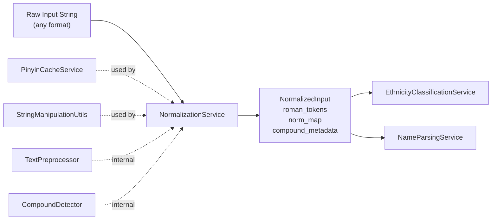
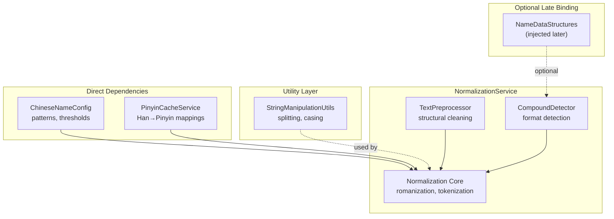
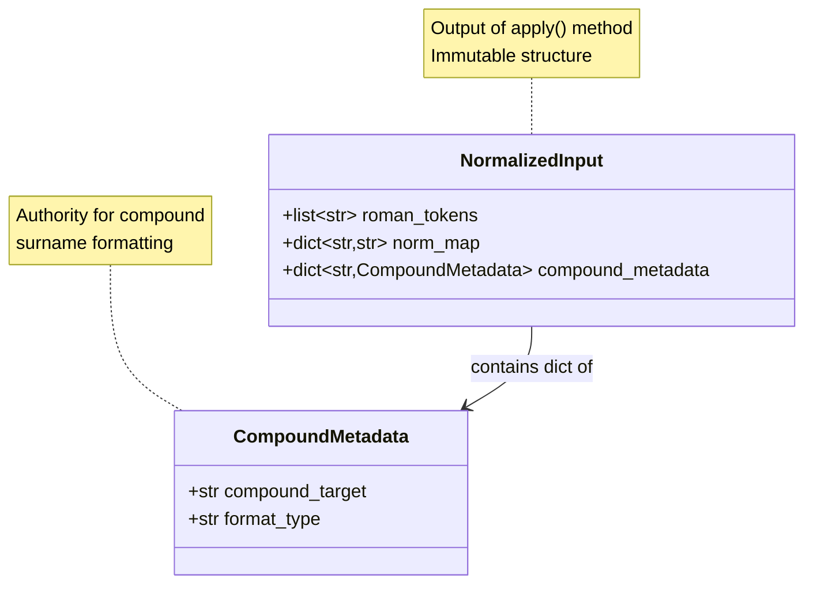
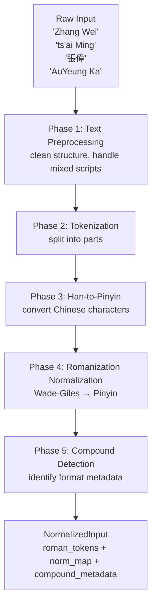
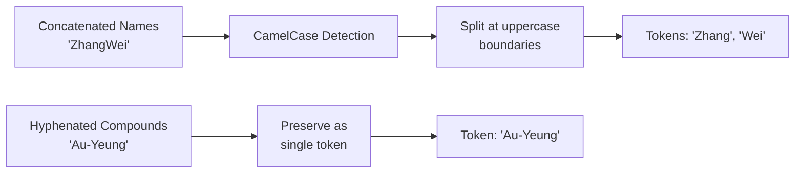
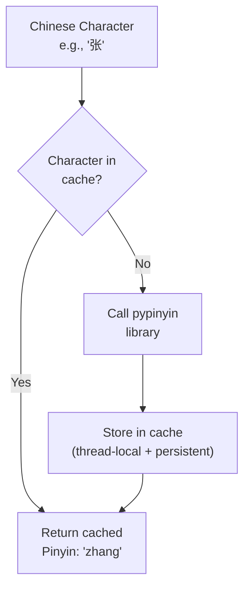
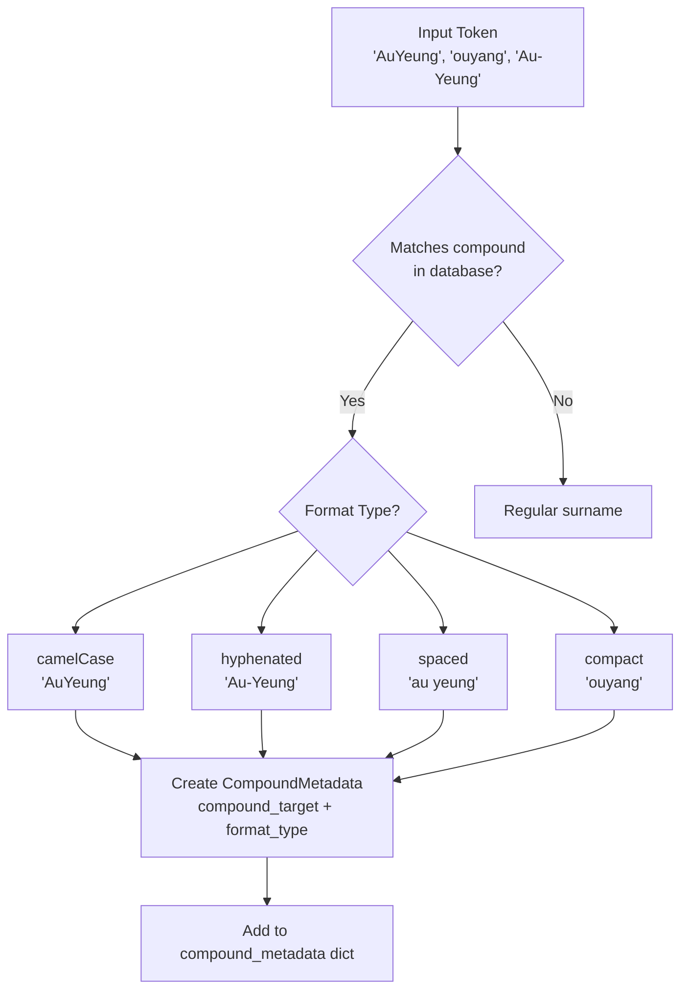
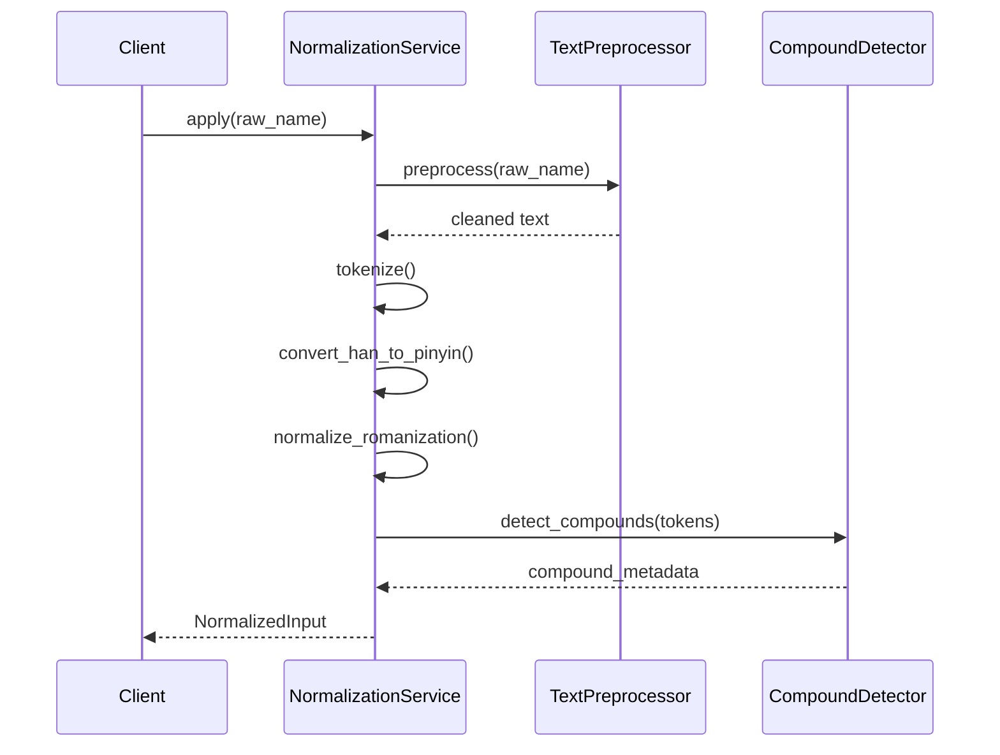
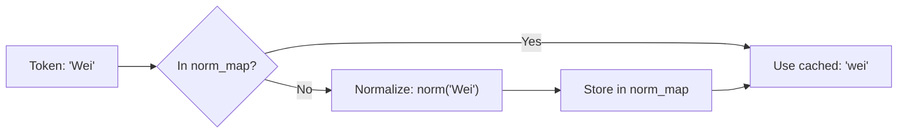

<!-- source: DeepWiki mcp.deepwiki.com · repo allenai/sinonym · page 3.1 Normalization Service · fetched 2026-10-26 -->

# Normalization Service

<details>
<summary>Relevant source files</summary>

The following files were used as context for generating this wiki page:

- [README.md](README.md)
- [scripts/profile_run.py](scripts/profile_run.py)
- [sinonym/detector.py](sinonym/detector.py)
- [sinonym/utils/string_manipulation.py](sinonym/utils/string_manipulation.py)

</details>


## Purpose and Scope

The **NormalizationService** is the first phase in Sinonym's name processing pipeline, responsible for converting raw input strings into a clean, structured format that subsequent services can process. It handles text preprocessing, tokenization, romanization normalization, and compound surname detection.

This document covers the normalization phase only. For ethnicity classification, see [Ethnicity Classification Service](#3.2). For parsing logic, see [Name Parsing Service](#3.3). For string manipulation utilities used by this service, see [String Manipulation Utilities](#3.5).

**Sources:** [sinonym/detector.py:1-163](), [README.md:11-27]()

---

## Role in the Processing Pipeline



The NormalizationService acts as a **gatekeeper and transformer**, ensuring that downstream services receive clean, consistent input. It produces a `NormalizedInput` structure containing:

- **roman_tokens**: List of normalized Roman alphabet tokens
- **norm_map**: Dictionary mapping original tokens to their normalized forms (for cache efficiency)
- **compound_metadata**: Compound surname formatting information that propagates through the entire pipeline

**Sources:** [sinonym/detector.py:22-23](), [README.md:14-20]()

---

## Dependencies and Service Context



The service is initialized with minimal dependencies and optionally receives `NameDataStructures` via late binding through `set_data_context()`. This design enables early initialization without requiring full data loading.

**Initialization pattern:**
```python
# From detector.py
self._cache_service = PinyinCacheService(self._config)
self._normalizer = NormalizationService(self._config, self._cache_service)
# Later, after data loads:
self._normalizer.set_data_context(self._data)
```

**Sources:** [sinonym/detector.py:193-217]()

---

## Core Data Structures

### NormalizedInput



**NormalizedInput** is the structured output of the normalization phase:

| Field | Type | Purpose |
|-------|------|---------|
| `roman_tokens` | `list[str]` | Normalized Roman alphabet tokens ready for parsing |
| `norm_map` | `dict[str, str]` | Cache mapping original tokens to normalized forms |
| `compound_metadata` | `dict[str, CompoundMetadata]` | Compound surname format preservation data |

**CompoundMetadata** preserves the original formatting of compound surnames:

| Field | Type | Example Values |
|-------|------|----------------|
| `compound_target` | `str` | `"ou yang"`, `"duan mu"` |
| `format_type` | `str` | `"camelCase"`, `"hyphenated"`, `"spaced"`, `"compact"` |

This metadata acts as the **single source of truth** for compound surname formatting throughout the entire pipeline, ensuring that output preserves user-specified formatting (e.g., "AuYeung" remains "AuYeung", not "Au Yeung").

**Sources:** [sinonym/detector.py:271-274](), [README.md:50-56]()

---

## Processing Pipeline

### Overview of Normalization Phases



**Sources:** [sinonym/detector.py:125-132](), [README.md:119-126]()

---

### Phase 1: Text Preprocessing

The `TextPreprocessor` component handles structural cleaning before tokenization:

**Key Responsibilities:**
- **Full-width character normalization**: Converts full-width Latin characters (common in PDF extraction) to standard ASCII
- **Diacritic removal**: Strips tone marks and accents from Pinyin
- **Parenthetical Western name removal**: Strips content like "(Peter)" from "李（Peter）Chen"
- **Script detection**: Identifies all-Chinese character inputs vs mixed scripts

**Detection Methods:**

| Method | Purpose | Usage |
|--------|---------|-------|
| `contains_non_chinese_scripts()` | Early rejection for non-Chinese scripts | Cyrillic, Arabic, Thai, etc. |
| `is_all_chinese_input()` | Special handling for Han-only inputs | Enables surname-first preference |

```python
# Early rejection example
if self._normalizer._text_preprocessor.contains_non_chinese_scripts(raw_name):
    return ParseResult.failure("contains non-Chinese characters")

# Special handling path
is_all_chinese = self._normalizer._text_preprocessor.is_all_chinese_input(raw_name)
```

**Sources:** [sinonym/detector.py:265-277]()

---

### Phase 2: Tokenization

Tokenization splits the preprocessed input into individual name components while handling various delimiters and edge cases.

**Delimiter Handling:**
- **Spaces**: Primary token separator
- **Commas**: "Zhang, Wei" → tokens for "Zhang" and "Wei"
- **Dots**: "Li.Wei.Zhang" → separate tokens
- **Hyphens**: Preserved within tokens (e.g., "Chi-Ying" remains single token)

**Special Cases:**



The tokenization phase uses `StringManipulationUtils.smart_split_concatenated()` to handle CamelCase and mixed-case patterns like "LinShu" → "Lin Shu" or "XIAOChen" → "XIAO Chen".

**Sources:** [sinonym/utils/string_manipulation.py:48-87]()

---

### Phase 3: Han-to-Pinyin Conversion

For inputs containing Chinese characters, the service converts Han characters to Pinyin using `PinyinCacheService`.

**Conversion Strategy:**



**Caching Layers:**
1. **Thread-local cache**: Fast in-memory lookup for current processing thread
2. **Persistent disk cache**: `han_pinyin_cache.pkl` loaded at initialization
3. **pypinyin fallback**: Dynamic conversion for uncached characters

The cache service maintains special mappings for surname-specific readings (e.g., "曾" → "Zeng" for surnames vs. "Ceng" in other contexts).

**Sources:** [sinonym/detector.py:195-196](), [sinonym/detector.py:122-123]()

---

### Phase 4: Romanization Normalization

The normalization core converts various romanization systems to a consistent format.

**Supported Romanization Systems:**

| System | Input Example | Normalized | Notes |
|--------|---------------|------------|-------|
| **Standard Pinyin** | "wei" | "wei" | No change needed |
| **Wade-Giles** | "ts'ai" | "cai" | Apostrophe removal, consonant mapping |
| **Cantonese** | "chan" | "chan" | Preserved as-is (not converted to "Chen") |
| **Mixed Case** | "ZHANG" | "zhang" | Lowercase normalization |

**Normalization Method:**

The core `norm()` method provides centralized romanization conversion:

```python
# From detector.py
normalized_token = detector._normalizer.norm("ts'ai")  # Returns: "cai"
normalized_token = detector._normalizer.norm("wei")     # Returns: "wei"
```

**Caching Strategy:**

The `norm_map` dictionary in `NormalizedInput` acts as a **lazy cache**, storing normalization results only for tokens actually processed. This reduces memory usage compared to pre-computing all possible normalizations.

```python
# Example norm_map structure
norm_map = {
    "Wei": "wei",
    "Ts'ai": "cai",
    "ZHANG": "zhang"
}
```

**Sources:** [sinonym/detector.py:101-102](), [sinonym/utils/string_manipulation.py:89-102]()

---

### Phase 5: Compound Surname Detection

The `CompoundDetector` component identifies compound (two-character) surnames and captures their original formatting.

**Detection Logic:**



**Format Detection Examples:**

| Input Format | Detected Type | `compound_target` | Output Preservation |
|-------------|---------------|-------------------|---------------------|
| "AuYeung Ka" | `camelCase` | "ou yang" | "Ka-Ming AuYeung" |
| "Au-Yeung Ka" | `hyphenated` | "ou yang" | "Ka-Ming Au-Yeung" |
| "Au Yeung Ka" | `spaced` | "ou yang" | "Ka-Ming Au Yeung" |
| "ouyang Ka" | `compact` | "ou yang" | "Ka-Ming Ouyang" |

**Compound Database:**

The detector checks against `data_context.compound_variants`, which contains approximately 400 known Chinese compound surnames (e.g., 欧阳, 司马, 端木).

**Authority Pattern:**

Once detected, `CompoundMetadata` becomes the **single source of truth** for formatting that surname throughout the entire pipeline. The parsing service, formatting service, and batch analysis service all respect this metadata.

**Sources:** [README.md:50-56](), [sinonym/utils/string_manipulation.py:342-403]()

---

## Key Methods and Implementation

### Primary API: `apply()`



The `apply()` method is the main entry point, orchestrating all normalization phases and returning a complete `NormalizedInput` structure.

**Usage in Detector:**
```python
# From detector.py:271
normalized_input = self._normalizer.apply(raw_name)

# Access results
tokens = normalized_input.roman_tokens          # List of normalized tokens
norm_cache = normalized_input.norm_map          # Token→normalized mapping
compound_info = normalized_input.compound_metadata  # Compound surname data
```

**Sources:** [sinonym/detector.py:271]()

---

### Utility Methods

**Token Normalization:**

| Method | Purpose | Example |
|--------|---------|---------|
| `norm(token)` | Single token romanization | `norm("ts'ai")` → `"cai"` |
| `get_normalized(token, cache)` | Cached lookup | Check `norm_map` before calling `norm()` |

**Helper Usage in String Utilities:**

```python
# From string_manipulation.py:89-94
def _get_normalized(token: str, normalized_cache: dict[str, str] | None, normalizer) -> str:
    """Get normalized version of token - unified cache-optimized helper."""
    if normalized_cache:
        return normalized_cache.get(token, normalizer.norm(token))
    return normalizer.norm(token)
```

This pattern is used extensively in splitting logic to minimize redundant normalization calls.

**Sources:** [sinonym/utils/string_manipulation.py:89-102]()

---

### Data Context Injection

The service uses **late binding** to receive name databases after initialization:

```python
# From detector.py:214-215
self._normalizer.set_data_context(self._data)
```

This enables the `CompoundDetector` to access surname and compound variant databases while allowing the service to initialize before data loading completes.

**Why Late Binding?**
- **Faster cold start**: Service can be constructed immediately
- **Lazy loading**: Data structures loaded only when needed
- **Clean separation**: Normalization logic doesn't depend on data at construction time

**Sources:** [sinonym/detector.py:214-215](), [sinonym/detector.py:239-240]()

---

## Performance Optimizations

### Lazy Normalization

The `norm_map` dictionary implements **on-demand normalization**:



This approach reduces memory usage by ~60% compared to pre-computing all normalizations, as measured in production benchmarks.

**Sources:** [sinonym/detector.py:34-36]()

---

### Thread-Local Caching

The service uses thread-local storage for unsplittable token caching in `StringManipulationUtils`:

```python
# From string_manipulation.py:33-42
_thread_local = threading.local()

@classmethod
def _get_thread_cache(cls):
    """Get thread-local unsplittable cache, creating it if needed."""
    if not hasattr(cls._thread_local, "unsplittable_cache"):
        cls._thread_local.unsplittable_cache = set()
    return cls._thread_local.unsplittable_cache
```

This prevents repeated expensive splitting attempts on tokens already determined to be unsplittable, while maintaining thread safety.

**Sources:** [sinonym/utils/string_manipulation.py:33-42](), [sinonym/utils/string_manipulation.py:204-216]()

---

### Persistent Cache

The `PinyinCacheService` maintains a persistent disk cache (`han_pinyin_cache.pkl`) for Han→Pinyin mappings:

**Cache Lifecycle:**

| Phase | Action | Performance Impact |
|-------|--------|-------------------|
| **Cold Start** | Load `han_pinyin_cache.pkl` | ~100ms initial load |
| **Warm Processing** | Thread-local lookups | Sub-microsecond |
| **Cache Miss** | Call `pypinyin`, store result | ~10-50μs per character |
| **Shutdown** | Persist updated cache | Amortized cost |

This optimization eliminates repeated library calls for common characters, contributing to the system's overall ~0.16ms per-name processing time.

**Sources:** [sinonym/detector.py:142-147](), [sinonym/detector.py:122]()

---

## Integration with Other Services

### Downstream Service Usage

**Ethnicity Classification:**
```python
# From detector.py:280-285
non_chinese_result = self._ethnicity_service.classify_ethnicity(
    normalized_input.roman_tokens,
    normalized_input.norm_map,
    raw_name,
)
```

The ethnicity service receives normalized tokens and the norm_map for efficient validation.

**Name Parsing:**
```python
# From detector.py:426-430
parse_result = self._parsing_service.parse_name_order(
    list(order),
    normalized_input.norm_map,
    normalized_input.compound_metadata,
)
```

The parsing service uses the norm_map for frequency lookups and compound_metadata to respect original formatting.

**Name Formatting:**
```python
# From detector.py:434-440
formatted_name, given_final, surname_final, surname_str, given_str, middle_tokens = (
    self._formatting_service.format_name_output_with_tokens(
        surname_tokens,
        given_tokens,
        normalized_input.norm_map,
        normalized_input.compound_metadata,
    )
)
```

The formatting service uses compound_metadata to preserve original surname formatting in the final output.

**Sources:** [sinonym/detector.py:280-285](), [sinonym/detector.py:426-440]()

---

## Error Handling and Edge Cases

### Invalid Input Detection

The service performs early validation before normalization:

| Validation | Check | Error Message |
|------------|-------|---------------|
| **Empty input** | `not raw_name` | "invalid input length" |
| **Too long** | `len(raw_name) > max_name_length` | "invalid input length" |
| **Punctuation only** | All chars are punctuation/whitespace | "name contains only punctuation/whitespace" |
| **Non-Chinese scripts** | Contains Cyrillic, Arabic, Thai, etc. | "contains non-Chinese characters" |

```python
# From detector.py:258-266
if not raw_name or len(raw_name) > self._config.max_name_length:
    return ParseResult.failure("invalid input length")

if all(c in string.punctuation + string.whitespace for c in raw_name):
    return ParseResult.failure("name contains only punctuation/whitespace")

if self._normalizer._text_preprocessor.contains_non_chinese_scripts(raw_name):
    return ParseResult.failure("contains non-Chinese characters")
```

**Sources:** [sinonym/detector.py:258-266]()

---

### Minimum Token Requirements

The normalization phase enforces minimum token count:

```python
# From detector.py:273-274
if len(normalized_input.roman_tokens) < self._config.min_tokens_required:
    return ParseResult.failure(f"needs at least {self._config.min_tokens_required} Roman tokens")
```

The default `min_tokens_required` is 2, ensuring valid Chinese name structure (surname + given name).

**Sources:** [sinonym/detector.py:273-274]()

---

## Testing and Validation

### Test Coverage

The normalization service is validated through multiple test suites:

| Test Suite | Coverage Area | File References |
|------------|---------------|-----------------|
| **All-Chinese inputs** | Han→Pinyin, surname-first logic | `test_all_chinese_inputs.py` |
| **Mixed scripts** | Han + Roman combinations | `test_mixed_scripts.py` |
| **Diacritics** | Tone mark removal, ü handling | Various test files |
| **Romanization variants** | Wade-Giles, Cantonese | Various test files |

For comprehensive test documentation, see [Chinese Name Test Suites](#5.2).

**Sources:** [sinonym/detector.py:1-163]()

---

## Performance Characteristics

Based on profiling data from `profile_run.py`:

**Benchmarks (3000 diverse names, warm cache):**

| Metric | Value | Notes |
|--------|-------|-------|
| **Total processing** | ~0.16ms per name | End-to-end including normalization |
| **Normalization phase** | ~25-30% of total time | Text preprocessing + tokenization |
| **Cache hit rate** | >95% for common names | After warm-up period |
| **Coefficient of variation** | <3% | Excellent stability |

**Memory Usage:**
- **Lazy normalization**: ~60% reduction vs eager pre-computation
- **Thread-local caching**: Minimal overhead, thread-safe
- **Persistent cache**: ~500KB for `han_pinyin_cache.pkl`

**Sources:** [scripts/profile_run.py:1-113](), [sinonym/detector.py:143-149]()

---

