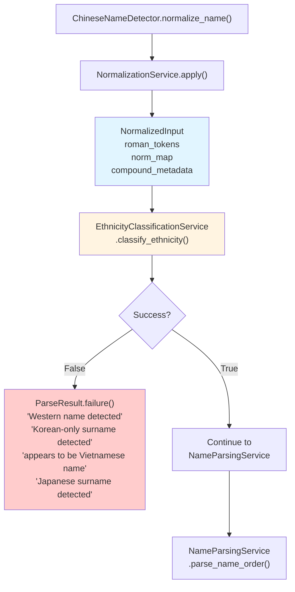
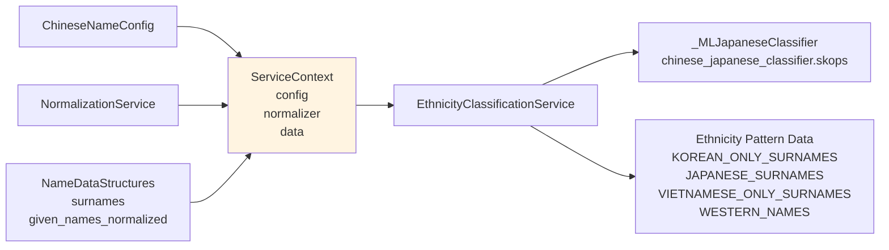
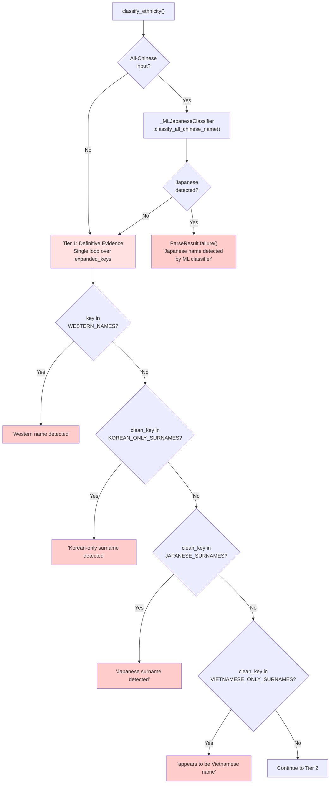
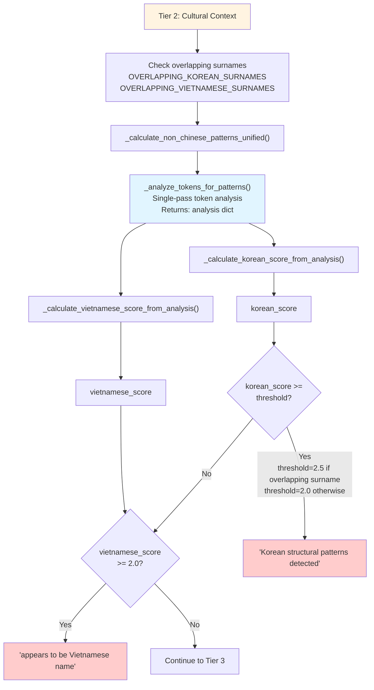
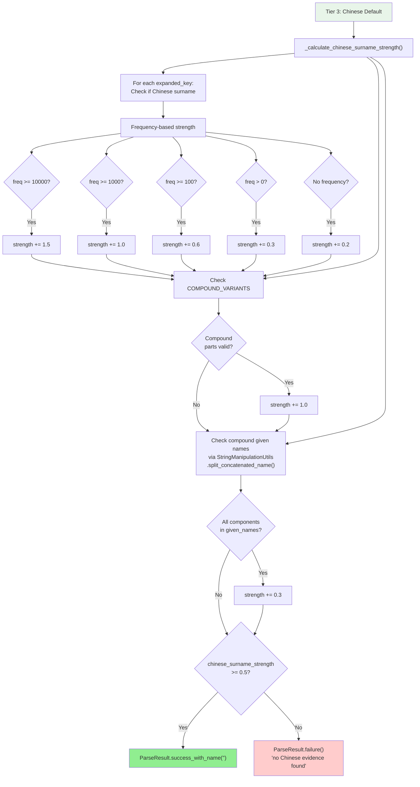
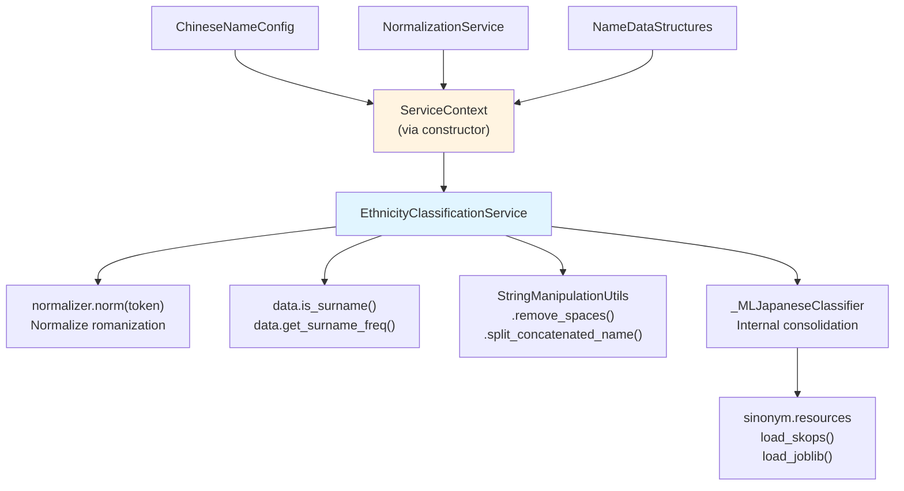

<!-- source: DeepWiki mcp.deepwiki.com · repo allenai/sinonym · page 3.2 Ethnicity Classification Service · fetched 2026-10-26 -->

# Ethnicity Classification Service

<details>
<summary>Relevant source files</summary>

The following files were used as context for generating this wiki page:

- [sinonym/detector.py](sinonym/detector.py)
- [sinonym/services/ethnicity.py](sinonym/services/ethnicity.py)

</details>


## Purpose and Scope

The `EthnicityClassificationService` implements a three-tier linguistic classification system to distinguish Chinese names from Korean, Vietnamese, Japanese, and Western names. This service acts as a critical gatekeeper in the name processing pipeline, preventing false positives by filtering out non-Chinese names before the parsing stage.

For the overall processing pipeline, see [Processing Pipeline](#2.2). For the data structures used in classification, see [Name Data Structures](#4.1). For how results flow through the system, see [Result Types and Data Classes](#4.2).

**Sources:** [sinonym/services/ethnicity.py:1-8](), [sinonym/detector.py:1-163]()

---

## Architecture and Pipeline Position

The ethnicity classification service sits between normalization and parsing in the four-phase pipeline. It receives normalized, tokenized input and makes a binary decision: allow processing to continue (Chinese name) or reject with a specific error message (non-Chinese name).



**Diagram: Ethnicity Classification in Processing Pipeline**

The service is initialized in `ChineseNameDetector._initialize_services()` with a `ServiceContext` bundle:



**Diagram: Service Initialization and Dependencies**

**Sources:** [sinonym/detector.py:217-233](), [sinonym/services/ethnicity.py:97-113]()

---

## Three-Tier Classification System

The classification system uses a tiered approach with increasing specificity and decreasing confidence thresholds. Each tier can make a definitive rejection decision, with the final tier defaulting to acceptance if Chinese evidence exists.

### Tier 1: Definitive Evidence (High Confidence)

The highest confidence tier checks for unambiguous non-Chinese indicators using curated linguistic databases. This tier uses a single optimized loop for fast short-circuit rejection.

| Pattern Type | Data Source | Example | Error Message |
|-------------|-------------|---------|---------------|
| Western names | `WESTERN_NAMES` | "John", "Smith", "Michael" | "Western name detected" |
| Korean-only surnames | `KOREAN_ONLY_SURNAMES` | "Seo", "Ahn", "Seong" | "Korean-only surname detected" |
| Japanese surnames | `JAPANESE_SURNAMES` | "Tanaka", "Suzuki", "Yamamoto" | "Japanese surname detected" |
| Vietnamese-only surnames | `VIETNAMESE_ONLY_SURNAMES` | "Tran", "Nguyen", "Pham" | "appears to be Vietnamese name" |

**Implementation:** [sinonym/services/ethnicity.py:161-185]()



**Diagram: Tier 1 Definitive Evidence Decision Flow**

**Sources:** [sinonym/services/ethnicity.py:127-185]()

### Tier 2: Cultural Context (Medium Confidence)

Tier 2 uses structural pattern scoring to detect Korean and Vietnamese names based on linguistic conventions. This tier handles overlapping surnames (surnames that exist in both Chinese and Korean/Vietnamese) by analyzing supporting evidence from given name patterns.



**Diagram: Tier 2 Cultural Context Scoring**

**Pattern Scoring Weights:**

| Pattern Type | Weight | Examples |
|-------------|--------|----------|
| Hyphenated Korean pairs | +3.0 | "Min-jun", "Hye-jin" |
| Known Korean name pairs | +3.0 | ("seung", "hyun"), ("ji", "woo") |
| Korean-specific tokens | +3.0 | "hyun", "seung", "jin" |
| Korean ambiguous tokens (≥2) | +1.0 | "ho", "su", "young" |
| Vietnamese "Thi" pattern | +3.0 | "Thi" middle name |
| Vietnamese surname + given | +2.0 | "Nguyen Van" + Vietnamese given |
| Multiple Vietnamese givens | +1.5 | ≥2 tokens in `VIETNAMESE_GIVEN_PATTERNS` |

**Sources:** [sinonym/services/ethnicity.py:186-222](), [sinonym/services/ethnicity.py:298-425]()

### Tier 3: Chinese Default (Low Confidence)

The final tier calculates Chinese surname strength and defaults to acceptance if any reasonable Chinese evidence exists. This tier implements a "innocent until proven guilty" approach for names that pass the previous filters.



**Diagram: Tier 3 Chinese Surname Strength Calculation**

**Sources:** [sinonym/services/ethnicity.py:212-222](), [sinonym/services/ethnicity.py:560-625]()

---

## ML-Enhanced Japanese Detection

For all-Chinese character inputs (e.g., "田中太郎"), a machine learning classifier provides high-confidence Japanese name detection. This addresses the challenge that Japanese names written in Kanji are visually indistinguishable from Chinese characters.

### ML Classifier Architecture

```mermaid
graph TB
    Input["All-Chinese input<br/>e.g., '田中太郎'"]
    
    Check{is_all_chinese_input()<br/>&&<br/>ML available?}
    
    Input --> Check
    
    Check -->|No| Skip["Skip ML classification<br/>Continue to Tier 1"]
    Check -->|Yes| Cache["ThreadLocalCache<br/>._cache"]
    
    Cache --> CacheHit{Cache hit?}
    CacheHit -->|Yes| Cached["Return cached result"]
    CacheHit -->|No| Model
    
    Model["ML Model<br/>chinese_japanese_classifier.skops<br/>or .joblib fallback"]
    
    Model --> Predict["model.predict([name])<br/>Returns: 'cn' or 'jp'"]
    Model --> Proba["model.predict_proba([name])<br/>Returns: [p_cn, p_jp]"]
    
    Predict --> Result
    Proba --> Result
    
    Result["prediction, confidence"]
    
    Result --> ConfCheck{prediction == 'jp'<br/>&&<br/>confidence >= 0.8?}
    
    ConfCheck -->|Yes| Reject["ParseResult.failure()<br/>'japanese'"]
    ConfCheck -->|No| Allow["ParseResult.success_with_name('')<br/>Allow through to Tier 1"]
    
    Reject --> CacheStore["Cache result"]
    Allow --> CacheStore
    CacheStore --> Return
    
    style Model fill:#e1f5ff
    style Cache fill:#fff4e1
    style Reject fill:#ffcccc
    style Allow fill:#90EE90
```

**Diagram: ML Japanese Classifier Flow**

### Implementation Details

**Class:** `_MLJapaneseClassifier` [sinonym/services/ethnicity.py:41-94]()

**Key Configuration:**
- **Confidence threshold:** 0.8 (only reject if very confident)
- **Model format:** Prefers `.skops` artifact, falls back to `.joblib`
- **Cache:** Thread-local cache with `get_or_compute()` pattern
- **Availability check:** Graceful degradation if ML dependencies unavailable

**Model Loading Strategy:**
```
1. Try: load_skops("chinese_japanese_classifier.skops")
2. Catch: load_joblib("chinese_japanese_classifier.joblib") 
3. Catch: Set _available = False, allow all names through
```

**Sources:** [sinonym/services/ethnicity.py:29-94](), [sinonym/services/ethnicity.py:127-141]()

---

## Pattern Detection and Analysis

The service uses a single-pass token analysis optimization to avoid redundant pattern matching. The `_analyze_tokens_for_patterns()` method performs all pattern checks in one iteration.

### Token Analysis Process

```mermaid
flowchart TD
    Start["_analyze_tokens_for_patterns(tokens)"]
    
    Start --> Init["Initialize analysis dict:<br/>surname_type<br/>hyphenated_tokens<br/>korean_specific_tokens<br/>korean_ambiguous_tokens<br/>vietnamese_tokens<br/>korean_given_pairs<br/>has_thi_pattern"]
    
    Init --> Surname["_classify_first_token_surname(tokens)<br/>Returns: 'korean_only', 'vietnamese_only',<br/>'korean_overlapping', 'vietnamese_overlapping',<br/>'chinese_only', 'none'"]
    
    Surname --> Loop["For each token in tokens:"]
    
    Loop --> Hyphen{Contains<br/>'-'?}
    Hyphen -->|Yes| StoreParts["Store parts in<br/>hyphenated_tokens"]
    Hyphen -->|No| Thi
    
    StoreParts --> Thi
    Thi{token in<br/>['thi', 'thị']?}
    Thi -->|Yes| SetThi["has_thi_pattern = True"]
    Thi -->|No| KorSpec
    SetThi --> KorSpec
    
    KorSpec{token in<br/>KOREAN_SPECIFIC_PATTERNS?}
    KorSpec -->|Yes| AddKorSpec["Add to korean_specific_tokens"]
    KorSpec -->|No| KorAmb
    AddKorSpec --> KorAmb
    
    KorAmb{token in<br/>KOREAN_AMBIGUOUS_PATTERNS?}
    KorAmb -->|Yes| AddKorAmb["Add to korean_ambiguous_tokens"]
    KorAmb -->|No| Viet
    AddKorAmb --> Viet
    
    Viet{token in<br/>VIETNAMESE_GIVEN_PATTERNS?}
    Viet -->|Yes| AddViet["Add to vietnamese_tokens"]
    Viet -->|No| NextToken
    AddViet --> NextToken
    
    NextToken["Next token"] --> Loop
    
    Loop --> Pairs["Check Korean given name pairs:<br/>For tokens[1:], check consecutive pairs<br/>against KOREAN_GIVEN_PAIRS"]
    
    Pairs --> Return["Return analysis dict"]
    
    style Init fill:#e1f5ff
    style Return fill:#90EE90
```

**Diagram: Single-Pass Token Pattern Analysis**

**Sources:** [sinonym/services/ethnicity.py:254-296]()

### Korean Score Calculation

The Korean scoring system combines multiple signals with different weights, adjusting thresholds based on surname type.

**Score Components:** [sinonym/services/ethnicity.py:320-393]()

| Signal | Weight | Condition |
|--------|--------|-----------|
| Korean-only surname | 10.0 | Definitive evidence |
| Chinese-only surname | 0.0 | Blocks Korean scoring |
| Hyphenated pairs (curated) | +3.0 | Both parts in `KOREAN_GIVEN_PATTERNS` |
| Hyphenated pairs (signature) | +3.0 | With overlapping surname OR not both Chinese given |
| Known Korean pairs | +3.0 | Per pair in `KOREAN_GIVEN_PAIRS` |
| Korean-specific tokens | +3.0 | Per token in `KOREAN_SPECIFIC_PATTERNS` |
| Korean signature with overlapping | +3.0 | Token in Korean patterns, not Chinese given |
| Ambiguous patterns (≥2) | +1.0 | With overlapping Korean surname |

**Threshold Logic:**
- **With overlapping Chinese surname:** 2.5 (higher bar to prevent false positives)
- **Without overlapping surname:** 2.0 (standard threshold)

**Sources:** [sinonym/services/ethnicity.py:200-206](), [sinonym/services/ethnicity.py:320-393]()

### Vietnamese Score Calculation

Vietnamese scoring focuses on the distinctive "Thi" middle name pattern and surname-given name combinations.

**Score Components:** [sinonym/services/ethnicity.py:395-425]()

| Signal | Weight | Condition |
|--------|--------|-----------|
| "Thi" pattern | +3.0 | Token is "thi" or "thị" |
| Surname + given patterns | +2.0 | Vietnamese surname + ≥1 Vietnamese given, no Chinese surname |
| Multiple Vietnamese givens | +1.5 | ≥2 tokens in `VIETNAMESE_GIVEN_PATTERNS` |

**Rejection threshold:** 2.0

**Sources:** [sinonym/services/ethnicity.py:207-209](), [sinonym/services/ethnicity.py:395-425]()

---

## Data Dependencies

The ethnicity classification service depends on several curated linguistic databases and dynamically initialized data structures.

### Static Pattern Data

| Data Source | Type | Usage | Example Values |
|------------|------|-------|----------------|
| `WESTERN_NAMES` | set[str] | Tier 1 definitive rejection | "john", "smith", "michael" |
| `KOREAN_ONLY_SURNAMES` | set[str] | Tier 1 definitive rejection | "seo", "ahn", "seong" |
| `JAPANESE_SURNAMES` | set[str] | Tier 1 definitive rejection | "tanaka", "suzuki", "yamamoto" |
| `VIETNAMESE_ONLY_SURNAMES` | set[str] | Tier 1 definitive rejection | "tran", "nguyen", "pham" |
| `OVERLAPPING_KOREAN_SURNAMES` | set[str] | Tier 2 threshold adjustment | "kim", "lee", "park" |
| `OVERLAPPING_VIETNAMESE_SURNAMES` | set[str] | Tier 2 scoring | "nguyen", "tran", "le" |
| `KOREAN_SPECIFIC_PATTERNS` | set[str] | Tier 2 scoring +3.0 | "hyun", "seung", "jin" |
| `KOREAN_AMBIGUOUS_PATTERNS` | set[str] | Tier 2 scoring +1.0 | "ho", "su", "young" |
| `KOREAN_GIVEN_PATTERNS` | set[str] | Tier 2 hyphen validation | "min", "ji", "hye" |
| `KOREAN_GIVEN_PAIRS` | set[tuple] | Tier 2 scoring +3.0 | ("seung", "hyun"), ("ji", "woo") |
| `VIETNAMESE_GIVEN_PATTERNS` | set[str] | Tier 2 scoring | "van", "thi", "duc" |
| `COMPOUND_VARIANTS` | dict[str, str] | Tier 3 compound surname detection | "ouyang" → "ou yang" |

**Import Statement:** [sinonym/services/ethnicity.py:11-24]()

### Dynamic Data Structures

| Structure | Source | Usage | Access Pattern |
|-----------|--------|-------|----------------|
| `self._data.surnames` | `NameDataStructures` | Tier 3 Chinese surname validation | `clean_key in self._data.surnames` |
| `self._data.surnames_normalized` | `NameDataStructures` | Tier 3 normalized surname lookup | `part1 in self._data.surnames_normalized` |
| `self._data.given_names_normalized` | `NameDataStructures` | Tier 2 Chinese given validation | `normalized in self._data.given_names_normalized` |
| `self._data.get_surname_freq()` | `NameDataStructures` | Tier 3 frequency-based strength | `self._data.get_surname_freq(clean_key_lower)` |
| `self._data.is_surname()` | `NameDataStructures` | Tier 3 surname validation | `self._data.is_surname(clean_key, normalized_key)` |

**Dependency Injection:** [sinonym/services/ethnicity.py:100-111]()

### Service Dependencies



**Diagram: Service Dependency Graph**

**Sources:** [sinonym/services/ethnicity.py:100-113](), [sinonym/services/ethnicity.py:26-27]()

---

## Method Reference

### Public Methods

| Method | Signature | Purpose | Returns |
|--------|-----------|---------|---------|
| `classify_ethnicity()` | `(tokens, normalized_cache, original_text) -> ParseResult` | Main classification entry point | Success (Chinese) or failure (non-Chinese) |

[sinonym/services/ethnicity.py:115-222]()

### Private Helper Methods

| Method | Purpose | Key Logic |
|--------|---------|-----------|
| `_classify_first_token_surname()` | Determine first token's surname type | Returns: "korean_only", "vietnamese_only", "korean_overlapping", etc. |
| `_analyze_tokens_for_patterns()` | Single-pass pattern detection | Returns analysis dict with all pattern matches |
| `_calculate_non_chinese_patterns_unified()` | Compute Korean and Vietnamese scores | Calls `_analyze_tokens_for_patterns()` once |
| `_calculate_korean_score_from_analysis()` | Calculate Korean pattern score | Uses pre-computed analysis dict |
| `_calculate_vietnamese_score_from_analysis()` | Calculate Vietnamese pattern score | Uses pre-computed analysis dict |
| `_calculate_chinese_surname_strength()` | Calculate Chinese surname evidence | Frequency-based strength calculation |

[sinonym/services/ethnicity.py:224-625]()

---

## Usage in Detection Pipeline

The ethnicity service is invoked early in the `normalize_name()` flow to prevent unnecessary parsing of non-Chinese names:

```mermaid
sequenceDiagram
    participant Det as ChineseNameDetector
    participant Norm as NormalizationService
    participant Eth as EthnicityClassificationService
    participant ML as _MLJapaneseClassifier
    participant Parse as NameParsingService
    
    Det->>Norm: apply(raw_name)
    Norm-->>Det: NormalizedInput
    
    Det->>Eth: classify_ethnicity(tokens, norm_map, original_text)
    
    alt All-Chinese input & ML available
        Eth->>ML: classify_all_chinese_name(original_text)
        ML-->>Eth: ParseResult (Japanese or allow)
    end
    
    Eth->>Eth: Tier 1: Check definitive evidence
    
    alt Tier 1 rejection
        Eth-->>Det: ParseResult.failure("Western/Korean/Japanese/Vietnamese")
        Det-->>Client: Early rejection
    end
    
    Eth->>Eth: Tier 2: Calculate pattern scores
    
    alt Tier 2 rejection
        Eth-->>Det: ParseResult.failure("Korean/Vietnamese patterns")
        Det-->>Client: Early rejection
    end
    
    Eth->>Eth: Tier 3: Calculate Chinese strength
    
    alt Chinese strength >= 0.5
        Eth-->>Det: ParseResult.success_with_name("")
        Det->>Parse: parse_name_order(...)
        Parse-->>Det: ParseResult with formatted name
        Det-->>Client: Success
    else No Chinese evidence
        Eth-->>Det: ParseResult.failure("no Chinese evidence found")
        Det-->>Client: Rejection
    end
```



**Diagram: Ethnicity Classification in Detection Sequence**

**Invocation:** [sinonym/detector.py:276-287]()

**Sources:** [sinonym/detector.py:249-495](), [sinonym/services/ethnicity.py:115-222]()

---

