<!-- source: DeepWiki mcp.deepwiki.com · repo allenai/sinonym · page 3.3 Name Parsing Service · fetched 2026-10-26 -->

# Name Parsing Service

<details>
<summary>Relevant source files</summary>

The following files were used as context for generating this wiki page:

- [sinonym/detector.py](sinonym/detector.py)
- [sinonym/services/parsing.py](sinonym/services/parsing.py)
- [sinonym/utils/string_manipulation.py](sinonym/utils/string_manipulation.py)

</details>


## Purpose and Scope

The **Name Parsing Service** implements probabilistic parsing algorithms to identify surname and given name boundaries in Chinese names. It uses frequency-based scoring, cultural validation patterns, and compound surname detection to generate and rank parse candidates.

This service handles the core parsing logic for Chinese names in various formats (romanized, mixed scripts, all-Chinese). For text preprocessing and tokenization, see [Normalization Service](#3.1). For output formatting and name assembly, see [Name Formatting Service](#3.4). For ethnicity filtering that precedes parsing, see [Ethnicity Classification Service](#3.2).

**Sources:** [sinonym/services/parsing.py:1-8]()

---

## Service Architecture

The `NameParsingService` class follows the dependency injection pattern introduced in the service layer, accepting a `ServiceContext` that bundles configuration, normalization service, and data structures.

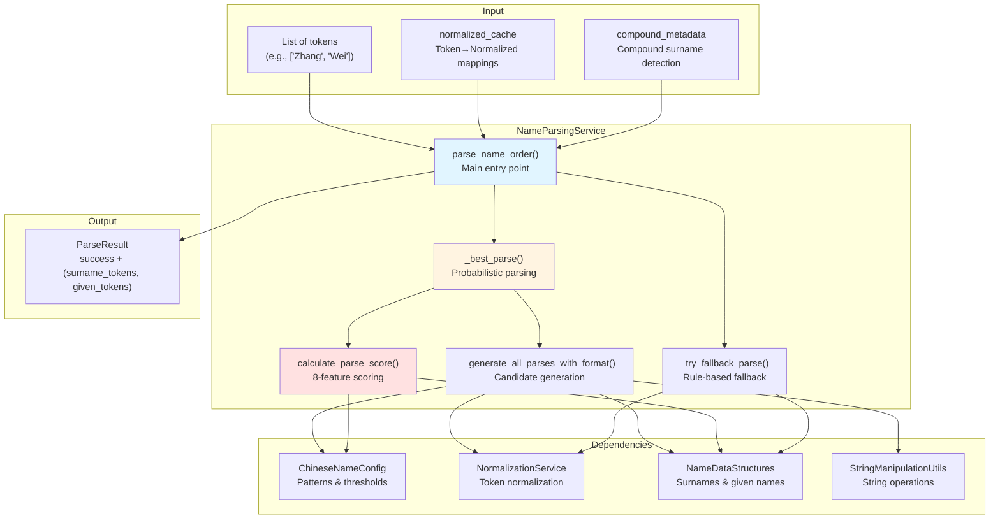

**Sources:** [sinonym/services/parsing.py:21-52](), [sinonym/detector.py:225-233]()

---

## Initialization and Context

The service supports both legacy and modern initialization patterns for backwards compatibility:

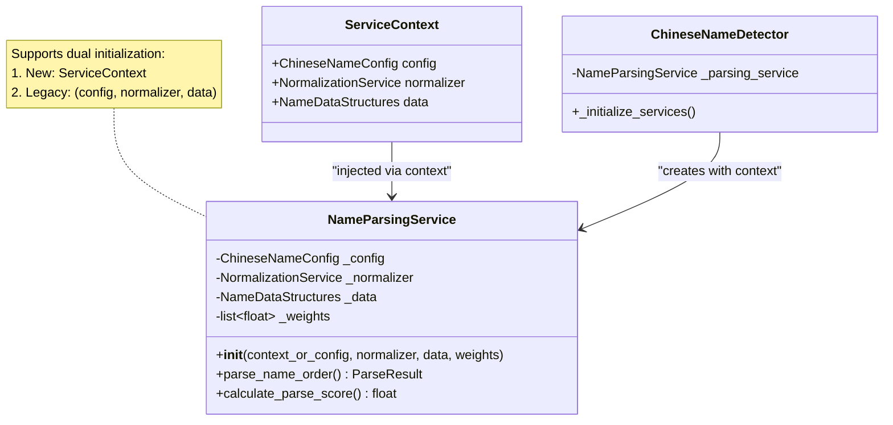

**Initialization Logic:**

| Interface Type | Constructor Args | Usage |
|---------------|------------------|--------|
| **Modern (Context)** | `ServiceContext` object | Recommended for new code |
| **Legacy (Individual)** | `config`, `normalizer`, `data` | Backwards compatibility |
| **Weight Override** | `weights` keyword arg | Custom feature weights |

**Sources:** [sinonym/services/parsing.py:24-51](), [sinonym/detector.py:228-229]()

---

## Parse Candidate Generation

The service generates multiple parse candidates by considering all valid surname positions and formats. This exhaustive generation ensures the best parse is discovered through scoring rather than heuristics.

### Generation Algorithm

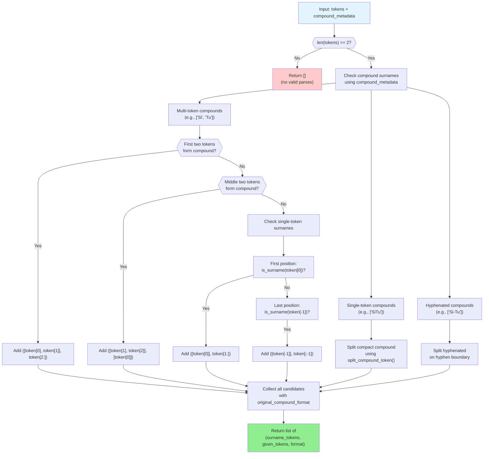

**Sources:** [sinonym/services/parsing.py:218-328]()

### Compound Surname Detection

The service relies on `CompoundMetadata` from the normalization service to identify compound surnames:

| Metadata Field | Purpose | Example |
|---------------|---------|---------|
| `is_compound` | Boolean flag | `True` for "SiTu" |
| `compound_target` | Canonical form | `"si tu"` |
| `format_type` | Original format | `"camelCase"`, `"hyphenated"`, `"compact"`, `"spaced"` |

**Generation Pattern Categories:**

1. **Multi-token compounds** (lines 230-260): Two consecutive tokens with matching `compound_target`
2. **Single-token compounds** (lines 264-283, 286-304): `camelCase` or `compact` format requiring splitting
3. **Hyphenated compounds** (lines 306-327): Explicit hyphen boundary with compound validation
4. **Single surnames** (lines 264-304): Regular surnames at first or last position

**Sources:** [sinonym/services/parsing.py:218-328](), [sinonym/services/normalization.py:18-27]()

---

## Scoring System

The service uses an 8-feature linear scoring model with tunable weights to rank parse candidates:

### Feature Definitions

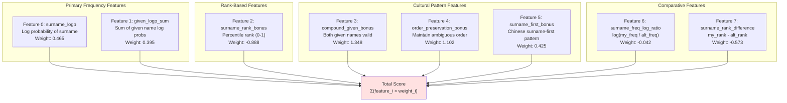

**Sources:** [sinonym/services/parsing.py:41-51](), [sinonym/services/parsing.py:345-445]()

### Scoring Logic

The `calculate_parse_score` method computes the weighted sum of all features:

| Feature | Calculation | Condition | Default Value |
|---------|------------|-----------|---------------|
| `surname_logp` | `get_surname_logp(surname_key)` | Always | -15.0 |
| `given_logp_sum` | `Σ get_given_logp(given_token)` | Always | sum of -10.0 per token |
| `surname_rank_bonus` | `get_surname_rank(surname_key)` | Always | 0.0-1.0 percentile |
| `compound_given_bonus` | 1.0 if both valid | `len(given_tokens)==2 && both_valid` | 0.0 |
| `order_preservation_bonus` | 1.0 if ambiguous | `is_ambiguous_case()` | 0.0 |
| `surname_first_bonus` | 1.0 if surname-first | `is_all_chinese && surname_first` | 0.0 |
| `surname_freq_log_ratio` | `log(my_freq / alt_freq)` | Two-token case | 0.0 |
| `surname_rank_difference` | `my_rank - alt_rank` | Two-token case | 0.0 |

**Special Handling for Compound Surnames:**

When a compound surname is not found in the database with its split form, the service attempts lookup using the original format from `CompoundMetadata`:

```python
# Fallback lookup chain (lines 362-370)
if surname_logp == default:
    if original_compound_format in COMPOUND_VARIANTS:
        surname_logp = get_surname_logp(COMPOUND_VARIANTS[original_compound_format])
    else:
        surname_logp = get_surname_logp(lowercase_join_with_spaces(surname_tokens))
```

**Sources:** [sinonym/services/parsing.py:345-445]()

---

## Parsing Algorithm

The main parsing flow uses a two-stage approach: probabilistic scoring with rule-based fallback.

### Main Parse Flow

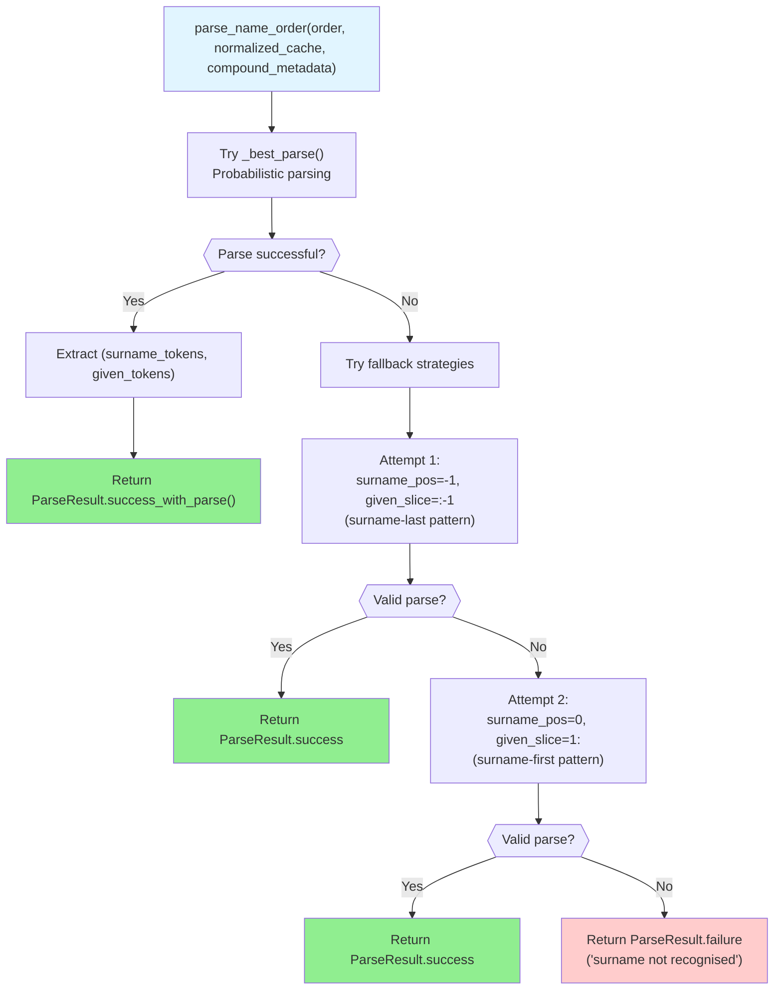

**Sources:** [sinonym/services/parsing.py:54-80]()

### Probabilistic Parsing (_best_parse)

The probabilistic parser generates all candidates, scores them, and selects the highest-scoring valid parse:

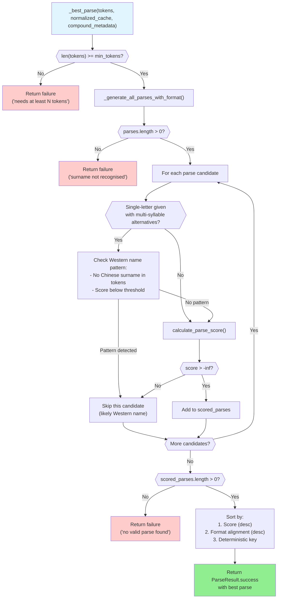

**Sources:** [sinonym/services/parsing.py:132-216]()

### Western Name Detection

The service includes early filtering to prevent parsing Western names where single letters are initials:

**Detection Criteria (lines 159-183):**

1. **Pattern identification:**
   - Has single-letter given tokens (e.g., "J" in "J Smith")
   - Has multi-syllable tokens (e.g., "Smith")
   
2. **Validation:**
   - No multi-syllable token is a known Chinese surname
   - Quick score estimate below `poor_score_threshold` (default: -20.0)

3. **Action:** Skip candidate during scoring, preventing Western names from being accepted

**Sources:** [sinonym/services/parsing.py:152-196]()

---

## Fallback Parsing Strategy

When probabilistic parsing fails, the service attempts rule-based parsing at fixed positions:

### Fallback Logic

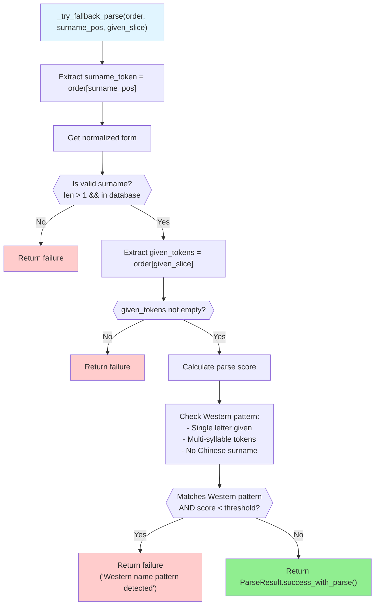

**Fallback Attempts (executed in order):**

| Attempt | `surname_pos` | `given_slice` | Pattern | Example |
|---------|--------------|--------------|---------|---------|
| 1 | `-1` | `:-1` | Surname-last | "Wei Zhang" → surname="Zhang", given="Wei" |
| 2 | `0` | `1:` | Surname-first | "Zhang Wei" → surname="Zhang", given="Wei" |

**Sources:** [sinonym/services/parsing.py:82-130]()

---

## Ambiguity Detection and Order Preservation

For ambiguous romanized cases where both tokens could be surnames or given names, the service applies an order preservation bonus to maintain the input order.

### Ambiguity Criteria

A two-token case is considered ambiguous when:

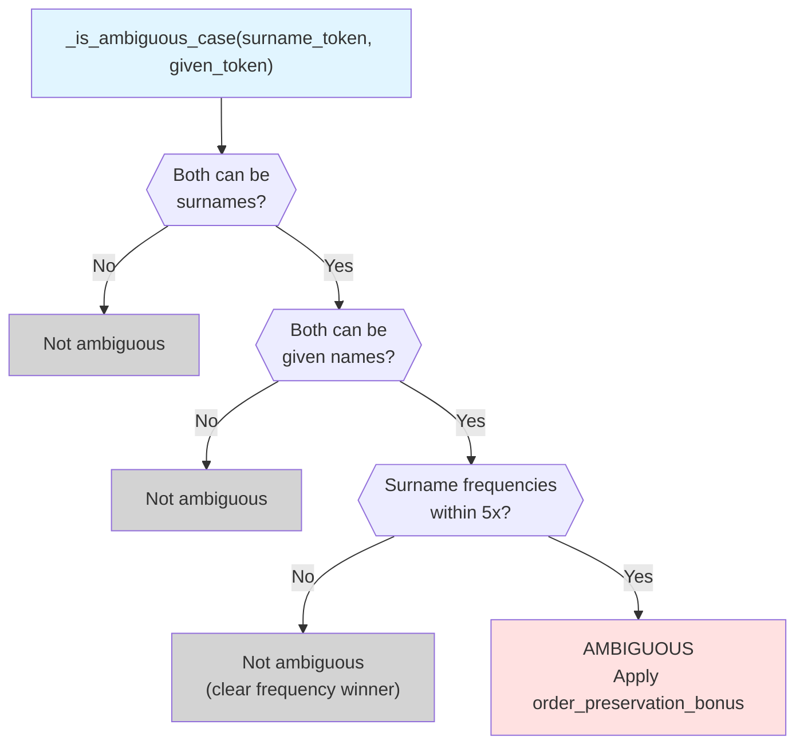

**Example Ambiguous Cases:**

| Name | Token 1 | Token 2 | Why Ambiguous |
|------|---------|---------|---------------|
| "Bei Yu" | Bei (surname + given) | Yu (surname + given) | Both valid both ways, similar frequency |
| "Wei Ming" | Wei (surname + given) | Ming (surname + given) | Both valid both ways, similar frequency |

**Order Preservation Bonus Application:**

The bonus (weight: 1.102) is applied to the parse that maintains the original token order:
- Input: `["Wei", "Ming"]`
- Parse maintaining order: given="Wei", surname="Ming" gets bonus
- Parse reversing order: given="Ming", surname="Wei" does not get bonus

**Sources:** [sinonym/services/parsing.py:399-406](), [sinonym/services/parsing.py:447-481]()

---

## Special Handling for All-Chinese Inputs

The parsing service is invoked differently for all-Chinese character inputs by the `ChineseNameDetector` to enforce surname-first cultural conventions.

### All-Chinese Processing Flow

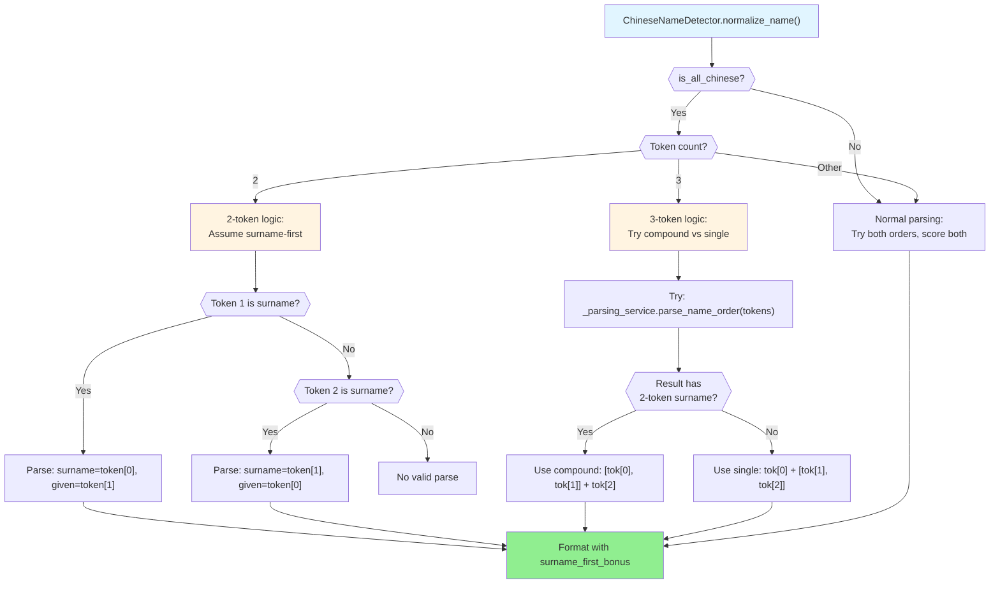

**Surname-First Bonus:**

For all-Chinese 2-token inputs, if the parse follows surname-first order (surname=token[0], given=token[1]), a bonus (weight: 0.425) is applied to reinforce the cultural convention.

**Sources:** [sinonym/detector.py:276-422]()

---

## Key Generation and Lookup

The service uses sophisticated key generation to handle both Chinese characters and romanized forms efficiently.

### Key Generation Methods

```mermaid
graph TB
    subgraph "Surname Key Generation"
        SurMethod["_surname_key(surname_tokens, normalized_cache)"]
        
        SurMethod --> SurSingle{{"Single token?"}}
        SurSingle -->|Yes| CheckCJK1["Check for CJK characters"]
        CheckCJK1 --> HasCJK1{{"Contains CJK?"}}
        HasCJK1 -->|Yes| TryCJK1["Try direct lookup"]
        TryCJK1 --> Found1{{"Found in DB?"}}
        Found1 -->|Yes| RetCJK1["Return Chinese key"]
        HasCJK1 -->|No| TryOrig1
        Found1 -->|No| TryOrig1["Try normalized form"]
        TryOrig1 --> RetNorm1["Return normalized key"]
        
        SurSingle -->|No| SurCompound["Compound surname:<br/>Join normalized tokens with space"]
        SurCompound --> RetComp["Return spaced compound"]
    end
    
    subgraph "Given Name Key Generation"
        GivMethod["_given_name_key(given_token, normalized_cache)"]
        
        GivMethod --> CheckCJK2["Check for CJK characters"]
        CheckCJK2 --> HasCJK2{{"Contains CJK?"}}
        HasCJK2 -->|Yes| TryCJK2["Try direct lookup"]
        TryCJK2 --> Found2{{"Found in DB?"}}
        Found2 -->|Yes| RetCJK2["Return Chinese key"]
        HasCJK2 -->|No| TryOrig2
        Found2 -->|No| TryOrig2["Try normalized form"]
        TryOrig2 --> RetNorm2["Return normalized key"]
    end
    
    style SurMethod fill:#e1f5ff
    style GivMethod fill:#e1f5ff
    style RetCJK1 fill:#90EE90
    style RetCJK2 fill:#90EE90
```

**Lookup Priority (for both surnames and given names):**

1. **Chinese characters** (if present): Direct lookup in database
2. **Original romanization**: Try `normalizer.norm(token)` form first
3. **Normalized romanization**: Fallback to fully normalized form

This priority ensures that Chinese character inputs get exact matches, while romanized inputs benefit from normalization (e.g., Wade-Giles to Pinyin conversion).

**Sources:** [sinonym/services/parsing.py:483-517]()

---

## Format Alignment Tie-Breaking

When multiple parses have identical scores, the service uses format alignment as a deterministic tie-breaker:

### Tie-Breaking Logic

```python
def parse_sort_key(parse_data):
    surname_tokens, given_tokens, score, original_compound_format = parse_data
    
    # Primary: score (descending)
    # Secondary: format_alignment (descending)  
    # Tertiary: deterministic string key
    format_alignment = _calculate_format_alignment_bonus(surname_tokens, given_tokens, tokens)
    secondary_key = f"{surname_tokens}|{given_tokens}"
    
    return (score, format_alignment, secondary_key)
```

**Format Alignment Bonus:**

| Condition | Bonus | Interpretation |
|-----------|-------|----------------|
| Given-surname order maintained | 0.001 | Western-style input preserved |
| Surname-given order maintained | 0.001 | Chinese-style input preserved |
| Order changed | 0.0 | Parse required reordering |

This small bonus (0.001) only affects tie-breaking and does not influence the primary scoring.

**Sources:** [sinonym/services/parsing.py:202-216](), [sinonym/services/parsing.py:519-543]()

---

## Integration Points

The parsing service integrates with multiple system components:

### Service Dependencies

```mermaid
graph TB
    subgraph "Data Layer"
        Data["NameDataStructures"]
        Data --> SurDB["surname_frequencies<br/>surname_ranks"]
        Data --> GivDB["given_log_probabilities<br/>given_names_normalized"]
        Data --> Methods["is_surname()<br/>get_surname_logp()<br/>get_given_logp()"]
    end
    
    subgraph "Configuration"
        Config["ChineseNameConfig"]
        Config --> Patterns["cjk_pattern<br/>forbidden_patterns_regex"]
        Config --> Thresholds["min_tokens_required<br/>poor_score_threshold"]
        Config --> Defaults["default_surname_logp<br/>default_given_logp"]
    end
    
    subgraph "Normalization"
        Norm["NormalizationService"]
        Norm --> NormMethods["norm()<br/>get_normalized()"]
        CompMeta["CompoundMetadata"]
    end
    
    subgraph "Utilities"
        StrUtil["StringManipulationUtils"]
        StrUtil --> UtilMethods["remove_spaces()<br/>lowercase_join_with_spaces()<br/>split_compound_token()"]
    end
    
    subgraph "NameParsingService"
        Parse["Main parsing methods"]
    end
    
    Data --> Parse
    Config --> Parse
    Norm --> Parse
    CompMeta --> Parse
    StrUtil --> Parse
    
    style Parse fill:#e1f5ff
```

**Sources:** [sinonym/services/parsing.py:13-16](), [sinonym/services/parsing.py:24-36]()

### External Callers

The parsing service is primarily invoked by:

1. **ChineseNameDetector** (main API): Calls `parse_name_order()` for single-name processing
2. **BatchAnalysisService** (batch processing): Uses parsing service to analyze multiple names with format context
3. **Test suites**: Direct instantiation for unit testing

**Sources:** [sinonym/detector.py:228-229](), [sinonym/services/batch_analysis.py]()

---

## Code Entity Reference

### Core Classes and Methods

| Entity | Location | Purpose |
|--------|----------|---------|
| `NameParsingService` | [sinonym/services/parsing.py:21]() | Main service class |
| `parse_name_order()` | [sinonym/services/parsing.py:54-80]() | Entry point for parsing |
| `_best_parse()` | [sinonym/services/parsing.py:132-216]() | Probabilistic parsing with scoring |
| `_generate_all_parses_with_format()` | [sinonym/services/parsing.py:218-328]() | Parse candidate generation |
| `calculate_parse_score()` | [sinonym/services/parsing.py:345-445]() | 8-feature scoring model |
| `_try_fallback_parse()` | [sinonym/services/parsing.py:82-130]() | Rule-based fallback |
| `_is_ambiguous_case()` | [sinonym/services/parsing.py:447-481]() | Ambiguity detection |
| `_surname_key()` | [sinonym/services/parsing.py:483-503]() | Surname lookup key generation |
| `_given_name_key()` | [sinonym/services/parsing.py:505-517]() | Given name lookup key generation |
| `_calculate_format_alignment_bonus()` | [sinonym/services/parsing.py:519-543]() | Tie-breaking alignment bonus |

### Key Constants

| Constant | Location | Value | Purpose |
|----------|----------|-------|---------|
| Default weights | [sinonym/services/parsing.py:42-51]() | 8-element list | Feature weights for scoring |
| `COMPOUND_VARIANTS` | [sinonym/chinese_names_data.py]() | Dict mapping | Compound surname format mappings |

**Sources:** [sinonym/services/parsing.py:1-544]()

---

