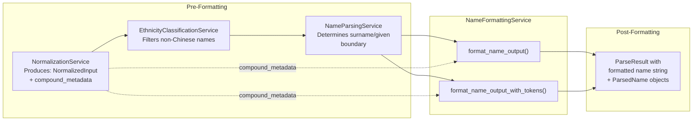
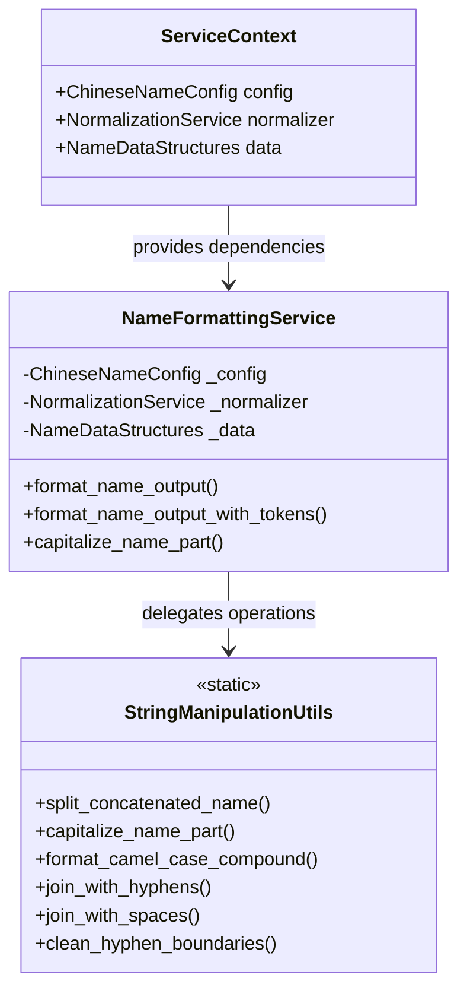
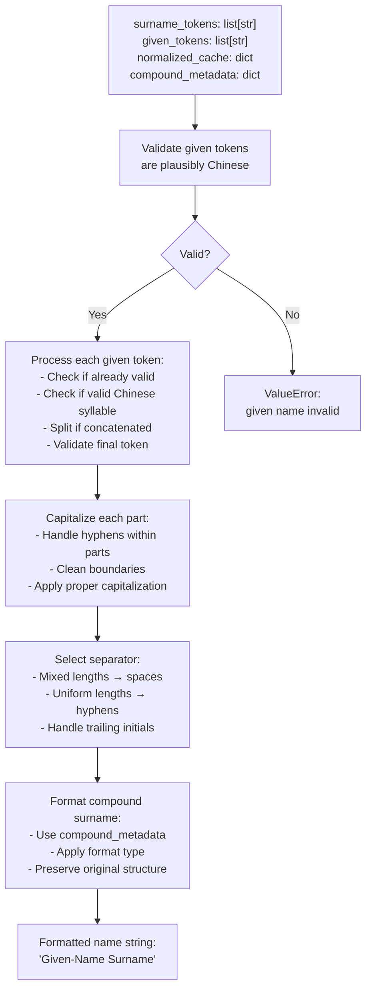
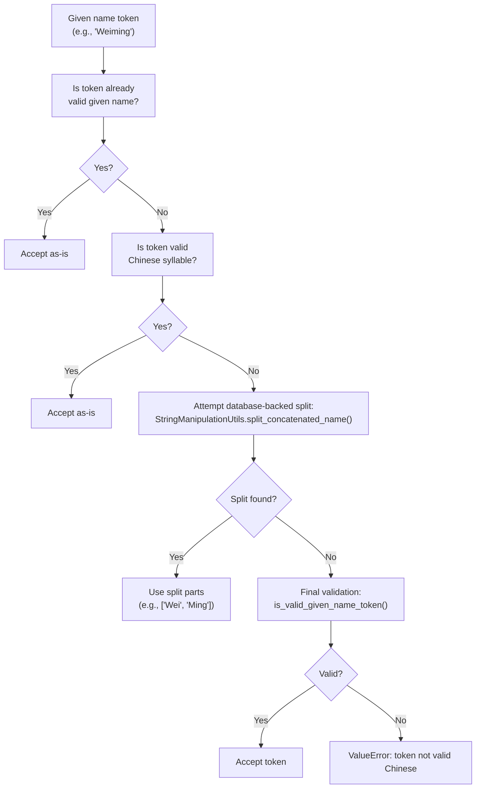
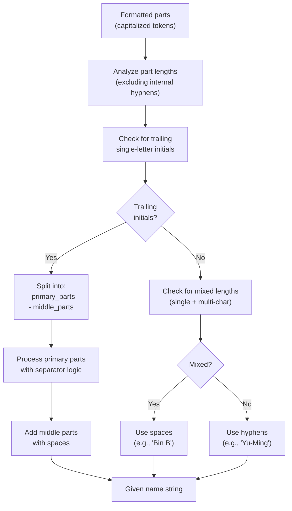
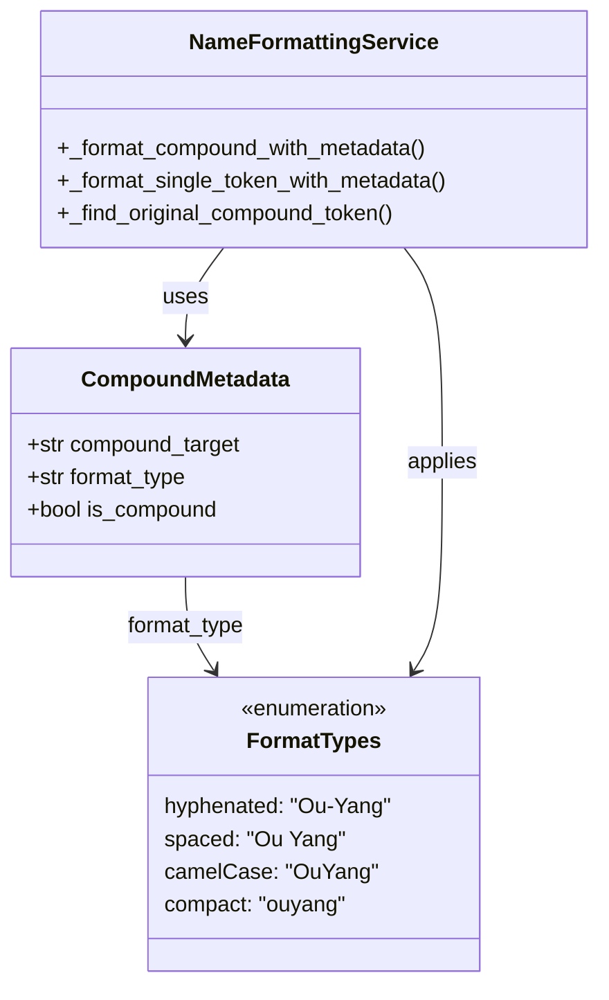
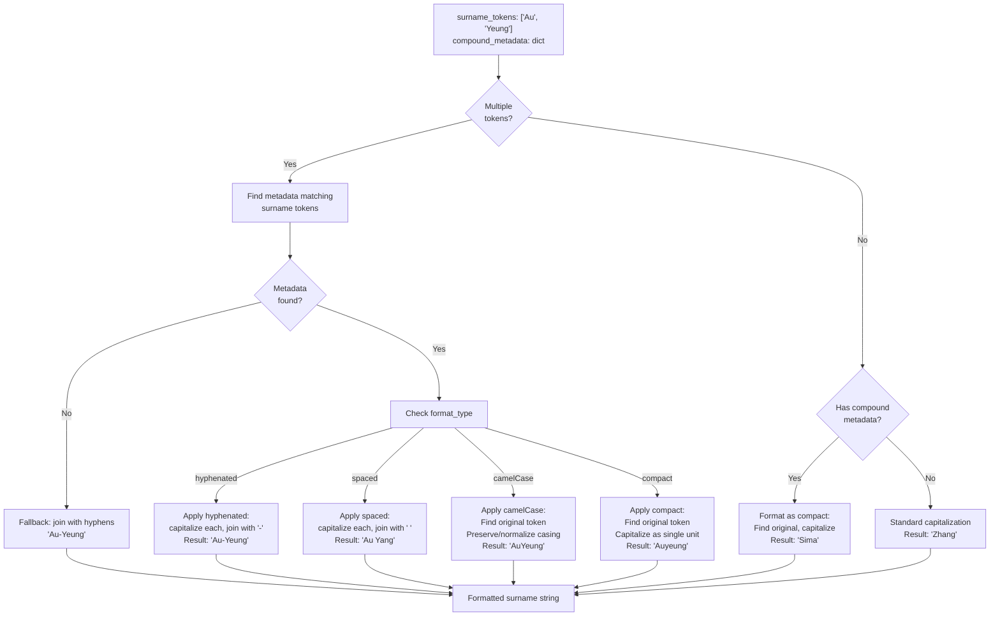
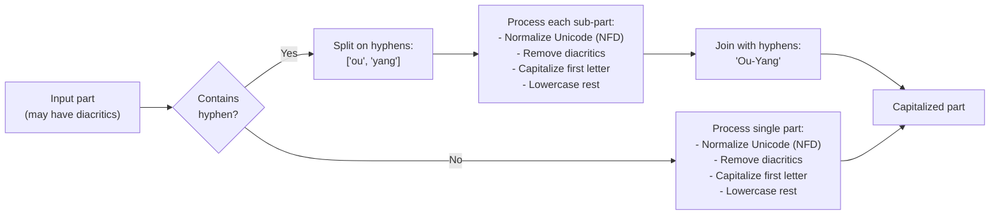
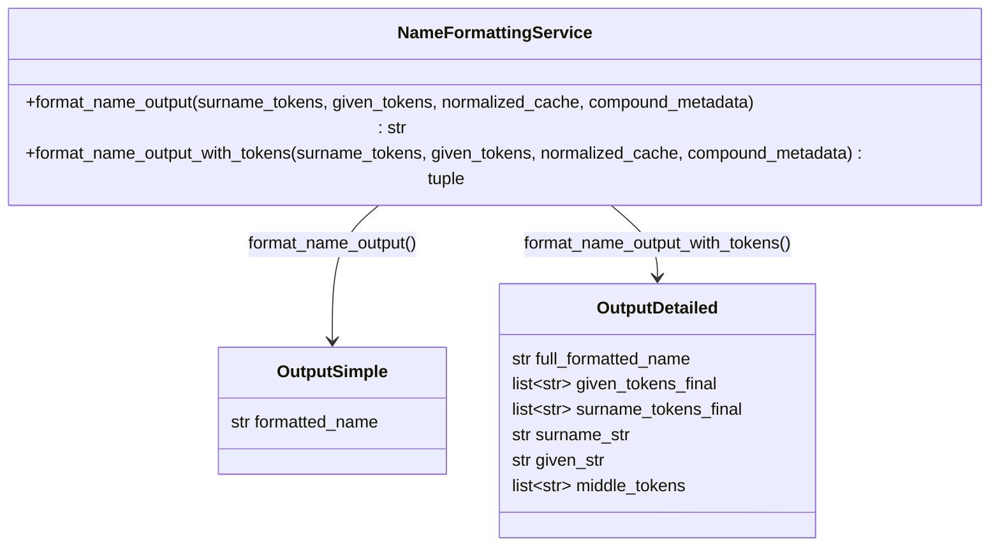
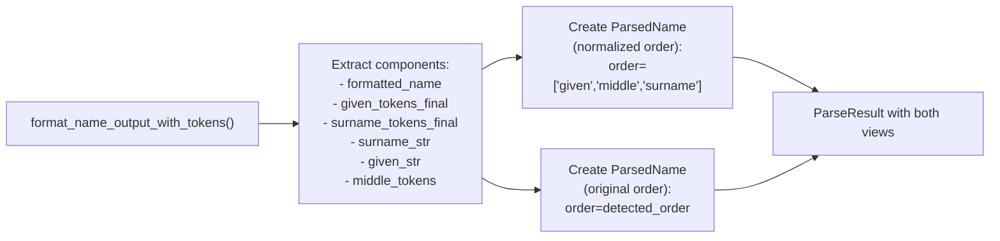

<!-- source: DeepWiki mcp.deepwiki.com · repo allenai/sinonym · page 3.4 Name Formatting Service · fetched 2026-10-26 -->

# Name Formatting Service

<details>
<summary>Relevant source files</summary>

The following files were used as context for generating this wiki page:

- [sinonym/coretypes/results.py](sinonym/coretypes/results.py)
- [sinonym/detector.py](sinonym/detector.py)
- [sinonym/services/formatting.py](sinonym/services/formatting.py)
- [sinonym/utils/string_manipulation.py](sinonym/utils/string_manipulation.py)

</details>


## Purpose and Scope

The `NameFormattingService` is responsible for converting parsed name components (surname tokens and given name tokens) into properly formatted output strings. It operates as the final stage of the name processing pipeline, after parsing has already determined the surname/given name boundary.

The service handles:
- Context-aware given name splitting using the full database
- Proper capitalization of all name parts
- Compound surname formatting based on metadata from normalization
- Separator selection (hyphens vs. spaces) based on token characteristics
- Middle name/initial handling

For information about the parsing stage that precedes formatting, see [Name Parsing Service](#3.3). For batch-level formatting decisions, see [Batch Processing System](#2.3).

**Sources:** [sinonym/services/formatting.py:1-14]()

---

## Architecture and Data Flow

### Position in Pipeline



The formatting service receives:
- **surname_tokens**: List of surname parts from parsing (e.g., `["Au", "Yeung"]`)
- **given_tokens**: List of given name parts from parsing (e.g., `["Wei", "Ming"]`)
- **normalized_cache**: Optional cache of normalized token mappings
- **compound_metadata**: Authority for compound surname formatting from `CompoundDetector`

**Sources:** [sinonym/services/formatting.py:26-41](), [sinonym/detector.py:434-441]()

---

### Service Initialization



The service accepts either a `ServiceContext` bundle (new interface) or individual components (legacy interface) for backwards compatibility.

**Sources:** [sinonym/services/formatting.py:29-40](), [sinonym/detector.py:224-229]()

---

## Core Formatting Operations

### Main Formatting Method

The `format_name_output()` method performs the complete formatting pipeline:



**Sources:** [sinonym/services/formatting.py:42-179]()

---

### Key Formatting Stages

| Stage | Responsibility | Key Methods Used |
|-------|---------------|------------------|
| **Validation** | Ensure given tokens are plausibly Chinese | `_normalizer.validate_given_tokens()` |
| **Token Processing** | Split concatenated names, validate components | `StringManipulationUtils.split_concatenated_name()` |
| **Capitalization** | Apply proper case to each part | `StringManipulationUtils.capitalize_name_part()` |
| **Separator Selection** | Choose hyphens or spaces based on token lengths | Length analysis logic |
| **Compound Formatting** | Apply compound surname format from metadata | `_format_compound_with_metadata()` |
| **Final Assembly** | Construct "Given-Name Surname" output | String concatenation |

**Sources:** [sinonym/services/formatting.py:59-179]()

---

## Given Name Processing

### Context-Aware Splitting

The formatting service performs **context-aware splitting** of given name tokens using the full database. This is distinct from the structural splitting performed during normalization.



This approach prevents incorrect splitting of Western names while correctly handling Chinese compounds. See [String Manipulation Utilities](#3.5) for details on the tiered confidence system.

**Sources:** [sinonym/services/formatting.py:63-97](), [sinonym/utils/string_manipulation.py:158-317]()

---

### Separator Selection Logic

After processing given name tokens, the service selects an appropriate separator:



**Sources:** [sinonym/services/formatting.py:118-161]()

---

## Compound Surname Formatting

### Format Type Authority

The formatting service trusts `CompoundMetadata` from the normalization stage as the **single authority** for compound surname formatting. This metadata is created by the `CompoundDetector` during normalization.



**Sources:** [sinonym/services/formatting.py:339-391](), [sinonym/utils/string_manipulation.py:342-370]()

---

### Compound Formatting Pipeline



**Sources:** [sinonym/services/formatting.py:339-437]()

---

### Format Type Examples

| Format Type | Input Tokens | Original Token | Output |
|-------------|--------------|----------------|--------|
| `hyphenated` | `["Ou", "Yang"]` | `"Ou-Yang"` | `"Ou-Yang"` |
| `spaced` | `["Ou", "Yang"]` | `"Ou Yang"` | `"Ou Yang"` |
| `camelCase` | `["Au", "Yeung"]` | `"AuYeung"` | `"AuYeung"` (preserved) |
| `camelCase` (malformed) | `["Au", "Yeung"]` | `"aUyEUNG"` | `"AuYeung"` (normalized) |
| `compact` | `["si", "ma"]` | `"sima"` | `"Sima"` |

**Sources:** [sinonym/services/formatting.py:368-390](), [sinonym/utils/string_manipulation.py:579-604]()

---

## Capitalization and Text Processing

### Capitalization Rules

The service uses `StringManipulationUtils.capitalize_name_part()` which implements special handling:

1. **Diacritics Removal**: All diacritical marks are removed for consistent output
2. **Hyphen Handling**: For hyphenated parts like `"ou-yang"`, each sub-part is capitalized: `"Ou-Yang"`
3. **First Letter Only**: Only the first letter is capitalized, avoiding issues with apostrophes (e.g., `"ts'ai"` → `"Ts'ai"`, not `"Ts'Ai"`)



**Sources:** [sinonym/utils/string_manipulation.py:505-545]()

---

### String Manipulation Delegation

The `NameFormattingService` delegates most string operations to `StringManipulationUtils`:

| Operation | Utility Method | Purpose |
|-----------|----------------|---------|
| Capitalization | `capitalize_name_part()` | Proper case with diacritics removal |
| Hyphen joining | `join_with_hyphens()` | Join parts with `-` |
| Space joining | `join_with_spaces()` | Join parts with ` ` |
| Compact joining | `join_compact()` | Join parts with no separator |
| Boundary cleaning | `clean_hyphen_boundaries()` | Remove leading/trailing hyphens |
| Hyphen splitting | `split_and_clean_hyphens()` | Split on hyphens and clean |
| CamelCase formatting | `format_camel_case_compound()` | Preserve camelCase structure |
| Compound splitting | `split_compound_token()` | Split compound while preserving structure |

**Sources:** [sinonym/services/formatting.py:103-117](), [sinonym/utils/string_manipulation.py:465-604]()

---

## Data Structures and Interfaces

### Method Signatures

The service provides two main public methods:



**`format_name_output()`**: Returns only the final formatted name string (e.g., `"Wei Zhang"`)

**`format_name_output_with_tokens()`**: Returns a tuple containing:
- Full formatted name string
- Individual given name tokens after splitting
- Individual surname tokens
- Surname component string (as used in output)
- Given name component string (as used in output)
- Middle tokens (single-letter initials that were separated)

**Sources:** [sinonym/services/formatting.py:42-179](), [sinonym/services/formatting.py:181-333]()

---

### Integration with ParsedName

The detailed token output from `format_name_output_with_tokens()` is used by the detector to construct `ParsedName` objects:



The detector uses this information to create two views:
- **`parsed`**: Normalized order (given-surname) with semantic labels
- **`parsed_original_order`**: Original input order with positional labels

**Sources:** [sinonym/detector.py:315-362](), [sinonym/coretypes/results.py:14-31]()

---

## Error Handling

### Validation Failures

The formatting service raises `ValueError` exceptions for invalid inputs:

| Error Condition | Error Message | When It Occurs |
|----------------|---------------|----------------|
| Invalid given tokens | `"given name tokens are not plausibly Chinese"` | Given tokens fail phonetic/database validation |
| Invalid token | `"given name token '{token}' is not valid Chinese"` | Individual token cannot be validated or split |
| No valid parts | `"given name invalid"` | After processing, no valid given name parts remain |

These exceptions are caught by the detector and converted to `ParseResult.failure()` responses.

**Sources:** [sinonym/services/formatting.py:59-100](), [sinonym/detector.py:363-364](), [sinonym/detector.py:492-493]()

---

## Usage Examples

### Simple Name Formatting

```python
# After parsing determines surname=["Zhang"], given=["Wei"]
surname_tokens = ["Zhang"]
given_tokens = ["Wei"]

formatted = formatting_service.format_name_output(
    surname_tokens, 
    given_tokens,
    normalized_cache,
    compound_metadata
)
# Result: "Wei Zhang"
```

### Compound Surname with CamelCase

```python
# Parsing found surname=["Au", "Yeung"], given=["Ka", "Fai"]
# compound_metadata indicates camelCase format
surname_tokens = ["Au", "Yeung"]
given_tokens = ["Ka", "Fai"]

formatted = formatting_service.format_name_output(
    surname_tokens,
    given_tokens, 
    normalized_cache,
    compound_metadata
)
# Result: "Ka-Fai AuYeung" (preserves camelCase surname)
```

### Concatenated Given Name Splitting

```python
# Parsing found given=["Weiming"] (concatenated)
given_tokens = ["Weiming"]

formatted = formatting_service.format_name_output(
    surname_tokens,
    given_tokens,
    normalized_cache,
    compound_metadata
)
# Result: "Wei-Ming Zhang" (split during formatting)
```

**Sources:** [sinonym/detector.py:434-441](), [sinonym/services/formatting.py:42-179]()

---

## Performance Considerations

### Caching Strategy

The formatting service benefits from caching at multiple levels:

1. **Normalized Cache**: The `normalized_cache` parameter provides pre-computed normalizations, avoiding repeated calls to `normalizer.norm()`
2. **LRU Caching**: `StringManipulationUtils.capitalize_name_part()` uses `@lru_cache` with 2048 entries for frequently capitalized parts
3. **Space Removal Cache**: `StringManipulationUtils.remove_spaces()` uses `@lru_cache` with 4096 entries

**Sources:** [sinonym/utils/string_manipulation.py:496-499](), [sinonym/utils/string_manipulation.py:506-514]()

---

### Split Attempt Optimization

To avoid repeated expensive splitting attempts on the same tokens, `StringManipulationUtils` maintains a thread-local cache of "unsplittable" tokens. Once a token is determined to be unsplittable, it's added to the cache and future attempts are skipped immediately.

**Sources:** [sinonym/utils/string_manipulation.py:35-42](), [sinonym/utils/string_manipulation.py:204-215]()

---

