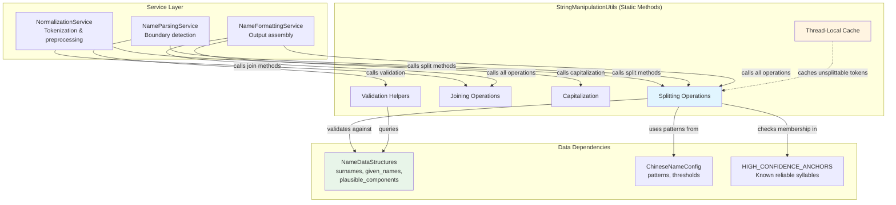
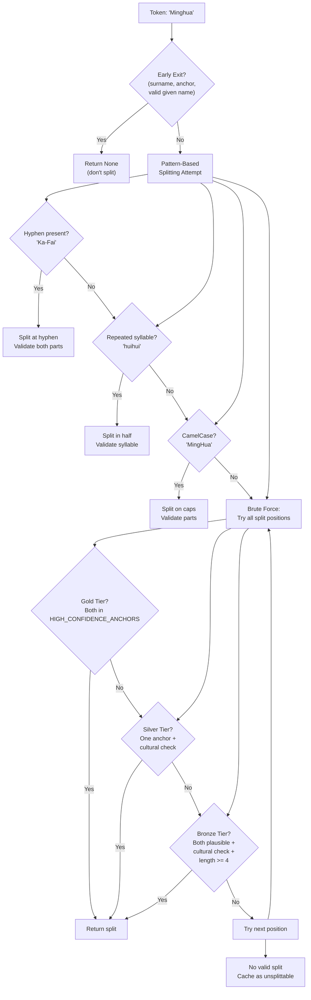
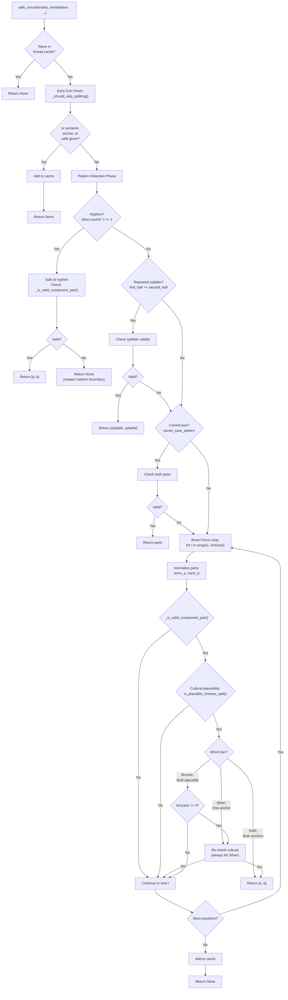
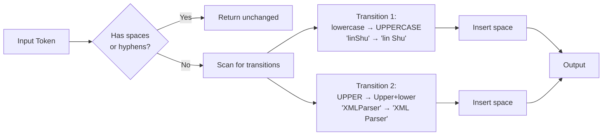
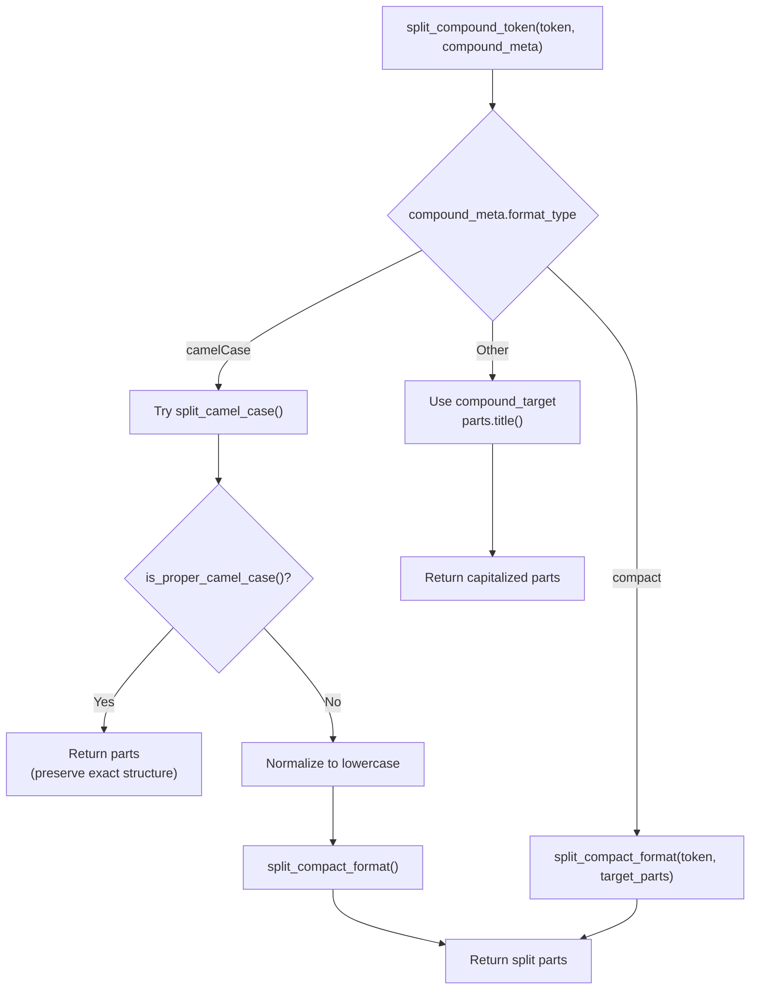
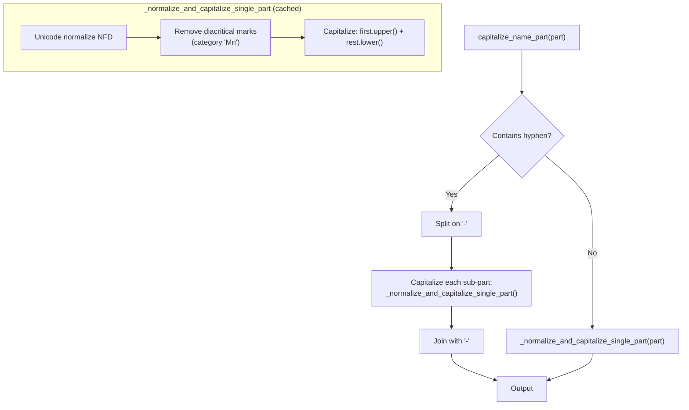
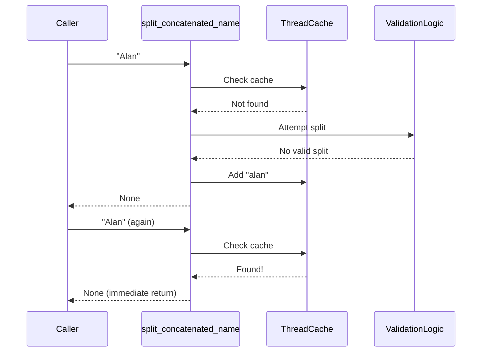

<!-- source: DeepWiki mcp.deepwiki.com · repo allenai/sinonym · page 3.5 String Manipulation Utilities · fetched 2026-10-26 -->

# String Manipulation Utilities

<details>
<summary>Relevant source files</summary>

The following files were used as context for generating this wiki page:

- [sinonym/coretypes/results.py](sinonym/coretypes/results.py)
- [sinonym/services/formatting.py](sinonym/services/formatting.py)
- [sinonym/services/parsing.py](sinonym/services/parsing.py)
- [sinonym/utils/string_manipulation.py](sinonym/utils/string_manipulation.py)

</details>


## Purpose and Scope

The `StringManipulationUtils` class provides centralized string processing utilities for Chinese name detection and normalization. This module consolidates pure string operations that were previously scattered across service components, including splitting concatenated names, case conversion, capitalization, and format transformations.

**Key Responsibilities:**
- Context-aware splitting of concatenated Chinese names using database validation
- Pattern-based detection and splitting (CamelCase, hyphens, repeated syllables)
- Capitalization with proper handling of diacritics, apostrophes, and hyphens
- String joining and format conversion for compound surnames
- Performance optimization through caching and early exit conditions

**Related Pages:**
- For name parsing logic that uses these utilities, see [Name Parsing Service](#3.3)
- For normalization that calls these utilities, see [Normalization Service](#3.1)
- For formatting that applies these utilities, see [Name Formatting Service](#3.4)

**Important Design Constraint:** This utility module provides **pure string operations only**. It does not make business logic decisions. Service components call these utilities and interpret the results within their broader context.

*Sources: [sinonym/utils/string_manipulation.py:1-13]()*

---

## Architecture and Design Principles

### Utility Pattern and Service Integration



**Design Characteristics:**
- **Static Methods Only:** All methods are `@staticmethod`, requiring no instance state
- **Pure Functions:** Methods take explicit parameters (data context, normalizer, config) rather than storing them
- **Dependency Injection:** Services pass required dependencies as arguments to each utility call
- **Thread Safety:** Thread-local caching ensures concurrent execution without contention

*Sources: [sinonym/utils/string_manipulation.py:29-31](), [sinonym/services/parsing.py:15](), [sinonym/services/formatting.py:20]()*

---

## String Splitting Operations

### Tiered Confidence System for Concatenated Names

The core splitting algorithm uses a three-tier confidence system to distinguish authentic Chinese name combinations from Western names that should remain unsplit.

#### Confidence Tiers



**Tier Definitions:**

| Tier | Requirements | Examples | Rationale |
|------|-------------|----------|-----------|
| **Gold** | Both parts in `HIGH_CONFIDENCE_ANCHORS` | "Ming" + "Hua" | Highest confidence - both parts are known reliable Chinese syllables |
| **Silver** | One anchor + cultural plausibility | "Ming" + "kun" | High confidence - at least one part is definitively Chinese |
| **Bronze** | Both plausible + cultural check + length ≥4 | "Wei" + "ming" (4+ chars) | Moderate confidence - requires additional length validation |

*Sources: [sinonym/utils/string_manipulation.py:157-318](), [sinonym/chinese_names_data.py:23]() (HIGH_CONFIDENCE_ANCHORS import)*

#### Implementation: `split_concatenated_name`

The main splitting method implements a sophisticated validation pipeline:



**Key Methods:**

- **`split_concatenated_name(token, normalized_cache, data_context, normalizer, config)`** [sinonym/utils/string_manipulation.py:158-318]() - Main entry point with tiered validation
- **`_should_skip_splitting(token, normalized_cache, normalizer, data_context)`** [sinonym/utils/string_manipulation.py:125-149]() - Early exit validation chain
- **`_is_valid_component_pair(norm_a, norm_b, data_context, orig_a, orig_b)`** [sinonym/utils/string_manipulation.py:105-123]() - Component validation with fallback
- **`is_plausible_chinese_split(norm_a, norm_b, data_context, config)`** [sinonym/utils/string_manipulation.py:320-340]() - Cultural authenticity check

*Sources: [sinonym/utils/string_manipulation.py:158-340]()*

---

### CamelCase and Pattern-Based Splitting

#### Smart Concatenation Detection

The `smart_split_concatenated` method handles various capitalization patterns found in author names:



**Examples:**

| Input | Output | Pattern |
|-------|--------|---------|
| `LinShu` | `Lin Shu` | Simple camelCase |
| `XIAOChen` | `XIAO Chen` | Mixed case with acronym |
| `LuWANG` | `Lu WANG` | Mixed case surname |
| `FurukawaKoichi` | `Furukawa Koichi` | Multiple transitions |
| `LU-Wang` | `LU Wang` | Preserves existing hyphen |

*Sources: [sinonym/utils/string_manipulation.py:48-88]()*

#### CamelCase Structure Handling

The utility provides specialized methods for detecting and splitting camelCase tokens:

**`is_camel_case(token)`** [sinonym/utils/string_manipulation.py:548-555]()
- Detects standard camelCase: starts uppercase, has additional uppercase, not all-uppercase
- Example: `AuYeung` → `True`, `AUYEUNG` → `False`

**`is_malformed_camel_case(token)`** [sinonym/utils/string_manipulation.py:557-573]()
- Detects non-standard capitalization suggesting word boundaries
- Example: `aUyEUNG` → `True` (multiple uppercase letters)

**`split_camel_case(token)`** [sinonym/utils/string_manipulation.py:405-436]()
- Splits on uppercase boundaries where previous character is lowercase
- Fallback: split at midpoint if pattern doesn't yield exactly 2 parts

*Sources: [sinonym/utils/string_manipulation.py:405-573]()*

---

### Compound Token Splitting

The `split_compound_token` method handles compound surnames that appear as single tokens, preserving their original structure:



**Key Validation: `is_proper_camel_case`**

Distinguishes proper camelCase from malformed patterns:

| Token | Parts | Proper? | Reason |
|-------|-------|---------|--------|
| `AuYeung` | `["Au", "Yeung"]` | ✓ | Clean boundary at `Y` |
| `aUyEUNG` | `["aUy", "EUNG"]` | ✗ | Weird case within parts |
| `DuanMu` | `["Duan", "Mu"]` | ✓ | Standard camelCase |

*Sources: [sinonym/utils/string_manipulation.py:342-460]()*

---

## String Formatting and Joining

### Joining Operations

The utility provides multiple joining strategies for different formatting needs:

| Method | Usage | Example |
|--------|-------|---------|
| `join_with_hyphens(parts)` | Compound surnames, uniform-length given names | `["Ka", "Fai"]` → `"Ka-Fai"` |
| `join_with_spaces(parts)` | Mixed-length components, middle initials | `["Bin", "B"]` → `"Bin B"` |
| `join_compact(parts)` | Compact compound formats | `["Si", "Ma"]` → `"Sima"` |
| `lowercase_join_with_spaces(tokens)` | Normalization keys | `["Au", "Yeung"]` → `"au yeung"` |

**Performance Optimization:**

```python
@staticmethod
@lru_cache(maxsize=4096)
def remove_spaces(text: str) -> str:
    """Remove spaces from text - centralized space removal with caching."""
    return text.replace(" ", "")
```

The `remove_spaces` method uses LRU caching because it's called frequently during normalization lookups.

*Sources: [sinonym/utils/string_manipulation.py:465-500]()*

### Hyphen Handling

Specialized methods for hyphen boundaries in name parts:

**`clean_hyphen_boundaries(text)`** [sinonym/utils/string_manipulation.py:486-489]()
- Removes leading/trailing hyphens from tokenization artifacts
- Example: `"-Wang-"` → `"Wang"`

**`split_and_clean_hyphens(text)`** [sinonym/utils/string_manipulation.py:491-494]()
- Splits on hyphens and filters empty parts
- Example: `"Ka-Fai-"` → `["Ka", "Fai"]`

*Sources: [sinonym/utils/string_manipulation.py:486-494]()*

---

## Capitalization and Case Handling

### Proper Name Capitalization

The `capitalize_name_part` method handles complex capitalization requirements:



**Why Custom Capitalization?**

Standard `.title()` incorrectly handles apostrophes:
- Standard: `"ts'ai".title()` → `"Ts'Ai"` ❌
- Custom: `capitalize_name_part("ts'ai")` → `"Ts'ai"` ✓

**Diacritics Handling:**

The method removes diacritical marks for consistent output:
- Input: `"José"` → Output: `"Jose"`
- Input: `"François"` → Output: `"Francois"`

**Hyphenated Compounds:**

Each hyphen-separated part is capitalized independently:
- `"ou-yang"` → `"Ou-Yang"`
- `"duan-mu"` → `"Duan-Mu"`

*Sources: [sinonym/utils/string_manipulation.py:505-546]()*

### Caching Strategy

```python
@staticmethod
@lru_cache(maxsize=2048)
def _normalize_and_capitalize_single_part(part: str) -> str:
    """Helper to normalize and capitalize a single part (no hyphens) - cached for performance."""
```

The capitalization helper uses LRU caching (2048 entries) because:
1. Name parts have high locality (same surnames/given names appear repeatedly)
2. Unicode normalization is relatively expensive
3. Cache hit rate is typically >90% in batch processing

*Sources: [sinonym/utils/string_manipulation.py:506-515]()*

---

## Performance Optimizations

### Thread-Local Unsplittable Cache

The utility maintains a thread-local cache of tokens that have been determined to be unsplittable:

```python
class StringManipulationUtils:
    # Thread-local cache for tokens that have been determined to be unsplittable
    _thread_local = threading.local()

    @classmethod
    def _get_thread_cache(cls):
        """Get thread-local unsplittable cache, creating it if needed."""
        if not hasattr(cls._thread_local, "unsplittable_cache"):
            cls._thread_local.unsplittable_cache = set()
        return cls._thread_local.unsplittable_cache
```

**Cache Usage Pattern:**



**Benefits:**
- Prevents repeated expensive splitting attempts on the same tokens
- Thread-local design avoids synchronization overhead
- Particularly effective in batch processing where same names appear multiple times

*Sources: [sinonym/utils/string_manipulation.py:32-43](), [sinonym/utils/string_manipulation.py:204-208]()*

### Early Exit Optimization

The `_should_skip_splitting` method implements a validation chain with short-circuit evaluation:

```python
return (
    # Don't split known surnames
    tok_normalized in data_context.surnames_normalized or
    # Don't split HIGH_CONFIDENCE_ANCHORS - they should remain intact
    tok_normalized in HIGH_CONFIDENCE_ANCHORS or
    # Don't split existing valid Chinese given name components
    data_context.is_given_name(tok_normalized) or
    data_context.is_given_name(original_lower)
)
```

**Optimization Strategy:**
1. Check against surnames database (most common case)
2. Check HIGH_CONFIDENCE_ANCHORS (fast set membership)
3. Check given names database (less common)
4. Only proceed to expensive splitting if all checks fail

*Sources: [sinonym/utils/string_manipulation.py:125-149]()*

### Inline Validation for Hot Paths

In the brute-force splitting loop, validations are inlined for performance:

```python
# Inline normalization for hot path performance
if normalized_cache:
    norm_a = normalizer.get_normalized(a, normalized_cache)
    norm_b = normalizer.get_normalized(b, normalized_cache)
else:
    norm_a = normalizer.norm(a)
    norm_b = normalizer.norm(b)
```

Rather than calling helper methods, the normalization logic is inlined to avoid function call overhead in the innermost loop.

*Sources: [sinonym/utils/string_manipulation.py:279-286]()*

---

## Integration with Services

### Service Call Patterns

```mermaid
graph TB
    subgraph "NormalizationService"
        Tokenize["tokenize() method"]
        Preprocess["Preprocessing logic"]
    end
    
    subgraph "NameParsingService"
        Generate["_generate_all_parses_with_format()"]
        CalcScore["calculate_parse_score()"]
    end
    
    subgraph "NameFormattingService"
        FormatOutput["format_name_output()"]
        FormatTokens["format_name_output_with_tokens()"]
    end
    
    subgraph "StringManipulationUtils"
        SplitConcat["split_concatenated_name()"]
        SplitCompound["split_compound_token()"]
        SmartSplit["smart_split_concatenated()"]
        CapPart["capitalize_name_part()"]
        JoinOps["join_with_* methods"]
        RemoveSpaces["remove_spaces()"]
    end
    
    Tokenize -->|"splits concatenated tokens"| SmartSplit
    Preprocess -->|"normalizes keys"| RemoveSpaces
    
    Generate -->|"splits compact compounds"| SplitCompound
    Generate -->|"capitalizes parts"| CapPart
    Generate -->|"joins for keys"| JoinOps
    CalcScore -->|"normalizes keys"| RemoveSpaces
    
    FormatOutput -->|"splits given names"| SplitConcat
    FormatOutput -->|"capitalizes output"| CapPart
    FormatOutput -->|"joins formatted parts"| JoinOps
    FormatTokens -->|"same operations"| SplitConcat
    FormatTokens -->|"same operations"| CapPart
    FormatTokens -->|"same operations"| JoinOps
```



### Dependency Injection Pattern

All utility methods receive required dependencies as explicit parameters:

```python
@staticmethod
def split_concatenated_name(
    token: str,
    normalized_cache: dict[str, str] | None,
    data_context,          # NameDataStructures instance
    normalizer,            # NormalizationService instance
    config,                # ChineseNameConfig instance
) -> list[str] | None:
```

**Benefits:**
- No hidden state or singleton dependencies
- Services control which data/config versions are used
- Easy to test with mock dependencies
- Thread-safe by design (no shared mutable state)

*Sources: [sinonym/utils/string_manipulation.py:158-165]()*

### Example: Parsing Service Integration

The parsing service uses utilities at multiple points:

1. **Compound Token Splitting** [sinonym/services/parsing.py:272-274]():
   ```python
   compound_parts = StringManipulationUtils.split_compound_token(first_token, first_meta)
   ```

2. **Key Normalization** [sinonym/services/parsing.py:95-96]():
   ```python
   if StringManipulationUtils.remove_spaces(normalized_surname) in self._data.surnames_normalized:
   ```

3. **Format Construction** [sinonym/services/parsing.py:341-342]():
   ```python
   return StringManipulationUtils.lowercase_join_with_spaces(tokens)
   ```

4. **Capitalization** [sinonym/services/parsing.py:311](), [sinonym/services/parsing.py:322]():
   ```python
   compound_parts = [StringManipulationUtils.capitalize_name_part(part) for part in target_compound.split()]
   ```

*Sources: [sinonym/services/parsing.py:15](), [sinonym/services/parsing.py:95-96](), [sinonym/services/parsing.py:169-170](), [sinonym/services/parsing.py:272-274](), [sinonym/services/parsing.py:311-327](), [sinonym/services/parsing.py:341-342]()*

### Example: Formatting Service Integration

The formatting service uses utilities extensively for output assembly:

1. **Given Name Splitting** [sinonym/services/formatting.py:82-89]():
   ```python
   split = StringManipulationUtils.split_concatenated_name(
       token, normalized_cache, self._data, self._normalizer, self._config,
   )
   if split:
       parts.extend(split)
   ```

2. **Hyphen Cleaning** [sinonym/services/formatting.py:106-114]():
   ```python
   clean_part = StringManipulationUtils.clean_hyphen_boundaries(part)
   if "-" in clean_part:
       sub_parts = StringManipulationUtils.split_and_clean_hyphens(clean_part)
   ```

3. **Capitalization** [sinonym/services/formatting.py:112-116]():
   ```python
   capitalized_parts = [StringManipulationUtils.capitalize_name_part(sub) for sub in sub_parts]
   formatted_part = StringManipulationUtils.join_with_hyphens(capitalized_parts)
   ```

4. **Compound Surname Formatting** [sinonym/services/formatting.py:379]():
   ```python
   return StringManipulationUtils.format_camel_case_compound(surname_tokens, original_token)
   ```

*Sources: [sinonym/services/formatting.py:20](), [sinonym/services/formatting.py:82-89](), [sinonym/services/formatting.py:106-116](), [sinonym/services/formatting.py:379]()*

---

## Summary

The `StringManipulationUtils` class provides a comprehensive suite of string processing operations specifically designed for Chinese name handling:

**Core Capabilities:**
- **Intelligent Splitting:** Tiered confidence system distinguishes Chinese names from Western names using anchors, database validation, and cultural plausibility checks
- **Pattern Recognition:** Handles CamelCase, hyphenated, repeated syllables, and compact compound formats
- **Proper Capitalization:** Correctly handles apostrophes, hyphens, and diacritics that standard `.title()` mishandles
- **Performance:** Thread-local caching, LRU caching, and early exit optimizations minimize computational overhead

**Design Philosophy:**
- Pure utility functions with no business logic
- Explicit dependency injection for testability
- Thread-safe by design through stateless operations
- Extensive reuse across normalization, parsing, and formatting services

*Sources: [sinonym/utils/string_manipulation.py:1-604]()*

---

