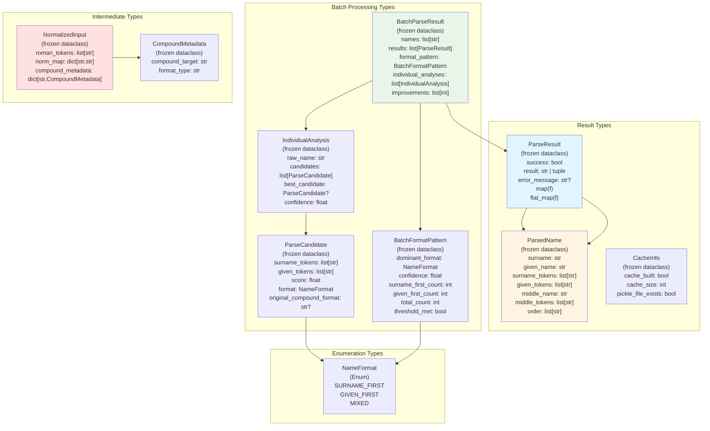
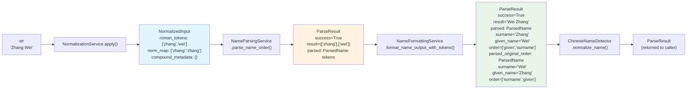
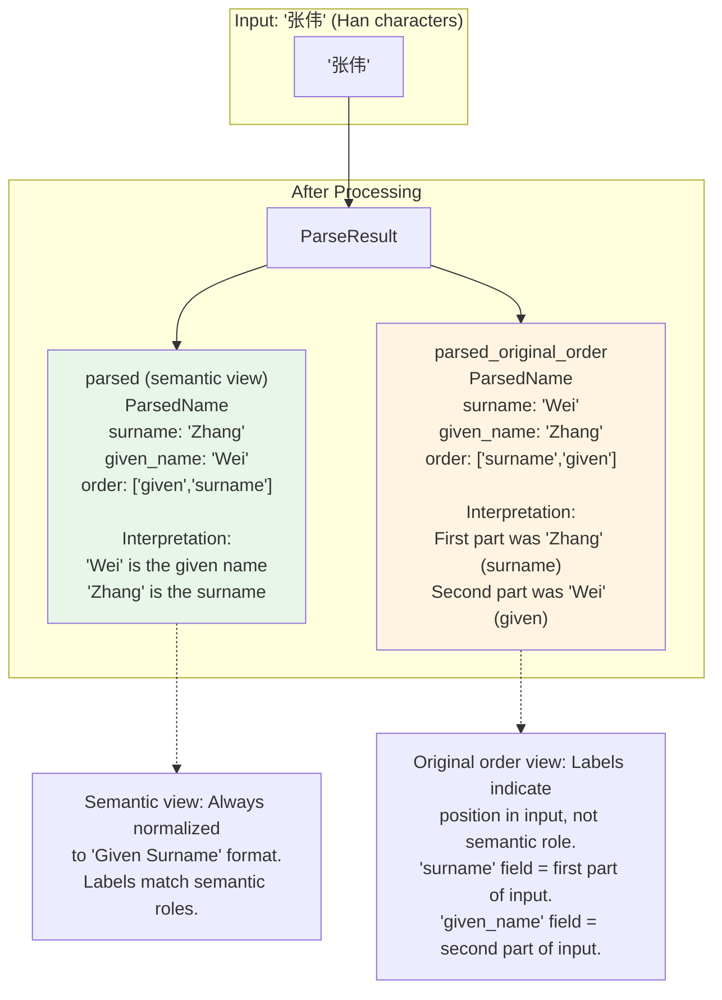
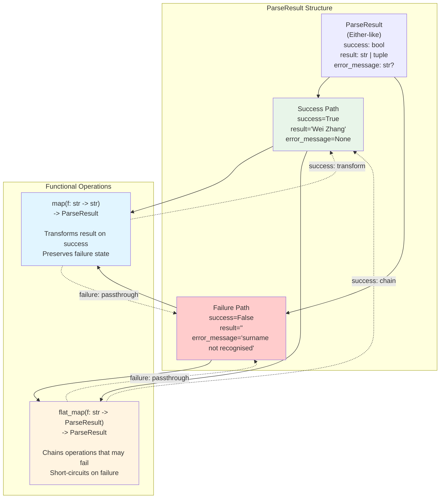
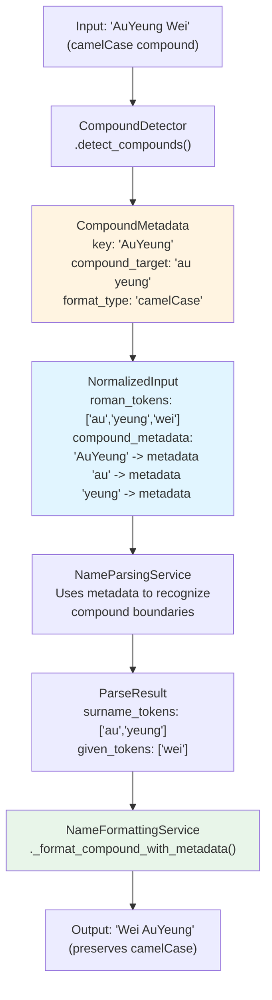
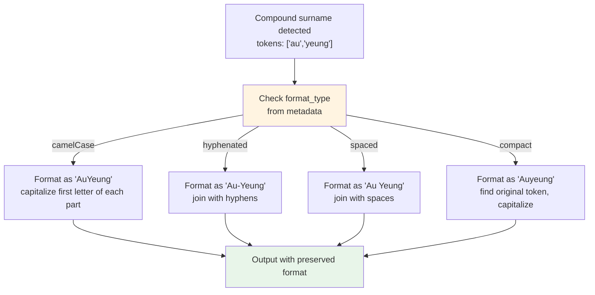
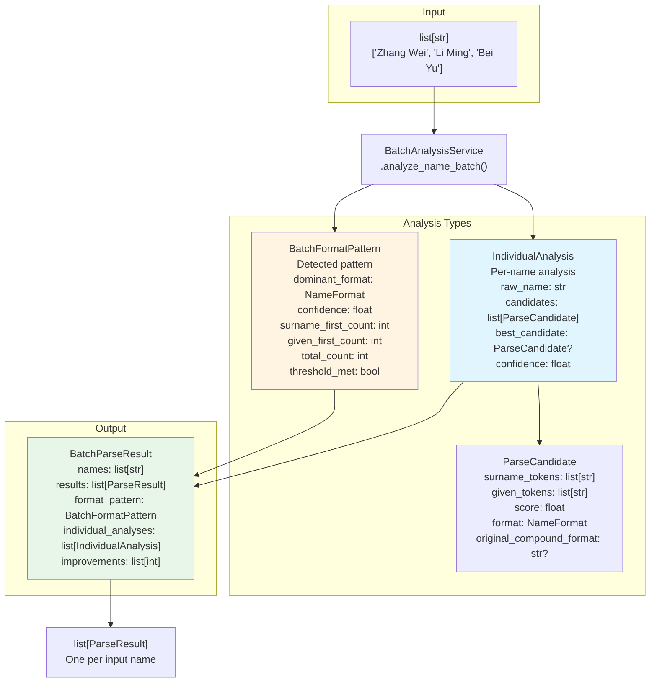
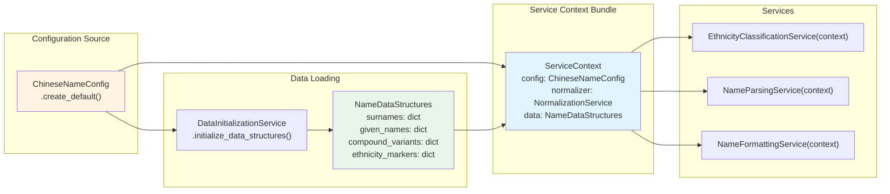

<!-- source: DeepWiki mcp.deepwiki.com · repo allenai/sinonym · page 4 Data and Type System · fetched 2026-10-26 -->

# Data and Type System

<details>
<summary>Relevant source files</summary>

The following files were used as context for generating this wiki page:

- [pyproject.toml](pyproject.toml)
- [sinonym/coretypes/results.py](sinonym/coretypes/results.py)
- [sinonym/detector.py](sinonym/detector.py)
- [sinonym/services/formatting.py](sinonym/services/formatting.py)
- [uv.lock](uv.lock)

</details>


This page provides an overview of sinonym's data structures and type system design. It covers the immutability guarantees, functional composition patterns, and how data flows through the processing pipeline. For details on the linguistic databases (surnames, given names, compounds), see [Name Data Structures](#4.1). For configuration details, see [Configuration System](#4.3).

## Design Philosophy

Sinonym's type system is built around three core principles:

1. **Immutability**: All data structures are frozen dataclasses, ensuring thread safety and preventing accidental mutation
2. **Functional Composition**: Result types provide Scala-compatible operations (`map`, `flat_map`) for error handling
3. **Dual Views**: Names are represented in both semantic order (given-surname) and original input order

These design choices enable safe concurrent processing and seamless integration with Scala codebases.

**Sources:** [sinonym/coretypes/results.py:1-192](), [sinonym/detector.py:1-163]()

## Core Type Hierarchy



**Type Immutability Contract**

All dataclasses use `@dataclass(frozen=True)`, which prevents field reassignment after construction:

| Type | Frozen | Purpose |
|------|--------|---------|
| `ParseResult` | ✓ | Either-like result container with success/failure states |
| `ParsedName` | ✓ | Structured name components with dual order views |
| `NormalizedInput` | ✓ | Intermediate normalized tokens and metadata |
| `CompoundMetadata` | ✓ | Format authority for compound surnames |
| `CacheInfo` | ✓ | Read-only cache statistics |
| `BatchParseResult` | ✓ | Complete batch analysis with pattern detection |

**Sources:** [sinonym/coretypes/results.py:1-192](), [sinonym/services/normalization.py:1-50]()

## Data Flow Through Type Transformations



**Key Transformation Points:**

1. **Normalization** [sinonym/services/normalization.py:150-200](): Raw string → `NormalizedInput` with tokens and metadata
2. **Parsing** [sinonym/services/parsing.py:1-100](): `NormalizedInput` → `ParseResult` with token pairs
3. **Formatting** [sinonym/services/formatting.py:42-180](): Token pairs → `ParseResult` with formatted string and `ParsedName`
4. **API Return** [sinonym/detector.py:249-496](): Final `ParseResult` with dual `ParsedName` views

**Sources:** [sinonym/detector.py:249-496](), [sinonym/services/normalization.py:150-200](), [sinonym/services/formatting.py:181-333]()

## ParsedName: Dual View Design

The `ParsedName` dataclass provides two simultaneous views of the same name:



**Field Interpretation:**

| View | `surname` field | `given_name` field | `order` field | Use Case |
|------|----------------|-------------------|---------------|----------|
| `parsed` | Always the surname (semantic) | Always the given name (semantic) | Normalized order: `['given','surname']` | Downstream processing, display |
| `parsed_original_order` | First component (positional) | Second component (positional) | Original order: `['surname','given']` or `['given','surname']` | Format preservation, round-tripping |

**Example Scenarios:**

```python
# Scenario 1: Surname-first input
result = detector.normalize_name("张伟")  # "Zhang Wei" in pinyin
result.parsed.surname              # "Zhang" (semantic)
result.parsed.given_name           # "Wei" (semantic)
result.parsed.order                # ["given", "surname"]

result.parsed_original_order.surname    # "Wei" (first part was Wei? No!)
# Actually, for all-Chinese input, original order is surname-first:
result.parsed_original_order.order      # ["surname", "given"]
# So the labels are swapped to reflect positional interpretation

# Scenario 2: Given-first input
result = detector.normalize_name("Wei Zhang")
result.parsed.surname              # "Zhang" (semantic)
result.parsed.given_name           # "Wei" (semantic)
result.parsed_original_order.order # ["given", "surname"]
# Original order matches semantic order, labels align
```

**Sources:** [sinonym/coretypes/results.py:14-31](), [sinonym/detector.py:324-363]()

## Functional Composition: ParseResult Operations

`ParseResult` implements Scala-compatible monadic operations for error handling:



**Implementation Details:**

| Method | Signature | Behavior on Success | Behavior on Failure |
|--------|-----------|---------------------|---------------------|
| `map(f)` | `(str -> str) -> ParseResult` | Apply `f` to `result`, wrap in new `ParseResult` | Return `self` unchanged |
| `flat_map(f)` | `(str -> ParseResult) -> ParseResult` | Apply `f`, preserve compound metadata | Return `self` unchanged |

**Code Example:**

```python
# map: Transform formatted name
result = detector.normalize_name("Zhang Wei")
uppercased = result.map(lambda name: name.upper())
# ParseResult(success=True, result="WEI ZHANG")

# flat_map: Chain operations that may fail
def validate_and_format(name: str) -> ParseResult:
    if len(name) > 20:
        return ParseResult.failure("name too long")
    return ParseResult.success_with_name(name.title())

result = detector.normalize_name("Zhang Wei")
chained = result.flat_map(validate_and_format)
```

**Sources:** [sinonym/coretypes/results.py:101-133]()

## CompoundMetadata: Format Authority Pattern

`CompoundMetadata` serves as the single source of truth for compound surname formatting, threading through the entire pipeline:



**CompoundMetadata Fields:**

| Field | Type | Purpose | Example |
|-------|------|---------|---------|
| `compound_target` | `str` | Normalized form for matching | `"ou yang"` |
| `format_type` | `str` | Original format style | `"camelCase"`, `"hyphenated"`, `"spaced"`, `"compact"` |

**Format Type Decision Tree:**



**Sources:** [sinonym/services/normalization.py:30-80](), [sinonym/services/formatting.py:339-437]()

## Batch Processing Type System

Batch processing introduces additional types for analyzing multiple names together:



**Batch Processing Flow:**

1. **Individual Analysis**: Each name generates multiple `ParseCandidate` objects with scores
2. **Pattern Detection**: `BatchFormatPattern` identifies dominant format (surname-first vs given-first)
3. **Result Assembly**: `BatchParseResult` combines individual results with pattern metadata
4. **Improvement Tracking**: `improvements` field lists indices where batch context changed the parse

**NameFormat Enum:**

| Value | Meaning | Example |
|-------|---------|---------|
| `SURNAME_FIRST` | Chinese style ordering | "Zhang Wei" |
| `GIVEN_FIRST` | Western style ordering | "Wei Zhang" |
| `MIXED` | No clear pattern | Mixed list |

**Sources:** [sinonym/coretypes/results.py:147-192](), [sinonym/services/batch_analysis.py:1-200]()

## Configuration Data Flow

Configuration data flows through the system via the `ServiceContext` pattern:



**ServiceContext Benefits:**

- **Reduced Constructor Complexity**: Services receive one bundled context instead of three separate parameters
- **Consistent Dependencies**: All context-dependent services have the same foundational data
- **Testing Simplification**: Mock the context once, use across all services

**Sources:** [sinonym/services/context.py:1-50](), [sinonym/detector.py:193-242]()

## Thread Safety and Immutability Guarantees

All core types are designed for safe concurrent access:

| Type | Thread Safety Mechanism | Mutation Prevention |
|------|------------------------|---------------------|
| `ParseResult` | `@dataclass(frozen=True)` | Cannot reassign fields after construction |
| `ParsedName` | `@dataclass(frozen=True)` | Immutable surname/given name components |
| `NormalizedInput` | `@dataclass(frozen=True)` | Read-only token lists and mappings |
| `CompoundMetadata` | `@dataclass(frozen=True)` | Format metadata cannot change |
| `NameDataStructures` | Loaded once at init | Shared read-only across threads |
| `ChineseNameConfig` | Static configuration | No mutable state |

**Concurrent Processing Example:**

```python
detector = ChineseNameDetector()  # Initialize once

# Safe to call from multiple threads
from concurrent.futures import ThreadPoolExecutor

names = ["Zhang Wei", "Li Ming", "Wang Xiaoli"]
with ThreadPoolExecutor(max_workers=3) as executor:
    results = list(executor.map(detector.normalize_name, names))
# All ParseResult objects are immutable and thread-safe
```

**Sources:** [sinonym/coretypes/results.py:1-192](), [pyproject.toml:10-35]()

## Type System Summary Table

| Type Category | Types | Purpose | Frozen |
|--------------|-------|---------|--------|
| Result Containers | `ParseResult` | Either-like success/failure wrapper | ✓ |
| Structured Output | `ParsedName` | Name components with dual views | ✓ |
| Intermediate Data | `NormalizedInput`, `CompoundMetadata` | Pipeline state between stages | ✓ |
| Batch Analysis | `BatchParseResult`, `BatchFormatPattern`, `IndividualAnalysis`, `ParseCandidate` | Multi-name processing metadata | ✓ |
| Enumerations | `NameFormat` | Format classification | N/A |
| Statistics | `CacheInfo` | Cache metrics | ✓ |

All types follow immutable design principles, enabling safe concurrent processing and functional composition patterns suitable for both Python and Scala consumers.

**Sources:** [sinonym/coretypes/results.py:1-192](), [sinonym/services/normalization.py:1-80]()

---

