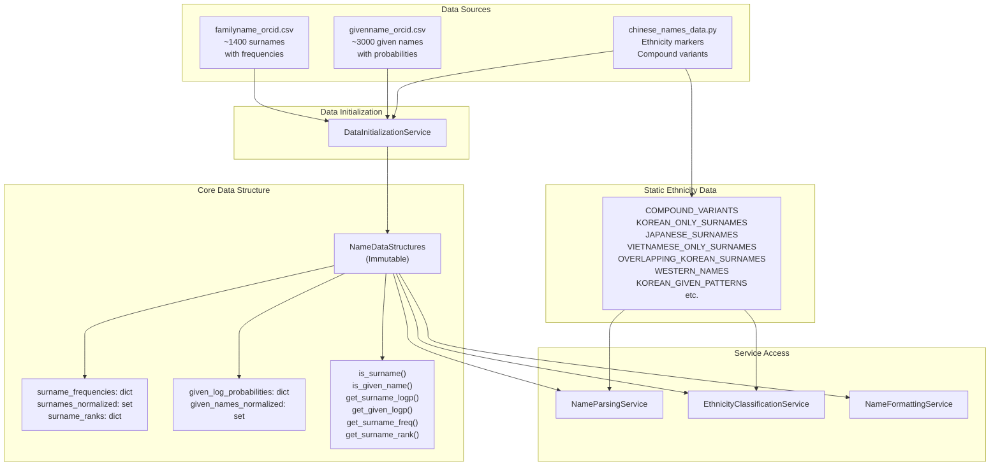
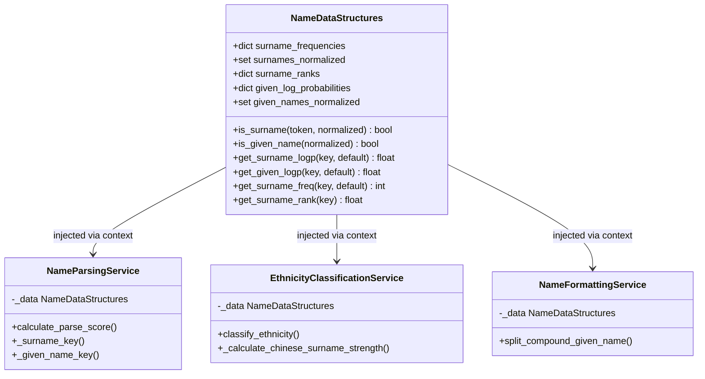
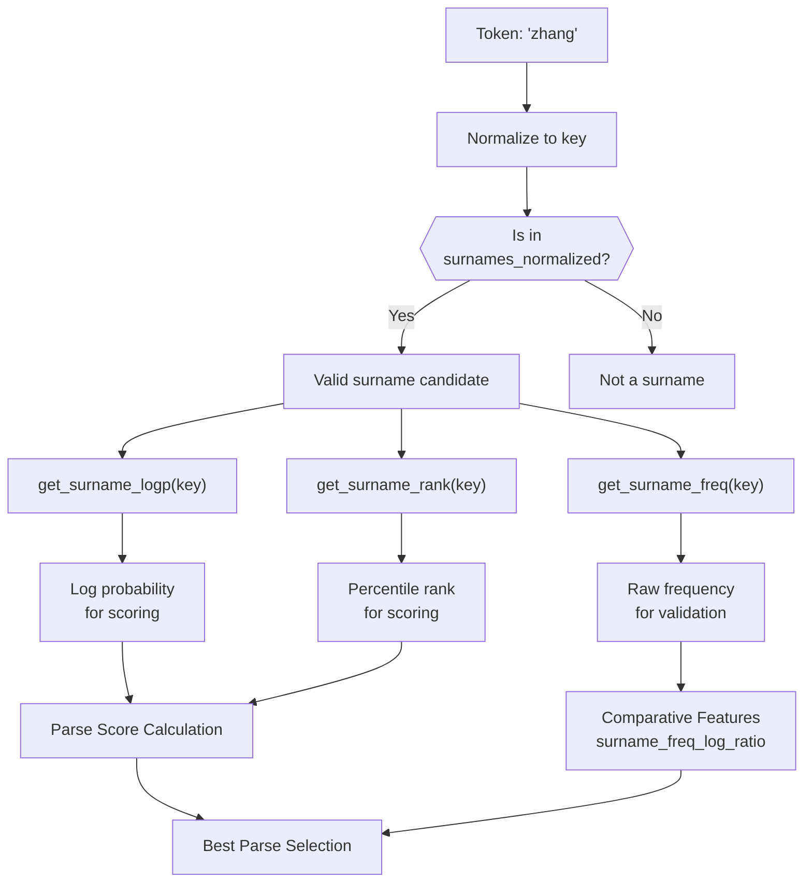
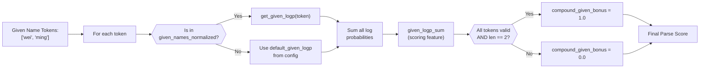
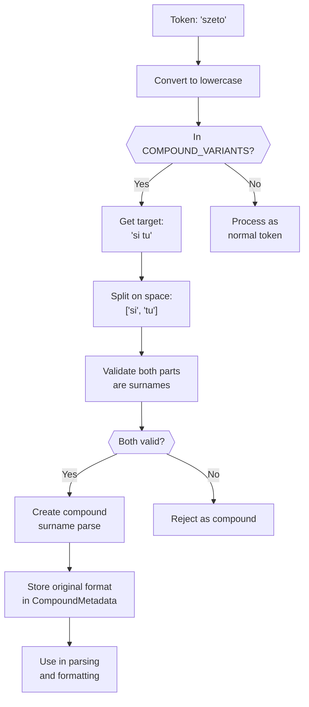
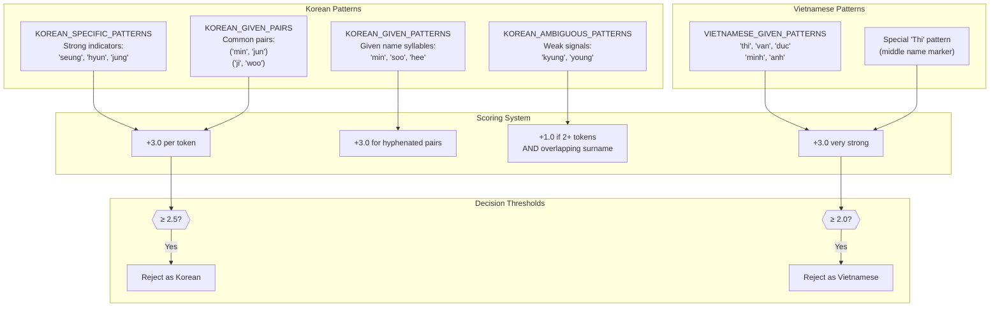
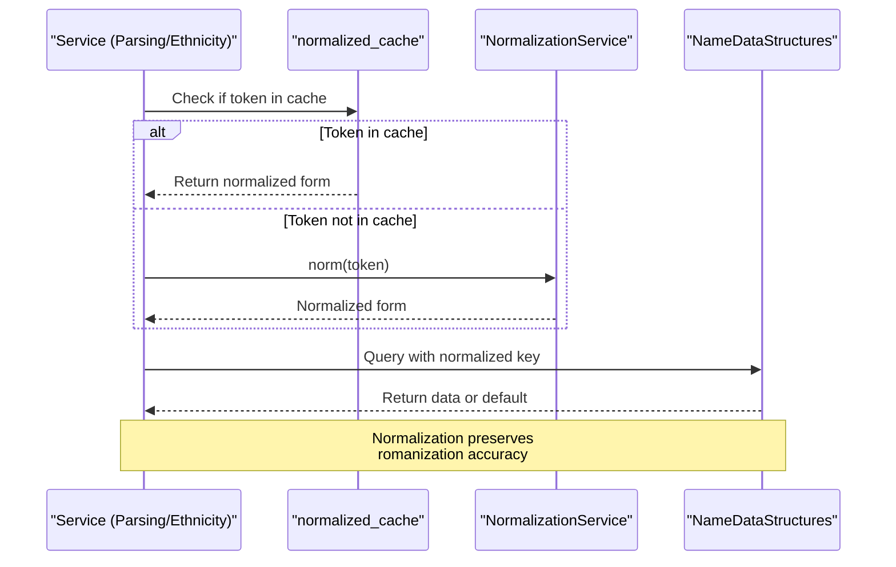
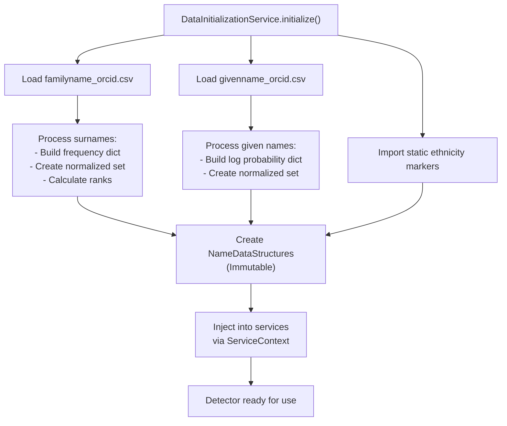

<!-- source: DeepWiki mcp.deepwiki.com · repo allenai/sinonym · page 4.1 Name Data Structures · fetched 2026-10-26 -->

# Name Data Structures

<details>
<summary>Relevant source files</summary>

The following files were used as context for generating this wiki page:

- [sinonym/detector.py](sinonym/detector.py)
- [sinonym/services/ethnicity.py](sinonym/services/ethnicity.py)
- [sinonym/services/parsing.py](sinonym/services/parsing.py)

</details>


This page documents the linguistic databases that power sinonym's name detection and parsing capabilities. It covers the core data structures in `NameDataStructures`, the ethnicity marker sets, and how services access this data for probabilistic scoring and validation.

For information about result types like `ParseResult` and `ParsedName`, see [Result Types and Data Classes](#4.2). For configuration of thresholds and patterns, see [Configuration System](#4.3).

## Overview

The `NameDataStructures` class serves as the central repository for all linguistic data used in Chinese name detection. It is initialized once at startup by `DataInitializationService` and injected into all service components through the `ServiceContext` pattern.

Sources: [sinonym/detector.py:170-183](), [sinonym/services/parsing.py:13-19](), [sinonym/services/ethnicity.py:11-24]()



**Diagram: Data Flow from Sources to Services**

Sources: [sinonym/detector.py:193-243]()

## NameDataStructures Class

The `NameDataStructures` class is an immutable container that provides structured access to all linguistic data. It is created by `DataInitializationService` during detector initialization and passed to services via `ServiceContext`.

### Core Attributes

| Attribute | Type | Purpose |
|-----------|------|---------|
| `surname_frequencies` | `dict[str, int]` | Maps normalized surnames to occurrence counts |
| `surnames_normalized` | `set[str]` | Set of all valid normalized surnames for fast lookups |
| `surname_ranks` | `dict[str, float]` | Percentile ranks (0.0-1.0) for surname frequency scoring |
| `given_log_probabilities` | `dict[str, float]` | Log probabilities for given name syllables |
| `given_names_normalized` | `set[str]` | Set of all valid normalized given names for fast validation |

Sources: [sinonym/services/parsing.py:89-103](), [sinonym/services/ethnicity.py:193-199]()

### Data Access Methods

The class provides convenience methods for common queries:



**Diagram: NameDataStructures Interface and Service Dependencies**

Sources: [sinonym/services/parsing.py:483-517](), [sinonym/services/ethnicity.py:560-625]()

## Surname Data

Surname data is loaded from `familyname_orcid.csv` and provides frequency-based scoring for probabilistic parsing.

### Data Structures

**`surname_frequencies: dict[str, int]`**

Maps normalized surname strings to their occurrence counts in the ORCID dataset. Used for frequency-based scoring in the parsing service.

Example entries:
- `"wang"`: 10538 (most common)
- `"li"`: 9234
- `"zhang"`: 8765
- `"si tu"`: 45 (compound surname, space-separated)

Sources: [sinonym/services/parsing.py:358-370]()

**`surnames_normalized: set[str]`**

Fast lookup set for surname validation. Checked during parsing to determine if a token can be a valid surname.

Sources: [sinonym/services/parsing.py:89-103]()

**`surname_ranks: dict[str, float]`**

Percentile ranks (0.0 to 1.0) calculated from frequency distribution. Used as a feature in the probabilistic scoring model:
- 1.0 = most frequent surname (top 1%)
- 0.5 = median frequency
- 0.0 = rare surname (bottom 1%)

Sources: [sinonym/services/parsing.py:408-432]()

### Usage in Parsing

The parsing service uses surname data in multiple ways:



**Diagram: Surname Data Usage in Parsing Pipeline**

Sources: [sinonym/services/parsing.py:345-445]()

### Key Lookup Methods

**`_surname_key(surname_tokens, normalized_cache)`** [sinonym/services/parsing.py:483-503]()

Converts surname tokens to lookup keys, with special handling:
1. For tokens with Chinese characters, use original form
2. Try original romanization first (preserves correct Pinyin)
3. Fall back to normalized form
4. For compound surnames, join with space

**`get_surname_logp(key, default)`**

Returns log probability for a surname key. Uses a default value for unknown surnames.

**`get_surname_freq(key, default=0)`**

Returns raw frequency count. Used for comparative features and validation thresholds.

**`get_surname_rank(key)`**

Returns percentile rank (0.0-1.0) used as a scoring feature.

Sources: [sinonym/services/parsing.py:408-432]()

## Given Name Data

Given name data is loaded from `givenname_orcid.csv` and contains probabilities for individual syllables that can form given names.

### Data Structures

**`given_log_probabilities: dict[str, float]`**

Maps normalized given name syllables to log probabilities. Used for scoring in parse candidate evaluation.

Example entries:
- `"wei"`: -2.3 (common)
- `"ming"`: -2.5 (common)
- `"xiaoli"`: -4.8 (less common compound)

Sources: [sinonym/services/parsing.py:372-378]()

**`given_names_normalized: set[str]`**

Fast lookup set for given name validation. Used to check if a token is a plausible Chinese given name.

Sources: [sinonym/services/ethnicity.py:347-350](), [sinonym/services/ethnicity.py:464-465]()

### Usage in Parsing



**Diagram: Given Name Data Usage in Scoring**

Sources: [sinonym/services/parsing.py:372-398]()

### Key Lookup Methods

**`_given_name_key(given_token, normalized_cache)`** [sinonym/services/parsing.py:505-517]()

Converts given name tokens to lookup keys:
1. For tokens with Chinese characters, use original form
2. Try original romanization first
3. Fall back to normalized form

**`is_given_name(normalized)`**

Boolean check for whether a normalized string is a valid Chinese given name syllable.

**`get_given_logp(key, default)`**

Returns log probability for a given name key, with default for unknown values.

Sources: [sinonym/services/parsing.py:372-384]()

## Compound Surname Variants

The `COMPOUND_VARIANTS` dictionary maps various romanization forms of compound surnames to their canonical spaced form.

### Structure

```python
COMPOUND_VARIANTS: dict[str, str]
```

Maps lowercase romanization variants to canonical "part1 part2" form.

Example mappings:

| Variant Form | Canonical Form | Notes |
|--------------|----------------|-------|
| `"szeto"` | `"si tu"` | Cantonese romanization |
| `"situ"` | `"si tu"` | Compact Pinyin |
| `"si-tu"` | `"si tu"` | Hyphenated form |
| `"sima"` | `"si ma"` |司马 (Sima) |
| `"ouyang"` | `"ou yang"` | 欧阳 (Ouyang) |
| `"zhuge"` | `"zhu ge"` | 诸葛 (Zhuge) |

Sources: [sinonym/services/parsing.py:13](), [sinonym/services/ethnicity.py:12]()

### Usage Patterns



**Diagram: Compound Variant Processing Flow**

Sources: [sinonym/services/parsing.py:330-343](), [sinonym/services/parsing.py:364-370](), [sinonym/services/ethnicity.py:596-606]()

### Integration with Parsing

The parsing service uses compound variants in multiple places:

1. **During parse generation** [sinonym/services/parsing.py:218-327]() - Checks for compound surnames in different positions
2. **During score calculation** [sinonym/services/parsing.py:361-370]() - Maps compound formats to canonical forms for frequency lookups
3. **In ethnicity classification** [sinonym/services/ethnicity.py:596-606]() - Adds Chinese surname strength for recognized compounds

## Ethnicity Markers

Ethnicity marker sets are used by `EthnicityClassificationService` to filter out non-Chinese names. These are curated lists imported from `sinonym.chinese_names_data`.

### Definitive Markers (Tier 1)

These markers provide high-confidence rejection:

| Set Name | Type | Count | Purpose |
|----------|------|-------|---------|
| `WESTERN_NAMES` | `set[str]` | Large | Common Western given names (John, Mary, etc.) |
| `KOREAN_ONLY_SURNAMES` | `set[str]` | ~50 | Surnames unique to Korean (e.g., "bak", "seok") |
| `JAPANESE_SURNAMES` | `set[str]` | ~100 | Japanese surnames (e.g., "tanaka", "yamamoto") |
| `VIETNAMESE_ONLY_SURNAMES` | `set[str]` | ~30 | Vietnamese-specific surnames (e.g., "tran", "le") |

Sources: [sinonym/services/ethnicity.py:11-24](), [sinonym/services/ethnicity.py:166-185]()

### Overlapping Surnames

These surnames exist in both Chinese and another language, requiring cultural context for disambiguation:

| Set Name | Purpose | Examples |
|----------|---------|----------|
| `OVERLAPPING_KOREAN_SURNAMES` | Korean surnames also used in Chinese | "kim" (金), "cho" (曹), "ha" (河) |
| `OVERLAPPING_VIETNAMESE_SURNAMES` | Vietnamese surnames also used in Chinese | "nguyen", "pham" |

Sources: [sinonym/services/ethnicity.py:190-209]()

### Cultural Pattern Markers

These patterns help identify non-Chinese names through structural analysis:



**Diagram: Ethnicity Pattern Scoring System**

Sources: [sinonym/services/ethnicity.py:298-425]()

### Usage in Classification

The three-tier classification system uses these markers:

**Tier 1: Definitive Evidence** [sinonym/services/ethnicity.py:161-185]()
- Check for Western names, Korean-only surnames, Japanese surnames, Vietnamese-only surnames
- Single match → immediate rejection

**Tier 2: Cultural Context** [sinonym/services/ethnicity.py:187-209]()
- Calculate pattern scores using given name patterns and pairs
- Apply thresholds with context-aware adjustments

**Tier 3: Chinese Default** [sinonym/services/ethnicity.py:211-222]()
- Calculate Chinese surname strength
- Accept if reasonable evidence exists

Sources: [sinonym/services/ethnicity.py:115-222]()

## Data Access Patterns

Services access name data through standardized methods to maintain consistency:

### Normalization-Aware Lookups



**Diagram: Normalized Data Access Pattern**

Sources: [sinonym/services/parsing.py:483-517](), [sinonym/services/ethnicity.py:150-159]()

### Frequency-Based Queries

Services query frequency data for scoring:

| Method | Service Usage | Purpose |
|--------|---------------|---------|
| `get_surname_logp()` | Parse scoring (weight: 0.465) | Primary surname frequency signal |
| `get_given_logp()` | Parse scoring (weight: 0.395) | Given name frequency signal |
| `get_surname_rank()` | Parse scoring (weight: -0.888) | Percentile-based feature |
| `get_surname_freq()` | Comparative features, validation | Raw frequency for ambiguity resolution |

Sources: [sinonym/services/parsing.py:42-51](), [sinonym/services/parsing.py:345-445]()

### Boolean Validation Checks

Fast set membership checks for validation:

```python
# Check if token is a valid surname
is_valid = self._data.is_surname(token, normalized_form)

# Check if token is a valid given name
is_valid = self._data.is_given_name(normalized_form)
```

Sources: [sinonym/services/parsing.py:94-96](), [sinonym/services/ethnicity.py:347-350]()

## Data Initialization

The `DataInitializationService` loads and processes data at startup:



**Diagram: Data Initialization Flow**

Sources: [sinonym/detector.py:193-243]()

### Immutability and Thread Safety

All data structures are designed to be immutable after initialization:
- Dictionaries and sets are not modified after creation
- Services receive read-only references through context injection
- No locking required for concurrent access
- Safe for multi-threaded environments

Sources: [sinonym/detector.py:161-162]()

---

